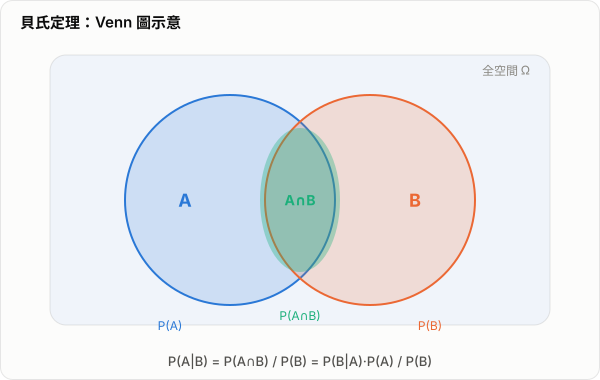

# 貝式定理與 AI 應用

貝式定理（Bayes' theorem）是機率論中最重要的更新規則之一。它回答的核心問題是：

> 當我們看到新的證據之後，應該如何修正原本對某件事情的相信程度？

在 AI 中，這個問題非常關鍵。因為 AI 很少是在完全確定的世界裡工作，更多時候是在面對雜訊、缺失資訊、模糊訊號與不完整觀測，因此需要一套正式的方法來做「根據證據更新判斷」。貝式定理正是這套方法的基礎。

## 1. 貝式定理的公式

對於兩個事件 `A` 與 `B`，且 `P(B) > 0`，貝式定理寫成：

$$
P(A \mid B) = \frac{P(B \mid A)P(A)}{P(B)}
$$

其中：

- `P(A)`：先驗機率（prior），表示在看到證據 `B` 之前，事件 `A` 原本的機率
- `P(B | A)`：似然（likelihood），表示如果 `A` 成立，看到證據 `B` 的機率
- `P(B)`：證據機率（evidence）或邊際機率（marginal likelihood）
- `P(A | B)`：後驗機率（posterior），表示看到證據 `B` 之後，事件 `A` 更新後的機率

用語意來看：

$$
\text{後驗} = \frac{\text{似然} \times \text{先驗}}{\text{證據}}
$$

也就是：

> 更新後的相信程度 = 證據在假設成立時出現的合理程度 × 原本的相信程度，再做一次正規化

## 2. 直觀理解

假設 `A` 代表「一封信是垃圾郵件」，`B` 代表「信中出現 free 這個字」。

如果我們只知道：

- 平常只有 20% 的信是垃圾郵件，即 `P(A)=0.2`
- 垃圾郵件中有 70% 會出現 `free`，即 `P(B|A)=0.7`
- 所有郵件中有 25% 會出現 `free`，即 `P(B)=0.25`

那麼看到 `free` 之後，這封信是垃圾郵件的機率就會更新為：

$$
P(A \mid B)=\frac{0.7 \times 0.2}{0.25}=0.56
$$

也就是 56%。

原本只覺得它有 20% 機率是垃圾郵件，但看到 `free` 後，判斷提高到 56%。這就是貝式定理的本質：**證據會改變信念，而且改變的幅度可被精確計算。**

*圖：Venn 圖示意。$P(A|B)$ 的分子是 $P(A\cap B)$（交集面積），分母是 $P(B)$（B 的全部面積）——也就是「在 B 確定發生的前提下，A 也發生的比例」。*

## 3. 相關證明

### 3.1 由條件機率定義直接推導

條件機率的定義是：

$$
P(A \mid B) = \frac{P(A \cap B)}{P(B)}, \qquad P(B) > 0
$$

同理，

$$
P(B \mid A) = \frac{P(A \cap B)}{P(A)}, \qquad P(A) > 0
$$

把第二式改寫為：

$$
P(A \cap B)=P(B \mid A)P(A)
$$

再代回第一式：

$$
P(A \mid B)=\frac{P(A \cap B)}{P(B)}
=\frac{P(B \mid A)P(A)}{P(B)}
$$

這就是貝式定理。

這個證明的重點是：`P(A ∩ B)` 可以從兩個方向描述。

- 從 `A` 出發：`P(A ∩ B)=P(B|A)P(A)`
- 從 `B` 出發：`P(A ∩ B)=P(A|B)P(B)`

兩者描述的是同一件事，因此可以互相轉換。

### 3.2 離散情況下結合全機率公式

如果事件 $A_1, A_2, \dots, A_n$ 構成一組互斥且完備的假設，且 $B$ 是觀察到的證據，則：

$$
P(B)=\sum_{i=1}^{n} P(B \mid A_i)P(A_i)
$$

這是全機率公式。

因此，某一個假設 `A_k` 在看到 `B` 之後的後驗機率為：

$$
P(A_k \mid B)=\frac{P(B \mid A_k)P(A_k)}
{\sum_{i=1}^{n} P(B \mid A_i)P(A_i)}
$$

這個形式在 AI 中更常見，因為分類問題通常就是：

- `A_i`：第 `i` 類別
- `B`：觀察到的特徵

模型要做的就是比較各個 `P(A_i | B)`，選出最大的那一類。

## 4. 為什麼分母 `P(B)` 很重要

很多初學者會把重點只放在 `P(B|A)P(A)`，但分母 `P(B)` 不只是附帶項，它負責正規化。

如果對所有可能假設都只看：

$$
P(B \mid A)P(A)
$$

那只是「未正規化的分數」。只有再除以 `P(B)`，才能保證所有後驗機率加總為 1。

在實作上，很多 AI 模型做分類時常寫成：

$$
P(A \mid B) \propto P(B \mid A)P(A)
$$

符號 $\propto$ 表示「成正比」。因為當不同類別共享同一個 $B$ 時，分母 $P(B)$ 對所有類別都一樣，所以比較大小時可以先省略分母，最後再做正規化。

## 5. 貝式定理與 AI 的關係

AI 的核心任務之一，是從資料反推出隱藏狀態、標籤、原因或最可能的解釋。這本質上就是：

> 已知觀察值，推估背後假設的機率。

這正是貝式定理處理的事情。

### 5.1 垃圾郵件分類

在經典文字分類中，可把：

- `A`：郵件類別，例如垃圾郵件或正常郵件
- `B`：郵件中出現的單字、片語或其他特徵

模型透過估計：

$$
P(\text{類別} \mid \text{特徵})
$$

來決定分類結果。這是最直接的貝式應用。

### 5.2 Naive Bayes 分類器

`Naive Bayes` 是最著名的貝式機器學習模型之一。它假設在給定類別 $C$ 的情況下，各個特徵 $x_1, x_2, \dots, x_n$ 彼此條件獨立，因此：

$$
P(C \mid x_1,\dots,x_n)
\propto
P(C)\prod_{j=1}^{n} P(x_j \mid C)
$$

這個假設通常不完全真實，但模型仍常有不錯效果，原因是：

- 訓練簡單
- 推論快速
- 對高維稀疏資料常很有效
- 在文字分類、情感分析、主題分類等任務上有實用價值

這是一個很典型的例子，說明即使模型假設簡化，只要更新規則合理，仍可能在實務上有用。

### 5.3 醫療診斷與風險評估

AI 醫療系統或決策支援模型中，常需要根據：

- 症狀
- 檢驗數值
- 影像特徵
- 病史

來更新某疾病存在的可能性。

例如：

$$
P(\text{疾病} \mid \text{檢驗結果})
$$

這類問題若不考慮先驗機率，很容易誤判。罕見疾病就算檢測靈敏，只因單次陽性結果就下結論，往往不合理。貝式方法能把疾病盛行率、檢測靈敏度與偽陽性率一起納入。

### 5.4 貝式網路（Bayesian Networks）

貝式網路是一種機率圖模型，用有向無環圖表示變數之間的條件依賴關係。每個節點代表一個隨機變數，邊表示依賴結構。

它的用途包括：

- 因果推理
- 診斷系統
- 不確定性推論
- 專家系統
- 缺失資料下的推估

其核心思想也是：觀察到一部分資訊後，更新其他變數的機率分佈。

### 5.5 機器人、定位與狀態估計

在機器人或自駕系統中，感測器資料通常有雜訊。系統要根據觀測結果推斷目前狀態，例如：

- 目前位置在哪裡
- 地圖上障礙物在哪裡
- 物體是否存在

這類問題可寫成：

$$
P(\text{狀態} \mid \text{觀測})
$$

卡爾曼濾波（Kalman filter）、粒子濾波（particle filter）等方法，本質上都帶有強烈的貝式更新思想：先有預測，再根據新觀測修正。

### 5.6 現代 AI 中的不確定性估計

在現代深度學習中，很多模型不再顯式地把整個系統寫成傳統的貝式公式，但貝式思想仍然非常重要，尤其在：

- 模型校準（calibration）
- 不確定性估計（uncertainty estimation）
- 主動學習（active learning）
- 小樣本學習
- 結合先驗知識的推理系統

例如在高風險任務中，AI 不只要給出答案，還要知道自己有多不確定。這種「機率化輸出」與「依據證據更新信念」的觀點，本質上就是貝式思維。

## 6. 貝式方法的優點

### 6.1 能自然處理不確定性

AI 世界中的資料經常不完整、不乾淨、有雜訊。貝式方法不是假設世界完全確定，而是直接在模型裡承認不確定性。

### 6.2 能結合先驗知識

很多情況下，資料量有限，但我們已經有領域知識。先驗機率可以把這些知識正式地納入模型，而不是只靠直覺。

### 6.3 更新規則一致

無論是文本、醫療、感測器資料，還是分類與推論，只要問題可以寫成「看到證據後更新信念」，就能用一致的框架來處理。

## 7. 貝式方法的限制

### 7.1 先驗可能難以選定

先驗 `P(A)` 不一定容易決定，不同先驗可能影響結果，尤其是在資料很少時更明顯。

### 7.2 高維問題可能計算昂貴

當模型變得非常複雜時，後驗分佈可能難以精確計算，這也是為什麼實務上常需要近似方法，例如變分推論或馬可夫鏈蒙地卡羅（MCMC）。

### 7.3 Naive Bayes 的獨立性假設常不成立

`Naive Bayes` 雖然實用，但它假設特徵條件獨立。現實世界中，特徵往往彼此相關，因此模型表達能力有限。

## 8. 總結

貝式定理的本質是：

> 用新的證據去更新原本的信念。

它不只是單一公式，而是一種看待推理的方式。在 AI 中，凡是涉及：

- 分類
- 診斷
- 感測器融合
- 不確定性估計
- 機率推論

的問題，都可以看到貝式思想的影子。

如果要用一句話概括它和 AI 的關係，可以說：

> 貝式定理讓 AI 能夠在不確定的世界裡，根據觀察持續修正判斷。
