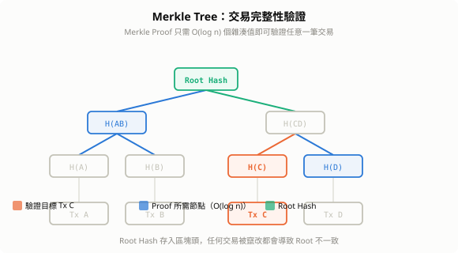
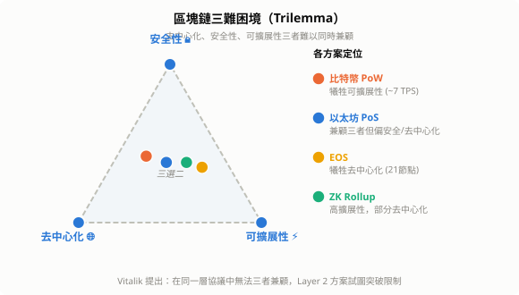
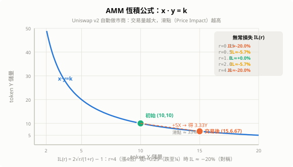

# 區塊鏈理論（Blockchain Theory）

區塊鏈要解決一個根本問題：**在沒有可信任中介的情況下，互不信任的陌生人如何達成共識、防止欺詐？** 其答案結合了密碼學雜湊、數位簽章、分散式共識演算法與賽局理論激勵機制。

## 1. 密碼學基礎

### 1.1 密碼雜湊函數

$$H: \{0,1\}^* \rightarrow \{0,1\}^{256}$$

SHA-256 等雜湊函數滿足四個性質：

| 性質 | 定義 |
|---|---|
| **確定性** | 相同輸入必得相同輸出 |
| **抗碰撞性** | 找到 $H(x) = H(y)$，$x \neq y$ 計算上不可行 |
| **單向性** | 已知 $H(x)$ 無法還原 $x$ |
| **雪崩效應** | 輸入改變一個 bit，輸出完全不同 |

**應用**：每個區塊包含前一區塊的 hash，形成不可篡改的鏈。篡改任何歷史區塊都必須重新計算後續所有區塊的 hash。

### 1.2 非對稱加密與數位簽章

每位用戶有金鑰對 $(sk, pk)$（私鑰、公鑰）：

- **簽章**：$\sigma = \text{Sign}(sk, m)$（用私鑰對訊息 $m$ 簽名）
- **驗證**：$\text{Verify}(pk, m, \sigma) \in \{0,1\}$（任何人用公鑰驗證）

比特幣使用 **ECDSA**（Elliptic Curve Digital Signature Algorithm），基於橢圓曲線 $y^2 = x^3 + 7 \pmod{p}$ 上離散對數問題的困難性。私鑰 $sk$ 是隨機大整數，公鑰 $pk = sk \cdot G$（$G$ 為生成點），從 $pk$ 還原 $sk$ 計算上不可行。

### 1.3 Merkle Tree

將 $n$ 筆交易以二元樹方式 hash，Root Hash 代表整批交易的「指紋」：

```
        Root Hash
       /          \
   Hash(AB)     Hash(CD)
   /     \      /     \
Hash(A) Hash(B) Hash(C) Hash(D)
  A       B       C       D
```

**Merkle Proof**：只需 $O(\log n)$ 個 hash 即可驗證某筆交易是否在區塊中，無需下載全部交易（輕節點驗證的基礎）。



---

## 2. 區塊結構

每個區塊包含：

| 欄位 | 內容 |
|---|---|
| **Previous Hash** | 前一區塊的 SHA-256 雜湊值 |
| **Merkle Root** | 本區塊所有交易的 Merkle 根 |
| **Nonce** | 工作量證明的隨機數 |
| **Timestamp** | Unix 時間戳 |
| **Difficulty Target** | 目前挖礦難度目標 |
| **Transactions** | 交易列表（coinbase + 一般交易） |

區塊 hash 計算：

$$\text{BlockHash} = H(\text{PrevHash} \| \text{MerkleRoot} \| \text{Nonce} \| \text{Timestamp} \| \cdots)$$

修改任意歷史區塊 $k$，需重新計算 $k$ 以後所有區塊的 hash，使攻擊成本隨鏈長度指數增長。

---

## 3. 共識機制

### 3.1 工作量證明（Proof of Work, PoW）

找到 Nonce 使區塊 hash 滿足難度目標：

$$H(\text{block header} \| \text{nonce}) < \text{Target}$$

等價於 hash 值前 $k$ 個 bit 均為 0，期望需嘗試 $2^k$ 次才找到解。比特幣約每 10 分鐘出一塊，難度每 2016 個區塊（約兩週）自動調整。

**安全性**：攻擊者需擁有全網 51% 以上算力才能重寫歷史（51% 攻擊）。攻擊成本 ≈ 誠實挖礦收益，使攻擊在經濟上不合理（賽局理論均衡）。

**缺點**：能耗巨大（比特幣年用電 ≈ 阿根廷全國）。

### 3.2 權益證明（Proof of Stake, PoS）

驗證者鎖定（Stake）代幣作為抵押，以持倉比例隨機被選為提議者：

$$P(\text{被選}) \propto \text{stake}_i$$

行為不端（例如雙重簽名）將被 **Slash**（沒收部分抵押）。以太坊 Merge（2022）後從 PoW 轉換為 PoS，能耗降低 99.95%。

**缺點**：「富者越富」的馬太效應；Nothing-at-Stake 問題（Slash 機制緩解）。

### 3.3 BFT 類共識（PBFT / Tendermint）

**拜占庭容錯（BFT）定理**：

> 在 $n$ 個節點中，只要惡意節點數 $f < \lfloor n/3 \rfloor$，系統仍能達成共識。

Tendermint 採兩階段提交：
1. **Propose**：提議者廣播新區塊
2. **Prevote**：節點廣播是否預投票
3. **Precommit**：收到 $\geq \frac{2}{3}n$ 預投票後廣播預提交
4. **Commit**：收到 $\geq \frac{2}{3}n$ 預提交後確認區塊

**優點**：即時最終性（finality），無需等待多個確認。  
**缺點**：通訊複雜度 $O(n^2)$，節點數通常 $< 200$。

---

## 4. CAP 定理與分散式帳本

區塊鏈本質是分散式資料庫，受 **CAP 定理**約束：

> 分散式系統無法同時滿足：**C（一致性）**、**A（可用性）**、**P（分區容錯）**

| 區塊鏈 | 取捨 |
|---|---|
| 比特幣（PoW） | AP：最終一致性，可用性高，犧牲強一致性 |
| Tendermint / Cosmos | CP：強一致性，分區時停止服務 |
| 以太坊 PoS | AP + Checkpoint 最終性 |

**最終一致性（Eventual Consistency）**：比特幣確認越多塊，被逆轉的機率指數下降。6 個確認後逆轉機率 $< 10^{-6}$。

---

## 5. UTXO vs. Account 模型

### UTXO（比特幣）

每筆交易消耗「未花費交易輸出（UTXO）」並產生新輸出：

```
輸入: [UTXO_1（5 BTC）, UTXO_2（3 BTC）]
輸出: [地址A（7 BTC）, 地址B（0.9 BTC）, 礦工手續費（0.1 BTC）]
```

需要輸入方對每個 UTXO 提供數位簽章。**雙花（Double Spend）** 問題：同一個 UTXO 只能被消耗一次，全節點驗證 UTXO 集合。

### Account 模型（以太坊）

維護全域狀態樹 $\sigma$，每個帳戶有：`{nonce, balance, codeHash, storageRoot}`

$$\sigma' = \Upsilon(\sigma, T) \quad \text{（以太坊狀態轉換函數）}$$

**Nonce**：防止重放攻擊，每筆交易必須遞增。狀態樹以 **Merkle Patricia Trie** 儲存，Root Hash 包含在區塊頭中。

---

## 6. 鏈長成長與帳本更新效率

> **常見疑問**：區塊鏈越來越長，更新帳本是否越來越慢？

答案是**部分操作是，核心出塊流程設計上不受鏈長影響**。

### 6.1 不隨鏈長變慢的操作

**出塊時間**：PoW 有難度自動調整機制，每 2016 個區塊（約兩週）重新校準，確保出塊時間恆定約 10 分鐘，與鏈長無關。

**交易驗證**：節點無需掃描歷史鏈，只需查當前狀態：

| 模型 | 查詢目標 | 複雜度 |
|------|---------|--------|
| UTXO（比特幣） | UTXO 集合（記憶體 hash 表，~5–8 GB） | $O(1)$ |
| Account（以太坊） | 狀態樹（Merkle Patricia Trie） | $O(\log n)$，$n$=帳戶數 |

Merkle Tree 保證：驗證一筆交易只需 $O(\log N)$ 個雜湊值（$N$=區塊內交易數），與鏈長完全無關。

**核心洞察**：不可篡改性靠 hash 鏈結歷史，驗證新交易靠當前狀態——如同銀行不需重播所有歷史才知道你的餘額。

### 6.2 確實隨鏈長變慢的操作

**初始同步（IBD, Initial Block Download）**：新節點加入必須下載並驗證所有歷史區塊：

$$T_{\text{sync}} \propto \text{鏈總大小（線性成長）}$$

| 網路 | 目前資料量 | 完整同步時間 |
|------|-----------|------------|
| 比特幣 | ≈ 600 GB | 數天（家用寬頻） |
| 以太坊 Archive | ≈ 1 TB+ | 一週以上 |

**狀態膨脹（State Bloat）**：以太坊狀態樹隨帳戶與合約增加而增大，Trie 深度 $\approx O(\log \text{帳戶數})$，每次讀寫略慢；長期閒置「殭屍帳戶」永久佔據儲存空間。

### 6.3 解法：剪枝與輕節點

現代節點普遍採用**剪枝（Pruning）**，只保留當前狀態，不保存完整歷史：

```
Full Node（預設）：最近數千區塊 + 當前狀態（~50–100 GB）
Archive Node：全部歷史（供區塊瀏覽器，1 TB+）
Light Node：只下載區塊頭，透過 Merkle Proof 驗證交易
```

正在研究中的長期方案：
- **EIP-4444**：歷史資料到期，由其他網路層（如 Portal Network）分散儲存
- **Verkle Tree**：比 Merkle Patricia Trie 更淺的樹結構，縮小見證資料（Witness）大小，支援 Stateless Client

---

## 8. 智能合約

在區塊鏈上執行的**自動化程式**，條件滿足時自動執行，無需中介。

以太坊虛擬機（EVM）執行 Bytecode，每個操作消耗 **Gas** 防止無限迴圈：

$$\text{手續費（ETH）} = \text{Gas Used} \times \text{Gas Price（Gwei）}$$

```solidity
// ERC-20 核心轉帳邏輯
function transfer(address to, uint256 amount) public returns (bool) {
    require(balances[msg.sender] >= amount, "餘額不足");
    balances[msg.sender] -= amount;
    balances[to] += amount;
    emit Transfer(msg.sender, to, amount);
    return true;
}
```

**常見漏洞**：重入攻擊（Reentrancy，The DAO 事件）、整數溢位、訪問控制錯誤。

---

## 9. 擴展性三難困境（Trilemma）

Vitalik 提出，三者難以同時兼顧：

**去中心化 ↔ 安全性 ↔ 可擴展性**

| 方案 | 犧牲 | 吞吐量 |
|---|---|---|
| 比特幣（PoW） | 可擴展性 | ~7 TPS |
| EOS | 去中心化（21 超級節點） | ~4000 TPS |
| Lightning Network | 部分去中心化 | 百萬 TPS（鏈下） |
| Optimistic Rollup | 部分去中心化 | ~2000 TPS |
| ZK Rollup | 部分去中心化 | ~100,000 TPS |



### ZK Rollup 原理

將大量交易打包，在鏈下執行後生成**零知識證明**：

$$\pi = \text{ZKProve}(\text{state\_before}, \text{transactions}, \text{state\_after})$$

在鏈上只需驗證 $\pi$（$O(1)$ 大小），無需重新執行所有交易，大幅提升吞吐量。

---

## 10. 零知識證明（Zero-Knowledge Proof）

證明者（Prover）向驗證者（Verifier）**證明知道某個秘密，而不揭露秘密本身**。

三個性質：
- **完整性**：若陳述為真，誠實 Prover 能說服 Verifier
- **正確性**：若陳述為假，作弊 Prover 成功機率可忽略（$< 2^{-\lambda}$）
- **零知識性**：Verifier 除「陳述為真」外不獲得額外資訊（模擬論證）

**zk-SNARKs 比較**：

| | zk-SNARK | zk-STARK |
|---|---|---|
| 證明大小 | $O(1)$（~200 bytes） | $O(\log^2 n)$（~100 KB） |
| 驗證時間 | $O(1)$ | $O(\log^2 n)$ |
| 可信設定 | 需要 | 不需要 |
| 後量子安全 | 否 | 是 |
| 代表 | Groth16、PLONK | StarkWare |

---

## 11. DeFi 中的數學

### 自動做市商（AMM）：Uniswap v2

**恆積公式**：

$$x \cdot y = k$$

$x$、$y$ 是兩種代幣儲量，$k$ 為常數。兌換 $\Delta x$ 個 token X，可得：

$$\Delta y = \frac{y \cdot \Delta x}{x + \Delta x}$$

價格影響（Price Impact）隨交易量增加而增大，大額交易需承受更多滑點。

**無常損失（Impermanent Loss）**：當價格比從 1 變為 $r$ 時，流動性提供者相比持幣的損失：

$$\text{IL}(r) = \frac{2\sqrt{r}}{1+r} - 1$$

$r=4$（價格漲 4 倍）時 IL ≈ −20%；$r=0.25$（跌至 1/4）時 IL ≈ −20%（對稱）。



---

## 12. 區塊鏈與 AI

| 領域 | 關係 |
|---|---|
| **聯邦學習** | 區塊鏈記錄模型更新，Shapley Value 鏈上分配貢獻 |
| **資料市場** | 智能合約自動化資料授權與付款，保護隱私 |
| **模型驗證** | ZK Proof 證明「模型以正確資料訓練」而不揭露資料 |
| **去中心化 AI** | 鏈上激勵節點提供算力（Bittensor、Render Network） |
| **生成內容溯源** | NFT 綁定 AI 生成內容，確保創作者所有權 |
| **預言機（Oracle）** | 鏈上智能合約安全獲取鏈外 AI 推論結果 |

---

## 13. 小結

| 概念 | 核心要點 |
|---|---|
| 密碼雜湊 | 單向、抗碰撞；鏈結區塊、Merkle Tree |
| ECDSA | 橢圓曲線數位簽章；私鑰 → 公鑰不可逆 |
| PoW | 算力競爭；51% 攻擊；能耗高 |
| PoS | 持倉比例選舉；Slash 機制；能耗低 |
| BFT | $f < n/3$ 容忍惡意節點；即時最終性 |
| CAP | AP（比特幣）vs. CP（Tendermint） |
| 鏈長與效率 | 出塊恆定（難度調整）；驗證查當前狀態 O(1)/O(log n)；IBD 線性成長；Pruning 解決 |
| 智能合約 | EVM Bytecode；Gas 費；重入攻擊 |
| Trilemma | 去中心化/安全/可擴展性三選二 |
| ZK Proof | 完整性+正確性+零知識性；zk-SNARK/STARK |
| AMM | 恆積公式 $xy=k$；無常損失 |
