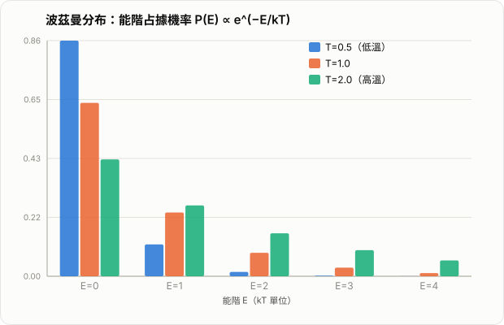

# 波茲曼方程（Boltzmann Equation）

波茲曼方程是統計力學中描述**非平衡態氣體如何隨時間演化**的基本方程，由路德維希·波茲曼（Ludwig Boltzmann）於 1872 年提出。它的核心任務，是把「大量粒子的微觀碰撞行為」與「氣體的宏觀熱力學性質（壓力、溫度、黏滯性⋯）」連接起來。

在 AI 與機器學習的脈絡中，波茲曼的名字更常出現在另一個場景：**波茲曼分布**（softmax 的物理原型）、**波茲曼機**（Boltzmann Machine）、以及**模擬退火**（simulated annealing）。這些應用其實都源自本文要介紹的統計力學架構，因此本文會在最後把兩者接起來。

## 1. 要解決什麼問題

考慮一個裝著大量氣體分子的容器。逐一追蹤每個分子的位置與速度（例如 $10^{23}$ 個分子）在計算上是不可能的，也沒有必要。我們真正關心的是宏觀量，例如：

- 某個區域的密度、平均速度、溫度
- 系統多久會達到平衡
- 氣體在受到擾動（如激波）後如何演化

波茲曼的想法是：與其追蹤每個粒子的精確軌跡，不如追蹤一個**機率分布函數**，描述「粒子在相空間中的統計分布」，再寫出這個分布函數本身該滿足的方程。

## 2. 分布函數：相空間中的機率密度

定義分布函數

$$
f(\mathbf{r}, \mathbf{v}, t)
$$

其意義是：在時間 $t$，位置 $\mathbf{r}$ 附近的體積元 $d^3r$、速度 $\mathbf{v}$ 附近的速度元 $d^3v$ 內，粒子數目約為

$$
dN = f(\mathbf{r}, \mathbf{v}, t)\, d^3r\, d^3v
$$

$(\mathbf{r}, \mathbf{v})$ 六個變數張成的空間稱為**相空間**（phase space）。$f$ 不是機率密度本身，而是相空間中的**粒子數密度**；只要除以總粒子數即可得到機率密度。

宏觀量都可以由 $f$ 的**速度矩**（moments）得到，例如：

$$
n(\mathbf{r},t)=\int f\, d^3v \qquad \text{(數密度)}
$$

$$
\mathbf{u}(\mathbf{r},t)=\frac{1}{n}\int \mathbf{v}\, f\, d^3v \qquad \text{(平均速度)}
$$

$$
T(\mathbf{r},t) \propto \frac{1}{n}\int |\mathbf{v}-\mathbf{u}|^2 f\, d^3v \qquad \text{(溫度)}
$$

也就是說，一旦知道 $f$ 隨時間怎麼變化，就能推出密度、流速、溫度等一切我們關心的宏觀物理量。波茲曼方程，就是在寫 $f$ 的演化方程。

*圖：波茲曼分布 $P(E_i)\propto e^{-E_i/kT}$。低溫（藍色）時粒子集中在低能階，機率分布峰值突出；高溫（青色）時各能階機率趨於均勻，系統更無序（熵更高）。*

## 3. 方程的推導思路

### 3.1 無碰撞情形：Liouville 方程

先假設粒子之間完全不碰撞，只受外力 $\mathbf{F}$ 影響（例如重力）。每個粒子在相空間中沿著軌跡 $(\mathbf{r}(t),\mathbf{v}(t))$ 移動，滿足

$$
\dot{\mathbf{r}} = \mathbf{v}, \qquad \dot{\mathbf{v}} = \frac{\mathbf{F}}{m}
$$

因為粒子數在相空間中不會憑空產生或消失（每個粒子的軌跡是連續的），$f$ 沿著這條軌跡的**全微分**必須為零：

$$
\frac{df}{dt}=\frac{\partial f}{\partial t}+\dot{\mathbf{r}}\cdot\nabla_{\mathbf{r}}f+\dot{\mathbf{v}}\cdot\nabla_{\mathbf{v}}f=0
$$

代入 $\dot{\mathbf{r}}=\mathbf{v}$、$\dot{\mathbf{v}}=\mathbf{F}/m$，得到

$$
\frac{\partial f}{\partial t}+\mathbf{v}\cdot\nabla_{\mathbf{r}}f+\frac{\mathbf{F}}{m}\cdot\nabla_{\mathbf{v}}f=0
$$

這就是**無碰撞波茲曼方程**，在電漿物理中也稱為 **Vlasov 方程**。它其實就是相空間版本的連續方程（質量守恆），只是換成「粒子數在相空間中守恆」的說法。

### 3.2 加入碰撞：完整的波茲曼方程

真實氣體中，分子會彼此碰撞，使軌跡瞬間改變速度（位置不變，因為碰撞被視為瞬時事件）。碰撞會讓粒子「跳出」原本的自由軌跡，因此上式右邊不再是零，而是一個描述碰撞淨效應的**碰撞項**：

$$
\boxed{\frac{\partial f}{\partial t}+\mathbf{v}\cdot\nabla_{\mathbf{r}}f+\frac{\mathbf{F}}{m}\cdot\nabla_{\mathbf{v}}f=\left(\frac{\partial f}{\partial t}\right)_{\text{coll}}}
$$

這就是完整的波茲曼方程。左邊三項合稱**輸運項**（transport terms），描述粒子在無碰撞情況下的自由飄移；右邊的**碰撞項**才是真正讓系統趨向平衡、產生熵增的來源。

| 項目 | 記號 | 物理意義 |
| --- | --- | --- |
| 時間變化 | $\partial f/\partial t$ | 分布函數本身隨時間的改變 |
| 空間對流 | $\mathbf{v}\cdot\nabla_{\mathbf{r}}f$ | 粒子帶著自己的速度移動造成的空間漂移 |
| 力場項 | $\dfrac{\mathbf{F}}{m}\cdot\nabla_{\mathbf{v}}f$ | 外力（重力、電磁力）使速度分布改變 |
| 碰撞項 | $\left(\partial f/\partial t\right)_{\text{coll}}$ | 粒子間碰撞造成的分布重新分配 |

## 4. 碰撞項的形式

### 4.1 雙體彈性碰撞的碰撞積分

對最常見的稀薄氣體（雙體彈性碰撞），碰撞項寫成一個積分：

$$
\left(\frac{\partial f}{\partial t}\right)_{\text{coll}}=\int_{\mathbb{R}^3}\int_{4\pi}\big(f'f_1'-f f_1\big)\,|\mathbf{v}-\mathbf{v}_1|\,\sigma(\Omega)\,d\Omega\,d^3v_1
$$

符號說明：

- $f=f(\mathbf{v})$、$f_1=f(\mathbf{v}_1)$：碰撞**前**兩個粒子的分布函數值
- $f'=f(\mathbf{v}')$、$f_1'=f(\mathbf{v}_1')$：碰撞**後**兩個粒子的分布函數值（速度由碰撞動力學決定）
- $\sigma(\Omega)$：微分散射截面，描述碰撞發生的機率
- $|\mathbf{v}-\mathbf{v}_1|$：相對速度，決定碰撞頻率

直觀理解：$f'f_1'$ 項代表「碰撞把粒子**送進**這個速度狀態」的機率（增益項），$ff_1$ 項代表「碰撞把粒子**送出**這個速度狀態」的機率（損失項）。兩者相減，就是這個速度狀態附近粒子數的淨變化率。

### 4.2 分子混沌假設

這個積分形式背後有一個關鍵假設，稱為**分子混沌假設**（Stosszahlansatz，德文原意「碰撞數假設」）：碰撞前，兩個即將相撞的粒子的速度是**統計獨立**的，所以聯合分布可以直接寫成乘積 $f(\mathbf{v})f(\mathbf{v}_1)$，而不需要考慮它們過去是否已經碰撞過、彼此關聯。

這個假設是波茲曼方程**不可逆**（會產生熵增）的根本原因。也正因如此，波茲曼方程雖然由（時間可逆的）牛頓力學推導而來，最終卻能得出時間不可逆的宏觀行為——這也是歷史上著名的 **Loschmidt 可逆性悖論**的核心爭議點。分子混沌假設在碰撞前成立，但碰撞後兩粒子已產生關聯，因此不能反向套用，時間對稱性因此被打破。

### 4.3 守恆量與碰撞不變量

彈性碰撞會守恆質量、動量、動能，因此下列量在碰撞前後不變，稱為**碰撞不變量**：

$$
\psi(\mathbf{v}) \in \{\,1,\; \mathbf{v},\; |\mathbf{v}|^2\,\}
$$

這些不變量滿足

$$
\int \psi(\mathbf{v})\left(\frac{\partial f}{\partial t}\right)_{\text{coll}} d^3v = 0
$$

這個性質是後面推導流體方程（第 7 節）的關鍵。

## 5. H 定理與熵增

波茲曼定義了一個量

$$
H(t)=\int f\ln f\, d^3r\, d^3v
$$

並證明：只要 $f$ 滿足波茲曼方程，就必有

$$
\frac{dH}{dt}\le 0
$$

這就是著名的 **H 定理**。由於熵 $S$ 與 $H$ 之間相差一個負號與比例常數（$S=-k_B H$，相差常數項），H 定理等價於熵單調不減：

$$
\frac{dS}{dt}\ge 0
$$

這是**熱力學第二定律**首次從微觀動力學被嚴格推導出來，是波茲曼方程最深刻的成就之一——它把「宏觀不可逆」與「微觀可逆的牛頓力學」用統計論證連接了起來。等號成立（$dH/dt=0$）當且僅當碰撞項為零，也就是系統已達到平衡。

## 6. 平衡態解：馬克士威－波茲曼分布

令碰撞項為零：

$$
\left(\frac{\partial f}{\partial t}\right)_{\text{coll}}=0
$$

可以證明，滿足此條件、且不隨時間變化的唯一解形式為

$$
f_{\text{eq}}(\mathbf{v}) = n\left(\frac{m}{2\pi k_B T}\right)^{3/2}\exp\!\left(-\frac{m|\mathbf{v}-\mathbf{u}|^2}{2 k_B T}\right)
$$

這就是**馬克士威－波茲曼速度分布**。推導的關鍵在於：碰撞項為零若且唯若被積函數本身為零，即

$$
f' f_1' = f f_1 \quad\Longleftrightarrow\quad \ln f' + \ln f_1' = \ln f + \ln f_1
$$

也就是說，$\ln f$ 必須是一個碰撞不變量（見 4.3 節）的線性組合：

$$
\ln f = a + \mathbf{b}\cdot\mathbf{v} + c|\mathbf{v}|^2
$$

把這個形式代回去、要求分布可歸一化（$c<0$）並代入密度、平均速度、溫度的定義，就會湊出上面的高斯型分布。這條推導路徑正是波茲曼方程與統計力學中「正則分布」概念的交會點（見第 9 節）。

## 7. 從波茲曼方程推導流體方程

對波茲曼方程兩邊乘上碰撞不變量 $\psi(\mathbf{v})$ 並對速度積分，由於碰撞項貢獻為零（4.3 節），可以消去右邊，只剩下輸運項。依 $\psi$ 的選擇不同，會得到不同的宏觀方程：

| $\psi(\mathbf{v})$ | 對應方程 | 物理意義 |
| --- | --- | --- |
| $1$ | 連續方程 $\dfrac{\partial \rho}{\partial t}+\nabla\cdot(\rho\mathbf{u})=0$ | 質量守恆 |
| $m\mathbf{v}$ | 動量方程（可導出 Navier–Stokes） | 動量守恆 |
| $\dfrac{1}{2}m|\mathbf{v}|^2$ | 能量方程 | 能量守恆 |

這三條方程合稱**矩方程**（moment equations），是波茲曼方程與流體力學（Euler 方程、Navier–Stokes 方程）之間的橋樑。這也是為什麼波茲曼方程被視為比流體力學更「基礎」的描述層級：流體方程可以由它推導出來，但反過來不行（流體方程假設了局部平衡，波茲曼方程則不需要）。

需要注意的是，矩方程本身並不封閉——動量方程含有需要能量矩才能決定的應力項，能量方程又需要更高階的矩，這稱為**封閉性問題**（closure problem）。實務上常用 Chapman–Enskog 展開等方法，在「接近平衡」的假設下對分布函數做微擾展開，才能把矩方程封閉成 Navier–Stokes 方程。

## 8. BGK 簡化模型

完整的碰撞積分計算成本很高，因此實務上（尤其是數值模擬）常用一個簡化模型，稱為 **BGK 模型**（Bhatnagar–Gross–Krook, 1954）：

$$
\left(\frac{\partial f}{\partial t}\right)_{\text{coll}} \approx -\frac{f-f_{\text{eq}}}{\tau}
$$

其中 $\tau$ 是**弛豫時間**（relaxation time），$f_{\text{eq}}$ 是第 6 節的局部馬克士威－波茲曼分布。

直觀意義非常簡單：不管碰撞的細節如何，碰撞的**淨效果**就是把分布函數以特徵時間 $\tau$ 拉向局部平衡分布。這個模型保留了波茲曼方程最重要的定性行為（守恆律、趨向平衡），卻大幅簡化了計算，是**格子波茲曼方法**（Lattice Boltzmann Method, LBM，見第 10 節）等數值方法的理論基礎。

## 9. 波茲曼方程 vs. 波茲曼分布：常見混淆

這是最容易混淆的一點，值得特別澄清。

| | 波茲曼方程 | 波茲曼分布 |
| --- | --- | --- |
| 領域 | 動力學（非平衡態） | 統計力學（平衡態） |
| 描述對象 | 分布函數 $f(\mathbf{r},\mathbf{v},t)$ 如何**隨時間演化** | 系統在**平衡態**時，處於能量 $E_i$ 的機率 |
| 典型形式 | $\partial_t f+\mathbf{v}\cdot\nabla f+\cdots=\text{碰撞項}$ | $P_i=\dfrac{1}{Z}e^{-E_i/k_BT}$ |
| 關係 | 是「過程」 | 是波茲曼方程**平衡態解**的一個特例（見第 6 節） |

**波茲曼分布**（Boltzmann distribution）來自正則系綜（canonical ensemble）理論：一個與大熱庫達成熱平衡的系統，處於微觀狀態 $i$（能量 $E_i$）的機率為

$$
P_i=\frac{1}{Z}\exp\!\left(-\frac{E_i}{k_BT}\right), \qquad Z=\sum_j \exp\!\left(-\frac{E_j}{k_BT}\right)
$$

其中 $Z$ 稱為**配分函數**（partition function）。第 6 節推出的馬克士威－波茲曼速度分布，其實就是把「能量」換成動能 $E=\tfrac12 m|\mathbf{v}|^2$ 之後波茲曼分布的一個具體例子。也就是說：**波茲曼分布是平衡態統計力學的結果，波茲曼方程是通往平衡態的動力學過程**——兩者一脈相承，但描述的是不同層次的問題。

## 10. 應用領域

- **氣體動力學**：稀薄氣體（Knudsen 數較大，連續介質假設失效的場合，如高空飛行器再入大氣層）、激波結構
- **電漿物理**：無碰撞版本即為 Vlasov 方程，是電漿動力學的基礎
- **半導體輸運理論**：描述半導體中電子在晶格散射下的輸運行為
- **輻射傳輸**：光子在介質中傳播與散射的方程，形式上與波茲曼方程高度類似
- **格子波茲曼方法（LBM）**：以 BGK 模型為基礎，將速度空間離散成有限方向集合，在規則網格上模擬流體，廣泛用於計算流體力學（CFD），尤其擅長處理複雜幾何與多孔介質流動

## 11. 與 AI／機器學習的連結

雖然波茲曼方程本身屬於統計力學，但因這條理論脈絡而得名的概念，在機器學習中相當常見：

### 11.1 Softmax 就是波茲曼分布

分類模型最後一層常用的 softmax 函數

$$
\text{softmax}(z_i)=\frac{e^{z_i}}{\sum_j e^{z_j}}
$$

在形式上與波茲曼分布 $P_i=\frac{1}{Z}e^{-E_i/k_BT}$ 完全一致——只要把 logit $z_i$ 對應到 $-E_i/k_BT$。這不是巧合，softmax 最早的命名與推導動機就是借用了統計力學的架構。這也是為什麼許多 softmax 的變體會引入「溫度參數」$T$：

$$
\text{softmax}_T(z_i)=\frac{e^{z_i/T}}{\sum_j e^{z_j/T}}
$$

- $T\to 0$：分布收斂到 one-hot（幾乎只選機率最大的類別），對應波茲曼分布在低溫下集中於基態
- $T\to\infty$：分布趨於均勻，對應高溫下系統遍歷所有能量狀態

這與知識蒸餾（knowledge distillation）、強化學習中的探索策略（如 softmax exploration）裡「溫度」的直觀意義是一致的。

### 11.2 波茲曼機（Boltzmann Machine）

波茲曼機是一種以能量函數定義聯合機率分布的隨機神經網路：

$$
P(\mathbf{s})=\frac{1}{Z}\exp\!\left(-\frac{E(\mathbf{s})}{T}\right)
$$

其中 $\mathbf{s}$ 是神經元的（二元）狀態、$E(\mathbf{s})$ 是仿照 Ising 模型定義的能量函數。這正是波茲曼分布在網路狀態空間上的直接套用；訓練過程（如對比散度演算法）本質上就是在調整能量函數的參數，讓模型分布逼近資料分布。**受限波茲曼機**（RBM）是深度學習早期（尤其是深度信念網路 DBN）重要的建構模塊。

### 11.3 模擬退火

模擬退火（simulated annealing）借用了「溫度逐漸降低」的物理過程來做全局最佳化：在高溫時允許系統以較大機率接受較差的解（對應波茲曼分布在高溫下較平坦，容易跳出局部極值），隨溫度逐漸降低，系統逐漸收斂到能量最低（即目標函數最優）的狀態。這也是波茲曼分布思想在最佳化演算法中的直接體現。

## 12. 小結

波茲曼方程

$$
\frac{\partial f}{\partial t}+\mathbf{v}\cdot\nabla_{\mathbf{r}}f+\frac{\mathbf{F}}{m}\cdot\nabla_{\mathbf{v}}f=\left(\frac{\partial f}{\partial t}\right)_{\text{coll}}
$$

的核心貢獻，是提供了一條從微觀粒子碰撞通往宏觀熱力學行為的嚴謹路徑：

- 左邊的輸運項描述粒子在相空間中的自由飄移
- 右邊的碰撞項描述分子間碰撞如何重新分配速度分布，是熵增與不可逆性的來源（H 定理）
- 平衡態解收斂為馬克士威－波茲曼分布，是波茲曼分布這一更廣泛的統計力學結果在速度空間中的具體實現
- 對分布函數取速度矩，可以由此推導出連續方程、Navier–Stokes 方程等流體力學方程，是連接動力學論與連續介質力學的關鍵橋樑
- 在計算上，BGK 簡化模型與格子波茲曼方法讓這套理論成為現代 CFD 的重要工具

若只記一句話，可以記成：

**波茲曼方程描述的是「系統如何走向平衡」的過程，而波茲曼分布描述的是「平衡態長什麼樣子」的結果；AI 中大量使用的 softmax、波茲曼機、模擬退火，借用的都是後者的數學形式與物理直覺。**
