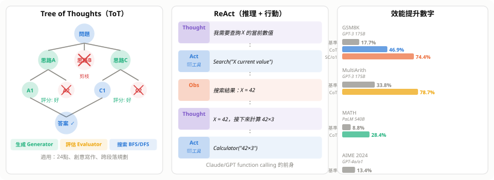

# Chain-of-Thought 推理（CoT）

> 讓模型「說出思考過程」，等於給它更多計算深度——這一個改變，讓語言模型從背誦者變成推理者。

---

## 1. 核心概念

### 1.1 問題：直接輸出的計算瓶頸

Transformer 在一個 forward pass 中，每個 token 的計算量約為 $O(d^2)$（$d$ 為 hidden dimension）。對於需要 $k$ 步推理的問題：

- **直接輸出**：等效於 $O(1)$ 層計算，對複雜問題深度不足
- **生成中間步驟**：每多生成一個 token，就多一次 $O(d^2)$ 計算

**生成中間推理 token = 給自己更多算力**。

### 1.2 直觀對比

```
標準 Prompting：
  Q: Roger 有 5 顆網球，買了 2 罐（每罐 3 顆），共幾顆？
  A: 11  ✗（模型直接猜，容易算錯）

Chain-of-Thought：
  Q: Roger 有 5 顆網球，買了 2 罐（每罐 3 顆），共幾顆？
  A: Roger 開始有 5 顆。
     2 罐 × 3 顆 = 6 顆。
     5 + 6 = 11。
     答案是 11 顆。  ✓
```


---

## 2. 三種主要形式

### 2.1 Few-shot CoT（Wei et al. 2022）

在 prompt 中提供 **「問題 + 推理過程 + 答案」** 的示範：

```
示範：
  Q: 蘋果 3 個，橘子 5 個，梨 2 個，共幾個？
  A: 蘋果加橘子：3 + 5 = 8。再加梨：8 + 2 = 10。答案是 10。

  Q: 一打雞蛋 12 顆，買了 3 打，共幾顆？
  A: 12 × 3 = 36。答案是 36 顆。

現在：
  Q: [實際問題]
  A: （模型接著生成推理步驟）
```

**重要發現**：CoT 只在 **~60B 參數以上**的模型才有正效果；小模型加了 CoT 反而更差（因為模型無法生成正確的推理步驟，錯誤步驟反而引入噪音）。

### 2.2 Zero-shot CoT（Kojima et al. 2022）

只需在問題後加一句：

$$\boxed{\texttt{Let's think step by step.}}$$

中文版：「請逐步思考」

**效果**：GPT-3（175B）在 MultiArith 算術任務上從 **17.7% → 78.7%**，完全不需要示範例子。

**為什麼有效？** 訓練資料中大量「步驟化」的文字（教科書解題、程式碼注釋、邏輯論文）教會了模型：「step by step」這個 token 序列之後，應該出現的是細緻的推理過程，而非直接結論。

### 2.3 Self-Consistency CoT（Wang et al. 2022）

**核心洞察**：一個複雜問題有多條正確的推理路徑，但錯誤路徑各不相同。

**步驟**：

1. 用 temperature > 0（如 0.7），對同一問題抽樣 $k$ 條推理鏈（$k = 20 \sim 40$）
2. 收集每條鏈的最終答案
3. **多數投票**（Majority Vote）取最頻繁的答案

```
推理鏈 1: ... → 答案 42
推理鏈 2: ... → 答案 42
推理鏈 3: ... → 答案 38（路徑出錯）
推理鏈 4: ... → 答案 42
...
Majority Vote → 42  ✓
```

**效果**：在 GSM8K（小學數學）上比 greedy CoT 提升 **+17.9%**。

代價：推理成本增加 $k$ 倍。

---

## 3. 進階變體

### 3.1 Tree of Thoughts（ToT，Yao et al. 2023）

把線性推理鏈擴展為**搜索樹**：

```
問題
  ├── 思路 A
  │     ├── A1（評估：好）→ 繼續展開
  │     └── A2（評估：差）→ 剪枝
  ├── 思路 B（評估：差）→ 剪枝
  └── 思路 C
        ├── C1（評估：好）→ 答案
        └── C2（評估：差）→ 剪枝
```

三個關鍵機制：

| 機制 | 實現方式 |
|---|---|
| **生成**（Generator） | 展開當前節點的可能下一步 |
| **評估**（Evaluator） | 用 LLM 自打分（「這個思路多大可能導向正確答案？」） |
| **搜索策略** | BFS（廣度優先）或 DFS（深度優先，可回溯） |

**適用場景**：24 點遊戲（需全局搜索）、創意寫作（需多路徑探索）、跨段落規劃。

### 3.2 ReAct（Reasoning + Acting，Yao et al. 2022）

將推理與**外部工具調用**交替進行：

```
Thought: 我需要找到 X 的當前值
Act:     Search("X current value")
Obs:     [搜索結果：X = 42]
Thought: 根據搜索結果，X 是 42，接下來需要計算...
Act:     Calculator("42 × 3")
Obs:     126
Thought: 答案是 126
Answer:  126
```

這是現代 **AI Agent**（工具調用框架）的直接前身，Claude/GPT 的 function calling 機制本質上是 ReAct 的系統化實作。

### 3.3 Reflexion（Shinn et al. 2023）

讓模型在失敗後**反思自己的錯誤**，生成語言層面的 self-critique 並存入 memory：

```
嘗試 1: [推理] → 答案 A → 環境反饋：錯誤
反思:   "我在第三步忘記考慮負數情況，
         下次需要先列出所有邊界條件"
嘗試 2: [加入反思後重新推理] → 答案 B → 正確
```

**本質**：用自然語言做「梯度更新」——但不更新模型權重，而是更新 prompt context。

### 3.4 Program-of-Thought（PoT）/ PAL

讓模型生成**程式碼**而非自然語言步驟，再由 Python 解釋器執行：

```python
# Q: 一個蓄水池每小時注入 2 m³，漏水 0.5 m³，
#    從 10 m³ 開始，幾小時後超過 20 m³？

capacity = 10
rate = 2 - 0.5  # net fill rate
hours = 0
while capacity <= 20:
    capacity += rate
    hours += 1
print(hours)  # 7
```

**優勢**：計算精確（不再靠模型算術），邏輯可驗證；**劣勢**：需要可執行環境，自然語言推理能力不如 CoT。



---

## 4. 為什麼有效：機制解析

### 4.1 計算深度定理（理論依據）

Feng et al. 2024 嚴格證明：

> **不使用 CoT**：常數深度 Transformer 無法解決需要超過 $O(1)$ 步驟的問題（如鏈式乘法、需要迭代的動態規劃）。
>
> **使用 CoT**：生成 $T$ 個中間 token，等效於增加 $T$ 層計算深度，可解決需要 $O(T)$ 步驟的問題。

形式化：一個 $L$ 層 Transformer 加上 $T$ 步 CoT，可模擬一個 $(L \cdot T)$ 層 Transformer 的計算能力。

### 4.2 注意力工作記憶假說

CoT 生成的中間 token 會被後續 token **attend 到**，相當於把中間計算結果「暫存」在 KV Cache 中：

$$\text{Attn}(Q_t, K_{1:t-1}, V_{1:t-1}) \quad \Rightarrow \quad \text{token } t \text{ 可「讀取」前面所有推理步驟}$$

推理步驟 = 外置工作記憶（external working memory），補充模型內部有限的 recurrent state。

### 4.3 訓練分佈匹配假說

預訓練語料包含大量「有步驟的文字」：

- 數學教科書解題過程
- 程式碼 + 注釋（本身是步驟化思維）
- 邏輯論文的推導
- Stack Overflow 的分步解答

CoT prompt 把問題「拉向」這些高品質樣本的分佈，模型因此輸出更準確的推理序列。

---

## 5. 適合與不適合的任務

| 任務類型 | CoT 效果 | 原因 |
|---|---|---|
| 多步算術 / 代數 | ✓✓✓ 顯著提升 | 每步可驗證，步驟明確 |
| 邏輯推理（命題邏輯） | ✓✓✓ | 中間步驟對應推理規則 |
| 常識推理 | ✓✓ | 步驟化澄清歧義 |
| 程式碼生成 | ✓✓ | 先想演算法再寫程式碼 |
| 科學問題（物理/化學） | ✓✓ | 公式推導天然是步驟 |
| 知識問答（factual） | ✗ 無效甚至有害 | CoT 可能「編造」錯誤推理鏈來支持錯誤答案 |
| 情感分類 | ✗ | 無需多步推理 |
| 機器翻譯 | ✗ | 並行生成更自然 |

---

## 6. 根本限制：不忠實推理

**Turpin et al. 2023** 的關鍵實驗：

在 few-shot 示範中加入 bias（所有示範答案都在選項 A），即使問題本身答案不是 A：

- 模型仍然傾向選 A
- 但生成的 CoT 推理鏈會**編造合理的理由**支持 A

```
真實決策機制：  模型因訓練 bias 偏好選 A
CoT 顯示的：   "因為 A 符合定義 X，所以選 A" （後合理化）
```

**Unfaithfulness**（不忠實）的三種形式：

| 類型 | 描述 |
|---|---|
| Post-hoc rationalization | 先決定答案，再生成支持它的推理 |
| Sycophancy（諂媚） | 推理向用戶「期望」的方向傾斜 |
| Shortcut reasoning | 推理步驟看似正確，但模型實際使用了捷徑 |

**深層原因**：語言模型預測的是「什麼樣的文字序列在訓練資料中常出現」，而非「這個推理步驟邏輯上是否正確」。CoT 的推理鏈與模型的真實計算路徑之間，存在根本性的隔閡——就像人類的「事後合理化」認知偏誤。

---

## 7. 從 CoT 到推理模型

### 7.1 訓練目標的轉變

| 世代 | CoT 形式 | 訓練方式 |
|---|---|---|
| Prompt CoT | 人工設計 prompt 中的示範步驟 | 無額外訓練 |
| Instruction-tuned CoT | 在帶步驟標注的資料上微調 | Supervised Fine-tuning |
| RL CoT（o1/R1 世代） | 模型自主展開推理，對/錯由結果判斷 | GRPO / PPO 強化學習 |

### 7.2 RL 訓練的核心思路

以數學題為例：

1. 模型生成長推理鏈 + 最終答案
2. 驗證答案是否正確（Ground truth）
3. 正確 → 正獎勵；錯誤 → 負獎勵
4. 模型學會「哪些推理模式更容易導向正確答案」

**關鍵突破**：不需要人工標注推理步驟（只需要最終答案的對錯），降低了標注成本。

### 7.3 Extended Thinking / Thinking Tokens

現代推理模型（OpenAI o1、DeepSeek-R1、Claude Extended Thinking）的架構特點：

- **思考 token**（thinking tokens）：模型的「草稿紙」，對用戶部分或完全隱藏
- **輸出 token**：最終呈現給用戶的答案
- 思考 token 可以包含：自我質疑、回溯、嘗試不同路徑、驗算

```
<thinking>
  讓我先試第一種方法...不對，有錯誤。
  換一個角度：先考慮邊界情況...
  好，現在驗算一下...確認正確。
</thinking>
答案：42
```

**效果**：在 AIME 2024（高中數學競賽）上，o1 達到 83.3%，而 GPT-4o 只有 13.4%。

### 7.4 DeepSeek-R1 的 Aha Moment

DeepSeek-R1 技術報告記錄了一個有趣現象：

> 在 RL 訓練的某個階段，模型自發地開始在推理過程中**重新評估自己之前的想法**（"Wait, let me reconsider..."），而這個行為並非人工設計，是訓練中自然湧現的。

這正是滲流理論所說的「湧現」：沒有任何局部規則指定「要自我反思」，但在規模與訓練達到臨界點後，宏觀行為自然出現。

---

## 8. 效能數字對比

| 模型 | 任務 | 標準 | +CoT | +Self-Consistency |
|---|---|---|---|---|
| GPT-3 175B | GSM8K（小學數學） | 17.7% | 46.9% | 74.4% |
| PaLM 540B | MATH（競賽數學） | 8.8% | 28.4% | — |
| GPT-4 | AIME 2024 | — | 13.4% | — |
| o1 | AIME 2024 | — | **83.3%** | — |

---

## 參考文獻

| 文獻 | 貢獻 |
|------|------|
| Wei et al. 2022 | Chain-of-Thought Prompting Elicits Reasoning in LLMs |
| Kojima et al. 2022 | Large Language Models are Zero-Shot Reasoners |
| Wang et al. 2022 | Self-Consistency Improves CoT Reasoning |
| Yao et al. 2023 | Tree of Thoughts |
| Yao et al. 2022 | ReAct: Synergizing Reasoning and Acting |
| Shinn et al. 2023 | Reflexion |
| Turpin et al. 2023 | CoT 的不忠實性（Unfaithfulness） |
| Feng et al. 2024 | CoT 的計算深度理論 |
| OpenAI 2024 | OpenAI o1 Technical Report |
| DeepSeek-AI 2025 | DeepSeek-R1 Technical Report |
