# 冰雹猜想（續）：函數、變換與算子的關係（§3.13–§3.25）

本檔是 [Collatz.md](Collatz.md) 第 3 節的後半。拆檔的原因：`Collatz.md` 的公式超過 2300 個，GitHub 在單頁公式過多時會有部分公式顯示 "Unable to render expression"，所以把 §3.13 之後的小節移到這裡。**小節編號沿用 `Collatz.md`**：§3.0 總表與 §3.1–§3.12、§4 以後的章節在 `Collatz.md`，§3.13–§3.25 在本檔。

每節都是同一個格式：先驗證 Collatz 與該主題（zeta、Dirichlet 級數、Möbius 函數、Lambert W、Gamma 函數、Euler 乘積、Selberg 跡公式、Hecke 算子、Ramanujan 求和、Mellin／Fourier／Laplace 變換、Gauss 求和）是否有關係，標明「已驗證」或「記憶」，沒有關係就明說；並附一張圖示。

---

## 目錄

- [3.13 Riemann zeta 與動力 zeta](#313-riemann-zeta-與動力-zeta)
- [3.14 Dirichlet 級數](#314-dirichlet-級數)
- [3.15 Möbius 函數](#315-möbius-函數)
- [3.16 Lambert W 函數](#316-lambert-w-函數)
- [3.17 Gamma 函數](#317-gamma-函數)
- [3.18 Euler 乘積](#318-euler-乘積)
- [3.19 Selberg 跡公式](#319-selberg-跡公式)
- [3.20 Hecke 算子](#320-hecke-算子)
- [3.21 Ramanujan 求和](#321-ramanujan-求和)
- [3.22 Mellin 變換](#322-mellin-變換)
- [3.23 Fourier 變換](#323-fourier-變換)
- [3.24 Laplace 變換](#324-laplace-變換)
- [3.25 Gauss 求和](#325-gauss-求和)

---

### 3.13 Riemann zeta 與動力 zeta

> 標示「（已驗證）」者，是我用程式實際檢查過的結果；「記憶」為依印象整理、未核對的說法。結論先說：**Collatz 與 Riemann ζ 函數（零點、黎曼猜想）沒有已知的直接關係**，我沒有查文獻。有三個真實的接點，其中最有意義的是**動力 zeta 函數**（Artin–Mazur／Ruelle），它不是 Riemann ζ 本身，而是它在動力系統裡的類比。

**1. 動力 zeta 函數：循環對應 Euler 乘積**

對一個映射 $T$，令 $N_k$ 為 $T^k(x)=x$ 的點數，定義

$$
\zeta_T(z)=\exp\Bigl(\sum_{k\ge1}\frac{N_k}{k}z^k\Bigr)=\prod_{\gamma}\bigl(1-z^{|\gamma|}\bigr)^{-1}
$$

乘積取遍所有基本週期軌道 $\gamma$，類似 Riemann ζ 的 Euler 乘積（質數對應基本循環）。

- **在 $\mathbb{Z}_2$ 上**：每個奇偶模式恰好對應一個週期點 $x=c/D$， $D=2^k-3^s$ 恆為奇數（窮舉 $k\le18$ 已驗證），所以 $c/D\in\mathbb{Z}_2$，共 $2^k$ 個， $\zeta_T(z)=1/(1-2z)$，與 §3.1 的共軛一致。
- **在整數上**（窮舉 $2^k$ 個模式， $k\le18$，已驗證）：解的個數（正、負、零合計）為

$$
N_k:\ 2,4,5,4,2,7,2,4,5,4,13,7,2,4,5,4,2,7\quad(k=1,\dots,18)
$$

且恰好等於「已知循環的 Euler 乘積」算出的值，即 $N_k=\sum_{|\gamma|\mid k}|\gamma|$，其中基本循環為 $\{0\}$、 $\{-1\}$、 $\{1,2\}$、 $\{-5,-7,-10\}$、 $\{-17,\dots\}$（長度 $1,1,2,3,11$）。所以在 $k\le18$ 內：

$$
\zeta_T(z)=(1-z)^{-2}\,(1-z^2)^{-1}\,(1-z^3)^{-1}\,(1-z^{11})^{-1}
$$

| $k$ | $\mathbb{Z}_2$ 週期點 $2^k$ | 正整數 | 負整數 | 0 |
|---|---|---|---|---|
| 1 | 2 | 0 | 1（ $-1$） | 1 |
| 2 | 4 | 2（ $\{1,2\}$） | 1 | 1 |
| 3 | 8 | 0 | 4（ $-1$ 與 $\{-5,-7,-10\}$） | 1 |
| 11 | 2048 | 0 | 12（ $-1$ 與 11-循環） | 1 |
| 18 | 262144 | 2 | 4 | 1 |

正整數的 $N_k$ 在 $k\le18$ 是「偶數 2、奇數 0」，對應的 $\zeta_T(z)$ 級數到 $z^{18}$ 恰為 $1/(1-z^2)=1+z^2+z^4+\cdots$（已驗證）。因為 $N_k$ 包含所有長度整除 $k$ 的循環，**$N_k$ 對所有 $k$ 都如此，等價於沒有非平凡正循環**。所以「無非平凡循環」可以寫成：正整數上的動力 zeta 只有一個 Euler 因子 $(1-z^2)^{-1}$。這只涵蓋循環，不涉及發散軌道；而且與 $\mathbb{Z}_2$ 的 $2^k$ 相比，整數解極少（ $k=18$ 時 $262144$ 對 $7$），這是「整數是 $\mathbb{Z}_2$ 中測度為 0 的子集」（§3.1）的具體寫照。

**2. 對數密度與 $\zeta$ 在 $s=1$ 的極點**

Tao（§7.1）用的是**對數密度**，定義為 $\frac1{\ln x}\sum_{n\in A,\,n\le x}\frac1n$ 的極限，與 $\zeta(s)=\sum n^{-s}$ 在 $s=1$ 的極點是同一個尺度：集合 $A$ 的 Dirichlet 級數在 $s\to1^+$ 的行為 $\sim\delta/(s-1)$， $\delta$ 就是它的密度（Abelian 方向，記憶）。例如與 6 互質的整數，Dirichlet 級數為 $\zeta(s)(1-2^{-s})(1-3^{-s})$，留數 $1/3$。我的環境沒有 mpmath，所以只做了部分和檢查： $\sum_{n\le10^6,\,\gcd(n,6)=1}1/n\,/\ln10^6=0.377$（偶數為 $0.496$，趨向 $1/2$），朝 $1/3$ 的收斂很慢（誤差約 $1/\ln x$），這只是相容，不算驗證。

**3. Euler 因子 2 與 3：Syracuse 映射的像**

奇數 $n\le3\times10^5$ 的 Syracuse 像 $T(n)=(3n+1)/2^{v}$ 一律與 6 互質，模 6 只有 $1,5$（已驗證）。這與 §3.2「3 的倍數進不來」同義，也等於從 $\zeta$ 的 Euler 乘積拿掉 $p=2,3$ 兩個因子。但這只是初等的同餘事實。

**4. $\zeta$ 零點的檢查：沒有發現連結**

- **動力 zeta 的零點與極點是顯式的**（已驗證， $k\le18$）： $\zeta_T$ 是有理函數，沒有零點，只有單位根的極點。整數上 $\zeta_T=(1-z)^{-2}(1-z^2)^{-1}(1-z^3)^{-1}(1-z^{11})^{-1}$， $z=1$ 是 $5$ 階極點，另有 $z=-1$、三次單位根與 $11$ 次單位根（ $\mathbb{Z}_2$ 上則是 $z=\frac12$）。我用精確分數檢查過 $\exp\bigl(\sum N_kz^k/k\bigr)$ 與上面的乘積到 $z^{18}$ 逐項相等。所以這裡不存在「零點是否落在一條線上」的問題；Riemann $\zeta$ 的零點位置才是難題。（有些雙曲系統的 Selberg zeta 有類似 RH 的結構，記憶，沒查證。）
- **Dirichlet 級數的收斂域與零點錯開**（推論）：§3.14 的 $\sum_dF_d(s)$ 在 $\mathrm{Re}\,s>1$ 絕對收斂，因為它被 $\zeta(\sigma)$ 控制；而 $\zeta$ 在 $\mathrm{Re}\,s\ge1$ 沒有零點（標準結果）。所以「猜想 $\iff E(s)\equiv0$」只在沒有零點的區域有意義，非平凡零點在 $0 < \mathrm{Re}\,s < 1$，落在這個級數的收斂域之外。
- **零點頻率的振盪檢查（未發現）**：若 $S(N)=\sum_{n\le N}\text{steps}(n)$ 的修正項 $b_N=S(N)/N-a(\ln N-1)$（ $a=10.428$，§3.16）帶有類似明確公式的振盪，零點 $\gamma$ 會對應 $\ln N$ 上週期 $2\pi/\gamma$ 的成分。我在 $N\in[2\times10^4,2\times10^6]$ 取 $3000$ 個對數等距的點，去掉線性趨勢後（殘差標準差 $0.149$）掃描週期 $0.2$ 到 $3.2$（已驗證）：

| 檢查 | 振幅 |
|---|---|
| 掃描週期的中位數／95 百分位／最大 | $0.064$／ $0.122$／ $0.137$ |
| $\gamma=14.135$（週期 $0.4445$） | $0.018$ |
| $\gamma=21.022$（週期 $0.2989$） | $0.014$ |
| $\gamma=25.011$（週期 $0.2512$） | $0.009$ |
| $\gamma=30.425$（週期 $0.2065$） | $0.008$ |
| 週期 $\ln2$／ $\ln\frac32$／ $\ln3$ | $0.026$／ $0.018$／ $0.043$ |

零點頻率的振幅都遠低於中位數， $\ln2$、 $\ln\frac32$、 $\ln3$ 也沒有訊號。**但沒有理論預期 $S(N)$ 會帶有 $\zeta$ 零點的振盪，所以「沒發現」幾乎不提供資訊**，只是排除一個天真的想法。 $\gamma$ 的數值是我記憶中的值。附帶觀察： $b_N$ 不是常數，從 $N=2^{14}$ 的 $-1.19$ 漂到 $2^{20}$ 的 $-2.24$。

先前搜尋時出現過 arXiv 上研究 Collatz 多項式零點的論文（arXiv:2001.00482），那不是 $\zeta$ 的零點，我只看過標題，沒有讀內容。

**沒有的部分**：沒有已知的 Dirichlet 級數把停止時間或軌道與 $\zeta$ 的零點連起來，也沒有函數方程。§3.7 的 Bernoulli 數經由 $\zeta(1-n)=-B_n/n$ 與 $\zeta$ 相連，但那是 Bernoulli 側的結論，與 Collatz 無關。

| 方面 | 結論 |
|---|---|
| 動力 zeta（ $\mathbb{Z}_2$） | $\zeta_T=1/(1-2z)$， $2^k$ 個週期點 |
| 動力 zeta（整數） | $k\le18$ 內 $N_k$ 恰為已知循環的 Euler 乘積；無非平凡正循環 $\Leftrightarrow\zeta_T=1/(1-z^2)$ |
| 對數密度 | 與 $\zeta$ 在 $s=1$ 的極點同一尺度（記憶） |
| Euler 因子 2、3 | 像與 6 互質，初等事實 |
| $\zeta$ 的零點、RH | 無已知關係； $\zeta_T$ 無零點，零點頻率的振盪未檢出（資訊量低） |

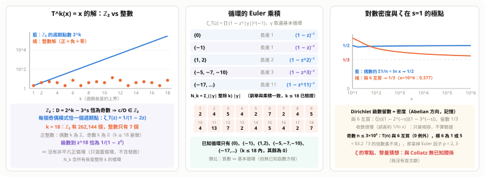

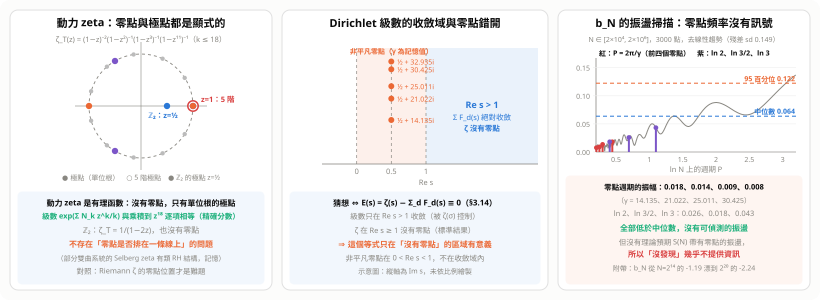

### 3.14 Dirichlet 級數

> 標示「（已驗證）」者，是我用程式實際檢查過的結果；「記憶」為依印象整理、未核對的說法。結論先說：**Dirichlet 級數在 Collatz 裡的角色，是用另一種語言重述已知的結構，沒有已知的 $L$ 函數、零點或函數方程**。

**1. 反向樹的層分割 $\zeta(s)$：猜想的 Dirichlet 級數寫法**

令 $F_d(s)=\sum_{\text{步數}(n)=d}n^{-s}$，即反向樹（§4）第 $d$ 層的 Dirichlet 級數。每個正整數至多屬於一層，所以

$$
\sum_{d\ge0}F_d(s)\;\le\;\zeta(s),\qquad
E(s):=\zeta(s)-\sum_{d}F_d(s)=\sum_{n\ \text{軌道到不了 }1}n^{-s}\ \ge0
$$

**猜想成立 $\iff E(s)\equiv0$**。若有反例，最小的反例 $n_0$ 使 $E(s)\ge n_0^{-s}$；這個寫法同時涵蓋發散軌道與非平凡循環。

我驗證了這個分割確實成立：對 $s=2,3$， $E_d(s)=\zeta(s)-\sum_{d'\le d}F_{d'}(s)$（用 $d\le58$ 的反向樹計算）與直接窮舉 $\sum_{\text{步數}>d,\ n\le10^6}n^{-s}$ 的差，恰好落在 $n>10^6$ 的尾項範圍內（ $s=2$ 約 $10^{-6}$， $s=3$ 約 $10^{-13}$，已驗證）：

| $d$ | $s=2$ 的缺口 $E_d$ | $s=3$ 的缺口 $E_d$ |
|---|---|---|
| 10 | $1.001\times10^{-1}$ | $7.10\times10^{-3}$ |
| 20 | $2.43\times10^{-2}$ | $4.30\times10^{-4}$ |
| 30 | $1.38\times10^{-2}$ | $2.03\times10^{-4}$ |
| 40 | $1.08\times10^{-2}$ | $1.65\times10^{-4}$ |
| 58 | $9.55\times10^{-3}$ | $1.60\times10^{-4}$ |

缺口下降很慢，因為像 $n=27$（111 步）這種小數字要到 $d\ge111$ 才會進來：光是 $27^{-3}=5.1\times10^{-5}$，就占了 $s=3$、 $d=58$ 缺口的 32%。這同時驗證了 §4 的結構：各層恰好分割正整數。

**2. 殘餘類與 Hurwitz zeta、平均停止時間**

§3.1 說前 $k$ 步由 $n\bmod2^k$ 決定，而殘餘類的 Dirichlet 級數正是 Hurwitz zeta：

$$
\sum_{n\equiv a\ (2^k)}n^{-s}=2^{-ks}\,\zeta\!\bigl(s,\tfrac{a}{2^k}\bigr),\qquad\text{在 }s=1\text{ 的留數 }2^{-k}
$$

（ $s=1.5$ 時 $a=5,\,k=3$ 為 $0.17101260$， $a=9,\,k=4$ 為 $0.06664532$，與 Hurwitz zeta 在 8 位小數一致，已驗證。）所以 §3.6 的「停止時間為 $k$ 的類占密度 $N_k/2^k$」可以寫成「留數為 $N_k/2^k$」。

平均停止時間：理想化值 $\sum_k kN_k/2^k=3.492$（ $k\le200$，質量 $0.999997$），實測 $2\le n\le3\times10^5$ 的平均為 $3.4816$，吻合（已驗證）。因此 $(s-1)\sum\sigma(n)\,n^{-s}\to3.49$（由密度的平均推得，我沒有在 $s\to1^{+}$ 直接驗證）。總步數的級數 $\sum\text{steps}(n)\,n^{-s}$ 則應在 $s=1$ 有二階極點（係數約 $10.4$），這是啟發式，未驗證。

**3. 沒有的部分：非乘性**

Dirichlet 級數有 Euler 乘積，需要係數是乘性的，但步數不是： $\text{steps}(3)=7$、 $\text{steps}(5)=5$、 $\text{steps}(15)=17$，既不是乘積 $35$，也不是和 $12$。對 500 對互質的 $m,n$（ $2$ 到 $60$，已計算）， $\text{steps}(mn)=\text{steps}(m)+\text{steps}(n)$ 只在 11% 的情形成立， $\text{steps}(mn)=\text{steps}(m)\cdot\text{steps}(n)$ 則為 0%。所以沒有 Euler 乘積、函數方程或 $L$ 函數，Dirichlet 特徵 mod $2^k$ 也沒有已知的作用。§7.1 提到 Tao 用的是模 $3^n$ 的**加法**特徵（傅立葉分析，依記憶），那是另一回事。

| 方面 | 結論 |
|---|---|
| 層級數分割 $\zeta(s)$ | 猜想 $\iff E(s)\equiv0$； $s=2,3$ 以窮舉驗證分割 |
| 殘餘類 | Hurwitz zeta，留數 $2^{-k}$（兩例 8 位小數吻合） |
| 平均停止時間 | $3.492$ 理想 vs $3.4816$ 實測 |
| 乘性／Euler 乘積／ $L$ 函數 | 無（ $\text{steps}(15)\ne35,\,12$） |

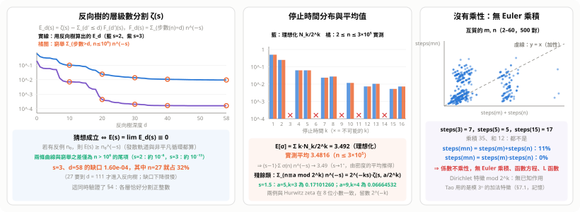

### 3.15 Möbius 函數

> 標示「（已驗證）」者，是我用程式實際檢查過的結果；「記憶」為依印象整理、未核對的說法。結論先說：**Möbius 函數 $\mu$ 與 Collatz 沒有已知的直接關係**。下面三個接點中，只有第一個是有內容的（反演是動力 zeta 的標準工具），其餘兩個是數值觀察或弱檢查。

**1. Möbius 反演：從動力 zeta 取出「恰好週期 $k$」的點數**

§3.13 的 $N_k=\#\{x\in\mathbb{Z}:T^k(x)=x\}$ 把所有週期整除 $k$ 的點都算進去。要得到「最小週期恰為 $k$」的點數 $P_k$，要做 Möbius 反演：

$$
N_k=\sum_{d\mid k}P_d\quad\Longleftrightarrow\quad P_k=\sum_{d\mid k}\mu\!\left(\tfrac{k}{d}\right)N_d,\qquad\text{原始循環數}=P_k/k
$$

我重新算了 $N_k$：對每條長 $k$ 的奇偶向量，寫 $T^k(x)=(3^ax+b)/2^k$，解 $x=b/(2^k-3^a)$，再檢查它是整數且真的走出這條奇偶向量（ $k\le18$，共 $2^{18}$ 條，已驗證）。結果 $N_k=2,4,5,4,2,7,2,4,5,4,13,7,2,4,5,4,2,7$，與 §3.13 一致，反演後：

| 範圍 | $P_k$（恰好週期 $k$ 的點數） | 原始循環 |
|---|---|---|
| $\mathbb{Z}$， $k=1$ | 2 | $\{0\}$、 $\{-1\}$ |
| $\mathbb{Z}$， $k=2$ | 2 | $\{1,2\}$ |
| $\mathbb{Z}$， $k=3$ | 3 | $\{-5,-7,-10\}$ |
| $\mathbb{Z}$， $k=11$ | 11 | 一個長 11 的負整數循環 |
| $\mathbb{Z}$，其餘 $k\le18$ | 0 | 無 |
| 正整數 | 只有 $P_2=2$ | $\{1,2\}$ |
| $\mathbb{Z}_2$， $k=1,\dots,12$ | $\sum_{d\mid k}\mu(k/d)2^d=2,2,6,12,30,54,126,240,504,990,\dots$ | 原始循環數 $2,1,2,3,6,9,18,30,56,99,186,335$（Lyndon 字數） |

每個 $P_k$ 都是 $k$ 的整數倍，這是內部一致性檢查，全部通過（已驗證）。

這是動力系統裡常見的標準用法，與 Collatz 的特殊性無關： $\mathbb{Z}_2$ 上 $T$ 與位移共軛（§3.1），所以原始循環數就是長度為 $k$ 的 Lyndon 字數。 $\mathbb{Z}$ 上（ $k\le18$）只有 5 個有限循環（ $\{0\}$、 $\{-1\}$、 $\{1,2\}$、 $\{-5,-7,-10\}$ 與長 11 的那個），與 $\mathbb{Z}_2$ 上的爆炸成長相比差距極大，但**這只涵蓋 $k\le18$，不是「沒有其他循環」的證明**。

**2. $\mu$ 的隨機性檢查（啟發式）**

$\mu(n)\in\{-1,0,1\}$ 被認為「看起來像隨機符號」；Sarnak 猜想（記憶）說 $\mu$ 與零熵動力系統產生的序列不相關。我檢查 $\mu$ 與 Collatz 的兩個統計量是否相關： $\text{steps}(n)$（標準映射到 1 的步數）與停止時間 $\sigma(n)$（第一個使 $T^j(n) < n$ 的 $j$，§3.14）。判斷標準是： $\mu$ 非零的個數約 $\tfrac{6}{\pi^2}N$，所以純隨機符號的部分和標準差約 $\sqrt{(6/\pi^2)N}$：

| $N$ | $\sum\mu(n)(-1)^{\text{steps}(n)}$ | $\sum\mu(n)(-1)^{\sigma(n)}$ | 隨機游走 sd | Mertens $M(N)$ |
|---|---|---|---|---|
| $10^3$ | 9（ $+0.37$ sd） | $-21$（ $-0.85$ sd） | 25 | 1 |
| $10^4$ | 102（ $+1.31$ sd） | $-134$（ $-1.72$ sd） | 78 | $-24$ |
| $10^5$ | 143（ $+0.58$ sd） | $-139$（ $-0.56$ sd） | 247 | $-49$ |
| $10^6$ | 925（ $+1.19$ sd） | 65（ $+0.08$ sd） | 780 | 211 |

$N\ge10^3$ 的所有取樣點（每 5000 取一點）兩個和都落在 $\pm3$ sd 內（已驗證），沒有偵測到相關性。這與 Sarnak 猜想的精神一致，但那條猜想針對零熵系統，Collatz 的步數函數是否屬於可套用的範圍，我沒有把握（記憶，未查證）。所以這只是**數值觀察，不是定理**，也不能當作該猜想的實例。（順帶一提，Mertens 函數的 $M(x)=O(x^{1/2+\varepsilon})$ 等價於 Riemann 猜想，依記憶，見 `Riemann-Hypothesis.md`；這與 Collatz 無關。）

**3. Syracuse 像的無平方因子比例（弱檢查）**

奇數 $n$ 的 Syracuse 像 $(3n+1)/2^k$ 一定與 6 互質（§3.13），所以若像的質因數分布「沒有偏向」，無平方比例應是

$$
\prod_{p\ge5}\bigl(1-p^{-2}\bigr)=\frac{6/\pi^{2}}{(1-\tfrac14)(1-\tfrac19)}=0.9119
$$

實測（奇數 $n\le4\times10^5$）：無平方比例 $0.9120$，被 5 整除 $0.200$（預測 $0.2$），被 25 整除 $0.040$（預測 $0.04$）， $\mu$ 的平均值 $-0.0028$（已驗證）。直接對與 6 互質的整數 $\le1.2\times10^6$ 數，比例也是 $0.9119$。

這個檢查很弱：每個與 6 互質的整數都能當 Syracuse 像，所以它只確認「像沒有偏向某些質因數」，近乎平凡。

**沒有的部分**

Möbius 函數的核心身分 $1/\zeta(s)=\sum\mu(n)n^{-s}$ 需要乘性的係數；§3.14 已看到 $\text{steps}$ 不乘性，所以沒有把 $\mu$ 與層級數 $F_d(s)$ 連起來的自然方式。我也沒有找到把 $\mu$ 與軌道、停止時間聯繫起來的已知結果（未查證文獻）。

| 接點 | 性質 |
|---|---|
| Möbius 反演取恰好週期點數 | 精確、有用（接 §3.13），但是通用的動力系統工具 |
| $\mu$ 與 $\text{steps}$、 $\sigma$ 的隨機性 | 數值觀察， $N\le10^6$ 無相關，非定理 |
| Syracuse 像的無平方比例 | 弱檢查，近乎平凡 |

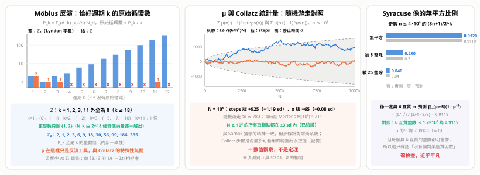

### 3.16 Lambert W 函數

> 標示「（已驗證）」者，是我用程式實際檢查過的結果；「記憶」為依印象整理、未核對的說法。結論先說：**Lambert W 函數與 Collatz 沒有已知的直接關係**。我用標準網頁搜尋找過，沒有結果把兩者連在一起，但這個搜尋很淺，不算窮盡。唯一能驗證的接點，是反解 $N\ln N$ 型成本的通用技巧。

$W$ 是 $w\,e^{w}=x$ 的解， $x\ge0$ 時有一支實數解 $W_0$， $-1/e\le x<0$ 時有兩支 $W_0\ge-1$ 與 $W_{-1}\le-1$。

**1. 反解驗證成本（已驗證，但是通用技巧）**

§5 說軌道平均步數約 $a\ln n$， $a=\dfrac{1.5}{\tfrac12\ln\tfrac43}=10.428$（標準映射的 $3n+1$ 與 $n/2$ 各算一步，所以比 $T$ 的 $6.95$ 多乘 $1.5$）。把全部 $n\le N$ 逐一跑到 1，總步數約為

$$
S(N)=\sum_{n\le N}\text{steps}(n)\approx a\,(N\ln N-N)+bN
$$

給定總步數預算 $B$，要反解 $N$。令 $u=\ln N-1+b/a$，則 $ue^{u}=\tfrac{B}{a}e^{-1+b/a}$，所以

$$
N=\exp\!\Bigl(1-\tfrac{b}{a}+W\!\bigl(\tfrac{B}{a}\,e^{-1+b/a}\bigr)\Bigr)
$$

我用 $N\in[10^4,10^5]$（每 1000 取一點）擬合 $b=-1.80$（標準差 $0.36$），再從實際的 $S(N)$ 反解 $N$（已驗證）：

| 真實 $N$ | $W$ 反解的相對誤差 | 只解 $N\ln N=B/a$ 的相對誤差 |
|---|---|---|
| $10^5$ | $-0.25\%$ | $-9.6\%$ |
| $2\times10^5$ | $-0.29\%$ | $-9.2\%$ |
| $5\times10^5$ | $-0.26\%$ | $-8.6\%$ |
| $10^6$ | $-0.29\%$ | $-8.2\%$ |

在 $2\times10^4$ 到 $10^6$ 之間取 45 個對數間隔的 $N$， $N>10^5$ 的外推點誤差都在 $0.35\%$ 以內，整個範圍在 $0.66\%$ 以內。要注意三點：

- **非獨立驗證**：擬合範圍 $[10^4,10^5]$ 與 $N=10^5$ 的檢查點重疊，只有 $N>10^5$ 算外推。
- **$b$ 不是常數**：逐點的 $b_N=S(N)/N-a(\ln N-1)$ 在 $N=10^3,10^4,10^5,10^6$ 分別是 $-2.07,-0.65,-2.09,-2.21$，擬合值只是範圍內的平均。
- **實務上不需要**：真正的大規模驗證用早停（降到比 $n$ 小就停，§9），每個 $n$ 平均只要 $3.48$ 步（ $n\le2\times10^5$，已驗證），成本是線性的，沒有 $\ln N$ 因子，也就用不到 $W$。

這與 Collatz 無關：任何 $N\ln N$ 型成本（例如比較排序）都可以這樣反解。

**2. 不成立的聯想：Cayley 樹**

$W$ 的經典出處是樹函數 $T(z)=ze^{T(z)}=-W(-z)$，用來數帶標號的樹（ $n^{n-1}$ 棵），係數的成長率 $n^{n-1}/n!$ 的相鄰比趨向 $e$（ $n=300$ 為 $2.705$，已驗證），收斂半徑 $1/e$。§3.11 提到反向樹每個節點有 1 或 2 個子節點，這一類形狀的計數是 Motzkin 型，母函數是代數函數，相鄰比趨向 $3$（ $n=300$ 為 $2.985$，已驗證），半徑 $1/3$。兩者的奇點都是平方根型，但數的是不同的東西。

Collatz 的反向樹並不是「所有一元—二元樹」，而是**固定的一棵樹**（分支由 $n\bmod6$ 決定），層級數約 $\lambda^d$（§3.9），不是 Cayley 型的計數，所以沒有 $W$。上面「形狀類型」的說法是依 §3.11 的結構推論。

**沒有的部分**

循環條件 $2^k$ 與 $3^s$ 的比較用的是對數與連分數（§3.10），沒有出現 $xe^x$ 型的方程；軌道、停止時間與 $W$ 之間也沒有我知道的關係。

| 接點 | 性質 |
|---|---|
| 反解 $N\ln N$ 型的步數預算 | 數值上準（誤差約 $0.3\%$），但通用，且實務用不到 |
| 與 Cayley 樹的 $W$ | 結構不同，無關 |
| 循環、軌道、停止時間 | 無已知關係 |

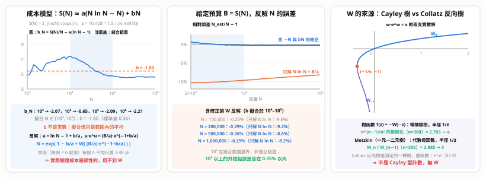

### 3.17 Gamma 函數

> 標示「（已驗證）」者，是我用程式實際檢查過的結果；「記憶」為依印象整理、未核對的說法。結論先說：**Gamma 函數與 Collatz 沒有已知的直接關係**（我沒有另外搜尋文獻）。三個接點中，第一個是我自己推出來的精確閉式，但在實際相關的範圍內不改變 §3.8 的結論；其餘兩個是標準工具。

**1. 循環乘積的 Gamma 閉式（已驗證，但實務上不改變結果）**

§3.8 的循環恆等式是 $2^k/3^s=\prod_i\bigl(1+\tfrac1{3n_i}\bigr)$，其中 $n_1,\dots,n_s$ 是循環裡 $s$ 個互異的奇數元素。每個因子隨 $n_i$ 遞減，所以固定 $n_{\min}=m$ 時，乘積最大的情形是取 $m$ 起最小的 $s$ 個奇數。這個乘積有 Gamma 閉式：

$$
\prod_{j=0}^{s-1}\Bigl(1+\frac{1}{3(m+2j)}\Bigr)=\frac{\Gamma(s+\alpha)\,\Gamma(\beta)}{\Gamma(\alpha)\,\Gamma(s+\beta)},\qquad\alpha=\frac{m+1/3}{2},\ \ \beta=\frac m2
$$

因為 $1+\frac1{3x}=\frac{x+1/3}{x}$，令 $x=m+2j$ 後把分子分母各除以 $2$，就是兩個等差數列的乘積，即 Gamma 函數的比值。驗證（已驗證）：

- $m=1$， $s\le50$：與精確分數相符（相對誤差 $<10^{-11}$）。
- $(m,s)=(1,7),(3,20),(101,300),(1001,5000)$：與逐項 $\ln(1+\tfrac1{3(m+2j)})$ 累加相符（差 $<10^{-9}$）。
- $m=10^6+1$， $s=10^3,\dots,4\times10^6$：與逐項累加相符（差 $<10^{-8}$）。

$m=1$ 時，乘積隨 $s$ 只長 $\dfrac{\sqrt\pi}{\Gamma(2/3)}\,s^{1/6}=1.3089\,s^{1/6}$： $s=10^3$ 為 $4.1393$（漸近式 $4.1392$）， $s=10^6$ 為 $13.0894$（比值 $1+1.3\times10^{-8}$）。粗上界 $(4/3)^s$ 在 $s=10$ 就是 $17.8$。這是理論極端，真實的循環最小元素遠大於 $1$。

與 §3.8 較粗的上界 $\bigl(1+\tfrac1{3m}\bigr)^s$ 比較（已驗證）：

| $m$ | $s$ | Gamma 乘積 | 粗上界 |
|---|---|---|---|
| $10^6+1$ | $10^3$ | $1.00033$ | $1.00033$ |
| $10^6+1$ | $10^6$ | $1.20094$ | $1.39561$ |
| $10^6+1$ | $4\times10^6$ | $1.44225$ | $3.79366$ |
| $1001$ | $10^6$ | $3.55$ | 約 $10^{144}$ |

兩個上界的 $\ln$ 的相對差約為 $s/m$（ $x=s/m$ 從 $10^{-3}$ 到 $4$ 都驗證過，介於 $0.3x$ 與 $1.1x$ 之間）。只有 $s\gtrsim m$ 時 Gamma 形式才明顯更緊；另外，近似式 $((m+2s)/m)^{1/6}$ 與 Gamma 閉式的最大相對差是 $1.2\times10^{-7}$（ $m=10^6+1$）。

實際情形是 $n_{\min}>2^{68}$（§3.8 的假設）、 $k\ge2.78\times10^{10}$ 即 $s\approx1.7\times10^{10}$， $s/m\approx6\times10^{-11}$，所以兩個上界的 $\ln$ 只差約 $6\times10^{-11}$ 的比例（**估計**；雙精度的 `lgamma` 在 $10^{20}$ 的參數下相減會失真，所以我沒有直接算）。它是漂亮的閉式，但不會改變 §3.8 的結論。這是我自己的推導，是否有人這樣用過我沒查證。

**2. Gamma 當作階乘與二項係數的延拓（已在 §3.9 涵蓋）**

奇偶向量的計數 $\binom ks=\dfrac{\Gamma(k+1)}{\Gamma(s+1)\,\Gamma(k-s+1)}$，Stirling 公式就是它的近似。§3.9 已用 Stirling 公式算出奇偶向量的熵，這裡沒有新內容，我也沒有重算。

**3. Mellin 變換與 Dirichlet 級數（標準恆等式，未針對 Collatz 驗證）**

$\Gamma(s)\sum a_nn^{-s}=\int_0^\infty t^{s-1}\sum a_ne^{-nt}\,dt$ 可以套在 §3.14 的層級數 $F_d(s)$ 上。完備化的 $\zeta$ 裡的 $\pi^{-s/2}\Gamma(s/2)$ 因子，則是跟函數方程一起來的；Collatz 的層級數沒有函數方程（§3.14），所以 $\Gamma$ 在這裡沒有作用。

**沒有的部分**：軌道、停止時間與 $\Gamma$ 之間，我知道的範圍內沒有關係。

| 接點 | 性質 |
|---|---|
| 循環乘積的 Gamma 閉式 | 精確、已驗證，但在已知範圍（ $s\ll n_{\min}$）與粗上界無差別 |
| 階乘／二項係數的延拓 | 已在 §3.9 涵蓋，無新內容 |
| Mellin 變換與 Gamma 因子 | 通用恆等式；Collatz 無函數方程，無作用 |
| 軌道、停止時間 | 無已知關係 |

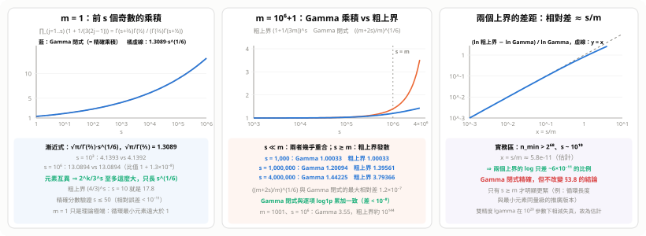

### 3.18 Euler 乘積

> 標示「（已驗證）」者，是我用程式實際檢查過的結果；「記憶」為依印象整理、未核對的說法。結論先說：**Collatz 的「步數」沒有 Euler 乘積（§3.14：步數不乘性），但有幾處真實的 Euler 乘積結構**，最有意思的是 $\mathbb{Z}_2$ 上的動力 zeta 與 $\mathbb{F}_2[x]$ 的 zeta 函數是同一個式子。

**1. $\mathbb{Z}_2$ 上：Euler 乘積取遍 Lyndon 字（已驗證）**

$\mathbb{Z}_2$ 上 $T$ 與位移共軛（§3.1），原始循環的個數是長度 $k$ 的 Lyndon 字數 $L_k=\frac1k\sum_{d\mid k}\mu(k/d)\,2^d$（§3.15 的 Möbius 反演）：

$$
L_k:\ 2,\,1,\,2,\,3,\,6,\,9,\,18,\,30,\,56,\,99,\,186,\,335,\,630,\,1161\quad(k=1,\dots,14)
$$

我驗證了

$$
\prod_{k\ge1}\bigl(1-z^k\bigr)^{-L_k}=\frac{1}{1-2z}
$$

展開到 $z^{14}$，係數恰為 $2^n$，與 §3.13 的 $\zeta_T(z)=1/(1-2z)$ 一致。另外我用窮舉驗證了兩件事：長度 $k\le12$ 的二元 Lyndon 字數與公式一致； $\mathbb{F}_2$ 上次數 $\le12$ 的不可約多項式個數也與公式一致（兩者都是 $2,1,2,3,6,9,18,30,56,99,186,335$）。

所以 $\zeta_T$ 與 $\mathbb{F}_2[x]$ 的 zeta 函數是同一個式子：令 $z=2^{-s}$， $\zeta_{\mathbb{F}_2[x]}(s)=\prod_P(1-2^{-s\deg P})^{-1}=1/(1-2^{1-s})$（取遍首一不可約多項式 $P$，記憶）。「質數」對應「基本循環」，「素數定理」對應 $2^k$ 的成長率。函數域版本的 RH 在這裡是平凡的：沒有零點，只有一個極點。

**2. 整數上：只有 5 個「質數」**

$k\le18$ 內， $\zeta_T=(1-z)^{-2}(1-z^2)^{-1}(1-z^3)^{-1}(1-z^{11})^{-1}$，Euler 乘積只有 5 個因子（§3.13）。相對於 $\mathbb{Z}_2$ 上無窮多個因子， $\mathbb{Z}$ 上的稀少正是「沒有非平凡正循環」的另一種說法。

**3. Syracuse 像的局部密度：質因數的整除事件（已驗證）**

像一定與 6 互質（ $p=2,3$ 被結構拿掉，§3.13）。對 $p\ge5$，我用奇數 $n\le4\times10^5$ 的 Syracuse 像（共 $200{,}000$ 個）檢查：

| 檢查 | 實測 | Euler 乘積預測 |
|---|---|---|
| 被 $5,7,11,13,17$ 整除的比例 | $0.2000,\,0.1429,\,0.0909,\,0.0769,\,0.0588$ | $1/p$（四位小數全相符） |
| 與 $5,7,11,13$ 互質 | $0.5754$ | $\prod(1-1/p)=0.5754$ |
| 與 $5,\dots,23$ 互質 | $0.4908$ | $0.4908$ |
| 無平方比例 | $0.9120$ | $\prod_{p\ge5}(1-p^{-2})=0.9119$（§3.15） |

$p=5,\dots,23$ 的相對偏差（實測比例 $\times\,p-1$）絕對值都不超過 $4\times10^{-5}$，比獨立抽樣的標準差（ $\ge0.0045$）小兩個數量級。這表示像在模 $p$ 上**比隨機抽樣更均勻**（確定性的結構），不是「更隨機」；標準差在這裡只是尺度。又因為每個與 6 互質的整數都能當 Syracuse 像，這個檢查偏弱（§3.15 已提過）。

質數的個數：像中有 $52{,}500$ 個質數，啟發式預測 $\sum3/\ln m=52{,}683.6$，比值 $0.9965$（偏差約 $0.35\%$）。 $3/\ln m$ 是密度 $1/\ln m$ 除以「與 6 互質」的比例 $\prod_{p=2,3}(1-\tfrac1p)=\tfrac13$，屬於 Hardy–Littlewood 風格的啟發式，不是定理。對照組：與 6 互質的整數（ $\le1.2\times10^6$）的質數比例是 $0.2323$，平均 $3/\ln m=0.2325$，比值 $0.9993$。像的質數比例是 $0.2625$，約是一般整數 $1/\ln m$ 的 $3$ 倍。

**4. 長得像但不是：循環恆等式的乘積**

§3.8 的 $2^k/3^s=\prod_i(1+\tfrac1{3n_i})$ 是對循環的**元素**取乘積，不是對質數或循環取 Euler 乘積；§3.17 給了它的 Gamma 閉式。

**沒有的部分**：步數不乘性（ $\text{steps}(3)=7$、 $\text{steps}(5)=5$、 $\text{steps}(15)=17$，§3.14），所以沒有把停止時間寫成 Euler 乘積、函數方程或 $L$ 函數的方式。

| 接點 | 性質 |
|---|---|
| $\mathbb{Z}_2$ 上的動力 zeta | Euler 乘積取遍 Lyndon 字， $=1/(1-2z)$，與 $\mathbb{F}_2[x]$ 的 zeta 相同（已驗證到 $z^{14}$） |
| $\mathbb{Z}$ 上的動力 zeta | 只有 5 個因子（ $k\le18$） |
| Syracuse 像的局部密度 | $p\ge5$ 的整除比例吻合 $1/p$，且比隨機抽樣更均勻；質數個數吻合 $3/\ln m$（啟發式，偏弱） |
| 循環恆等式的乘積 | 對元素取乘積，不是 Euler 乘積 |
| 步數 | 非乘性，無 Euler 乘積 |

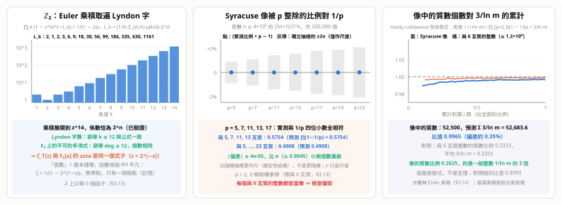

### 3.19 Selberg 跡公式

> 標示「（已驗證）」者，是我用程式實際檢查過的結果；「記憶」為依印象整理、未核對的說法。結論先說：**Collatz 與 Selberg 跡公式沒有已知的直接關係**。Selberg 跡公式把雙曲曲面上 Laplacian 的**譜**（本徵值）與**閉測地線**（週期軌道）的長度連起來；Collatz 沒有曲面，也沒有 Laplacian。唯一對得上的是它的**離散類比**，即符號動力（位移映射）的跡公式。

**1. 位移映射的離散跡公式（已驗證）**

$\mathbb{Z}_2$ 上 $T$ 與位移共軛（§3.1）。位移的轉移矩陣是 de Bruijn 圖的鄰接矩陣 $A$（ $2^n$ 個狀態）。我對 $n=3,4$ 算了：

- $\mathrm{tr}(A^k)=2^k$， $k=1,\dots,12$ 全部成立，而 $2^k$ 正是週期點數 $N_k$。
- 特徵多項式只剩 $x^{N}-2x^{N-1}$（ $N$ 是狀態數），也就是譜只有 $\{2,0,\dots,0\}$，所以 $\det(1-zA)=1-2z$。
- 另外驗證了 $N_k=\sum_{d\mid k}d\,L_d$（ $k\le12$， $L_d$ 為 §3.18 的 Lyndon 字數）。

這給出

$$
\underbrace{\mathrm{tr}(A^k)}_{\text{譜側}}=\underbrace{N_k=\sum_{d\mid k}d\,L_d}_{\text{週期軌道側}},\qquad
\zeta_T(z)=\frac{1}{\det(1-zA)}=\frac{1}{1-2z}
$$

這與 §3.13、§3.18 的動力 zeta 一致，形式上就是 Selberg 跡公式的對應物：譜（這裡只有一個本徵值 $2$）對應週期軌道（Lyndon 字）。這是 Bowen–Lanford／Ruelle 一類的標準結果（記憶）。

**2. 質軌道定理的類比（已驗證）**

Selberg 的質測地線定理說，長度 $\le x$ 的原始閉測地線約有 $e^{x}/x$ 條（記憶）。 $\mathbb{Z}_2$ 上對應的是 §3.18 的 Lyndon 字數 $L_k\sim2^k/k$：

| $k$ | $4$ | $8$ | $12$ | $16$ | $20$ | $24$ | $30$ |
|---|---|---|---|---|---|---|---|
| $L_kk/2^k$ | $0.75$ | $0.9375$ | $0.9814$ | $0.9961$ | $0.99901$ | $0.99974$ | $0.99997$ |

收斂很快，誤差約 $2^{-k/2}$ 量級（例如 $k=20$ 的誤差 $9.9\times10^{-4}$、 $2^{-10}=9.8\times10^{-4}$）。這裡 $e^x$ 對應 $2^k$，拓撲熵 $\ln2$ 取代了曲率。

**3. 整數循環的乘數（已驗證）**

五個已知循環的乘數 $\lambda=3^s/2^k$（ $k$ 是長度， $s$ 是奇數步數）：

| 循環 | $k$ | $s$ | $\lambda$ | 類型 | $1/\lvert1-\lambda\rvert$ |
|---|---|---|---|---|---|
| $\{0\}$ | 1 | 0 | $1/2$ | 吸引 | $2$ |
| $\{-1\}$ | 1 | 1 | $3/2$ | 排斥 | $2$ |
| $\{1,2\}$ | 2 | 1 | $3/4$ | 吸引 | $4$ |
| $\{-5,-7,-10\}$ | 3 | 2 | $9/8$ | 排斥 | $8$ |
| 含 $-17$ 的 11-循環 | 11 | 7 | $2187/2048$ | 排斥 | $14.73$ |

最後一欄就是 $2^k/\lvert2^k-3^s\rvert$。實數上的 Ruelle 型跡公式會用 $1/\lvert1-\lambda\rvert$ 當權重，但 $T$ 在 $\mathbb{R}$ 上斜率是 $1/2$ 與 $3/2$，**不是一致擴張**，標準公式不適用（記憶／推論）。這張表只是整理，沒有譜的意義。

**沒有的部分**

- **沒有幾何**（推論）： $T$ 的兩個分支 $x\mapsto x/2$、 $x\mapsto(3x+1)/2$ 是 Möbius 變換，矩陣 $\begin{pmatrix}1&0\\0&2\end{pmatrix}$、 $\begin{pmatrix}3&1\\0&2\end{pmatrix}$ 都固定 $\infty$。它們生成的群落在上三角（仿射）群裡，是可解群；Selberg 需要的是半單群（如 $\mathrm{PSL}(2,\mathbb{R})$）裡的格點，所以沒有對應的雙曲曲面。
- **沒有 RH 類比**：Selberg zeta 的零點（對應本徵值）有「 $\mathrm{Re}\,s=\tfrac12$」的結構（記憶），Collatz 的動力 zeta 是有理函數，沒有零點（§3.13）。
- **真正的橋在別處**：Mayer（1991）把 Gauss 映射（連分數）的轉移算子與 $\mathrm{PSL}(2,\mathbb{Z})$ 的 Selberg zeta 連起來（記憶）。Collatz 與連分數的關係只經過 $\log_23$ 的收斂分數（§3.10），沒有轉移算子。

| 接點 | 性質 |
|---|---|
| 位移的離散跡公式 | 精確： $\mathrm{tr}(A^k)=2^k$，譜只有 $\{2\}$（已驗證） |
| 質軌道定理類比 | $L_kk/2^k\to1$（已驗證， $k\le30$） |
| 循環乘數 | 整理成表，無譜的意義 |
| 雙曲曲面、Laplacian、RH 類比 | 無（群是可解的，推論） |

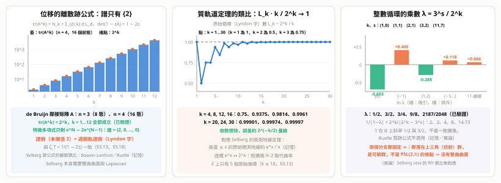

### 3.20 Hecke 算子

> 標示「（已驗證）」者，是我用程式實際檢查過的結果；「記憶」為依印象整理、未核對的說法。結論先說：**Collatz 與 Hecke 算子沒有已知的直接關係**。我用標準網頁搜尋找過，沒有結果把兩者或模形式連在一起，但這個搜尋很淺，不算窮盡。有一個形式上的巧合，但經驗證後它很快就失效。

**1. 反向樹的轉移算子，有一半是 Hecke 型算子（已驗證）**

作用在序列 $a=(a_n)$ 上，反向樹（§4）的轉移算子是

$$
(La)_n=a_{2n}+[\,n\equiv4\ (\mathrm{mod}\ 6)\,]\;a_{(n-1)/3}=(U_2a)_n+(Ra)_n
$$

其中 $(U_pa)_n=a_{pn}$。在 $q$-展開上，Hecke 算子是 $T_p=U_p+p^{k-1}V_p$（ $p$ 不整除層級時，記憶），所以 $U_p$ 是它的一部分。我驗證了 $U_pU_q=U_qU_p$（ $(p,q)=(2,3),(3,5),(2,5),(3,7),(5,7)$，用隨機整數序列 $N=60000$），這與 Hecke 算子互相交換一致。

**2. 但 $R$ 破壞了它（已驗證）**

同一組隨機序列上，檢查 $L$ 與 $U_p$ 是否交換：

| $p$ | $(LU_pa)_n\ne(U_pLa)_n$ 的比例 | $R$ 與 $U_p$ 不交換的比例 |
|---|---|---|
| 2 | $7122/15000$（約 $47\%$） | $9487/19999$（約 $47\%$） |
| 3 | $1574/10000$（約 $16\%$） | $3142/19999$（約 $16\%$） |
| 5 | $1887/6000$（約 $31\%$） | $3789/12000$（約 $32\%$） |
| 7 | $683/4285$（約 $16\%$） | 未算 |

Hecke 代數是交換的，所以 $L$ 不在其中。原因在 $R$ 的移位 $n\mapsto(n-1)/3$：在 $q$-展開上，下標平移 $-1$ 不是模形式的運算（推論）。

**3. 分支是 Hecke 陪集的元素（已驗證，但近乎定義）**

$T$ 的分支是整數的本原矩陣（四個元素的最大公因數為 $1$）：

| 分支 | 矩陣 | 行列式 | 所屬 |
|---|---|---|---|
| $x/2$ | $[[1,0],[0,2]]$（按列） | $2$ | $T_2$ 的 $3$ 個陪集之一 |
| $(3x+1)/2$ | $[[3,1],[0,2]]$（按列） | $6$ | $T_6$ 的 $12$ 個陪集之一 |
| 反向的 $(x-1)/3$ | $[[1,-1],[0,3]]$（按列） | $3$ | $T_3$ 的 $4$ 個陪集之一（模平移 $x\mapsto x+1$，推論） |

陪集數 $3,12,4$ 是 Dedekind 的 $\psi(2),\psi(6),\psi(3)$，我用窮舉確認過。我也檢查了 $x<2000$：奇數 $x$ 的 $T(x)$ 都落在 $T_6$ 的陪集像 $\{(ax+b)/d\}$ 裡，偶數 $x$ 的 $T(x)$ 都落在 $T_2$ 的陪集像裡。例如 $x=7$ 時 $T_6$ 的 $12$ 個像是 $42,\tfrac{21}{2},11,\tfrac{14}{3},5,\tfrac{16}{3},\tfrac76,\tfrac43,\tfrac32,\tfrac53,\tfrac{11}{6},2$，Collatz 取的是 $11$； $x=6$ 時 $T_2$ 的 $3$ 個像是 $12,3,\tfrac72$，Collatz 取 $3$。

但這只說明這些分支是 $\mathrm{GL}_2(\mathbb{Q})$ 中的本原整數矩陣，**任何這種矩陣都如此，沒有 Collatz 特有的資訊**。真正的差別是：Hecke 對應會同時給出全部 $3$、 $4$、 $12$ 個像，而 Collatz 用 $x$ 的奇偶性（一個同餘條件）**挑出其中一個**。

**4. Dirichlet 級數的角度（推論）**

$U_2$ 對應 $2^{-s}$ 因子，也就是 Euler 乘積在 $p=2$ 的因子： $F_{d+1}(s)=2^{-s}F_d(s)+\sum_{n\equiv4\,(6)}\bigl(\tfrac{n-1}{3}\bigr)^{-s}$（§3.14 的層級數）。第二項的平移 $n\mapsto n-1$ 會把級數變成 Hurwitz zeta，破壞乘性。Hecke 本徵形式的 $L$ 函數必須有 Euler 乘積，Collatz 的層級數沒有（§3.14、§3.18：步數不乘性），所以與模形式、 $L$ 函數沒有已知關係。

**5. 真正在做算子的文獻（只看過標題，沒讀內容）**

搜尋出現過 arXiv:2010.12987「Koopman operators and the $3x+1$-dynamical system」（Collatz 的 Koopman 算子與 3x+1 問題），以及 arXiv:1209.3495「The Collatz conjecture and De Bruijn graphs」（與 §3.19 用的 de Bruijn 圖有關）。

| 接點 | 性質 |
|---|---|
| $U_2$ 是 Hecke 型算子 | 是，且 $U_pU_q$ 交換（已驗證） |
| 完整的轉移算子 $L=U_2+R$ | 與 $U_p$ 不交換，不在 Hecke 代數裡（已驗證） |
| 分支屬於 Hecke 陪集 | 對，但對任何本原整數矩陣都成立；Collatz 用奇偶性挑一個（近乎定義） |
| 與模形式、 $L$ 函數的關係 | 無已知關係；無 Euler 乘積 |

### 3.21 Ramanujan 求和

> 標示「（已驗證）」者，是我用程式實際檢查過的結果；「記憶」為依印象整理、未核對的說法。結論先說：**Collatz 與 Ramanujan 求和沒有已知的直接關係**。我用標準網頁搜尋找過，只找到一篇 2025 年的預印本聲稱兩者相關，據搜尋摘要，它自己也承認 Ramanujan 沒有處理過 Collatz，且結論過度推論，我視為不可靠。「Ramanujan 求和」可能指兩件事：給發散級數賦值（ $1+2+3+\cdots=-\tfrac1{12}$），或 Ramanujan 和 $c_q(n)$；兩種都檢查了。

**1. 幾何級數的正規化值就是分支的不動點（已驗證，但通用）**

任何方法（Abel、 $\zeta$ 正規化、Ramanujan）都給 $\sum a^j=\dfrac1{1-a}$，而且當 $\lvert a\rvert_p<1$ 時，這就是 $p$-進極限。對 Collatz：

- **標準映射的奇數分支** $x\mapsto3x+1$，從 $0$ 出發得 $x_k=\sum_{j < k}3^j=(3^k-1)/2$。精確有 $x_k+\tfrac12=\tfrac{3^k}{2}$（ $k\le14$），所以 $3$-進意義下 $x_k\to-\tfrac12=\tfrac1{1-3}$，正是該分支的不動點；實數距離 $3^k/2$ 發散， $3$-進距離 $3^{-k}$ 收斂。
- **$T$ 的奇數分支** $(3x+1)/2$ 的不動點是 $-1$，對應 $\sum2^j=\tfrac1{1-2}=-1$。已驗證 $T^j(2^k-1)=3^j2^{k-j}-1$（ $k=5,10,16$， $j\le k$）以及 $v_2\bigl((2^k-1)+1\bigr)=k$（ $k\le20$），這就是 §3.3 的 Mersenne 數貼近 $-1$。

但這對**所有**幾何級數都成立，不是 Ramanujan 求和特有的，也沒有給 Collatz 新資訊。

**2. $1+2+3+\cdots=-\tfrac1{12}$：沒有出現（已驗證／推論）**

$-\tfrac1{12}=\zeta(-1)$。形式上可以問：把 §3.14 的層級數分割 $\zeta(s)=\sum_dF_d(s)$ 代入 $s=-1$，會不會得到 $\sum_d\bigl(\text{第 }d\text{ 層的和}\bigr)=-\tfrac1{12}$？

- 每個 $F_d(s)$ 是有限和，對所有 $s$ 都有定義；但分割只在 $\mathrm{Re}\,s>1$ 有意義（推論）。
- 我算了反向樹第 $d$ 層所有數的和 $S_d$（ $d\le46$）： $S_{d+1}/S_d$ 在 $d=30,\dots,45$ 之間於 $2.08$ 到 $2.16$ 之間交替擺動（圖中只畫到 $d=45$），所以 $\sum_dS_d$ 幾何發散。層的大小比則穩定在 $1.263$（ $d\ge40$，§3.9）。
- $S_d$ 不是純幾何級數，沒有理由其正規化值是 $-\tfrac1{12}$，也沒有已知的解析延拓把它與 $\zeta(-1)$ 連起來。

**3. Ramanujan 和 $c_q(n)$ 與 2-進同餘類（已驗證，但通用）**

$c_q(n)=\sum_{\gcd(a,q)=1}e^{2\pi ian/q}$。我驗證了 $q=2^k$（ $k\le6$， $0\le n\le128$）時

$$
[\,q\mid n\,]=\frac1q\sum_{d\mid q}c_d(n),\qquad c_{2^k}(n)=2^k[\,2^k\mid n\,]-2^{k-1}[\,2^{k-1}\mid n\,]
$$

全部成立。Collatz 的前 $k$ 步由 $n\bmod2^k$ 決定（§3.1），所以這些同餘類的指示函數可以寫成 Ramanujan 和的線性組合。但這只是 $\mathbb{Z}/2^k\mathbb{Z}$ 上的一般調和分析。§7.1 提到 Tao 用的是模 $3^n$ 的加法特徵（記憶），不是 Ramanujan 展開。我不知道有人把 $\text{steps}(n)$ 做 Ramanujan 展開（沒查）。

| 接點 | 性質 |
|---|---|
| 幾何級數的正規化值 | 等於分支不動點（ $-\tfrac12$、 $-1$），對所有幾何級數成立，非 Ramanujan 特有 |
| $\sum n=-\tfrac1{12}$ | 未出現；層級和 $S_d$ 幾何發散，無已知延拓 |
| Ramanujan 和 $c_q(n)$ | 2-進同餘類指示函數的標準展開，無 Collatz 特有資訊 |
| 與猜想的關係 | 無已知關係 |

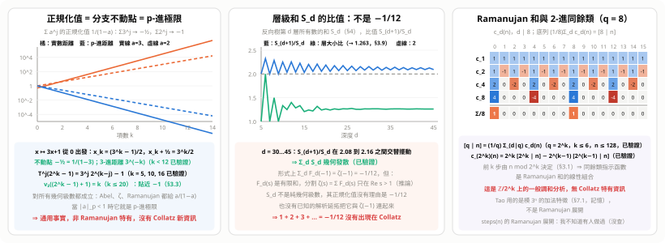

### 3.22 Mellin 變換

> 標示「（已驗證）」者，是我用程式實際檢查過的結果；「記憶」為依印象整理、未核對的說法。結論先說：**Collatz 與 Mellin 變換沒有已知的直接關係**。Mellin 變換是處理乘法結構（伸縮）與 Dirichlet 級數的語言。下面有兩個接點值得一看：一個把 §3.16 的成本公式讀成 Dirichlet 級數的極點，一個用 Mellin 型的矩條件預測軌道最大值的尾巴，後者我用數值驗證過。

**1. Mellin–Perron：S(N) 的公式就是 s=1 雙重極點的留數（推論）**

$\Gamma(s)\sum a_nn^{-s}=\int_0^\infty t^{s-1}\sum a_ne^{-nt}\,dt$（§3.17），所以 §3.14 的層級數 $F_d(s)$ 就是 $\sum_{n\in L_d}e^{-nt}$ 的 Mellin 變換（ $L_d$ 是反向樹第 $d$ 層的所有數）。

再看總步數的級數 $D(s)=\sum\mathrm{steps}(n)\,n^{-s}$。§3.14 提過它在 $s=1$ 應有二階極點（啟發式，沒驗證）。令 $D(s)\approx\frac{a}{(s-1)^2}+\frac{b}{s-1}$，Mellin–Perron 公式 $\sum_{n\le x}\mathrm{steps}(n)=\frac1{2\pi i}\int D(s)\frac{x^s}{s}\,ds$ 的留數是

$$
\mathrm{Res}_{s=1}\,D(s)\frac{x^s}{s}=x\left[a(\ln x-1)+b\right]
$$

與 §3.16 的 $S(N)\approx a(N\ln N-N)+bN$ 完全同形， $b$ 是單極點的係數。這是形式推導，我沒有直接驗證 $D(s)$ 的極點結構。

**2. 伸縮的 Mellin 對角化與軌道最大值的尾巴（已驗證）**

當 $n$ 很大時， $T$ 的分支近似於伸縮：偶數乘 $\frac12$，奇數乘 $\frac32$。Mellin 變換正是對伸縮對角化的。隨機模型（兩個分支各一半機率）的矩函數是

$$
M(s)=\frac12\left[(\frac12)^s+(\frac32)^s\right],\qquad M(0)=1,\quad M(1)=\frac12\cdot\frac12+\frac12\cdot\frac32=1,\quad M^{\prime}(0)=\frac12\ln\frac34<0
$$

負漂移的隨機游走，其最大值尾巴由 $M(s)=1$ 的非零根（Cramér 指數）決定（記憶），這裡根是 $s_c=1$。令 $m(n)$ 為從 $n$ 出發的 $T$ 軌道最大值，則預測

$$
P\left(m(n)\ge x\cdot n\right)\sim C/x
$$

我取 $n\in[10^6,2\times10^6]$ 的 $40000$ 個隨機起點，對 $T$ 算軌道最大值與 $n$ 的比 $m(n)/n$：

| $x$ | $2$ | $4$ | $8$ | $16$ | $32$ | $64$ | $128$ | $256$ |
|---|---|---|---|---|---|---|---|---|
| $x\cdot P(m(n)/n\ge x)$ | $0.851$ | $0.808$ | $0.826$ | $0.826$ | $0.828$ | $0.789$ | $0.832$ | $0.838$ |

$x\cdot P$ 在 $x=2$ 到 $256$ 間穩定在約 0.82，平均 0.825；每隔 $2^{1/4}$ 取點時範圍為 0.78 到 0.90。尾巴指數確實是 1。這支持「隨機模型的 Mellin 型矩條件預測對真實軌道有效」，但這只是數值吻合，不是證明。

**3. 反向樹上的 s=1 條件（推論）**

反向樹每個節點 $n$ 有子節點 $2n$，以及（ $n\equiv4\ (\mathrm{mod}\ 6)$ 時） $(n-1)/3$。若節點在模 $6$ 上均勻分布（比例 $1/6$），則

$$
2^{-1}+3^{1}\cdot\frac16=1
$$

也就是對數測度 $dn/n$ 在反向樹上平均守恆。這與 §3.13 的 $\zeta$ 在 $s=1$ 的極點一致，但只是代數恆等式，「均勻」是假設。方程 $2^{-s}+3^{s}/6=1$ 還有另一個根 $s\approx0.477$，我不知道它的意義。

**4. 試過但沒有結論**

我也試了更新定理的預測 $F_d(1)=\sum_{n\in L_d}1/n\to1/a=0.0959$。 $d\le47$ 時， $F_d(1)$ 在 $d\ge10$ 之間於 $0.067$ 到 $0.24$ 擺動， $d=30,\dots,47$ 的平均是 $0.081$。原因是 $d\approx47$ 對應的典型 $n$ 只有約 $90$，離散效應主導，這個深度算不出收斂，所以我不宣稱驗證。

| 接點 | 性質 |
|---|---|
| $F_d(s)$ 是 $\sum e^{-nt}$ 的 Mellin 變換 | 標準恆等式，無新資訊 |
| Mellin–Perron 與 $S(N)$ 公式 | 形式推導； $D(s)$ 的雙重極點未驗證 |
| 伸縮的矩條件 $M(1)=1$ 與尾巴 $\sim C/x$ | 隨機模型的預測，數值吻合（ $x\cdot P\approx0.82$） |
| 反向樹的 $2^{-1}+3\cdot\frac16=1$ | 代數恆等式，依賴均勻假設 |
| 更新定理 $F_d(1)\to1/a$ | 試過，深度不足，無結論 |

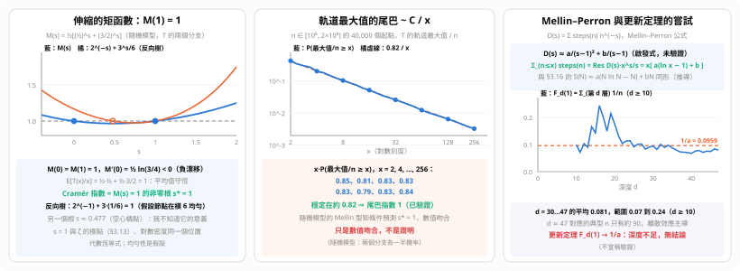

### 3.23 Fourier 變換

> 標示「（已驗證）」者，是我用程式實際檢查過的結果；「記憶」為依印象整理、未核對的說法；「搜尋摘要」指我只看過網頁搜尋的摘要，沒有讀原文。結論先說：**這是少數有真實連結的主題，但連結在「已證明的部分結果」，不在猜想本身**。Fourier 分析是 Tao 2019 年「幾乎所有軌道」結果的核心工具；除此之外，我檢查了幾個通用的 Fourier 結構。

**1. Tao 的方法（搜尋摘要）**

據搜尋結果，Tao 的論文（arXiv:1909.03562，Forum of Mathematics, Pi, 2022）證明：在對數密度的意義下，對幾乎所有 $N$， $\mathrm{Col}_{\min}(N)$ 小於任何趨向無窮的函數 $f(N)$，例如小於 $\log\log\log\log N$。證明歸結為估計 $\mathbb{Z}/3^n\mathbb{Z}$ 上一個**偏斜隨機游走的特徵函數在高頻的值**。之後 Gonçalves 等人（arXiv:2111.06170）把它推廣到其他參數的 Collatz 型映射。這印證了 §7.1 原本「記憶」的說法。Tao 也指出，更強的「存在一個絕對常數」的版本，可能和 Collatz 猜想一樣難。

**2. 偏斜隨機游走的穩態，不是均勻分布（已驗證）**

模 $27$ 時， $\mathrm{Syr}(n)=(3n+1)/2^v$， $v$ 是幾何分布（ $P(v=j)=2^{-j}$）。這是 $\mathbb{Z}/27$ 上的馬可夫鏈 $r\mapsto(3r+1)\,2^{-v}$。我用 $10^5$ 個 $n\in[10^9,2\times10^9]$ 的起點，檢查 $\mathrm{Syr}^K(n)\bmod27$ 的分布：

| $K$ | 與「18 個單位上均勻」的 TV 距離 | 與穩態的 TV 距離 |
|---|---|---|
| $1$ | $0.166$ | $0.328$ |
| $2$ | $0.277$ | $0.204$ |
| $3$ | $0.346$ | $0.0051$ |
| $4,\dots,8$ | $0.344$ 到 $0.347$ | $0.0034$ 到 $0.0062$ |

- **收斂很快**： $K=3$ 時就與穩態一致，雜訊下限約 $0.0046$（用穩態自己抽 $10^5$ 個樣本量到的 TV 距離）。
- **穩態不是均勻**：模 $3$ 時 $P(1)=\tfrac13$、 $P(2)=\tfrac23$（因為 $v$ 奇數的機率是 $\tfrac23$）。
- **Fourier 係數**：穩態在 $\xi=9,18$ 的 $\lvert\hat\pi(\xi)\rvert=0.577$，而單位上的均勻分布是 $0.5$。

這就是「偏斜隨機游走」的意思：高頻的特徵函數不為零，要估計的是它的大小。

**3. 轉移算子在 Fourier 基底下（已驗證）**

反向樹的轉移算子（§3.20）作用在 $e^{2\pi i\xi n}$ 上：

$$
L\,e^{2\pi i\xi n}=e^{2\pi i(2\xi)n}+\frac16\sum_{j=0}^{5}c_j\,e^{2\pi i(\xi/3+j/6)n},\qquad c_j=e^{-2\pi i\xi/3}\,e^{-2\pi i\cdot4j/6}
$$

也就是：**頻率加倍**，加上 $6$ 個「收縮 $3$ 倍並平移 $j/6$」的頻率。對 $\xi=0.1234$、 $n<1200$，直接計算與右式的最大誤差是 $2.6\times10^{-13}$。這是 §3.20 那個 Hecke 型多值對應在頻率空間的樣子。

**4. $\text{steps}(n)$ 的頻譜：2-進結構是 dyadic 譜線（已驗證）**

取 $n\in[2^{14},2^{18}]$，把 $\text{steps}(n)-a\ln n$（ $a=10.428$，§3.16）去均值後做 Fourier 分析，振幅（正弦成分的大小）如下：

| 頻率 | $1/16$ | $1/8$ | $3/16$ | $1/4$ | $5/16$ | $3/8$ | $7/16$ | $1/2$ |
|---|---|---|---|---|---|---|---|---|
| 振幅 | $5.37$ | $3.26$ | $3.51$ | $8.68$ | $4.88$ | $7.99$ | $2.60$ | $6.20$ |

背景（ $40$ 個隨機頻率）的中位數是 $0.154$，最大是 $0.696$，所以 dyadic 頻率 $j/2^m$ 的譜線都高出背景一個數量級以上。其中奇數 $n$ 的平均步數是 $125.55$、偶數是 $113.15$，差 $12.40$，對應頻率 $1/2$ 的振幅 $6.2$（差的一半）。原因是平均步數依賴 $n\bmod2^k$（§3.1），這是 $\mathbb{Z}/2^k\mathbb{Z}$ 上的一般 Fourier 結構。

**5. 其他通用結構**

- **整個延拓的頻譜只有三個頻率**（代數檢查）： $f(x)=x+\tfrac14-\tfrac{2x+1}{4}\cos\pi x$ 在整數 $0,\dots,200$ 與 $T$ 一致（已驗證），所以它的 Fourier 變換只在頻率 $0,\pm\tfrac12$（含導數項，因為有因子 $x$）。
- **$\ln n$ 上的 Fourier 變換就是 Mellin 變換**（§3.22）。§3.13 補的週期圖，在零點頻率與 $\ln2$ 等週期上沒有振盪。

| 接點 | 性質 |
|---|---|
| Tao 的模 $3^n$ 特徵函數方法 | 真實連結，已證明部分結果（搜尋摘要） |
| $\mathrm{Syr}^K \bmod 27$ 的穩態 | 非均勻， $K=3$ 收斂（已驗證） |
| 轉移算子的頻率對應 | 頻率加倍 + 6 個收縮平移（已驗證） |
| $\text{steps}(n)$ 的頻譜 | dyadic 譜線，高出背景一個數量級（已驗證） |
| 整個延拓的頻譜 | 只有 $0,\pm\tfrac12$ |
| 與猜想本身 | 沒有證明；Tao 的方法只給「幾乎所有」 |

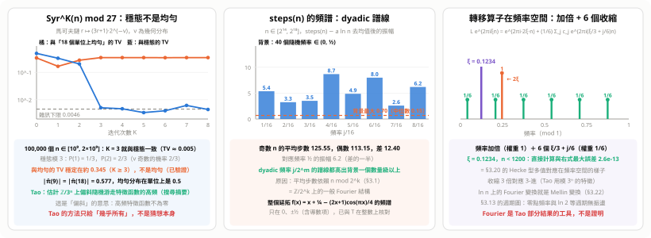

### 3.24 Laplace 變換

> 標示「（已驗證）」者，是我用程式實際檢查過的結果；「記憶」為依印象整理、未核對的說法。結論先說：**Collatz 與 Laplace 變換沒有已知的直接關係**（我沒有搜尋這個主題的文獻）。Laplace 變換是描述「指數增長率」與「首次通過時間」的語言，Collatz 有兩處與它相接：一處把 §5 的隨機模型讀成首次通過時間的累積量，我用數值驗證過；另一處是反向樹的指數增長率。

**1. Dirichlet 級數是 $\ln n$ 上的 Laplace 變換（推論）**

令 $n=e^u$，則 $D(s)=\sum a_nn^{-s}=\sum a_ne^{-su}$，也就是對 $\ln n$ 的 Laplace 變換。收斂橫坐標與極點給出指數增長率，這與 §3.22 的 Mellin–Perron 是同一件事。從 $D(s)$ 在 $s=1$ 的行為回推 $S(x)\sim a\,x\ln x$，是 Tauberian 方向（Karamata 一類的定理，記憶），需要 Tauberian 條件； $\text{steps}(n)$ 不單調，所以我們只有 Abelian 方向（§3.13）。

**2. 首次通過時間的累積量（已驗證）**

$T$ 的隨機模型（§5）：每步 $\ln n$ 加 $X$， $X=-\ln2$ 或 $+\ln\tfrac32$ 各一半機率。到達 $1$ 所需步數 $\tau$ 的矩母函數（Laplace 變換）約為 $E[z^\tau]\approx n^{-\theta(z)}$，其中 $\theta(z)$ 解 $z\,M(\theta)=1$， $M$ 是 §3.22 的矩函數（推導，記憶）。對 $z=1$ 附近展開，得到兩個累積量係數：

$$
\mu=\tfrac12\ln\tfrac34=-0.14384:\qquad E[\tau]\approx\frac{\ln n}{\lvert\mu\rvert}=6.952\ln n,\qquad \mathrm{Var}[\tau]\approx\frac{\sigma^2}{\lvert\mu\rvert^3}\ln n=101.4\ln n
$$

其中 $\sigma^2=0.30174$。 $6.952=10.43/1.5$，與 §5 標準映射的 $10.43$ 一致。我對每個尺度取 $20000$ 個 $n\in[N,2N]$，算 $T$ 到 $1$ 的步數：

| $N$ | 平均步數 | $6.952\ln n$ | 變異數 | $101.4\ln n$ | 變異數比值 | sd |
|---|---|---|---|---|---|---|
| $10^3$ | $50.04$ | $50.72$ | $707$ | $740$ | $0.956$ | $26.6$ |
| $10^4$ | $65.68$ | $66.71$ | $868$ | $973$ | $0.892$ | $29.5$ |
| $10^5$ | $81.63$ | $82.72$ | $1100$ | $1206$ | $0.912$ | $33.2$ |
| $10^6$ | $97.60$ | $98.73$ | $1335$ | $1440$ | $0.927$ | $36.5$ |
| $10^7$ | $113.66$ | $114.75$ | $1530$ | $1673$ | $0.914$ | $39.1$ |

- **平均**：相鄰尺度間的斜率是 $6.80,\,6.93,\,6.93,\,6.97$，預測 $6.952$。預測值比實測平均高約 $1$ 步（常數項）。
- **變異數**：實測是預測的 $0.89$ 到 $0.96$ 倍。相鄰尺度間的斜率是 $69.7,\,100.8,\,102.1,\,84.6$，預測 $101.4$。兩端偏離的幅度與取樣誤差相當（每個變異數的相對誤差約 $1\%$，斜率誤差約 $\pm9$，這是我的估計）。

所以隨機模型的 Laplace 型預測，在平均上吻合，變異數在約 $10\%$ 內吻合。這只是數值吻合，不是證明；真實軌道的奇偶性並非獨立。

**3. 指數增長率就是橫坐標（已驗證）**

令 $z=e^{-s}$， $\sum_dc_dz^d$ 的收斂橫坐標就是 $c_d$ 的指數增長率。

- **週期軌道**： $N_k=2^k$， $\zeta_T(z)=1/(1-2z)$ 的極點在 $z=\tfrac12$，橫坐標 $s=\ln2$，就是拓撲熵（§3.13、§3.19）。
- **反向樹**：層大小 $\lvert L_d\rvert$ 的比值，在 $d=50,\dots,53$ 為 $1.2636,\,1.2636,\,1.2638,\,1.2636$，對數 $0.2339$ 到 $0.2342$。§3.9 的 $\lambda=(1+\sqrt{7/3})/2$ 給 $\ln\lambda=0.2341$，吻合。所以 $\sum_d\lvert L_d\rvert e^{-sd}$ 在 $s>0.2341$ 收斂。

**4. 通用的部分**

Laplace 方法（對形如 $\int e^{-nf}$ 的積分取極值點）就是 Stirling 公式的來源，§3.9 已用過，沒有 Collatz 特有的內容。我不知道有結果把軌道或猜想本身與 Laplace 變換連起來。

| 接點 | 性質 |
|---|---|
| Dirichlet 級數是 $\ln n$ 上的 Laplace 變換 | 等價於 §3.22 的 Mellin；Tauberian 方向缺失 |
| 首次通過時間的累積量 | 平均 $6.952\ln n$ 吻合，變異數約 $10\%$ 內吻合（隨機模型，非證明） |
| 橫坐標 = 指數增長率 | $\ln2$、 $\ln\lambda=0.2341$ 吻合（已驗證） |
| Laplace 方法 | = Stirling，通用 |
| 與猜想本身 | 無已知關係 |

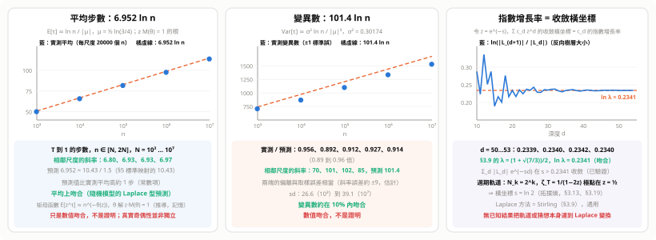

### 3.25 Gauss 求和

> 標示「（已驗證）」者，是我用程式實際檢查過的結果；「記憶」為依印象整理、未核對的說法。結論先說：**Collatz 與 Gauss 求和沒有已知的直接關係**（我沒有搜尋這個主題的文獻）。「Gauss 求和」可能指兩件事：Gauss 和 $G(\chi)=\sum\chi(n)e^{2\pi in/p}$，或等差級數的求和 $1+2+\cdots+n=\frac{n(n+1)}{2}$。兩種都檢查了。

**1. Gauss 的單位群結構，與 2-進／3-進的對偶（已驗證）**

Gauss 的《算術研究》證明了原根的存在與單位群的結構（記憶）。這與 Collatz 的兩個模數直接相關：

| 事實 | 驗證範圍 |
|---|---|
| 2 是模 $3^m$ 的原根： $\mathrm{ord}_{3^m}(2)=2\cdot3^{m-1}=\varphi(3^m)$ | $m=1,\dots,10$（如模 27 為 18、模 81 為 54） |
| 3 只生成模 $2^k$ 單位群的一半： $\mathrm{ord}_{2^k}(3)=2^{k-2}$ | $k=3,\dots,20$（如模 32 為 8、模 1024 為 256） |
| $(\mathbb{Z}/2^k)^\times$ 的最大元素階是 $2^{k-2}$，小於 $\varphi=2^{k-1}$（群不是循環的） | $k=3,\dots,10$ |

意思是：模 $3^m$ 時，乘以 $2^{-v}$ 能走遍全部單位，所以 §3.23 的偏斜隨機游走在單位上混合得很快；模 $2^k$ 時 3 只能走一半（兩個不同的生成元）。這與 §3.2 的「3-進收縮對偶」是同一個結構。這是我的詮釋（推論），不是已知定理。

**2. Gauss 和與函數方程（推論）**

Gauss 和在 $L$ 函數的函數方程裡當根數（記憶）。Collatz 的層級數沒有函數方程，也沒有 Euler 乘積（§3.14、§3.18），所以 Gauss 和沒有出現的位置。我另外確認了奇質數 $p\le101$（共 25 個）的二次 Gauss 和模長都是 $\sqrt p$（教科書結果，與 Collatz 無關）。

**3. 一個純算術的巧合（已驗證）**

§3.23 的穩態在模 3 上是 $P(1)=\frac13$、 $P(2)=\frac23$，它在頻率 1 的 Fourier 係數模長是 $\lvert\frac13\omega+\frac23\omega^2\rvert=0.57735=1/\sqrt3$（ $\omega=e^{2\pi i/3}$）。而二次 Gauss 和 $\sum_{n=0}^{2}\left(\frac n3\right)e^{2\pi in/3}=i\sqrt3$，除以 3 後模長也是 $1/\sqrt3$。兩者相等只是因為 $a^2+b^2-ab$ 的數字剛好一致（ $\frac13,\frac23$ 與 $\frac13,-\frac13$ 各算一次都得 $\frac13$），沒有結構上的意義。

順帶一提，模 $p\ge5$ 時，Syracuse 像在 $\mathbb{Z}/p$ 上是均勻的（§3.18：整除比例 $1/p$），所以沒有這種偏斜。

**4. 等差級數求和 $\frac{n(n+1)}{2}$（已驗證）**

三角形數當 Collatz 的起點，有沒有特別？我取 $m=150,\dots,1499$ 的三角形數 $\frac{m(m+1)}{2}$，算 $\mathrm{steps}/(a\ln n)$（ $a=10.428$），與同樣大小的隨機整數比較：

| | 平均 | 標準差 |
|---|---|---|
| 三角形數（1350 個） | 0.976 | 0.428 |
| 隨機整數（1350 個） | 0.989 | 0.411 |

差 0.013，約 0.8 個標準誤，沒有可見的差異；奇數的三角形數比例是 0.500。所以三角形數沒有特殊性。

| 接點 | 性質 |
|---|---|
| 單位群結構（原根） | 2 是模 $3^m$ 的原根、 $\mathrm{ord}_{2^k}(3)=2^{k-2}$（已驗證），與 3-進／2-進對偶一致 |
| Gauss 和與 $L$ 函數 | Collatz 無函數方程，無位置（推論） |
| $\lvert\hat\pi\rvert=1/\sqrt3$ | 算術巧合，無意義 |
| 三角形數當起點 | 無特殊性（已驗證，約 0.8 個標準誤） |
| 與猜想本身 | 無已知關係 |

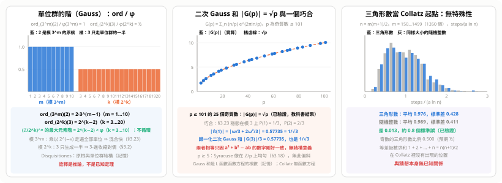
