# 冰雹猜想（續）：第 3 章前半——基本概念與特殊數列（§3.0–§3.12）

本檔是 [Collatz.md](Collatz.md) 第 3 章的前半：先定義 Syracuse 映射與等價陳述，再用 §3.0 總表對照 Collatz 與各種特殊數列（§3.3–§3.12：Mersenne、Fibonacci、Lucas、Catalan、Bernoulli、Euler 數與 e、Stirling、Pell、Motzkin、Fermat）。第 3 章的後半（§3.13–§3.26：函數、變換與算子）在 [Collatz-Functions.md](Collatz-Functions.md)。**小節編號不變**：`Collatz.md` 的第 1、2、4–11 章引用的「§3.x」，都在這兩個檔案。

拆檔的原因：我觀察到單頁公式超過約 1800 個時，GitHub 會有大量公式顯示 "Unable to render expression"（這是觀察，不是官方說明），所以把第 3 章分成兩個檔案，每個檔案約 1000 到 1200 個公式。

每節都標明「已驗證」或「記憶」，沒有關係就明說，並附一張圖示。

---

## 目錄

- [3. 基本概念與等價陳述](#3-基本概念與等價陳述)
  - [3.0 特殊數列對照總表（§3.3–§3.26）](#30-特殊數列對照總表33326)
  - [3.1 2-進位觀點](#31-2-進位觀點)
  - [3.2 3-進位觀點](#32-3-進位觀點)
  - [3.3 Mersenne 數：全 1 的極端案例](#33-mersenne-數全-1-的極端案例)
  - [3.4 Fibonacci：O/E 步序列的黃金分割位移](#34-fibonaccioe-步序列的黃金分割位移)
  - [3.5 Lucas 序列：統一 Mersenne、崩落極端與 Fibonacci](#35-lucas-序列統一-mersenne崩落極端與-fibonacci)
  - [3.6 Catalan：首次穿越計數、2-進位與 Catalan 猜想](#36-catalan首次穿越計數2-進位與-catalan-猜想)
  - [3.7 Bernoulli：沒有已知關係的檢查](#37-bernoulli沒有已知關係的檢查)
  - [3.8 Euler 數與 e](#38-euler-數與-e)
  - [3.9 Stirling 數與 Stirling 公式](#39-stirling-數與-stirling-公式)
  - [3.10 Pell 數與連分數](#310-pell-數與連分數)
  - [3.11 Motzkin 數](#311-motzkin-數)
  - [3.12 Fermat 數](#312-fermat-數)
  - [3.13–3.26 函數、變換與算子（另檔）](#313326-函數變換與算子另檔)

---

## 3. 基本概念與等價陳述

**Syracuse 映射**（只看奇數，把連續的除 2 合併）：

$$
T(n) = \frac{3n+1}{2^{\,v_2(3n+1)}}, \quad n \text{ 為奇數}
$$

其中 $v_2(m)$ 是 $m$ 的 2-進位賦值（ $m$ 含有幾個因子 2）。 $T$ 把「一次乘 3 加 1 與其後所有除 2」打包成一步。

| 量 | 定義 | 例（ $n=27$） |
|---|---|---|
| 停止時間 $\sigma(n)$ | 首次 $f^k(n) < n$ 的 $k$ | 96 |
| 全停止時間 | 首次 $f^k(n) = 1$ 的 $k$ | 111 |
| 軌道峰值 | $\max_k f^k(n)$ | 9232 |

**等價陳述**：冰雹猜想成立，當且僅當下列兩種「壞事」都不發生：

1. **不存在發散軌道**： $f^k(n) \to \infty$。
2. **不存在非平凡循環**：除了 $1 \to 4 \to 2 \to 1$ 之外，沒有別的循環。

兩者目前都無法排除。

### 3.0 特殊數列對照總表（§3.3–§3.26）

> 本表只整理各小節的結論，不含新的計算；總覽圖只畫 §3.3–§3.12 的十個數列，§3.13–§3.26 是函數與級數而非數列，只列在表中；「已驗證」的範圍與出處以各小節為準。連結類型的意思：**真實連結**＝有可驗證的精確關係；**框架**＝提供統一的描述語言；**結構類比**＝形狀相似但機制不同；**無已知關係**＝檢查後沒有發現連結（或只有巧合）。

| 小節 | 數列 | 連結類型 | 核心結論 | 關鍵已驗證事實 |
|---|---|---|---|---|
| §3.3 | Mersenne 數 $2^k-1$ | 真實連結（極端案例） | 全 1 的 2-進位貼近不動點 $-1$：前 $k$ 步全是奇數步，爬升約 $(3/2)^k$ 倍；是否為質數沒有差別 | $T^j(2^k-1)=3^j2^{k-j}-1$（ $k<40$）； $v_2(3^k-1)$ 由升冪引理決定（ $k<200$）； $k\ge31$ 時步數約為典型值的 1.95 倍 |
| §3.4 | Fibonacci $F_n$ | 真實連結（結構） | 標準版 O/E 序列禁止連續兩個 O（黃金分割位移），合法序列數 $=F_{m+2}$；費氏數當起點沒有特殊性 | $m\le14$ 全部吻合；Haar 熵 $0.462 < \ln\varphi=0.481$ |
| §3.5 | Lucas 序列 $U_n(P,Q)$、Lucas 數 $L_n$ | 框架（序列）／無（Lucas 數） | $2^n-1$、 $(4^i-1)/3$、 $3^n-2^n$、 $F_n$ 都是 Lucas 序列； $L_n$ 本身無特殊性；循環分母 $2^k-3^s$ 不是 Lucas 項 | $\gcd(U_m,U_n)=U_{\gcd(m,n)}$（ $m,n<25$）；Lucas–Lehmer $s_i=V_{2^i}(4,1)$ |
| §3.6 | Catalan $C_n$ | 結構類比＋真實連結 | 零漂移（ $q=4$）的首次穿越計數是 Catalan 數，Collatz 為次臨界（尾端指數衰減）； $C_n$ 為奇數 ⇔ $n=2^k-1$； $2^k-3^s=\pm1$ 對應三個最小循環 | ballot 計數 $=C_m$（ $m\le10$）； $N_k>0\Leftrightarrow k=\lfloor s\log_23\rfloor+1$（ $k\le80$） |
| §3.7 | Bernoulli $B_n$ | 無已知關係 | von Staudt–Clausen 使 2、3 恆在分母屬巧合； $v_2=v_3=-1$ 對稱，Collatz 靠不對稱；延拓 $f$ 只含 cos | $2k\le80$； $f(z)=z+\frac{1-(2z+1)\cos\pi z}{4}$ |
| §3.8 | Euler 數與 e | 真實連結（e）／無（正割數） | 循環恆等式 $2^k/3^s=\prod(1+\frac1{3n_i})$ 導出 $n_{\min}\le s/(3\varepsilon)$；自行推得 $k\ge2.78\times10^{10}$；文獻下界恰為 $\ln2/\ln3$ 的收斂分母 | 300 個隨機起點精確驗證；四個循環皆成立 |
| §3.9 | Stirling 數／公式 | 無已知關係（數）／工具（公式） | Stirling 公式給出奇偶向量熵 0.95 bits，天真的期望循環數不衰減；副產物：反向樹 $\lambda=(1+\sqrt{7/3})/2$ | $k\le18$ 窮舉，實際正解僅平凡循環； $d=50\to58$ 每步 $1.2637$ |
| §3.10 | Pell 數 $P_n$ | 無直接關係（連分數對比） | $U_n(2,-1)$，根 $1\pm\sqrt2$；Pell 是 $\sqrt2$ 的收斂分母； $\log_23$ 像典型實數，Fibonacci 與 Pell 是收斂最慢的極端 | $v_2(P_n)=v_2(n)$（ $n\le300$）； $\ln q_n/(n+1)$ 在 $n=59$： $\log_23$ 為 $1.135$、 $\sqrt2$ 為 $0.864$、黃金比為 $0.476$ |
| §3.11 | Motzkin $M_n$ | 結構類比 | Dyck 路徑加水平步；成長率 3 與乘數 3 無關；反向樹形狀屬一元—二元樹 | 偶數項 $n=m4^j-1,\,m4^j-2$（ $m$ 奇， $n\le2000$），密度 $1/3$ |
| §3.12 | Fermat $F_n$ | 真實連結（乘積與對偶） | $2^{2^n}-1=\prod F_k$，崩落極端數 $=\prod F_k$；Fermat 數貼近吸引循環 $\{1,2\}$（乘數 $3/4$），Mersenne 數貼近排斥不動點 $-1$（乘數 $3/2$） | $T^{2j}(1+2^N)=1+3^j2^{N-2j}$（ $N\le40$）；所有正循環的乘數 $<1$ |
| §3.13 | Riemann zeta／動力 zeta | 真實連結（動力 zeta）／無（ζ 零點） | 動力 zeta 把循環寫成 Euler 乘積： $\mathbb{Z}_2$ 上 $\zeta_T=1/(1-2z)$，無非平凡正循環 ⇔ 正整數上 $\zeta_T=1/(1-z^2)$；對數密度對應 $\zeta$ 在 $s=1$ 的極點；與 $\zeta$ 的零點、RH 無已知關係（ $\zeta_T$ 無零點； $b_N$ 在零點週期上無振盪，資訊量低） | $N_k$ 與已知循環的 Euler 乘積一致（ $k\le18$）； $T(n)$ 與 6 互質（ $n\le3\times10^5$） |
| §3.14 | Dirichlet 級數 | 重述已知結構（無 $L$ 函數） | 反向樹各層的 Dirichlet 級數分割 $\zeta(s)$：猜想 $\iff E(s)\equiv0$；殘餘類為 Hurwitz zeta，留數 $2^{-k}$；步數不乘性，無 Euler 乘積與函數方程 | $s=2,3$ 窮舉驗證分割；平均停止時間 $3.492$ vs $3.4816$； $\text{steps}(15)=17\ne35,\,12$ |
| §3.15 | Möbius 函數 $\mu$ | 工具（反演）／無已知關係 | Möbius 反演從動力 zeta 取出恰好週期 $k$ 的點數： $\mathbb{Z}$ 只剩 $k=1,2,3,11$， $\mathbb{Z}_2$ 為 Lyndon 字數； $\mu$ 與步數、停止時間未見相關（數值，非定理）；Syracuse 像的無平方比例等於預測 | $N_k$ 由 $2^{18}$ 條奇偶向量解出（ $k\le18$）；部分和在 $N\le10^6$ 內 $\pm3$ sd；無平方比例 $0.9120$ vs $0.9119$ |
| §3.16 | Lambert W 函數 | 無已知關係（只有通用的反解技巧） | 用 $W$ 反解 $S(N)\approx a(N\ln N-N)+bN$ 的驗證預算（ $a=10.428$）；Cayley 樹的 $W$（半徑 $1/e$）與 Motzkin 型反向樹形狀（半徑 $1/3$）無關；實務上早停使成本線性，用不到 $W$ | $b=-1.80$ 擬合於 $[10^4,10^5]$； $N>10^5$ 的反解誤差 $\le0.35\%$（只解 $N\ln N$ 為 $-8\%$～ $-10\%$）； $n^{n-1}/n!$ 相鄰比 $2.705\to e$、Motzkin $2.985\to3$ |
| §3.17 | Gamma 函數 | 無已知關係（只有精確但實務上不改變結果的閉式） | 循環乘積 $\prod(1+\frac1{3(m+2j)})$ 有 Gamma 閉式， $m=1$ 時約 $1.3089\,s^{1/6}$；只有 $s\gtrsim n_{\min}$ 時比 §3.8 的粗上界更緊，實際 $s/n_{\min}\approx6\times10^{-11}$（估計）；二項係數延拓已在 §3.9；Collatz 無函數方程，Gamma 因子無作用 | 閉式與精確分數、逐項累加一致（ $m\in\{1,3,101,1001,10^6+1\}$）； $s=10^6$ 與漸近式比值 $1+1.3\times10^{-8}$； $\ln$ 相對差介於 $0.3x$ 與 $1.1x$（ $x=s/m$） |
| §3.18 | Euler 乘積 | 結構類比（動力 zeta 即 $\mathbb{F}_2[x]$ 的 zeta）／統計相容（像的局部密度） | $\mathbb{Z}_2$ 上 $\prod(1-z^k)^{-L_k}=1/(1-2z)$，取遍 Lyndon 字，與 $\mathbb{F}_2[x]$ 的 zeta 同式； $\mathbb{Z}$ 上只有 5 個因子；Syracuse 像的整除比例吻合 $1/p$（比隨機更均勻），質數個數吻合 $3/\ln m$；步數不乘性，無 Euler 乘積 | 展開到 $z^{14}$ 係數為 $2^n$；Lyndon 字與不可約多項式窮舉 $k\le12$ 一致； $p=5,\dots,23$ 偏差 $\le4\times10^{-5}$；質數 $52500$ vs $52683.6$ |
| §3.19 | Selberg 跡公式 | 結構類比（離散跡公式）／無已知關係（幾何） | 位移的轉移矩陣滿足 $\mathrm{tr}(A^k)=2^k$，譜只有 $\{2\}$，對應動力 zeta $1/(1-2z)$； $L_kk/2^k\to1$ 類比質測地線定理；兩個分支固定 $\infty$、群可解，無雙曲曲面，也無 RH 類比 | $\mathrm{tr}(A^k)=2^k$（ $k\le12$， $n=3,4$）； $L_kk/2^k=0.99997$（ $k=30$）；五個循環的 $\lambda=1/2,\,3/2,\,3/4,\,9/8,\,2187/2048$ |
| §3.20 | Hecke 算子 | 無已知關係（形式上的巧合） | 轉移算子 $L=U_2+R$ 中 $U_p$ 是 Hecke 型算子，但 $R$（平移 $n\mapsto(n-1)/3$）使 $L$ 與 $U_p$ 不交換；分支是 $T_2,T_6,T_3$ 陪集的元素（任何本原整數矩陣皆然），Collatz 用奇偶性挑出一個像；無 Euler 乘積，與模形式、 $L$ 函數無關 | $U_pU_q$ 交換（5 組）； $L$ 與 $U_p$ 不同下標比例 $47\%,16\%,31\%,16\%$（ $p=2,3,5,7$）；陪集數 $3,12,4$ |
| §3.21 | Ramanujan 求和 | 無已知關係（只有通用的巧合） | 幾何級數的正規化值 $1/(1-a)$ 等於分支不動點（ $\sum3^j\to-\tfrac12$、 $\sum2^j\to-1$）也是 $p$-進極限，對所有幾何級數成立；反向樹層級和 $S_d$ 幾何發散， $1+2+3+\cdots=-\tfrac1{12}$ 未出現；Ramanujan 和只是 2-進同餘類指示函數的標準展開 | $x_k+\tfrac12=3^k/2$（ $k\le14$）； $T^j(2^k-1)=3^j2^{k-j}-1$； $S_{d+1}/S_d\in[2.08,2.16]$（ $d=30,\dots,45$）； $[q\mid n]=\tfrac1q\sum c_d(n)$（ $k\le6$） |
| §3.22 | Mellin 變換 | 無已知關係（隨機模型的矩條件與數值吻合） | $F_d(s)$ 是 $\sum e^{-nt}$ 的 Mellin 變換；Mellin–Perron 把 $S(N)\approx a(N\ln N-N)+bN$ 讀成 $s=1$ 雙重極點的留數（推導）；伸縮的矩函數 $M(1)=1$ 預測軌道最大值尾巴 $\sim C/x$，數值吻合；更新定理 $F_d(1)\to1/a$ 試過，深度不足 | $x\cdot P(m(n)/n\ge x)\approx0.82$（ $x=2,\dots,256$， $40000$ 個起點）； $2^{-1}+3\cdot\tfrac16=1$； $F_d(1)$ 在 $d=30,\dots,47$ 的平均 $0.081$ |
| §3.23 | Fourier 變換 | 真實連結（部分結果的工具） | Tao 2019 把「幾乎所有軌道」歸結為 $\mathbb{Z}/3^n$ 上偏斜隨機游走特徵函數的高頻估計（搜尋摘要）； $\mathrm{Syr}^K\bmod27$ 收斂到非均勻的穩態；轉移算子在頻率空間是「加倍 + 6 個收縮平移」； $\text{steps}(n)$ 有 dyadic 譜線；只給「幾乎所有」，不是猜想的證明 | $K=3$ 時與穩態 TV $0.005$（雜訊 $0.0046$），與均勻 TV $0.345$；轉移算子誤差 $2.6\times10^{-13}$；dyadic 譜線振幅 $2.6$ 到 $8.7$ vs 背景最大 $0.70$ |
| §3.24 | Laplace 變換 | 無已知關係（隨機模型的累積量與數值吻合） | Dirichlet 級數是 $\ln n$ 上的 Laplace 變換（等價於 Mellin；Tauberian 方向缺失）；首次通過時間的矩母函數給平均 $6.952\ln n$、變異數 $101.4\ln n$，數值吻合；指數增長率即收斂橫坐標： $\ln2$（週期軌道）、 $\ln\lambda=0.2341$（反向樹） | 平均斜率 $6.80$ 到 $6.97$（預測 $6.952$）；變異數為預測的 $0.89$ 到 $0.96$ 倍； $\ln$ 層大小比 $0.2339$ 到 $0.2342$ |
| §3.25 | Gauss 求和 | 無已知關係（單位群結構與 2-進／3-進對偶一致） | 2 是模 $3^m$ 的原根、 $\mathrm{ord}_{2^k}(3)=2^{k-2}$，與 3-進／2-進對偶一致（詮釋為推論）；Gauss 和需要函數方程，Collatz 沒有； $\lvert\hat\pi\rvert=1/\sqrt3$ 是算術巧合；三角形數當起點無特殊性 | $m\le10$、 $k\le20$ 的階全部吻合； $p\le101$ 的 $\lvert G(p)\rvert=\sqrt p$；三角形數與隨機整數的差約 0.8 個標準誤 |
| §3.26 | Bernoulli 多項式 | 無已知關係（形式上同型於反向樹的 $2n$ 一支） | $B_n$ 是加倍映射轉移算子的本徵函數（ $LB_n=2^{-n}B_n$），對應 $U_2$ 一支；完整的 $L=U_2+R$ 因 $R$ 的平移而不成立；殘餘類的正規化冪和是 $-B_p(r/2^k)/p$ 型（Hurwitz zeta 恆等式），Faulhaber 同餘類和精確；皆為通用恆等式 | 乘法定理與本徵值關係 $n\le12$ 精確成立； $\zeta(1-p,a)=-B_p(a)/p$ 誤差 $2.5\times10^{-32}$；Faulhaber 1736 個情形全部相等 |

圖中橘色實線是可驗證的真實關係，紫色線表示同屬 Lucas 序列，藍色虛線是類比或對比；各卡片的結論與驗證範圍以對應小節為準。

**作為起點的步數**（標準版步數除以 $10.43\ln n$，各小節已驗證）：

| 起點 | 倍數 | 同大小隨機數 | 結論 |
|---|---|---|---|
| Mersenne $2^k-1$（ $k\ge31$） | 平均約 $1.95$ | 約 $1$ | 約 2 倍（極端案例） |
| Fibonacci $F_5,\dots,F_{120}$ | $1.03$ | $0.98$ | 無差異 |
| Lucas $L_5,\dots,L_{120}$ | $1.04$ | $0.99$ | 無差異 |
| Pell $P_5,\dots,P_{120}$ | $0.956$ | $0.992$ | 無差異 |
| Fermat $F_2,\dots,F_9$ | $0.41$– $2.11$ | 約 $1$ | 無規律 |

**跨小節的三個共同機制**

1. **2-進位貼近**（§3.1）：Mersenne 數貼近不動點 $-1$（排斥，放大），Fermat 數貼近循環 $\{1,2\}$（吸引，縮小）；起始爬升步數等於 $v_2(n+1)$，也連到 Catalan 數的 $v_2(C_n)$（§3.6）。
2. **$2^k$ 與 $3^s$ 的不可公度**（§3.8、§3.10）：循環條件歸結為 $\log_23$ 的有理逼近；文獻中的循環長度下界 $17{,}087{,}915$ 與 $217{,}976{,}794{,}617$（出處為記憶）都是它的收斂分母；Pell 與 Fibonacci 對應最慢的連分數， $\log_23$ 則像典型實數。
3. **漂移符號與臨界**（§3.6、§3.9、§3.11、§8.1）： $\ln(q/4)$ 的正負決定收斂傾向；Catalan 是零漂移（ $q=4$）的首次穿越計數；反向樹成長率 $\lambda$ 是權重 $1/3$ 的「Fibonacci」；Motzkin 的成長率 3 則只是步數種類，與此無關。

**閱讀建議**：想看「真實連結」先讀 §3.3、§3.4、§3.8、§3.12；想看「類比」讀 §3.6、§3.11；想看「為何沒有關係」讀 §3.7、§3.9、§3.10。

### 3.1 2-進位觀點

> 標示「（已驗證）」者，是我用程式實際檢查過的結論；共軛定理的出處（Lagarias、Bernstein 等）為依記憶整理，未逐篇核對。

**為什麼 2-進位自然出現**：整數的二進位表示中，除以 2 是**右移**，奇偶是**最低位**。以捷徑映射 $T(n)=n/2$（偶）、 $(3n+1)/2$（奇）， $T$ 可無縫延拓到 2-進位整數 $\mathbb{Z}_2$（位元向左無限延伸）。

**奇偶向量定理（已驗證 $k\le14$）**：令 $e_j = T^j(n) \bmod 2$，則

$$
n \bmod 2^k \;\longleftrightarrow\; (e_0,\dots,e_{k-1}) \quad \text{一一對應}
$$

每一種長度 $k$ 的奇偶模式，恰好對應一個模 $2^k$ 的剩餘類，機率精確為 $2^{-k}$。這正是 §5 隨機模型的精確來源：在 $\mathbb{Z}_2$ 上它不是近似，而是定理。

**與位移映射共軛**：定義 $\Phi(x)=\sum_{k\ge0} e_k 2^k$，則

$$
\Phi \circ T = S \circ \Phi, \qquad S = \text{右移一位}
$$

$\Phi$ 是 $\mathbb{Z}_2$ 的同胚並保持 Haar 測度，因此 $\mathbb{Z}_2$ 上的 Collatz 動力等價於公平硬幣的**伯努利位移**（遍歷、混合）。

| $n$ | 奇偶序列 $\Phi(n)$（低位在左） |
|---|---|
| $1$ | $1010\,1010\dots$（ $=-1/3$） |
| $-1$ | $1111\,1111\dots$（ $=-1$，不動點） |
| $3$ | $11000\,101010\dots$ |
| $27$ | $110111110101101110111101\dots$ |

**逆映射的封閉形式（已驗證，模 $2^{60}$）**：

$$
n = -\sum_{k\ge0}\frac{e_k\,2^k}{3^{\,1+s_k}}, \qquad s_k = e_0+\dots+e_{k-1}
$$

於是冰雹猜想可改寫成不含迭代的陳述（Bernstein 型）：**對每個正整數 $n$， $\Phi(n)$ 的二進位展開最終是 $(10)$ 的無限重複**（尾端等於 $-1/3$ 的某種平移）。

**核心張力**

| 視角 | 行為 |
|---|---|
| 2-進位（位元層級） | 公平硬幣位移，最大隨機 |
| 實數大小（尺度層級） | 每個奇數步 $\ln n$ 平均下降 $0.288$，收縮 |

正整數只是 $\mathbb{Z}_2$ 中**測度為 0** 的子集。Terras、Tao 的「幾乎所有」結果本質上是測度論；要證「所有」，就必須對這個零測集逐點負責，這就是 §6 所說的「局部—全局落差」。

**循環的 2-進位刻畫**： $\mathbb{Z}_2$ 中每個週期奇偶向量對應**唯一**的週期點，且是有理數；整數循環只是其中「碰巧是整數」者。長度 $k$、含 $s$ 個奇數步的循環須滿足 Böhm–Sontacchi 條件：

$$
n = \frac{c}{2^k - 3^s} \quad (\text{須為正整數})
$$

這要求 $2^k \approx 3^s$，即 $s/k$ 逼近 $\log_2 3 = [1;1,1,2,2,3,1,5,\dots]$（已計算）。循環長度下界（如 Eliahou 1993）據我了解是利用其連分數收斂分數推得，此點未逐篇核對。平凡循環對應 $k=2,\,s=1$： $2^2-3=1$。負整數循環（ $-1$、 $-5$ 等）也是同一套動力在 $\mathbb{Z}_2$ 上的點， $-1$ 就是全 1 序列。

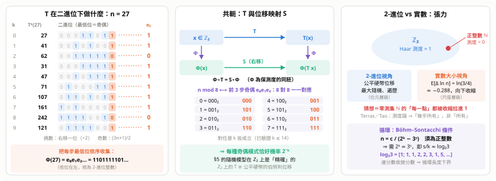

### 3.2 3-進位觀點

> 標示「（已驗證）」者，是我用程式實際檢查過的結論。3-進位沒有像 §3.1 那樣乾淨的共軛定理（就我所知），本節偏重「對偶」的直覺與可驗證事實。

**對偶**：2 與 3 在三種「大小」下的行為剛好互補。

| 運算 | 實數 | 2-進位 | 3-進位 |
|---|---|---|---|
| ×3 | 放大 3 倍 | 等距 | **收縮為 1/3** |
| ÷2 | 縮小 1/2 | **放大 2 倍** | 等距 |

2-進位下 ÷2 是擴張（位移，不斷露出新位元，見 §3.1）；3-進位下 ×3 是收縮，初值的資訊被快速洗掉。

**「3n+1」在 $\mathbb{Z}_3$ 是收縮映射**：不動點是 $-1/2$，因為 $2(3x+1)+1 = 3(2x+1)$（已驗證），所以每做一次，到 $-1/2$ 的 3-進位距離縮為 $1/3$。例如從 $x_0=0$ 迭代： $0,1,4,13,40,121,\dots$，距離依序是 $1, 1/3, 1/9, 1/27,\dots$。

**離散事實**

- **3 的倍數永遠進不來**： $3n+1\equiv1\pmod3$，偶數步也不會產生新的 3 的倍數。已驗證 $n\le2\times10^5$ 的所有軌道，從非 3 的倍數進入 3 的倍數的次數為 0。
- **反向樹的分支條件**：往前一步要「除以 3」（3-進位的擴張），要求 $2^j m\equiv1\pmod3$，例如 $n\equiv4\pmod6$ 才分支（§4）。

**2-進位模式決定 3-進位位置**：奇數 $n$ 迭代 $k$ 次 Syracuse，得到

$$
\text{Syr}^k(n)\cdot2^{A}=3^k n+c
$$

其中 $A$ 與 $c$ 只由各步的 2-進位賦值 $(v_1,\dots,v_k)$ 決定。因為 $3^k n\equiv0\pmod{3^k}$，

$$
\text{Syr}^k(n)\bmod3^k \;=\; c\cdot2^{-A}\bmod3^k \quad\text{只依賴賦值模式，與 }n\text{ 無關}
$$

（已驗證： $k=4$， $n<4\times10^5$ 的奇數共 3651 種模式，每種模式都只對應 1 個餘數。例如模式 $(1,4,2,2)$ 的 $n=3,1027,2051,3075,4099$， $\text{Syr}^4(n)\bmod81$ 全是 $1$。）賦值模式的分布是精確的幾何分布 $P(v=j)=2^{-j}$，所以是 2-進位的隨機性決定了 3-進位的位置。

**分布不是均勻的（已驗證）**：實測模 $3^n$（ $n=3,4,5$，60,000 個 400 位元隨機起點）， $\text{Syr}^k(n)$ 的分布約 4 步後就收斂到一個**固定但非均勻**的分布：

| 模數 | 與均勻分布的 TV 距離（ $k\ge4$） | 隨步數 |
|---|---|---|
| $3^3$ | 約 0.35 | 固定，不再下降 |
| $3^4$ | 約 0.37 | 固定，不再下降 |
| $3^5$ | 約 0.39 | 固定，不再下降 |

（取樣噪聲小於 0.02。）所以對 Tao 2019 在模 $3^n$ 上的分析，合理的理解是「近似那個固定分布」，而非「近似均勻」，這點已在 §7.1 更正。

**實數層面的連結**： $2^k$ 與 $3^s$ 永遠不等（不可公度）。循環要求 $2^k-3^s$ 很小，等價於 $k\ln2$ 與 $s\ln3$ 要非常接近，這是連分數與 Baker 線性對數形式下界的問題。我記得 Simons–de Weger（2005）據此排除了 $m\le68$ 的 $m$-循環，此點未逐篇核對。

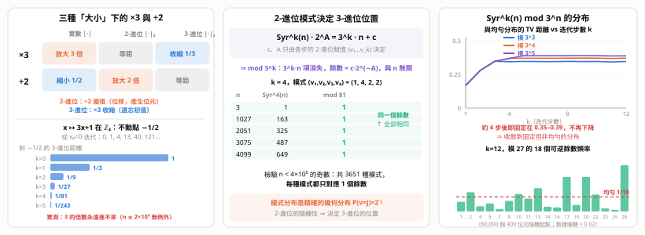

### 3.3 Mersenne 數：全 1 的極端案例

> 標示「（已驗證）」者，是我用程式實際檢查過的結果。結論先說：Collatz 與 Mersenne **質數**沒有已知的深層關係； $2^k-1$（二進位全 1）是 Collatz 的極端測試案例，軌道只看二進位結構，不看它是不是質數。

**2-進位視角**： $2^k-1\equiv-1\pmod{2^k}$，與 §3.1 中全 1 的奇偶序列前 $k$ 位相同，所以前 $k$ 步全是奇數步：

$$
T^{\,j}(2^k-1)=3^j\,2^{k-j}-1\quad(0\le j\le k)
$$

（已驗證， $k<40$； $T$ 為捷徑版）。連續 $k$ 次 $\times\tfrac32$，到 $3^k-1$ 時放大約 $(3/2)^k$ 倍，這是「連續爬升」的極端。

**爬完之後掉幾步（升冪引理）**：

$$
v_2(3^k-1)=\begin{cases}1 & k\text{ 為奇數}\\ v_2(k)+2 & k\text{ 為偶數}\end{cases}
$$

（已驗證， $k<200$）。所以 $3^k-1$ 之後只連續除 2 幾次，又回到「隨機」。

**另一個極端： $(4^i-1)/3$**。 $n=1,5,21,85,341,1365,\dots$ 滿足 $3n+1=4^i$，一步之後連除 $2i$ 次直接到 1，標準版總步數為 $2i+1$（已驗證： $5\to5$ 步、 $21\to7$、 $85\to9$、 $341\to11$、 $1365\to13$）。這是模 $2^{2i}$ 下 $n\equiv-1/3$ 的點，與 $n\equiv-1$ 的 Mersenne 數互為對偶：

| 極端 | 代表 | 行為 |
|---|---|---|
| 連續奇數步 | $2^k-1$ | 先爬升 $(3/2)^k$ 倍 |
| 一步後連續偶數步 | $(4^i-1)/3$ | 一步後直接崩落到 1 |

**實測：Mersenne 軌道（標準版，已驗證）**。「倍數」是步數除以隨機模型預測的 $10.43\ln n$（§5）：

| $k$ | 步數 | 倍數 | $\log_{10}(\text{峰值}/n)$ |
|---|---|---|---|
| 5 ★ | 106 | 2.96 | 2.47 |
| 7 ★ | 46 | 0.91 | 1.54 |
| 13 ★ | 158 | 1.68 | 2.92 |
| 17 ★ | 224 | 1.82 | 4.08 |
| 31 ★ | 450 | 2.01 | 5.76 |
| 61 ★ | 860 | 1.95 | 11.83 |
| 89 ★ | 1454 | 2.26 | 15.97 |
| 8 / 20 / 32 / 64（非質數） | 47 / 178 / 451 / 863 | 約 0.8–1.9 | — |

（★ 為 Mersenne 質數的指數。）

- $k\ge31$ 時步數約為典型值的 **2 倍**（ $k=31$ 到 $100$ 的平均約 1.95，圖中為全部數據）。
- 峰值確實超過爬完 $k$ 步的 $(3/2)^k$： $k=61$ 時 $\log_{10}$ 為 11.83，對照 $61\log_{10}1.5=10.74$。
- 質數與否看不出差異： $k=61$ 的 1.95 與 $k=64$ 的 1.87 沒有區別。

**一個觀察到的規律（未證明）**：對所有奇數 $k=3,\dots,197$（98 個）， $\text{steps}(2^{k+1}-1)=\text{steps}(2^k-1)+1$（98/98 成立），偶數 $k$ 則只有 56/99。例如 7 與 15 的軌道在 40 合流，後者晚一步。

**「峰值大」不等於「長串 1」**： $n<2^{20}$ 的奇數中，峰值 $/n$ 最大的前 10 個，尾端連續 1 的個數是 $8,6,11,3,1,14,7,7,1,14$（平均 7.2，全體奇數平均 2.0，已驗證）。長串 1 有幫助，但不是唯一因素，所以 Mersenne 數並不是「最壞情況」。

**與 Mersenne 質數本身**：沒有已知的深層連結。Lucas–Lehmer 檢驗用的是 $s\mapsto s^2-2\pmod{M_p}$（二次映射），而 Collatz 是分段線性映射，兩者機制不同。§3.1 的循環條件分母 $2^k-3^s$ 在 $s=0$ 時退化成 Mersenne 數 $2^k-1$，但那對應沒有奇數步的平凡情形，沒有實質意義。

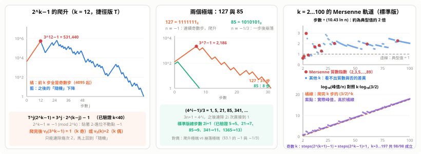

### 3.4 Fibonacci：O/E 步序列的黃金分割位移

> 標示「（已驗證）」者，是我用程式實際檢查過的結果。結論先說：**真實的連結在「軌道的結構」，不在「費氏數當起點」**。標準版 Collatz 的奇偶步序列恰好是黃金分割位移，合法序列的種類數就是費氏數。

**為什麼費氏數會出現**：用標準映射（奇數 $n\mapsto3n+1$，偶數 $n\mapsto n/2$）時， $3n+1$ 一定是偶數，所以奇數步（記 O）後面**必接**偶數步（E），序列裡不會出現兩個連續的 O。「禁止 OO」的字串集合正是費氏數的經典計數對象，長度 $m$ 的合法字串數 $a_m$ 滿足

$$
a_m = a_{m-1} + a_{m-2}, \qquad a_m = F_{m+2}
$$

（以 E 結尾：前面任意合法序列；以 O 結尾：前一個必為 E。）

| $m$ | 實際出現的 O/E 序列種類 | $F_{m+2}$ |
|---|---|---|
| 1, 2, 3, 4, 5 | 2, 3, 5, 8, 13 | 2, 3, 5, 8, 13 |
| 10 | 144 | 144 |
| 14 | 987 | 987 |

（已驗證， $m=1,\dots,14$ 全部吻合；枚舉 $n<2^{18}$ 的前 14 個標準步，每個種類都實際出現，且從未出現 OO。）

**與 §3.1 的 2-進位圖像相容**：標準序列可拆成「OE」與「E」兩種區塊，分別對應捷徑版的奇偶位元 $1$ 與 $0$。在 Haar 測度下兩者機率各 $1/2$，所以平均每個捷徑步對應 1.5 個標準步。因此：

- 每個標準步的熵是 $\ln2/1.5\approx0.462$ nats，小於黃金分割位移的拓撲熵 $\ln\varphi\approx0.481$（已計算）。這符合變分原理：Haar 測度不是最大熵測度。
- 每個標準步的漂移是 $\tfrac12\ln\tfrac34/1.5=-0.0959=-\ln\tfrac43/3$（已驗證兩者相等），正是 §5 預測全停止時間約 $10.43\ln n$ 的來源。

**反向樹只是「黃金分割樹」的一小部分**：每條合法 O/E 序列最多對應反向樹的一個節點，所以第 $d$ 層至多 $F_{d+2}$ 個節點。實際的節點數（已計算）：

$$
1,1,1,1,1,2,2,4,4,6,6,8,10,14,18,24,29,36,44,58,72,91,\dots
$$

$d=9$ 時只有 6 個節點，對照 89 條合法序列；第 30–44 層每步成長約 $1.262$，遠低於 $\varphi=1.618$；更深的層（ $d=50\to58$）收斂到 $\lambda=(1+\sqrt{7/3})/2\approx1.2638$，推導見 §3.9。（先前曾把它與 $2^{1/3}\approx1.260$ 類比，但 $2^{1/3}$ 並不符，該說法已撤回。）

**沒有關係的部分（已驗證）**：

- **費氏數當起點**： $F_5,\dots,F_{120}$ 的步數除以 $10.43\ln n$，平均 1.03，同大小隨機數平均 0.98，看不出差異。個別數字很極端，例如 $F_{10}=55$ 要 112 步（2.68 倍）， $F_{60}$ 只要 162 步（0.55 倍），但沒有規律。
- **$\log_2 3$ 的連分數** $[1;1,1,2,2,3,1,5,\dots]$：收斂分數分母為 $1,1,2,5,12,41,53,306,665$，對照費氏數 $1,1,2,3,5,8$，只有前三項重合； $\log_2 3$ 不是「黃金型」數（黃金比的連分數全是 1）。

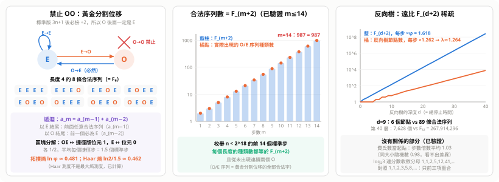

### 3.5 Lucas 序列：統一 Mersenne、崩落極端與 Fibonacci

> 標示「（已驗證）」者，是我用程式實際檢查過的結果。結論先說：Lucas **數** $L_n$（2, 1, 3, 4, 7, 11, …）本身與 Collatz 沒有已知的特殊關係；有意義的是「Lucas **序列**」這個一般架構，它把前面幾節出現的數列放進同一個框架。

**Lucas 數本身：沒有特殊性**

- $L_n=F_{n-1}+F_{n+1}$，且 $L_n^2-5F_n^2=4(-1)^n$（已驗證， $n<300$）。它與 Fibonacci 共用同一對根 $\varphi,\psi$，所以 §3.4 的黃金分割位移沒有因此多出新內容。
- **奇偶**： $L_n$ 為偶數當且僅當 $3\mid n$（已驗證， $n\le300$），模式 $0,1,1$ 週期 3，與 Fibonacci 相同。
- **模 3**： $L_n\equiv0\pmod 3$ 當且僅當 $n\equiv2\pmod4$（已驗證， $n\le300$）。依 §3.2，3 的倍數不會被軌道上的其他點「進入」，所以這些 $L_n$ 只可能是起點。
- **當起點**： $L_5,\dots,L_{120}$ 的步數除以 $10.43\ln n$ 平均 1.04，同大小隨機數 0.99，看不出差異（與 Fibonacci 的結論相同）。
- **小數字巧合**： $3L_5+1=34=F_9$、 $3L_3+1=13=F_7$，但 $3L_7+1=88$、 $3L_9+1=229$ 都不是費氏數；在 $n<60$ 的搜尋中這類命中只有 18 個（含極小數字），沒有規律。

**Lucas 序列 $U_n(P,Q)$**：令 $\alpha,\beta$ 為 $x^2-Px+Q=0$ 的兩根，

$$
U_n=\frac{\alpha^n-\beta^n}{\alpha-\beta},\qquad V_n=\alpha^n+\beta^n,\qquad U_{n+1}=P\,U_n-Q\,U_{n-1}
$$

前面出現的數列都是它的特例（以下恆等式皆已驗證）：

| 數列 | $(P,Q)$ | 根 | 在 Collatz 中的角色 |
|---|---|---|---|
| $2^n-1$ | $(3,2)$ | $2,\,1$ | Mersenne 數，連續爬升極端（§3.3） |
| $(4^i-1)/3$：1, 5, 21, 85, … | $(5,4)$ | $4,\,1$ | 一步後崩落的極端（§3.3） |
| $3^n-2^n$ | $(5,6)$ | $3,\,2$ | 兩個「底」的等指數差 |
| $F_n$、 $L_n$ | $(1,-1)$ | $\varphi,\,\psi$ | O/E 序列的黃金分割位移（§3.4） |

**相關事實**

- **強可除性**： $\gcd(U_m,U_n)=U_{\gcd(m,n)}$（對上面 $(3,2)$、 $(5,6)$、 $(1,-1)$ 三組、 $m,n<25$ 已驗證）。例如 $\gcd(63,511)=7=2^3-1$，即 $\gcd(2^6-1,\,2^9-1)=2^{\gcd(6,9)}-1$。
- **Lucas–Lehmer 檢驗**： $s_i=V_{2^i}(4,1)$（ $i<6$ 已驗證），所以它也屬於這個家族，與 §3.3 的 Mersenne 質數相連。但它是二次映射 $s\mapsto s^2-2$，機制仍與 Collatz 的分段線性映射不同。
- **容易誤會的地方**：§3.1 循環條件的分母 $2^k-3^s$ 的指數一般**不相等**（ $k\ne s$），所以它不是 Lucas 序列的項，而是「線性對數形式」的問題（連分數與 Baker 下界）。只有等指數的 $3^n-2^n$ 才是 Lucas 序列。循環要求 $2^k\approx3^s$，即 $s/k\approx0.631$，與 Lucas 序列的對角線 $k=s$ 無關； $(k,s)=(2,1),(3,2),(8,5),(19,12)$ 是 $\log_2 3$ 的收斂分數（見下圖右）。

| 方面 | 結論 |
|---|---|
| $L_n$ 作起點、奇偶、模 3 | 看不出特殊性，只有已知的週期性質 |
| 與 Fibonacci 的關係 | 同一對根，沒有新增內容 |
| Lucas 序列架構 | 把 Mersenne 數、崩落極端、 $3^n-2^n$、費氏／Lucas 數放進同一個框架 |
| 循環分母 $2^k-3^s$ | 不是 Lucas 序列（指數不等），屬 Diophantine 問題 |

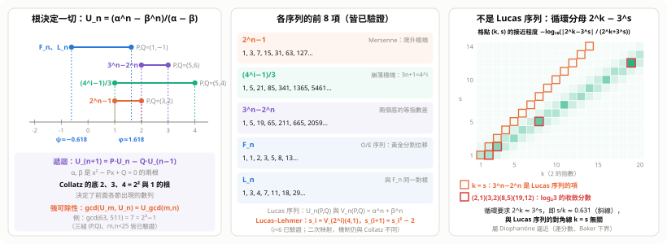

### 3.6 Catalan：首次穿越計數、2-進位與 Catalan 猜想

> 標示「（已驗證）」者，是我用程式實際檢查過的結果；「記憶」為依印象整理、未核對的出處。結論先說：Catalan 數 $C_n=\binom{2n}{n}/(n+1)$（1, 1, 2, 5, 14, 42, …）與 Collatz 有三處真實連結，另有同名的 Catalan **猜想**與循環條件相關。

**1. 首次穿越計數：Catalan 是「零漂移」的類比**

§3.1 的停止時間在 $n$ 夠大時由奇偶向量決定：前 $j$ 步有 $s_j$ 個奇數步，則 $T^j(n)\approx3^{s_j}n/2^j$。**理想化的停止時間為 $k$** 的奇偶向量數 $N_k$，滿足 $3^{s_j}\ge2^j$（ $j < k$）且 $3^{s_k}<2^k$。計算結果（ $k=1,\dots,13$）：

$$
N_k:\ 1,\ 1,\ 0,\ 1,\ 2,\ 0,\ 3,\ 7,\ 0,\ 12,\ 0,\ 30,\ 85
$$

- $N_k>0$ 當且僅當 $k=\lfloor s\log_2 3\rfloor+1$（ $k\le80$ 已驗證），所以 $k=3,6,9,11,14,17,19,22$ 的 $N_k=0$：理想化下沒有這些停止時間。
- 與實測吻合：60 位元隨機起點（20000 個）的 $P(\text{停止時間}=4)=0.0624$，理論 $N_4/2^4=0.0625$。
- $\sum_{k\le K}N_k/2^k$ 在 $K=10,40$ 分別為 $0.9375,\,0.9942$，趨向 1，正是 Terras 的「密度為 1」（§7）。

**Catalan 的出現**：把門檻 $3^s<2^k$ 換成 $4^s<2^k$（即 $s < k/2$；§8.1 的漂移 $\ln(q/4)$ 在 $q=4$ 時為零，這是**零漂移**情形），奇數步記 $+1$、偶數步記 $-1$，首次跌破 0 的序列數就是經典的 ballot 問題：長度 $2m+1$ 的首次穿越序列恰有 $C_m$ 條（ $m\le10$ 已驗證： $1,1,2,5,14,\dots,16796$）。

兩者的差別在尾端（已計算 $P(\text{停止時間}>K)$）：

| $K$ | 10–11 | 20–21 | 40–41（類比取 41） | 60 |
|---|---|---|---|---|
| Collatz（ $q=3$，負漂移） | 0.0625 | 0.0261 | 0.0058 | 0.0019 |
| 零漂移類比（Catalan） | 0.2256 | 0.1682 | 0.1224 | 0.1026 |

Collatz 的尾端指數衰減，Catalan 類比只有冪律衰減（約 $K^{-1/2}$）。所以 $3n+1$ 是「次臨界」：負漂移讓停止時間有指數尾，這是它在統計上「幾乎一定收斂」的原因（§5）。

**2. 2-進位：Catalan 數在 Mersenne 數上才是奇數**

- $C_n$ 為奇數當且僅當 $n=2^k-1$（ $n<5000$ 已驗證）。這與 §3.3 的 Mersenne 數（全 1、連續爬升的極端）一致。
- 更一般地， $v_2(C_n)=s_2(n+1)-1=s_2(n)-v_2(n+1)$（ $n<3000$ 已驗證， $s_2$ 為二進位 1 的個數）。
- 對奇數 $n$，捷徑映射 $T$ 的「起始連續奇數步數」恰為 $v_2(n+1)$（ $n<3000$ 已驗證），所以 $v_2(C_n)+(\text{起始爬升步數})=s_2(n)$。

**3. Catalan 猜想與 $2^k-3^s=\pm1$**

Catalan 猜想（Mihăilescu 2002 證明，記憶）說 $x^a-y^b=1$（ $a,b>1$）的唯一解是 $3^2-2^3=1$。對 2 與 3 的冪，Levi ben Gerson（1343）早已知道（記憶） $|2^k-3^s|=1$ 只有少數解。已驗證 $k<300,\ s<200$：

$$
(k,s)=(1,0),\ (1,1),\ (2,1),\ (3,2)
$$

它們對應 §3.1 循環條件分母 $2^k-3^s$ 為 $\pm1$ 的情形，**剛好就是三個最小循環**（捷徑映射 $T$，在 $|n|\le60$ 內搜尋，已驗證）：

| $(k,s)$ | $2^k-3^s$ | 循環 |
|---|---|---|
| $(1,1)$ | $-1$ | $\{-1\}$ |
| $(2,1)$ | $+1$ | $\{1,2\}$（平凡循環） |
| $(3,2)$ | $-1$ | $\{-5,-7,-10\}$ |

下一個循環 $\{-17,\dots\}$ 是 $k=11,\ s=7$，分母為 $-139$。

| 方面 | 結論 |
|---|---|
| 停止時間的首次穿越計數 | Catalan 是零漂移類比；Collatz 是次臨界，尾端指數衰減 |
| 2-進位 | $C_n$ 奇數 ⇔ $n=2^k-1$； $v_2(C_n)$ 與起始爬升步數相連 |
| Catalan 猜想 | $2^k-3^s=\pm1$ 的解對應三個最小循環 |

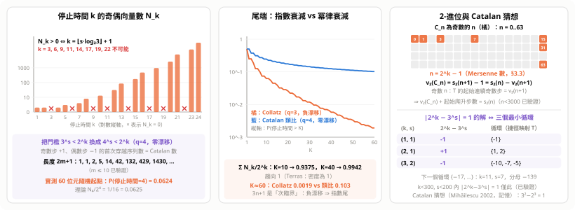

### 3.7 Bernoulli：沒有已知關係的檢查

> 標示「（已驗證）」者，是我用程式實際檢查過的結果。結論先說：**就我所知，Collatz 與 Bernoulli 數沒有已知的直接關係**；我沒有查文獻，以下是依我的知識加上計算，檢查幾個看起來像接點的地方，並說明為什麼它們不構成連結。

**1. von Staudt–Clausen：2 與 3 恆在分母**

$$
\text{den}(B_{2k})=\prod_{(p-1)\mid 2k}p
$$

（用精確分數驗證， $2k\le80$。） $p=2$ 時 $1\mid2k$、 $p=3$ 時 $2\mid2k$ 恆成立，所以每個 $B_{2k}$ 的分母都含 2 和 3，且分母 $\equiv6\pmod{12}$（已驗證）。這與 Collatz 的兩個質數 2、3 重合，但只是因為 $1,2$ 整除每個偶數。更重要的是兩者的對比：

| 量 | Bernoulli 數 | Collatz |
|---|---|---|
| 2-進位 | $v_2(B_{2k})=-1$ | 位移，擴張（§3.1） |
| 3-進位 | $v_3(B_{2k})=-1$ | $\times3$ 收縮（§3.2） |

$v_2(B_{2k})=v_3(B_{2k})=-1$ 對所有 $2k\le80$ 成立（已驗證）：兩種大小恆等，完全對稱；而 Collatz 的特點正是 2-進位與 3-進位「不對稱」。所以這個重合沒有結構意義。質數 5 要到 $4\mid2k$ 才進入分母（ $B_4,B_8,B_{12}$ 的 $v_5=-1$，已驗證）。

**2. Chamberland 延拓：只有 cos，沒有 tan／cot**

§8.5 的延拓可化簡為 $f(z)=z+\frac{1-(2z+1)\cos\pi z}{4}$（已驗證）。Bernoulli 數出現在 $\tan$、 $\cot$、 $\coth$ 的泰勒展開，例如

$$
z\cot z=\sum_{n\ge0}(-1)^n\frac{B_{2n}(2z)^{2n}}{(2n)!}
$$

（ $z=0.3$ 已驗證）。但 $f$ 只含 $\cos\pi z$，它的係數只有階乘； $1/\cos$ 對應的是 Euler 數，不是 Bernoulli 數。所以延拓的級數分析不會自然出現 Bernoulli 數。

**3. 其他想過但不成立的地方**

- **Faulhaber 冪和**：連續做奇數步 $x\mapsto3x+1$ 得 $x_j=3^j(x_0+\tfrac12)-\tfrac12$（由 §3.2 已驗證的恆等式推得），是純等比級數。循環條件中的 $c=\sum_i 3^{\,s-1-i}2^{k_i}$ 是「2 的冪與 3 的冪的乘積和」，不是冪和 $\sum k^m$，不會出現 Bernoulli 數。
- **ζ 函數值**： $\zeta(1-n)=-B_n/n$ 把 Bernoulli 數與 $\zeta$ 連起來，而 §3.1、§7 的 Collatz 結果是測度論與 2-進位分析，沒有 Dirichlet 級數的角色。

| 方面 | 結論 |
|---|---|
| 與 2、3 兩個質數 | 巧合：von Staudt–Clausen 只是 $1,2\mid2k$ |
| 2-進位／3-進位 | Bernoulli 數對稱（ $v_2=v_3=-1$），Collatz 靠不對稱 |
| Chamberland 延拓 | $f(z)=z+\frac{1-(2z+1)\cos\pi z}{4}$，只有 cos，無 Bernoulli |
| Faulhaber、ζ | 與 Collatz 的結構無關 |

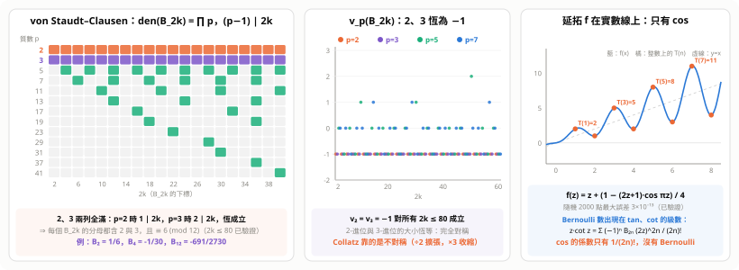

### 3.8 Euler 數與 e

> 標示「（已驗證）」者，是我用程式實際檢查過的結果；「自行推得」為我的推導；「記憶」為依印象整理、未核對的出處。結論先說：「Euler 數」有兩種意思，**歐拉數 $e$ 與 Collatz 有一個真實的連結（循環的乘積恆等式）**，Euler（正割）數 $E_n$ 則沒有已知的關係。

**1. 循環的精確乘積公式**

對捷徑映射 $T$，奇數步 $n_i\mapsto(3n_i+1)/2=\tfrac32\,n_i\,(1+\tfrac{1}{3n_i})$，所以對任意起點：

$$
2^k\,T^k(n)\;=\;3^s\,n\prod_{\text{奇數步 }i}\Bigl(1+\frac{1}{3n_i}\Bigr)
$$

（300 個隨機起點、精確分數計算，全部相等，已驗證。）若軌道是循環（ $T^k(n)=n$），就得到

$$
\frac{2^k}{3^s}=\prod_i\Bigl(1+\frac{1}{3n_i}\Bigr)
$$

已驗證四個已知循環：

| 循環 | $(k,s)$ | $2^k/3^s$ | $\prod(1+\frac1{3n_i})$ |
|---|---|---|---|
| $\{-1\}$ | $(1,1)$ | $2/3$ | $2/3$ |
| $\{1,2\}$ | $(2,1)$ | $4/3$ | $4/3$ |
| $\{-5,-7,-10\}$ | $(3,2)$ | $8/9$ | $8/9$ |
| $\{-17,\dots\}$ | $(11,7)$ | $2048/2187$ | $2048/2187$ |

取對數： $k\ln2-s\ln3=\sum_i\ln(1+\tfrac1{3n_i})$（四個循環皆已驗證；平凡循環上等於 $\ln\tfrac43=0.2877$）。

**2. 對正循環的上界（自行推得）**

對正循環，令 $\varepsilon=k\ln2-s\ln3$。用 $\ln(1+x)\le x$（也就是 $1+x\le e^x$， $e$ 在這裡只是工具）得

$$
0 < \varepsilon\le\sum_i\frac{1}{3n_i}\le\frac{s}{3\,n_{\min}}
\quad\Longrightarrow\quad n_{\min}\le\frac{s}{3\,\varepsilon}
$$

所以循環的最小元越大， $\varepsilon$ 就必須越小，這正是 §3.1、§3.5 提到的「 $\log_2 3$ 要有極佳有理逼近」。

- 對每個 $k\le300$，取 $s=\lfloor k\ln2/\ln3\rfloor$，上界 $s/(3\varepsilon)$ 最大只有 $6725$（ $k=233$，已計算），遠小於已驗證範圍 $2^{68}\approx2.95\times10^{20}$（§7，記憶），所以這些 $k$ 全被排除。
- **更嚴格的範圍（自行推得）**：若非平凡正循環的所有元素都 $>2^{68}$，則 $0 < \varepsilon < s/(3\cdot2^{68})$，等價於 $\alpha-s/k < c$，其中 $\alpha=\ln2/\ln3$、 $c=\alpha/(3\ln3\cdot2^{68})\approx6.49\times10^{-22}$。當 $k<1/\sqrt{2c}\approx2.78\times10^{10}$ 時， $c<1/(2k^2)$，由 Legendre 判準 $s/k$ 必為 $\alpha$ 的收斂分數。我檢查了 $\alpha$ 的收斂分數， $q<2.78\times10^{10}$ 的**沒有一個**滿足條件（已驗證），所以此論證嚴格地給出 $k\ge2.78\times10^{10}$。
- **這個論證到此為止**： $k=114{,}208{,}327{,}604$ 的半收斂分數就滿足條件，所以僅靠這個簡單論證排除不了 $2.78\times10^{10}$ 以上的情形；文獻更強的下界要靠更精細的分析。
- **對照文獻**：§7 引用的 Eliahou（1993）下界 $17{,}087{,}915$ 與 Hercher（2023）的 $217{,}976{,}794{,}617$（皆為記憶），**恰好都是 $\ln2/\ln3$ 的收斂分數分母**（已驗證，兩者都出現在計算出的收斂分數列表中）。

**3. Euler 公式與延拓的逃逸**

§8.5 的延拓含 $\cos\pi z=(e^{i\pi z}+e^{-i\pi z})/2$。由 $|\cos(a+ib)|^2=\cos^2a+\sinh^2b$ 得 $|\cos\pi z|\ge\sinh(\pi|\mathrm{Im}\,z|)$，所以 $|f(z)|$ 隨 $|\mathrm{Im}\,z|$ 以 $e^{\pi|\mathrm{Im}\,z|}$ 量級暴增。已驗證（每個 $y$ 取 $x\in[-3,5]$ 的 2000 或 800 個樣本點）：

| $\mathrm{Im}\,z$ | $\min\|f(x+iy)\|$（2000 點） | $\sinh(\pi y)$ |
|---|---|---|
| 3 | $9.3\times10^{3}$ | $6.2\times10^{3}$ |
| 12 | $7.1\times10^{16}$ | $1.2\times10^{16}$ |

**4. Euler（正割）數 $E_n$：沒有已知關係**

$|E_{2n}|=1,1,5,61,1385,50521,2702765,\dots$，滿足 $\sec z=\sum|E_{2n}|\,z^{2n}/(2n)!$（ $z=0.4$ 已驗證）。已驗證 $n\le40$： $|E_{2n}|$ 全是奇數且 $\equiv1\pmod4$，即 2-進位單位。

- $f$ 只含 $\cos$，而 Euler 數是 $1/\cos=\sec$ 的係數，所以延拓的級數不會出現 $E_n$（與 §3.7 的 Bernoulli 結論同理）。
- 交替排列由 Euler 之字數計數；但 §3.4 的 O/E 序列計數是 Fibonacci，不是 Euler 數。

| 方面 | 結論 |
|---|---|
| 循環的乘積恆等式 | 真實連結： $2^k/3^s=\prod(1+\frac1{3n_i})$，導出 $n_{\min}\le s/(3\varepsilon)$ 與 $\log_2 3$ 逼近的關係 |
| 循環長度下界 | 自行推得 $k\ge2.78\times10^{10}$（假設已驗證至 $2^{68}$）；文獻下界恰為收斂分數分母 |
| Euler 公式與延拓 | $\|f\|\gtrsim e^{\pi\|\mathrm{Im}\,z\|}$，逃逸速度極快 |
| Euler 正割數 $E_n$ | 無已知關係（ $f$ 含 cos 不含 sec） |

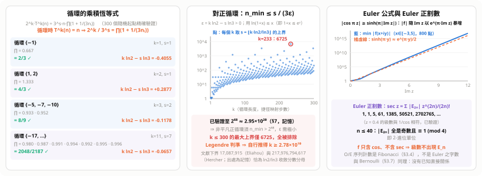

### 3.9 Stirling 數與 Stirling 公式

> 標示「（已驗證）」者，是我用程式實際檢查過的結果；「解讀」為我的推論，未驗證。結論先說：**Stirling 數（兩類）與 Collatz 沒有已知的直接關係**；檢查過程中得到的主要收穫是反向樹成長率的精確值，它修正了 §3.4 的一個說法。

**1. Stirling 數本身**

- **第二類**： $S(n,k)=\frac1{k!}\sum_j(-1)^{k-j}\binom kj j^n$（ $k=4$、 $n\le30$ 已驗證）。特例（ $n\le40$ 已驗證）：

$$
S(n,2)=2^{n-1}-1,\qquad S(n,3)=\frac{3^{n-1}-2^n+1}{2}
$$

$S(n,2)$ 就是 §3.3 的 Mersenne 數。 $S(n,3)$ 同時含 $3^{n-1}$ 與 $2^n$，看起來像 §3.1 循環分母 $2^k-3^s$，但**不是**：這裡兩個指數幾乎相等， $3^{n-1}/2^n$ 隨 $n$ 增大，不會近乎抵消；Collatz 循環要求 $3^s\approx2^k$，其中 $s\approx0.631k$。

- **第一類**： $c(n,2)=(n-1)!\,H_{n-1}$（ $n\le15$ 已驗證），與調和數相連，看不出與 Collatz 的結構關係。

**2. Stirling 公式與奇偶向量**

長度 $k$、含 $s$ 個 1 的奇偶向量有 $\binom ks$ 個。Stirling 公式給出

$$
\log_2\binom ks\approx k\,H(s/k)-\tfrac12\log_2\bigl(2\pi k\,pq\bigr),\qquad p=s/k,\ q=1-p
$$

取 $s=\lfloor k\ln2/\ln3\rfloor$，修正項與精確差值的誤差為： $k=10$ 時 $0.038$ bit， $k=100$ 時 $0.004$ bit， $k=400$ 時約 $0.001$ bit（已驗證，約 $0.4/k$ bit）。對 $\alpha=\ln2/\ln3$， $H(\alpha)=0.9500$ bits，也就是「 $s\approx0.631k$」的奇偶向量約 $2^{0.95k}$ 個，略少於全部的 $2^k$。

**一個容易誤判的地方**：天真的「期望循環數」 $\sum_{s < \alpha k}\binom ks/(2^k-3^s)$（假設 $n=c/D$ 為整數的機率是 $1/D$）並**不衰減**：窮舉全部 $2^k$ 個模式（ $k\le18$，已驗證），期望值落在約 $0.7$– $5.1$（ $k=8$ 時 $5.10$），而實際的正解恰為偶數 $k$ 的 2 個（平凡循環的起點 1、2），奇數 $k$ 為 0。解讀：和主要由 $s$ 接近 $k/2$ 的項貢獻，此時 $D\approx2^k$，熵 $0.95<1$ 只控制 $s=\alpha k$ 那一項；此外 $c\bmod D$ 並非均勻分布（未驗證）。所以這個簡單的機率論證本身無法排除非平凡循環。

**3. 反向樹成長率的精確值**

- 每個節點都有 $2n$ 這個偶數子節點；偶數節點 $n$ 只有在 $n\equiv4\pmod6$ 時多一個奇數子節點 $(n-1)/3$。
- 令 $E_d,O_d$ 為第 $d$ 層的偶數、奇數節點數，則 $E_{d+1}=E_d+O_d$， $O_{d+1}\approx E_d/3$。實測 $O_{d+1}/E_d=0.3318,\,0.3333,\,0.3331$（ $d=40,50,57$，已驗證）。
- 所以成長率滿足 $\lambda^2=\lambda+\tfrac13$：

$$
\lambda=\frac{1+\sqrt{7/3}}{2}\approx1.2638
$$

實測（ $d=50\to58$）每步 $1.2637$，與 $\lambda$ 吻合，而 $2^{1/3}=1.2599$ 並不符。這是 §3.4 黃金分割（ $\lambda^2=\lambda+1$）的「權重 $1/3$」版本：權重 1 時是 $\varphi$，權重 $1/3$ 時是 $1.2638$。

| 方面 | 結論 |
|---|---|
| $S(n,k)$、 $c(n,k)$ | 公式含 $2^n,3^n$，但結構與 $2^k-3^s$ 不同，無已知關係 |
| Stirling 公式 | 給出奇偶向量的熵 0.95 bits，但天真的循環期望值不衰減 |
| 反向樹成長率 | $\lambda=(1+\sqrt{7/3})/2\approx1.2638$，修正 §3.4 的 $2^{1/3}$ 說法 |

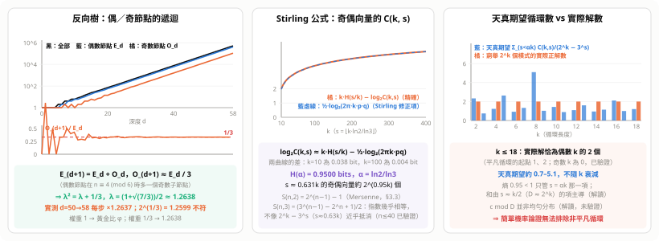

### 3.10 Pell 數與連分數

> 標示「（已驗證）」者，是我用程式實際檢查過的結果；「記憶」為依印象整理、未核對的常數。結論先說：**Pell 數與 Collatz 沒有已知的直接關係**，但在連分數這一側有一個有意義的對比。

**1. Pell 數是 Lucas 序列的又一個特例**

$P_n=0,1,2,5,12,29,70,169,\dots$ 滿足 $P_{n+1}=2P_n+P_{n-1}$，即 §3.5 的 $U_n(2,-1)$，根為 $1\pm\sqrt2$（銀比 $1+\sqrt2\approx2.414$），伴隨序列 $Q_n=V_n(2,-1)=2,2,6,14,34,\dots$。已驗證 $U_n(2,-1)=P_n$、 $Q_n^2-8P_n^2=4(-1)^n$（ $n<200$）、強可除性 $\gcd(P_m,P_n)=P_{\gcd(m,n)}$（ $m,n<30$）。但它的根是 $1\pm\sqrt2$，不在 §3.5 表中 Collatz 的底 $\{2,1\},\{4,1\},\{3,2\}$ 裡。

**2. 2-進位與 3-進位性質**

- $v_2(P_n)=v_2(n)$（ $1\le n\le300$ 已驗證）； $P_n$ 的奇偶就是 $n$ 的奇偶，即 $0,1,0,1,\dots$。這與平凡循環 $\{1,2\}$ 的奇偶序列 $1010\dots$（§3.1）同形，但那是「序列各項的奇偶」，不是軌道的奇偶，純屬巧合。
- $P_n\equiv0\pmod3$ 當且僅當 $4\mid n$（ $n\le300$ 已驗證），模 3 的週期為 8（ $0,1,2,2,0,2,1,1$）。依 §3.2，3 的倍數只可能是起點。

**3. 連分數：有意義的對比**

Pell 數正是 $\sqrt2=[1;2,2,2,\dots]$ 的收斂分數分母： $1/1,\ 3/2,\ 7/5,\ 17/12,\ 41/29,\ 99/70,\ 239/169$，分母為 $P_n$，分子為 $Q_n/2$（已驗證）。Collatz 用的是 $\log_2 3$ 的連分數（§3.1、§3.8）：

$$
\log_2 3=[1;1,1,2,2,3,1,5,2,23,2,2,1,1,55,1,4,3,1,1,15,\dots]
$$

收斂分母為 $1,1,2,5,12,41,53,306,665,15601,\dots$。前四個 $1,2,5,12$ 與 Pell 數相同，第五個起分歧（ $41$ 對 $29$），因為出現了部分商 3。這與 §3.4 的 Fibonacci 一樣，只是開頭巧合。

收斂分母的成長速率 $\ln q_n/(n+1)$（已計算）：

| 數 | 連分數 | $\ln q_n/(n+1)$ | 極限 |
|---|---|---|---|
| 黃金比（Fibonacci） | $[1;1,1,\dots]$ | $0.476$（ $n=59$） | $\ln\varphi=0.481$ |
| $\sqrt2$（Pell） | $[1;2,2,\dots]$ | $0.864$（ $n=59$） | $\ln(1+\sqrt2)=0.881$ |
| $\log_2 3$ | 見上 | $1.074,\ 1.106,\ 1.135$（ $n=20,40,59$） | — |
| 典型實數（Lévy，記憶） | — | — | $\pi^2/(12\ln2)=1.187$ |

$\log_2 3$ 的部分商 $a_1,\dots,a_{59}$ 幾何平均為 $2.604$，接近典型值 Khinchin 常數 $2.685$（記憶）。意思是：Fibonacci（全 1）與 Pell（全 2）是收斂得最慢的「極端」，而 $\log_2 3$ 像典型實數，並帶有大的部分商（23、55、15），所以出現 §3.8 那種「跳躍」的極佳逼近（例如從 $q=1054$ 跳到 $24727$）。這正是循環長度下界能快速增大的來源。

**4. 其他**

- **當起點**： $P_5,\dots,P_{120}$ 的步數除以 $10.43\ln n$ 平均 $0.956$，同大小隨機數 $0.992$，看不出差異（與 Fibonacci、Lucas 相同）。
- **Pell 方程**： $x^2-3y^2=1$ 的最小解 $(2,1)$ 呼應 $2^2-3=1$（§3.6 平凡循環的分母），但接著的 $(7,4),(26,15),(97,56)$ 沒有延續這個對應，只是巧合。

| 方面 | 結論 |
|---|---|
| Lucas 序列架構 | $U_n(2,-1)$，根 $1\pm\sqrt2$ 不在 Collatz 的底中 |
| 2-進位／3-進位 | $v_2(P_n)=v_2(n)$； $P_n\equiv0\ (3)\Leftrightarrow4\mid n$ |
| 連分數 | Pell = $\sqrt2$ 的收斂分母； $\log_2 3$ 像典型實數，成長率 $\approx1.1$ |
| 作起點 | 看不出特殊性 |

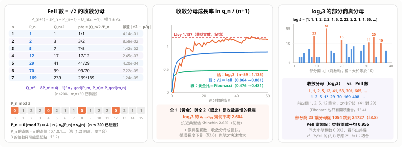

### 3.11 Motzkin 數

> 標示「（已驗證）」者，是我用程式實際檢查過的結果；「解讀」為我的推論；「記憶」為依印象整理、未核對的出處。結論先說：**Motzkin 數與 Collatz 沒有已知的直接關係**；它與 §3.6 的 Catalan 數是近親，連結只到「類比」為止。

**1. Motzkin 數與 Catalan 的關係**

$M_n=1,1,2,4,9,21,51,127,323,835,\dots$ 是「上、下、水平」三種步、不跌破 0、回到 0 的路徑數。已驗證：

- 窮舉路徑數等於 $M_n$（ $n\le25$）。
- $M_n=\sum_k\binom n{2k}C_k$（ $C_k$ 為 Catalan 數， $n\le60$）。
- 一元—二元樹（每個節點有 0、1 或 2 個孩子）有 $n$ 個節點的個數是 $M_{n-1}$（ $n\le30$）。

回到 §3.6：停止時間的首次穿越，在「奇數步 $+1$、偶數步 $-1$」的零漂移類比下給出 Catalan 數；若再加一種「水平步」就會變成 Motzkin 數。但 Collatz 沒有水平步，每一步不是乘 $3/2$ 就是乘 $1/2$，所以這只是類比。

**2. 成長率：恰好是 3**

$M_n/M_{n-1}\to3$，且修正項吻合 $3\bigl(1-\tfrac{3}{2n}\bigr)$： $n=2000$ 時比值為 $2.99775$，公式也是 $2.99775$（已驗證 $n\le2000$），符合 $M_n\sim c\cdot3^n n^{-3/2}$。這個 3 是「步的種類數」，與 Collatz 的乘數 3 無關，是巧合。Collatz 反向樹的成長率是 §3.9 的 $\lambda=(1+\sqrt{7/3})/2\approx1.2638$。

**3. 2-進位：偶數 $M_n$ 的位置**

已驗證（ $n\le2000$）：

$$
M_n\ \text{為偶數}\iff n=m\cdot4^j-1\ \text{或}\ m\cdot4^j-2,\quad m\text{ 為奇數},\ j\ge1
$$

偶數項成對出現： $n=2,3;\ 10,11;\ 14,15;\ 18,19;\ 26,27;\dots$。偶數項的密度為 $\sum_{j\ge1}4^{-j}=\tfrac13$，實測 $0.334$。這與我記憶中 Deutsch–Sagan（2006）的結果一致，出處未核對。對照 §3.6，Catalan 數為奇數只在 $n=2^k-1$（Mersenne 數）。兩者都由 2-進位結構決定，但 Motzkin 的規則是 base-4 加上 $v_2$ 的奇偶，與 Collatz 的 $\mathbb{Z}_2$ 位移（§3.1）沒有對應。

**4. 結構類比：反向樹是一元—二元樹**

§4 的反向樹中，每個節點有 1 個孩子（ $2n$）或 2 個孩子（ $2n$ 與 $(n-1)/3$），正是 Motzkin 數所計數的「一元—二元樹」這一族。但這只是形狀上的相似： $M_n$ 把所有形狀等權重計數（成長率 3），Collatz 的反向樹卻是由算術唯一決定的一棵無限樹，其成長率由偶／奇兩型節點的分支矩陣決定（§3.9， $\lambda^2=\lambda+\tfrac13$）。這一點是解讀，不是已知的定理。

| 方面 | 結論 |
|---|---|
| 與 Catalan（§3.6） | 加「水平步」得 Motzkin；Collatz 無水平步，僅為類比 |
| 成長率 | $M_n/M_{n-1}\to3$，與 Collatz 的乘數 3 無關 |
| 2-進位 | 偶數項 $n=m4^j-1,\,m4^j-2$（ $m$ 奇），密度 $1/3$；與 $\mathbb{Z}_2$ 位移無對應 |
| 反向樹 | 形狀屬一元—二元樹，但計數機制不同，無已知關係 |

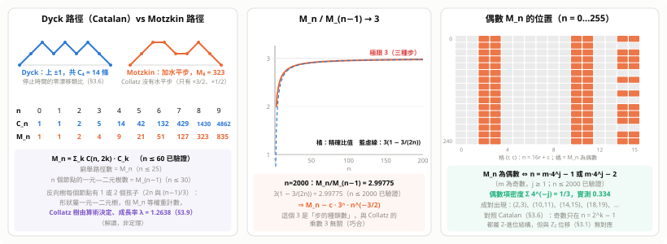

### 3.12 Fermat 數

> 標示「（已驗證）」者，是我用程式實際檢查過的結果。結論先說：**Fermat 數本身（Fermat 質數、可作圖性等）與 Collatz 沒有已知的深層關係**，但它與 §3.3 的 Mersenne 數、§3.5 的 Lucas 序列有精確的代數關係，並帶出一個「貼近循環」的對偶。

**1. 代數：Fermat 數把 Mersenne 數與崩落極端數分解**

$F_n=2^{2^n}+1=3,5,17,257,65537,\dots$，已驗證（ $n\le12$、 $n\le11$）：

$$
2^{2^n}-1=\prod_{k < n}F_k,\qquad \frac{4^{2^n}-1}{3}=\prod_{k=1}^{n}F_k
$$

第二式說明 §3.3 的崩落極端數 $(4^i-1)/3=1,5,21,85,\dots$ 中， $i=2^n$ 的項正是 $F_1,\ F_1F_2,\ F_1F_2F_3,\dots=5,\ 85,\ 21845,\ 1431655765,\dots$。它們的標準版總步數是 $2i+1=2^{n+1}+1$： $5,9,17,33,65$（ $n=1,\dots,9$ 已驗證）。

在 §3.5 的架構下， $F_n=V_{2^n}(3,2)$ 是 $U_m(3,2)=2^m-1$ 的伴隨序列，雙倍公式 $U_{2m}=U_mV_m$ 給出 $2^{2^{n+1}}-1=(2^{2^n}-1)F_n$（ $m<40$ 已驗證）。

**2. Mersenne 指數為 $2^n$ 的情形**

§3.3 的公式 $T^{k}(2^k-1)=3^k-1$ 在 $k=2^n$ 時（ $n\le8$ 已驗證）成立，而升冪引理給出 $v_2(3^{2^n}-1)=n+2$（ $n\le11$ 已驗證）：爬完之後可連續除 $n+2$ 次 2。

**3. 對偶：Fermat 數貼近 1，Mersenne 數貼近 $-1$**

$F_n=2^N+1$（ $N=2^n$）模 $2^N$ 同餘於 1，所以軌道前 $N$ 步「沿著」平凡循環 $\{1,2\}$ 走。已驗證（ $N\le40$）：

$$
T^{\,2j}(1+2^N)=1+3^j\,2^{N-2j}\qquad(2j\le N)
$$

於是 $T^{2^n}(F_n)=1+3^{2^{n-1}}$（ $n=2,\dots,8$ 已驗證），其 $v_2$ 為 1（ $n=2,\dots,7$）。奇偶序列的前 $2^n$ 位恰為 $(10)^{2^{n-1}}$（ $n=3,\dots,6$ 已驗證），之後接 $0101$。對照 Mersenne 數 $2^k-1$：前 $k$ 位全是 1（ $k=8,16,32$ 已驗證），貼近的是不動點 $-1$。

差別在於「乘數」 $3^s/2^k$（已計算）：

| 循環 | $(k,s)$ | 乘數 | 性質 |
|---|---|---|---|
| $\{-1\}$ | $(1,1)$ | $3/2$ | 排斥 |
| $\{1,2\}$ | $(2,1)$ | $3/4$ | **吸引** |
| $\{-5,-7,-10\}$ | $(3,2)$ | $9/8$ | 排斥 |
| $\{-17,\dots\}$ | $(11,7)$ | $2187/2048$ | 排斥 |

只有正的平凡循環吸引：這與 §3.1 的條件 $2^k>3^s$（正循環須分母 $D>0$）等價，即所有正循環的乘數都 $<1$。所以貼近 $-1$ 的 Mersenne 數先放大 $(3/2)^k$ 倍，貼近 1 的 Fermat 數則縮為 $(\sqrt3/2)^N$ 倍（從 $2^N$ 降到 $3^{N/2}$）。

**4. 作為起點：看不出特殊性**

$F_2,\dots,F_9$ 的步數除以 $10.43\ln n$ 為 $0.41,\ 2.11,\ 0.86,\ 1.09,\ 1.04,\ 0.99,\ 0.93,\ 0.89$（已計算），沒有規律。許多 Fermat 數的軌道會經過 $F_1=5$，但 5 是大量軌道共同的通道（進入 16 的兩個入口之一），並非 Fermat 數特有。

| 方面 | 結論 |
|---|---|
| 乘積恆等式 | $2^{2^n}-1=\prod_{k < n}F_k$；崩落極端數在 $i=2^n$ 時是 $\prod_{k=1}^nF_k$ |
| Lucas 架構 | $F_n=V_{2^n}(3,2)$，與 Mersenne 數互為 $V/U$ |
| 貼近循環 | Fermat 數 $\to\{1,2\}$（吸引，縮小）；Mersenne 數 $\to-1$（排斥，放大） |
| Fermat 質數、作起點 | 無已知關係，看不出特殊性 |

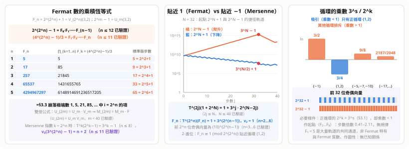

### 3.13–3.26 函數、變換與算子（另檔）

這十四個小節移到 [Collatz-Functions.md](Collatz-Functions.md)（拆檔的原因：單頁公式過多時，GitHub 會有公式無法渲染），編號不變：

- [§3.13 Riemann zeta 與動力 zeta](Collatz-Functions.md#313-riemann-zeta-與動力-zeta)
- [§3.14 Dirichlet 級數](Collatz-Functions.md#314-dirichlet-級數)
- [§3.15 Möbius 函數](Collatz-Functions.md#315-möbius-函數)
- [§3.16 Lambert W 函數](Collatz-Functions.md#316-lambert-w-函數)
- [§3.17 Gamma 函數](Collatz-Functions.md#317-gamma-函數)
- [§3.18 Euler 乘積](Collatz-Functions.md#318-euler-乘積)
- [§3.19 Selberg 跡公式](Collatz-Functions.md#319-selberg-跡公式)
- [§3.20 Hecke 算子](Collatz-Functions.md#320-hecke-算子)
- [§3.21 Ramanujan 求和](Collatz-Functions.md#321-ramanujan-求和)
- [§3.22 Mellin 變換](Collatz-Functions.md#322-mellin-變換)
- [§3.23 Fourier 變換](Collatz-Functions.md#323-fourier-變換)
- [§3.24 Laplace 變換](Collatz-Functions.md#324-laplace-變換)
- [§3.25 Gauss 求和](Collatz-Functions.md#325-gauss-求和)
- [§3.26 Bernoulli 多項式](Collatz-Functions.md#326-bernoulli-多項式)

總表（§3.0）仍列出這十四個小節的結論與關鍵已驗證事實。
