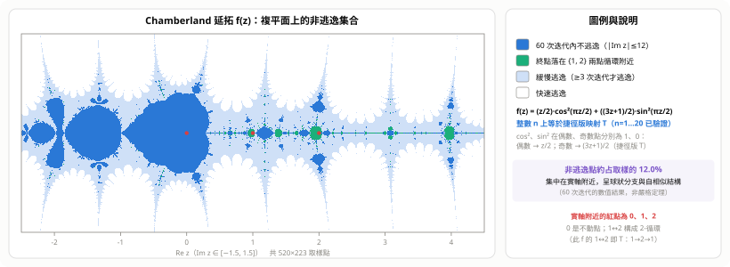

# 冰雹猜想（Collatz Conjecture）

冰雹猜想又稱 **3n+1 問題**、**考拉茲猜想**：任取一個正整數，偶數就除以 2，奇數就乘 3 再加 1，反覆進行，最後一定會到達 1 嗎？規則小學生就看得懂，卻自 1937 年提出以來無人能證明，Erdős 曾說：「數學還沒有準備好面對這類問題。」

與本庫其他筆記的關係：它是離散動力系統的極簡範例，與 `Markov-Chain.md`（隨機漂移模型）、`Fractal.md`（複平面延拓出碎形）、`NP.md`／`Prime-Theory.md`（可計算性與數論）都有交會；「簡單規則、不可預測行為」的特質也呼應 `Percolation.md` 與 `Information-Theory.md` 的主題。

貫穿全文的主線：

- **局部簡單、全局不可預測**：每一步都是確定的，但軌道長度與峰值幾乎沒有可用的公式。
- **啟發式說它會收斂，但啟發式不是證明**：平均而言軌道向下漂移，問題在於無法排除極少數的例外。
- **現有結果只能證明「幾乎所有」**：Tao（2019）證明了強力的「幾乎所有」結果，距離「所有」仍有一步之遙。

---

## 目錄

1. [定義與別名](#1-定義與別名)
2. [動手算：軌道與紀錄保持者](#2-動手算軌道與紀錄保持者)
3. [基本概念與等價陳述](#3-基本概念與等價陳述)
4. [反向樹：從 1 往回長](#4-反向樹從-1-往回長)
5. [啟發式論證：隨機漂移模型](#5-啟發式論證隨機漂移模型)
6. [為什麼這麼難](#6-為什麼這麼難)
7. [已知結果](#7-已知結果)
8. [推廣與變形](#8-推廣與變形)
9. [計算與驗證](#9-計算與驗證)
10. [與 AI／本庫的連結](#10-與-ai本庫的連結)
11. [一句話記憶](#11-一句話記憶)

---

## 1. 定義與別名

$$
f(n) = \begin{cases} n/2 & n \text{ 為偶數} \\ 3n+1 & n \text{ 為奇數} \end{cases}
$$

**猜想**：對任意正整數 $n$，存在 $k$ 使得 $f^{k}(n) = 1$。到達 1 之後會進入 $1 \to 4 \to 2 \to 1$ 的**平凡循環**。

| 名稱 | 由來 |
|---|---|
| 考拉茲猜想（Collatz） | Lothar Collatz 於 1937 年提出 |
| 3n+1 問題 | 直接取自規則 |
| 冰雹猜想（Hailstone） | 數值像冰雹在雲中被氣流反覆托起、墜落，最後才落地 |
| 角谷猜想（Kakutani） | 角谷靜夫在 1960 年代於美國推廣，日本沿用此名 |
| 敘拉古猜想（Syracuse） | 相關研究在 Syracuse 大學流傳 |
| Ulam 問題、Hasse 算法、Thwaites 猜想 | 不同數學家各自獨立提出或推廣 |

---

## 2. 動手算：軌道與紀錄保持者

```
n = 6 :  6 → 3 → 10 → 5 → 16 → 8 → 4 → 2 → 1                    （8 步）
n = 7 :  7 → 22 → 11 → 34 → 17 → 52 → 26 → 13 → 40 → 20 → 10
           → 5 → 16 → 8 → 4 → 2 → 1                             （16 步）
```

起始值只差 1，步數差一倍：步數對 $n$ 極不平滑。下表是「到某上限為止，步數最多的起始值」（皆為實際計算結果）：

| $n$ 範圍上限 | 步數最多的 $n$ | 全停止時間 | 軌道峰值 |
|---|---|---|---|
| 10 | 9 | 19 | 52 |
| 100 | 97 | 118 | 9,232 |
| 1,000 | 871 | 178 | 190,996 |
| 10,000 | 6,171 | 261 | 975,400 |
| 100,000 | 77,031 | 350 | 21,933,016 |
| 1,000,000 | 837,799 | 524 | 2,974,984,576 |

**$n=27$ 是經典的「驚嚇案例」**：只有兩位數，卻要 111 步才到 1，途中飆到 $9232 \approx 342n$。


---

## 3. 基本概念與等價陳述

**Syracuse 映射**（只看奇數，把連續的除 2 合併）：

$$
T(n) = \frac{3n+1}{2^{\,v_2(3n+1)}}, \quad n \text{ 為奇數}
$$

其中 $v_2(m)$ 是 $m$ 的 2-進位賦值（$m$ 含有幾個因子 2）。$T$ 把「一次乘 3 加 1 與其後所有除 2」打包成一步。

| 量 | 定義 | 例（$n=27$） |
|---|---|---|
| 停止時間 $\sigma(n)$ | 首次 $f^k(n) < n$ 的 $k$ | 96 |
| 全停止時間 | 首次 $f^k(n) = 1$ 的 $k$ | 111 |
| 軌道峰值 | $\max_k f^k(n)$ | 9232 |

**等價陳述**：冰雹猜想成立，當且僅當下列兩種「壞事」都不發生：

1. **不存在發散軌道**：$f^k(n) \to \infty$。
2. **不存在非平凡循環**：除了 $1 \to 4 \to 2 \to 1$ 之外，沒有別的循環。

兩者目前都無法排除。

### 3.1 2-進位觀點

> 標示「（已驗證）」者，是我用程式實際檢查過的結論；共軛定理的出處（Lagarias、Bernstein 等）為依記憶整理，未逐篇核對。

**為什麼 2-進位自然出現**：整數的二進位表示中，除以 2 是**右移**，奇偶是**最低位**。以捷徑映射 $T(n)=n/2$（偶）、$(3n+1)/2$（奇），$T$ 可無縫延拓到 2-進位整數 $\mathbb{Z}_2$（位元向左無限延伸）。

**奇偶向量定理（已驗證 $k\le14$）**：令 $e_j = T^j(n) \bmod 2$，則

$$
n \bmod 2^k \;\longleftrightarrow\; (e_0,\dots,e_{k-1}) \quad \text{一一對應}
$$

每一種長度 $k$ 的奇偶模式，恰好對應一個模 $2^k$ 的剩餘類，機率精確為 $2^{-k}$。這正是 §5 隨機模型的精確來源：在 $\mathbb{Z}_2$ 上它不是近似，而是定理。

**與位移映射共軛**：定義 $\Phi(x)=\sum_{k\ge0} e_k 2^k$，則

$$
\Phi \circ T = S \circ \Phi, \qquad S = \text{右移一位}
$$

$\Phi$ 是 $\mathbb{Z}_2$ 的同胚並保持 Haar 測度，因此 $\mathbb{Z}_2$ 上的 Collatz 動力等價於公平硬幣的**伯努利位移**（遍歷、混合）。

| $n$ | 奇偶序列 $\Phi(n)$（低位在左） |
|---|---|
| $1$ | $1010\,1010\dots$（$=-1/3$） |
| $-1$ | $1111\,1111\dots$（$=-1$，不動點） |
| $3$ | $11000\,101010\dots$ |
| $27$ | $110111110101101110111101\dots$ |

**逆映射的封閉形式（已驗證，模 $2^{60}$）**：

$$
n = -\sum_{k\ge0}\frac{e_k\,2^k}{3^{\,1+s_k}}, \qquad s_k = e_0+\dots+e_{k-1}
$$

於是冰雹猜想可改寫成不含迭代的陳述（Bernstein 型）：**對每個正整數 $n$，$\Phi(n)$ 的二進位展開最終是 $(10)$ 的無限重複**（尾端等於 $-1/3$ 的某種平移）。

**核心張力**

| 視角 | 行為 |
|---|---|
| 2-進位（位元層級） | 公平硬幣位移，最大隨機 |
| 實數大小（尺度層級） | 每個奇數步 $\ln n$ 平均下降 $0.288$，收縮 |

正整數只是 $\mathbb{Z}_2$ 中**測度為 0** 的子集。Terras、Tao 的「幾乎所有」結果本質上是測度論；要證「所有」，就必須對這個零測集逐點負責，這就是 §6 所說的「局部—全局落差」。

**循環的 2-進位刻畫**：$\mathbb{Z}_2$ 中每個週期奇偶向量對應**唯一**的週期點，且是有理數；整數循環只是其中「碰巧是整數」者。長度 $k$、含 $s$ 個奇數步的循環須滿足 Böhm–Sontacchi 條件：

$$
n = \frac{c}{2^k - 3^s} \quad (\text{須為正整數})
$$

這要求 $2^k \approx 3^s$，即 $s/k$ 逼近 $\log_2 3 = [1;1,1,2,2,3,1,5,\dots]$（已計算）。循環長度下界（如 Eliahou 1993）據我了解是利用其連分數收斂分數推得，此點未逐篇核對。平凡循環對應 $k=2,\,s=1$：$2^2-3=1$。負整數循環（$-1$、$-5$ 等）也是同一套動力在 $\mathbb{Z}_2$ 上的點，$-1$ 就是全 1 序列。


### 3.2 3-進位觀點

> 標示「（已驗證）」者，是我用程式實際檢查過的結論。3-進位沒有像 §3.1 那樣乾淨的共軛定理（就我所知），本節偏重「對偶」的直覺與可驗證事實。

**對偶**：2 與 3 在三種「大小」下的行為剛好互補。

| 運算 | 實數 | 2-進位 | 3-進位 |
|---|---|---|---|
| ×3 | 放大 3 倍 | 等距 | **收縮為 1/3** |
| ÷2 | 縮小 1/2 | **放大 2 倍** | 等距 |

2-進位下 ÷2 是擴張（位移，不斷露出新位元，見 §3.1）；3-進位下 ×3 是收縮，初值的資訊被快速洗掉。

**「3n+1」在 $\mathbb{Z}_3$ 是收縮映射**：不動點是 $-1/2$，因為 $2(3x+1)+1 = 3(2x+1)$（已驗證），所以每做一次，到 $-1/2$ 的 3-進位距離縮為 $1/3$。例如從 $x_0=0$ 迭代：$0,1,4,13,40,121,\dots$，距離依序是 $1, 1/3, 1/9, 1/27,\dots$。

**離散事實**

- **3 的倍數永遠進不來**：$3n+1\equiv1\pmod3$，偶數步也不會產生新的 3 的倍數。已驗證 $n\le2\times10^5$ 的所有軌道，從非 3 的倍數進入 3 的倍數的次數為 0。
- **反向樹的分支條件**：往前一步要「除以 3」（3-進位的擴張），要求 $2^j m\equiv1\pmod3$，例如 $n\equiv4\pmod6$ 才分支（§4）。

**2-進位模式決定 3-進位位置**：奇數 $n$ 迭代 $k$ 次 Syracuse，得到

$$
\text{Syr}^k(n)\cdot2^{A}=3^k n+c
$$

其中 $A$ 與 $c$ 只由各步的 2-進位賦值 $(v_1,\dots,v_k)$ 決定。因為 $3^k n\equiv0\pmod{3^k}$，

$$
\text{Syr}^k(n)\bmod3^k \;=\; c\cdot2^{-A}\bmod3^k \quad\text{只依賴賦值模式，與 }n\text{ 無關}
$$

（已驗證：$k=4$，$n<4\times10^5$ 的奇數共 3651 種模式，每種模式都只對應 1 個餘數。例如模式 $(1,4,2,2)$ 的 $n=3,1027,2051,3075,4099$，$\text{Syr}^4(n)\bmod81$ 全是 $1$。）賦值模式的分布是精確的幾何分布 $P(v=j)=2^{-j}$，所以是 2-進位的隨機性決定了 3-進位的位置。

**分布不是均勻的（已驗證）**：實測模 $3^n$（$n=3,4,5$，60,000 個 400 位元隨機起點），$\text{Syr}^k(n)$ 的分布約 4 步後就收斂到一個**固定但非均勻**的分布：

| 模數 | 與均勻分布的 TV 距離（$k\ge4$） | 隨步數 |
|---|---|---|
| $3^3$ | 約 0.35 | 固定，不再下降 |
| $3^4$ | 約 0.37 | 固定，不再下降 |
| $3^5$ | 約 0.39 | 固定，不再下降 |

（取樣噪聲小於 0.02。）所以對 Tao 2019 在模 $3^n$ 上的分析，合理的理解是「近似那個固定分布」，而非「近似均勻」，這點已在 §7.1 更正。

**實數層面的連結**：$2^k$ 與 $3^s$ 永遠不等（不可公度）。循環要求 $2^k-3^s$ 很小，等價於 $k\ln2$ 與 $s\ln3$ 要非常接近，這是連分數與 Baker 線性對數形式下界的問題。我記得 Simons–de Weger（2005）據此排除了 $m\le68$ 的 $m$-循環，此點未逐篇核對。


---

## 4. 反向樹：從 1 往回長

把規則倒過來：給定 $n$，哪些數一步會變成 $n$？

- $2n \to n$：**永遠成立**（$2n$ 是偶數，除 2 得 $n$）。
- $m \to n$ 且 $m$ 為奇數、$n = 3m+1$：即 $m = (n-1)/3$，要求它是奇整數，等價於 $n \equiv 4 \pmod 6$。

因此每個節點有 1 或 2 個「前身」，從 1 出發可長出一棵樹：

```
1 ← 2 ← 4 ← 8 ← 16 ─┬─ 32 ← 64 ─┬─ 128 ← 256 ← 512 ...
                    │           └─ 21 ← 42 ← 84 ...
                    └─ 5 ← 10 ──┬─ 20 ← 40 ─┬─ 80 ...
                                │           └─ 13 ← 26 ...
                                └─ 3 ← 6 ← 12 ...
```

（箭頭 $a \leftarrow b$ 表示 $b$ 一步變成 $a$；例如 $21 \to 64$、$5 \to 16$、$3 \to 10$、$13 \to 40$。）

**猜想的等價說法**：這棵反向樹涵蓋全部正整數。分支只在 $n \equiv 4 \pmod 6$ 時出現（約每 6 個數 1 個），樹很「稀疏」，但分支足夠多，經驗上看起來能覆蓋一切。


---

## 5. 啟發式論證：隨機漂移模型

假設奇數 $n$ 的 $3n+1$ 其 2-進位賦值 $v = v_2(3n+1)$ 像隨機變數：

$$
P(v = k) = 2^{-k}, \quad k = 1, 2, 3, \dots \qquad \mathbb{E}[v] = 2
$$

（對奇數 $n$ 這個分布是精確成立的；「假設」的是各步之間近似獨立。）每個奇數步把數值乘上 $3/2^v$，因此對數的期望變化為：

$$
\mathbb{E}[\ln \text{倍率}] = \ln 3 - \mathbb{E}[v]\ln 2 = \ln 3 - 2\ln 2 = \ln\tfrac{3}{4} \approx -0.288 < 0
$$

軌道的 $\ln n$ **平均每個奇數步下降約 0.288**，像帶負漂移的隨機遊走。每個奇數步連同後續除 2，平均占 $1 + \mathbb{E}[v] = 3$ 個標準步，於是預測：

$$
\text{全停止時間} \approx \frac{3}{\ln(4/3)} \ln n \approx 10.43 \ln n
$$

實測 $n \le 10^5$ 的平均值約為 $10.2 \ln n$，吻合良好（見上圖右）。

**這個模型也解釋了推廣版本的差異**：對 $qn+1$（$q$ 為奇數），漂移為 $\ln q - 2\ln 2 = \ln(q/4)$。

| 版本 | $\ln(q/4)$ | 隨機模型預測 |
|---|---|---|
| $3n+1$ | $-0.288$ | 向下漂移，收斂 |
| $5n+1$ | $+0.223$ | 向上漂移，多數軌道發散 |

**限制**：隨機模型只是機率上的直覺。它無法排除「結構性」的例外（例如某個特殊的發散軌道或循環），而這正是證明的困難所在。$n=27$ 的實際長度（111 步）約為漂移預期（約 34 步）的 3 倍，說明個別軌道會大幅偏離平均。

---

## 6. 為什麼這麼難

1. **乘法與加法交纏**：除以 2 是 2-進位的右移；乘 3 再加 1 是在另一個進位體系裡操作。兩者交替，沒有任何代數不變量可抓。
2. **沒有平滑結構**：$\sigma(n)$ 對 $n$ 極度不連續（$n=6,7$ 差一倍），無法用分析方法逼近。
3. **局部—全局落差**：模 $2^k$ 的同餘類能精確描述前 $k$ 步，但軌道可以無限走下去。
4. **一般化版本是不可判定的**：Conway（1972）證明，把規則改成「依 $n \bmod p$ 查表、套用不同的一次函數」的廣義 Collatz 型問題，**一般而言**無法由演算法判定是否收斂（可編碼圖靈機，與 FRACTRAN 同源）。這不代表 3n+1 本身不可判定，但暗示一般性的證明技術很難存在。

> 「Mathematics may not be ready for such problems.」——Paul Erdős

---

## 7. 已知結果

| 年份 | 結果 | 意義 |
|---|---|---|
| 1976 | Terras：密度為 1 的正整數有有限停止時間 | 幾乎所有 $n$ 都會降到比自己小 |
| 1993 | Eliahou：非平凡循環長度至少 17,087,915 | 若存在循環，必須極長 |
| 1994 | Korec：幾乎所有 $n$ 滿足 $\text{Col}_{\min}(n) < n^{\theta}$，$\theta > \log 3/\log 4 \approx 0.7924$ | Terras／Allouche 之後的冪次改進（自然密度） |
| 2003 | Krasikov–Lagarias：$\le x$ 中至少 $x^{0.84}$ 個會到 1 | 收斂的數有多項式量級 |
| 2019 | **Tao**：幾乎所有軌道達到「幾乎有界」的值 | 目前最強的「幾乎所有」結果 |
| 2020 | Barina：驗證至 $2^{68} \approx 2.95\times10^{20}$ | 數值上無反例 |
| 2023 | Hercher：非平凡循環長度提高至約 $2.2\times10^{11}$ 以上 | 排除更多短循環 |

**Tao 2019 的內容**：令 $\text{Col}_{\min}(N) = \min_{k\ge0} f^k(N)$。對任意趨向無窮的函數 $g(N)$（即使增長得極慢），在**對數密度**意義下，幾乎所有 $N$ 都滿足 $\text{Col}_{\min}(N) < g(N)$。換句話說：幾乎所有軌道都會降到任意小——但「降到 1」仍沒有被證明，且「幾乎所有」仍容許密度為 0 的無限多個例外。

### 7.1 Tao 2019 的證明策略

> **可信度標註**：標示「✔」的內容有對照摘要／導言查證；標示「△」的是依記憶整理的概述，細節（尤其是 3-進位部分）請對照原論文 arXiv:1909.03562。

**先看前人卡在哪**：Terras、Everett 證明 $\text{Col}_{\min}(N) < N$（幾乎所有 $N$）；Allouche 改成 $N^{\theta}$；Korec 做到 $\theta > 0.7924$。這些都是**自然密度**，且降幅停在冪次。Tao 一次把門檻降到任意慢增長的 $g(N)$。

```
真實軌道（難分析）
      │  ① 換成 Syracuse 映射 + 對數密度 ✔
      ▼
Syracuse 迭代 Syrᵏ(N)
      │  ② 證明「近似轉移」：迭代後的（對數尺度）分布 ≈ 理想隨機模型 ✔
      ▼
隨機模型：ln n 帶負漂移 ln(3/4) 的隨機遊走（見 §5）
      │  ③ 隨機遊走幾乎必然降到任意低 ✔
      ▼
幾乎所有 N 的軌道 Col_min(N) < g(N)
```

**① 為什麼換映射與測度 ✔**
均勻測度對 Collatz 映射沒有不變性。**對數密度**有近似的乘法不變性，更適合分析「乘 3、除 2 的冪」這類乘法運算；Syracuse 映射則是做 2-進位分析時特別方便的版本。

**② 近似轉移性質（approximate transport）✔／△**
- 取對數意義下的典型起點 $N$，迭代 $k$ 次 Syracuse（$k$ 隨 $N$ 緩慢增長）。
- 證明 $\text{Syr}^{k}(N)$ 的（對數）分布，與一個**理想化的隨機變數**的分布近似。這個隨機變數的建構與 §5 的幾何分布 $P(v=k)=2^{-k}$ 同一精神。
- △ 我記憶中，Tao 在模 $3^n$ 的剩餘類上，用特徵函數（傅立葉係數）控制 Syracuse 迭代的分布。**更正**：我先前寫成「近似均勻」，但後來用程式實測（$n=3,4,5$，隨機大起點）發現，迭代幾步內分布就收斂到一個**固定但非均勻**的分布，與均勻分布的 TV 距離約 $0.35$–$0.39$，且不隨步數減小；所以應理解為「近似那個固定分布」，而非均勻分布，細節待對照原論文。摘要提到「二維更新過程（renewal process）與三角形聯集」，似乎屬於這一步的核心估計。**搜尋結果只確認到 2-進位分析，未能確認 3-進位的說法。**

**③ 與隨機遊走比較 ✔**
一旦分布與隨機模型近似，而模型的 $\ln$ 漂移為負，幾乎所有軌道就會降到任意低的值。

**為什麼證不到 1**
- 結論是**對數密度意義下的「幾乎所有」**，仍容許密度為 0 的無限多個例外；非平凡循環與發散軌道若存在，可以躲在這個例外集合裡。
- 近似誤差只在尺度夠大時可控；要降到常數（如 1）需要在小數值端做精確控制，這個方法就不再有效。一般認為這大致已是此方法的極限（此為我的轉述，未逐字核對原文）。

---

## 8. 推廣與變形

> 標示「（已驗證）」者，是我用程式實際檢查過的結果；標示「記憶」者是依印象整理、未核對的出處。2-進位與 3-進位延拓已在 §3.1、§3.2 討論。

### 8.1 $qn+r$ 家族

把「奇數就乘 3 加 1」改成 $qn+r$（偶數仍除以 2）。依 §5 的隨機模型，漂移是 $\ln(q/4)$：$q<4$ 預期收斂，$q>4$ 預期多數軌道飛走。以 $n\le2000$ 為起點的實測（已驗證）：

| 變形 | 漂移 | 找到的不同循環數 | 實測 |
|---|---|---|---|
| $3n+1$ | $-0.288$ | 1（$\{1,4,2\}$） | 全部收斂 |
| $3n-1$ | $-0.288$ | **3** | 全部收斂 |
| $3n+5$ | $-0.288$ | **6**（最小元 1, 5, 19, 23, 187, 347） | 全部收斂 |
| $5n+1$ | $+0.223$ | 3（最小元 1, 13, 17） | 87% 超過 $10^{60}$ 或 2 萬步 |
| $5n-1$ | $+0.223$ | 1 | 81% 超過上限 |
| $7n+1$ | $+0.560$ | 1 | 98% 超過上限 |

兩個重點：

- **負漂移只保證「不發散」，不保證「循環唯一」**：$3n-1$ 有 $\{1,2\}$、$\{5,14,7,20,10\}$、$\{17,50,\dots\}$（長 18）三個循環，$3n+5$ 至少有六個。$3n+1$ 看起來只有一個循環反而是特例。
- 正漂移那組只是「多數軌道飛走」的實測與啟發式。就我所知，沒有任何一個軌道被**證明**發散（例如 $5n+1$ 的 $n=7$）。

### 8.2 擴展到負整數

$3n+1$ 在負整數上也有三個循環（已驗證），最小元分別為 $-2$、$-20$、$-272$：$\{-1,-2\}$、$\{-5,-14,-7,-20,-10\}$、$\{-17,\dots\}$（長 18）。$-1$ 對應 §3.1 中全 1 的奇偶序列。

### 8.3 廣義 Collatz（依模數查表）

把規則改為「依 $n \bmod d$ 套用不同的一次函數」。Conway（1972）證明這一類問題一般**不可判定**（§6）。依記憶，De Mol（2008）把它與標籤系統（tag system）的可計算性連起來，細節未核對。這說明 $3n+1$ 的「簡單」是個特例：一般形式可以編碼圖靈機。

### 8.4 無進位版本：$\mathbb{F}_2[x]$ 類比

在 $\mathbb{F}_2[x]$ 上令 $P\mapsto P/x$（若 $x\mid P$），否則 $P\mapsto(x+1)P+1$（這是我採用的形式，與原論文是否逐字一致未核對）。

- 實測：次數小於 18 的 $2^{18}$ 個多項式，**全部**最終到 0 或 1（已驗證）。
- 步數：到 0 或 1 的最大步數隨次數近似線性成長（次數 $<17$ 時最多 86 步），而一般整數（$n<2^{17}$）最多 353 步（已驗證）。
- 依記憶，Hicks–Mullen–Yucas–Zavislak（2008）對這個類比給出了證明。
- 我的解讀（非查證）：這裡沒有進位，位元與「大小」不再互相干擾，次數成為可加的大小量，困難因而消失，這也佐證 §3.1 的張力：Collatz 的困難來自進位把 2-進位與實數大小纏在一起。

### 8.5 連續與複平面延拓

Chamberland（1996）把捷徑映射 $T$ 延拓到實數線與複平面：

$$
f(z)=\frac{z}{2}\cos^2\!\frac{\pi z}{2}+\frac{3z+1}{2}\sin^2\!\frac{\pi z}{2}
$$

$\cos^2$ 與 $\sin^2$ 在偶數、奇數點分別為 1、0，所以 $f$ 在整數 $n$ 上等於 $T(n)$（$n=1,\dots,20$ 已驗證）。下圖是我自己計算的：對 $\mathrm{Re}\,z\in[-2.5,4.5]$、$\mathrm{Im}\,z\in[-1.5,1.5]$ 的網格迭代 60 次，標出不逃逸（$|\mathrm{Im}\,z|\le12$）的點。非逃逸點約占取樣的 12.0%，集中在實軸附近，呈現球狀分支與自相似結構（為 60 次迭代的數值結果，非嚴格定理）。$0$ 是不動點，$1\leftrightarrow2$ 構成 2-循環。



### 8.6 外表相近的數列：Juggler 序列

偶數取 $\lfloor\sqrt a\rfloor$，奇數取 $\lfloor a^{3/2}\rfloor$，猜想也都到 1。實測（已驗證）：

| 起點 | 步數 | 峰值位數 |
|---|---|---|
| 9 | 7 | 3 |
| 19 | 9 | 3 |
| 37 | 17 | 14 |
| 77 | 19 | 7 |

起點 2–300 之中，峰值最大的是 193，達 271 位數。37 只走 17 步卻衝到 14 位數，與 $n=27$ 的「驚嚇案例」類似。

![qn+r 家族、F2[x] 類比與 Juggler 序列](figures/collatz-variants.svg)

### 8.7 小結

| 想改變的 | 發生的事 |
|---|---|
| 係數 $q$ | 漂移符號決定「收斂／飛走」，但循環數會變多 |
| 常數項 $r$ | 循環結構大變（$3n-1$、$3n+5$） |
| 依模數查表 | 可編碼圖靈機，不可判定 |
| 換成無進位環 | 可證明（記憶） |
| 延拓到 $\mathbb{Z}_2$／$\mathbb{Z}_3$ | 位移共軛／收縮對偶（§3.1、§3.2） |
| 延拓到複平面 | 非逃逸集合呈碎形 |

---

## 9. 計算與驗證

**帶快取的步數計算**（避免重複走已算過的尾段）：

```python
_cache = {1: 0}

def collatz_steps(n: int) -> int:
    path = []
    while n not in _cache:
        path.append(n)
        n = n // 2 if n % 2 == 0 else 3 * n + 1
    s = _cache[n]
    for m in reversed(path):
        s += 1
        _cache[m] = s
    return s

collatz_steps(27)      # 111
collatz_steps(837799)  # 524
```

**大規模驗證的剪枝思想**（Barina 等人的做法）：

- 對 $n$ 模 $2^k$ 的某個同餘類，前 $k$ 個「奇偶位元」固定，$k$ 步後 $f^k(n) = (3^a n + b)/2^k$，其中 $a$ 是這 $k$ 步裡的奇數步數。
- 若 $3^a < 2^k$，則 $n$ 夠大時 $f^k(n) < n$，這個同餘類只需驗證到有限範圍；真正需要逐一驗證的只剩 $3^a > 2^k$ 的少數類別。
- 配合已驗證範圍內「降到更小的數就停」，並以 GPU／分散式計算，把上限推到 $10^{20}$ 量級。

---

## 10. 與 AI／本庫的連結

| 主題 | 連結 |
|---|---|
| 隨機遊走與漂移 | 軌道的 $\ln n$ 是帶負漂移的隨機遊走，與 `Markov-Chain.md` 的轉移鏈思想一致 |
| 漂移符號 ≈ 相變 | $\ln(q/4)$ 的正負決定收斂或發散（$3n+1$ vs $5n+1$），類似序參數過零，參見 `Percolation.md` |
| 混沌與碎形 | 複平面延拓出碎形，參見 `Fractal.md`；軌道對初值極度敏感 |
| 不可判定性 | 廣義 Collatz 可編碼圖靈機，與 `NP.md`、可計算性主題相通 |
| 數論 | 2-進位／3-進位的交互作用，參見 `Prime-Theory.md` |
| 神經網路的學習難度 | 步驟函數對輸入奇偶位元極度敏感、不平滑；常被用作測試模型能否做「長鏈精確計算」的簡單任務（此為觀察性描述，非定理） |

---

## 11. 一句話記憶

$$
\boxed{\;n \mapsto \begin{cases} n/2 \\ 3n+1 \end{cases}\;:\; \text{平均每個奇數步 } \ln n \text{ 下降 } 0.288\text{，所以幾乎一定落地——但「幾乎一定」不是「一定」。}\;}
$$

規則三行寫完，證明至今無人完成：**隨機模型說會收斂，Tao 證明了幾乎所有，驗證到 $10^{20}$ 沒反例，但最後一步仍然懸空。**

---

## 參考文獻

- Lagarias, J. C. (1985). *The 3x+1 problem and its generalizations*. American Mathematical Monthly, 92(1), 3–23.
- Lagarias, J. C. (Ed.) (2010). *The Ultimate Challenge: The 3x+1 Problem*. American Mathematical Society.
- Terras, R. (1976). *A stopping time problem on the positive integers*. Acta Arithmetica, 30, 241–252.
- Conway, J. H. (1972). *Unpredictable iterations*. Proc. 1972 Number Theory Conference, Boulder, 49–52.
- Krasikov, I. & Lagarias, J. C. (2003). *Bounds for the 3x+1 problem using difference inequalities*. Acta Arithmetica, 109, 237–258.
- Tao, T. (2019). *Almost all orbits of the Collatz map attain almost bounded values*. arXiv:1909.03562.
- Barina, D. (2021). *Convergence verification of the Collatz problem*. The Journal of Supercomputing, 77, 2681–2688.
- Hercher, C. (2023). *There are no Collatz m-cycles with m ≤ 91*. Journal of Integer Sequences, 26, Article 23.3.5.
- Chamberland, M. (1996). *A continuous extension of the 3x+1 problem to the real line*. Dynamics and Stability of Systems, 11(3), 249–264.
