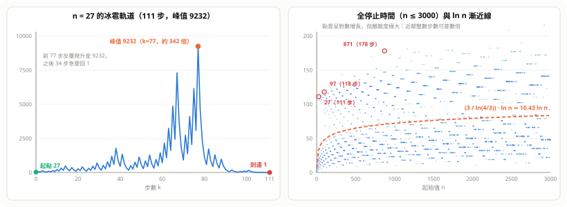

# 冰雹猜想（Collatz Conjecture）

冰雹猜想又稱 **3n+1 問題**、**考拉茲猜想**：任取一個正整數，偶數就除以 2，奇數就乘 3 再加 1，反覆進行，最後一定會到達 1 嗎？規則小學生就看得懂，卻自 1937 年提出以來無人能證明，Erdős 曾說：「數學還沒有準備好面對這類問題。」

與本庫其他筆記的關係：它是離散動力系統的極簡範例，與 `Markov-Chain.md`（隨機漂移模型）、`Fractal.md`（複平面延拓出碎形）、`NP.md`／`Prime-Theory.md`（可計算性與數論）都有交會；「簡單規則、不可預測行為」的特質也呼應 `Percolation.md` 與 `Information-Theory.md` 的主題。

貫穿全文的主線：

- **局部簡單、全局不可預測**：每一步都是確定的，但軌道長度與峰值幾乎沒有可用的公式。
- **啟發式說它會收斂，但啟發式不是證明**：平均而言軌道向下漂移，問題在於無法排除極少數的例外。
- **現有結果只能證明「幾乎所有」**：Tao（2019）證明了強力的「幾乎所有」結果，距離「所有」仍有一步之遙。

---

## 目錄

1. [定義與別名](#1-定義與別名)
2. [動手算：軌道與紀錄保持者](#2-動手算軌道與紀錄保持者)
3. [基本概念與等價陳述](#3-基本概念與等價陳述)
4. [反向樹：從 1 往回長](#4-反向樹從-1-往回長)
5. [啟發式論證：隨機漂移模型](#5-啟發式論證隨機漂移模型)
6. [為什麼這麼難](#6-為什麼這麼難)
7. [已知結果](#7-已知結果)
8. [推廣與變形](#8-推廣與變形)
9. [計算與驗證](#9-計算與驗證)
10. [與 AI／本庫的連結](#10-與-ai本庫的連結)
11. [一句話記憶](#11-一句話記憶)

---

## 1. 定義與別名

$$
f(n) = \begin{cases} n/2 & n \text{ 為偶數} \\ 3n+1 & n \text{ 為奇數} \end{cases}
$$

**猜想**：對任意正整數 $n$，存在 $k$ 使得 $f^{k}(n) = 1$。到達 1 之後會進入 $1 \to 4 \to 2 \to 1$ 的**平凡循環**。

| 名稱 | 由來 |
|---|---|
| 考拉茲猜想（Collatz） | Lothar Collatz 於 1937 年提出 |
| 3n+1 問題 | 直接取自規則 |
| 冰雹猜想（Hailstone） | 數值像冰雹在雲中被氣流反覆托起、墜落，最後才落地 |
| 角谷猜想（Kakutani） | 角谷靜夫在 1960 年代於美國推廣，日本沿用此名 |
| 敘拉古猜想（Syracuse） | 相關研究在 Syracuse 大學流傳 |
| Ulam 問題、Hasse 算法、Thwaites 猜想 | 不同數學家各自獨立提出或推廣 |

---

## 2. 動手算：軌道與紀錄保持者

```
n = 6 :  6 → 3 → 10 → 5 → 16 → 8 → 4 → 2 → 1                    （8 步）
n = 7 :  7 → 22 → 11 → 34 → 17 → 52 → 26 → 13 → 40 → 20 → 10
           → 5 → 16 → 8 → 4 → 2 → 1                             （16 步）
```

起始值只差 1，步數差一倍：步數對 $n$ 極不平滑。下表是「到某上限為止，步數最多的起始值」（皆為實際計算結果）：

| $n$ 範圍上限 | 步數最多的 $n$ | 全停止時間 | 軌道峰值 |
|---|---|---|---|
| 10 | 9 | 19 | 52 |
| 100 | 97 | 118 | 9,232 |
| 1,000 | 871 | 178 | 190,996 |
| 10,000 | 6,171 | 261 | 975,400 |
| 100,000 | 77,031 | 350 | 21,933,016 |
| 1,000,000 | 837,799 | 524 | 2,974,984,576 |

**$n=27$ 是經典的「驚嚇案例」**：只有兩位數，卻要 111 步才到 1，途中飆到 $9232 \approx 342n$。



---

## 3. 基本概念與等價陳述

**Syracuse 映射**（只看奇數，把連續的除 2 合併）：

$$
T(n) = \frac{3n+1}{2^{\,v_2(3n+1)}}, \quad n \text{ 為奇數}
$$

其中 $v_2(m)$ 是 $m$ 的 2-進位賦值（$m$ 含有幾個因子 2）。$T$ 把「一次乘 3 加 1 與其後所有除 2」打包成一步。

| 量 | 定義 | 例（$n=27$） |
|---|---|---|
| 停止時間 $\sigma(n)$ | 首次 $f^k(n) < n$ 的 $k$ | 96 |
| 全停止時間 | 首次 $f^k(n) = 1$ 的 $k$ | 111 |
| 軌道峰值 | $\max_k f^k(n)$ | 9232 |

**等價陳述**：冰雹猜想成立，當且僅當下列兩種「壞事」都不發生：

1. **不存在發散軌道**：$f^k(n) \to \infty$。
2. **不存在非平凡循環**：除了 $1 \to 4 \to 2 \to 1$ 之外，沒有別的循環。

兩者目前都無法排除。

---

## 4. 反向樹：從 1 往回長

把規則倒過來：給定 $n$，哪些數一步會變成 $n$？

- $2n \to n$：**永遠成立**（$2n$ 是偶數，除 2 得 $n$）。
- $m \to n$ 且 $m$ 為奇數、$n = 3m+1$：即 $m = (n-1)/3$，要求它是奇整數，等價於 $n \equiv 4 \pmod 6$。

因此每個節點有 1 或 2 個「前身」，從 1 出發可長出一棵樹：

```
1 ← 2 ← 4 ← 8 ← 16 ─┬─ 32 ← 64 ─┬─ 128 ← 256 ← 512 ...
                    │           └─ 21 ← 42 ← 84 ...
                    └─ 5 ← 10 ──┬─ 20 ← 40 ─┬─ 80 ...
                                │           └─ 13 ← 26 ...
                                └─ 3 ← 6 ← 12 ...
```

（箭頭 $a \leftarrow b$ 表示 $b$ 一步變成 $a$；例如 $21 \to 64$、$5 \to 16$、$3 \to 10$、$13 \to 40$。）

**猜想的等價說法**：這棵反向樹涵蓋全部正整數。分支只在 $n \equiv 4 \pmod 6$ 時出現（約每 6 個數 1 個），樹很「稀疏」，但分支足夠多，經驗上看起來能覆蓋一切。


---

## 5. 啟發式論證：隨機漂移模型

假設奇數 $n$ 的 $3n+1$ 其 2-進位賦值 $v = v_2(3n+1)$ 像隨機變數：

$$
P(v = k) = 2^{-k}, \quad k = 1, 2, 3, \dots \qquad \mathbb{E}[v] = 2
$$

（對奇數 $n$ 這個分布是精確成立的；「假設」的是各步之間近似獨立。）每個奇數步把數值乘上 $3/2^v$，因此對數的期望變化為：

$$
\mathbb{E}[\ln \text{倍率}] = \ln 3 - \mathbb{E}[v]\ln 2 = \ln 3 - 2\ln 2 = \ln\tfrac{3}{4} \approx -0.288 < 0
$$

軌道的 $\ln n$ **平均每個奇數步下降約 0.288**，像帶負漂移的隨機遊走。每個奇數步連同後續除 2，平均占 $1 + \mathbb{E}[v] = 3$ 個標準步，於是預測：

$$
\text{全停止時間} \approx \frac{3}{\ln(4/3)} \ln n \approx 10.43 \ln n
$$

實測 $n \le 10^5$ 的平均值約為 $10.2 \ln n$，吻合良好（見上圖右）。

**這個模型也解釋了推廣版本的差異**：對 $qn+1$（$q$ 為奇數），漂移為 $\ln q - 2\ln 2 = \ln(q/4)$。

| 版本 | $\ln(q/4)$ | 隨機模型預測 |
|---|---|---|
| $3n+1$ | $-0.288$ | 向下漂移，收斂 |
| $5n+1$ | $+0.223$ | 向上漂移，多數軌道發散 |

**限制**：隨機模型只是機率上的直覺。它無法排除「結構性」的例外（例如某個特殊的發散軌道或循環），而這正是證明的困難所在。$n=27$ 的實際長度（111 步）約為漂移預期（約 34 步）的 3 倍，說明個別軌道會大幅偏離平均。

---

## 6. 為什麼這麼難

1. **乘法與加法交纏**：除以 2 是 2-進位的右移；乘 3 再加 1 是在另一個進位體系裡操作。兩者交替，沒有任何代數不變量可抓。
2. **沒有平滑結構**：$\sigma(n)$ 對 $n$ 極度不連續（$n=6,7$ 差一倍），無法用分析方法逼近。
3. **局部—全局落差**：模 $2^k$ 的同餘類能精確描述前 $k$ 步，但軌道可以無限走下去。
4. **一般化版本是不可判定的**：Conway（1972）證明，把規則改成「依 $n \bmod p$ 查表、套用不同的一次函數」的廣義 Collatz 型問題，**一般而言**無法由演算法判定是否收斂（可編碼圖靈機，與 FRACTRAN 同源）。這不代表 3n+1 本身不可判定，但暗示一般性的證明技術很難存在。

> 「Mathematics may not be ready for such problems.」——Paul Erdős

---

## 7. 已知結果

| 年份 | 結果 | 意義 |
|---|---|---|
| 1976 | Terras：密度為 1 的正整數有有限停止時間 | 幾乎所有 $n$ 都會降到比自己小 |
| 1993 | Eliahou：非平凡循環長度至少 17,087,915 | 若存在循環，必須極長 |
| 2003 | Krasikov–Lagarias：$\le x$ 中至少 $x^{0.84}$ 個會到 1 | 收斂的數有多項式量級 |
| 2019 | **Tao**：幾乎所有軌道達到「幾乎有界」的值 | 目前最強的「幾乎所有」結果 |
| 2020 | Barina：驗證至 $2^{68} \approx 2.95\times10^{20}$ | 數值上無反例 |
| 2023 | Hercher：非平凡循環長度提高至約 $2.2\times10^{11}$ 以上 | 排除更多短循環 |

**Tao 2019 的內容**：令 $\text{Col}_{\min}(N) = \min_{k\ge0} f^k(N)$。對任意趨向無窮的函數 $g(N)$（即使增長得極慢），在**對數密度**意義下，幾乎所有 $N$ 都滿足 $\text{Col}_{\min}(N) < g(N)$。換句話說：幾乎所有軌道都會降到任意小——但「降到 1」仍沒有被證明，且「幾乎所有」仍容許密度為 0 的無限多個例外。

---

## 8. 推廣與變形

| 變形 | 現象 |
|---|---|
| $3n-1$ | 已知有三個循環：$\{1,2\}$、$\{5,14,7,20,10\}$、$\{17,50,\dots\}$（長 18） |
| $5n+1$ | 有 $\{1,\dots\}$、$13$ 與 $17$ 的循環；例如 $n=7$ 的軌道至今被猜測發散 |
| 擴展到負整數 | 已知循環：$\{-1,-2\}$、$\{-5,-14,-7,-20,-10\}$、$\{-17,\dots\}$（長 18） |
| 2-進位整數 $\mathbb{Z}_2$ | $T$ 可延拓到 2-進位整數，與位移映射共軛（Bernstein–Lagarias） |
| 複平面延拓 | Chamberland（1996）：$f(z)=\tfrac{z}{2}\cos^2\!\tfrac{\pi z}{2}+\tfrac{3z+1}{2}\sin^2\!\tfrac{\pi z}{2}$，其 Julia 集呈現碎形 |
| 廣義 Collatz（Conway） | 不可判定 |

---

## 9. 計算與驗證

**帶快取的步數計算**（避免重複走已算過的尾段）：

```python
_cache = {1: 0}

def collatz_steps(n: int) -> int:
    path = []
    while n not in _cache:
        path.append(n)
        n = n // 2 if n % 2 == 0 else 3 * n + 1
    s = _cache[n]
    for m in reversed(path):
        s += 1
        _cache[m] = s
    return s

collatz_steps(27)      # 111
collatz_steps(837799)  # 524
```

**大規模驗證的剪枝思想**（Barina 等人的做法）：

- 對 $n$ 模 $2^k$ 的某個同餘類，前 $k$ 個「奇偶位元」固定，$k$ 步後 $f^k(n) = (3^a n + b)/2^k$，其中 $a$ 是這 $k$ 步裡的奇數步數。
- 若 $3^a < 2^k$，則 $n$ 夠大時 $f^k(n) < n$，這個同餘類只需驗證到有限範圍；真正需要逐一驗證的只剩 $3^a > 2^k$ 的少數類別。
- 配合已驗證範圍內「降到更小的數就停」，並以 GPU／分散式計算，把上限推到 $10^{20}$ 量級。

---

## 10. 與 AI／本庫的連結

| 主題 | 連結 |
|---|---|
| 隨機遊走與漂移 | 軌道的 $\ln n$ 是帶負漂移的隨機遊走，與 `Markov-Chain.md` 的轉移鏈思想一致 |
| 漂移符號 ≈ 相變 | $\ln(q/4)$ 的正負決定收斂或發散（$3n+1$ vs $5n+1$），類似序參數過零，參見 `Percolation.md` |
| 混沌與碎形 | 複平面延拓出碎形，參見 `Fractal.md`；軌道對初值極度敏感 |
| 不可判定性 | 廣義 Collatz 可編碼圖靈機，與 `NP.md`、可計算性主題相通 |
| 數論 | 2-進位／3-進位的交互作用，參見 `Prime-Theory.md` |
| 神經網路的學習難度 | 步驟函數對輸入奇偶位元極度敏感、不平滑；常被用作測試模型能否做「長鏈精確計算」的簡單任務（此為觀察性描述，非定理） |

---

## 11. 一句話記憶

$$
\boxed{\;n \mapsto \begin{cases} n/2 \\ 3n+1 \end{cases}\;:\; \text{平均每個奇數步 } \ln n \text{ 下降 } 0.288\text{，所以幾乎一定落地——但「幾乎一定」不是「一定」。}\;}
$$

規則三行寫完，證明至今無人完成：**隨機模型說會收斂，Tao 證明了幾乎所有，驗證到 $10^{20}$ 沒反例，但最後一步仍然懸空。**

---

## 參考文獻

- Lagarias, J. C. (1985). *The 3x+1 problem and its generalizations*. American Mathematical Monthly, 92(1), 3–23.
- Lagarias, J. C. (Ed.) (2010). *The Ultimate Challenge: The 3x+1 Problem*. American Mathematical Society.
- Terras, R. (1976). *A stopping time problem on the positive integers*. Acta Arithmetica, 30, 241–252.
- Conway, J. H. (1972). *Unpredictable iterations*. Proc. 1972 Number Theory Conference, Boulder, 49–52.
- Krasikov, I. & Lagarias, J. C. (2003). *Bounds for the 3x+1 problem using difference inequalities*. Acta Arithmetica, 109, 237–258.
- Tao, T. (2019). *Almost all orbits of the Collatz map attain almost bounded values*. arXiv:1909.03562.
- Barina, D. (2021). *Convergence verification of the Collatz problem*. The Journal of Supercomputing, 77, 2681–2688.
- Hercher, C. (2023). *There are no Collatz m-cycles with m ≤ 91*. Journal of Integer Sequences, 26, Article 23.3.5.
- Chamberland, M. (1996). *A continuous extension of the 3x+1 problem to the real line*. Dynamics and Stability of Systems, 11(3), 249–264.
