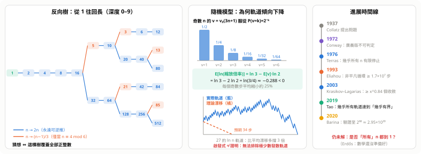

# 冰雹猜想（Collatz Conjecture）

冰雹猜想又稱 **3n+1 問題**、**考拉茲猜想**：任取一個正整數，偶數就除以 2，奇數就乘 3 再加 1，反覆進行，最後一定會到達 1 嗎？規則小學生就看得懂，卻自 1937 年提出以來無人能證明，Erdős 曾說：「數學還沒有準備好面對這類問題。」

與本庫其他筆記的關係：它是離散動力系統的極簡範例，與 `Markov-Chain.md`（隨機漂移模型）、`Fractal.md`（複平面延拓出碎形）、`NP.md`／`Prime-Theory.md`（可計算性與數論）都有交會；「簡單規則、不可預測行為」的特質也呼應 `Percolation.md` 與 `Information-Theory.md` 的主題。

貫穿全文的主線：

- **局部簡單、全局不可預測**：每一步都是確定的，但軌道長度與峰值幾乎沒有可用的公式。
- **啟發式說它會收斂，但啟發式不是證明**：平均而言軌道向下漂移，問題在於無法排除極少數的例外。
- **現有結果只能證明「幾乎所有」**：Tao（2019）證明了強力的「幾乎所有」結果，距離「所有」仍有一步之遙。

---

## 目錄

1. [定義與別名](#1-定義與別名)
2. [動手算：軌道與紀錄保持者](#2-動手算軌道與紀錄保持者)
3. [基本概念與等價陳述（另檔）](#3-基本概念與等價陳述另檔)
4. [反向樹：從 1 往回長](#4-反向樹從-1-往回長)
5. [啟發式論證：隨機漂移模型](#5-啟發式論證隨機漂移模型)
6. [為什麼這麼難](#6-為什麼這麼難)
7. [已知結果](#7-已知結果)
   - [7.1 Tao 2019 的證明策略](#71-tao-2019-的證明策略)
8. [推廣與變形](#8-推廣與變形)
   - [8.1 qn+r 家族](#81-qnr-家族)
   - [8.2 擴展到負整數](#82-擴展到負整數)
   - [8.3 廣義 Collatz（依模數查表）](#83-廣義-collatz依模數查表)
   - [8.4 無進位版本：F2[x] 類比](#84-無進位版本f2x-類比)
   - [8.5 連續與複平面延拓](#85-連續與複平面延拓)
   - [8.6 外表相近的數列：Juggler 序列](#86-外表相近的數列juggler-序列)
   - [8.7 小結](#87-小結)
9. [計算與驗證](#9-計算與驗證)
10. [與 AI／本庫的連結](#10-與-ai本庫的連結)
11. [一句話記憶](#11-一句話記憶)

---

## 1. 定義與別名

$$
f(n) = \begin{cases} n/2 & n \text{ 為偶數} \\ 3n+1 & n \text{ 為奇數} \end{cases}
$$

**猜想**：對任意正整數 $n$，存在 $k$ 使得 $f^{k}(n) = 1$。到達 1 之後會進入 $1 \to 4 \to 2 \to 1$ 的**平凡循環**。

| 名稱 | 由來 |
|---|---|
| 考拉茲猜想（Collatz） | Lothar Collatz 於 1937 年提出 |
| 3n+1 問題 | 直接取自規則 |
| 冰雹猜想（Hailstone） | 數值像冰雹在雲中被氣流反覆托起、墜落，最後才落地 |
| 角谷猜想（Kakutani） | 角谷靜夫在 1960 年代於美國推廣，日本沿用此名 |
| 敘拉古猜想（Syracuse） | 相關研究在 Syracuse 大學流傳 |
| Ulam 問題、Hasse 算法、Thwaites 猜想 | 不同數學家各自獨立提出或推廣 |

---

## 2. 動手算：軌道與紀錄保持者

```
n = 6 :  6 → 3 → 10 → 5 → 16 → 8 → 4 → 2 → 1                    （8 步）
n = 7 :  7 → 22 → 11 → 34 → 17 → 52 → 26 → 13 → 40 → 20 → 10
           → 5 → 16 → 8 → 4 → 2 → 1                             （16 步）
```

起始值只差 1，步數差一倍：步數對 $n$ 極不平滑。下表是「到某上限為止，步數最多的起始值」（皆為實際計算結果）：

| $n$ 範圍上限 | 步數最多的 $n$ | 全停止時間 | 軌道峰值 |
|---|---|---|---|
| 10 | 9 | 19 | 52 |
| 100 | 97 | 118 | 9,232 |
| 1,000 | 871 | 178 | 190,996 |
| 10,000 | 6,171 | 261 | 975,400 |
| 100,000 | 77,031 | 350 | 21,933,016 |
| 1,000,000 | 837,799 | 524 | 2,974,984,576 |

**$n=27$ 是經典的「驚嚇案例」**：只有兩位數，卻要 111 步才到 1，途中飆到 $9232 \approx 342n$。


---

## 3. 基本概念與等價陳述（另檔）

第 3 章整章移到 [Collatz-Connections.md](Collatz-Connections.md)（拆檔的原因：單頁公式過多時，GitHub 可能有部分公式無法渲染；小節編號不變）。本檔其餘章節引用的「§3.x」都指該檔。為了讓後面的章節好讀，這裡只留 Syracuse 映射的定義：

$$
T(n)=\frac{3n+1}{2^{v_2(3n+1)}},\qquad n\text{ 為奇數}
$$

其中 $v_2(m)$ 是 $m$ 的 2-進位賦值； $T$ 把「一次乘 3 加 1 與其後所有除 2」打包成一步。

第 3 章的小節：

- [§3.0 特殊數列對照總表（§3.3–§3.26）](Collatz-Connections.md#30-特殊數列對照總表33326)
- [§3.1 2-進位觀點](Collatz-Connections.md#31-2-進位觀點)
- [§3.2 3-進位觀點](Collatz-Connections.md#32-3-進位觀點)
- [§3.3 Mersenne 數：全 1 的極端案例](Collatz-Connections.md#33-mersenne-數全-1-的極端案例)
- [§3.4 Fibonacci：O/E 步序列的黃金分割位移](Collatz-Connections.md#34-fibonaccioe-步序列的黃金分割位移)
- [§3.5 Lucas 序列：統一 Mersenne、崩落極端與 Fibonacci](Collatz-Connections.md#35-lucas-序列統一-mersenne崩落極端與-fibonacci)
- [§3.6 Catalan：首次穿越計數、2-進位與 Catalan 猜想](Collatz-Connections.md#36-catalan首次穿越計數2-進位與-catalan-猜想)
- [§3.7 Bernoulli：沒有已知關係的檢查](Collatz-Connections.md#37-bernoulli沒有已知關係的檢查)
- [§3.8 Euler 數與 e](Collatz-Connections.md#38-euler-數與-e)
- [§3.9 Stirling 數與 Stirling 公式](Collatz-Connections.md#39-stirling-數與-stirling-公式)
- [§3.10 Pell 數與連分數](Collatz-Connections.md#310-pell-數與連分數)
- [§3.11 Motzkin 數](Collatz-Connections.md#311-motzkin-數)
- [§3.12 Fermat 數](Collatz-Connections.md#312-fermat-數)
- [§3.13 Riemann zeta 與動力 zeta](Collatz-Connections.md#313-riemann-zeta-與動力-zeta)
- [§3.14 Dirichlet 級數](Collatz-Connections.md#314-dirichlet-級數)
- [§3.15 Möbius 函數](Collatz-Connections.md#315-möbius-函數)
- [§3.16 Lambert W 函數](Collatz-Connections.md#316-lambert-w-函數)
- [§3.17 Gamma 函數](Collatz-Connections.md#317-gamma-函數)
- [§3.18 Euler 乘積](Collatz-Connections.md#318-euler-乘積)
- [§3.19 Selberg 跡公式](Collatz-Connections.md#319-selberg-跡公式)
- [§3.20 Hecke 算子](Collatz-Connections.md#320-hecke-算子)
- [§3.21 Ramanujan 求和](Collatz-Connections.md#321-ramanujan-求和)
- [§3.22 Mellin 變換](Collatz-Connections.md#322-mellin-變換)
- [§3.23 Fourier 變換](Collatz-Connections.md#323-fourier-變換)
- [§3.24 Laplace 變換](Collatz-Connections.md#324-laplace-變換)
- [§3.25 Gauss 求和](Collatz-Connections.md#325-gauss-求和)
- [§3.26 Bernoulli 多項式](Collatz-Connections.md#326-bernoulli-多項式)

---

## 4. 反向樹：從 1 往回長

把規則倒過來：給定 $n$，哪些數一步會變成 $n$？

- $2n \to n$：**永遠成立**（ $2n$ 是偶數，除 2 得 $n$）。
- $m \to n$ 且 $m$ 為奇數、 $n = 3m+1$：即 $m = (n-1)/3$，要求它是奇整數，等價於 $n \equiv 4 \pmod 6$。

因此每個節點有 1 或 2 個「前身」，從 1 出發可長出一棵樹：

```
1 ← 2 ← 4 ← 8 ← 16 ─┬─ 32 ← 64 ─┬─ 128 ← 256 ← 512 ...
                    │           └─ 21 ← 42 ← 84 ...
                    └─ 5 ← 10 ──┬─ 20 ← 40 ─┬─ 80 ...
                                │           └─ 13 ← 26 ...
                                └─ 3 ← 6 ← 12 ...
```

（箭頭 $a \leftarrow b$ 表示 $b$ 一步變成 $a$；例如 $21 \to 64$、 $5 \to 16$、 $3 \to 10$、 $13 \to 40$。）

**猜想的等價說法**：這棵反向樹涵蓋全部正整數。分支只在 $n \equiv 4 \pmod 6$ 時出現（約每 6 個數 1 個），樹很「稀疏」，但分支足夠多，經驗上看起來能覆蓋一切。



---

## 5. 啟發式論證：隨機漂移模型

假設奇數 $n$ 的 $3n+1$ 其 2-進位賦值 $v = v_2(3n+1)$ 像隨機變數：

$$
P(v = k) = 2^{-k}, \quad k = 1, 2, 3, \dots \qquad \mathbb{E}[v] = 2
$$

（對奇數 $n$ 這個分布是精確成立的；「假設」的是各步之間近似獨立。）每個奇數步把數值乘上 $3/2^v$，因此對數的期望變化為：

$$
\mathbb{E}[\ln \text{倍率}] = \ln 3 - \mathbb{E}[v]\ln 2 = \ln 3 - 2\ln 2 = \ln\tfrac{3}{4} \approx -0.288 < 0
$$

軌道的 $\ln n$ **平均每個奇數步下降約 0.288**，像帶負漂移的隨機遊走。每個奇數步連同後續除 2，平均占 $1 + \mathbb{E}[v] = 3$ 個標準步，於是預測：

$$
\text{全停止時間} \approx \frac{3}{\ln(4/3)} \ln n \approx 10.43 \ln n
$$

實測 $n \le 10^5$ 的平均值約為 $10.2 \ln n$，吻合良好（見上圖右）。

**這個模型也解釋了推廣版本的差異**：對 $qn+1$（ $q$ 為奇數），漂移為 $\ln q - 2\ln 2 = \ln(q/4)$。

| 版本 | $\ln(q/4)$ | 隨機模型預測 |
|---|---|---|
| $3n+1$ | $-0.288$ | 向下漂移，收斂 |
| $5n+1$ | $+0.223$ | 向上漂移，多數軌道發散 |

**限制**：隨機模型只是機率上的直覺。它無法排除「結構性」的例外（例如某個特殊的發散軌道或循環），而這正是證明的困難所在。 $n=27$ 的實際長度（111 步）約為漂移預期（約 34 步）的 3 倍，說明個別軌道會大幅偏離平均。

---

## 6. 為什麼這麼難

1. **乘法與加法交纏**：除以 2 是 2-進位的右移；乘 3 再加 1 是在另一個進位體系裡操作。兩者交替，沒有任何代數不變量可抓。
2. **沒有平滑結構**： $\sigma(n)$ 對 $n$ 極度不連續（ $n=6,7$ 差一倍），無法用分析方法逼近。
3. **局部—全局落差**：模 $2^k$ 的同餘類能精確描述前 $k$ 步，但軌道可以無限走下去。
4. **一般化版本是不可判定的**：Conway（1972）證明，把規則改成「依 $n \bmod p$ 查表、套用不同的一次函數」的廣義 Collatz 型問題，**一般而言**無法由演算法判定是否收斂（可編碼圖靈機，與 FRACTRAN 同源）。這不代表 3n+1 本身不可判定，但暗示一般性的證明技術很難存在。

> 「Mathematics may not be ready for such problems.」——Paul Erdős

---

## 7. 已知結果

| 年份 | 結果 | 意義 |
|---|---|---|
| 1976 | Terras：密度為 1 的正整數有有限停止時間 | 幾乎所有 $n$ 都會降到比自己小 |
| 1993 | Eliahou：非平凡循環長度至少 17,087,915 | 若存在循環，必須極長 |
| 1994 | Korec：幾乎所有 $n$ 滿足 $\text{Col}_{\min}(n) < n^{\theta}$， $\theta > \log 3/\log 4 \approx 0.7924$ | Terras／Allouche 之後的冪次改進（自然密度） |
| 2003 | Krasikov–Lagarias： $\le x$ 中至少 $x^{0.84}$ 個會到 1 | 收斂的數有多項式量級 |
| 2019 | **Tao**：幾乎所有軌道達到「幾乎有界」的值 | 目前最強的「幾乎所有」結果 |
| 2020 | Barina：驗證至 $2^{68} \approx 2.95\times10^{20}$ | 數值上無反例 |
| 2023 | Hercher：非平凡循環長度提高至約 $2.2\times10^{11}$ 以上 | 排除更多短循環 |

**Tao 2019 的內容**：令 $\text{Col}_{\min}(N) = \min_{k\ge0} f^k(N)$。對任意趨向無窮的函數 $g(N)$（即使增長得極慢），在**對數密度**意義下，幾乎所有 $N$ 都滿足 $\text{Col}_{\min}(N) < g(N)$。換句話說：幾乎所有軌道都會降到任意小——但「降到 1」仍沒有被證明，且「幾乎所有」仍容許密度為 0 的無限多個例外。

### 7.1 Tao 2019 的證明策略

> **可信度標註**：標示「✔」的內容有對照摘要／導言查證；標示「△」的是依記憶整理的概述，細節（尤其是 3-進位部分）請對照原論文 arXiv:1909.03562。

**先看前人卡在哪**：Terras、Everett 證明 $\text{Col}_{\min}(N) < N$（幾乎所有 $N$）；Allouche 改成 $N^{\theta}$；Korec 做到 $\theta > 0.7924$。這些都是**自然密度**，且降幅停在冪次。Tao 一次把門檻降到任意慢增長的 $g(N)$。

```
真實軌道（難分析）
      │  ① 換成 Syracuse 映射 + 對數密度 ✔
      ▼
Syracuse 迭代 Syrᵏ(N)
      │  ② 證明「近似轉移」：迭代後的（對數尺度）分布 ≈ 理想隨機模型 ✔
      ▼
隨機模型：ln n 帶負漂移 ln(3/4) 的隨機遊走（見 §5）
      │  ③ 隨機遊走幾乎必然降到任意低 ✔
      ▼
幾乎所有 N 的軌道 Col_min(N) < g(N)
```

**① 為什麼換映射與測度 ✔**
均勻測度對 Collatz 映射沒有不變性。**對數密度**有近似的乘法不變性，更適合分析「乘 3、除 2 的冪」這類乘法運算；Syracuse 映射則是做 2-進位分析時特別方便的版本。

**② 近似轉移性質（approximate transport）✔／△**
- 取對數意義下的典型起點 $N$，迭代 $k$ 次 Syracuse（ $k$ 隨 $N$ 緩慢增長）。
- 證明 $\text{Syr}^{k}(N)$ 的（對數）分布，與一個**理想化的隨機變數**的分布近似。這個隨機變數的建構與 §5 的幾何分布 $P(v=k)=2^{-k}$ 同一精神。
- △ 我記憶中，Tao 在模 $3^n$ 的剩餘類上，用特徵函數（傅立葉係數）控制 Syracuse 迭代的分布。**更正**：我先前寫成「近似均勻」，但後來用程式實測（ $n=3,4,5$，隨機大起點）發現，迭代幾步內分布就收斂到一個**固定但非均勻**的分布，與均勻分布的 TV 距離約 $0.35$– $0.39$，且不隨步數減小；所以應理解為「近似那個固定分布」，而非均勻分布，細節待對照原論文。摘要提到「二維更新過程（renewal process）與三角形聯集」，似乎屬於這一步的核心估計。**搜尋結果只確認到 2-進位分析，未能確認 3-進位的說法。**

**③ 與隨機遊走比較 ✔**
一旦分布與隨機模型近似，而模型的 $\ln$ 漂移為負，幾乎所有軌道就會降到任意低的值。

**為什麼證不到 1**
- 結論是**對數密度意義下的「幾乎所有」**，仍容許密度為 0 的無限多個例外；非平凡循環與發散軌道若存在，可以躲在這個例外集合裡。
- 近似誤差只在尺度夠大時可控；要降到常數（如 1）需要在小數值端做精確控制，這個方法就不再有效。一般認為這大致已是此方法的極限（此為我的轉述，未逐字核對原文）。

---

## 8. 推廣與變形

> 標示「（已驗證）」者，是我用程式實際檢查過的結果；標示「記憶」者是依印象整理、未核對的出處。2-進位與 3-進位延拓已在 §3.1、§3.2 討論。

### 8.1 qn+r 家族

把「奇數就乘 3 加 1」改成 $qn+r$（偶數仍除以 2）。依 §5 的隨機模型，漂移是 $\ln(q/4)$： $q<4$ 預期收斂， $q>4$ 預期多數軌道飛走。以 $n\le2000$ 為起點的實測（已驗證）：

| 變形 | 漂移 | 找到的不同循環數 | 實測 |
|---|---|---|---|
| $3n+1$ | $-0.288$ | 1（ $\{1,4,2\}$） | 全部收斂 |
| $3n-1$ | $-0.288$ | **3** | 全部收斂 |
| $3n+5$ | $-0.288$ | **6**（最小元 1, 5, 19, 23, 187, 347） | 全部收斂 |
| $5n+1$ | $+0.223$ | 3（最小元 1, 13, 17） | 87% 超過 $10^{60}$ 或 2 萬步 |
| $5n-1$ | $+0.223$ | 1 | 81% 超過上限 |
| $7n+1$ | $+0.560$ | 1 | 98% 超過上限 |

兩個重點：

- **負漂移只保證「不發散」，不保證「循環唯一」**： $3n-1$ 有 $\{1,2\}$、 $\{5,14,7,20,10\}$、 $\{17,50,\dots\}$（長 18）三個循環， $3n+5$ 至少有六個。 $3n+1$ 看起來只有一個循環反而是特例。
- 正漂移那組只是「多數軌道飛走」的實測與啟發式。就我所知，沒有任何一個軌道被**證明**發散（例如 $5n+1$ 的 $n=7$）。

### 8.2 擴展到負整數

$3n+1$ 在負整數上也有三個循環（已驗證），最小元分別為 $-2$、 $-20$、 $-272$： $\{-1,-2\}$、 $\{-5,-14,-7,-20,-10\}$、 $\{-17,\dots\}$（長 18）。 $-1$ 對應 §3.1 中全 1 的奇偶序列。

### 8.3 廣義 Collatz（依模數查表）

把規則改為「依 $n \bmod d$ 套用不同的一次函數」。Conway（1972）證明這一類問題一般**不可判定**（§6）。依記憶，De Mol（2008）把它與標籤系統（tag system）的可計算性連起來，細節未核對。這說明 $3n+1$ 的「簡單」是個特例：一般形式可以編碼圖靈機。

### 8.4 無進位版本：F2[x] 類比

在 $\mathbb{F}_2[x]$ 上令 $P\mapsto P/x$（若 $x\mid P$），否則 $P\mapsto(x+1)P+1$（這是我採用的形式，與原論文是否逐字一致未核對）。

- 實測：次數小於 18 的 $2^{18}$ 個多項式，**全部**最終到 0 或 1（已驗證）。
- 步數：到 0 或 1 的最大步數隨次數近似線性成長（次數 $<17$ 時最多 86 步），而一般整數（ $n<2^{17}$）最多 353 步（已驗證）。
- 依記憶，Hicks–Mullen–Yucas–Zavislak（2008）對這個類比給出了證明。
- 我的解讀（非查證）：這裡沒有進位，位元與「大小」不再互相干擾，次數成為可加的大小量，困難因而消失，這也佐證 §3.1 的張力：Collatz 的困難來自進位把 2-進位與實數大小纏在一起。

### 8.5 連續與複平面延拓

Chamberland（1996）把捷徑映射 $T$ 延拓到實數線與複平面：

$$
f(z)=\frac{z}{2}\cos^2\!\frac{\pi z}{2}+\frac{3z+1}{2}\sin^2\!\frac{\pi z}{2}
$$

$\cos^2$ 與 $\sin^2$ 在偶數、奇數點分別為 1、0，所以 $f$ 在整數 $n$ 上等於 $T(n)$（ $n=1,\dots,20$ 已驗證）。化簡後得到只含 $\cos$ 的封閉形式（隨機 2000 個複數點最大誤差 $3\times10^{-13}$，已驗證； $n=1,\dots,39$ 上等於 $T(n)$）：

$$
f(z)=z+\frac{1-(2z+1)\cos\pi z}{4}
$$

下圖是我自己計算的：對 $\mathrm{Re}\,z\in[-2.5,4.5]$、 $\mathrm{Im}\,z\in[-1.5,1.5]$ 的網格迭代 60 次，標出不逃逸（ $|\mathrm{Im}\,z|\le12$）的點。非逃逸點約占取樣的 12.0%，集中在實軸附近，呈現球狀分支與自相似結構（為 60 次迭代的數值結果，非嚴格定理）。 $0$ 是不動點， $1\leftrightarrow2$ 構成 2-循環。


### 8.6 外表相近的數列：Juggler 序列

偶數取 $\lfloor\sqrt a\rfloor$，奇數取 $\lfloor a^{3/2}\rfloor$，猜想也都到 1。實測（已驗證）：

| 起點 | 步數 | 峰值位數 |
|---|---|---|
| 9 | 7 | 3 |
| 19 | 9 | 3 |
| 37 | 17 | 14 |
| 77 | 19 | 7 |

起點 2–300 之中，峰值最大的是 193，達 271 位數。37 只走 17 步卻衝到 14 位數，與 $n=27$ 的「驚嚇案例」類似。

![qn+r 家族、F2[x] 類比與 Juggler 序列](figures/collatz-variants.svg)

### 8.7 小結

| 想改變的 | 發生的事 |
|---|---|
| 係數 $q$ | 漂移符號決定「收斂／飛走」，但循環數會變多 |
| 常數項 $r$ | 循環結構大變（ $3n-1$、 $3n+5$） |
| 依模數查表 | 可編碼圖靈機，不可判定 |
| 換成無進位環 | 可證明（記憶） |
| 延拓到 $\mathbb{Z}_2$／ $\mathbb{Z}_3$ | 位移共軛／收縮對偶（§3.1、§3.2） |
| 延拓到複平面 | 非逃逸集合呈碎形 |

---

## 9. 計算與驗證

**帶快取的步數計算**（避免重複走已算過的尾段）：

```python
_cache = {1: 0}

def collatz_steps(n: int) -> int:
    path = []
    while n not in _cache:
        path.append(n)
        n = n // 2 if n % 2 == 0 else 3 * n + 1
    s = _cache[n]
    for m in reversed(path):
        s += 1
        _cache[m] = s
    return s

collatz_steps(27)      # 111
collatz_steps(837799)  # 524
```

**大規模驗證的剪枝思想**（Barina 等人的做法）：

- 對 $n$ 模 $2^k$ 的某個同餘類，前 $k$ 個「奇偶位元」固定， $k$ 步後 $f^k(n) = (3^a n + b)/2^k$，其中 $a$ 是這 $k$ 步裡的奇數步數。
- 若 $3^a < 2^k$，則 $n$ 夠大時 $f^k(n) < n$，這個同餘類只需驗證到有限範圍；真正需要逐一驗證的只剩 $3^a > 2^k$ 的少數類別。
- 配合已驗證範圍內「降到更小的數就停」，並以 GPU／分散式計算，把上限推到 $10^{20}$ 量級。

---

## 10. 與 AI／本庫的連結

| 主題 | 連結 |
|---|---|
| 隨機遊走與漂移 | 軌道的 $\ln n$ 是帶負漂移的隨機遊走，與 `Markov-Chain.md` 的轉移鏈思想一致 |
| 漂移符號 ≈ 相變 | $\ln(q/4)$ 的正負決定收斂或發散（ $3n+1$ vs $5n+1$），類似序參數過零，參見 `Percolation.md` |
| 混沌與碎形 | 複平面延拓出碎形，參見 `Fractal.md`；軌道對初值極度敏感 |
| 不可判定性 | 廣義 Collatz 可編碼圖靈機，與 `NP.md`、可計算性主題相通 |
| 數論 | 2-進位／3-進位的交互作用，參見 `Prime-Theory.md` |
| Möbius 函數 | Möbius 反演從動力 zeta 取出恰好週期 $k$ 的點數（ $\mathbb{Z}$ 只剩 $k=1,2,3,11$， $\mathbb{Z}_2$ 為 Lyndon 字數）； $\mu$ 與步數、停止時間未見相關（數值，非定理）；無已知直接關係（§3.15），參見 `Prime-Theory.md`、`Riemann-Hypothesis.md` |
| Bernoulli 多項式 | $B_n$ 是加倍映射轉移算子的本徵函數（對應 $U_2$ 一支，完整的 $L=U_2+R$ 不成立）；殘餘類的正規化冪和與 Faulhaber 同餘類和是 Bernoulli 多項式的通用恆等式；無已知直接關係（§3.26），參見 `Taylor.md`、`Fourier-Series.md` |
| Gauss 求和 | 2 是模 $3^m$ 的原根、 $\mathrm{ord}_{2^k}(3)=2^{k-2}$，與 3-進／2-進對偶一致（推論）；Gauss 和需要函數方程，Collatz 沒有；三角形數當起點無特殊性；無已知直接關係（§3.25），參見 `Prime-Theory.md`、`Group-Theory.md` |
| Laplace 變換 | Dirichlet 級數是 $\ln n$ 上的 Laplace 變換（等價於 Mellin）；首次通過時間的矩母函數預測平均 $6.952\ln n$、變異數 $101.4\ln n$，數值吻合；指數增長率即收斂橫坐標（ $\ln2$、 $\ln\lambda$）；無已知直接關係（§3.24），參見 `Markov-Chain.md`、`Taylor.md` |
| Fourier 變換 | Tao 2019 把「幾乎所有軌道」歸結為 $\mathbb{Z}/3^n$ 上偏斜隨機游走特徵函數的高頻估計（搜尋摘要）； $\mathrm{Syr}^K\bmod27$ 收斂到非均勻穩態； $\text{steps}(n)$ 有 dyadic 譜線；只給「幾乎所有」，不是猜想的證明（§3.23），參見 `Fourier-Series.md`、`Harmonic-Analysis.md` |
| Mellin 變換 | Mellin–Perron 把 $S(N)$ 的公式讀成 $s=1$ 雙重極點的留數（推導）；伸縮的矩條件 $M(1)=1$ 預測軌道最大值尾巴 $\sim C/x$，數值吻合（ $x\cdot P\approx0.82$）；無已知直接關係（§3.22），參見 `Fourier-Series.md`、`Harmonic-Analysis.md` |
| Ramanujan 求和 | 幾何級數的正規化值等於分支不動點與 $p$-進極限（通用）；層級和 $S_d$ 幾何發散， $1+2+3+\cdots=-\tfrac1{12}$ 未出現；Ramanujan 和只是 2-進同餘類的標準展開；無已知直接關係（§3.21），參見 `Riemann-Hypothesis.md` |
| Hecke 算子 | 轉移算子 $L=U_2+R$ 中的 $U_p$ 是 Hecke 型算子且 $U_pU_q$ 交換，但 $R$ 使 $L$ 與 $U_p$ 不交換；分支是 Hecke 陪集的元素，用奇偶性挑一個像；無已知直接關係（§3.20），參見 `Group-Theory.md`、`Prime-Theory.md` |
| Selberg 跡公式 | 位移的離散跡公式 $\mathrm{tr}(A^k)=2^k$（譜只有 $\{2\}$）對應動力 zeta； $L_kk/2^k\to1$ 類比質測地線定理；無雙曲曲面與 Laplacian，無已知直接關係（§3.19），參見 `Riemannian-Geometry.md`、`Group-Theory.md` |
| Euler 乘積 | $\mathbb{Z}_2$ 上的動力 zeta 是取遍 Lyndon 字的 Euler 乘積，與 $\mathbb{F}_2[x]$ 的 zeta 同式；Syracuse 像的局部密度吻合 $\prod(1-1/p)$；步數不乘性，無 Euler 乘積（§3.18），參見 `Prime-Theory.md` |
| Gamma 函數 | 循環乘積 $\prod(1+\frac1{3(m+2j)})$ 的 Gamma 閉式精確，但只有 $s\gtrsim n_{\min}$ 才比粗上界更緊，實務上不改變 §3.8 的結論；二項係數延拓見 §3.9；無已知直接關係（§3.17） |
| Lambert W 函數 | 可用 $W$ 反解 $N\ln N$ 型的逐一驗證預算（誤差約 $0.3\%$），但通用且實務上用不到（早停使成本線性）；Cayley 樹的 $W$ 與反向樹無關；無已知直接關係（§3.16） |
| Dirichlet 級數 | 反向樹各層的 Dirichlet 級數分割 $\zeta(s)$（猜想 $\iff E(s)\equiv0$）；殘餘類是 Hurwitz zeta；步數不乘性，無 Euler 乘積／ $L$ 函數（§3.14） |
| Riemann zeta | 動力 zeta 把循環寫成 Euler 乘積（ $\mathbb{Z}_2$ 上 $1/(1-2z)$；無非平凡正循環 $\Leftrightarrow1/(1-z^2)$）；對數密度對應 $\zeta$ 在 $s=1$ 的極點；與零點、RH 無已知關係（§3.13；動力 zeta 無零點， $b_N$ 在零點週期上無振盪），參見 `Riemann-Hypothesis.md` |
| Fermat 數 | $2^{2^n}-1=\prod_{k < n}F_k$、崩落極端數 $=\prod F_k$；貼近 1 的吸引（乘數 $3/4$）對貼近 $-1$ 的排斥（乘數 $3/2$）（§3.12） |
| Motzkin 數 | 與 Catalan 同屬路徑計數（加水平步）；成長率 3 與 Collatz 乘數無關；偶數項 $n=m4^j-1,\,m4^j-2$；反向樹形狀屬一元—二元樹（§3.11） |
| Pell 數 | $U_n(2,-1)$，根 $1\pm\sqrt2$；為 $\sqrt2$ 的收斂分母，對比 $\log_2 3$ 像典型實數（§3.10） |
| Stirling 數／公式 | 與 Stirling 數無已知關係；Stirling 公式給奇偶向量熵 0.95 bits；反向樹成長率 $\lambda=(1+\sqrt{7/3})/2$（§3.9） |
| Euler 數／e | 循環的乘積恆等式 $2^k/3^s=\prod(1+\frac1{3n_i})$ 是真實連結，可推得 $n_{\min}\le s/(3\varepsilon)$；Euler 正割數無已知關係（§3.8） |
| Bernoulli 數 | 無已知直接關係；von Staudt–Clausen 使 2、3 恆在分母但屬巧合， $v_2=v_3=-1$ 對稱而 Collatz 靠不對稱（§3.7） |
| Catalan 數／猜想 | 首次穿越計數：Catalan 是零漂移類比，Collatz 為次臨界（§3.6）； $C_n$ 奇數 ⇔ $n=2^k-1$； $2^k-3^s=\pm1$ 對應三個最小循環 |
| Lucas 數／序列 | $L_n$ 本身無特殊性；Lucas 序列 $U_n(P,Q)$ 統一 Mersenne 數、 $(4^i-1)/3$、 $3^n-2^n$、Fibonacci（§3.5） |
| Fibonacci | 標準版 O/E 步序列是黃金分割位移，合法序列數 $=F_{m+2}$（§3.4）；費氏數當起點則看不出特殊性 |
| Mersenne 數／質數 | $2^k-1$ 是全 1 的極端案例（§3.3）；與 Mersenne 質數本身無已知深層關係，Lucas–Lehmer 為二次映射，參見 `Prime-Theory.md` |
| 神經網路的學習難度 | 步驟函數對輸入奇偶位元極度敏感、不平滑；常被用作測試模型能否做「長鏈精確計算」的簡單任務（此為觀察性描述，非定理） |

---

## 11. 一句話記憶

$$
\boxed{\;n \mapsto \begin{cases} n/2 \\ 3n+1 \end{cases}\;:\; \text{平均每個奇數步 } \ln n \text{ 下降 } 0.288\text{，所以幾乎一定落地——但「幾乎一定」不是「一定」。}\;}
$$

規則三行寫完，證明至今無人完成：**隨機模型說會收斂，Tao 證明了幾乎所有，驗證到 $10^{20}$ 沒反例，但最後一步仍然懸空。**

---

## 參考文獻

- Lagarias, J. C. (1985). *The 3x+1 problem and its generalizations*. American Mathematical Monthly, 92(1), 3–23.
- Lagarias, J. C. (Ed.) (2010). *The Ultimate Challenge: The 3x+1 Problem*. American Mathematical Society.
- Terras, R. (1976). *A stopping time problem on the positive integers*. Acta Arithmetica, 30, 241–252.
- Conway, J. H. (1972). *Unpredictable iterations*. Proc. 1972 Number Theory Conference, Boulder, 49–52.
- Krasikov, I. & Lagarias, J. C. (2003). *Bounds for the 3x+1 problem using difference inequalities*. Acta Arithmetica, 109, 237–258.
- Tao, T. (2019). *Almost all orbits of the Collatz map attain almost bounded values*. arXiv:1909.03562.
- Barina, D. (2021). *Convergence verification of the Collatz problem*. The Journal of Supercomputing, 77, 2681–2688.
- Hercher, C. (2023). *There are no Collatz m-cycles with m ≤ 91*. Journal of Integer Sequences, 26, Article 23.3.5.
- Chamberland, M. (1996). *A continuous extension of the 3x+1 problem to the real line*. Dynamics and Stability of Systems, 11(3), 249–264.
