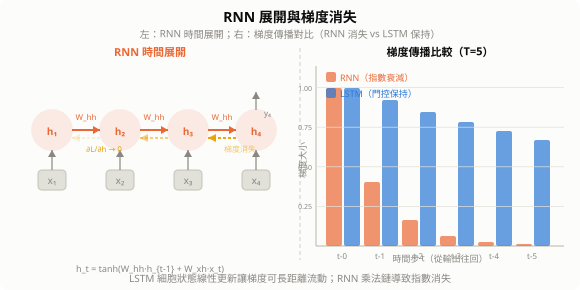
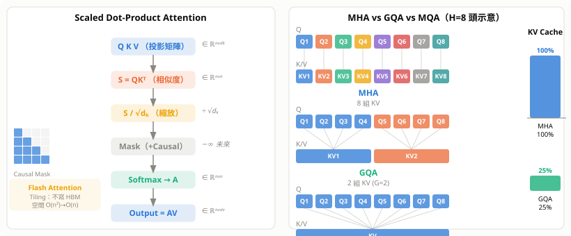
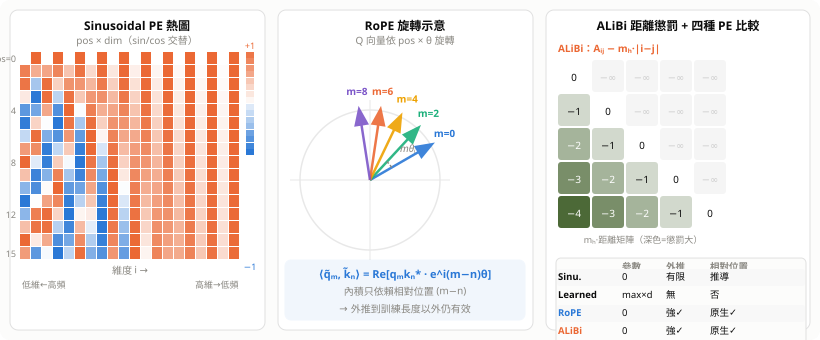
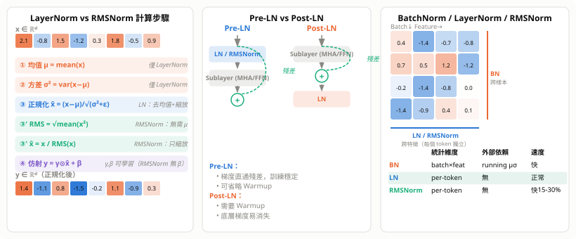
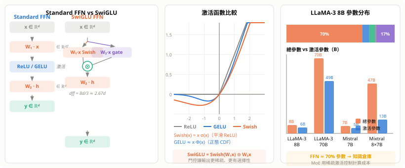
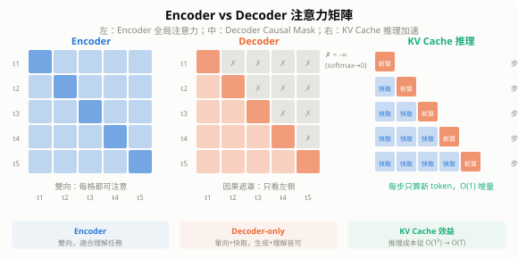
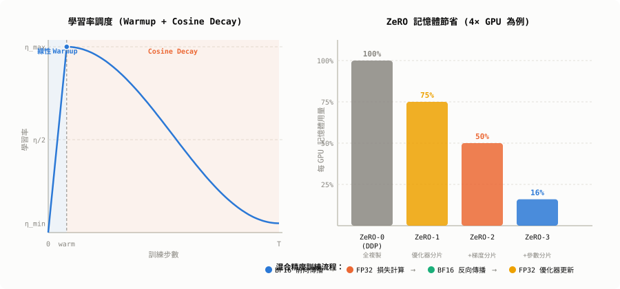
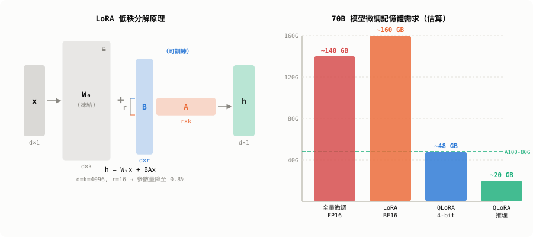
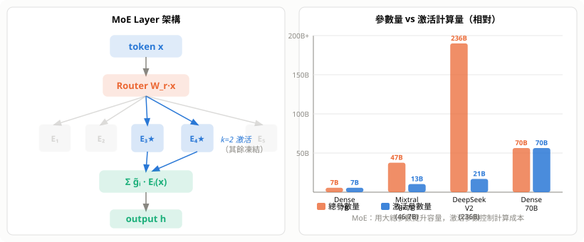

# 深度學習演化史

> 從感知機到大語言模型，每個時代都由一個核心問題驅動：如何讓梯度流得更深、更遠、更有效率。


---

## 1. 第一波：感知機與人工神經元（1943–1969）

### 1.1 McCulloch–Pitts 神經元（1943）

第一個數學神經元模型：加權輸入超過閾值即激活，純二元輸出。

$$y = \begin{cases} 1 & \text{if } \sum_i w_i x_i \geq \theta \\ 0 & \text{otherwise} \end{cases}$$

### 1.2 感知機（Rosenblatt 1957）

第一個**可學習**的分類器，引入更新規則：

$$w_i \leftarrow w_i + \eta \cdot (y - \hat{y}) \cdot x_i$$

**感知機收斂定理**：若資料線性可分，感知機在有限步內必定收斂。

**技術特點**：
- 單層、線性決策邊界
- 無隱藏層，特徵仍需人工設計
- 只能解線性可分問題

### 1.3 第一次 AI 寒冬

Minsky & Papert《Perceptrons》（1969）嚴格證明：單層感知機無法解 XOR 問題。由於當時無人知道如何訓練多層網路，神經網路研究幾乎停滯 15 年。

---

## 2. 第二波：反向傳播與多層網路（1986–1990s）

### 2.1 反向傳播算法（Rumelhart, Hinton & Williams 1986）

將**連鎖律**系統化為可自動計算梯度的算法：

$$\frac{\partial L}{\partial w^{(l)}} = \frac{\partial L}{\partial a^{(l)}} \cdot \frac{\partial a^{(l)}}{\partial z^{(l)}} \cdot \frac{\partial z^{(l)}}{\partial w^{(l)}}$$

逐層從輸出往輸入傳遞誤差信號，使任意深度的 MLP 都可端到端訓練。

### 2.2 萬能近似定理（Universal Approximation Theorem）

> 含一個足夠寬隱藏層的 MLP，可以以任意精度近似任何連續函數。

理論上解決了「為何需要深度學習」的問題，但**實際訓練**仍面臨：

| 問題 | 原因 |
|------|------|
| 梯度消失 | Sigmoid 飽和區導數 $\sigma'(z) \to 0$ |
| 局部最小值 | 非凸損失函數 |
| 計算資源 | 當時 CPU 速度遠不足 |

### 2.3 LeNet（LeCun 1998）

第一個成功的卷積神經網路，用於手寫數字辨識（MNIST）。已具備：
- 卷積層（局部感受野）
- 池化層（平移不變性）
- 全連接分類頭

但硬體條件不足，無法擴展到更大問題 → **第二次 AI 寒冬**，SVM 在 2000s 主導機器學習。

---

## 3. 第三波：深度學習復興（2006–2012）

### 3.1 逐層預訓練（Hinton 2006）

用**受限玻爾茲曼機（RBM）**逐層貪婪預訓練，再整體微調：

```
輸入層 → RBM₁ → RBM₂ → RBM₃ → 輸出層
         ←——— 預訓練（無監督）———→
         ←——————— 微調（有監督）——————→
```

解決了深層網路的**初始化問題**：預訓練提供好的初始權重，使梯度能有效傳播。

### 3.2 GPU 革命

NVIDIA CUDA（2007）讓矩陣運算加速 10–50 倍，使大規模神經網路訓練成為可能。

### 3.3 AlexNet：轉折點（Krizhevsky, Sutskever, Hinton 2012）

ImageNet 競賽 Top-5 錯誤率：26.2% → **15.3%**，震驚整個計算機視覺界。

**關鍵創新**：

| 技術 | 作用 |
|------|------|
| **ReLU** $\max(0,x)$ | 梯度不消失，訓練速度 6× |
| **Dropout** | 隨機丟棄神經元，防止過擬合 |
| **資料增強** | 隨機裁切/翻轉，擴大訓練集 |
| **多 GPU 並行** | 模型分佈在兩張 GTX 580 |

---

## 4. 第四波：CNN 架構黃金時代（2013–2017）

### 4.1 架構演進

| 架構 | 年份 | 深度 | 核心創新 |
|------|------|------|----------|
| VGG | 2014 | 16–19 層 | 純 3×3 卷積堆疊，結構簡潔 |
| GoogLeNet / Inception | 2014 | 22 層 | Inception Module：並行多尺度卷積 |
| **ResNet** | 2015 | 152 層 | **殘差連接**，突破深度瓶頸 |
| DenseNet | 2017 | 100+ 層 | 每層連接所有前層特徵圖 |

### 4.2 ResNet 殘差連接：本波最重要發明

**問題**：網路越深，訓練誤差反而增大（退化問題，非過擬合）。

**解法**：讓層學習殘差而非完整映射：

$$H(x) = F(x) + x$$

若最優解接近恆等映射，$F(x) \to 0$ 比 $H(x) \to x$ 容易學習。

**梯度視角**：跳躍連接提供梯度的「高速公路」：

$$\frac{\partial L}{\partial x} = \frac{\partial L}{\partial H} \cdot \left(1 + \frac{\partial F}{\partial x}\right)$$

即使 $\partial F/\partial x \approx 0$，梯度仍可透過 $+1$ 項直接回傳。


### 4.3 遷移學習確立

ImageNet 預訓練 → 微調（Fine-tuning）的範式在此時代成熟：在小資料集上也能獲得強大特徵表示。

---

## 5. 第五波：序列模型與注意力（2014–2018）

### 5.0 循環神經網路 RNN（1986–2014）

**標準 RNN** 是第一個處理序列的神經網路，共享同一組權重逐步展開：

$$h_t = \tanh(W_{hh}\, h_{t-1} + W_{xh}\, x_t + b_h)$$
$$y_t = W_{hy}\, h_t + b_y$$

- $h_t$：隱藏狀態，扮演「記憶」角色
- $W_{hh}$：狀態轉移矩陣（同一組，跨所有時間步共享）
- 展開後本質是極深的前饋網路（深度 = 序列長度 $T$）

**展開示意**：

```
x₁ → [h₁] → [h₂] → [h₃] → ... → [hₜ] → y
        ↑        ↑        ↑              ↑
       W_hh    W_hh    W_hh           W_hh
```

**核心問題：梯度消失 / 梯度爆炸**

反向傳播時梯度需穿越 $T$ 個時間步：

$$\frac{\partial L}{\partial h_1} = \frac{\partial L}{\partial h_T} \cdot \prod_{t=2}^{T} \frac{\partial h_t}{\partial h_{t-1}} = \frac{\partial L}{\partial h_T} \cdot \prod_{t=2}^{T} W_{hh}^\top \cdot \text{diag}(\tanh'(\cdot))$$

- $\|W_{hh}\| < 1$：梯度指數衰減 → **消失**，無法學長程依賴
- $\|W_{hh}\| > 1$：梯度指數爆炸 → 訓練不穩（以梯度裁剪 Gradient Clipping 緩解）

**GRU（Gated Recurrent Unit，Cho 2014）**：LSTM 的輕量替代，只用兩個門（重置門 $r_t$、更新門 $z_t$）：

$$\tilde{h}_t = \tanh(W[r_t \odot h_{t-1}, x_t]),\quad h_t = (1-z_t)\odot h_{t-1} + z_t \odot \tilde{h}_t$$

參數比 LSTM 少 25%，許多任務性能相當。

**RNN 的歷史貢獻**：
- 語音辨識（CTC Loss + RNN，2006）
- 語言模型（RNNLM，2010）
- 機器翻譯（Seq2Seq，2014）
- 為 Attention 和 Transformer 鋪路

### 5.1 LSTM：長程依賴的解法

標準 RNN 梯度隨時間步指數衰減：$\partial L/\partial h_0 \sim \lambda^T$，$T$ 大時消失或爆炸。

**LSTM 門控機制**（Hochreiter & Schmidhuber 1997，主流化於 2014）：

$$\begin{align}
f_t &= \sigma(W_f [h_{t-1}, x_t] + b_f) & \text{(遺忘門)} \\
i_t &= \sigma(W_i [h_{t-1}, x_t] + b_i) & \text{(輸入門)} \\
o_t &= \sigma(W_o [h_{t-1}, x_t] + b_o) & \text{(輸出門)} \\
c_t &= f_t \odot c_{t-1} + i_t \odot \tilde{c}_t & \text{(細胞狀態)}
\end{align}$$

細胞狀態 $c_t$ 的線性更新讓梯度可長距離流動。



### 5.2 Seq2Seq + Attention（Bahdanau 2015）

**Seq2Seq**：編碼器將整個序列壓縮為單一向量 → 解碼器展開（瓶頸問題）。

**Attention 解法**：解碼器第 $i$ 步動態計算對編碼器各位置 $j$ 的權重：

$$\alpha_{ij} = \frac{\exp(e_{ij})}{\sum_k \exp(e_{ik})}, \quad c_i = \sum_j \alpha_{ij} h_j$$

每個輸出位置可直接「對齊」最相關的輸入位置，機器翻譯品質大幅提升。

---

## 6. 第六波：Transformer 統一（2017–2020）

### 6.0 Attention 機制深度解析

#### 6.0.1 起源：Bahdanau Attention（2015）

RNN Seq2Seq 把整個序列壓縮成一個固定向量 $c$，長序列資訊丟失。**Attention 的核心思想**：解碼每個輸出時，動態決定「要看輸入的哪個部分，看多少」。

解碼器第 $i$ 步，對編碼器所有位置 $j$ 計算相關度分數，轉為注意力權重，再加權聚合：

$$e_{ij} = v^\top \tanh(W_s s_{i-1} + W_h h_j), \quad \alpha_{ij} = \frac{\exp(e_{ij})}{\sum_k \exp(e_{ik})}, \quad c_i = \sum_j \alpha_{ij} h_j$$

#### 6.0.2 縮放點積注意力（Scaled Dot-Product Attention）

Transformer 把注意力抽象為三個角色：

| 向量 | 意義 | 類比 |
|------|------|------|
| **Q**（Query） | 我在找什麼？ | 搜尋關鍵字 |
| **K**（Key） | 我有什麼？ | 資料庫索引 |
| **V**（Value） | 實際內容是什麼？ | 資料庫值 |

$$\text{Attention}(Q, K, V) = \text{softmax}\!\left(\frac{QK^\top}{\sqrt{d_k}}\right)V$$

**四步計算流程**：

**① 相似度矩陣**：$S = QK^\top \in \mathbb{R}^{n \times n}$，$S_{ij} = q_i \cdot k_j$，越大代表越相關。

**② 縮放（除以 $\sqrt{d_k}$）**：$d_k$ 維向量內積的方差 $= d_k$，不縮放時 softmax 進入飽和區、梯度趨零：

$$\text{Var}(q \cdot k) = \sum_{i=1}^{d_k} \text{Var}(q_i k_i) = d_k \quad \Rightarrow \quad \text{std} = \sqrt{d_k}$$

**③ Softmax → 注意力權重**：$A = \text{softmax}(\tilde{S}) \in \mathbb{R}^{n \times n}$，每行和為 1。

**④ 加權聚合**：$\text{Output} = AV$，每個位置的輸出是所有 Value 的加權混合。

**Q、K、V 的來源**：輸入 $X \in \mathbb{R}^{n \times d}$ 透過三個可學習投影矩陣生成：

$$Q = XW^Q,\quad K = XW^K,\quad V = XW^V \quad (W^Q, W^K \in \mathbb{R}^{d \times d_k},\ W^V \in \mathbb{R}^{d \times d_v})$$

- **Self-Attention**：Q、K、V 皆來自同一序列 $X$，每個位置同時扮演三角色
- **Cross-Attention**（Encoder-Decoder）：$Q$ 來自解碼器，$K, V$ 來自編碼器輸出

#### 6.0.3 Multi-Head Attention：多視角並行

單頭只能捕捉一種關係（如句法），多頭允許同時學習多種模式：

$$\text{head}_i = \text{Attention}(QW_i^Q,\; KW_i^K,\; VW_i^V)$$

$$\text{MultiHead}(Q,K,V) = \text{Concat}(\text{head}_1, \ldots, \text{head}_h)\, W^O$$

每頭維度 $d_k = d/h$，總計算量不變。實際觀察中不同頭分工：某頭專注句法依存、某頭處理共指消解、某頭捕捉局部相鄰。

#### 6.0.4 位置編碼（Positional Encoding）

Self-Attention 無順序感知——$A_{ij}$ 只看內容相似度，對位置 1 和位置 100 一視同仁，必須注入位置資訊。

**正弦位置編碼（原始 Transformer）**：

$$PE_{(pos,2i)} = \sin\!\left(\frac{pos}{10000^{2i/d}}\right), \quad PE_{(pos,2i+1)} = \cos\!\left(\frac{pos}{10000^{2i/d}}\right)$$

**RoPE（現代主流，LLaMA / Qwen）**：把相對位置旋轉進 Q、K 向量：

$$\tilde{q}_m = q_m e^{im\theta}, \quad \tilde{k}_n = k_n e^{in\theta} \quad \Rightarrow \quad \tilde{q}_m \cdot \tilde{k}_n = \text{Re}[(q_m \cdot k_n^*)\, e^{i(m-n)\theta}]$$

內積只依賴**相對位置** $m-n$，長上下文外推更自然，使 context window 擴展到 1M token。

#### 6.0.5 複雜度與 Flash Attention

| 操作 | 時間 | 空間 |
|------|------|------|
| $QK^\top$ | $O(n^2 d)$ | $O(n^2)$ |
| Softmax | $O(n^2)$ | $O(n^2)$ |
| $AV$ | $O(n^2 d)$ | $O(nd)$ |

**瓶頸**：$O(n^2)$ 空間，$n=100\text{K}$ 時注意力矩陣需 $10^{10}$ 個元素，無法放入 GPU 記憶體。

**Flash Attention（Dao et al. 2022）**：分塊計算（tiling），避免將完整 $n \times n$ 矩陣寫入 HBM：
- 時間複雜度仍 $O(n^2)$，但 IO 操作大幅減少，速度 2–4×
- 空間降至 $O(n)$，使百萬 token 長上下文成為可能

**近似方法**：

| 方法 | 思路 | 複雜度 |
|------|------|--------|
| Longformer | 局部窗口 + 全局 token | $O(n)$ |
| GQA（分組查詢） | 多 Q 共享同一組 K, V | 推理快 2–8× |
| Linformer | 低秩分解 K, V | $O(n)$ |

> **一句話**：Attention 是**軟性的可微分查詢**——Query 與所有 Key 計算相似度，返回所有 Value 的加權混合，全程可微，讓任意兩位置的路徑長度從 RNN 的 $O(n)$ 降為 $O(1)$。

#### 6.0.6 Flash Attention：IO 感知的分塊計算

標準注意力的瓶頸是 **GPU HBM（高頻寬記憶體）頻寬**，不是算術。把 $n \times n$ 的矩陣寫進/讀出 HBM 極慢；即使算術量相同，IO 越少越快。

**Tiling 核心思路**（Dao et al. 2022）：

```
把 Q 分成 T_r 個 tile，K/V 各分成 T_c 個 tile
外迴圈：遍歷 K/V tile（放入 SRAM，不寫 HBM）
內迴圈：遍歷 Q tile，累積 Softmax 分子與分母

關鍵：Online Softmax 技巧
  維護 running max m 和 running sum ℓ
  每次讀入新 K tile 時用舊 m/ℓ 更新：
    m_new = max(m_old, rowmax(S_new))
    ℓ_new = ℓ_old · exp(m_old − m_new) + rowsum(exp(S_new − m_new))
  最終輸出 = accumulated_O / ℓ_final（數值穩定）
```

| 指標 | 標準 Attention | Flash Attention |
|------|---------------|----------------|
| HBM 讀寫次數 | $O(n^2)$ | $O(n^2 / M)$（$M$=SRAM 大小） |
| 空間（HBM） | $O(n^2)$ | $O(n)$ |
| 實測速度 | 1× | **2–4×**（A100 上） |
| 長上下文支援 | 受限 | 百萬 token |

**Flash Attention 2/3**（後續改進）：
- FA2（2023）：改進並行調度（Q 並行而非 K/V 並行），A100 上達理論 FLOPs 利用率 70%
- FA3（2024）：利用 H100 TMA 和 Warp Specialization，速度再提升 1.5–2×

**反向傳播的巧妙之處**：前向傳播不保存中間注意力矩陣 $A$，反向傳播時用 $O, \ell$ 在 SRAM 內**重算**所需的 $A$ 塊，以計算換記憶體。

#### 6.0.7 推理優化：KV Cache

自回歸生成時，第 $t$ 步只新增一個 token，之前 token 的 K、V 不需重算：

```
Step t:
  新 token xₜ → 只計算 kₜ = xₜ Wᴷ, vₜ = xₜ Wᵛ
  K_cache = [k₁, k₂, ..., kₜ₋₁, kₜ]  ← append
  V_cache = [v₁, v₂, ..., vₜ₋₁, vₜ]  ← append
  Attention(qₜ, K_cache, V_cache)      ← 只算一行
```

**每步計算量**：$O(t \cdot d)$（非 $O(t^2 \cdot d)$），使長序列生成可行。

**KV Cache 記憶體公式**：

$$\text{Mem}_\text{KV} = 2 \times L \times H \times d_k \times n \times \text{bytes}$$

- $L$=層數，$H$=頭數，$d_k$=每頭維度，$n$=序列長度
- 以 LLaMA-3 70B（$L=80, H=64, d_k=128$，BF16）：每 token 約 **40 KB**，序列 32K → 1.3 GB

**KV Cache 的瓶頸與解法**：

| 問題 | 解法 |
|------|------|
| 記憶體隨 batch×seq 線性膨脹 | **Paged Attention**（vLLM）：非連續記憶體頁，OS 分頁概念 |
| 多頭 KV Cache 佔用大 | **GQA / MQA**（見下節）|
| 長序列後期 Cache 失效 | **Sliding Window**（Mistral）：只保留近 $w$ 步 |

#### 6.0.8 現代注意力變體：GQA / MQA

**核心問題**：$H$ 個頭需要 $H$ 組 K、V，KV Cache 大小 $\propto H$。訓練參數對稱不代表推理必須對稱。

**Multi-Query Attention（MQA，Shazeer 2019）**：所有 Q 頭共享**同一組** K、V：

$$\text{head}_i = \text{Attention}(QW_i^Q,\ K W^K,\ V W^V)$$

KV Cache 縮小 $H$ 倍，但多頭的「多視角」退化。

**Grouped-Query Attention（GQA，Ainslie et al. 2023）**：$H$ 個 Q 頭分成 $G$ 組，每組共享一組 K/V（$G$ 通常 4–8）：

```
H=32 頭，G=8 組：
Q: [Q₁ Q₂ Q₃ Q₄ | Q₅ Q₆ Q₇ Q₈ | ... | Q₂₉ Q₃₀ Q₃₁ Q₃₂]
K:  [K_1          | K_2          | ... | K_8             ]
V:  [V_1          | V_2          | ... | V_8             ]
```

| 方法 | K/V 組數 | KV Cache 大小 | 品質 |
|------|---------|--------------|------|
| MHA（Multi-Head） | $H$ | 100% | 最好 |
| GQA（Grouped-Query） | $G$（$G < H$） | $G/H$（約 25–50%） | ≈MHA |
| MQA（Multi-Query） | 1 | $1/H$（約 3%） | 略降 |

**GQA 在現代 LLM 的採用**：LLaMA-3、Mistral、Qwen2、Gemma2 均使用 GQA（通常 $H=32, G=8$ 或 $H=64, G=8$）。GQA 推理速度接近 MQA，品質接近 MHA，是目前的工業標準選擇。

**訓練 GQA 的技巧**：可從已有 MHA checkpoint 透過 Mean Pooling（同組 K/V 頭取平均）初始化 GQA，再繼續預訓練少量步數，品質損失極小。



#### 6.0.9 位置編碼深入：Sinusoidal / Learned / RoPE / ALiBi

Transformer 的 Self-Attention 是**集合操作**——把 token 當無序集合，任意交換兩個 token 後輸出不變。位置編碼（Positional Encoding，PE）把「第幾個位置」的資訊注入 embedding，讓模型恢復順序感知。

---

**Sinusoidal PE（Vaswani 2017，原始 Transformer）**

$$PE_{(pos,2i)} = \sin\!\left(\frac{pos}{10000^{2i/d}}\right), \quad PE_{(pos,2i+1)} = \cos\!\left(\frac{pos}{10000^{2i/d}}\right)$$

直接相加：$x'_{pos} = x_{pos} + PE_{pos}$

| 設計要點 | 說明 |
|---------|------|
| 低維（$i$ 小）→ 高頻 | 區分相鄰位置 |
| 高維（$i$ 大）→ 低頻 | 區分遠距位置 |
| 相對位置可推導 | $PE_{pos+k}$ 可由 $PE_{pos}$ 線性變換（三角恆等式） |
| 無參數、可外推 | 訓練 512 tokens 推論時仍可用更長序列（但效果會下降） |

---

**Learned PE（BERT / GPT-2）**

```
PE_table ∈ ℝ^{max_len × d}   ← 可訓練 Embedding 矩陣
```

把位置當 token id 查表，加到 token embedding。優點：更靈活；缺點：超過 `max_len` 無法外推，多 $\text{max\_len} \times d$ 個參數。

---

**RoPE（Rotary Position Embedding，Su et al. 2021）—— 現代主流**

不把 PE 加到 embedding，而是在計算 $QK^\top$ **前**，對 Q、K 施加「旋轉」：

$$\tilde{q}_m = q_m \cdot e^{im\theta}, \quad \tilde{k}_n = k_n \cdot e^{in\theta}$$

內積自然包含相對位置：

$$\langle \tilde{q}_m, \tilde{k}_n \rangle = \text{Re}\!\left[q_m k_n^* \cdot e^{i(m-n)\theta}\right]$$

實作：對 $(q_{2i},\, q_{2i+1})$ 成對旋轉（2D 旋轉矩陣），旋轉角 $\theta_i = 10000^{-2i/d}$：

$$\begin{bmatrix}\tilde{q}_{2i}\\\tilde{q}_{2i+1}\end{bmatrix} = \begin{bmatrix}\cos m\theta_i & -\sin m\theta_i\\\sin m\theta_i & \cos m\theta_i\end{bmatrix} \begin{bmatrix}q_{2i}\\q_{2i+1}\end{bmatrix}$$

| 優點 | 說明 |
|------|------|
| 純相對位置 | Attention score 只依賴 $m-n$ |
| 無額外參數 | 旋轉角由公式生成 |
| 強外推 | 搭配 YaRN / RoPE scaling 可延伸至數十萬 token |
| 與 Flash Attention 相容 | 旋轉僅作用於 Q/K，不影響 V |

採用：LLaMA 全系、Mistral、Qwen、GPT-NeoX、Falcon。

---

**ALiBi（Attention with Linear Biases，Press et al. 2022）**

不改 embedding，直接在 Attention score 加線性距離懲罰：

$$A_{ij} = \frac{q_i k_j^\top}{\sqrt{d_k}} - m_h \cdot |i - j|$$

$m_h$ 是每個 head 的斜率（超參數，各頭不同）。距離越遠懲罰越大，外推性強，天然偏好局部注意力。採用：BLOOM。

---

**四種 PE 對比**

| | Sinusoidal | Learned | RoPE | ALiBi |
|---|:---:|:---:|:---:|:---:|
| 額外參數 | 0 | $\text{max\_len} \times d$ | 0 | 0 |
| 外推能力 | 有限 | 無 | 強（+YaRN） | 強 |
| 相對位置 | 可推導 | 否 | 原生 | 原生 |
| 注入方式 | 加法 | 加法 | 旋轉 Q/K | Attention bias |
| 代表模型 | 原版 Transformer | BERT/GPT-2 | LLaMA/Qwen | BLOOM |

> **一句話**：RoPE 同時兼顧「無需參數、原生相對位置、強外推」，是現代 LLM 的工業標準 PE。



#### 6.0.10 Layer Normalization 與 RMSNorm

---

**為什麼需要 Normalization**

深層網路訓練時，每一層的輸入分佈隨參數更新不斷漂移（**Internal Covariate Shift**），導致梯度爆炸/消失、學習率難以設定。Normalization 把每層輸入「拉回」穩定分佈，加速收斂。

---

**BatchNorm vs LayerNorm**

| | BatchNorm（Ioffe 2015） | LayerNorm（Ba 2016） |
|---|---|---|
| 統計維度 | **跨樣本**（同一特徵，batch 維） | **跨特徵**（同一樣本，特徵維） |
| 均值/方差形狀 | $(C,)$，共享整個 batch | $(d,)$，每個 token 獨立 |
| 推論需要 | 移動平均（running stats） | 無需，即時計算 |
| 適用場景 | CNN / 大 batch | Transformer / 小 batch / 可變長序列 |

Transformer 選 LayerNorm：序列長度可變、batch size 小、每個 token 位置應獨立正規化。

---

**LayerNorm 公式**

對 $d$ 維向量 $x$（一個 token 的 embedding）：

$$\mu = \frac{1}{d}\sum_{j=1}^d x_j, \quad \sigma^2 = \frac{1}{d}\sum_{j=1}^d (x_j - \mu)^2$$

$$\hat{x}_i = \frac{x_i - \mu}{\sqrt{\sigma^2 + \epsilon}}, \quad y_i = \gamma_i \hat{x}_i + \beta_i$$

- $\gamma, \beta \in \mathbb{R}^d$：可學習的 scale / shift，初始化 $\gamma=\mathbf{1},\, \beta=\mathbf{0}$
- $\epsilon \approx 10^{-5}$：防止除零
- 淨效果：輸出均值≈0、方差≈1，再由 $\gamma,\beta$ 決定最終尺度

---

**Pre-LN vs Post-LN**

```
Post-LN:  y = LayerNorm( x + Sublayer(x) )   ← 原版 Transformer / BERT
Pre-LN:   y = x + Sublayer( LayerNorm(x) )   ← GPT 系列 / LLaMA / Qwen
```

| | Post-LN | Pre-LN |
|---|---|---|
| 訓練穩定性 | 較差（底層梯度小） | **更穩定**（梯度直通殘差） |
| 學習率 Warmup | **必須** | 可省略或縮短 |
| 最終性能 | 理論略高 | 差距極小 |
| 採用 | 原版 Transformer、BERT | **GPT 全系、LLaMA、Qwen** |

Post-LN 梯度消失原因：梯度穿過 LayerNorm 的 Jacobian 被壓縮（Frobenius 範數 $< 1$），多層疊加後底層梯度趨近於零，必須 Warmup 才能穩定訓練。

---

**RMSNorm（現代主流簡化）**

**Zhang & Sennrich 2019**，去掉均值計算，只做 RMS 縮放：

$$\text{RMS}(x) = \sqrt{\frac{1}{d}\sum_{i=1}^d x_i^2}, \quad \hat{x}_i = \frac{x_i}{\text{RMS}(x)}, \quad y_i = \gamma_i \hat{x}_i$$

- 去掉 $\beta$（shift 項）和 $\mu$ 計算
- 速度比 LayerNorm 快約 **15–30%**，效果接近
- 採用：**LLaMA 全系、Mistral、Qwen、Gemma**——幾乎所有現代 LLM

---

**在 Transformer Block 中的位置（Pre-LN 示意）**

```
x ──┬─────────────────────────────► (+) ──┬─────────────────────────────► (+) ──►
    │                               ↑     │                               ↑
    └─► RMSNorm ─► MHA ────────────┘     └─► RMSNorm ─► FFN ────────────┘
         殘差前正規化                           殘差前正規化
```

每個 Sublayer 前各一個 RMSNorm，殘差連接讓梯度直通底層。

> **一句話**：LayerNorm 在每個 token 內部做正規化；RMSNorm 去掉均值只保留 RMS 縮放，更快且效果相當，是現代 LLM 的標準選擇。



#### 6.0.11 Feed-Forward Network（FFN）

每個 Transformer Block 有兩個子層：MHA + **FFN**。FFN 接在 Attention 之後，對每個 token **獨立**做非線性變換（不跨 token）。

---

**標準 FFN（Vaswani 2017）**

$$\text{FFN}(x) = W_2 \cdot \text{ReLU}(W_1 x + b_1) + b_2$$

- $W_1 \in \mathbb{R}^{d_{ff} \times d}$，$W_2 \in \mathbb{R}^{d \times d_{ff}}$
- 原始論文：$d = 512,\; d_{ff} = 2048$（**4× 擴展比**）
- 參數量：$2 \times d \times d_{ff}$，約佔整個模型 **2/3** 的參數
- 設計直覺：先投影到高維空間學習豐富非線性組合，再壓縮回 $d$ 維保持殘差維度一致

---

**激活函數演進**

| 激活 | 公式 | 採用 |
|------|------|------|
| ReLU | $\max(0,x)$ | 原版 Transformer |
| GELU | $x \cdot \Phi(x)$（$\Phi$ 為正態 CDF） | BERT、GPT-2 |
| SwiGLU | $\text{Swish}(W_1 x) \odot (W_3 x)$ | LLaMA、Qwen、Gemma |
| GeGLU | $\text{GELU}(W_1 x) \odot (W_2 x)$ | PaLM |

**GELU** 近似：

$$\text{GELU}(x) \approx 0.5x\!\left(1 + \tanh\!\left[\sqrt{2/\pi}(x + 0.044715x^3)\right]\right)$$

---

**SwiGLU（現代主流，Shazeer 2020）**

GLU（Gated Linear Unit）思想：兩個投影——一個做激活、一個做門控，逐元素相乘：

$$\text{FFN}_{\text{SwiGLU}}(x) = \bigl(\text{Swish}(xW_1) \odot xW_3\bigr)\, W_2, \quad \text{Swish}(x) = x \cdot \sigma(x)$$

現在有**三個矩陣**（$W_1, W_2, W_3$），為保持參數量與 2 矩陣版相同，$d_{ff}$ 縮小：

$$d_{ff} = \tfrac{2}{3} \times 4d = \tfrac{8d}{3} \approx 2.67d \quad\text{（再取整到 128 的倍數）}$$

LLaMA-3 8B 實際值：$d = 4096,\; d_{ff} = 14336$（$\approx 3.5d$）

---

**FFN 的詮釋：鍵值記憶體（Geva et al. 2021）**

| 矩陣 | 詮釋 |
|------|------|
| $W_1$ 的每一行 | 鍵（key）：與輸入 $x$ 匹配 |
| 激活後的稀疏向量 | 匹配強度（稀疏化） |
| $W_2$ 的每一列 | 值（value）：儲存的知識片段 |
| FFN 輸出 | 被激活的 value 加權和 |

> **事實知識主要存在 FFN**（「巴黎是法國的首都」），**語法/推理主要在 Attention**。

---

**參數量分布（LLaMA-3 8B，$L=32$）**

| 部分 | 參數量 | 佔比 |
|------|--------|------|
| FFN（SwiGLU 3 矩陣） | $32 \times 3 \times 4096 \times 14336 \approx 5.6\text{B}$ | **~70%** |
| MHA（含 GQA） | $\approx 0.5\text{B}$ | ~6% |
| Embedding | $\approx 0.5\text{B}$ | ~6% |
| Norm + 其他 | 極少 | ~1% |

---

**FFN 與 MoE 的關係**

MoE 就是把一個 Dense FFN 替換成 $N$ 個 Expert FFN，每次 token 只激活 top-$k$ 個：

```
Dense：  token ──► FFN ──► 輸出
MoE：    token ──► Router ──► E₁·g₁ + E₃·g₃（top-2）──► 輸出
```

Mixtral 8×7B：8 個 Expert，每次激活 2 個，激活參數 ≈ 12.9B，總參數 46.7B。

> **一句話**：FFN 是 Transformer 的「知識倉庫」，SwiGLU 門控機制讓它更有選擇性地組合特徵，約佔模型 70% 的參數。



### 6.1 Self-Attention 機制

《Attention Is All You Need》（Vaswani et al. 2017）：**完全拋棄 RNN/CNN**，純注意力架構。

**縮放點積注意力**：

$$\text{Attention}(Q, K, V) = \text{softmax}\!\left(\frac{QK^\top}{\sqrt{d_k}}\right)V$$

- $Q = XW^Q$（Query）、$K = XW^K$（Key）、$V = XW^V$（Value）
- $\sqrt{d_k}$ 防止內積過大導致 softmax 飽和
- 任意兩個位置的交互成本 $O(1)$（RNN 需 $O(n)$ 步）

### 6.2 Multi-Head Attention

$$\text{MultiHead}(Q,K,V) = \text{Concat}(\text{head}_1, \ldots, \text{head}_h) W^O$$

$h$ 個頭從不同子空間捕獲不同類型的依賴關係（句法、語義、共指…）。

### 6.3 Transformer 完整架構

```
輸入 → Embedding + Positional Encoding
      → N × [Multi-Head Attention → Add&Norm → FFN → Add&Norm]
      → 輸出
```

**為何 Transformer 勝出**：

| 特性 | RNN | Transformer |
|------|-----|-------------|
| 並行計算 | 順序依賴，慢 | 完全並行，快 |
| 長程依賴 | 衰減 | 直接連接，$O(1)$ |
| 規模擴展 | 難 | 線性擴展 |

### 6.4 BERT：雙向預訓練語言模型（Devlin et al. 2018）

**BERT = Bidirectional Encoder Representations from Transformers**

GPT 用 Transformer Decoder（只看左邊），BERT 用 **Transformer Encoder（同時看左右）**，取得雙向上下文。

**預訓練任務一：Masked Language Model（MLM）**

隨機遮蔽 15% 的 token，讓模型預測被遮蔽的詞：

```
輸入：The cat sat on the [MASK] .
預測：                        mat
```

- 15% 中：80% 換成 `[MASK]`，10% 換成隨機詞，10% 保持不變
- 防止模型只學 `[MASK]` 的表示，強迫理解上下文語義

**預訓練任務二：Next Sentence Prediction（NSP）**

判斷句子 B 是否為句子 A 的下一句（後來研究發現 NSP 效果存疑，RoBERTa 移除之）：

```
[CLS] 句子A [SEP] 句子B [SEP] → IsNext / NotNext
```

**BERT 架構**：

| 版本 | 層數 | 隱藏維度 | 注意力頭 | 參數量 |
|------|------|----------|----------|--------|
| BERT-Base | 12 | 768 | 12 | 110M |
| BERT-Large | 24 | 1024 | 16 | 340M |

**微調（Fine-tuning）範式**：在下游任務上只需接一個小頭（Linear Layer），少量標註資料即可達 SOTA：

```
預訓練 BERT（大量無標註文字）
         ↓ 凍結 or 微調所有層
分類頭 / QA頭 / NER頭（少量標註資料）
```


**BERT 的歷史意義**：
- 11 個 NLP benchmark 同時刷新 SOTA
- 確立「預訓練語言模型 + 任務微調」為 NLP 標準流程
- [CLS] token 表示成為句子級語義表示的通用方式

**BERT 後繼者**：

| 模型 | 改進點 |
|------|--------|
| RoBERTa（2019） | 移除 NSP、更大 batch、更長訓練 |
| ALBERT（2019） | 參數共享，大幅減少參數量 |
| DistilBERT（2019） | 知識蒸餾，60% 大小 97% 性能 |
| DeBERTa（2020） | 解耦位置與內容注意力 |

### 6.5 GPT 系列：生成式預訓練

| 模型 | 訓練目標 | 適合任務 |
|------|----------|----------|
| **BERT** | MLM（雙向，填空） | 分類、問答、NER |
| **GPT** | CLM（單向自回歸，預測下一詞） | 文本生成、對話 |

$$P(x_1,\ldots,x_T) = \prod_{t=1}^{T} P(x_t \mid x_1,\ldots,x_{t-1})$$

**預訓練 + 微調**成為 NLP 標準流程，取代了特徵工程 + 任務專用模型。

### 6.6 Encoder vs Decoder：為何現代大模型只用 Decoder？

原始 Transformer 同時有 Encoder 和 Decoder，現代大模型（GPT/LLaMA/Qwen）卻全數拋棄 Encoder，只保留 Decoder。

**結構核心差異：Self-Attention 是否有因果遮罩（Causal Mask）**

| 特性 | Encoder | Decoder |
|------|---------|---------|
| Self-Attention | **雙向**：每個位置可看全部 | **單向**：只看左側（過去） |
| 因果遮罩 | 無 | 有（上三角 $= -\infty$） |
| Cross-Attention | 無 | 有（接收 Encoder 輸出） |
| 適合 | 理解（分類、NER、問答） | 生成（逐 token 自回歸） |

**Causal Mask 的本質**——把未來位置設為 $-\infty$，softmax 後為 0：

$$\text{Mask}_{ij} = \begin{cases} 0 & i \geq j \\ -\infty & i < j \end{cases}$$

```
位置  1  2  3  4
  1 [✓  ✗  ✗  ✗]   只看自己
  2 [✓  ✓  ✗  ✗]   看 1,2
  3 [✓  ✓  ✓  ✗]   看 1,2,3
  4 [✓  ✓  ✓  ✓]   看全部
```

訓練時所有位置**並行**計算；推理時**自回歸**逐步生成。

**為何只用 Decoder？四個根本原因：**

**① 統一理解與生成**：Decoder 把「理解」和「生成」都化為「預測下一個 token」。足夠大的 Decoder-only 模型（GPT-3 展示）可在 zero-shot 下完成翻譯、摘要、分類，無需 Encoder。

**② 訓練目標最簡、最可擴展**：
$$L = -\sum_t \log P(x_t \mid x_1, \ldots, x_{t-1})$$
無需設計 MLM 遮蔽策略，整個網際網路文字直接拿來用，天然支援無限規模化。

**③ KV Cache 推理高效**：生成時只新增一個 token，之前 token 的 K, V 快取不重算，增量 $O(1)$。Encoder 每次需重算全序列，無法快取。

**④ Encoder-Decoder 的 Cross-Attention 是不必要的抽象**：當輸入輸出同語言時（對話、問答），把問題和答案拼在同一序列裡，Cross-Attention 自然退化為 Self-Attention，結構更簡潔。

**什麼情況保留 Encoder-Decoder？**

| 場景 | 代表模型 | 原因 |
|------|----------|------|
| 機器翻譯 | 原始 Transformer | 源/目標語言 Cross-Attention 建模對應關係 |
| 語音辨識 | Whisper | 音頻 Encoder + 文字 Decoder |
| 圖像描述 | BLIP-2 | 視覺 Encoder + 文字 Decoder |
| 統一 NLP | T5 / mT5 | 所有任務 text-to-text |



> **一句話**：Decoder-only 把理解與生成統一為預測下一 token，訓練目標最簡、規模化最容易、KV Cache 推理最高效，這是現代大模型的共同選擇。

---

### 6.7 Transformer 訓練細節

大模型的強大不只來自架構，更來自**精心設計的訓練工程**：正確的損失函數、穩定的優化器、混合精度、分散式並行。

#### 訓練目標（Loss Function）

**Decoder-only（GPT 系列）— 因果語言模型（CLM）**：

$$L = -\frac{1}{T}\sum_{t=1}^{T} \log P(x_t \mid x_1, \ldots, x_{t-1};\, \theta)$$

每個位置預測下一個 token，對整個序列的交叉熵取平均。

**Encoder-only（BERT）— 遮蔽語言模型（MLM）**：

$$L = -\sum_{i \in \mathcal{M}} \log P(x_i \mid x_{\setminus \mathcal{M}};\, \theta)$$

只對被遮蔽的位置集合 $\mathcal{M}$ 計算損失，其餘位置不參與梯度回傳。

#### Tokenization：BPE / WordPiece / SentencePiece

原始文字必須先轉為離散 token ID，才能輸入模型。

**BPE（Byte Pair Encoding，GPT 系列）**：
1. 初始：每個字元都是一個 token
2. 反覆合併最頻繁的相鄰 pair：`t`+`h`→`th`，`th`+`e`→`the`
3. 直到詞彙表達到目標大小（GPT-4 約 100K tokens）

**WordPiece（BERT）**：合併準則改為最大化語言模型 log-likelihood。

**SentencePiece（LLaMA/Qwen）**：直接在 unicode byte 層面操作，語言無關。

#### 優化器：AdamW

標準 Adam 加上**解耦權重衰減（Decoupled Weight Decay）**：

$$m_t = \beta_1 m_{t-1} + (1-\beta_1) g_t \quad (\text{一階矩})$$
$$v_t = \beta_2 v_{t-1} + (1-\beta_2) g_t^2 \quad (\text{二階矩})$$
$$\theta_t = \theta_{t-1} - \eta \cdot \frac{\hat{m}_t}{\sqrt{\hat{v}_t} + \epsilon} - \eta \lambda \theta_{t-1}$$

| 超參數 | 典型值 | 作用 |
|--------|--------|------|
| $\beta_1$ | 0.9 | 梯度指數移動平均（平滑方向） |
| $\beta_2$ | 0.95–0.999 | 梯度平方指數移動平均（自適應 LR） |
| $\epsilon$ | $10^{-8}$ | 防除以零 |
| $\lambda$ | 0.1 | 權重衰減（L2 正則強度） |

> **為何 AdamW 優於 Adam**：Adam 的 L2 正則與自適應學習率耦合，使得不同參數的正則化強度不均；AdamW 把衰減從梯度更新中分離，正則化效果更一致。

#### 學習率調度：Warmup + Cosine Decay

Transformer 對學習率極敏感，需兩階段調度：

**Warmup 階段**（通常佔訓練 1–5% 步數）：

$$\eta_t = \eta_{\max} \cdot \frac{t}{t_{\text{warm}}}$$

**Cosine Decay 階段**：

$$\eta_t = \eta_{\min} + \frac{1}{2}(\eta_{\max} - \eta_{\min})\left(1 + \cos\frac{t - t_{\text{warm}}}{T - t_{\text{warm}}} \pi\right)$$

> **為何需要 Warmup**：訓練初期二階矩估計 $v_t \approx 0$，Adam 的偏差修正 $\hat{v}_t$ 不可靠；Warmup 讓優化器先以小學習率積累可靠的梯度統計，避免初始不穩定的大步幅。



#### 梯度裁剪（Gradient Clipping）

Transformer 偶發梯度爆炸，以全域 L2 範數裁剪穩定訓練：

$$\text{if } \|g\|_2 > \delta: \quad g \leftarrow g \cdot \frac{\delta}{\|g\|_2}$$

典型值 $\delta = 1.0$，不改變梯度方向，僅縮放大小。

#### 正則化技術

| 技術 | 位置 | 作用 |
|------|------|------|
| Dropout | Attention 權重、FFN 層 | 隨機丟棄（訓練 $p=0.1$，推理 $p=0$） |
| Weight Decay | AdamW 中 | L2 正則，抑制權重過大 |
| **Pre-Norm** | 每個子層前 | 梯度可直接通過殘差路徑，訓練更穩定 |
| Label Smoothing | 損失函數 | 軟化 one-hot 目標，防止過度自信 |

> **Pre-Norm vs Post-Norm**：原始 Transformer 用 Post-Norm（`LayerNorm(x + Sublayer(x))`），現代大模型改 Pre-Norm（`x + Sublayer(LayerNorm(x))`），梯度可沿殘差路徑直通，不需精細調 Warmup 也能穩定。

#### 混合精度訓練（Mixed Precision / BF16）

FP32 訓練佔記憶體大，改用 **BF16**（Brain Float 16）：

| 格式 | 位元 | 動態範圍 | 精度 |
|------|------|----------|------|
| FP32 | 32 | $10^{-38}$–$10^{38}$ | 7 位十進位 |
| FP16 | 16 | $10^{-5}$–65504 | 3–4 位 |
| **BF16** | **16** | **同 FP32** | **2–3 位** |

BF16 保留 FP32 的指數位元數（8 bit），動態範圍相同，不會像 FP16 那樣發生溢出（overflow）。

**AMP 訓練流程**：前向（BF16）→ 損失（FP32）→ 反向（BF16）→ 優化器（FP32 master copy）

記憶體節省 ≈50%，速度提升 2–3×（Tensor Core 對 BF16 有硬體加速）。

#### 大規模分散式訓練

| 並行策略 | 切分維度 | 適用場景 |
|----------|----------|----------|
| **資料並行（DDP）** | Batch | 模型能放入單張 GPU |
| **張量並行（Megatron-LM）** | 矩陣列/行 | 單層參數超過單 GPU |
| **流水線並行** | 層 | 極大模型，層數多 |
| **ZeRO（DeepSpeed）** | 優化器/梯度/參數 | 通用記憶體節省 |

**ZeRO 三個 Stage**：
- ZeRO-1：分片**優化器狀態** → ~4× 記憶體節省
- ZeRO-2：再分片**梯度** → ~8×
- ZeRO-3：再分片**模型參數** → ~64×（4 GPU 環境下每 GPU 只存 1/4 參數）

#### 訓練穩定性問題

| 問題 | 症狀 | 解法 |
|------|------|------|
| Loss spike | 訓練中途 loss 突然飆升 | 降 LR、梯度裁剪、checkpoint 回滾 |
| NaN / Inf | 梯度爆炸 | 降低 lr、加強裁剪、改 BF16 |
| 訓練/驗證 gap 大 | 過擬合 | 增 Dropout、Weight Decay |
| Loss 不下降 | 卡 plateau | 增大 batch size、調 Warmup 長度 |

#### 完整訓練流程

```
原始語料
  ↓ Tokenize（BPE/SentencePiece）
Token ID 序列
  ↓ 切成固定長度 chunks（如 2048 tokens）
Mini-batch
  ↓ 前向傳播（BF16，Flash Attention）
Logits → Cross-Entropy Loss
  ↓ 反向傳播
梯度（Gradient Clipping clip=1.0）
  ↓ AdamW 更新（Warmup + Cosine LR）
更新後參數
  ↓ 每 N 步存 checkpoint
繼續下一個 step...
```

**實際規模（GPT-3 為例）**：300B tokens 語料、batch 3.2M tokens（梯度累積實現）、$\eta_{\max}=6\times10^{-4}$、warmup 375M tokens，訓練數週於數千張 A100。

---

## 7. 第七波：大模型與湧現（2020–2023）

### 7.1 Scaling Law（Kaplan et al. 2020）

損失與模型規模、資料量、算力之間存在冪律關係：

$$L(N) \propto N^{-\alpha_N}, \quad L(D) \propto D^{-\alpha_D}$$

**Chinchilla Law（Hoffmann et al. 2022）**：模型大小與訓練 token 數應等比例增長：
$$N_{\text{opt}} \propto C^{0.5}, \quad D_{\text{opt}} \propto C^{0.5}$$

→ 許多大模型訓練資料不足（underfitting），而非模型太小。


### 7.2 湧現能力（Emergent Abilities）

超過某個參數閾值後，模型突然獲得從未明確訓練的能力：

| 能力 | 湧現規模（約） |
|------|--------------|
| 少樣本學習 | ~7B |
| 思維鏈推理 | ~100B |
| 指令跟隨 | ~100B |
| 多步算術 | ~100B+ |

### 7.3 RLHF：讓模型對齊人類偏好

**InstructGPT / ChatGPT（OpenAI 2022）** 三步流程：

```
1. 監督微調（SFT）：人類示範答案 → 微調預訓練模型
2. 獎勵模型（RM）：人類比較兩個回答優劣 → 訓練評分模型
3. PPO 強化學習：用 RM 分數優化語言模型策略
```

RLHF 解決了「模型能力強但行為不受控」的問題，開啟對話 AI 時代。

### 7.4 Foundation Model 範式

一個基礎模型（Foundation Model）透過微調/提示適應千種下游任務，取代了「每個任務一個模型」的舊範式。

---

## 8. 第八波：多模態、效率與推理（2023–今）

### 8.1 多模態統一

**GPT-4V、Gemini、LLaVA**：視覺 + 語言統一編碼。

常見架構：視覺編碼器（ViT）輸出向量，透過投影層對齊語言模型空間：

$$z_{\text{vision}} = \text{MLP}(\text{ViT}(I)) \in \mathbb{R}^{L \times d}$$

再將 $z_{\text{vision}}$ 與文字 token 拼接輸入 LLM。

### 8.2 長上下文：RoPE 位置編碼

**Rotary Position Embedding（Su et al. 2021）**：將相對位置資訊注入 Attention，支持外推到訓練時未見的長度：

$$q_m \cdot k_n \propto \text{Re}\left[(W_q x_m)(W_k x_n)^* e^{i(m-n)\theta}\right]$$

內積只依賴相對位置 $m-n$，使上下文窗口從 2K 擴展到 1M token。

### 8.3 推理模型（Test-Time Compute）

**OpenAI o1/o3、DeepSeek-R1（2024–2025）**：推理時投入更多計算，不直接輸出答案，而是先「思考」（Chain-of-Thought 內化）。

$$\text{Answer} = \text{LLM}\!\left(\text{problem} + \underbrace{\text{scratchpad thinking}}_{\text{測試時計算}}\right)$$

Scaling Law 從「訓練算力」延伸到「推理算力」。

### 8.4 高效微調：LoRA

#### 核心動機

預訓練大模型（如 LLaMA-70B）全量微調需要：
- FP32 梯度 + AdamW 優化器狀態（$m_t, v_t$）：約 **420 GB**
- 每個任務一份完整模型副本，多任務部署成本爆炸

**LoRA（Hu et al. 2021）的解法**：凍結原始權重，只訓練低秩增量矩陣。

#### 數學原理

預訓練權重 $W_0 \in \mathbb{R}^{d \times k}$，微調後理想更新量 $\Delta W$ 滿足低秩假設：

$$W = W_0 + \Delta W = W_0 + BA, \quad B \in \mathbb{R}^{d \times r},\ A \in \mathbb{R}^{r \times k},\ r \ll \min(d,k)$$

前向傳播：

$$h = W_0 x + B A x$$

**參數量比較**（$d = k = 4096,\ r = 16$）：

| 方法 | 參數量 | 比例 |
|------|--------|------|
| 全量微調 $\Delta W$ | $4096 \times 4096 = 16.7M$ | 100% |
| LoRA | $4096 \times 16 + 16 \times 4096 = 131K$ | **0.8%** |



#### 初始化策略

訓練起點必須保持 $\Delta W = 0$（不改變預訓練行為）：

$$A \sim \mathcal{N}(0, \sigma^2), \quad B = 0 \implies \Delta W = BA = 0$$

**縮放因子 $\alpha$**：

$$h = W_0 x + \frac{\alpha}{r} B A x$$

無論 $r$ 取多少，$\alpha/r$ 的比值讓更新幅度的量級保持穩定（通常設 $\alpha = r$ 或 $\alpha = 2r$）。

#### 套用位置

Transformer 中四個 Attention 投影矩陣均可套用：

```
輸入 x
  ├─ Q 投影 W_q  ← LoRA
  ├─ K 投影 W_k  ← LoRA
  ├─ V 投影 W_v  ← LoRA（最常用）
  └─ O 投影 W_o  ← LoRA
  FFN：W_1, W_2  ← 可選
```

實務上最常只加 **Q、V**，兼顧效果與效率。

#### 推理時零額外延遲

訓練完成後直接合併：

$$W' = W_0 + BA$$

推理時直接用 $W'$，架構不變，**推理延遲為零**。多任務時只需保存各任務的小矩陣 $(B_i, A_i)$，動態替換即可，無需存多份完整模型。

#### 超參數選擇

| 超參數 | 常用值 | 說明 |
|--------|--------|------|
| $r$（秩） | 4 / 8 / 16 / 64 | 越大表達能力越強，參數越多 |
| $\alpha$ | $r$ 或 $2r$ | 控制更新幅度，$\alpha/r$ 是等效 LR 縮放 |
| 目標模組 | Q、V 或全部 Attention | 加越多效果越好，訓練成本也越高 |
| Dropout | 0–0.1 | 防止小秩矩陣過擬合 |

**$r$ 的選擇原則**：通用指令微調（$r=8$–$16$）；特定領域（$r=32$–$64$）；任務越難、訓練資料越少 → 適當增大 $r$。

#### LoRA 的變體

| 名稱 | 改進點 |
|------|--------|
| **LoRA+** | A、B 使用不同學習率（B 用更大 LR），收斂更快 |
| **QLoRA** | 基礎模型量化成 4-bit NF4，LoRA 仍在 BF16；70B 僅需單張 48GB GPU |
| **AdaLoRA** | SVD 剪枝式自動分配秩：重要層大 $r$，次要層小 $r$ |
| **DoRA** | 把權重分解為「方向」與「大小」各自更新，更接近全量微調效果 |

#### QLoRA：4-bit 量化 + LoRA

```
基礎模型 W_0
  ↓ NF4 量化（4-bit，每參數 0.5 bytes）
W_0^{NF4}（凍結，推理時動態反量化成 BF16）
  +
LoRA 增量 B, A（保持 BF16，可訓練）
```

**NF4（NormalFloat 4-bit）**：專為正態分佈權重設計，量化誤差最小化。

**雙重量化（Double Quantization）**：連量化常數（scale factor）再量化一次，節省額外 ~0.4 GB。

記憶體效益（70B 模型）：

| 方法 | GPU 記憶體需求 |
|------|--------------|
| FP16 全量微調 | ~140 GB（需 2×A100-80G） |
| LoRA（BF16） | ~160 GB（仍需多卡） |
| **QLoRA（4-bit）** | **~48 GB（單張 A100-80G）** |
| QLoRA 純推理 | ~20 GB（消費級 GPU） |

#### 為何低秩假設成立？

1. **本徵維度研究**（Aghajanyan et al. 2021）：MRPC 任務用 200 維即可達到全量微調 90% 效果，說明任務更新的有效維度極低
2. **奇異值衰減**：預訓練模型的 $\Delta W$ 奇異值快速衰減，前幾個主方向已捕獲大部分資訊
3. **SVD 連結**：LoRA 的 $BA$ 本質上限制 $\Delta W$ 為秩 $\leq r$ 的矩陣，與 Eckart-Young 最佳低秩近似定理一脈相承

### 8.5 混合專家（MoE）

**核心洞見**：模型參數量決定容量，但並非每個 token 都需要所有知識。MoE 把 Transformer 的 FFN 層替換為「多位專家競爭服務」機制，以少量計算代價換取巨大模型容量。

| 比較 | Dense 模型 | MoE 模型 |
|------|-----------|---------|
| 訓練參數 | $N$ | $N \times E$（$E$ 個專家） |
| 每次計算（FLOPs） | $\propto N$ | $\propto N \times k/E$（僅激活 $k$ 個） |
| 推理記憶體 | $\propto N$ | $\propto N \times E$（需載入全部） |
| 推理延遲 | 基準 | 接近 Dense-$k/E$ 規模 |

#### 路由機制：Softmax + TopK

每個 token $x$ 經過一個小型線性路由器，產生對 $E$ 個專家的偏好分數：

$$g(x) = \text{Softmax}(W_r \cdot x) \in \mathbb{R}^E$$

選出分數最高的 $k$ 個專家，對其輸出加權求和：

$$\text{MoE}(x) = \sum_{i \in \text{Top-}k(g(x))} \tilde{g}_i(x) \cdot \text{Expert}_i(x)$$

其中 $\tilde{g}_i$ 是只對選中 $k$ 個重新歸一化的路由權重。

**數字例子**（$E=8, k=2$）：

```
g(x) = [0.05, 0.03, 0.42, 0.08, 0.31, 0.04, 0.05, 0.02]
Top-2: Expert 2 (0.42), Expert 4 (0.31)
歸一化: 0.575 × Expert_2(x) + 0.425 × Expert_4(x)
```

#### 負載均衡：防止 Expert 崩塌

訓練時 Router 天然傾向少數「熱門」Expert，導致其他 Expert 廢棄——稱為**Expert Collapse**。

**輔助損失**（Switch Transformer / ST-MoE）：

$$\mathcal{L}_{\text{aux}} = \alpha \cdot E \cdot \sum_{i=1}^{E} f_i \cdot P_i$$

- $f_i$ = Expert $i$ 實際處理的 token 比例（離散，不可微）
- $P_i$ = Router 分配給 Expert $i$ 的平均機率（連續，可微）
- 乘積鼓勵 $f_i \approx 1/E$（均勻分配），$\alpha \approx 10^{-2}$

**Expert Capacity**（容量上限）：每個 Expert 設最大 token 數 $C = \frac{T}{E} \times \text{capacity\_factor}$，超過則丟棄（capacity factor 通常 1.0–1.25）。

#### 代表模型對比

| 模型 | 年份 | Expert 數 | $k$ | 總參數 | 激活參數 |
|------|------|-----------|-----|--------|---------|
| Switch Transformer | 2021 | 2048 | 1 | 1.6T | ~15B |
| GLaM | 2022 | 64 | 2 | 1.2T | ~96B |
| Mixtral 8×7B | 2024 | 8 | 2 | 46.7B | 12.9B |
| Mixtral 8×22B | 2024 | 8 | 2 | 141B | 39B |
| GPT-4（傳聞） | 2023 | 8 | 2 | ~1.8T | ~220B |
| DeepSeek-V2 | 2024 | 160 | 6 | 236B | 21B |

#### Fine-Grained MoE：DeepSeek-MoE 設計

傳統 MoE 每個 Expert 很大，$k=2$ 只有 $\binom{8}{2}=28$ 種組合。DeepSeek-MoE 拆得更細：

$$\text{MoE}(x) = \underbrace{\sum_{i=1}^{K_s} \text{Expert}_i^{\text{shared}}(x)}_{\text{共享 Expert（每次都激活）}} + \underbrace{\sum_{i \in \text{Top-k}(g)} \tilde{g}_i \cdot \text{Expert}_i^{\text{routing}}(x)}_{\text{路由 Expert（競爭激活）}}$$

- **Shared Expert**：處理通用知識（語法、常識），每個 token 必選
- **Routing Expert**：處理專門知識（數學、程式），競爭選 $k$ 個
- DeepSeek-V2：160 個 Routing Expert，每次選 6 個；2 個 Shared Expert

#### Expert 並行：分散式部署

MoE 天然支援大規模分散式——不同 Expert 分布在不同 GPU/節點：

```
GPU 0: Expert 1–2    GPU 1: Expert 3–4
GPU 2: Expert 5–6    GPU 3: Expert 7–8

每個 token 由 Router 決定發往哪個 GPU
需要 All-to-All 通訊（MoE 訓練的主要通訊瓶頸）
```

Expert 並行可與 Tensor 並行、Pipeline 並行組合（3D 並行 + Expert 並行 = 4D 並行）。

#### Expert 自然特化（湧現現象）

實驗觀察（Mixtral 論文）：Expert 在訓練後會自然分工，無需人工設計：

- 程式碼語法 Expert → 傾向處理 `def`、`{}`、縮排 token
- 數學推理 Expert → 傾向處理數字、等式、變數
- 多語言 Expert → 傾向處理非英語 token

Router 在訓練中學會把相似語境的 token 路由到同一個 Expert，Expert 則深化該方向能力。



---

## 9. 技術演化全景

### 9.1 核心問題驅動脈絡

```
梯度消失          梯度消失（深層）    長程依賴          並行效率
感知機 ——→ MLP ——→ ResNet/BN ——→ LSTM/GRU ——→ Transformer
  ↑                                              ↓
特徵工程        規模效應 + 預訓練範式        Scaling Law
                GPT/BERT ————————→ 大模型/湧現
                                       ↓
                              多模態 + 推理時計算
                              GPT-4V / o1 / R1
```

### 9.2 各波次關鍵指標對比

| 時代 | 代表模型 | 參數量 | 訓練資料 | 核心突破 |
|------|----------|--------|----------|----------|
| 1986 | MLP | ~千 | 小資料集 | 反向傳播 |
| 2012 | AlexNet | 60M | 1.2M 圖片 | GPU + ReLU |
| 2015 | ResNet-152 | 60M | ImageNet | 殘差連接 |
| 2017 | Transformer | 65M | WMT | Self-Attention |
| 2018 | BERT-Large | 340M | BooksCorpus + Wiki | 預訓練 |
| 2020 | GPT-3 | 175B | 300B token | Scaling Law |
| 2023 | GPT-4 | ~1.8T（估） | ~13T token | 多模態 + RLHF |
| 2024 | DeepSeek-R1 | 671B（MoE） | — | 推理時計算 |

### 9.3 未解問題

- **可解釋性**：Transformer 的「思考」過程仍是黑盒
- **樣本效率**：人類學一個概念只需數例，LLM 需要兆級 token
- **持續學習**：微調新知識導致災難性遺忘（Catastrophic Forgetting）
- **推理成本**：超大模型推理費用仍是產業化瓶頸

---

## 10. 小結

| 核心主線 | 解法 |
|----------|------|
| 梯度消失 | ReLU、BatchNorm、殘差連接 |
| 長程依賴 | LSTM → Attention → Transformer |
| 並行效率 | GPU → Transformer 並行架構 |
| 泛化能力 | 預訓練 + 微調 |
| 規模瓶頸 | Scaling Law + MoE + LoRA |
| 行為對齊 | RLHF / RLAIF |
| 推理能力 | Test-Time Compute（o1/R1） |

深度學習的歷史本質上是**「讓梯度流得更深」與「讓計算規模化」兩條主線的交替突破**，每當一條主線遇到瓶頸，另一條帶來突破，推動整個領域螺旋式前進。
