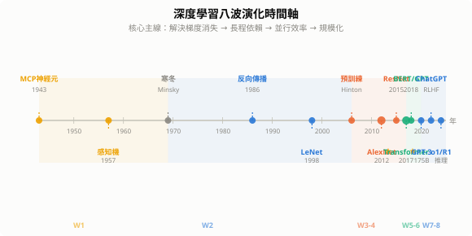
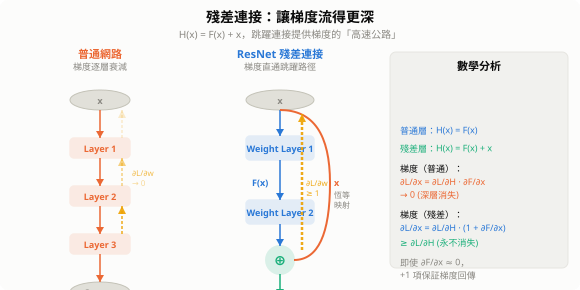
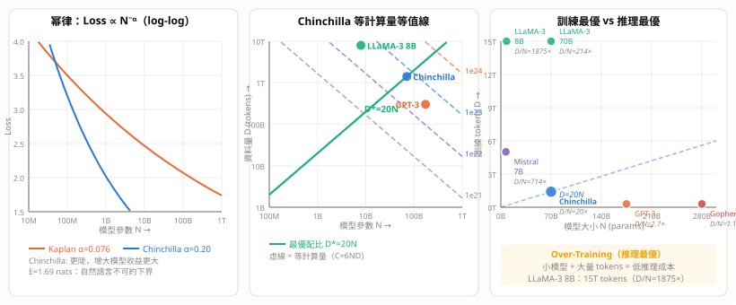

# 深度學習演化史

> 從感知機到大語言模型，每個時代都由一個核心問題驅動：如何讓梯度流得更深、更遠、更有效率。



---

## 1. 第一波：感知機與人工神經元（1943–1969）

### 1.1 McCulloch–Pitts 神經元（1943）

第一個數學神經元模型：加權輸入超過閾值即激活，純二元輸出。

$$y = \begin{cases} 1 & \text{if } \sum_i w_i x_i \geq \theta \\ 0 & \text{otherwise} \end{cases}$$

### 1.2 感知機（Rosenblatt 1957）

第一個**可學習**的分類器，引入更新規則：

$$w_i \leftarrow w_i + \eta \cdot (y - \hat{y}) \cdot x_i$$

**感知機收斂定理**：若資料線性可分，感知機在有限步內必定收斂。

**技術特點**：
- 單層、線性決策邊界
- 無隱藏層，特徵仍需人工設計
- 只能解線性可分問題

### 1.3 第一次 AI 寒冬

Minsky & Papert《Perceptrons》（1969）嚴格證明：單層感知機無法解 XOR 問題。由於當時無人知道如何訓練多層網路，神經網路研究幾乎停滯 15 年。

---

## 2. 第二波：反向傳播與多層網路（1986–1990s）

### 2.1 反向傳播算法（Rumelhart, Hinton & Williams 1986）

將**連鎖律**系統化為可自動計算梯度的算法：

$$\frac{\partial L}{\partial w^{(l)}} = \frac{\partial L}{\partial a^{(l)}} \cdot \frac{\partial a^{(l)}}{\partial z^{(l)}} \cdot \frac{\partial z^{(l)}}{\partial w^{(l)}}$$

逐層從輸出往輸入傳遞誤差信號，使任意深度的 MLP 都可端到端訓練。

### 2.2 萬能近似定理（Universal Approximation Theorem）

> 含一個足夠寬隱藏層的 MLP，可以以任意精度近似任何連續函數。

理論上解決了「為何需要深度學習」的問題，但**實際訓練**仍面臨：

| 問題 | 原因 |
|------|------|
| 梯度消失 | Sigmoid 飽和區導數 $\sigma'(z) \to 0$ |
| 局部最小值 | 非凸損失函數 |
| 計算資源 | 當時 CPU 速度遠不足 |

### 2.3 LeNet（LeCun 1998）

第一個成功的卷積神經網路，用於手寫數字辨識（MNIST）。已具備：
- 卷積層（局部感受野）
- 池化層（平移不變性）
- 全連接分類頭

但硬體條件不足，無法擴展到更大問題 → **第二次 AI 寒冬**，SVM 在 2000s 主導機器學習。

---

## 3. 第三波：深度學習復興（2006–2012）

### 3.1 逐層預訓練（Hinton 2006）

用**受限玻爾茲曼機（RBM）**逐層貪婪預訓練，再整體微調：

```
輸入層 → RBM₁ → RBM₂ → RBM₃ → 輸出層
         ←——— 預訓練（無監督）———→
         ←——————— 微調（有監督）——————→
```

解決了深層網路的**初始化問題**：預訓練提供好的初始權重，使梯度能有效傳播。

### 3.2 GPU 革命

NVIDIA CUDA（2007）讓矩陣運算加速 10–50 倍，使大規模神經網路訓練成為可能。

### 3.3 AlexNet：轉折點（Krizhevsky, Sutskever, Hinton 2012）

ImageNet 競賽 Top-5 錯誤率：26.2% → **15.3%**，震驚整個計算機視覺界。

**關鍵創新**：

| 技術 | 作用 |
|------|------|
| **ReLU** $\max(0,x)$ | 梯度不消失，訓練速度 6× |
| **Dropout** | 隨機丟棄神經元，防止過擬合 |
| **資料增強** | 隨機裁切/翻轉，擴大訓練集 |
| **多 GPU 並行** | 模型分佈在兩張 GTX 580 |

---

## 4. 第四波：CNN 架構黃金時代（2013–2017）

### 4.1 架構演進

| 架構 | 年份 | 深度 | 核心創新 |
|------|------|------|----------|
| VGG | 2014 | 16–19 層 | 純 3×3 卷積堆疊，結構簡潔 |
| GoogLeNet / Inception | 2014 | 22 層 | Inception Module：並行多尺度卷積 |
| **ResNet** | 2015 | 152 層 | **殘差連接**，突破深度瓶頸 |
| DenseNet | 2017 | 100+ 層 | 每層連接所有前層特徵圖 |

### 4.2 ResNet 殘差連接：本波最重要發明

**問題**：網路越深，訓練誤差反而增大（退化問題，非過擬合）。

**解法**：讓層學習殘差而非完整映射：

$$H(x) = F(x) + x$$

若最優解接近恆等映射，$F(x) \to 0$ 比 $H(x) \to x$ 容易學習。

**梯度視角**：跳躍連接提供梯度的「高速公路」：

$$\frac{\partial L}{\partial x} = \frac{\partial L}{\partial H} \cdot \left(1 + \frac{\partial F}{\partial x}\right)$$

即使 $\partial F/\partial x \approx 0$，梯度仍可透過 $+1$ 項直接回傳。



### 4.3 遷移學習確立

ImageNet 預訓練 → 微調（Fine-tuning）的範式在此時代成熟：在小資料集上也能獲得強大特徵表示。

---

## 5. 第五波：序列模型與注意力（2014–2018）

### 5.0 循環神經網路 RNN（1986–2014）

**標準 RNN** 是第一個處理序列的神經網路，共享同一組權重逐步展開：

$$h_t = \tanh(W_{hh}\, h_{t-1} + W_{xh}\, x_t + b_h)$$
$$y_t = W_{hy}\, h_t + b_y$$

- $h_t$：隱藏狀態，扮演「記憶」角色
- $W_{hh}$：狀態轉移矩陣（同一組，跨所有時間步共享）
- 展開後本質是極深的前饋網路（深度 = 序列長度 $T$）

**展開示意**：

```
x₁ → [h₁] → [h₂] → [h₃] → ... → [hₜ] → y
        ↑        ↑        ↑              ↑
       W_hh    W_hh    W_hh           W_hh
```

**核心問題：梯度消失 / 梯度爆炸**

反向傳播時梯度需穿越 $T$ 個時間步：

$$\frac{\partial L}{\partial h_1} = \frac{\partial L}{\partial h_T} \cdot \prod_{t=2}^{T} \frac{\partial h_t}{\partial h_{t-1}} = \frac{\partial L}{\partial h_T} \cdot \prod_{t=2}^{T} W_{hh}^\top \cdot \text{diag}(\tanh'(\cdot))$$

- $\|W_{hh}\| < 1$：梯度指數衰減 → **消失**，無法學長程依賴
- $\|W_{hh}\| > 1$：梯度指數爆炸 → 訓練不穩（以梯度裁剪 Gradient Clipping 緩解）

**GRU（Gated Recurrent Unit，Cho 2014）**：LSTM 的輕量替代，只用兩個門（重置門 $r_t$、更新門 $z_t$）：

$$\tilde{h}_t = \tanh(W[r_t \odot h_{t-1}, x_t]),\quad h_t = (1-z_t)\odot h_{t-1} + z_t \odot \tilde{h}_t$$

參數比 LSTM 少 25%，許多任務性能相當。

**RNN 的歷史貢獻**：
- 語音辨識（CTC Loss + RNN，2006）
- 語言模型（RNNLM，2010）
- 機器翻譯（Seq2Seq，2014）
- 為 Attention 和 Transformer 鋪路

### 5.1 LSTM：長程依賴的解法

標準 RNN 梯度隨時間步指數衰減：$\partial L/\partial h_0 \sim \lambda^T$，$T$ 大時消失或爆炸。

**LSTM 門控機制**（Hochreiter & Schmidhuber 1997，主流化於 2014）：

$$\begin{align}
f_t &= \sigma(W_f [h_{t-1}, x_t] + b_f) & \text{(遺忘門)} \\
i_t &= \sigma(W_i [h_{t-1}, x_t] + b_i) & \text{(輸入門)} \\
o_t &= \sigma(W_o [h_{t-1}, x_t] + b_o) & \text{(輸出門)} \\
c_t &= f_t \odot c_{t-1} + i_t \odot \tilde{c}_t & \text{(細胞狀態)}
\end{align}$$

細胞狀態 $c_t$ 的線性更新讓梯度可長距離流動。

### 5.2 Seq2Seq + Attention（Bahdanau 2015）

**Seq2Seq**：編碼器將整個序列壓縮為單一向量 → 解碼器展開（瓶頸問題）。

**Attention 解法**：解碼器第 $i$ 步動態計算對編碼器各位置 $j$ 的權重：

$$\alpha_{ij} = \frac{\exp(e_{ij})}{\sum_k \exp(e_{ik})}, \quad c_i = \sum_j \alpha_{ij} h_j$$

每個輸出位置可直接「對齊」最相關的輸入位置，機器翻譯品質大幅提升。

---

## 6. 第六波：Transformer 統一（2017–2020）

### 6.1 Self-Attention 機制

《Attention Is All You Need》（Vaswani et al. 2017）：**完全拋棄 RNN/CNN**，純注意力架構。

**縮放點積注意力**：

$$\text{Attention}(Q, K, V) = \text{softmax}\!\left(\frac{QK^\top}{\sqrt{d_k}}\right)V$$

- $Q = XW^Q$（Query）、$K = XW^K$（Key）、$V = XW^V$（Value）
- $\sqrt{d_k}$ 防止內積過大導致 softmax 飽和
- 任意兩個位置的交互成本 $O(1)$（RNN 需 $O(n)$ 步）

### 6.2 Multi-Head Attention

$$\text{MultiHead}(Q,K,V) = \text{Concat}(\text{head}_1, \ldots, \text{head}_h) W^O$$

$h$ 個頭從不同子空間捕獲不同類型的依賴關係（句法、語義、共指…）。

### 6.3 Transformer 完整架構

```
輸入 → Embedding + Positional Encoding
      → N × [Multi-Head Attention → Add&Norm → FFN → Add&Norm]
      → 輸出
```

**為何 Transformer 勝出**：

| 特性 | RNN | Transformer |
|------|-----|-------------|
| 並行計算 | 順序依賴，慢 | 完全並行，快 |
| 長程依賴 | 衰減 | 直接連接，$O(1)$ |
| 規模擴展 | 難 | 線性擴展 |

### 6.4 BERT：雙向預訓練語言模型（Devlin et al. 2018）

**BERT = Bidirectional Encoder Representations from Transformers**

GPT 用 Transformer Decoder（只看左邊），BERT 用 **Transformer Encoder（同時看左右）**，取得雙向上下文。

**預訓練任務一：Masked Language Model（MLM）**

隨機遮蔽 15% 的 token，讓模型預測被遮蔽的詞：

```
輸入：The cat sat on the [MASK] .
預測：                        mat
```

- 15% 中：80% 換成 `[MASK]`，10% 換成隨機詞，10% 保持不變
- 防止模型只學 `[MASK]` 的表示，強迫理解上下文語義

**預訓練任務二：Next Sentence Prediction（NSP）**

判斷句子 B 是否為句子 A 的下一句（後來研究發現 NSP 效果存疑，RoBERTa 移除之）：

```
[CLS] 句子A [SEP] 句子B [SEP] → IsNext / NotNext
```

**BERT 架構**：

| 版本 | 層數 | 隱藏維度 | 注意力頭 | 參數量 |
|------|------|----------|----------|--------|
| BERT-Base | 12 | 768 | 12 | 110M |
| BERT-Large | 24 | 1024 | 16 | 340M |

**微調（Fine-tuning）範式**：在下游任務上只需接一個小頭（Linear Layer），少量標註資料即可達 SOTA：

```
預訓練 BERT（大量無標註文字）
         ↓ 凍結 or 微調所有層
分類頭 / QA頭 / NER頭（少量標註資料）
```

**BERT 的歷史意義**：
- 11 個 NLP benchmark 同時刷新 SOTA
- 確立「預訓練語言模型 + 任務微調」為 NLP 標準流程
- [CLS] token 表示成為句子級語義表示的通用方式

**BERT 後繼者**：

| 模型 | 改進點 |
|------|--------|
| RoBERTa（2019） | 移除 NSP、更大 batch、更長訓練 |
| ALBERT（2019） | 參數共享，大幅減少參數量 |
| DistilBERT（2019） | 知識蒸餾，60% 大小 97% 性能 |
| DeBERTa（2020） | 解耦位置與內容注意力 |

### 6.5 GPT 系列：生成式預訓練

| 模型 | 訓練目標 | 適合任務 |
|------|----------|----------|
| **BERT** | MLM（雙向，填空） | 分類、問答、NER |
| **GPT** | CLM（單向自回歸，預測下一詞） | 文本生成、對話 |

$$P(x_1,\ldots,x_T) = \prod_{t=1}^{T} P(x_t \mid x_1,\ldots,x_{t-1})$$

**預訓練 + 微調**成為 NLP 標準流程，取代了特徵工程 + 任務專用模型。

---

## 7. 第七波：大模型與湧現（2020–2023）

### 7.1 Scaling Law（Kaplan et al. 2020）

損失與模型規模、資料量、算力之間存在冪律關係：

$$L(N) \propto N^{-\alpha_N}, \quad L(D) \propto D^{-\alpha_D}$$

**Chinchilla Law（Hoffmann et al. 2022）**：模型大小與訓練 token 數應等比例增長：
$$N_{\text{opt}} \propto C^{0.5}, \quad D_{\text{opt}} \propto C^{0.5}$$

→ 許多大模型訓練資料不足（underfitting），而非模型太小。



### 7.2 湧現能力（Emergent Abilities）

超過某個參數閾值後，模型突然獲得從未明確訓練的能力：

| 能力 | 湧現規模（約） |
|------|--------------|
| 少樣本學習 | ~7B |
| 思維鏈推理 | ~100B |
| 指令跟隨 | ~100B |
| 多步算術 | ~100B+ |

### 7.3 RLHF：讓模型對齊人類偏好

**InstructGPT / ChatGPT（OpenAI 2022）** 三步流程：

```
1. 監督微調（SFT）：人類示範答案 → 微調預訓練模型
2. 獎勵模型（RM）：人類比較兩個回答優劣 → 訓練評分模型
3. PPO 強化學習：用 RM 分數優化語言模型策略
```

RLHF 解決了「模型能力強但行為不受控」的問題，開啟對話 AI 時代。

### 7.4 Foundation Model 範式

一個基礎模型（Foundation Model）透過微調/提示適應千種下游任務，取代了「每個任務一個模型」的舊範式。

---

## 8. 第八波：多模態、效率與推理（2023–今）

### 8.1 多模態統一

**GPT-4V、Gemini、LLaVA**：視覺 + 語言統一編碼。

常見架構：視覺編碼器（ViT）輸出向量，透過投影層對齊語言模型空間：

$$z_{\text{vision}} = \text{MLP}(\text{ViT}(I)) \in \mathbb{R}^{L \times d}$$

再將 $z_{\text{vision}}$ 與文字 token 拼接輸入 LLM。

### 8.2 長上下文：RoPE 位置編碼

**Rotary Position Embedding（Su et al. 2021）**：將相對位置資訊注入 Attention，支持外推到訓練時未見的長度：

$$q_m \cdot k_n \propto \text{Re}\left[(W_q x_m)(W_k x_n)^* e^{i(m-n)\theta}\right]$$

內積只依賴相對位置 $m-n$，使上下文窗口從 2K 擴展到 1M token。

### 8.3 推理模型（Test-Time Compute）

**OpenAI o1/o3、DeepSeek-R1（2024–2025）**：推理時投入更多計算，不直接輸出答案，而是先「思考」（Chain-of-Thought 內化）。

$$\text{Answer} = \text{LLM}\!\left(\text{problem} + \underbrace{\text{scratchpad thinking}}_{\text{測試時計算}}\right)$$

Scaling Law 從「訓練算力」延伸到「推理算力」。

### 8.4 高效微調：LoRA

**LoRA（Hu et al. 2021）**：凍結預訓練權重，只訓練低秩分解的增量：

$$W' = W_0 + \Delta W = W_0 + BA, \quad B \in \mathbb{R}^{d \times r},\ A \in \mathbb{R}^{r \times k},\ r \ll \min(d,k)$$

7B 模型的可訓練參數從 70 億降至數百萬，消費級 GPU 可微調大模型。

### 8.5 混合專家（MoE）

**Mixtral、GPT-4（傳聞）**：每個 token 只激活部分「專家」（子網路）：

$$y = \sum_{i \in \text{Top-}k} G_i(x) \cdot E_i(x)$$

總參數大（強大能力）但推理時活躍參數少（低成本），解決大模型推理費用問題。

---

## 9. 技術演化全景

### 9.1 核心問題驅動脈絡

```
梯度消失          梯度消失（深層）    長程依賴          並行效率
感知機 ——→ MLP ——→ ResNet/BN ——→ LSTM/GRU ——→ Transformer
  ↑                                              ↓
特徵工程        規模效應 + 預訓練範式        Scaling Law
                GPT/BERT ————————→ 大模型/湧現
                                       ↓
                              多模態 + 推理時計算
                              GPT-4V / o1 / R1
```

### 9.2 各波次關鍵指標對比

| 時代 | 代表模型 | 參數量 | 訓練資料 | 核心突破 |
|------|----------|--------|----------|----------|
| 1986 | MLP | ~千 | 小資料集 | 反向傳播 |
| 2012 | AlexNet | 60M | 1.2M 圖片 | GPU + ReLU |
| 2015 | ResNet-152 | 60M | ImageNet | 殘差連接 |
| 2017 | Transformer | 65M | WMT | Self-Attention |
| 2018 | BERT-Large | 340M | BooksCorpus + Wiki | 預訓練 |
| 2020 | GPT-3 | 175B | 300B token | Scaling Law |
| 2023 | GPT-4 | ~1.8T（估） | ~13T token | 多模態 + RLHF |
| 2024 | DeepSeek-R1 | 671B（MoE） | — | 推理時計算 |

### 9.3 未解問題

- **可解釋性**：Transformer 的「思考」過程仍是黑盒
- **樣本效率**：人類學一個概念只需數例，LLM 需要兆級 token
- **持續學習**：微調新知識導致災難性遺忘（Catastrophic Forgetting）
- **推理成本**：超大模型推理費用仍是產業化瓶頸

---

## 10. 小結

| 核心主線 | 解法 |
|----------|------|
| 梯度消失 | ReLU、BatchNorm、殘差連接 |
| 長程依賴 | LSTM → Attention → Transformer |
| 並行效率 | GPU → Transformer 並行架構 |
| 泛化能力 | 預訓練 + 微調 |
| 規模瓶頸 | Scaling Law + MoE + LoRA |
| 行為對齊 | RLHF / RLAIF |
| 推理能力 | Test-Time Compute（o1/R1） |

深度學習的歷史本質上是**「讓梯度流得更深」與「讓計算規模化」兩條主線的交替突破**，每當一條主線遇到瓶頸，另一條帶來突破，推動整個領域螺旋式前進。
