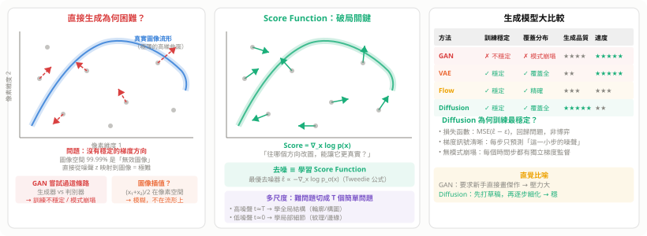
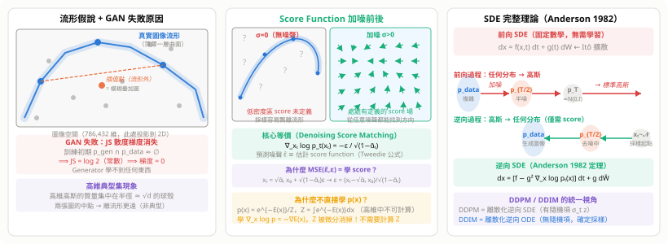
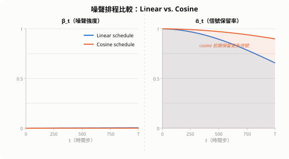
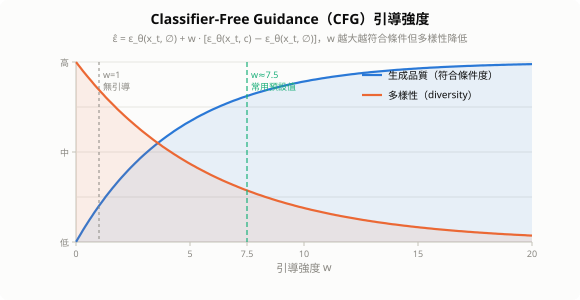
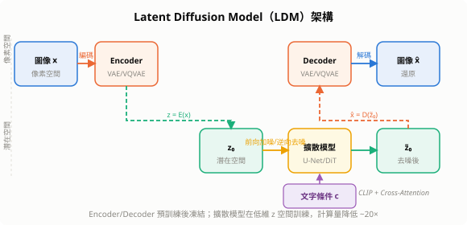
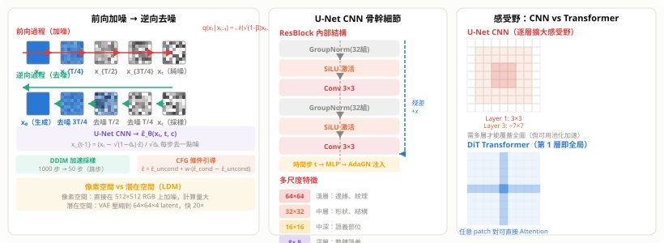

# 擴散模型（Diffusion Models）

擴散模型（Diffusion Model）的靈感來自**熱力學第二定律**：有序系統在噪聲擾動下逐漸趨於無序。若能學會**逆轉**這個擴散過程，就能從純雜訊生成真實資料。擴散模型目前是圖像、音訊、蛋白質、分子生成的最強生成範式。

## 0. 為什麼要加噪再去噪？（而不是直接學）

> 這是理解擴散模型的**最根本問題**。

### 0.1 直接學圖像分布，為何失敗？

想生成圖像 = 從真實圖像分布 $p(x)$ 中採樣。

**問題在於**：$p(x)$ 是一個極其複雜的高維分布——

```
圖像空間的維度 = 512 × 512 × 3 = 786,432 維
其中「有效圖像」（貓、狗、風景…）只佔極微小的一層薄薄流形
剩下 99.99% 的空間全是「無意義的像素噪聲」
```

**直接生成的嘗試（GAN）**：

```
隨機噪聲 z → [生成器 G] → 圖像 x̂
                              ↓
                        [判別器 D] → 真 or 假？
```

G 和 D 在**博弈**（minimax），訓練訊號不穩定：
- G 找到一種能騙過 D 的「捷徑」→ **模式崩塌**（只生成幾種圖）
- D 訓練太好 → G 梯度消失，學不了
- 收斂條件苛刻，需要大量調參

**插值現有圖像？**

```
(貓的圖像 + 狗的圖像) / 2 = ？
```

在像素空間插值的結果是兩張圖的**模糊疊加**，不是有效圖像。  
高維空間中，兩個真實資料點之間幾乎全是「無效圖像」（維度詛咒）。

---

### 0.2 Score Function：破局的數學洞見

**換一個問題**：不直接生成圖像，而是學習「**方向**」——

$$
\nabla_x \log p(x) \quad \text{（Score Function，分數函數）}
$$

這個梯度的物理意義：**從任意一張圖出發，往哪個方向微調像素，能讓它更像真實圖像？**

有了 Score Function，就能從任意點出發（包括純噪聲），沿梯度「走」到真實圖像的高密度區域。

**去噪 = 學習 Score Function（Tweedie 公式）**：

$$
\hat{x}_0 = \frac{x_t + (1-\bar\alpha_t)\nabla_{x_t}\log p(x_t)}{\sqrt{\bar\alpha_t}}
\quad \Longleftrightarrow \quad
\text{最優去噪器} \propto -\nabla_{x_t}\log p_{\sigma_t}(x_t)
$$

訓練神經網路預測噪聲 $\hat\epsilon_\theta(x_t, t)$，等價於學習各噪聲等級的 Score Function。

---

### 0.2.5 GAN 失敗的數學原因（更深層）

GAN 的原始損失等價於最小化 **JS 散度**：

$$\mathcal{L}_{\text{GAN}} = \mathbb{E}[\log D(x)] + \mathbb{E}[\log(1-D(G(z)))] \equiv 2\,\text{JS}(p_{\text{data}} \| p_{\text{gen}}) - 2\log 2$$

**訓練初期的梯度消失**：當 $p_{\text{gen}}$ 和 $p_{\text{data}}$ 幾乎不重疊（維度詛咒下幾乎必然如此）：

$$\text{JS}(p_{\text{data}} \| p_{\text{gen}}) = \log 2 \quad\text{（常數）} \implies \nabla_\theta \mathcal{L} = 0$$

Generator 完全學不了任何東西。WGAN 改用 Wasserstein 距離緩解此問題，但博弈本質不變：  
Generator 和 Discriminator 的**博弈均衡**（Nash equilibrium）極難達到，  
Generator 總會找到「欺騙 D 的捷徑」而不是「生成多樣圖像」→ 模式崩塌。

---

### 0.2.6 Score Function 為何繞過正規化常數？

學習分布 $p(x)$ 通常需要能量模型：$p(x) = e^{-E_\theta(x)} / Z_\theta$，
其中 $Z_\theta = \int e^{-E_\theta(x)} dx$ 在高維中**不可計算**。

但 **Score Function** $s(x) = \nabla_x \log p(x)$ 把 $Z$ 自動消掉：

$$s(x) = \nabla_x \log \frac{e^{-E(x)}}{Z} = \underbrace{-\nabla_x E(x)}_{\text{可計算}} - \underbrace{\nabla_x \log Z}_{= 0,\ Z\text{ 不依賴 }x}$$

**Hyvärinen（2005）Score Matching**：用 Fisher 散度訓練，完全不需要 $Z$：

$$\mathcal{L}_{\text{SM}} = \mathbb{E}_{p(x)}\!\left[\text{tr}(\nabla_x s_\theta(x)) + \tfrac{1}{2}\|s_\theta(x)\|^2\right]$$

**問題**：需要計算 Jacobian 的跡，計算量 $O(d)$，$d=786{,}432$ 維時代價巨大。

**Vincent（2011）Denoising Score Matching 的解法**：加噪聲後 score 有閉合形式：

$$\nabla_{x_t} \log p_\sigma(x_t | x_0) = -\frac{x_t - x_0}{\sigma^2} = -\frac{\epsilon}{\sqrt{1-\bar\alpha_t}}$$

因此訓練目標變成：**「預測加入的噪聲 $\epsilon$」**，完全不需要計算 Jacobian，
代價從 $O(d)$ 降到 $O(1)$。這就是為什麼 $\hat\epsilon_\theta(x_t,t)$ 等價於估計 score function。

---

### 0.2.7 高維典型集：為什麼插值失敗

高維空間有一個反直覺的現象——**典型集（Typical Set）**：

$$\text{高維高斯 } \mathcal{N}(0, I_d) \text{ 的質量集中在半徑} \approx \sqrt{d} \text{ 的球殼上}$$

驗證：$\mathbb{E}[\|x\|^2] = d$，$\text{Var}(\|x\|^2) = 2d$，故 $\|x\| \approx \sqrt{d}$ 以高概率成立。

**對插值的影響**：

```
圖像 A：‖xₐ‖ ≈ √d（在典型集球殼上）
圖像 B：‖x_b‖ ≈ √d（在典型集球殼上）
插值點：‖(xₐ+x_b)/2‖ ≈ √d/√2 ≈ 0.7√d  ← 比球殼內縮了 30%
```

插值結果落在更低能量的「非典型」區域，對應**亮度偏低、細節模糊**的圖像——
這正是 VAE 和直接插值總是模糊的數學根源。

---

### 0.3 為什麼分多步？（難問題 → T 個簡單問題）

| 方式 | 任務難度 | 結果 |
|---|---|---|
| 一步：純噪聲 → 完整圖像 | 極難（等同直接學 $p(x)$） | 學不好 |
| T 步：每步只去一點噪聲 | 每步容易 | 穩定收斂 |

**每步的任務**：「這張圖加入了 $\epsilon \sim \mathcal{N}(0,I)$，請把它找出來。」  
這是一個**清晰的回歸問題**，損失函數是簡單的 MSE：

$$
\mathcal{L} = \mathbb{E}_{t, x_0, \epsilon}\!\left[\|\epsilon - \hat\epsilon_\theta(x_t, t)\|^2\right]
$$

無對抗、無博弈、梯度穩定，訓練收斂有理論保證。

---

### 0.4 多尺度學習：自動由粗到細

不同噪聲等級迫使模型學不同粒度的特徵：

```
t 大（高噪聲）→ 從模糊輪廓中去噪 → 學全局結構（這張圖大概是什麼？）
t 中（中噪聲）→ 半清晰圖中去噪   → 學部位關係（眼睛在哪裡？）
t 小（低噪聲）→ 幾乎清晰的圖去噪 → 學精細細節（毛髮紋理、邊緣銳利度）
```

就像畫家的工作流程：**先打草稿確定構圖，再細化輪廓，最後刻劃細節。**

---

### 0.4.5 SDE 完整理論——為什麼逆向過程必然存在

**前向 SDE（Itô 微分方程）**：

$$dx = \underbrace{f(x,t)}_{\text{漂移項}} dt + \underbrace{g(t)}_{\text{擴散係數}} dW$$

DDPM 對應 $f(x,t) = -\frac{\beta(t)}{2}x$（Ornstein-Uhlenbeck 過程），這個 SDE 能將**任意分布**逐漸推向 $\mathcal{N}(0,I)$。

**Anderson（1982）逆向 SDE 定理**：

$$dx = \underbrace{\left[f(x,t) - g(t)^2\,\nabla_x\log p_t(x)\right]}_{\text{逆向漂移 = 前向漂移 − g²×score}} dt + g(t)\,d\bar W$$

這個方程描述了如何從 $\mathcal{N}(0,I)$ **精確還原**到原始分布 $p_{\text{data}}(x)$，
唯一需要的額外項是 **score function** $\nabla_x\log p_t(x)$。

**關鍵洞見**：
- 前向 SDE 完全由人設計（選 $\beta(t)$），不需要訓練
- 逆向 SDE 存在性是**數學定理**，只要知道 score 就可以反轉
- 神經網路的唯一工作：學習各時間步的 score（即學 $\hat\epsilon_\theta$）

**DDPM / DDIM 的統一視角**：

| 方法 | 採樣方程 | 隨機性 | 步數 |
|---|---|---|---|
| DDPM | 離散化逆向 **SDE**（有 $\sigma_t z$ 隨機項） | 有 | 1000 步 |
| DDIM | 離散化逆向 **ODE**（去掉隨機項） | 無（確定性） | 50 步 |
| DPM-Solver | 高階 ODE 求解器（3–4 步高精度） | 無 | 5–20 步 |

---

### 0.5 四種生成模型的本質比較

| 方法 | 核心思路 | 訓練穩定性 | 分布覆蓋 | 生成品質 | 速度 |
|---|---|---|---|---|---|
| **GAN** | 對抗博弈，直接生成 | ✗ 不穩定 | ✗ 模式崩塌 | ★★★★ | ★★★★★ |
| **VAE** | 壓縮到 latent 再還原 | ✓ 穩定 | ✓ 覆蓋全 | ★★ | ★★★★★ |
| **Flow** | 可逆映射，精確 $p(x)$ | ✓ 穩定 | ✓ 精確 | ★★★ | ★★★ |
| **Diffusion** | Score Function，分步去噪 | ✓ 最穩定 | ✓ 覆蓋全 | ★★★★★ | ★★（DDIM緩解）|

**Diffusion 訓練穩定的三個原因**：
1. **回歸問題**，不是博弈——損失函數是 MSE，梯度方向明確
2. **逐步監督**——每個時間步 $t$ 都有獨立的梯度訊號，不會梯度消失
3. **無模式崩塌**——模型不能偷懶只記幾種圖，每個 $t$ 的去噪都要正確

---





---

## 1. 核心直覺

```
有序（低熵）→ 加噪聲 → 無序（高熵）   ← 前向，確定性
無序（高熵）← 學習去噪 ← 有序（低熵）  ← 逆向，學習的
```

前向過程（加噪）是已知的物理過程；逆向過程（去噪）由神經網路學習。訓練完成後，從純高斯雜訊出發，反覆執行去噪步驟即可生成資料。

---

## 2. 數學框架

### 2.1 前向過程（加噪）

給定真實資料 $x_0$，逐步加高斯噪聲：

$$q(x_t | x_{t-1}) = \mathcal{N}\!\left(\sqrt{1-\beta_t}\, x_{t-1},\; \beta_t I\right)$$

利用重參數化技巧，可以**一步**從 $x_0$ 採樣任意時間步 $x_t$：

$$x_t = \sqrt{\bar{\alpha}_t}\, x_0 + \sqrt{1 - \bar{\alpha}_t}\, \epsilon, \quad \epsilon \sim \mathcal{N}(0, I)$$

其中 $\bar{\alpha}_t = \prod_{s=1}^t (1 - \beta_s)$，$\beta_t$ 是**噪聲排程（noise schedule）**。

- $t = 0$：原始資料 $x_0$
- $t = T$：幾乎純高斯 $x_T \approx \mathcal{N}(0, I)$



### 2.2 逆向過程（去噪）

逆向條件分布由 Bayes 定理推導，仍是高斯分布：

$$q(x_{t-1}|x_t, x_0) = \mathcal{N}\!\left(\tilde{\mu}_t(x_t, x_0),\; \tilde{\beta}_t I\right)$$

$$\tilde{\mu}_t = \frac{\sqrt{\bar{\alpha}_{t-1}}\,\beta_t}{1-\bar{\alpha}_t} x_0 + \frac{\sqrt{\alpha_t}(1-\bar{\alpha}_{t-1})}{1-\bar{\alpha}_t} x_t$$

神經網路 $\epsilon_\theta(x_t, t)$ 預測加入的噪聲 $\epsilon$，再還原出均值。

### 2.3 損失函數

DDPM 的訓練目標（ELBO 的簡化形式）：

$$\mathcal{L} = \mathbb{E}_{t,\, x_0,\, \epsilon}\!\left[\|\epsilon - \epsilon_\theta(x_t, t)\|^2\right]$$

**直覺**：讓網路在每個時間步 $t$ 學會「猜出加了什麼噪聲」。訓練穩定，無 GAN 的對抗訓練困難。

### 2.4 採樣（DDPM）

給定 $x_T \sim \mathcal{N}(0,I)$，逐步去噪：

$$x_{t-1} = \frac{1}{\sqrt{\alpha_t}}\!\left(x_t - \frac{1-\alpha_t}{\sqrt{1-\bar{\alpha}_t}}\,\epsilon_\theta(x_t, t)\right) + \sigma_t z, \quad z \sim \mathcal{N}(0,I)$$

共需 $T$（通常 1000）步，每步一次神經網路前向計算。

---

## 3. Score-based SDE：統一框架

Song et al.（2021）將離散步驟推廣為**連續隨機微分方程**：

$$dx = f(x,t)\,dt + g(t)\,dW_t \quad \text{（前向 SDE）}$$

**逆向 SDE**（Anderson, 1982）：

$$dx = \left[f(x,t) - g(t)^2\, \underbrace{\nabla_x \log p_t(x)}_{\text{score function}}\right]dt + g(t)\,d\bar{W}_t$$

神經網路學習 **score function** $s_\theta(x,t) \approx \nabla_x \log p_t(x)$，訓練目標稱為 **score matching**：

$$\mathcal{L}_{\text{SM}} = \mathbb{E}_{t, x_t}\!\left[\|s_\theta(x_t,t) - \nabla_{x_t}\log q(x_t|x_0)\|^2\right]$$

DDPM 是此框架的特例（$f(x,t) = -\frac{1}{2}\beta(t)x$，$g(t) = \sqrt{\beta(t)}$）。

---

## 4. 加速採樣

DDPM 的 1000 步採樣是主要缺點，多種方法大幅加速：

### 4.1 DDIM（確定性採樣）

DDIM（Song et al., 2020）利用對應的**確定性 ODE**：

$$dx = \left[f(x,t) - \frac{1}{2}g(t)^2\,s_\theta(x,t)\right]dt$$

與 SDE 具有相同的邊際分布，但去除了隨機項，可用 10–50 步完成生成，且結果可複現。

### 4.2 DPM-Solver

將逆向 ODE 改寫為指數積分形式，高階數值解法在 20 步內達到 DDPM 1000 步的品質。

### 4.3 Consistency Models

由 Song et al.（2023）提出，訓練一個函數 $f_\theta(x_t, t) \approx x_0$，對任意 $t$ 直接映射到原始資料，實現**1–2 步採樣**。

---

## 5. 條件生成與引導

### 5.1 Classifier Guidance

訓練一個外部分類器 $p_\phi(c|x_t)$，採樣時加入梯度引導：

$$\hat{\epsilon} = \epsilon_\theta(x_t, t) - \sqrt{1-\bar{\alpha}_t}\,\nabla_{x_t}\log p_\phi(c|x_t)$$

需要在每個噪聲層級訓練分類器，繁瑣。

### 5.2 Classifier-Free Guidance（CFG）

Ho & Salimans（2021）的主流方法，訓練時隨機以機率 $p$ 丟棄條件 $c$：

$$\epsilon_{\text{guided}} = \epsilon_\theta(x_t, \emptyset) + w \cdot \bigl[\epsilon_\theta(x_t, c) - \epsilon_\theta(x_t, \emptyset)\bigr]$$

- $w$：引導強度（guidance scale），通常 7–15
- $w$ 越大：越符合條件，多樣性降低
- 一個模型同時學有條件/無條件，無需外部分類器



---

## 6. Latent Diffusion Model（LDM）

像素空間的擴散計算量巨大（$512\times512 \times 3 = 786432$ 維）。**LDM（Rombach et al., 2022）** 在低維潛在空間做擴散：

```
圖像 ──Encoder──▶ z₀（64×64×4）──加噪──▶ z_T
                                              │
                              擴散模型在 z 空間去噪
                                              │
圖像 ◀──Decoder── z₀ ◀──────────────────────
```

- Encoder/Decoder：預訓練的 VQ-VAE 或 KL-VAE，訓練後**凍結**
- 文字條件：CLIP 編碼後透過 Cross-Attention 注入 U-Net
- **Stable Diffusion** 即基於此架構，計算量降低約 20×



---

## 7. 網路架構

> **核心觀念**：Diffusion Model 是一個**訓練框架**（前向加噪 + 逆向去噪），骨幹網路只是其中一個可替換的模組。
> 早期選擇 **CNN（U-Net）**，現代選擇 **Transformer（DiT）**。

### 7.0 圖像如何從噪聲到清晰

**前向過程（固定數學，無需學習）**：

$$
q(x_t | x_{t-1}) = \mathcal{N}\!\left(\sqrt{1-\beta_t}\, x_{t-1},\ \beta_t I\right)
$$

每步乘以 $\sqrt{1-\beta_t}$（壓縮訊號）並加高斯噪聲，$T$ 步後 $x_T \sim \mathcal{N}(0, I)$。  
一步採樣公式：$x_t = \sqrt{\bar\alpha_t}\, x_0 + \sqrt{1-\bar\alpha_t}\, \epsilon$，$\epsilon \sim \mathcal{N}(0,I)$。

**逆向過程（神經網路學習）**：

$$
x_{t-1} = \frac{1}{\sqrt{\alpha_t}}\!\left(x_t - \frac{1-\alpha_t}{\sqrt{1-\bar\alpha_t}}\,\hat\epsilon_\theta(x_t, t, c)\right) + \sigma_t z
$$

骨幹網路 $\hat\epsilon_\theta$ 輸入「帶噪 latent + 時間步 + 條件」，預測加入的噪聲 $\epsilon$，  
然後一步步還原：**純噪聲 → 半清晰輪廓 → 細節 → 完整圖像**。

```
t=1000  ████████████  （純噪聲）
t= 800  ████████▒▒░░  （輪廓浮現）
t= 500  ████▒▒░░░░    （結構成形）
t= 200  ██░░░░        （細節增加）
t=   0  ░░            （完整生成圖像）
```

**為什麼要在 Latent 空間做？（LDM）**

| 空間 | 分辨率 | 計算量 | 範例 |
|---|---|---|---|
| 像素空間 | 512×512×3 | 極大 | DDPM（原始） |
| 潛在空間 | 64×64×4 | ÷20 | Stable Diffusion |

VAE Encoder 把圖像壓縮到 latent，擴散模型在 latent 上去噪，VAE Decoder 還原到像素。

---

### 7.1 U-Net CNN 骨幹

#### 為什麼選 CNN（U-Net）？

Diffusion Model 需要骨幹能**同時捕捉局部細節（紋理/邊緣）與全局結構**。  
U-Net 的 Encoder-Decoder 結構 + Skip Connection 天然滿足這個需求：

```
輸入 xₜ（64×64×4）
│
├── Encoder（下採樣，CNN 堆疊）
│   ├── 64×64  ← ResBlock × 2  → 淺層特徵（邊緣、紋理）
│   ├── 32×32  ← ResBlock × 2  → 中層特徵（形狀、局部結構）
│   └── 16×16  ← ResBlock + Self-Attn  → 語義特徵
│
├── Bottleneck（8×8）
│   └── ResBlock → Cross-Attn（文字條件）→ ResBlock
│
├── Decoder（上採樣，對稱）
│   ├── 16×16 ←─────────────────────── skip from Encoder 16×16
│   ├── 32×32 ←─────────────────────── skip from Encoder 32×32
│   └── 64×64 ←─────────────────────── skip from Encoder 64×64
│
└── 輸出 ε̂（與輸入同尺寸，預測噪聲）
```

#### ResBlock 內部結構

$$
\text{ResBlock}(x, t) = x + \text{Conv}_{3\times3}\!\left(\text{SiLU}\!\left(\text{GroupNorm}\!\left(\text{Conv}_{3\times3}(\text{GroupNorm}(x))\right) + \text{MLP}(t)\right)\right)
$$

| 組件 | 作用 |
|---|---|
| `Conv 3×3` | 局部特徵提取（感受野逐層擴大） |
| `GroupNorm(32組)` | 正規化（比 BN 更適合小 batch） |
| `SiLU` | 平滑非線性（比 ReLU 在擴散模型表現更好） |
| `時間步 MLP` | 將 $t$ 的 sinusoidal 嵌入加進每個 ResBlock |
| `殘差 +x` | 防止梯度消失，保留低頻訊號 |

#### Skip Connection 的角色

Encoder 的中間特徵圖透過 Skip Connection 直接傳給對應的 Decoder 層，  
讓 Decoder 在恢復高解析度時能重用低層的**空間細節**（邊緣、位置）。  
這正是從模糊到清晰「細節還原」的關鍵機制。

以 U-Net 為骨幹，加入：
- **時間嵌入**：$t$ 透過 sinusoidal embedding → MLP，以 AdaGN 注入每個 ResBlock
- **Self-Attention**：在中間層（$16\times16$、$8\times8$）加入
- **Cross-Attention**：文字/類別條件注入



### 7.2 Diffusion Transformer（DiT）

Peebles & Xie（2022）以 **純 Transformer 取代 U-Net**，發現 Diffusion Model 同樣遵循 Scaling Law。

**核心設計**：

1. **Patch 化**：Latent $z \in \mathbb{R}^{H \times W \times C}$ 切成 $p \times p$ patch，展開為長度 $(H/p)(W/p)$ 的 token 序列
2. **時間步嵌入**：$t$ 透過 sinusoidal → MLP，與類別條件合併為 $c$
3. **adaLN-Zero**（最優條件注入）：

$$
y = \gamma(c) \cdot \text{LayerNorm}(x) + \beta(c)
$$

初始化 $\gamma=1, \beta=0$（Zero init），讓模型先學會去噪再學條件引導。

**Scaling Law（FID ∝ GFLOPs⁻ᵅ）**：

| 模型 | 參數量 | FID ↓（越低越好） |
|---|---|---|
| DiT-S/2 | 33M | 43.5 |
| DiT-B/2 | 130M | 22.1 |
| DiT-L/2 | 458M | 9.6 |
| DiT-XL/2 | 675M | **2.3** |

模型越大，品質越好，冪律關係與 LLM 完全一致。

---

### 7.3 Cross-Attention 文字條件注入

U-Net 與 DiT 都可透過 **Cross-Attention** 注入文字條件：

$$
\text{Cross-Attn}(Q_{\text{image}}, K_{\text{text}}, V_{\text{text}}) = \text{softmax}\!\left(\frac{Q K^\top}{\sqrt{d_k}}\right) V
$$

| 角色 | 來源 | 意義 |
|---|---|---|
| Q | 圖像 patch token | 「我需要什麼文字資訊？」 |
| K, V | 文字 token（CLIP/T5） | 「文字描述的語義」 |

每個圖像 patch 透過 Attention 加權選取文字資訊，實現**局部語義對齊**。

**U-Net 時代（SD 1/2）**：Cross-Attention 只插入瓶頸層（$16^2$、$8^2$），感受野受限。  
**DiT 時代（SD3/FLUX）**：每層 Transformer Block 皆含 Cross-Attention，全局感受野。  
**MMDiT（SD3/FLUX.1）**：文字與圖像 token 完全平等，聯合 Self-Attention，取消 Cross-Attention 分界。

---

### 7.4 Sora：時空 Patch 擴散

OpenAI Sora（2024）推廣 DiT 至影片生成：

```
影片 ──→ 3D Patch（空間 p×p × 時間 f frames）
     ──→ 展開序列（長度 ∝ 解析度 × 幀數）
     ──→ Transformer 全局 Attention
     ──→ 預測每個 patch 的噪聲 ε̂
```

**關鍵洞見**：影片只是「更長的序列」，任意長寬比、任意時長只需改變序列長度。Flash Attention 緩解 $O(n^2)$ 的記憶體壓力。

---

### 7.5 模型演進時間線

```
2020  DDPM           U-Net（純 CNN）
2022  SD 1/2         U-Net + Cross-Attention（CLIP 文字條件）
2022  DiT            純 Transformer，Scaling Law 驗證
2024  Sora           Spatial-Temporal DiT，任意長寬比影片
2024  SD3 / FLUX.1   MMDiT，文圖 token 聯合 Self-Attention
```

---


---

## 8. 主要應用

### 8.1 圖像生成

| 模型 | 機構 | 核心技術 |
|---|---|---|
| **DALL-E 3** | OpenAI | CLIP 引導 + CFG |
| **Stable Diffusion 3** | Stability AI | Flow Matching + DiT |
| **Imagen 3** | Google | 超解析度串聯擴散 |
| **Flux** | Black Forest Labs | Rectified Flow + DiT |

### 8.2 音訊生成

- **WaveGrad / DiffWave**：波形層級語音合成
- **AudioLDM 2**：在音訊 latent space 擴散
- **MusicLM + MusicLDM**：音樂生成

### 8.3 影片生成

- **Sora**（OpenAI）：推測為 Spacetime Patches + DiT
- **CogVideo / VideoLDM**：在時間維度加入 3D Attention
- **挑戰**：時間一致性 + 計算量 $O(\text{frames} \times T)$

### 8.4 蛋白質結構設計

- **RFdiffusion**（Baker Lab）：在蛋白質 backbone 的 SE(3) 空間做擴散，從頭設計功能性蛋白質
- **FrameDiff**：等變擴散，原子座標嚴格保持旋轉/平移不變性

### 8.5 分子生成（藥物設計）

- **DiffSBDD / TargetDiff**：生成與蛋白質口袋結合的 3D 分子
- 連續空間（原子座標）+ 離散空間（原子類型）混合擴散

---

## 9. 與其他生成模型比較

| 模型 | 優點 | 缺點 |
|---|---|---|
| **GAN** | 採樣快（單步）、解析度高 | 訓練不穩、模式崩塌 |
| **VAE** | 結構清晰、速度快 | 生成品質較低、影像模糊 |
| **Normalizing Flow** | 精確似然、可逆 | 架構限制多、計算重 |
| **Diffusion** | 品質最高、訓練穩定 | 原始採樣慢（多步） |
| **Consistency Model** | 1–2 步採樣、高品質 | 訓練較複雜 |

---

## 10. 最新進展（2023–2025）

| 方向 | 重點 |
|---|---|
| **Flow Matching** | 直線化 ODE 路徑，SD3 / Flux 採用，採樣更快更穩定 |
| **Rectified Flow** | InstaFlow，反覆蒸餾使軌跡越來越直 |
| **Discrete Diffusion** | 文字 token 的擴散（MDM / D3PM / MDLM） |
| **DiT Scaling** | 與 LLM 同樣的 scaling law，更大模型品質持續提升 |
| **Video DiT** | Sora / Movie Gen，時空 patch 擴散 |
| **Distillation** | 將 1000 步 Diffusion 蒸餾至 1–4 步（ADD、LCM、Turbo） |

---

## 11. 小結

| 概念 | 核心要點 |
|---|---|
| 前向過程 | 逐步加高斯噪聲，$t$ 步可一次採樣 |
| 逆向過程 | 學習 $\epsilon_\theta$ 或 score function，逐步去噪 |
| 損失函數 | 預測噪聲的 MSE，訓練穩定無對抗 |
| Score SDE | 連續化統一框架；DDPM 為特例 |
| CFG | 無需外部分類器的條件引導，$w$ 控制強度 |
| LDM | 在潛在空間擴散，計算量降低 20× |
| DiT | Transformer 骨幹，更好的 scaling |
| 加速採樣 | DDIM → DPM-Solver → Consistency Model → Flow Matching |
