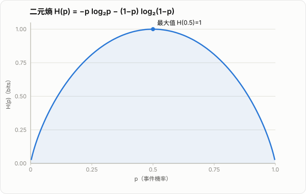

# AI 熵（Entropy）介紹

熵（Entropy）是資訊理論、機器學習與深度學習中最核心的概念之一。直觀來看，熵衡量的是「不確定性」：一個系統越難預測、可能結果越分散，熵就越高；若結果幾乎確定，熵就越低。

在 AI 裡，熵不只是抽象數學量，而是直接影響：

- 模型如何衡量不確定性
- 分類模型為何使用 cross entropy
- 決策樹如何選擇切分特徵
- 強化學習如何鼓勵探索
- 語言模型如何理解下一個 token 的分布

因此，理解熵的價值，不只是背公式，而是理解 AI 如何處理「資訊、機率與不確定性」。

## 1. 為什麼需要熵

先考慮一個問題：如果某事件發生機率很低，當它真的發生時，我們通常會覺得「資訊量很大」；反過來，如果事件幾乎必然發生，它帶來的新資訊就很少。

例如：

- 太陽明天升起：資訊量很低
- 抽獎中頭獎：資訊量很高
- 模型對某一類別機率分布非常平均：不確定性高
- 模型幾乎把所有機率都壓在單一類別：不確定性低

熵就是用來量化這種整體不確定性的工具。

## 2. 從單一事件的資訊量開始推導

### 2.1 自資訊（self-information）

設某事件 $x$ 發生的機率為 $p(x)$。我們想定義它的資訊量 $I(x)$，通常希望滿足以下性質：

- 事件越罕見，資訊量越大
- 事件越常見，資訊量越小
- 兩個獨立事件同時發生時，總資訊量應該可加

第三點最關鍵。若事件 $x$ 與 $y$ 獨立，則

$$
p(x,y)=p(x)p(y)
$$

我們希望資訊量滿足

$$
I(x,y)=I(x)+I(y)
$$

也就是說，某個函數 $f$ 應該滿足：

$$
f(pq)=f(p)+f(q)
$$

在連續性條件下，滿足這個性質的函數形式就是對數函數，因此可寫成

$$
I(x)=-k\log p(x)
$$

其中 $k>0$ 是常數。常見選擇為：

- 若 $\log$ 以 2 為底，單位是 bit
- 若 $\log$ 以 $e$ 為底，單位是 nat

通常在機器學習裡，多半使用自然對數，因此單位常是 nat。

### 2.2 為什麼前面要有負號

因為對 $0 < p(x) \le 1$ 而言，

$$
\log p(x) \le 0
$$

若不加負號，資訊量會是非正值，不符合直觀。加上負號後：

- $p(x)$ 越小，$-\log p(x)$ 越大
- $p(x)=1$ 時，$I(x)=0$

這和我們對「罕見事件資訊量較大」的直觀一致。

## 3. Shannon Entropy 的定義與推導

*圖：二元熵 $H(p)=-p\log_2 p-(1-p)\log_2(1-p)$。均勻分布（$p=0.5$）時不確定性最大（1 bit）；接近確定事件（$p\to 0$ 或 $p\to 1$）時熵趨近 0。*

公式

$$
H(X)=-\sum_{i=1}^{n}p_i\log p_i
$$

不是任意猜出的函數。Shannon 的想法是先列出「合理的不確定性度量」應具備的性質，再找出滿足這些性質的形式。以下用較直觀、但保留數學重點的方式走完推導。

### 3.1 先決定單一事件的資訊量

令事件 $x$ 的機率為 $p$，以 $I(p)$ 表示「看到它發生時得到的資訊量」。合理的要求如下：

1. **罕見事件應帶來更多資訊：** $p$ 越小，$I(p)$ 越大。
2. **必然事件不帶來新資訊：** $I(1)=0$。
3. **獨立事件的資訊可相加：** 若兩事件獨立，先後得知它們發生，得到的總資訊應等於兩者資訊和：

$$
I(pq)=I(p)+I(q)
$$

其中 $pq$ 是兩個獨立事件同時發生的機率。

對數恰好把「相乘」轉成「相加」：

$$
\log(pq)=\log p+\log q
$$

在再要求函數連續（排除不合理的特殊解）後，滿足上述可加性的函數只能是常數倍的對數：

$$
I(p)=c\log p
$$

因為 $0<p\leq1$ 時 $\log p\leq0$，而資訊量應為非負且罕見時更大，所以 $c$ 必須為負。令 $c=-k$、$k>0$：

$$
I(p)=-k\log p
$$

通常把比例常數選為 $k=1$。對數底數只改變單位：底數為 2 時是 bit；底數為 $e$ 時是 nat。

### 3.2 從一次結果，變成整個分布的不確定性

現在令離散隨機變數 $X$ 有結果 $x_1,\dots,x_n$，其機率為 $p_1,\dots,p_n$。在真正觀察前，我們不知道哪個 $x_i$ 會發生；但一旦發生 $x_i$，獲得的資訊量為

$$
I(x_i)=-\log p_i
$$

因此「觀察一次 $X$ 平均會獲得多少資訊」應取機率加權平均，而不是把每個結果等權相加：

$$
H(X)=\mathbb{E}[I(X)]
=\sum_{i=1}^{n}p_i I(x_i)
$$

代入自資訊：

$$
\boxed{H(X)=-\sum_{i=1}^{n}p_i\log p_i}
$$

這就是 Shannon entropy。$p_i$ 同時扮演兩個角色：它決定結果 $x_i$ 有多令人意外（$-\log p_i$），也決定這個意外有多常發生（權重 $p_i$）。

### 3.3 為什麼這個定義符合「拆解不確定性」

Shannon 也要求：若先判斷事件屬於哪一群，再判斷群內的細節，總不確定性應等於兩階段不確定性的總和。這稱為 **grouping axiom**（分組公理）。

例如四個結果的機率為 $(p_1,p_2,p_3,p_4)$。先只分成 A 群與 B 群：

$$
P(A)=p_1+p_2,\qquad P(B)=p_3+p_4
$$

若已知在 A 群內，結果為 $x_1$ 或 $x_2$ 的條件機率分別是

$$
\frac{p_1}{p_1+p_2},\qquad \frac{p_2}{p_1+p_2}
$$

則熵應滿足

$$
\begin{aligned}
H(p_1,p_2,p_3,p_4)
&=H(P(A),P(B))\\
&\quad+P(A)H\!\left(\frac{p_1}{P(A)},\frac{p_2}{P(A)}\right)\\
&\quad+P(B)H\!\left(\frac{p_3}{P(B)},\frac{p_4}{P(B)}\right).
\end{aligned}
$$

把 $H=-\sum_i p_i\log p_i$ 代入後，群內項的 $\log P(A)$、$\log P(B)$ 會恰好抵消，等式成立。這表示熵可以一致地處理「先粗分、再細分」的不確定性。

更正式地說，若一個離散分布的不確定性度量滿足：

- 只依賴機率分布，且對機率連續；
- 結果越均勻，不確定性越大；
- 確定結果的不確定性為零；
- 滿足上述分組公理；

那麼它除了整體正比例與對數底數不同外，唯一的形式就是 Shannon entropy。

### 3.4 一句話總結推導

「獨立資訊要相加」迫使單一事件的資訊量採用 $-\log p$；「整體不確定性是觀察一次的平均資訊量」再迫使我們取期望。因此得到 $-\sum_i p_i\log p_i$。

## 4. 熵的直觀意義

### 4.1 熵低：系統幾乎可預測

若某個分布為

$$
[1,0,0,\dots,0]
$$

表示結果是確定的。此時

$$
H(X)=-(1\cdot \log 1)=0
$$

因為 $\log 1 = 0$，所以完全沒有不確定性。

### 4.2 熵高：系統難以預測

若共有 $n$ 個結果且每個都等機率：

$$
p_i=\frac{1}{n}
$$

則

$$
H(X)= -\sum_{i=1}^{n}\frac{1}{n}\log\frac{1}{n}
= -\log\frac{1}{n}
= \log n
$$

也就是說，當分布越平均時，熵越大。

### 4.3 二元熵函數

若隨機變數只有兩種結果，機率分別為 $p$ 與 $1-p$，則熵為：

$$
H(p)=-p\log p-(1-p)\log(1-p)
$$

這個函數有幾個重要性質：

- 當 $p=0$ 或 $p=1$ 時，熵為 0
- 當 $p=0.5$ 時，熵最大

這很好理解：如果硬幣一定正面，沒有不確定性；公平硬幣最難猜，因此熵最高。

## 5. 熵的幾個重要性質

### 5.1 非負性

由於對 $0<p_i\le1$，

$$
-\log p_i \ge 0
$$

因此

$$
H(X) \ge 0
$$

### 5.2 最大值出現在均勻分布

在固定結果數 $n$ 下，當

$$
p_1=p_2=\cdots=p_n=\frac{1}{n}
$$

時熵最大，值為

$$
H_{\max}=\log n
$$

這表示：所有結果越平均、越難預測，不確定性就越高。

### 5.3 確定分布的熵為零

若某一結果機率為 1，其餘為 0，則熵為 0。這對應完全確定、沒有資訊增量的情況。

## 6. 熵的作用

從數學定義往回看，熵的作用可以整理成四件事。

### 6.1 衡量不確定性

這是最核心的功能。熵高表示分布分散、結果難預測；熵低表示分布集中、結果較確定。

### 6.2 衡量平均資訊量

因為熵是自資訊的期望值，所以也可以理解為：平均觀察一次隨機變數，會獲得多少資訊。

### 6.3 連接機率模型與最佳化目標

很多 AI loss function 的本質都與熵、cross entropy、KL divergence 有關。熵提供了「分布差異」與「資訊代價」的語言。

### 6.4 建立編碼與壓縮下界

在資訊理論裡，熵代表平均最短編碼長度的理論下界。雖然在一般深度學習課程中不一定深入到編碼理論，但這個觀點能幫助理解：熵衡量的是資料本身有多少不可壓縮的不確定性。

## 7. Cross Entropy 與 KL Divergence

在 AI 中，熵很少孤立出現；它幾乎總是與 cross entropy 和 KL divergence 一起出現。

### 7.1 Cross Entropy

若真實分布為 $P$，模型分布為 $Q$，則 cross entropy 定義為：

$$
H(P,Q)=-\sum_i P(i)\log Q(i)
$$

它的意思是：若資料其實來自分布 $P$，但你用分布 $Q$ 來描述，平均代價是多少。

### 7.2 KL Divergence

KL divergence 定義為：

$$
D_{KL}(P\|Q)=\sum_i P(i)\log \frac{P(i)}{Q(i)}
$$

它描述的是模型分布 $Q$ 相對於真實分布 $P$ 的額外資訊代價。

### 7.3 三者的關係

三者有一個極重要公式：

$$
H(P,Q)=H(P)+D_{KL}(P\|Q)
$$

因為對固定資料分布 $P$ 而言，$H(P)$ 是常數，所以最小化 cross entropy，就等價於最小化 $D_{KL}(P\|Q)$。

這就是為什麼分類問題中，cross entropy 幾乎成為標準做法。

## 8. 熵在 AI 中的應用

下面幾個場景，是熵在 AI 中最常見、也最重要的落地方式。

### 8.1 分類模型與 Cross Entropy Loss

在分類問題裡，模型通常會輸出一個機率分布。例如對三類分類，模型可能輸出：

$$
Q = [0.7, 0.2, 0.1]
$$

若真實標籤是第一類，則真實分布可寫成 one-hot：

$$
P = [1,0,0]
$$

此時 cross entropy 為：

$$
H(P,Q)=-\log 0.7
$$

若模型把正確類別機率壓得越高，cross entropy 就越小。這表示：

- 模型越接近正確分布，loss 越低
- 模型越自信地壓錯類別，loss 會急劇增大

因此 cross entropy 不只是分類 loss，它其實是在要求模型學到一個接近真實標籤分布的機率模型。

### 8.2 語言模型與下一個 token 預測

大型語言模型本質上是在做：

- 給定上下文
- 預測下一個 token 的機率分布

若真實 token 為 $x_t$，模型輸出對詞彙表的分布 $Q$，則訓練目標通常就是最小化該位置的 cross entropy。

所以語言模型中的 perplexity、negative log-likelihood 等概念，本質上都和熵高度相關。平均 cross entropy 越低，表示模型對真實 token 的不確定性越小。

### 8.3 決策樹中的資訊增益

在決策樹中，熵常用來衡量節點資料的混亂程度。若某節點包含多種類別且比例接近，熵就高；若節點幾乎只含單一類別，熵就低。

決策樹在選擇切分特徵時，常使用資訊增益（information gain）：

$$
IG(Y,X)=H(Y)-H(Y|X)
$$

也就是：

- 切分前標籤的不確定性
- 減去切分後剩下的不確定性

若某特徵能讓資料切分後更純，條件熵 $H(Y|X)$ 就會下降，資訊增益就會提高。這正是 ID3、C4.5 等演算法的核心想法。

### 8.4 強化學習中的熵正則化

在強化學習中，若策略 $\pi(a|s)$ 太早變得過度確定，模型可能只會利用目前看起來最好的動作，而缺乏探索。

因此常在目標函數中加入 policy entropy：

$$
H(\pi(\cdot|s))=-\sum_a \pi(a|s)\log \pi(a|s)
$$

再把它當成獎勵項或正則化項，鼓勵策略維持一定隨機性。這種做法的效果是：

- 避免過早收斂到次佳策略
- 增加探索
- 在某些演算法中提升訓練穩定性

例如 A3C、PPO、Soft Actor-Critic 等方法，都會出現與熵相關的設計。

### 8.5 不確定性估計與模型校準

若模型輸出的類別機率非常平均，表示預測熵高；若幾乎全壓在單一類別，表示預測熵低。

因此，在分類系統中，熵常被用作一種簡單的不確定性分數：

- 高熵：模型拿不定主意
- 低熵：模型很有把握

這可用於：

- 拒絕預測
- 主動學習（active learning）
- OOD 偵測的輔助訊號
- 人工複審排序

但要注意，低熵不一定代表模型真的正確，因為模型也可能「很有自信地犯錯」。因此熵常需搭配 calibration 一起看。

### 8.6 最大熵原理

最大熵原理（maximum entropy principle）的核心觀點是：

- 在已知限制條件下
- 應選擇熵最大的分布

原因是這樣的分布引入最少額外假設。這個思想在：

- 統計建模
- 指數族模型
- 最大熵分類器
- 某些生成式建模方法

中都有深刻影響。從更高層次看，它反映了 AI 中一個重要觀念：在資訊不足時，不應過度武斷地指定分布。

## 9. 一個簡單數值例子

考慮三種分布：

$$
P_1=[1,0,0]
$$

$$
P_2=[0.5,0.5,0]
$$

$$
P_3=[\frac{1}{3},\frac{1}{3},\frac{1}{3}]
$$

比較它們的熵：

- $P_1$：完全確定，熵最低
- $P_2$：有部分不確定性
- $P_3$：最平均，熵最高

若使用自然對數：

$$
H(P_1)=0
$$

$$
H(P_2)= -0.5\log0.5-0.5\log0.5 = \log 2
$$

$$
H(P_3)= -3\cdot \frac{1}{3}\log\frac{1}{3} = \log 3
$$

因為

$$
\log 3 > \log 2 > 0
$$

所以越平均的分布，熵越大。

## 10. 實務上常見誤解

### 10.1 熵高不代表模型比較好

熵高只代表不確定性高，不代表預測品質好。對分類模型來說：

- 太高的熵可能代表模型根本分不清
- 太低的熵可能代表模型過度自信

要判斷模型好不好，仍要回到任務指標與校準品質。

### 10.2 Cross Entropy 不等於 Entropy

Entropy 是單一分布本身的不確定性：

$$
H(P)
$$

Cross entropy 是用分布 $Q$ 去描述分布 $P$ 的代價：

$$
H(P,Q)
$$

兩者不同，但關係非常密切。

### 10.3 低熵預測也可能是錯的

神經網路常出現 overconfident prediction。也就是說，模型對錯誤答案給出極高機率，導致熵很低，但實際上判斷錯誤。

因此，熵常是有用訊號，但不是完整答案。

## 11. 與現代深度學習的連結

從現代 AI 的角度來看，熵幾乎貫穿整個機率式學習框架：

- 分類訓練靠 cross entropy
- 語言模型訓練靠 next-token negative log-likelihood
- 決策樹靠 information gain
- 強化學習靠 entropy bonus 維持探索
- 分布匹配與蒸餾常用 KL divergence

換句話說，熵不是某一章節的附屬概念，而是機率建模的共同語言。

## 12. 總結

熵的核心意義，是把「不確定性」與「平均資訊量」量化。它的推導可以分成兩步：

1. 先定義單一事件的資訊量為 $-\log p$
2. 再對整個分布取期望，得到

$$
H(X)=-\sum_i p_i \log p_i
$$

這個公式看似簡單，但背後連接了：

- 資訊理論
- 機率分布
- 分類 loss
- 決策樹切分
- 強化學習探索
- 語言模型訓練

若只記一句話，可以記成：

**熵衡量的是一個分布平均有多不可預測，而 AI 的很多學習目標，本質上都在控制或最小化這種不確定性。**
