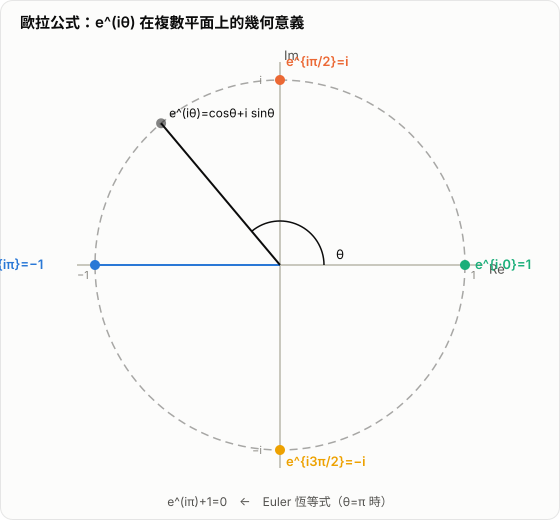

# Euler 公式與 Euler 恆等式的各種證明

Euler 公式與 Euler 恆等式是數學中最有名的兩個公式之一。它們看起來簡短，卻把指數函數、三角函數、複數、幾何旋轉與微分方程全部連在一起。

很多人第一次看到

$$
e^{i\pi}+1=0
$$

時，會覺得這像是某種神奇巧合。其實它不是巧合，而是多條數學結構在同一個地方匯合的結果。

本文會先區分 Euler 公式與 Euler 恆等式，再給出多種證明，包括泰勒展開、微分方程、矩陣旋轉，以及偏幾何的證明方式。

## 1. 什麼是 Euler 公式與 Euler 恆等式

Euler 公式是

$$
e^{ix}=\cos x+i\sin x
$$

其中：

- $x$ 是實數
- $i$ 是虛數單位，滿足 $i^2=-1$

Euler 恆等式則是把 Euler 公式中的 $x$ 取成 $\pi$ 之後得到的特殊情形：

$$
e^{i\pi}+1=0
$$

兩者的關係是：

- Euler 公式是一般型
- Euler 恆等式是其中一個特例

## 2. 為什麼 Euler 恆等式是 Euler 公式的特例

由 Euler 公式

$$
e^{ix}=\cos x+i\sin x
$$

令

$$
x=\pi
$$

則

$$
e^{i\pi}=\cos \pi+i\sin \pi
$$

因為

$$
\cos \pi=-1,\qquad \sin \pi=0
$$

所以

$$
e^{i\pi}=-1
$$

移項後得到

$$
e^{i\pi}+1=0
$$

因此，若 Euler 公式成立，Euler 恆等式自然成立。

## 3. Euler 公式的證明一：泰勒展開

這是最經典也最直接的證明。

我們知道三個函數的麥克勞林展開為：

$$
e^x=1+x+\frac{x^2}{2!}+\frac{x^3}{3!}+\frac{x^4}{4!}+\cdots
$$

$$
\cos x=1-\frac{x^2}{2!}+\frac{x^4}{4!}-\frac{x^6}{6!}+\cdots
$$

$$
\sin x=x-\frac{x^3}{3!}+\frac{x^5}{5!}-\frac{x^7}{7!}+\cdots
$$

現在把 $e^x$ 裡的 $x$ 換成 $ix$：

$$
e^{ix}=1+ix+\frac{(ix)^2}{2!}+\frac{(ix)^3}{3!}+\frac{(ix)^4}{4!}+\cdots
$$

利用

$$
i^2=-1,\quad i^3=-i,\quad i^4=1,\quad i^5=i,\quad \cdots
$$

可得

$$
e^{ix}
=1+ix-\frac{x^2}{2!}-i\frac{x^3}{3!}+\frac{x^4}{4!}+i\frac{x^5}{5!}-\cdots
$$

把實部與虛部分開：

$$
e^{ix}
=\left(1-\frac{x^2}{2!}+\frac{x^4}{4!}-\cdots\right)
+i\left(x-\frac{x^3}{3!}+\frac{x^5}{5!}-\cdots\right)
$$

而這兩個級數正好就是：

$$
\cos x=1-\frac{x^2}{2!}+\frac{x^4}{4!}-\cdots
$$

$$
\sin x=x-\frac{x^3}{3!}+\frac{x^5}{5!}-\cdots
$$

因此

$$
e^{ix}=\cos x+i\sin x
$$

這就證明了 Euler 公式。

## 4. Euler 公式的證明二：微分方程

這個證明的想法是：證明兩個函數滿足同一個微分方程，且具有相同初值，那它們就必須相等。

先定義

$$
f(x)=e^{ix}
$$

則由鏈鎖律可得

$$
f'(x)=ie^{ix}=if(x)
$$

且

$$
f(0)=e^0=1
$$

再定義

$$
g(x)=\cos x+i\sin x
$$

則

$$
g'(x)=-\sin x+i\cos x
$$

另一方面，

$$
ig(x)=i(\cos x+i\sin x)=i\cos x-\sin x
$$

所以

$$
g'(x)=ig(x)
$$

且

$$
g(0)=\cos 0+i\sin 0=1
$$

因此 $f(x)$ 與 $g(x)$ 都滿足同一個初值問題：

$$
y'(x)=iy(x),\qquad y(0)=1
$$

由微分方程解的唯一性可知：

$$
f(x)=g(x)
$$

也就是

$$
e^{ix}=\cos x+i\sin x
$$

## 5. Euler 公式的證明三：矩陣與旋轉觀點

這個證明把複數乘法和二維旋轉連在一起。

定義矩陣

$$
J=
\begin{pmatrix}
0 & -1 \\
1 & 0
\end{pmatrix}
$$

它的作用是把平面向量逆時針旋轉 $90^\circ$，而且滿足

$$
J^2=-I
$$

這和複數單位 $i$ 的性質

$$
i^2=-1
$$

完全平行。

現在考慮矩陣指數

$$
e^{xJ}=I+xJ+\frac{(xJ)^2}{2!}+\frac{(xJ)^3}{3!}+\cdots
$$

因為 $J^2=-I$，高次方會循環，所以可得

$$
e^{xJ}=(\cos x)I+(\sin x)J
$$

寫成矩陣形式就是

$$
e^{xJ}=
\begin{pmatrix}
\cos x & -\sin x \\
\sin x & \cos x
\end{pmatrix}
$$

這正是平面旋轉矩陣。

另一方面，在複平面上，乘上 $e^{ix}$ 的作用也正是旋轉角 $x$。  
因此，複數形式與矩陣形式其實在描述同一個旋轉：

$$
e^{ix}=\cos x+i\sin x
$$

所以 Euler 公式可以理解為：  
複數指數函數其實就是平面旋轉的代數表示。

## 6. Euler 公式的證明四：複平面幾何觀點

這個證明比較偏幾何直覺，重點是把單位圓上的點與旋轉結合起來。

在複平面上，單位圓上角度為 $x$ 的點可以寫成

$$
z(x)=\cos x+i\sin x
$$

幾何上，旋轉角度 $x+y$，等於先旋轉 $x$，再旋轉 $y$。  
而複數乘法正好對應旋轉的合成，因此有

$$
z(x+y)=z(x)z(y)
$$

這表示函數 $z(x)$ 具有和指數函數一樣的乘法結構。

接著看非常小的角度 $h$。由單位圓上的小角幾何可知，當 $h\to 0$ 時：

$$
\cos h \to 1,\qquad \sin h \sim h
$$

因此

$$
z(h)=\cos h+i\sin h=1+ih+o(h)
$$

令

$$
h=\frac{x}{n}
$$

則由旋轉的可加性，

$$
z(x)=z\left(\frac{x}{n}\right)^n
$$

所以

$$
z(x)=\left(1+i\frac{x}{n}+o\left(\frac{1}{n}\right)\right)^n
$$

當 $n\to\infty$ 時，這正是指數函數極限定義的形式，因此得到

$$
z(x)=e^{ix}
$$

也就是

$$
\cos x+i\sin x=e^{ix}
$$

這個證明的核心思想不是展開級數，而是：

- 單位圓上的點表示旋轉
- 旋轉具有角度可加性
- 可加性對應到指數的乘法結構

因此它是 Euler 公式最有幾何味道的一種證明。



*圖：$e^{i\theta}$ 在複數平面的單位圓上以角速度 1 旋轉。當 $\theta=\pi$ 時落在實軸的 $-1$ 點，即得 $e^{i\pi}=-1$，也就是 $e^{i\pi}+1=0$。*

## 7. Euler 恆等式的直接推出

一旦 Euler 公式成立，Euler 恆等式的推出就非常直接。

由

$$
e^{ix}=\cos x+i\sin x
$$

令

$$
x=\pi
$$

可得

$$
e^{i\pi}=\cos \pi+i\sin \pi
$$

因為

$$
\cos \pi=-1,\qquad \sin \pi=0
$$

所以

$$
e^{i\pi}=-1
$$

進一步得到

$$
e^{i\pi}+1=0
$$

## 8. Euler 恆等式的幾何意義

從幾何上看，Euler 恆等式描述的是單位圓上的一個非常特殊的位置。

由 Euler 公式可知：

$$
e^{ix}
$$

表示複平面上單位圓上，與正實軸夾角為 $x$ 的點。

當

$$
x=\pi
$$

時，代表從正實軸逆時針旋轉 $180^\circ$。  
在單位圓上，這個點正好是最左端的點：

$$
(-1,0)
$$

用複數表示，就是

$$
-1
$$

因此

$$
e^{i\pi}=-1
$$

而

$$
e^{i\pi}+1=0
$$

就是把這個幾何位置轉成代數式後得到的結果。

所以從幾何直覺看，Euler 恆等式本質上是在說：

- 指數形式的旋轉，走到角度 $\pi$
- 正好抵達實軸上的 $-1$

### 8.1 在 Markdown Preview Enhanced 中直接畫出幾何圖

如果要在 VS Code 的 Markdown Preview Enhanced 中直接顯示 Euler 恆等式的幾何圖，可以使用 `tikz` fenced code block。這不是一般數學公式，而是圖形語法：

```tikz {showConsole=false}
\begin{tikzpicture}[scale=2]
  \draw[->, thick] (-1.25,0) -- (1.25,0) node[right] {$\Re$};
  \draw[->, thick] (0,-1.25) -- (0,1.25) node[above] {$\Im$};

  \draw[thick] (0,0) circle (1);
  \draw[dashed] (0,0) -- (-1,0);

  \fill (0,0) circle (0.02) node[below right] {$0$};
  \fill (1,0) circle (0.025) node[below right] {$1$};
  \fill (-1,0) circle (0.025) node[below left] {$-1=e^{i\pi}$};

  \draw[->, blue, very thick] (0.28,0) arc[start angle=0,end angle=180,radius=0.28];
  \node[blue] at (0,0.42) {$\pi$};
  \node at (0.15,1.08) {$|z|=1$};
\end{tikzpicture}
```

這張圖表達的是：

- 單位圓上的點都可寫成 $e^{ix}$
- 當角度轉到 $\pi$ 時，點落在 $(-1,0)$
- 因此 $e^{i\pi}=-1$，進一步得到 $e^{i\pi}+1=0$

### 8.2 先看一般角度，再看 $x=\pi$

如果先不把角度固定成 $\pi$，而是看一般角度 $x$，那麼單位圓上的點可以畫成：

```tikz {showConsole=false}
\begin{tikzpicture}[scale=2]
  \draw[->, thick] (-0.2,0) -- (1.35,0) node[right] {$\Re$};
  \draw[->, thick] (0,-0.2) -- (0,1.25) node[above] {$\Im$};

  \draw[thick] (0,0) circle (1);
  \draw[dashed] (0,0) -- (50:1);
  \draw[dashed] (50:1) -- ({cos(50)},0);
  \draw[dashed] (50:1) -- (0,{sin(50)});

  \fill (0,0) circle (0.02) node[below left] {$0$};
  \fill (50:1) circle (0.025) node[above right] {$e^{ix}=(\cos x,\sin x)$};

  \draw[->, blue, thick] (0.28,0) arc[start angle=0,end angle=50,radius=0.28];
  \node[blue] at (0.34,0.16) {$x$};

  \node[below] at ({cos(50)},0) {$\cos x$};
  \node[left] at (0,{sin(50)}) {$\sin x$};
  \node at (0.85,0.95) {$|e^{ix}|=1$};
\end{tikzpicture}
```

這張圖對應的是 Euler 公式：

$$
e^{ix}=\cos x+i\sin x
$$

它表示：

- 複數 $e^{ix}$ 位在單位圓上
- 它的實部是 $\cos x$
- 它的虛部是 $\sin x$

當把這個一般點繼續旋轉到 $x=\pi$，就會落到前一張圖的 $-1$，也就是 Euler 恆等式的特殊情形。

## 9. 為什麼這個恆等式特別重要

Euler 恆等式之所以著名，不只是因為它短，而是因為它把數學中五個最基本的常數連在一起：

$$
e,\qquad i,\qquad \pi,\qquad 1,\qquad 0
$$

而且這五個常數分別來自不同領域：

- $e$ 來自指數成長與微積分
- $i$ 來自複數
- $\pi$ 來自幾何與圓
- $1$ 是乘法單位
- $0$ 是加法單位

Euler 恆等式的重要性在於，它不是把這些常數「硬湊在一起」，而是揭示它們原本就深層相連。

## 10. 常見誤解

### 10.1 這不是巧合公式

很多人會把

$$
e^{i\pi}+1=0
$$

看成某種漂亮巧合。其實不是。  
它是 Euler 公式在 $x=\pi$ 的必然結果。

### 10.2 Euler 恆等式不是獨立於 Euler 公式的另一件事

Euler 恆等式不是另一條無關公式，而是 Euler 公式的特例。  
所以若要真正理解它，核心還是要先理解

$$
e^{ix}=\cos x+i\sin x
$$

### 10.3 幾何證明不代表完全脫離分析

很多所謂的幾何證明，實際上仍然會用到連續性、極限或小角近似。  
它的差別不在於「完全不用分析」，而在於它把重點放在旋轉、單位圓與複平面的結構。

## 11. 總結

Euler 公式

$$
e^{ix}=\cos x+i\sin x
$$

把複數指數函數與三角函數、旋轉幾何統一起來；Euler 恆等式

$$
e^{i\pi}+1=0
$$

則是這個公式在 $x=\pi$ 時最精煉、最著名的特例。從泰勒展開、微分方程、矩陣旋轉到複平面幾何，不同證明方法都在說明同一件事：指數、三角函數與旋轉其實是同一個結構的不同語言。這也是為什麼 Euler 恆等式不只是漂亮，而是真正深刻。
