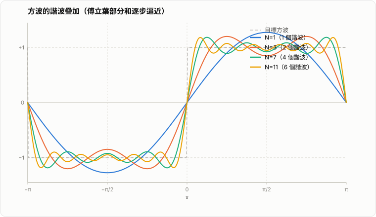

# 傅立葉級數（Fourier Series）

傅立葉級數的核心問題是：能不能把一個週期函數拆成許多不同頻率的正弦波與餘弦波，再把它們加總回原來的函數？答案是可以，而且這個想法不只漂亮，還是訊號處理、偏微分方程、物理學、機器學習與數值分析中的基礎工具。

直觀上，傅立葉級數做的事很像「向量分解」：平面上的向量可以拆成 $x$ 軸與 $y$ 軸的分量；同樣地，一個週期函數也可以拆成各種頻率方向上的分量。這些分量就是

$$
\cos x,\ \sin x,\ \cos 2x,\ \sin 2x,\ \cos 3x,\ \sin 3x,\ \dots
$$

它們像是一組函數空間中的基底，讓我們能用簡單波形組合出複雜波形。

## 1. 為什麼正弦與餘弦特別重要？

正弦與餘弦有三個關鍵特性：

1. 它們天然具有週期性。
2. 它們在微分與積分下形式穩定，不會跑出完全不同型態的函數。
3. 它們彼此正交，能夠像座標軸一樣分離不同頻率的資訊。

所謂正交，可以先看最常見的幾個關係（區間取在 $[-\pi,\pi]$）：

$$
\int_{-\pi}^{\pi}\sin(mx)\sin(nx)\,dx=
\begin{cases}
0,&m\ne n,\\
\pi,&m=n,
\end{cases}
$$

$$
\int_{-\pi}^{\pi}\cos(mx)\cos(nx)\,dx=
\begin{cases}
0,&m\ne n,\\
\pi,&m=n\ge 1,
\end{cases}
$$

$$
\int_{-\pi}^{\pi}\sin(mx)\cos(nx)\,dx=0.
$$

這表示不同頻率之間不會互相干擾，因此我們可以用積分把某個頻率的係數單獨「投影」出來。

## 2. 標準形式

若函數 $f(x)$ 是 $2\pi$ 週期函數，則它的傅立葉級數通常寫成

$$
f(x)\sim \frac{a_0}{2}+\sum_{n=1}^{\infty}\bigl(a_n\cos nx+b_n\sin nx\bigr).
$$

這裡：

- $\frac{a_0}{2}$ 是平均值或直流成分（DC component）。
- $a_n\cos nx$ 是第 $n$ 個餘弦頻率成分。
- $b_n\sin nx$ 是第 $n$ 個正弦頻率成分。

對應的係數由下列公式決定：

$$
a_0=\frac{1}{\pi}\int_{-\pi}^{\pi}f(x)\,dx,
$$

$$
a_n=\frac{1}{\pi}\int_{-\pi}^{\pi}f(x)\cos(nx)\,dx,\qquad n\ge 1,
$$

$$
b_n=\frac{1}{\pi}\int_{-\pi}^{\pi}f(x)\sin(nx)\,dx,\qquad n\ge 1.
$$

從這些公式可以看出，傅立葉級數不是任意猜一串係數，而是透過正交性精確算出每個頻率的權重。

## 3. 一般週期 $T$ 的形式

若函數的週期不是 $2\pi$，而是一般的 $T>0$，則可以改寫成

$$
f(x)\sim \frac{a_0}{2}+\sum_{n=1}^{\infty}\left(a_n\cos\frac{2\pi nx}{T}+b_n\sin\frac{2\pi nx}{T}\right).
$$

係數則變成

$$
a_0=\frac{2}{T}\int_{x_0}^{x_0+T}f(x)\,dx,
$$

$$
a_n=\frac{2}{T}\int_{x_0}^{x_0+T}f(x)\cos\frac{2\pi nx}{T}\,dx,
$$

$$
b_n=\frac{2}{T}\int_{x_0}^{x_0+T}f(x)\sin\frac{2\pi nx}{T}\,dx.
$$

其中 $x_0$ 可以任選，只要積分區間完整涵蓋一個週期即可。

## 4. 複數形式

若用歐拉公式

$$
e^{inx}=\cos(nx)+i\sin(nx),
$$

傅立葉級數可以更緊湊地寫成

$$
f(x)\sim \sum_{n=-\infty}^{\infty}c_ne^{inx},
$$

其中

$$
c_n=\frac{1}{2\pi}\int_{-\pi}^{\pi}f(x)e^{-inx}\,dx.
$$

這種形式在線性代數、量子力學、訊號分析與傅立葉變換中非常常見，因為它把正弦與餘弦統一成同一種指數基底。

## 5. 對稱性可以大幅簡化計算

有些函數帶有對稱性，係數會自動消失。

### 5.1 偶函數

若 $f(-x)=f(x)$，則 $f$ 是偶函數。此時

$$
b_n=0,
$$

所以傅立葉級數只剩餘弦項：

$$
f(x)\sim \frac{a_0}{2}+\sum_{n=1}^{\infty}a_n\cos nx.
$$

### 5.2 奇函數

若 $f(-x)=-f(x)$，則 $f$ 是奇函數。此時

$$
a_0=0,\qquad a_n=0,
$$

所以傅立葉級數只剩正弦項：

$$
f(x)\sim \sum_{n=1}^{\infty}b_n\sin nx.
$$

這種對稱性在實際計算時很有用，因為常常可以把一大半的積分直接省掉。

## 6. 例子一：$f(x)=x$ 的傅立葉級數

考慮區間 $(-\pi,\pi)$ 上的函數

$$
f(x)=x,
$$

並把它做成 $2\pi$ 週期延拓。由於 $f(x)=x$ 是奇函數，所以只會有正弦項：

$$
f(x)\sim \sum_{n=1}^{\infty}b_n\sin nx.
$$

計算

$$
b_n=\frac{1}{\pi}\int_{-\pi}^{\pi}x\sin(nx)\,dx
=\frac{2(-1)^{n+1}}{n}.
$$

因此

$$
x\sim 2\sum_{n=1}^{\infty}\frac{(-1)^{n+1}}{n}\sin(nx),\qquad -\pi<x<\pi.
$$

這個例子很重要，因為它說明了看起來不是波形的函數，也能拆成無限多個波形的和。把前幾項畫出來時，會看到近似曲線愈來愈接近直線，但在跳躍點附近仍會出現明顯波動。

## 7. 例子二：方波與奇次諧波

定義方波

$$
f(x)=
\begin{cases}
1,&0<x<\pi,\\
-1,&-\pi<x<0,
\end{cases}
$$

再做 $2\pi$ 週期延拓。這也是奇函數，所以只有正弦項。計算後可得

$$
f(x)\sim \frac{4}{\pi}\left(\sin x+\frac{1}{3}\sin 3x+\frac{1}{5}\sin 5x+\cdots\right).
$$

*圖：方波的諧波疊加。虛線為目標方波；四條實線依次加入更多奇次諧波，可見疊加愈多高次項，曲線就愈貼近方波，但在跳躍點附近仍出現振盪（Gibbs 現象）。*

這個展開有兩個很有代表性的現象：

1. 只出現奇數頻率，也就是 $1,3,5,\dots$ 的諧波。
2. 越高頻的係數越小，所以主要輪廓通常由低頻決定，細節則由高頻補足。

這也是為什麼傅立葉觀點在聲音分析、振動分析與頻譜分析中特別自然。

## 8. 收斂到底代表什麼？

寫成

$$
f(x)\sim \frac{a_0}{2}+\sum_{n=1}^{\infty}(a_n\cos nx+b_n\sin nx)
$$

並不自動代表每個點都完美等於右邊無限和。收斂的細節很重要。

### 8.1 在連續點

若 $f$ 分段光滑、分段連續，則在函數連續的點 $x$ 上，傅立葉級數通常收斂到

$$
f(x).
$$

### 8.2 在跳躍不連續點

若 $x$ 是跳躍點，則傅立葉級數收斂到左右極限的平均：

$$
\frac{f(x^-)+f(x^+)}{2}.
$$

這也是為什麼上面的方波在跳點處不會收斂到 $1$ 或 $-1$，而是收斂到 $0$。

### 8.3 更一般的意義

即使點態收斂不夠理想，傅立葉級數在很多情況下仍會以平方平均（$L^2$）的意義逼近函數。這對工程和物理非常重要，因為很多時候我們關心的是整體能量誤差，而不是每個點都完全一致。

## 9. Gibbs 現象

當函數有跳躍不連續時，傅立葉部分和在跳點附近會產生振盪與過衝，這稱為 Gibbs 現象。即使取很多很多項，跳點附近的波紋範圍會縮小，但最大過衝的比例不會完全消失。

這提醒我們一件事：傅立葉級數非常擅長表示整體頻率結構，但遇到尖角、斷點或突變時，局部表現常會出現振盪。這也是後來小波、局部基底與各種時頻方法被提出的重要原因之一。

## 10. Parseval 等式：能量的觀點

傅立葉級數不只是在做函數分解，也是在做能量分配。對於足夠好的函數，有

$$
\frac{1}{\pi}\int_{-\pi}^{\pi}|f(x)|^2\,dx
=\frac{a_0^2}{2}+\sum_{n=1}^{\infty}(a_n^2+b_n^2).
$$

左邊是函數在整個區間上的總能量，右邊則是各個頻率成分能量的總和。這個等式說明：函數的能量可以拆到不同頻率上來看，因此頻域分析不只是換一種寫法，而是真的揭示了訊號結構。

## 11. 與傅立葉變換有什麼不同？

兩者都在做「用頻率表示函數」這件事，但使用場景不同：

- 傅立葉級數：主要處理週期函數。
- 傅立葉變換：主要處理非週期函數，或定義在整個實數軸上的訊號。

可以把傅立葉級數想成離散頻率的分解，因為週期訊號只需要一串離散頻率；而傅立葉變換則對應連續頻率分布。

## 12. 典型應用

傅立葉級數在很多地方都會出現：

- 訊號處理：分析音訊、濾波、去噪、頻譜分解。
- 物理學：振動、波動、熱傳導、量子力學中的本徵模態展開。
- 偏微分方程：用分離變數法解熱方程、波動方程、拉普拉斯方程。
- 電機與控制：電路中的諧波分析、週期輸入響應。
- 機器學習：Fourier features、位置編碼、週期性特徵表示。

對 AI 與數值模型而言，傅立葉級數提供了一種很重要的視角：複雜訊號常常可以拆成不同頻率層次，低頻描述整體趨勢，高頻描述細節變化。

## 13. 小結

傅立葉級數最重要的觀念可以濃縮成下面幾點：

1. 週期函數可以拆成許多正弦與餘弦的疊加。
2. 係數來自正交投影，不是憑感覺拼湊。
3. 低頻決定整體形狀，高頻補充局部細節。
4. 在不連續點附近會出現 Gibbs 現象。
5. 它是從時域走向頻域分析的第一步。

如果把三角函數看成「描述週期結構的字母」，那麼傅立葉級數就是用這些字母寫出複雜波形與週期函數的語法。理解這件事之後，傅立葉分析、傅立葉變換、頻譜方法與許多現代模型中的頻率表示，都會變得自然許多。

## 14. 附錄：核心公式證明

這一節把前面最常用的幾個公式補上推導。主線其實很簡單：先證明正弦與餘弦彼此正交，再把函數對這些基底做投影，就能把傅立葉係數單獨抽出來。

### 14.1 正交公式的證明

先看餘弦與餘弦的積。由積化和差公式，

$$
\cos(mx)\cos(nx)=\frac12\bigl(\cos((m-n)x)+\cos((m+n)x)\bigr).
$$

因此

$$
\int_{-\pi}^{\pi}\cos(mx)\cos(nx)\,dx
=\frac12\int_{-\pi}^{\pi}\cos((m-n)x)\,dx
+\frac12\int_{-\pi}^{\pi}\cos((m+n)x)\,dx.
$$

當 $m\ne n$ 時，$m-n\ne 0$ 且 $m+n\ne 0$，而

$$
\int_{-\pi}^{\pi}\cos(kx)\,dx=0\qquad (k\ne 0),
$$

所以

$$
\int_{-\pi}^{\pi}\cos(mx)\cos(nx)\,dx=0 \qquad (m\ne n).
$$

當 $m=n$ 時，

$$
\cos^2(nx)=\frac12\bigl(1+\cos(2nx)\bigr),
$$

因此

$$
\int_{-\pi}^{\pi}\cos^2(nx)\,dx
=\frac12\int_{-\pi}^{\pi}1\,dx+\frac12\int_{-\pi}^{\pi}\cos(2nx)\,dx
=\frac12(2\pi)+0=\pi.
$$

所以

$$
\int_{-\pi}^{\pi}\cos(mx)\cos(nx)\,dx=
\begin{cases}
0,&m\ne n,\\
\pi,&m=n\ge 1.
\end{cases}
$$

再看正弦與正弦。由

$$
\sin(mx)\sin(nx)=\frac12\bigl(\cos((m-n)x)-\cos((m+n)x)\bigr),
$$

可得

$$
\int_{-\pi}^{\pi}\sin(mx)\sin(nx)\,dx=0 \qquad (m\ne n).
$$

若 $m=n$，則

$$
\sin^2(nx)=\frac12\bigl(1-\cos(2nx)\bigr),
$$

因此

$$
\int_{-\pi}^{\pi}\sin^2(nx)\,dx
=\frac12\int_{-\pi}^{\pi}1\,dx-\frac12\int_{-\pi}^{\pi}\cos(2nx)\,dx
=\pi.
$$

所以

$$
\int_{-\pi}^{\pi}\sin(mx)\sin(nx)\,dx=
\begin{cases}
0,&m\ne n,\\
\pi,&m=n.
\end{cases}
$$

最後看正弦與餘弦：

$$
\sin(mx)\cos(nx)=\frac12\bigl(\sin((m+n)x)+\sin((m-n)x)\bigr).
$$

而

$$
\int_{-\pi}^{\pi}\sin(kx)\,dx=0,
$$

所以

$$
\int_{-\pi}^{\pi}\sin(mx)\cos(nx)\,dx=0.
$$

這就是傅立葉級數最核心的正交性來源。

### 14.2 係數公式的證明

先假設 $f(x)$ 可以展成

$$
f(x)\sim \frac{a_0}{2}+\sum_{n=1}^{\infty}\bigl(a_n\cos nx+b_n\sin nx\bigr).
$$

要找 $a_m$，就在等式兩邊同乘 $\cos(mx)$，再從 $-\pi$ 積到 $\pi$：

$$
\int_{-\pi}^{\pi}f(x)\cos(mx)\,dx
=\int_{-\pi}^{\pi}\frac{a_0}{2}\cos(mx)\,dx
+\sum_{n=1}^{\infty}a_n\int_{-\pi}^{\pi}\cos(nx)\cos(mx)\,dx
+\sum_{n=1}^{\infty}b_n\int_{-\pi}^{\pi}\sin(nx)\cos(mx)\,dx.
$$

由上一節的正交公式：

- $\int_{-\pi}^{\pi}\cos(mx)\,dx=0$
- $\int_{-\pi}^{\pi}\sin(nx)\cos(mx)\,dx=0$
- $\int_{-\pi}^{\pi}\cos(nx)\cos(mx)\,dx$ 只有在 $n=m$ 時不為零

因此只剩

$$
\int_{-\pi}^{\pi}f(x)\cos(mx)\,dx
=a_m\int_{-\pi}^{\pi}\cos^2(mx)\,dx
=a_m\pi.
$$

所以

$$
a_m=\frac{1}{\pi}\int_{-\pi}^{\pi}f(x)\cos(mx)\,dx.
$$

完全同理，兩邊同乘 $\sin(mx)$ 再積分，可得

$$
b_m=\frac{1}{\pi}\int_{-\pi}^{\pi}f(x)\sin(mx)\,dx.
$$

最後把原展開式直接從 $-\pi$ 積到 $\pi$：

$$
\int_{-\pi}^{\pi}f(x)\,dx
=\int_{-\pi}^{\pi}\frac{a_0}{2}\,dx
+\sum_{n=1}^{\infty}a_n\int_{-\pi}^{\pi}\cos(nx)\,dx
+\sum_{n=1}^{\infty}b_n\int_{-\pi}^{\pi}\sin(nx)\,dx.
$$

後兩串都消掉，所以

$$
\int_{-\pi}^{\pi}f(x)\,dx=\frac{a_0}{2}\cdot 2\pi=a_0\pi.
$$

因此

$$
a_0=\frac{1}{\pi}\int_{-\pi}^{\pi}f(x)\,dx.
$$

這樣就得到前文的三個係數公式。

### 14.3 奇偶對稱為什麼能簡化展開

若 $f$ 是偶函數，也就是

$$
f(-x)=f(x),
$$

而 $\sin(nx)$ 是奇函數，所以 $f(x)\sin(nx)$ 是奇函數。奇函數在對稱區間上的積分為零，因此

$$
b_n=\frac{1}{\pi}\int_{-\pi}^{\pi}f(x)\sin(nx)\,dx=0.
$$

這表示偶函數的傅立葉級數只剩餘弦項。

若 $f$ 是奇函數，也就是

$$
f(-x)=-f(x),
$$

而 $\cos(nx)$ 是偶函數，所以 $f(x)\cos(nx)$ 是奇函數，因此

$$
a_n=\frac{1}{\pi}\int_{-\pi}^{\pi}f(x)\cos(nx)\,dx=0.
$$

同時

$$
a_0=\frac{1}{\pi}\int_{-\pi}^{\pi}f(x)\,dx=0.
$$

所以奇函數的傅立葉級數只剩正弦項。這也是很多例子能迅速簡化的原因。

### 14.4 例子：$f(x)=x$ 的傅立葉級數推導

在 $(-\pi,\pi)$ 上令

$$
f(x)=x.
$$

因為 $x$ 是奇函數，所以

$$
a_0=0,\qquad a_n=0.
$$

只需要計算

$$
b_n=\frac{1}{\pi}\int_{-\pi}^{\pi}x\sin(nx)\,dx.
$$

由於 $x$ 和 $\sin(nx)$ 都是奇函數，兩者乘積是偶函數，因此

$$
b_n=\frac{2}{\pi}\int_{0}^{\pi}x\sin(nx)\,dx.
$$

接著做分部積分。令

$$
u=x,\qquad dv=\sin(nx)\,dx,
$$

則

$$
du=dx,\qquad v=-\frac{\cos(nx)}{n}.
$$

所以

$$
\int x\sin(nx)\,dx
=-\frac{x\cos(nx)}{n}+\frac{1}{n}\int \cos(nx)\,dx
=-\frac{x\cos(nx)}{n}+\frac{\sin(nx)}{n^2}.
$$

代入 $0$ 到 $\pi$：

$$
\int_{0}^{\pi}x\sin(nx)\,dx
=\left[-\frac{x\cos(nx)}{n}+\frac{\sin(nx)}{n^2}\right]_{0}^{\pi}.
$$

因為

$$
\sin(n\pi)=0,\qquad \cos(n\pi)=(-1)^n,
$$

所以

$$
\int_{0}^{\pi}x\sin(nx)\,dx=-\frac{\pi(-1)^n}{n}.
$$

因此

$$
b_n=\frac{2}{\pi}\left(-\frac{\pi(-1)^n}{n}\right)
=\frac{2(-1)^{n+1}}{n}.
$$

最後得到

$$
x\sim 2\sum_{n=1}^{\infty}\frac{(-1)^{n+1}}{n}\sin(nx),\qquad -\pi<x<\pi.
$$

### 14.5 例子：方波為什麼只剩奇次諧波

令

$$
f(x)=
\begin{cases}
1,&0<x<\pi,\\
-1,&-\pi<x<0.
\end{cases}
$$

這是奇函數，所以只需計算 $b_n$：

$$
b_n=\frac{1}{\pi}\int_{-\pi}^{\pi}f(x)\sin(nx)\,dx
=\frac{2}{\pi}\int_{0}^{\pi}\sin(nx)\,dx.
$$

這裡利用了在 $(0,\pi)$ 上 $f(x)=1$。接著計算

$$
\int_{0}^{\pi}\sin(nx)\,dx
=\left[-\frac{\cos(nx)}{n}\right]_{0}^{\pi}
=\frac{1-\cos(n\pi)}{n}
=\frac{1-(-1)^n}{n}.
$$

所以

$$
b_n=\frac{2}{\pi}\cdot \frac{1-(-1)^n}{n}.
$$

若 $n$ 是偶數，則 $(-1)^n=1$，因此 $b_n=0$。若 $n$ 是奇數，則 $(-1)^n=-1$，因此

$$
b_n=\frac{4}{n\pi}.
$$

所以

$$
f(x)\sim \frac{4}{\pi}\left(\sin x+\frac{1}{3}\sin 3x+\frac{1}{5}\sin 5x+\cdots\right).
$$

這也說明了方波只含奇次諧波。

### 14.6 Parseval 等式的計算骨架

若

$$
f(x)\sim \frac{a_0}{2}+\sum_{n=1}^{\infty}(a_n\cos nx+b_n\sin nx),
$$

那麼把右邊平方後再積分：

$$
\int_{-\pi}^{\pi}|f(x)|^2\,dx.
$$

展開時會出現常數平方項、正弦平方項、餘弦平方項，以及大量交叉項。由於不同頻率彼此正交，交叉項積分後全部消失，只留下

$$
\int_{-\pi}^{\pi}\left(\frac{a_0}{2}\right)^2dx
=\frac{a_0^2}{4}\cdot 2\pi,
$$

$$
\int_{-\pi}^{\pi}a_n^2\cos^2(nx)\,dx=a_n^2\pi,
$$

$$
\int_{-\pi}^{\pi}b_n^2\sin^2(nx)\,dx=b_n^2\pi.
$$

因此

$$
\int_{-\pi}^{\pi}|f(x)|^2\,dx
=\frac{a_0^2}{2}\pi+\pi\sum_{n=1}^{\infty}(a_n^2+b_n^2).
$$

兩邊同除以 $\pi$，就得到

$$
\frac{1}{\pi}\int_{-\pi}^{\pi}|f(x)|^2\,dx
=\frac{a_0^2}{2}+\sum_{n=1}^{\infty}(a_n^2+b_n^2).
$$

嚴格來說，完整證明還需要適當的收斂條件，但計算結構就是如此：能量會被分配到各個正交頻率成分上。

### 14.7 為什麼跳躍點會收斂到左右極限平均

這個結果比前面幾個係數公式更深，因為它牽涉到傅立葉部分和的極限行為。這裡給出一個標準證明骨架：先把第 $N$ 個部分和寫成 Dirichlet kernel 的卷積，再把問題化成一個振盪積分，最後用 Riemann-Lebesgue 引理收尾。

先設

$$
S_N(f;x)=\frac{a_0}{2}+\sum_{n=1}^{N}\bigl(a_n\cos(nx)+b_n\sin(nx)\bigr)
$$

表示 $f$ 的第 $N$ 個傅立葉部分和。

我們要證明：若 $f$ 是 $2\pi$ 週期函數，且在每個區間上分段 $C^1$，那麼在任意點 $x$，

$$
\lim_{N\to\infty}S_N(f;x)=\frac{f(x^-)+f(x^+)}{2}.
$$

其中 $f(x^-)$ 與 $f(x^+)$ 分別表示左極限與右極限。當 $f$ 在 $x$ 連續時，這個公式就退化成 $S_N(f;x)\to f(x)$。

#### 第一步：把部分和寫成 kernel 形式

把 $a_n,b_n$ 的積分公式代回 $S_N(f;x)$：

$$
S_N(f;x)
=\frac{1}{2\pi}\int_{-\pi}^{\pi}f(y)\,dy
+\sum_{n=1}^{N}\left(\frac{1}{\pi}\int_{-\pi}^{\pi}f(y)\cos(ny)\,dy\right)\cos(nx)
+\sum_{n=1}^{N}\left(\frac{1}{\pi}\int_{-\pi}^{\pi}f(y)\sin(ny)\,dy\right)\sin(nx).
$$

把積分提出來，再用

$$
\cos(ny)\cos(nx)+\sin(ny)\sin(nx)=\cos(n(y-x)),
$$

可得

$$
S_N(f;x)
=\frac{1}{\pi}\int_{-\pi}^{\pi}f(y)\left(\frac12+\sum_{n=1}^{N}\cos(n(y-x))\right)\,dy.
$$

令

$$
D_N(t)=1+2\sum_{n=1}^{N}\cos(nt),
$$

則

$$
\frac12+\sum_{n=1}^{N}\cos(nt)=\frac12D_N(t),
$$

因此

$$
S_N(f;x)=\frac{1}{2\pi}\int_{-\pi}^{\pi}f(y)D_N(y-x)\,dy.
$$

再利用週期性做變數替換 $t=x-y$，可寫成

$$
S_N(f;x)=\frac{1}{2\pi}\int_{-\pi}^{\pi}f(x-t)D_N(t)\,dt.
$$

這就是 Dirichlet kernel 的卷積形式。

#### 第二步：求出 Dirichlet kernel 的閉式

因為

$$
D_N(t)=\sum_{n=-N}^{N}e^{int},
$$

這是一個有限等比級數，所以

$$
D_N(t)=e^{-iNt}\frac{1-e^{i(2N+1)t}}{1-e^{it}}.
$$

把分子分母同時乘上 $e^{-it/2}$ 並整理，可得

$$
D_N(t)=\frac{\sin\bigl((N+\tfrac12)t\bigr)}{\sin(t/2)}.
$$

因此

$$
S_N(f;x)=\frac{1}{2\pi}\int_{-\pi}^{\pi}f(x-t)\frac{\sin\bigl((N+\tfrac12)t\bigr)}{\sin(t/2)}\,dt.
$$

另外，因為 $D_N$ 是偶函數，所以

$$
S_N(f;x)=\frac{1}{2\pi}\int_{0}^{\pi}\bigl(f(x-t)+f(x+t)\bigr)D_N(t)\,dt.
$$

#### 第三步：把目標值抽出來

令

$$
A=\frac{f(x^-)+f(x^+)}{2}.
$$

又因為

$$
\int_{-\pi}^{\pi}D_N(t)\,dt=2\pi,
$$

而 $D_N$ 是偶函數，所以

$$
\int_{0}^{\pi}D_N(t)\,dt=\pi.
$$

因此

$$
A=\frac{1}{2\pi}\int_{0}^{\pi}\bigl(f(x^-)+f(x^+)\bigr)D_N(t)\,dt.
$$

把這一式從 $S_N(f;x)$ 減掉，得到

$$
S_N(f;x)-A
=\frac{1}{2\pi}\int_{0}^{\pi}
\bigl(f(x-t)+f(x+t)-f(x^-)-f(x^+)\bigr)D_N(t)\,dt.
$$

再代入

$$
D_N(t)=\frac{\sin\bigl((N+\tfrac12)t\bigr)}{\sin(t/2)},
$$

可得

$$
S_N(f;x)-A
=\frac{1}{2\pi}\int_{0}^{\pi}
\bigl(f(x-t)+f(x+t)-f(x^-)-f(x^+)\bigr)
\frac{\sin\bigl((N+\tfrac12)t\bigr)}{\sin(t/2)}\,dt.
$$

現在定義

$$
g_x(t)=\frac{f(x-t)+f(x+t)-f(x^-)-f(x^+)}{2\sin(t/2)}.
$$

則上式變成

$$
S_N(f;x)-A
=\frac{1}{\pi}\int_{0}^{\pi}g_x(t)\sin\bigl((N+\tfrac12)t\bigr)\,dt.
$$

#### 第四步：為什麼 $g_x(t)$ 可積

若 $f$ 在各區間上分段 $C^1$，則在 $t=0$ 附近，

- $f(x-t)\to f(x^-)$
- $f(x+t)\to f(x^+)$

而且分段可微會保證分子在 $t\to 0$ 時至多是 $O(t)$) 的量；另一方面

$$
\sin(t/2)\sim t/2 \qquad (t\to 0),
$$

所以 $g_x(t)$ 在 $t=0$ 附近是有界的。遠離 $0$ 時，$g_x(t)$ 只是分段連續函數，因此在 $[0,\pi]$ 上可積。

也就是說，

$$
g_x\in L^1([0,\pi]).
$$

#### 第五步：用 Riemann-Lebesgue 引理收尾

Riemann-Lebesgue 引理告訴我們：若 $g\in L^1([0,\pi])$，則

$$
\int_{0}^{\pi}g(t)\sin(\lambda t)\,dt\to 0
\qquad (\lambda\to\infty).
$$

把 $g=g_x$、$\lambda=N+\tfrac12$ 代入，就得到

$$
\lim_{N\to\infty}\bigl(S_N(f;x)-A\bigr)=0.
$$

因此

$$
\lim_{N\to\infty}S_N(f;x)=A=\frac{f(x^-)+f(x^+)}{2}.
$$

這就證明了：在跳躍不連續點，傅立葉級數收斂到左右極限的平均值；在連續點，由於 $f(x^-)=f(x^+)=f(x)$，便得到

$$
\lim_{N\to\infty}S_N(f;x)=f(x).
$$

#### 考試手寫精簡版

若

$$
S_N(f;x)=\frac{1}{2\pi}\int_{-\pi}^{\pi}f(x-t)D_N(t)\,dt,
\qquad
D_N(t)=\frac{\sin\bigl((N+\tfrac12)t\bigr)}{\sin(t/2)},
$$

則因為 $D_N$ 是偶函數，可寫成

$$
S_N(f;x)=\frac{1}{2\pi}\int_{0}^{\pi}\bigl(f(x-t)+f(x+t)\bigr)D_N(t)\,dt.
$$

令

$$
A=\frac{f(x^-)+f(x^+)}{2},
\qquad
g_x(t)=\frac{f(x-t)+f(x+t)-f(x^-)-f(x^+)}{2\sin(t/2)}.
$$

則

$$
S_N(f;x)-A
=\frac{1}{\pi}\int_{0}^{\pi}g_x(t)\sin\bigl((N+\tfrac12)t\bigr)\,dt.
$$

若 $f$ 分段光滑，則 $g_x\in L^1([0,\pi])$。由 Riemann-Lebesgue 引理，

$$
\int_{0}^{\pi}g_x(t)\sin\bigl((N+\tfrac12)t\bigr)\,dt\to 0,
$$

故

$$
\lim_{N\to\infty}S_N(f;x)=A=\frac{f(x^-)+f(x^+)}{2}.
$$

特別地，若 $f$ 在 $x$ 連續，則 $f(x^-)=f(x^+)=f(x)$，所以

$$
\lim_{N\to\infty}S_N(f;x)=f(x).
$$

#### 這個證明真正用了什麼

整個論證的核心其實只有三件事：

1. 傅立葉部分和可以寫成和 Dirichlet kernel 的卷積。
2. Dirichlet kernel 的閉式會把問題化成振盪積分。
3. 振盪積分對可積函數會趨近於零，這是 Riemann-Lebesgue 引理的內容。

因此，跳點處出現平均值不是偶然，而是「對稱 kernel 加上高頻振盪平均」的直接結果。
