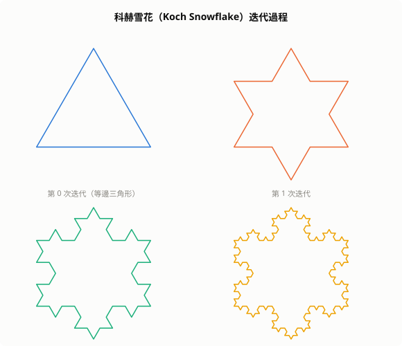
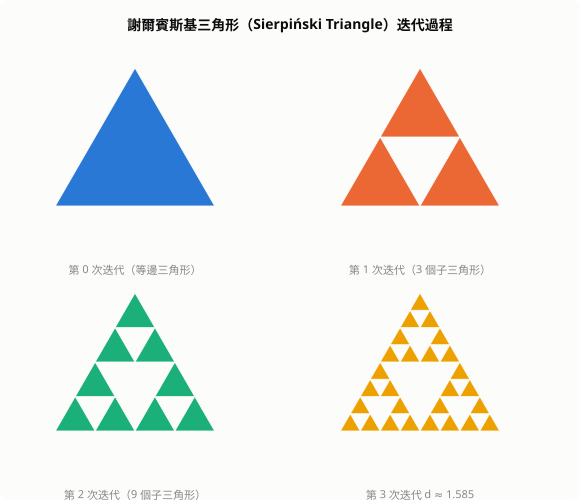

# 碎形幾何（Fractal Geometry）

碎形（Fractal）是一類在不同尺度下呈現自相似結構的幾何物件。傳統歐幾里得幾何描述直線、圓、球等「整數維度」的光滑形狀；碎形幾何則用來描述自然界中更普遍的不規則形狀：雲、海岸線、樹枝、血管、山脈。

「Fractal」一詞由數學家 Benoit Mandelbrot 於 1975 年創造，源自拉丁文 *fractus*（破碎的）。

## 1. 為什麼需要碎形幾何

考慮一個問題：英國的海岸線有多長？

當你用 100 公里的尺量，得到一個值；改用 1 公里的尺量，總長度變長了，因為小灣彎曲被計入；再用 1 公尺的尺量，長度又更長。

這個悖論稱為**理查森效應（Richardson Effect）**：用越精細的尺，測出的長度越長，甚至趨近無限。原因是海岸線具有碎形結構——任意放大都還有更多細節。

傳統幾何無法描述這類物件，碎形幾何正是為了填補這個缺口。

## 2. 自相似性

碎形最核心的特徵是**自相似性（Self-Similarity）**：物件的局部在形狀上與整體相似。

自相似性分三類：

### 2.1 精確自相似（Exact Self-Similarity）
嚴格的幾何自相似，常見於數學構造的碎形。

**科赫雪花（Koch Snowflake）**：
- 以一條線段開始，將中間三分之一替換成等邊三角形的兩邊
- 對每條新邊無限重複此操作
- 周長無限大，面積有限

每一段邊都是整體的縮小版，放大 3 倍即可看到相同結構。


*圖：科赫雪花的四個迭代階段。每次迭代將每條邊的中間三分之一替換為等邊三角形的兩邊，邊數從 3 增至 3×4ⁿ，碎形維度收斂至 log4/log3 ≈ 1.262。*

**謝爾賓斯基三角形（Sierpiński Triangle）**：
- 將等邊三角形三等分，移除中心的倒三角形
- 對剩下三個小三角形重複上述步驟，無限遞迴


*圖：謝爾賓斯基三角形的四個迭代階段。每次迭代移除每個填色三角形中央的倒三角形，子三角形數從 1 增至 3ⁿ，碎形維度收斂至 log3/log2 ≈ 1.585。*

### 2.2 統計自相似（Statistical Self-Similarity）
在統計意義上，不同尺度下的結構具有相同的統計特性。自然界的碎形幾乎都屬於此類，例如：

- 山脈的輪廓：放大任意區段，高低起伏的統計分布相似
- 肺部支氣管：每一層分支的角度與比例服從類似的分布

### 2.3 自仿射（Self-Affinity）
不同方向上以不同比例縮放仍保持相似，例如股市的價格曲線：

$$
f(x) \sim \lambda^{-H} f(\lambda x)
$$

其中 $H$ 稱為 Hurst 指數，控制自仿射的強度。

## 3. 碎形維度

碎形最重要的量化指標是它的**維度**，而這個維度可以是非整數。

### 3.1 豪斯多夫維度（Hausdorff Dimension）

以自相似碎形為例，設：
- 整體被分成 $N$ 個縮小版本
- 每個版本的線性縮放比例為 $r$（邊長是原來的 $1/r$）

則碎形維度 $d$ 定義為：

$$
N = r^d
\implies d = \frac{\log N}{\log r}
$$

**科赫雪花**：每條邊分成 4 段，每段長度為原來的 $1/3$，故

$$
d = \frac{\log 4}{\log 3} \approx 1.262
$$

它的維度介於一維曲線（$d=1$）和二維平面（$d=2$）之間——確實是「比線多一點，比面少一點」的物件。

**謝爾賓斯基三角形**：分成 3 份，每份縮小為原來的 $1/2$，故

$$
d = \frac{\log 3}{\log 2} \approx 1.585
$$

**Menger 海綿**（三維推廣）：

$$
d = \frac{\log 20}{\log 3} \approx 2.727
$$

### 3.2 盒計數維度（Box-Counting Dimension）

實際應用中，豪斯多夫維度不易計算，常改用**盒計數維度**：

用邊長為 $\epsilon$ 的小盒子覆蓋碎形，計算需要的盒子數 $N(\epsilon)$。若

$$
N(\epsilon) \propto \epsilon^{-d}
$$

則碎形維度為

$$
d = \lim_{\epsilon \to 0} \frac{\log N(\epsilon)}{\log(1/\epsilon)}
$$

實驗上，畫出 $\log N(\epsilon)$ 對 $\log(1/\epsilon)$ 的圖，斜率即為維度的估計值。

### 3.3 維度的直覺意義

| 物件 | 維度 |
|---|---|
| 點 | 0 |
| 光滑曲線 | 1 |
| 科赫雪花 | ≈ 1.26 |
| 謝爾賓斯基三角形 | ≈ 1.58 |
| 光滑平面 | 2 |
| 碎形海岸線 | ≈ 1.1 ~ 1.5（因地而異） |
| Menger 海綿 | ≈ 2.73 |
| 光滑球體表面 | 2 |
| 三維空間 | 3 |

維度越高，表示碎形在空間中「填充」得越密。

## 4. 迭代函數系統（IFS）

**迭代函數系統（Iterated Function System, IFS）** 是生成碎形的標準數學框架。

給定一組收縮映射（contracting maps）$\{f_1, f_2, \ldots, f_n\}$，每個 $f_i$ 滿足：

$$
d(f_i(x), f_i(y)) \leq s_i \cdot d(x, y), \quad 0 < s_i < 1
$$

根據 **Banach 不動點定理**，存在唯一的**吸引子（Attractor）** $A$，使得：

$$
A = f_1(A) \cup f_2(A) \cup \cdots \cup f_n(A)
$$

從任意起始點不斷隨機應用這些映射（**混沌遊戲，Chaos Game**），軌跡會收斂到這個吸引子。

**蕨類葉片的 IFS（Barnsley Fern）**：

| 映射 | 係數 | 機率 |
|---|---|---|
| $f_1$ | $\begin{pmatrix}0&0\\0&0.16\end{pmatrix}\begin{pmatrix}x\\y\end{pmatrix}+\begin{pmatrix}0\\0\end{pmatrix}$ | 1% |
| $f_2$ | $\begin{pmatrix}0.85&0.04\\-0.04&0.85\end{pmatrix}\begin{pmatrix}x\\y\end{pmatrix}+\begin{pmatrix}0\\1.6\end{pmatrix}$ | 85% |
| $f_3$ | $\begin{pmatrix}0.2&-0.26\\0.23&0.22\end{pmatrix}\begin{pmatrix}x\\y\end{pmatrix}+\begin{pmatrix}0\\1.6\end{pmatrix}$ | 7% |
| $f_4$ | $\begin{pmatrix}-0.15&0.28\\0.26&0.24\end{pmatrix}\begin{pmatrix}x\\y\end{pmatrix}+\begin{pmatrix}0\\0.44\end{pmatrix}$ | 7% |

四條簡單的仿射變換，就能生成逼真的蕨類葉片形狀——這展示了碎形幾何用極簡規則描述複雜自然形狀的能力。

## 5. Mandelbrot 集合

**Mandelbrot 集合**是最著名的碎形，定義為複數平面上使以下迭代不發散的所有點 $c$：

$$
z_{n+1} = z_n^2 + c, \quad z_0 = 0
$$

若 $|z_n| \to \infty$，則 $c$ 不屬於 Mandelbrot 集合；若 $|z_n|$ 保持有界，則 $c \in M$。

其邊界具有無窮複雜的結構，放大任意局部都會出現新的細節，包括整個 Mandelbrot 集合的縮小版本。

**Julia 集合**與其密切相關：固定 $c$，改變起始點 $z_0$，收斂的起始點全體即為 Julia 集合 $J_c$。每個 $c$ 對應一個不同的 Julia 集合，$c \in M$ 當且僅當對應的 Julia 集合是連通的。

## 6. 碎形與混沌的關係

混沌（Chaos）和碎形是不同的數學概念，但在非線性動力系統中密切交織：

**混沌**關注動態系統對初始條件的敏感性：

$$
|\delta x(t)| \approx |\delta x(0)| e^{\lambda t}, \quad \lambda > 0
$$

其中 $\lambda$ 為正的**李雅普諾夫指數（Lyapunov Exponent）**，代表系統的發散速率。

**奇異吸引子（Strange Attractor）** 是混沌系統相空間中軌跡的長期行為。它具有：
- **有限體積**（吸引子，不是整個空間）
- **碎形結構**（豪斯多夫維度非整數）
- **混沌動態**（相鄰軌跡指數發散）

**Lorenz 吸引子**是最典型的例子。Lorenz 方程描述大氣對流：

$$
\dot{x} = \sigma(y - x), \quad
\dot{y} = x(\rho - z) - y, \quad
\dot{z} = xy - \beta z
$$

取 $\sigma=10, \rho=28, \beta=8/3$ 時，軌跡形成蝴蝶形的奇異吸引子，其維度約為 $2.06$。

也就是說：**碎形是混沌吸引子的幾何描述，混沌是產生碎形結構的動力學機制**。

## 7. 在 AI 與機器學習中的應用

碎形幾何雖然不像梯度下降或注意力機制那樣直接，但在以下領域有重要影響：

### 7.1 損失曲面的幾何分析

深度學習的損失函數 $\mathcal{L}(\theta)$ 在高維參數空間中是極度複雜的曲面，研究發現：

- 損失曲面在某些方向上具有碎形般的多尺度結構
- 大量鞍點和局部極小值的分布有類似碎形的層次性
- 這解釋了為何 SGD 能跳出局部極小值：噪聲讓優化軌跡探索不同尺度的結構

### 7.2 神經網路的規模律（Scaling Laws）

OpenAI 的規模律顯示，模型效能 $L$ 與計算量 $C$、參數量 $N$、數據量 $D$ 之間存在冪律關係：

$$
L \propto C^{-\alpha}, \quad L \propto N^{-\beta}, \quad L \propto D^{-\gamma}
$$

冪律（Power Law）是碎形的標誌性特徵——它意味著系統在不同尺度上具有相似的行為，沒有特定的「典型尺度」。

### 7.3 生成模型與碎形紋理

GAN 和擴散模型生成自然場景時，需要在多個尺度上生成一致的細節（雲、石頭、植被）。碎形過程（如分數布朗運動 fBm）提供了理論基礎：

$$
\mathbb{E}[|B_H(t) - B_H(s)|^2] \propto |t-s|^{2H}
$$

其中 $H$ 為 Hurst 指數，$H=0.5$ 是標準隨機遊走，$H>0.5$ 為持續性（趨勢）行為，$H<0.5$ 為反持續性（震盪）行為。

### 7.4 時間序列的碎形分析

金融時間序列、腦電訊號（EEG）、語音信號均表現出碎形特性。用碎形維度衡量序列的複雜程度，可作為特徵輸入 ML 模型。

## 8. 混沌密碼學（Chaos-Based Cryptography）

混沌系統與密碼學有三個關鍵共同特性：**初始條件敏感性**（像加密的鑰匙敏感性）、**確定性但難以預測**（像偽隨機數）、**遍歷性**（軌跡最終遍歷整個相空間）。這讓混沌成為密碼學工具的候選。

### 8.1 混沌偽隨機數生成

**Logistic Map** 是最簡單的一維混沌映射：

$$
x_{n+1} = r \cdot x_n (1 - x_n), \quad x_0 \in (0,1)
$$

當 $r \approx 3.99$ 時，系統進入完全混沌區（正的李雅普諾夫指數 $\lambda > 0$），輸出序列 $\{x_n\}$ 通過大多數統計隨機性測試，可作為串流密碼（stream cipher）的 keystream。

```python
def logistic_map(r, x0, n):
    x = x0
    for _ in range(n):
        x = r * x * (1 - x)
        yield x

# 以初始條件作為金鑰
key = 0.123456789  # 極度敏感：改變最後一位即得完全不同序列
keystream = list(logistic_map(3.9999, key, 1000))
```

**二維混沌映射**（Hénon Map）提供更強的混沌性：

$$
x_{n+1} = 1 - a x_n^2 + y_n, \quad y_{n+1} = b x_n
$$

取 $a=1.4, b=0.3$ 時為混沌狀態，其吸引子具有碎形結構（維度 $\approx 1.26$）。

### 8.2 混沌區塊加密

將混沌序列與明文做 XOR（串流加密）或用混沌映射構造替換盒（S-box）：

| 設計 | 方法 | 安全性 |
|---|---|---|
| 混沌 XOR 串流 | keystream $\oplus$ plaintext | 取決於初始條件精度 |
| 混沌 S-box | 用混沌序列生成非線性替換表 | 可達高非線性度（>100） |
| 混沌 Hash | 疊代混沌映射產生摘要 | 研究階段 |

### 8.3 與傳統密碼學的比較

| | 混沌密碼 | 現代密碼（AES/RSA） |
|---|---|---|
| 安全性基礎 | 初始條件難以推斷 | 計算困難性（NP-hard 假設） |
| 速度 | 極快（適合 IoT） | AES 較快，RSA 較慢 |
| 標準化 | 無（非 NIST 標準） | 有完整標準與驗證 |
| 已知攻擊 | 相空間重建（Taken's theorem）可能重建系統 | 目前安全 |
| 應用場景 | 輕量加密、影像加密 | 通用加密 |

### 8.4 碎形隱寫術（Fractal Steganography）

利用 IFS 壓縮的不唯一性，可在碎形編碼過程中嵌入隱藏訊息：

1. 將載體圖像做 IFS 碎形壓縮，得到一組映射參數
2. 微調部分參數（在人眼無法察覺的範圍內）以編碼秘密位元
3. 解碼方知道哪些參數被修改，可還原秘密

這屬於**隱寫術**（Steganography）——不隱藏「有秘密」這件事本身，而是讓秘密藏在圖像細節中。

### 8.5 安全性限制

混沌密碼面臨的核心問題：**有限精度問題**。電腦以浮點數（64 位元）表示 $x_n$，有限精度導致：

- 長期迭代後序列出現**短週期**（非真正混沌）
- 相比數學上的混沌，實際序列的隨機性較弱
- Taken's 嵌入定理允許攻擊者從足夠長的輸出序列重建相空間，推斷初始條件

因此，混沌密碼目前在**影像加密**和**IoT 輕量加密**領域有應用，但尚未取代 AES 等標準算法。

---

## 9. 程式碼範例：混沌遊戲生成謝爾賓斯基三角形

```python
import random

# 三個頂點
vertices = [(0, 0), (1, 0), (0.5, 1)]

# 任意起始點
x, y = 0.5, 0.5

points = []
for _ in range(50000):
    # 隨機選一個頂點
    vx, vy = random.choice(vertices)
    # 移動到中點
    x, y = (x + vx) / 2, (y + vy) / 2
    points.append((x, y))

# 畫出 points，即得謝爾賓斯基三角形
```

只需三條規則，50000 個點就能繪出謝爾賓斯基三角形——這正是碎形幾何的魅力：**極簡規則，複雜結構**。

## 10. 小結

| 概念 | 核心思想 |
|---|---|
| 碎形 | 在不同尺度下具有自相似結構的幾何物件 |
| 碎形維度 | 衡量碎形「填充空間」程度的非整數維度 |
| IFS | 用一組收縮映射的吸引子定義碎形 |
| Mandelbrot 集合 | 複數迭代 $z \mapsto z^2+c$ 的穩定邊界 |
| 奇異吸引子 | 混沌系統在相空間中具有碎形結構的長期軌跡 |
| 混沌密碼 | 以 Logistic Map 等混沌映射生成 keystream，適合輕量加密 |
| 規模律 | 神經網路的冪律行為暗示其損失曲面的碎形性質 |

碎形幾何的核心訊息：**自然界的複雜不是雜亂無章，而是簡單規則在多個尺度上重複的結果**。
