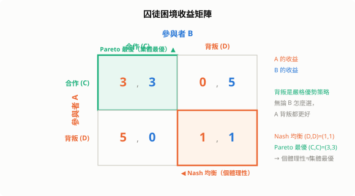
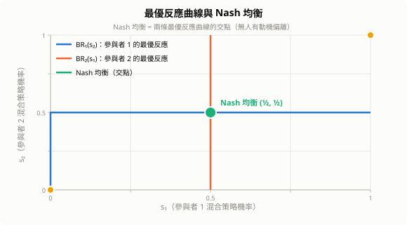
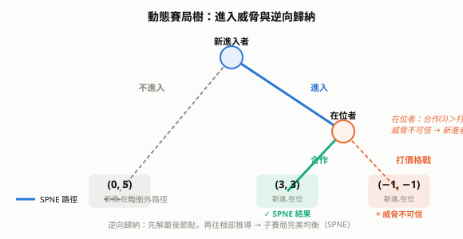
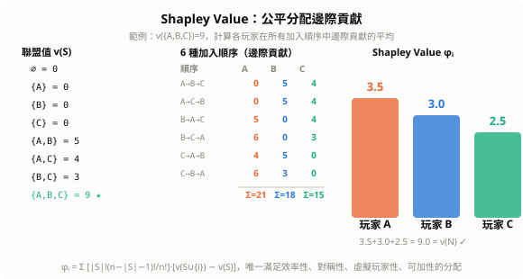

# 賽局理論（Game Theory）

賽局理論研究**理性決策者之間的策略互動**：當你的最佳選擇取決於別人怎麼選，該怎麼分析？由 John von Neumann 與 Oskar Morgenstern 於 1944 年奠基，John Nash 於 1950 年的 Nash 均衡理論使其成為現代經濟學與 AI 的核心工具。

## 1. 基本元素

一個賽局由三部分構成：

| 元素 | 符號 | 說明 |
|---|---|---|
| **參與者** | $i \in N$ | 做決策的主體（人、公司、AI Agent） |
| **策略集** | $S_i$ | 參與者 $i$ 可選的所有行動 |
| **收益函數** | $u_i(s_1, \ldots, s_n)$ | 所有人選定策略後 $i$ 得到的報酬 |

**純策略**：確定性地選擇某個行動。  
**混合策略**：以機率分布 $\sigma_i \in \Delta(S_i)$ 隨機選擇，期望收益為：

$$U_i(\sigma) = \sum_{s \in S} u_i(s) \prod_{j \in N} \sigma_j(s_j)$$

---

## 2. 囚徒困境（Prisoner's Dilemma）

最著名的賽局。兩名嫌疑人各自選擇**合作（C）** 或**背叛（D）**：

$$\begin{array}{c|cc}
 & \text{B 合作} & \text{B 背叛} \\\hline
\text{A 合作} & (3,3) & (0,5) \\
\text{A 背叛} & (5,0) & (1,1)
\end{array}$$

- 無論 B 怎麼選，A 背叛都比合作更好（**嚴格優勢策略**）
- 雙方理性推導 → 都背叛 → 結果 $(1,1)$
- 但雙方合作 $(3,3)$ 明明更好

**核心矛盾**：個體理性 ≠ 集體最優。這是市場失靈、軍備競賽、公共財問題的數學根源。



**優勢策略消去法（IESDS）**：反覆刪除被嚴格優勢的策略，剩下的為可理性化策略。

---

## 3. Nash 均衡

> **Nash 均衡**：策略組合 $(s_1^*, \ldots, s_n^*)$，使得每個參與者在其他人策略固定時，**無誘因單方面偏離**：
>
> $$u_i(s_i^*, s_{-i}^*) \geq u_i(s_i, s_{-i}^*) \quad \forall s_i \in S_i,\; \forall i$$

**Nash 存在定理（1950）**：每個參與者有限的賽局至少存在一個混合策略 Nash 均衡。

證明關鍵：Kakutani 不動點定理。最優反應對應 $BR_i(\sigma_{-i})$ 在混合策略空間是凸值映射，存在不動點。



### 例：剪刀石頭布（零和賽局）

純策略均衡不存在（任何確定選擇都會被對手預測並擊敗）。混合策略均衡：各以 $\frac{1}{3}$ 機率隨機出三種選擇，期望收益為 0。

---

## 4. 賽局的分類

### 4.1 合作 vs. 非合作

- **非合作賽局**：參與者獨立決策，不可簽署有約束力合約（囚徒困境）
- **合作賽局**：研究聯盟形成與收益分配（Shapley value）

### 4.2 完全資訊 vs. 不完全資訊

- **完全資訊**：所有參與者知道收益矩陣（棋類遊戲）
- **不完全資訊**：存在私有資訊（撲克、拍賣、保險市場）

### 4.3 靜態 vs. 動態（展開型）

- **靜態**：同時決策（囚徒困境）
- **動態**：序貫決策，有先後順序與資訊更新（棋局、談判、拍賣）

### 4.4 零和 vs. 非零和

- **零和**：一方得益必為另一方損失，$\sum_i u_i = 0$（棋類、撲克）
- **非零和**：合作可產生額外價值（貿易、協議）

---

## 5. 動態賽局：逆向歸納法

**進入威脅賽局**：在位者威脅新進入者「你若進入，我就打價格戰」。

展開型賽局樹（由右往左解）：

```
新進入者
├─ 不進入 → (0, 5)
└─ 進入
     在位者
     ├─ 合作    → (3, 3)
     └─ 打價格戰 → (-1, -1)
```

**逆向歸納（Backward Induction）**：在位者若真面對進入，合作 $(3)$ 優於打價格戰 $(-1)$，威脅不可信。新進入者預見此，選擇進入。

**子賽局完美均衡（SPNE）**：只保留在每個子賽局都是 Nash 均衡的策略，消除不可信威脅。



---

## 6. 重複賽局與合作的出現

囚徒困境重複有限次 → 逆向歸納推導每次都背叛（有限期末效應）。

囚徒困境重複**無限次**，合作可以出現！

**觸發策略（Grim Trigger）**：
- 初始合作
- 一旦對方背叛，永遠背叛

參與者比較合作收益現值與背叛一次後收益現值，設貼現因子 $\delta \in (0,1)$：

$$\underbrace{\frac{3}{1-\delta}}_{\text{永遠合作}} \geq \underbrace{5 + \frac{\delta}{1-\delta}}_{\text{背叛一次後雙方永遠背叛}} \implies \delta \geq \frac{1}{2}$$

$\delta \geq 0.5$ 時永遠合作是 Nash 均衡，合作從個體理性中自然浮現。

**民間定理（Folk Theorem）**：只要 $\delta$ 夠大，幾乎任何可行且個人理性的收益都可以成為無限重複賽局的均衡。

---

## 7. 不完全資訊：貝氏賽局

參與者有**私有類型** $\theta_i$（例如對商品的保留價格），其他人只知其機率分布 $p(\theta_{-i})$。

**貝氏 Nash 均衡（BNE）**：策略 $s_i^*(\theta_i)$ 對每個類型 $\theta_i$ 都最大化期望收益：

$$s_i^*(\theta_i) = \arg\max_{s_i} \mathbb{E}_{\theta_{-i}}\!\left[u_i(s_i, s_{-i}^*(\theta_{-i}), \theta_i)\right]$$

**應用：密封第二價格拍賣（Vickrey Auction）**

每人出價，最高出價者得標，但只付**第二高出價**。真實出價是均勢策略（與他人出價無關），設計上消除了戰略出價問題。

---

## 8. 合作賽局：Shapley Value

$n$ 個玩家組成聯盟，如何**公平分配**合作產生的總收益 $v(N)$？

**Shapley Value**：玩家 $i$ 的公平份額 = 其在所有可能加入順序中**邊際貢獻的平均**：

$$\phi_i(v) = \sum_{S \subseteq N \setminus \{i\}} \frac{|S|!\,(n-|S|-1)!}{n!}\bigl[v(S \cup \{i\}) - v(S)\bigr]$$

滿足四條公理：
1. **效率性**：$\sum_i \phi_i = v(N)$（總收益全部分配）
2. **對稱性**：貢獻相同的玩家得到相同份額
3. **虛擬玩家性**：貢獻為零的玩家得到零
4. **可加性**：兩個賽局合併，份額可以相加

是**唯一**滿足這四條性質的分配方式。

**計算複雜度**：精確計算需 $O(2^n)$，$n$ 大時用蒙地卡羅近似。



---

## 9. 機制設計（Mechanism Design）

> 賽局理論的「逆問題」：**設計規則**，使自利的參與者在均衡中達到設計者想要的結果。

### 激勵相容（Incentive Compatibility, IC）

真實報告私有資訊是每個參與者的最優策略：

$$u_i(\theta_i, \theta_i) \geq u_i(\hat{\theta}_i, \theta_i) \quad \forall \hat{\theta}_i$$

### 顯示原理（Revelation Principle）

任何機制的均衡結果，都可以用**激勵相容的直接顯示機制**複現：讓每個人說真話是最優策略。設計者只需考慮直接機制。

### VCG 機制

讓每個人支付自己對他人造成的外部性，使真實報告成為優勢策略：

$$\text{稅}_{i} = \sum_{j \neq i} v_j(s^*_{-i}) - \sum_{j \neq i} v_j(s^*)$$

其中 $s^*$ 是所有人參與時的社會最優選擇，$s^*_{-i}$ 是不計入 $i$ 的選擇。

---

## 10. 賽局理論與 AI

### 10.1 GAN：二人零和賽局

生成器 $G$ 與判別器 $D$ 的極小極大賽局：

$$\min_G \max_D \; \mathbb{E}_{x \sim p_{\text{data}}}[\log D(x)] + \mathbb{E}_{z \sim p_z}[\log(1 - D(G(z)))]$$

Nash 均衡條件：$D^*(x) = \frac{1}{2}$，$G^*$ 完美複製真實分布 $p_G = p_{\text{data}}$。GAN 訓練困難本質上是尋找 Nash 均衡的困難。

### 10.2 多智能體強化學習（MARL）

多個 agent 同時學習策略，環境非平穩（non-stationary）：每個 agent 的最優策略依賴其他 agent 的策略，而後者也在更新。收斂目標通常是 Nash 均衡或相關均衡。

### 10.3 聯邦學習：Shapley Value 分配貢獻

各方提供資料，用 Shapley Value 計算每個資料提供者的邊際貢獻，按貢獻分配獎勵或費用，解決資料定價問題。

### 10.4 RLHF 與機制設計

RLHF 訓練框架可理解為機制設計：設計獎勵函數（機制），使模型（參與者）在最大化獎勵（均衡行為）時產生對齊人類偏好的輸出。

### 10.5 AlphaGo / AlphaStar

完全資訊動態零和賽局。理論上存在最優混合策略，AlphaGo 以 MCTS + 自我對弈（self-play）逼近 Nash 均衡；AlphaStar 在星際爭霸的不完全資訊賽局中使用 Nash averaging 保持策略多樣性。

### 10.6 拍賣與廣告競價

Google 關鍵字廣告使用廣義第二價格拍賣（GSP），設計上使廣告主接近真實出價。機制設計原理確保系統收益與效率的均衡。

---

## 11. 小結

| 概念 | 核心要點 |
|---|---|
| Nash 均衡 | 無人有動機單方面偏離的穩定點；有限賽局必存在 |
| 囚徒困境 | 嚴格優勢策略 → 個體理性導致集體次優 |
| 逆向歸納 / SPNE | 從末端往回解動態賽局，消除不可信威脅 |
| Folk Theorem | 貼現因子夠大時，重複賽局可支撐合作 |
| 貝氏 Nash 均衡 | 私有資訊下的均衡，以期望收益為基準 |
| Shapley Value | 公平分配邊際貢獻的唯一解，$O(2^n)$ |
| 機制設計 | 設計規則讓說真話成為最優策略 |
| GAN | 極小極大賽局，Nash 均衡 = 完美生成 |
| MARL | 多 agent 同時學習，收斂至 Nash 均衡 |
