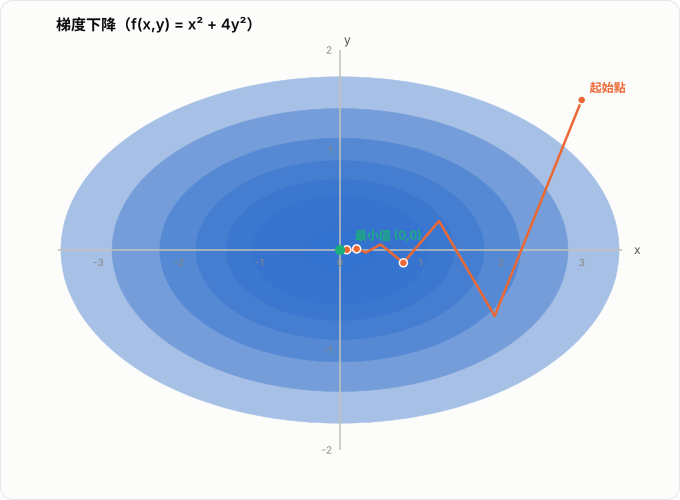
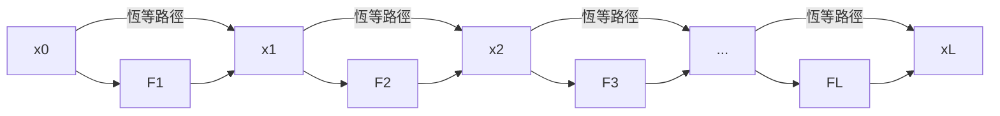
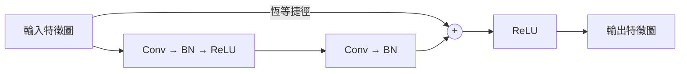

# LLM 中的梯度下降：應用與分析（與反向傳播、殘差連接的交互作用）

梯度下降（Gradient Descent）是所有神經網路訓練的最佳化核心，但在 LLM（大型語言模型）的尺度下——動輒數十億到數千億參數、數十到上百層的 Transformer 堆疊——單純的梯度下降概念並不足以說明訓練為何可行。真正讓 LLM 能被訓練起來的，是**梯度下降、反向傳播、殘差連接**三者的協同作用：反向傳播負責把梯度算出來，殘差連接負責讓梯度在極深的網路中不會消失，梯度下降（及其變體）則負責拿這個梯度去更新參數。

本文延續 [[Backpropagation]] 的推導基礎，聚焦在 LLM 場景下梯度下降實際怎麼運作，以及它與反向傳播、殘差連接之間的數學交互。

## 1. 梯度下降的基本形式回顧

給定損失函數 $\mathcal{L}(\theta)$，其中 $\theta$ 是模型全部參數，最基本的梯度下降更新規則是

$$
\theta \leftarrow \theta - \eta \, \nabla_\theta \mathcal{L}(\theta)
$$

其中 $\eta$ 是學習率（learning rate）。這個式子本身極為簡單，但在 LLM 中，$\theta$ 的維度可能高達 $10^{11}$ 量級，$\nabla_\theta \mathcal{L}$ 這個梯度本身，就是靠反向傳播才算得出來的（見 [[Backpropagation]] 第 2、3 節）。

也就是說：**梯度下降回答的是「拿到梯度之後怎麼移動參數」，反向傳播回答的是「梯度從哪裡來」**。這是理解兩者分工的第一個關鍵。

*圖：梯度下降在橢圓等高線損失面上的路徑。橢圓長軸方向曲率小、短軸方向曲率大，導致路徑呈鋸齒狀震盪（這也是 Adam 比 SGD 更適合非等向性損失地形的原因）。*

## 2. LLM 訓練實際使用的優化器：為何不是原始梯度下降

LLM 幾乎不使用上一節的原始（vanilla）梯度下降，而是使用 **Adam** 或其變體 **AdamW**。原因與 LLM 的損失地形（loss landscape）特性有關：

- 參數量極大，不同參數的梯度尺度差異懸殊
- 訓練資料以 mini-batch 方式餵入，梯度本身帶有雜訊（因此嚴格說是**隨機梯度下降**，Stochastic Gradient Descent, SGD）
- 損失地形中存在大量狹長、彎曲的谷地，固定學習率容易震盪或收斂過慢

Adam 為每個參數維護梯度的一階動量（均值）與二階動量（未中心化變異數）估計：

$$
m_t = \beta_1 m_{t-1} + (1-\beta_1) g_t, \qquad
v_t = \beta_2 v_{t-1} + (1-\beta_2) g_t^2
$$

$$
\hat{m}_t = \frac{m_t}{1-\beta_1^t}, \qquad \hat{v}_t = \frac{v_t}{1-\beta_2^t}
$$

$$
\theta_t \leftarrow \theta_{t-1} - \eta \, \frac{\hat{m}_t}{\sqrt{\hat{v}_t}+\epsilon}
$$

其中 $g_t = \nabla_\theta \mathcal{L}(\theta_{t-1})$ 就是反向傳播算出的梯度。AdamW 則是把 L2 權重衰減（weight decay）從梯度計算中解耦出來，直接對參數做衰減，而非混入梯度，這在 LLM 訓練中被證實能改善泛化與穩定性，因此幾乎是目前 LLM 預訓練與微調的預設選擇。

**重點：無論優化器多複雜，$g_t$ 這個原始梯度永遠來自反向傳播；優化器只是決定「怎麼用這個梯度」，這是梯度下降這個大家族的變體，而不是取代它。**

## 3. LLM 訓練中梯度下降的工程變體

在真正的 LLM 訓練流程中，梯度下降還會搭配以下機制，這些都是直接為了讓「梯度下降 + 反向傳播」在超深、超大模型中維持穩定：

### 3.1 學習率排程（Learning Rate Schedule）

LLM 訓練通常不用固定學習率，而是搭配：

- **Warmup**：訓練初期學習率從接近 0 線性上升到目標值。原因是訓練剛開始時參數是隨機初始化的，反向傳播算出的梯度方向不穩定，若學習率一開始就很大，容易發生梯度爆炸或訓練崩潰。
- **衰減（decay）**：如 cosine decay 或線性衰減，讓學習率在訓練後期逐漸降低，使參數在接近收斂時能做更精細的調整。

### 3.2 梯度裁剪（Gradient Clipping）

$$
g \leftarrow g \cdot \min\left(1, \frac{c}{\|g\|_2}\right)
$$

當反向傳播算出的梯度範數 $\|g\|_2$ 超過閾值 $c$ 時，等比例縮小整個梯度向量。這在 LLM 訓練中幾乎是必備機制，因為極深的 Transformer 偶爾會出現梯度尖峰（gradient spike），若不裁剪，一次異常更新就可能讓訓練發散。這個問題與第 6 節「殘差流」的性質直接相關。

### 3.3 梯度累積（Gradient Accumulation）

受限於顯存，LLM 常無法把整個大 batch 一次塞進 GPU。做法是把大 batch 切成多個 micro-batch，分別做前向、反向傳播，梯度累加後才執行一次梯度下降更新：

$$
g_{\text{total}} = \sum_{i=1}^{k} \nabla_\theta \mathcal{L}(\theta; x_i)
$$

這不改變梯度下降的數學本質，只是把「反向傳播算梯度」與「梯度下降更新參數」在工程上解耦，讓有效 batch size 可以遠大於單次能放進顯存的量。

### 3.4 混合精度與分散式訓練

反向傳播與梯度下降的計算通常以 FP16／BF16 進行以節省顯存與加速，但梯度累加與參數更新仍保留一份 FP32 主權重（master weights），避免長期累積的數值誤差侵蝕梯度下降的收斂性。在多 GPU／多機訓練中，還需要把各裝置算出的區域梯度做 all-reduce 平均，才能執行一致的參數更新——這些都是反向傳播產出的梯度，在真正被梯度下降使用之前，還要經過的工程處理。

## 4. 反向傳播如何解決梯度下降的問題

梯度下降的更新公式 $\theta \leftarrow \theta-\eta\nabla_\theta\mathcal{L}(\theta)$ 假設梯度**已經存在手邊**，卻沒有說梯度怎麼算出來。若沒有反向傳播，唯一直覺的替代方案是數值微分：對每個參數各自擾動一次，

$$
\frac{\partial \mathcal{L}}{\partial w}\approx\frac{\mathcal{L}(w+\epsilon)-\mathcal{L}(w-\epsilon)}{2\epsilon}
$$

若模型有 $N$ 個參數，這需要約 $2N$ 次前向傳播，對 LLM 動輒 $10^{11}$ 參數的規模完全不可行。反向傳播的解法，是利用鏈式法則把「損失對輸出端的敏感度」沿計算圖**反向逐層傳遞**，只需一次前向 + 一次反向傳播，就能同時算出所有參數的梯度。

```mermaid
flowchart TB
    subgraph FWD["前向傳播&#40;Forward Pass&#41;：計算輸出"]
        direction LR
        X["輸入 x"] --> Z1["z1 = W1·x"]
        Z1 --> A1["a1 = φ&#40;z1&#41;"]
        A1 --> Z2["z2 = W2·a1"]
        Z2 --> A2["a2 = φ&#40;z2&#41;"]
        A2 --> L["損失 L"]
    end

    subgraph BWD["反向傳播&#40;Backward Pass&#41;：計算梯度"]
        direction RL
        dL["dL/da2"] --> dZ2["dL/dz2 = δ2"]
        dZ2 --> dA1["dL/da1 = W2^T·δ2"]
        dA1 --> dZ1["dL/dz1 = δ1"]
        dZ1 --> dX["dL/dx"]
        dZ2 -.-> dW2["dL/dW2 = δ2·a1^T"]
        dZ1 -.-> dW1["dL/dW1 = δ1·x^T"]
    end

    L -. "從這裡開始反向" .-> dL
    dW2 -- "餵給梯度下降" --> GD["θ ← θ − η·∇L"]
    dW1 -- "餵給梯度下降" --> GD
```

| | 前向傳播 | 反向傳播 |
| --- | --- | --- |
| 方向 | 輸入 → 輸出 | 輸出 → 輸入 |
| 算的是什麼 | 每層的中間值 $z^{(l)}, a^{(l)}$ | 每層的誤差信號 $\delta^{(l)}=\partial\mathcal{L}/\partial z^{(l)}$ |
| 依賴 | 上一層的輸出 | 下一層的誤差信號（鏈式法則） |
| 目的 | 算出損失 $\mathcal{L}$ | 算出梯度 $\nabla_\theta\mathcal{L}$，交給梯度下降使用 |

圖中每一步的核心遞迴關係（見 [[Backpropagation]] 第 3 節）：

$$
\delta^{(l)} = \left((W^{(l+1)})^T \delta^{(l+1)}\right)\odot(\phi^{(l)})'(z^{(l)})
$$

也就是說：誤差信號先經由下一層權重矩陣的轉置傳回來，再乘上本層激活函數的局部導數。這是反向傳播能同時解決「梯度算不算得出來」與「算得快不快」兩個問題的關鍵：每個 $\delta^{(l)}$ 只依賴 $\delta^{(l+1)}$ 與本層局部資訊，因此一次反向掃描就能算完全部參數的梯度，不需要對每個參數重新跑一次前向傳播。

## 5. 反向傳播在 Transformer 中如何運作

LLM 的骨幹是 Transformer，其每一層由兩個子模組構成：**自注意力（Self-Attention）** 與 **前饋網路（Feed-Forward Network, FFN）**，且兩者都包裹在殘差連接與 LayerNorm 之中。以 Pre-LN 架構為例，第 $l$ 層可寫成：

$$
x_{l+1} = x_l + \text{Attn}\big(\text{LN}(x_l)\big)
$$

$$
x_{l+1}' = x_{l+1} + \text{FFN}\big(\text{LN}(x_{l+1})\big)
$$

反向傳播要做的事，和 [[Backpropagation]] 中描述的一般前饋網路完全一致：從損失函數開始，透過鏈式法則逐層往回算 $\partial \mathcal{L}/\partial x_l$，只是這裡的「一層」是一個包含注意力機制、矩陣乘法、softmax、LayerNorm 的複合函數，計算圖遠比簡單 MLP 複雜。反向傳播會依序對 softmax、QKV 投影矩陣、FFN 中的非線性激活等每一個運算節點套用鏈式法則，但**整體遞迴結構的本質不變**：後面層的誤差信號 $\delta$，決定前面層能收到多少梯度。

這正是第 6 節要處理的問題：如果 LLM 有 96 層（如 GPT-3 規模），誤差信號要連續乘過 96 次子層的雅可比矩陣，理論上很容易發生梯度消失。殘差連接正是為了解決這件事而存在的架構設計。

## 6. 殘差連接如何從數學上保護梯度下降

### 6.1 沒有殘差連接時的問題

考慮一個沒有殘差連接的深層網路，第 $l$ 層輸出 $x_{l+1}=F_l(x_l)$。根據鏈式法則，輸出對輸入的梯度需要逐層連乘雅可比矩陣：

$$
\frac{\partial \mathcal{L}}{\partial x_0} = \frac{\partial \mathcal{L}}{\partial x_L}\prod_{l=0}^{L-1}\frac{\partial x_{l+1}}{\partial x_l}=\frac{\partial \mathcal{L}}{\partial x_L}\prod_{l=0}^{L-1}J_{F_l}
$$

若每個雅可比矩陣 $J_{F_l}$ 的譜半徑略小於 1（這在使用飽和型激活函數，或層數一深就很常見），這個連乘會讓梯度隨層數呈指數衰減，也就是 [[Backpropagation]] 第 7 節提到的**梯度消失**。對只有幾層的網路影響不大，但對 LLM 動辄數十層的 Transformer 堆疊而言，這會讓最前面幾層幾乎收不到有效梯度，梯度下降對這些層的更新形同停滯。

### 6.2 殘差連接如何改變這個乘積

殘差連接把每一層改寫成「恆等映射加上一個可學習的殘差函數」：

$$
x_{l+1} = x_l + F_l(x_l)
$$

對這個式子直接微分：

$$
\frac{\partial x_{l+1}}{\partial x_l} = I + \frac{\partial F_l(x_l)}{\partial x_l}
$$

代入鏈式法則：

$$
\frac{\partial \mathcal{L}}{\partial x_0} = \frac{\partial \mathcal{L}}{\partial x_L}\prod_{l=0}^{L-1}\left(I + \frac{\partial F_l}{\partial x_l}\right)
$$

把乘積展開，會出現一項不含任何 $\partial F_l/\partial x_l$ 的**純恆等路徑**：

$$
\frac{\partial \mathcal{L}}{\partial x_0} = \frac{\partial \mathcal{L}}{\partial x_L}\cdot I + \left(\text{其餘含 } \partial F_l/\partial x_l \text{ 的展開項}\right)
$$

這個恆等項 $I$ 保證了：**不論中間各層的雅可比矩陣有多小、多不穩定，梯度都存在一條「原封不動」傳回最前層的捷徑**。這正是殘差連接被稱為 skip connection 的原因——它讓誤差信號可以直接跳過（skip）中間的非線性變換，不被逐層衰減。

基本結構示意圖：

```mermaid
flowchart LR
    X["輸入 x"] --> F["F(x)&#40;可學習變換&#41;"]
    X -- "恆等捷徑 identity" --> ADD(("+"))
    F --> ADD
    ADD --> Y["輸出 x + F(x)"]
```

把這個結構逐層堆疊起來，會形成一條貫穿全網路的**殘差主幹（residual stream）**：

圖中最上方那條橫貫全圖、不經過任何 $F_l$ 的「恆等路徑」，就是反向傳播時梯度能直達最前層的捷徑；各層的 $F_l$ 只是往這條主幹上「加東西」，而不是取代它。

### 6.3 與反向傳播遞迴式的對照

回顧 [[Backpropagation]] 第 3 節的一般遞迴式：

$$
\delta^{(l)} = \left((W^{(l+1)})^T \delta^{(l+1)}\right)\odot(\phi^{(l)})'(z^{(l)})
$$

這是「純乘性」的傳遞——每往回一層，訊號都必須完整穿過一次權重轉置與激活函數導數的相乘。而在殘差架構中，等效的遞迴式變成「加性」的：

$$
\delta^{(l)} \approx \delta^{(l+1)} + \left(\text{經過 } F_l \text{ 局部雅可比的修正項}\right)
$$

也就是說，殘差連接沒有取代反向傳播的鏈式法則，而是**改變了計算圖的拓撲結構**——多加了一條恆等邊，讓反向傳播在做鏈式法則展開時，天然多出一條不會衰減的路徑。這是「架構設計」與「梯度計算方法」互相配合的具體例子：反向傳播是通用的求導程序，殘差連接則是專門設計來讓這個求導程序在深層網路中表現良好的架構。

## 7. 三者的協同：一次完整的 LLM 訓練步驟

把三個機制串起來看，一次 LLM 訓練迭代大致是：

1. **前向傳播**：輸入 token 序列，逐層通過「殘差連接 + 注意力／FFN + LayerNorm」，算出 logits 與交叉熵損失 $\mathcal{L}$（可參照 [[Entropy]] 第 7 節 cross entropy 的定義）。
2. **反向傳播**：從 $\mathcal{L}$ 開始，沿計算圖反向套用鏈式法則，逐層算出所有參數的梯度 $\nabla_\theta \mathcal{L}$。由於殘差連接在計算圖中提供了恆等路徑（第 6 節），即使模型有數十層，最前面幾層依然能收到有效、未被過度衰減的梯度。
3. **梯度後處理**：跨裝置 all-reduce 平均梯度、梯度裁剪（3.2 節）、必要時的梯度累積（3.3 節）。
4. **梯度下降更新**：AdamW 等優化器根據當前與歷史梯度統計量，配合學習率排程（3.1 節），更新參數 $\theta$。

這四步驟中，第 2 步依賴殘差連接維持梯度品質，第 4 步依賴第 2 步輸出的梯度才能運作。三者是**嚴格的上下游關係**：殘差連接改善反向傳播的梯度品質 → 反向傳播提供梯度 → 梯度下降消費梯度並更新參數。任何一環出問題，訓練都無法有效進行——這也是為什麼 LLM 論文在描述訓練細節時，architecture（含殘差設計）、optimizer 設定、learning rate schedule 幾乎必定並列說明，因為它們本來就是同一個問題的三個互鎖環節。

## 8. Pre-LN 與 Post-LN：LayerNorm 位置如何影響梯度流

殘差連接的效果還會被 LayerNorm 的擺放位置放大或削弱，這在 LLM 架構選型上是實際的工程考量。

- **Post-LN**（原始 Transformer）：$x_{l+1} = \text{LN}\big(x_l + F_l(x_l)\big)$。LayerNorm 包在殘差相加之後，恆等路徑會被 LayerNorm 的縮放與平移「打斷」，深層堆疊時梯度仍可能不穩定，訓練初期通常需要更細緻的 warmup 才能穩定收斂。
- **Pre-LN**（現代主流 LLM，如 GPT 系列後期版本、LLaMA）：$x_{l+1} = x_l + F_l(\text{LN}(x_l))$。LayerNorm 只作用在進入子層之前，殘差主幹（residual stream）$x_l$ 本身完全不經過 LayerNorm 的縮放，第 6.2 節推導出的恆等路徑 $I$ 被完整保留，梯度流動更穩定，因此對更深的模型、更省去 warmup 需求更友善。

```mermaid
flowchart TB
    subgraph PostLN["Post-LN&#40;原始 Transformer&#41;"]
        A1["x_l"] --> A2["F_l&#40;x_l&#41;"]
        A1 --> A3(("+"))
        A2 --> A3
        A3 --> A4["LayerNorm"]
        A4 --> A5["x_l+1"]
    end
    subgraph PreLN["Pre-LN&#40;現代主流 LLM&#41;"]
        B1["x_l"] --> B2["LayerNorm"]
        B2 --> B3["F_l"]
        B1 -- "恆等路徑不經過 LN" --> B4(("+"))
        B3 --> B4
        B4 --> B5["x_l+1"]
    end
```

Post-LN 的恆等路徑在相加後還要經過 LayerNorm，捷徑被打斷；Pre-LN 的恆等路徑完全不經過 LayerNorm，第 6.2 節推導的恆等矩陣 $I$ 得以完整保留，這正是現代 LLM 多改採 Pre-LN 的關鍵原因。

這說明了殘差連接與反向傳播的交互作用，不是只有「有沒有殘差」這種二元問題，連結構中一個 LayerNorm 放在殘差相加前還是後，都會直接影響第 6 節那個恆等矩陣 $I$ 能不能被完整保留，進而影響梯度下降能否在深層 LLM 中有效更新每一層參數。

## 9. 殘差連接的其他應用：ResNet 與 U-Net

殘差連接並非 Transformer／LLM 專屬設計，第 6 節推導的「恆等路徑保護梯度」這個原理，最早是在卷積網路（CNN）中被提出並驗證的，之後也被廣泛用在影像分割、生成模型等架構中。理解這些原始應用場景，有助於看清殘差連接是一個通用的梯度保護機制，而不是 Transformer 的專屬技巧。

### 9.1 ResNet：解決深層 CNN 的退化問題

殘差連接最初由何愷明等人於 2015 年在 **ResNet**（Residual Network）中提出，用來解決一個當時很反直覺的現象：單純堆疊更多卷積層，訓練誤差不但沒有下降，反而**上升**——這稱為**退化問題（degradation problem）**，且不是過擬合造成的（訓練誤差本身就更差），而是深層網路更難被梯度下降有效優化，與第 6.1 節推導的梯度消失同源。

ResNet 的解法就是把每兩到三個卷積層包成一個殘差區塊：

$$
x_{l+1} = x_l + F_l(x_l)
$$

其中 $F_l$ 通常是「卷積 → BatchNorm → ReLU → 卷積 → BatchNorm」的組合。這與第 6.2 節推導的結構完全一致，差別只在於 $F_l$ 內部用的是卷積層而非注意力／FFN。ResNet 因此能訓練到 50、101、甚至 152 層，遠超當時（VGG 約 19 層）的深度上限，也直接證明了「恆等路徑保護梯度」這個機制的有效性——後來的 Transformer 沿用同一套設計理由，是同一個原理在不同架構中的重複驗證。

### 9.2 U-Net：編碼器與解碼器之間的 Skip Connection

**U-Net** 最初設計用於醫學影像分割，其結構是一個對稱的「編碼器（下採樣）→ 解碼器（上採樣）」，並在對應解析度的編碼器層與解碼器層之間加入 **skip connection**：

```mermaid
flowchart TB
    E1["編碼器 L1&#40;高解析度&#41;"] --> E2["編碼器 L2"]
    E2 --> E3["編碼器 L3"]
    E3 --> BN["瓶頸層 Bottleneck"]
    BN --> D3["解碼器 L3"]
    D3 --> D2["解碼器 L2"]
    D2 --> D1["解碼器 L1&#40;高解析度&#41;"]
    E1 -- "skip connection" --> D1
    E2 -- "skip connection" --> D2
    E3 -- "skip connection" --> D3
```

U-Net 的 skip connection 與第 6 節的殘差連接原理相通，但用途略有側重：

- **梯度保護**：與 ResNet／Transformer 相同，skip connection 讓梯度可以繞過深層的下採樣／上採樣路徑，直接回傳到編碼器淺層。
- **細節資訊保留**：這是 U-Net 特別強調的一點。影像在編碼器中逐層下採樣會丟失空間解析度細節（例如物體邊緣），解碼器單靠上採樣很難完全還原。skip connection 把編碼器淺層**尚未被壓縮的高解析度特徵**直接接到解碼器對應層，讓分割輸出能同時保有深層語意資訊與淺層空間細節。

這也是為什麼 U-Net 常被歸類為「用殘差原理解決資訊瓶頸問題」，而不只是「解決梯度消失」——同一個恆等捷徑的數學結構（$x + F(x)$ 或串接 concat 版本），在不同任務中承擔的主要職責可以不同。**Diffusion Model** 的去噪網路骨幹也普遍採用 U-Net 架構，同樣依賴這個 skip connection 設計來穩定深層去噪路徑的訓練。

### 9.3 三種應用的共同點

| 架構 | 領域 | 殘差連接主要解決的問題 |
| --- | --- | --- |
| ResNet | 影像分類（CNN） | 深層網路退化問題、梯度消失 |
| Transformer / LLM | 序列建模 | 數十至上百層堆疊下的梯度消失 |
| U-Net | 影像分割、Diffusion | 梯度消失 + 編碼器細節資訊流失 |

三者的共通點，正是第 6 節推導的核心結論：只要在計算圖中加入一條 $\partial x_{l+1}/\partial x_l$ 含有恆等項 $I$ 的路徑，反向傳播算出的梯度就能穿越深層結構而不被連乘衰減——這是一個與具體任務、具體層類型無關的通用機制。

## 10. 訓練與推理：各自需要的技巧

前面談的梯度下降、反向傳播、殘差連接三者協同，都是針對**訓練**階段。訓練與推理是目的完全不同的兩個階段——訓練要學習參數（需要梯度），推理只是用已固定的參數做前向計算（不需要梯度）——因此兩者所需的技巧集合幾乎不重疊。

### 10.1 訓練階段需要的技巧

核心任務：算出梯度、更新參數，讓損失函數變小。

| 類別 | 技巧 | 作用 |
| --- | --- | --- |
| 梯度計算 | 反向傳播 | 透過鏈式法則算出 $\nabla_\theta \mathcal{L}$（見 [[Backpropagation]]、第 4 節） |
| 梯度傳遞品質 | 殘差連接 | 提供恆等路徑，避免深層網路梯度消失（第 6 節） |
| 參數更新 | 梯度下降變體（AdamW 等） | 用梯度更新參數（第 2 節） |
| 穩定性 | 梯度裁剪 | 防止梯度爆炸導致訓練發散（第 3.2 節） |
| 穩定性 | 學習率排程（Warmup + Decay） | 訓練初期避免大步長震盪，後期精細收斂（第 3.1 節） |
| 記憶體/效率 | 梯度累積 | 用多個 micro-batch 模擬大 batch（第 3.3 節） |
| 記憶體/效率 | 混合精度訓練（FP16/BF16 + FP32 主權重） | 加速並節省顯存，同時避免數值誤差侵蝕梯度（第 3.4 節） |
| 記憶體/效率 | 梯度檢查點（Gradient Checkpointing） | 犧牲部分重算成本換取顯存 |
| 泛化 | 權重衰減、Dropout、LayerNorm | 避免過擬合、穩定訓練分布 |
| 分散式 | 資料/模型/張量平行、all-reduce 梯度同步 | 讓千億參數模型能在多機多卡上訓練 |

這些技巧幾乎都圍繞同一件事：讓反向傳播算出的梯度，經過殘差連接保持品質，再讓梯度下降穩定地拿去更新參數——也就是第 7 節描述的那條上下游鏈條。

### 10.2 推理階段需要的技巧

核心任務：只做前向傳播，用固定參數產生輸出，完全不涉及梯度計算與參數更新。

| 類別 | 技巧 | 作用 |
| --- | --- | --- |
| 記憶體/速度 | KV Cache | 快取先前 token 的 Key/Value，避免自迴歸生成時重複計算注意力 |
| 模型壓縮 | 量化（Quantization, INT8/INT4） | 降低權重與激活值精度，減少顯存並加速推理 |
| 模型壓縮 | 剪枝、蒸餾 | 縮小模型規模同時保留效能 |
| 生成策略 | 取樣策略（Greedy、Top-k、Top-p、Temperature） | 控制輸出的隨機性與品質（temperature 對應 softmax 溫度，見 [[Boltzmann-Equation]] 第 11.1 節） |
| 吞吐量 | 批次推理 / Continuous Batching | 同時服務多個請求，提升 GPU 利用率 |
| 吞吐量 | 投機解碼（Speculative Decoding） | 用小模型先猜測、大模型驗證，加速自迴歸生成 |
| 架構相容 | 殘差連接 | 訓練時設計進架構，推理時前向計算依然要走這條路徑，但不涉及梯度 |

> **補充：KV Cache 為何在標準訓練中用不到，以及 RLHF 是個例外**
>
> 訓練（預訓練 / 監督式微調）採用 teacher forcing：完整目標序列已知，模型搭配 causal mask 在**單次前向傳播**中平行算出序列所有位置的輸出，每個位置的 K、V 只會被算一次，不存在「逐步生成、需要複用先前 K/V」的場景，因此不需要 KV Cache。
>
> 但若訓練流程包含 **RLHF**（如 PPO），policy 模型需要先自迴歸**生成**一段回應（rollout）才能計算 reward、再做梯度更新。這個 rollout 步驟本質上就是推理（逐 token 生成），因此會用到 KV Cache 來加速；只是這仍然是「推理」在訓練管線中的應用——真正的梯度計算（反向傳播、參數更新）階段依然不需要 KV Cache。判斷標準是「是否在做自迴歸逐步生成」，而不是單純「訓練 vs 推理」的字面二分。

### 10.3 關鍵對照：同一技巧在兩階段的角色差異

| 技巧 | 訓練階段 | 推理階段 |
| --- | --- | --- |
| 反向傳播 | 必要（算梯度） | 不需要 |
| 梯度下降 | 必要（更新參數） | 不需要 |
| 殘差連接 | 需要（保護梯度不消失） | 仍需要（前向計算的一部分，維持深層數值穩定，與梯度無關） |
| LayerNorm | 需要（穩定訓練、配合殘差保護梯度流） | 仍需要（穩定前向輸出分布） |

訓練階段的技巧幾乎都圍繞「怎麼算出好的梯度、怎麼穩定地用梯度更新參數」；推理階段完全拋開梯度，技巧全部圍繞「怎麼用固定參數更快、更省資源地做前向計算」。殘差連接和 LayerNorm 是少數兩階段都用得到的例外，因為它們是架構本身的一部分：訓練時保護梯度流，推理時單純是前向計算路徑的一部分。

## 11. 小結

在 LLM 的尺度下，梯度下降不再是一個孤立的優化算法，而是與反向傳播、殘差連接構成一條完整的訓練鏈：

- **反向傳播**負責把損失函數的訊息，透過鏈式法則轉換成每個參數的梯度（見 [[Backpropagation]]）。
- **殘差連接**透過在計算圖中引入恆等路徑（$\partial x_{l+1}/\partial x_l = I + \partial F_l/\partial x_l$），確保這個梯度在數十甚至上百層的 Transformer 堆疊中不會被逐層乘積衰減殆盡。
- **梯度下降**（實務上是 AdamW，搭配 warmup、衰減排程、梯度裁剪等機制）則負責把這個「品質有保障」的梯度，轉換成穩定、有效的參數更新。

若只記一句話：**殘差連接讓反向傳播算出的梯度能夠「活著」傳回深層網路的每一層，梯度下降才有東西可用；三者缺一，LLM 這種超深模型都無法被有效訓練。**
