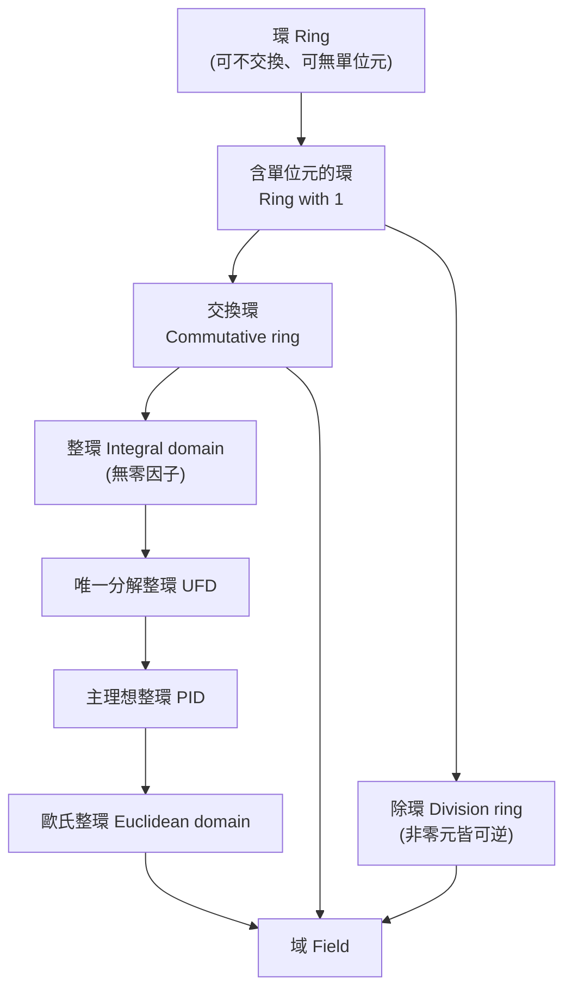
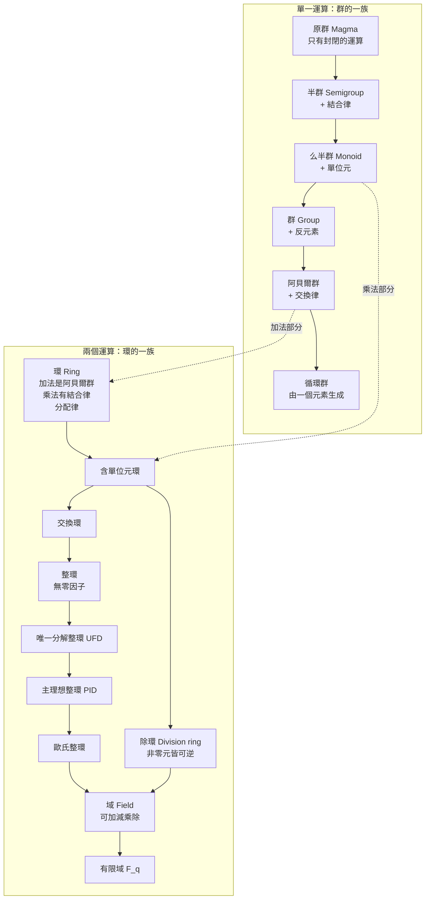
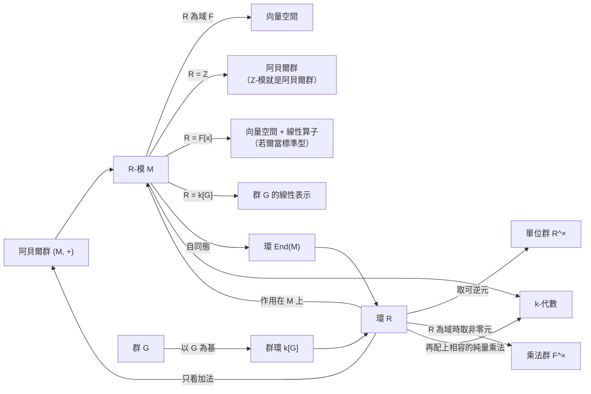
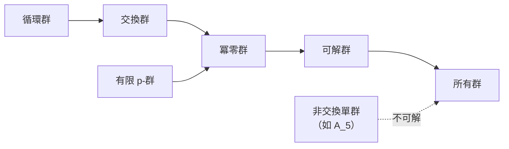
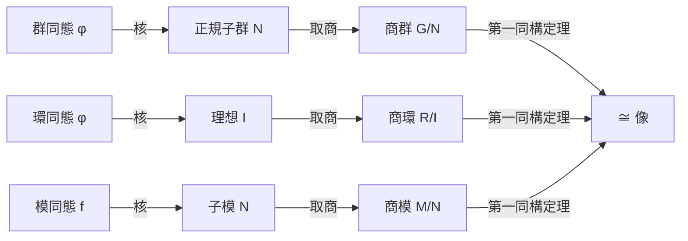
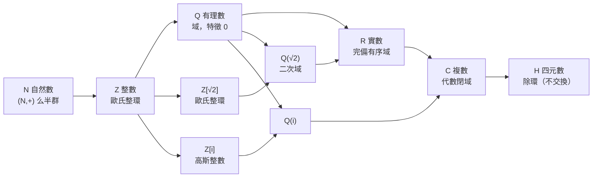
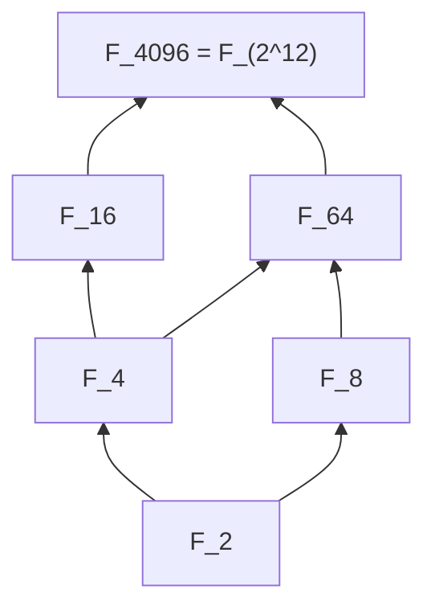
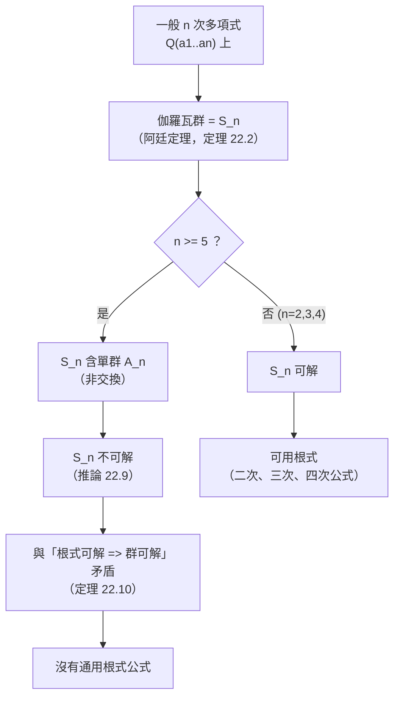
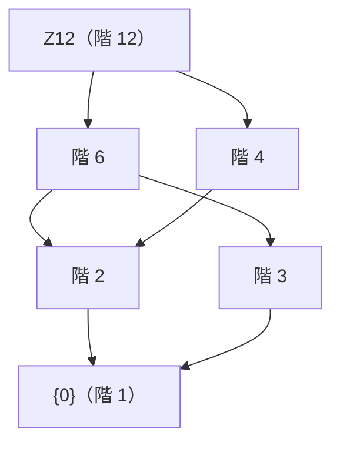

# 代數學：群、環、域、模（Group, Ring, Field, Module）

> 群只有**一個**運算與四條公理，用來描述「對稱性」；環與域有**兩個**運算（加、乘）；模則是「**環作用在交換群上**」的結構，把向量空間的純量從域放寬為環。本文先講群論（第 1–12 節），再講環、域、模及其相互關係，並以伽羅瓦理論（第 21 節）把域與群連結起來，再完整推導五次方程為何沒有通用根式解（第 22 節），接著用兩個統一範例（第 23 節的無限範例 Z[√2]、第 24 節的有限範例 Z12）把所有概念串在一起，最後是應用與習題。

---

## 目錄

**第一部分：群論**

1. [動機：什麼是對稱？](#1-動機什麼是對稱)
2. [群的定義與基本性質](#2-群的定義與基本性質)
3. [常見的群（例子）](#3-常見的群例子)
4. [子群與循環群](#4-子群與循環群)
5. [陪集與拉格朗日定理](#5-陪集與拉格朗日定理)
6. [正規子群與商群](#6-正規子群與商群)
7. [群同態與同構定理](#7-群同態與同構定理)
8. [置換群與凱萊定理](#8-置換群與凱萊定理)
9. [群作用](#9-群作用)
10. [西羅（Sylow）定理](#10-西羅sylow定理)
11. [直積與有限生成交換群](#11-直積與有限生成交換群)
12. [可解群與單群](#12-可解群與單群)

**第二部分：環、域、模、伽羅瓦理論與統一範例**

13. [總覽：從群到環、域、模](#13-總覽從群到環域模)
14. [環（Ring）](#14-環ring)
15. [理想、商環與環同態](#15-理想商環與環同態)
16. [整環的階層：從整環到域](#16-整環的階層從整環到域)
17. [域（Field）](#17-域field)
18. [模（Module）](#18-模module)
19. [模的結構定理（PID 上）](#19-模的結構定理pid-上)
20. [三者的關係與對照](#20-三者的關係與對照)
21. [伽羅瓦理論（Galois Theory）](#21-伽羅瓦理論galois-theory)
22. [五次方程為何沒有通用根式解（阿貝爾—魯菲尼定理）](#22-五次方程為何沒有通用根式解阿貝爾魯菲尼定理)
23. [統一範例：以 Z[√2] 貫穿群、環、域、模與伽羅瓦群](#23-統一範例以-z2-貫穿群環域模與伽羅瓦群)
24. [有限版統一範例：以 Z12 貫穿群、環、域、模與伽羅瓦群](#24-有限版統一範例以-z12-貫穿群環域模與伽羅瓦群)
25. [例子總表](#25-例子總表)

**第三部分：應用與總結**

26. [應用](#26-應用)
27. [重要定理速查表](#27-重要定理速查表)
28. [練習題](#28-練習題)
29. [延伸閱讀](#29-延伸閱讀)

---

## 1. 動機：什麼是對稱？

考慮一個正三角形。能讓它「看起來沒變」的操作有：

- 繞中心旋轉 $0^\circ, 120^\circ, 240^\circ$（3 種）
- 沿三條對稱軸翻轉（3 種）

共 6 個操作。這些操作具有以下特性：

| 特性 | 說明 |
|------|------|
| 可連續進行 | 先做 A 再做 B，結果仍是一個對稱操作 |
| 有「什麼都不做」 | 旋轉 $0^\circ$ |
| 可還原 | 每個操作都有反操作 |
| 結合律 | 連續做三個操作，如何分組不影響結果 |

把這些性質抽象化，就得到**群**的定義。

---

## 2. 群的定義與基本性質

### 2.1 定義

設 $G$ 為非空集合，$\cdot : G \times G \to G$ 為二元運算。若滿足下列四條公理，則稱 $(G, \cdot)$ 為**群（group）**：

1. **封閉性（Closure）**：對任意 $a, b \in G$，有 $a \cdot b \in G$。
2. **結合律（Associativity）**：$(a \cdot b) \cdot c = a \cdot (b \cdot c)$。
3. **單位元（Identity）**：存在 $e \in G$，使得對所有 $a \in G$，$e \cdot a = a \cdot e = a$。
4. **反元素（Inverse）**：對每個 $a \in G$，存在 $a^{-1} \in G$，使得 $a \cdot a^{-1} = a^{-1} \cdot a = e$。

若另外滿足**交換律** $a \cdot b = b \cdot a$，則稱為**交換群**（或**阿貝爾群**，Abelian group）。

群 $G$ 的元素個數 $|G|$ 稱為群的**階（order）**。$|G|$ 有限者稱為**有限群**。

> 記號慣例：運算寫成乘法時，$a \cdot b$ 常簡寫為 $ab$，單位元記為 $e$ 或 $1$；寫成加法時，單位元記為 $0$，反元素記為 $-a$。

### 2.2 基本性質

**命題 2.1**　設 $G$ 為群，則：

1. 單位元唯一。
2. 每個元素的反元素唯一。
3. $(a^{-1})^{-1} = a$。
4. $(ab)^{-1} = b^{-1}a^{-1}$。
5. **消去律**：$ab = ac \Rightarrow b = c$；$ba = ca \Rightarrow b = c$。

**證明（1）**　若 $e, e'$ 皆為單位元，則 $e = e \cdot e' = e'$。

**證明（2）**　若 $b, c$ 皆為 $a$ 的反元素，則
$b = be = b(ac) = (ba)c = ec = c$。

**證明（4）**　$(ab)(b^{-1}a^{-1}) = a(bb^{-1})a^{-1} = aa^{-1} = e$，由反元素唯一性即得。

**證明（5）**　在 $ab = ac$ 兩邊左乘 $a^{-1}$ 即得 $b = c$。 $\blacksquare$

### 2.3 元素的階

對 $g \in G$，使 $g^n = e$ 的最小正整數 $n$ 稱為 $g$ 的**階**，記為 $\mathrm{ord}(g)$；若不存在則稱階為無限。

---

## 3. 常見的群（例子）

| 群 | 運算 | 階 | 是否交換 | 備註 |
|----|------|----|----------|------|
| $(\mathbb{Z}, +)$ | 加法 | $\infty$ | 是 | 整數加法群 |
| $(\mathbb{Q}^\times, \cdot)$、$(\mathbb{R}^\times, \cdot)$ | 乘法 | $\infty$ | 是 | 非零有理／實數 |
| $\mathbb{Z}_n = \mathbb{Z}/n\mathbb{Z}$ | 模 $n$ 加法 | $n$ | 是 | 循環群 |
| $(\mathbb{Z}/n\mathbb{Z})^\times$ | 模 $n$ 乘法 | $\varphi(n)$ | 是 | 與 $n$ 互質的剩餘類 |
| $GL_n(\mathbb{R})$ | 矩陣乘法 | $\infty$ | $n \ge 2$ 時否 | 可逆 $n \times n$ 矩陣 |
| $SL_n(\mathbb{R})$ | 矩陣乘法 | $\infty$ | $n \ge 2$ 時否 | 行列式為 1 |
| $S_n$ | 函數合成 | $n!$ | $n \ge 3$ 時否 | 對稱群（置換群） |
| $D_n$ | 函數合成 | $2n$ | $n \ge 3$ 時否 | 正 $n$ 邊形的二面體群 |
| $Q_8$ | — | 8 | 否 | 四元數群 $\{\pm1, \pm i, \pm j, \pm k\}$ |
| Klein 四元群 $V_4$ | — | 4 | 是 | $\mathbb{Z}_2 \times \mathbb{Z}_2$ |

### 3.1 二面體群 $D_n$

正 $n$ 邊形的對稱群。設 $r$ 為旋轉 $360^\circ/n$，$s$ 為某一條軸的翻轉，則

$$D_n = \langle r, s \mid r^n = s^2 = e,\ srs = r^{-1} \rangle = \{e, r, \dots, r^{n-1}, s, sr, \dots, sr^{n-1}\}.$$

第 1 節的正三角形對稱群即為 $D_3$，階為 6。

### 3.2 小階群的分類

| 階 | 1 | 2 | 3 | 4 | 5 | 6 | 7 | 8 |
|----|---|---|---|---|---|---|---|---|
| 不同構的群個數 | 1 | 1 | 1 | 2 | 1 | 2 | 1 | 5 |

- 階 4：$\mathbb{Z}_4$、$V_4$
- 階 6：$\mathbb{Z}_6$、$S_3$（$\cong D_3$）
- 階 8：$\mathbb{Z}_8$、$\mathbb{Z}_4 \times \mathbb{Z}_2$、$\mathbb{Z}_2^3$、$D_4$、$Q_8$

---

## 4. 子群與循環群

### 4.1 子群

$G$ 的子集 $H$ 若對 $G$ 的運算本身也構成群，稱為 $G$ 的**子群**，記為 $H \le G$。

**定理 4.1（子群判定法，一步法）**　非空子集 $H \subseteq G$ 為子群，當且僅當對所有 $a, b \in H$，有 $ab^{-1} \in H$。

**有限情形**　若 $H$ 為有限非空子集，則 $H \le G$ 當且僅當 $H$ 對乘法封閉。

### 4.2 生成子群與循環群

對 $g \in G$，

$$\langle g \rangle = \{ g^k : k \in \mathbb{Z} \}$$

稱為由 $g$ 生成的**循環子群**。若 $G = \langle g \rangle$，則 $G$ 為**循環群**，$g$ 為其**生成元**。

**定理 4.2（循環群的結構）**

1. 循環群必為交換群。
2. 無限循環群同構於 $(\mathbb{Z}, +)$；$n$ 階循環群同構於 $(\mathbb{Z}_n, +)$。
3. 循環群的子群仍是循環群。
4. 若 $|G| = n$ 且 $G = \langle g \rangle$，則 $g^k$ 的階為 $\dfrac{n}{\gcd(n, k)}$；$g^k$ 為生成元當且僅當 $\gcd(n, k) = 1$，故生成元共有 $\varphi(n)$ 個。
5. 對 $n$ 的每個正因數 $d$，$\mathbb{Z}_n$ 恰有一個 $d$ 階子群。

### 4.3 其他重要子群

- **中心**　$Z(G) = \{ z \in G : zg = gz,\ \forall g \in G \}$，為 $G$ 的交換（正規）子群。
- **中心化子**　$C_G(a) = \{ g \in G : ga = ag \}$。
- **正規化子**　$N_G(H) = \{ g \in G : gHg^{-1} = H \}$。

---

## 5. 陪集與拉格朗日定理

### 5.1 陪集

設 $H \le G$，對 $g \in G$：

- **左陪集** $gH = \{ gh : h \in H \}$
- **右陪集** $Hg = \{ hg : h \in H \}$

**性質**

1. 每個陪集大小皆為 $|H|$（因 $h \mapsto gh$ 為雙射）。
2. 兩個左陪集要麼相等，要麼不相交。故左陪集將 $G$ **劃分**為若干等大的塊。
3. $aH = bH \iff a^{-1}b \in H$。

$H$ 在 $G$ 中不同左陪集的個數稱為 **指數（index）**，記為 $[G : H]$。

### 5.2 拉格朗日定理

**定理 5.1（Lagrange）**　設 $G$ 為有限群，$H \le G$，則

$$|G| = [G : H] \cdot |H|.$$

特別地，子群的階整除群的階。

**證明**　$G$ 被分成 $[G:H]$ 個互不相交的左陪集，每個含 $|H|$ 個元素，故 $|G| = [G:H]\,|H|$。 $\blacksquare$

### 5.3 推論

| 推論 | 說明 |
|------|------|
| 元素的階整除群的階 | 取 $H = \langle g \rangle$ |
| $g^{|G|} = e$ | 對有限群的任意 $g$ |
| 質數階群必為循環群 | 任取 $g \ne e$，$\langle g \rangle$ 的階整除 $p$ 且大於 1，故為 $p$ |
| **費馬小定理** | $p$ 為質數、$p \nmid a$ 時，$a^{p-1} \equiv 1 \pmod p$（取群 $\mathbb{Z}_p^\times$） |
| **歐拉定理** | $\gcd(a, n) = 1$ 時，$a^{\varphi(n)} \equiv 1 \pmod n$ |

> ⚠️ 拉格朗日定理的**逆命題不成立**：$A_4$ 的階為 12，卻**沒有** 6 階子群。

---

## 6. 正規子群與商群

### 6.1 正規子群

子群 $N \le G$ 稱為**正規子群**，記為 $N \trianglelefteq G$，若對所有 $g \in G$：

$$gNg^{-1} = N \quad(\text{等價地：} gN = Ng).$$

**等價條件**：(a) 每個左陪集等於右陪集；(b) $N$ 為某個群同態的核；(c) 對所有 $g \in G, n \in N$，$gng^{-1} \in N$。

**常見正規子群**

- 指數為 2 的子群必為正規子群。
- 交換群的任何子群都是正規的。
- 中心 $Z(G)$。
- $A_n \trianglelefteq S_n$、$SL_n \trianglelefteq GL_n$。
- 同態的核。

### 6.2 商群

設 $N \trianglelefteq G$。在陪集集合 $G/N = \{ gN : g \in G \}$ 上定義

$$(aN)(bN) = (ab)N,$$

則 $G/N$ 成為群，稱為**商群（quotient group）**，單位元為 $N$，$(gN)^{-1} = g^{-1}N$，且 $|G/N| = [G:N]$。

> 正規性是此運算「定義良好（well-defined）」的充要條件：它保證結果不依賴於代表元的選擇。

**例子**

- $\mathbb{Z}/n\mathbb{Z}$：以 $n\mathbb{Z}$ 為正規子群所得的商，即模 $n$ 加法群。
- $\mathbb{R}/\mathbb{Z} \cong S^1$（圓周群）。
- $D_n / \langle r \rangle \cong \mathbb{Z}_2$。

---

## 7. 群同態與同構定理

### 7.1 同態

映射 $\varphi : G \to H$ 若滿足 $\varphi(ab) = \varphi(a)\varphi(b)$，稱為**群同態**。此時自動有 $\varphi(e_G) = e_H$、$\varphi(a^{-1}) = \varphi(a)^{-1}$。

- **核**：$\ker \varphi = \{ g \in G : \varphi(g) = e_H \}$，為 $G$ 的正規子群。
- **像**：$\operatorname{im} \varphi = \varphi(G)$，為 $H$ 的子群。
- $\varphi$ 為單射 $\iff \ker\varphi = \{e\}$。
- 雙射同態稱為**同構**，記為 $G \cong H$，表示兩群在結構上「完全相同」。

### 7.2 同構定理

**第一同構定理**　設 $\varphi : G \to H$ 為群同態，則

$$G / \ker\varphi \;\cong\; \operatorname{im}\varphi.$$

**第二同構定理**　設 $H \le G$、$N \trianglelefteq G$，則 $HN \le G$，$H \cap N \trianglelefteq H$，且

$$H / (H \cap N) \cong HN / N.$$

**第三同構定理**　設 $N \trianglelefteq G$、$K \trianglelefteq G$ 且 $N \subseteq K$，則 $K/N \trianglelefteq G/N$，且

$$(G/N)\,/\,(K/N) \cong G/K.$$

**對應定理**　$G/N$ 的子群與 $G$ 中包含 $N$ 的子群一一對應，且正規性保持。

### 7.3 第一同構定理的例子

| 同態 $\varphi$ | 核 | 像 | 結論 |
|----------------|-----|-----|------|
| $\det : GL_n(\mathbb{R}) \to \mathbb{R}^\times$ | $SL_n(\mathbb{R})$ | $\mathbb{R}^\times$ | $GL_n / SL_n \cong \mathbb{R}^\times$ |
| $\operatorname{sgn} : S_n \to \{\pm 1\}$ | $A_n$ | $\{\pm1\}$ | $S_n / A_n \cong \mathbb{Z}_2$ |
| $\mathbb{Z} \to \mathbb{Z}_n,\ k \mapsto k \bmod n$ | $n\mathbb{Z}$ | $\mathbb{Z}_n$ | $\mathbb{Z}/n\mathbb{Z} \cong \mathbb{Z}_n$ |
| $\exp : (\mathbb{R}, +) \to (\mathbb{R}_{>0}, \cdot)$ | $\{0\}$ | $\mathbb{R}_{>0}$ | 同構 |
| $\mathbb{R} \to S^1,\ t \mapsto e^{2\pi i t}$ | $\mathbb{Z}$ | $S^1$ | $\mathbb{R}/\mathbb{Z} \cong S^1$ |

---

## 8. 置換群與凱萊定理

### 8.1 對稱群 $S_n$

集合 $\{1, 2, \dots, n\}$ 上所有雙射（置換）構成的群，運算為函數合成，$|S_n| = n!$。

### 8.2 循環表示法

每個置換可唯一（除順序外）分解為**互不相交的輪換（cycle）**之積。例如

$$\sigma = \begin{pmatrix} 1&2&3&4&5&6 \\ 3&1&2&5&4&6 \end{pmatrix} = (1\ 3\ 2)(4\ 5).$$

- 互不相交的輪換可交換。
- 輪換型為 $(c_1, c_2, \dots, c_k)$ 的置換，其階為 $\operatorname{lcm}(c_1, \dots, c_k)$。上例階為 $\operatorname{lcm}(3,2) = 6$。
- $S_n$ 中的**共軛類**恰由輪換型決定，故共軛類個數為 $n$ 的**分拆數** $p(n)$。

### 8.3 對換、符號與交代群

- 每個輪換可寫成**對換**（2-輪換）之積：$(a_1\ a_2 \cdots a_k) = (a_1\ a_k)\cdots(a_1\ a_3)(a_1\ a_2)$。
- 置換寫成對換之積時，對換個數的**奇偶性**唯一。偶數個為**偶置換**，否則為**奇置換**。
- **符號同態** $\operatorname{sgn} : S_n \to \{\pm 1\}$。
- **交代群** $A_n = \ker(\operatorname{sgn})$，為所有偶置換，$|A_n| = n!/2$（$n \ge 2$）。

### 8.4 凱萊定理

**定理 8.1（Cayley）**　每個群 $G$ 都同構於某個對稱群的子群。特別地，$n$ 階群嵌入 $S_n$。

**證明概要**　對 $g \in G$ 定義左乘映射 $\lambda_g : G \to G,\ x \mapsto gx$，它是 $G$ 上的置換。映射 $g \mapsto \lambda_g$ 為單射群同態，故 $G \cong \{\lambda_g\} \le \operatorname{Sym}(G)$。 $\blacksquare$

> 意義：「抽象群」與「置換群」在表達力上等價——研究所有群，等同於研究置換群的子群。

---

## 9. 群作用

### 9.1 定義

群 $G$ 在集合 $X$ 上的**作用**是映射 $G \times X \to X,\ (g, x) \mapsto g \cdot x$，滿足：

1. $e \cdot x = x$；
2. $(gh) \cdot x = g \cdot (h \cdot x)$。

等價地，這是一個同態 $G \to \operatorname{Sym}(X)$。

### 9.2 軌道與穩定子

- **軌道**　$\operatorname{Orb}(x) = G \cdot x = \{ g \cdot x : g \in G \}$。不同軌道構成 $X$ 的一個劃分。
- **穩定子**　$\operatorname{Stab}(x) = G_x = \{ g \in G : g \cdot x = x \} \le G$。
- **固定點集**　$\operatorname{Fix}(g) = \{ x \in X : g \cdot x = x \}$。

**定理 9.1（軌道—穩定子定理）**

$$|\operatorname{Orb}(x)| = [G : \operatorname{Stab}(x)], \qquad\text{故有限群時}\quad |G| = |\operatorname{Orb}(x)| \cdot |\operatorname{Stab}(x)|.$$

### 9.3 類方程

令 $G$ 以共軛 $g \cdot x = gxg^{-1}$ 作用於自身，則軌道為**共軛類**，$x$ 的穩定子為中心化子 $C_G(x)$。設 $x_1, \dots, x_k$ 為不在中心內的各共軛類代表元，則

$$|G| = |Z(G)| + \sum_{i=1}^{k} [G : C_G(x_i)].$$

**推論**

- **$p$-群的中心非平凡**：若 $|G| = p^n\ (n \ge 1)$，則 $Z(G) \ne \{e\}$。
- 階為 $p^2$ 的群必為交換群（$\cong \mathbb{Z}_{p^2}$ 或 $\mathbb{Z}_p \times \mathbb{Z}_p$）。

### 9.4 柯西定理

**定理 9.2（Cauchy）**　若質數 $p$ 整除 $|G|$，則 $G$ 含有 $p$ 階元素。

### 9.5 伯恩賽德引理（計數軌道）

**定理 9.3（Burnside）**　有限群 $G$ 作用於有限集 $X$，則軌道個數為

$$|X / G| = \frac{1}{|G|} \sum_{g \in G} |\operatorname{Fix}(g)|.$$

**例：3 顆珠子、2 種顏色的項鍊（只允許旋轉）**

群 $C_3 = \{e, r, r^2\}$ 作用於 $2^3 = 8$ 種塗色：

| 元素 | $|\operatorname{Fix}|$ | 原因 |
|------|------|------|
| $e$ | 8 | 全部不變 |
| $r$ | 2 | 三顆需同色 |
| $r^2$ | 2 | 三顆需同色 |

軌道數 $= (8 + 2 + 2)/3 = 4$，即：全 A、全 B、一 A 兩 B、兩 A 一 B。

---

## 10. 西羅（Sylow）定理

設 $|G| = p^k m$，其中 $p$ 為質數且 $p \nmid m$。階為 $p^k$ 的子群稱為 **Sylow $p$-子群**。

**定理 10.1（Sylow 三定理）**

1. **存在性**　Sylow $p$-子群必存在（推廣了 Cauchy 定理）。
2. **共軛性**　任兩個 Sylow $p$-子群互為共軛。且任何 $p$-子群都含於某個 Sylow $p$-子群。
3. **個數**　令 $n_p$ 為 Sylow $p$-子群的個數，則
   $$n_p \equiv 1 \pmod p, \qquad n_p \mid m, \qquad n_p = [G : N_G(P)].$$

**推論**：$n_p = 1 \iff$ Sylow $p$-子群為正規子群。

### 例：15 階群必為循環群

$|G| = 15 = 3 \cdot 5$。

- $n_3 \mid 5$ 且 $n_3 \equiv 1 \pmod 3$，得 $n_3 = 1$。
- $n_5 \mid 3$ 且 $n_5 \equiv 1 \pmod 5$，得 $n_5 = 1$。

故 3 階子群 $P$ 與 5 階子群 $Q$ 皆正規，且 $P \cap Q = \{e\}$，$G \cong P \times Q \cong \mathbb{Z}_3 \times \mathbb{Z}_5 \cong \mathbb{Z}_{15}$。

### 例：$pq$ 階群的簡單性

任何 $pq$ 階群（$p, q$ 為質數）都不是單群，因為至少存在一個正規的 Sylow 子群（以 $n_p, n_q$ 的限制式可證）。

---

## 11. 直積與有限生成交換群

### 11.1 直積

群 $G, H$ 的**直積** $G \times H$ 以分量方式運算：$(g_1, h_1)(g_2, h_2) = (g_1g_2,\ h_1h_2)$。$|G \times H| = |G||H|$。

**中國剩餘定理（群論版）**　$\mathbb{Z}_m \times \mathbb{Z}_n \cong \mathbb{Z}_{mn} \iff \gcd(m, n) = 1$。

**內直積判定**　若 $H, K \trianglelefteq G$，$H \cap K = \{e\}$，且 $G = HK$，則 $G \cong H \times K$。

### 11.2 有限生成交換群基本定理

**定理 11.1**　每個有限生成交換群都同構於

$$\mathbb{Z}^r \times \mathbb{Z}_{n_1} \times \mathbb{Z}_{n_2} \times \cdots \times \mathbb{Z}_{n_k},\qquad n_1 \mid n_2 \mid \cdots \mid n_k \ (\text{不變因子形式}),$$

或等價地寫成**初等因子形式**

$$\mathbb{Z}^r \times \mathbb{Z}_{p_1^{e_1}} \times \cdots \times \mathbb{Z}_{p_s^{e_s}},$$

其中 $r \ge 0$ 為**秩**，且表示法唯一。

**推論**　$n$ 階有限交換群的同構類個數，等於把 $n$ 的各質冪指數分別做分拆後所得個數之**乘積**。

**例：12 階交換群**　$12 = 2^2 \cdot 3$。

- $2^2$ 的分拆：$\{2\}$、$\{1, 1\}$ → $\mathbb{Z}_4$、$\mathbb{Z}_2^2$
- $3^1$ 的分拆：$\{1\}$ → $\mathbb{Z}_3$

故共 2 種：$\mathbb{Z}_{12}$（$\cong \mathbb{Z}_4 \times \mathbb{Z}_3$）與 $\mathbb{Z}_2 \times \mathbb{Z}_6$（$\cong \mathbb{Z}_2^2 \times \mathbb{Z}_3$）。

---

## 12. 可解群與單群

### 12.1 單群

**單群**是只有平凡正規子群 $\{e\}$ 與自身的非平凡群。單群之於群，類似質數之於整數。

**若爾當—赫爾德定理（Jordan–Hölder）**　每個有限群都有一條**合成列**

$$\{e\} = G_0 \trianglelefteq G_1 \trianglelefteq \cdots \trianglelefteq G_n = G,$$

使每個因子 $G_{i+1}/G_i$ 為單群，且這些**合成因子**（在不計順序與同構下）由 $G$ 唯一決定。

**有限單群分類定理**（歷經數十年、數百篇論文完成）：每個有限單群必屬於下列之一：

1. 質數階循環群 $\mathbb{Z}_p$；
2. $n \ge 5$ 的交代群 $A_n$；
3. 李型（Lie type）有限單群的無窮族；
4. 26 個**散在單群**（最大者為「魔群」，階約 $8 \times 10^{53}$）。

**定理 12.1**　$n \ge 5$ 時 $A_n$ 為單群。最小的非交換單群為 $A_5$（階 60）。

### 12.2 可解群

若存在正規列 $\{e\} = G_0 \trianglelefteq G_1 \trianglelefteq \cdots \trianglelefteq G_n = G$，使每個因子 $G_{i+1}/G_i$ 皆為**交換群**，則稱 $G$ 為**可解群**。

- 所有交換群、所有 $p$-群皆可解。
- $S_3$、$S_4$ 可解；$S_n\ (n \ge 5)$ **不可解**（因 $A_n$ 為非交換單群）。
- **費特—湯普森定理（Feit–Thompson）**：奇數階群皆可解。
- **伯恩賽德 $p^a q^b$ 定理**：階形如 $p^aq^b$ 的群皆可解。

### 12.3 與方程式可解性的關係

**伽羅瓦（Galois）理論**把多項式方程式與其伽羅瓦群連結：

> 方程式可用**根式**求解 $\iff$ 其伽羅瓦群為**可解群**。

一般 5 次以上方程式的伽羅瓦群為 $S_n$（$n \ge 5$），不可解，因此**不存在**五次以上方程式的一般根式公式（**阿貝爾—魯菲尼定理**）。這是群論誕生的歷史動機之一。完整的伽羅瓦理論見第 21 節，五次方程不可根式解的完整推導見第 22 節。

---

## 13. 總覽：從群到環、域、模

### 13.1 一句話定義

| 結構 | 資料 | 一句話 |
|------|------|--------|
| **群** $G$ | 一個運算 $\cdot$ | 可逆的運算 |
| **環** $R$ | 加法 $+$、乘法 $\cdot$ | $(R,+)$ 是交換群；乘法有結合律；乘法對加法有分配律 |
| **域** $F$ | 同環 | 交換環，且非零元素皆有乘法反元素（可做加減乘除） |
| **模** $M$ over $R$ | 交換群 $(M,+)$ 與環 $R$ 的「純量乘法」 | 把「向量空間的純量」從域放寬為環 |

### 13.2 包含關係



> 嚴格的包含鏈：**域 ⊂ 歐氏整環 ⊂ PID ⊂ UFD ⊂ 整環 ⊂ 交換環 ⊂ 環**；另外 **域 = 交換的除環**。

### 13.3 模與其他結構的關係（一覽）

| 當環 $R$ 取為… | $R$-模就是… |
|----------------|-------------|
| 域 $F$ | $F$-**向量空間** |
| 整數環 $\mathbb{Z}$ | **交換群（阿貝爾群）** |
| 多項式環 $F[x]$ | 「$F$-向量空間 $V$ 加上一個線性算子 $T: V \to V$」 |
| 群環 $k[G]$ | 群 $G$ 在 $k$-向量空間上的**線性表示** |

### 13.4 完整階層圖：「是一種」的包含關係

下圖把所有代數結構放在同一張圖上。**箭頭 $A \to B$ 表示「$B$ 是 $A$ 的特例」**（多加一條公理），因此愈往下結構愈強、例子愈少。



**讀圖要點**

- 群的一族只有**一個**運算；每多一條公理，結構更強：`原群 → 半群 → 么半群 → 群 → 阿貝爾群 → 循環群`。
- 環把兩個運算放在一起：**加法**部分必須是阿貝爾群，**乘法**部分只需是半群（含單位元時是么半群）。
- 域在兩條分支交會：它既是「歐氏整環」（可做帶餘除法，且任何非零元都是單位），也是「交換的除環」。
- **每個箭頭都是嚴格包含**，可用本文的例子說明：

| 嚴格包含 | 屬於前者但不屬於後者的例子 |
|----------|----------------------------|
| 半群 $\supsetneq$ 么半群 | $(2\mathbb{Z}_{>0}, +)$：正偶數，沒有單位元 $0$ |
| 么半群 $\supsetneq$ 群 | $(\mathbb{N}, +)$、$(\mathbb{Z}, \cdot)$：缺反元素 |
| 群 $\supsetneq$ 阿貝爾群 | $S_3$、$GL_2(\mathbb{R})$、$D_n$（$n\ge3$） |
| 阿貝爾群 $\supsetneq$ 循環群 | $\mathbb{Z}_2 \times \mathbb{Z}_2$、$(\mathbb{Z}_{12}^\times, \cdot)$、$(\mathbb{Q}, +)$ |
| 環 $\supsetneq$ 含單位元環 | $2\mathbb{Z}$（偶數環，無單位元） |
| 含單位元環 $\supsetneq$ 交換環 | $M_2(\mathbb{R})$、$\mathbb{H}$ |
| 交換環 $\supsetneq$ 整環 | $\mathbb{Z}_{12}$、$\mathbb{Z}_6$（有零因子） |
| 整環 $\supsetneq$ UFD | $\mathbb{Z}[\sqrt{-5}]$ |
| UFD $\supsetneq$ PID | $\mathbb{Z}[x]$、$\mathbb{Q}[x,y]$ |
| PID $\supsetneq$ 歐氏整環 | $\mathbb{Z}\!\left[\tfrac{1+\sqrt{-19}}{2}\right]$ |
| 歐氏整環 $\supsetneq$ 域 | $\mathbb{Z}$、$\mathbb{Q}[x]$ |
| 除環 $\supsetneq$ 域 | $\mathbb{H}$（四元數） |

### 13.5 「由…組成」的組合關係

13.4 的箭頭是「**是一種**」（is-a）。另一種關係是「**由…組成**」（has-a）：一個結構以另一個結構為零件。兩種關係不能混為一談。



| 組合 | 說明 | 本文位置 |
|------|------|----------|
| 環 $=$ 阿貝爾群 $+$ 么半群 $+$ 分配律 | 兩個運算以分配律綁在一起 | 第 14 節 |
| 域 $=$ 加法阿貝爾群 $+$ **乘法阿貝爾群**（$F^\times$）$+$ 分配律 | 去掉 $0$ 後乘法成群 | 第 17 節 |
| 模 $=$ 阿貝爾群 $+$ 環的作用 | 等價於環同態 $R \to \mathrm{End}(M)$ | 第 18.2 節 |
| 向量空間 $=$ 域上的模 | 純量能除，所以一定有基 | 第 18.5 節 |
| 代數 $=$ 環 $+$ 模（且相容） | 例：$M_n(F)$、$R[x]$ | 第 18.6 節 |
| 群環 $k[G]$ | 群 $G$ 與環 $k$ 合成的環；群表示 $=$ $k[G]$-模 | 第 13.3 節 |
| 單位群 $R^\times$ | 從環取出的**群** | 第 14.5 節 |
| 伽羅瓦群 | 域擴張取出的**對稱群** | 第 21 節 |

### 13.6 群內部的「分類包含鏈」

同樣是「群」，內部還有一條由強到弱的包含鏈：



| 層級 | 代表例子 | 為什麼不在更強的類別 |
|------|----------|----------------------|
| 循環群 | $\mathbb{Z}_{12}$、$\mathbb{Z}$、$\mathbb{Z}_p$ | — |
| 交換但不循環 | $V_4$、$\mathbb{Z}_2\times\mathbb{Z}_6$、$(\mathbb{Q},+)$ | 沒有單一生成元 |
| 冪零但不交換 | $D_4$、$Q_8$（皆為 2-群） | 乘法不交換 |
| 可解但不冪零 | $S_3$、$A_4$、$S_4$ | 中心平凡，上中心列停在 $\{e\}$ |
| 不可解 | $A_5$、$S_5$、$A_n$（$n\ge5$） | $A_n$ 是非交換單群 |

- **有限單群中可解者只有 $\mathbb{Z}_p$**；其餘都不可解。
- 此鏈決定伽羅瓦群能否根式求解（第 21.7 節）：伽羅瓦群落在「可解」之內才可用根式解。
- 在伽羅瓦理論中的對應：$\mathbb{Z}_{12}$（循環）、$V_4$（交換）、$S_3$（可解）、$S_5$（不可解）。

### 13.7 子結構、商結構與同態核的包含鏈

| 結構 | 子結構的包含鏈（左 $\subset$ 右） | 能做商的子結構 | 同態的核 |
|------|------------------------------------|----------------|----------|
| 群 $G$ | 特徵子群（如 $Z(G)$、$[G,G]$）$\subset$ 正規子群 $\subset$ 子群 $\subset G$ | 正規子群 | 群同態的核 |
| 環 $R$（交換含 $1$） | 極大理想 $\subset$ 素理想 $\subset$ 根理想 $\subset$ 理想 $\subset$ 加法子群 $\subset R$ | 理想 | 環同態的核 |
| 模 $M$ | 子模 $\subset$ 子群 $\subset M$ | **任何子模** | 模同態的核 |
| 域 $F$ | 只有 $\{0\}$ 與 $F$（理想只有兩個） | — | 域同態必為單射 |

**三個「核」的統一觀點**



- **理想 $=$ 環作為自身左模的子模**（所以「理想」是「子模」的特例）。
- **正規子群 $\leftrightarrow$ 理想 $\leftrightarrow$ 子模**：三個「核」，三個「商」，同一個第一同構定理。
- 交換環的 $R/\mathfrak{m}$ 為域 $\iff$ $\mathfrak{m}$ 極大；$R/\mathfrak{p}$ 為整環 $\iff$ $\mathfrak{p}$ 為素理想。

### 13.8 數系與域的包含鏈（元素所在的世界）

「所有元素的包含關係」最直觀的版本是**數系的嵌套**：每個數系對自己的運算是什麼結構，往上一層又多出什麼性質。



**有限域的包含鏈**（以特徵 2 為例，即 $\mathbb{F}_{2^d} \subseteq \mathbb{F}_{2^{12}} \iff d \mid 12$）：



這張包含圖與 $\mathbb{Z}_{12}$ 的子群格（第 24.2 節）**上下顛倒**：域越大，對應的伽羅瓦子群越小（第 21.6 節）。

### 13.9 常見對象的「歸屬矩陣」

下表對每個常見對象標出它**最精確**的結構，以及它因此**自動**屬於的所有上層類別（沿 13.4 的箭頭往上）。

| 對象（運算） | 最精確的結構 | 同時也是（向上包含） |
|--------------|--------------|----------------------|
| $(\mathbb{N}, +)$ | 么半群 | 半群、原群 |
| $(\mathbb{Z}, \cdot)$ | 么半群（非群） | 半群、原群 |
| $(\mathbb{Z}, +)$ | 無限循環群 | 阿貝爾群、群、么半群、半群 |
| $(\mathbb{Z}_{12}, +)$ | 12 階循環群 | 阿貝爾群、群、…… |
| $(\mathbb{Z}_{12}^\times, \cdot)$ | $V_4$（交換非循環） | 阿貝爾群、群、…… |
| $S_3$ | 可解、非冪零的群 | 群、么半群、半群 |
| $GL_2(\mathbb{R})$ | 非交換群 | 群、么半群、半群 |
| $2\mathbb{Z}$ | 環（無單位元） | — |
| $\mathbb{Z}_{12}$ | 交換環（有零因子） | 含單位元環、環 |
| $M_2(\mathbb{R})$ | 含單位元環（非交換、有零因子） | 環 |
| $\mathbb{Z}[\sqrt{-5}]$ | 整環（非 UFD） | 交換環、含單位元環、環 |
| $\mathbb{Z}[x]$ | UFD（非 PID） | 整環、交換環、環 |
| $\mathbb{Z}[\sqrt2]$、$\mathbb{Z}$、$\mathbb{Q}[x]$ | 歐氏整環 | PID、UFD、整環、交換環、環 |
| $\mathbb{H}$ | 除環（非域） | 含單位元環、環 |
| $\mathbb{F}_p$、$\mathbb{Q}$、$\mathbb{R}$、$\mathbb{C}$ | 域 | 歐氏整環、PID、UFD、整環、交換環、除環、環 |
| $\mathbb{Q}^2$（向量加法與純量乘法） | $\mathbb{Q}$-向量空間 | $\mathbb{Q}$-模、$\mathbb{Z}$-模、阿貝爾群、群 |
| $\mathbb{Z}_{12}$（作為 $\mathbb{Z}$-模） | 扭模 | 阿貝爾群 |
| $M_n(F)$ | $F$-代數 | 環、$F$-向量空間 |

> 最後一欄的「……」表示沿 13.4 圖往上一路包含到「原群」為止。

> 想用**同一個例子**看群、環、域、模、伽羅瓦群如何同時出現，請直接看第 23 節（無限範例，以環 Z[√2] 為例）與第 24 節（有限範例，以 12 小時制時鐘 Z12 為例）。

---

## 14. 環（Ring）

### 14.1 定義

集合 $R$ 配上兩個二元運算 $+$ 與 $\cdot$，滿足：

1. $(R, +)$ 為**交換群**（單位元記為 $0$，$a$ 的加法反元素記為 $-a$）。
2. 乘法有**結合律**：$(ab)c = a(bc)$。
3. **分配律**：$a(b + c) = ab + ac$，$(a + b)c = ac + bc$。

**常見附加條件**

| 條件 | 名稱 |
|------|------|
| 存在 $1 \in R$ 使 $1 \cdot a = a \cdot 1 = a$ | **含單位元環**（本文預設 $1 \ne 0$） |
| $ab = ba$ | **交換環** |

> 注意：環的乘法**不要求**有反元素（這是環與域的關鍵差別）；環的乘法也不一定交換。

### 14.2 基本性質

- $0 \cdot a = a \cdot 0 = 0$。
- $(-a)b = a(-b) = -(ab)$。
- 若 $1 = 0$ 則 $R = \{0\}$（零環）。

### 14.3 特殊元素

| 概念 | 定義 |
|------|------|
| **單位（unit）** | 有乘法反元素的元素。全體單位構成**單位群** $R^\times$ |
| **零因子（zero divisor）** | $a \ne 0$ 且存在 $b \ne 0$ 使 $ab = 0$ |
| **冪零元** | 存在 $n$ 使 $a^n = 0$ |
| **冪等元** | $a^2 = a$ |

### 14.4 常見的環

| 環 | 交換？ | 零因子？ | 備註 |
|----|:------:|:--------:|------|
| $\mathbb{Z}$ | ✔ | 無 | 單位只有 $\pm 1$ |
| $\mathbb{Z}/n\mathbb{Z}$ | ✔ | $n$ 為合數時有 | $(\mathbb{Z}/n\mathbb{Z})^\times$ 為與 $n$ 互質的剩餘類 |
| $\mathbb{Q}, \mathbb{R}, \mathbb{C}$ | ✔ | 無 | 皆為域 |
| $R[x]$（多項式環） | $R$ 交換則交換 | $R$ 為整環則無 | 單位為 $R$ 的單位（$R$ 為整環時） |
| $M_n(R)$（$n \times n$ 矩陣環） | $n \ge 2$ 時否 | 有 | $M_n(R)^\times = GL_n(R)$ |
| $\mathbb{Z}[i]$（高斯整數） | ✔ | 無 | 歐氏整環 |
| 四元數 $\mathbb{H}$ | ✘ | 無 | 除環但不是域 |
| $\mathbb{Z} \times \mathbb{Z}$（直積） | ✔ | 有 | 分量運算 |
| $C(X)$（連續函數環） | ✔ | 一般有 | 逐點運算 |

### 14.5 與群的連結

- $(R, +)$ 是交換群；$R^\times$ 是（乘法）群。
- 於是環裡同時隱含**兩個**群：加法群與單位群。
- 例：$\mathbb{Z}_n^\times$ 是 $\varphi(n)$ 階交換群，費馬小定理與歐拉定理即來自拉格朗日定理。

---

## 15. 理想、商環與環同態

### 15.1 理想（Ideal）

環 $R$ 的加法子群 $I$ 稱為**（雙邊）理想**，若對所有 $r \in R, a \in I$ 有 $ra \in I$ 且 $ar \in I$。

> **理想之於環，如同正規子群之於群**：理想正是讓商結構能夠良定義的子集。

- 由 $a$ 生成的**主理想**：$(a) = \{ ra : r \in R \}$（交換含單位元環）。
- 由 $a_1, \dots, a_k$ 生成的理想：$(a_1, \dots, a_k) = \{ r_1a_1 + \cdots + r_ka_k \}$。
- 在 $\mathbb{Z}$ 中，每個理想都是 $(n) = n\mathbb{Z}$。

### 15.2 商環

對理想 $I \subseteq R$，$R/I = \{ a + I \}$ 以
$(a + I) + (b + I) = (a+b) + I$、$(a + I)(b + I) = ab + I$ 構成環，稱為**商環**。

例：$\mathbb{Z}/n\mathbb{Z}$、$\mathbb{R}[x]/(x^2 + 1) \cong \mathbb{C}$。

### 15.3 環同態與同構定理

映射 $\varphi : R \to S$ 若保持加法與乘法（且 $\varphi(1) = 1$），稱為**環同態**。

- $\ker\varphi$ 是 $R$ 的理想；$\operatorname{im}\varphi$ 是 $S$ 的子環。
- **第一同構定理**：$R / \ker\varphi \cong \operatorname{im}\varphi$。
- 例：$\mathbb{R}[x] \to \mathbb{C},\ f \mapsto f(i)$ 的核為 $(x^2 + 1)$，故 $\mathbb{R}[x]/(x^2+1) \cong \mathbb{C}$。

### 15.4 素理想與極大理想

設 $R$ 為交換含單位元環，$I \subsetneq R$ 為真理想：

| 概念 | 定義 | 商環特徵 |
|------|------|----------|
| **素理想** | $ab \in I \Rightarrow a \in I$ 或 $b \in I$ | $R/I$ 為**整環** |
| **極大理想** | 不存在真理想 $J$ 使 $I \subsetneq J \subsetneq R$ | $R/I$ 為**域** |

**推論**：極大理想 ⟹ 素理想（因為域必為整環）。

**例**：在 $\mathbb{Z}$ 中，$(n)$ 為素理想 $\iff$ $n$ 為質數或 $0$；$(n)$ 為極大理想 $\iff$ $n$ 為質數。因此 $\mathbb{Z}/p\mathbb{Z}$ 為域，$\mathbb{Z}/n\mathbb{Z}$（$n$ 為合數）不是整環。

---

## 16. 整環的階層：從整環到域

### 16.1 各層級定義

| 層級 | 定義 |
|------|------|
| **整環（ID）** | 交換、含 $1 \ne 0$、**無零因子** |
| **UFD** | 整環，且每個非零非單位元素可**唯一**分解為不可約元之積（至單位與次序） |
| **PID** | 整環，且每個理想都是**主理想** |
| **歐氏整環（ED）** | 整環，且存在「帶餘除法」：有函數 $N : R\setminus\{0\} \to \mathbb{N}$，使 $a = qb + r$，$r = 0$ 或 $N(r) < N(b)$ |
| **域** | 交換環，且每個非零元可逆 |

### 16.2 每一層的「分界例子」

| 環 | 屬於 | 不屬於 | 說明 |
|----|------|--------|------|
| $\mathbb{Z},\ F[x],\ \mathbb{Z}[i]$ | 歐氏整環 | 域 | 有帶餘除法，但 $2$、$x$ 不可逆 |
| $\mathbb{Z}\!\left[\tfrac{1+\sqrt{-19}}{2}\right]$ | PID | 歐氏整環 | 著名的「PID 而非 ED」例子 |
| $\mathbb{Z}[x],\ F[x, y]$ | UFD | PID | 例如理想 $(2, x) \subset \mathbb{Z}[x]$ 不是主理想 |
| $\mathbb{Z}[\sqrt{-5}]$ | 整環 | UFD | $6 = 2 \cdot 3 = (1+\sqrt{-5})(1-\sqrt{-5})$，兩種不可約分解 |
| $\mathbb{Z}/6\mathbb{Z}$ | 交換環 | 整環 | $2 \cdot 3 = 0$，有零因子 |
| $M_2(\mathbb{R})$ | 環 | 交換環 | 乘法不交換 |

### 16.3 重要結論

- **有限整環必為域**。（乘以固定非零元 $a$ 是有限集上的單射，故為滿射，因而存在 $b$ 使 $ab = 1$。）
- **PID 中，每個非零素理想皆為極大理想**。
- **高斯定理**：若 $R$ 為 UFD，則 $R[x]$ 也是 UFD。
- **希爾伯特基底定理**：若 $R$ 為諾特環（理想皆有限生成），則 $R[x]$ 也是諾特環。

---

## 17. 域（Field）

### 17.1 定義

**域** $F$ 是含單位元 $1 \ne 0$ 的交換環，且每個非零元素都有乘法反元素。等價地：

> $(F, +)$ 是交換群，$(F\setminus\{0\}, \cdot)$ 也是交換群，且乘法對加法有分配律。

- **除環**（斜域）：只要求每個非零元可逆，不要求乘法交換。例：四元數 $\mathbb{H}$。
- **Wedderburn 小定理**：**有限**除環必為域。

### 17.2 域與環的差別（重點）

| 比較項 | 一般環 | 域 |
|--------|--------|-----|
| 乘法反元素 | 不一定有 | 非零元皆有 |
| 零因子 | 可能有 | **一定沒有** |
| 理想 | 可能很多 | 只有 $\{0\}$ 與 $F$ |
| 能否做除法 | 否 | 可（除以非零元） |
| $R^\times$ | 單位群，通常很小 | $F^\times = F \setminus \{0\}$ |

**判定**：交換含單位元環 $R$ 是域 $\iff$ $R$ 的理想只有 $\{0\}$ 與 $R$ $\iff$ $\{0\}$ 是極大理想。

### 17.3 常見的域

| 域 | 特徵 | 說明 |
|----|:----:|------|
| $\mathbb{Q},\ \mathbb{R},\ \mathbb{C}$ | $0$ | 數域 |
| $\mathbb{F}_p = \mathbb{Z}/p\mathbb{Z}$（$p$ 質數） | $p$ | 最小的有限域 |
| $\mathbb{F}_{p^n}$ | $p$ | 有限域，階為 $p^n$ |
| $\mathbb{Q}(\sqrt{2})$ | $0$ | $\{ a + b\sqrt{2} : a, b \in \mathbb{Q} \}$ |
| $F(x)$（有理函數域） | 同 $F$ | $F[x]$ 的分式域 |
| $\mathbb{Q}[x]/(f)$（$f$ 在 $\mathbb{Q}$ 上不可約） | $0$ | 代數擴張 |

### 17.4 特徵（Characteristic）

$\operatorname{char} F$ = 使 $\underbrace{1 + \cdots + 1}_{n} = 0$ 的最小正整數 $n$；若不存在則為 $0$。

- 域的特徵不是 $0$ 就是**質數**。
- 特徵 $p$ 的域含 $\mathbb{F}_p$（質子域）；特徵 $0$ 的域含 $\mathbb{Q}$。
- 特徵 $p$ 時有**弗羅貝尼烏斯公式**：$(a + b)^p = a^p + b^p$。

### 17.5 有限域

**定理（Galois）**

1. 有限域的元素個數必為 $q = p^n$（$p$ 為質數）。
2. 對每個質冪 $q = p^n$，恰存在**一個**（至同構）$q$ 元域，記為 $\mathbb{F}_q$ 或 $\mathrm{GF}(q)$。
3. $\mathbb{F}_q^\times$ 為 $q - 1$ 階**循環群**。
4. $\mathbb{F}_{p^m} \subseteq \mathbb{F}_{p^n} \iff m \mid n$。

> 注意：$\mathbb{Z}/4\mathbb{Z}$ **不是**域（$2 \cdot 2 = 0$）；4 元域 $\mathbb{F}_4$ 要用 $\mathbb{F}_2[x]/(x^2 + x + 1)$ 構造。

### 17.6 分式域與域擴張

- **分式域**：任何整環 $R$ 都可嵌入其**分式域** $\operatorname{Frac}(R)$（如同由 $\mathbb{Z}$ 造出 $\mathbb{Q}$）。例：$\operatorname{Frac}(F[x]) = F(x)$。
- **域擴張** $K/F$：$K$ 是含 $F$ 的域。此時 $K$ 自然是 $F$-**向量空間**，維度 $[K : F]$ 稱為擴張次數。
- **塔定理**：$[L : F] = [L : K][K : F]$。
- **代數閉域**：每個非常數多項式都有根，例如 $\mathbb{C}$。
- **伽羅瓦理論**：把域擴張與其自同構群（伽羅瓦群）對應起來，詳見第 21 節。

---

## 18. 模（Module）

### 18.1 定義

設 $R$ 為含單位元環。**左 $R$-模** $M$ 是交換群 $(M, +)$，配上純量乘法 $R \times M \to M,\ (r, m) \mapsto rm$，滿足：

1. $r(m + n) = rm + rn$
2. $(r + s)m = rm + sm$
3. $(rs)m = r(sm)$
4. $1 \cdot m = m$

> **模 = 把向量空間定義中的「域」換成「環」。** 條件完全相同，只是純量不一定能除。

### 18.2 等價描述（重要）

給定交換群 $M$，則 $R$-模結構與環同態

$$\rho : R \longrightarrow \operatorname{End}(M)$$

一一對應，其中 $\operatorname{End}(M)$ 是 $M$ 的群自同態構成的環。即「模 = 環在交換群上的**表示**」，這與「群作用 = 群到對稱群的同態」是同一種想法。

### 18.3 例子

| 環 $R$ | $R$-模 | 說明 |
|--------|--------|------|
| 任意 $R$ | $R$ 本身（自由模 $R^n$） | $R$ 左乘自己 |
| 任意 $R$ | $R$ 的左理想 | 理想是 $R$ 的子模 |
| $\mathbb{Z}$ | 任意交換群 $A$ | $n \cdot a = a + \cdots + a$，**結構唯一** |
| 域 $F$ | $F$-向量空間 | 模的特殊情形 |
| $F[x]$ | $(V, T)$：向量空間配線性算子 | $f(x) \cdot v = f(T)v$ |
| $\mathbb{Z}/n\mathbb{Z}$ | 滿足 $nA = 0$ 的交換群 | 如 $\mathbb{Z}_n$ 本身 |
| $M_n(F)$ | $F^n$ | 矩陣作用於向量 |
| $k[G]$ | $G$ 的 $k$-線性表示 | 表示論的出發點 |

### 18.4 子模、商模與模同態

- **子模** $N \le M$：$M$ 的子群且對 $R$ 作用封閉。
- **商模** $M/N$：以 $r(m + N) = rm + N$ 定義。
- **模同態** $f : M \to N$：保持加法與純量乘法，$f(rm) = rf(m)$。核是子模，像是子模。
- **同構定理依然成立**：$M/\ker f \cong \operatorname{im} f$，另有第二、第三同構定理。
- $\operatorname{Hom}_R(M, N)$ 當 $R$ 交換時是 $R$-模；$\operatorname{End}_R(M)$ 是環。

> 對照：群 → 正規子群 → 商群；環 → 理想 → 商環；模 → **子模** → 商模。三者的商結構模式完全相同。

### 18.5 生成、自由與扭

- **生成集**：$M = \langle S \rangle = \{ \sum r_i s_i \}$。有限生成者稱為**有限生成模**。
- **基與自由模**：若 $M$ 有一組線性獨立的生成集，則 $M \cong R^n$，稱為**自由模**。
- **扭元（torsion element）**：存在非零 $r$ 使 $rm = 0$。全體扭元構成**扭子模**（$R$ 為整環時）。
- 沒有非零扭元的模稱為**無扭模**。

**與向量空間最大的差別**

| | 向量空間（域 $F$ 上） | 一般模（環 $R$ 上） |
|---|---|---|
| 是否一定有基 | **一定有**（Zorn 引理） | **不一定**（如 $\mathbb{Z}_n$ 當 $\mathbb{Z}$-模） |
| 線性獨立集可否擴成基 | 可以 | 不一定 |
| 子空間／子模是否有補 | 一定有補空間 | 不一定（$2\mathbb{Z} \subset \mathbb{Z}$ 無補） |
| 自由模的子模 | 自由 | 不一定自由（但 $R$ 為 PID 時是） |
| 維度 | 良定義 | $R$ 非交換時秩可能不唯一 |

> 例：$\mathbb{Z}_2$ 當作 $\mathbb{Z}$-模時，任一元 $1$ 滿足 $2 \cdot 1 = 0$（有扭），故沒有基，不是自由模。

### 18.6 進一步概念（簡述）

- **直和** $M \oplus N$；**短正合列** $0 \to A \to B \to C \to 0$。
- **投射模、內射模、平坦模**：衡量模的「好壞程度」；自由模 ⟹ 投射模 ⟹ 平坦模。
- **張量積** $M \otimes_R N$：把雙線性映射化為線性映射。
- **$R$-代數**：同時是環與 $R$-模，且乘法與純量乘法相容，如 $M_n(F)$ 是 $F$-代數、$R[x]$ 是 $R$-代數。

---

## 19. 模的結構定理（PID 上）

**定理 7.1**　設 $R$ 為 PID，則每個**有限生成** $R$-模 $M$ 同構於

$$M \;\cong\; R^r \;\oplus\; R/(d_1) \;\oplus\; R/(d_2) \;\oplus\; \cdots \;\oplus\; R/(d_k),\qquad d_1 \mid d_2 \mid \cdots \mid d_k,$$

其中 $r \ge 0$（秩）與不變因子 $d_i$（至單位倍數）由 $M$ 唯一決定。

這一個定理同時統一了兩個經典結果：

### 19.1 $R = \mathbb{Z}$：有限生成交換群基本定理

$\mathbb{Z}$-模即交換群，因此有限生成交換群 $\cong \mathbb{Z}^r \oplus \mathbb{Z}_{d_1} \oplus \cdots \oplus \mathbb{Z}_{d_k}$（見第 11 節）。

### 19.2 $R = F[x]$：若爾當標準型與有理標準型

設 $V$ 為有限維 $F$-向量空間，$T : V \to V$ 為線性算子，則 $V$ 成為 $F[x]$-模，且 $V$ 為有限生成的扭模：

$$V \;\cong\; F[x]/(f_1) \oplus \cdots \oplus F[x]/(f_k),\qquad f_1 \mid f_2 \mid \cdots \mid f_k.$$

- $f_k$ 就是 $T$ 的**最小多項式**，$f_1 f_2 \cdots f_k$ 是**特徵多項式**。
- 若 $F$ 為代數閉域（如 $\mathbb{C}$），則再分解為 $F[x]/((x - \lambda)^m)$，即得**若爾當標準型**。
- 兩個矩陣相似 $\iff$ 其對應的 $F[x]$-模同構 $\iff$ 不變因子相同。

> 這說明了：線性代數裡的「若爾當標準型」，本質上是 PID 上模論的一個特例。

---

## 20. 三者的關係與對照

### 20.1 運算結構對照

| | 群 | 環 | 域 | 模 |
|---|---|---|---|---|
| 運算 | 1 個 | 2 個（$+, \cdot$） | 2 個 | 1 個加法 + 環作用 |
| 加法部分 | — | 交換群 | 交換群 | 交換群 |
| 乘法部分 | 群 | 半群／么半群 | **交換群**（去掉 0） | 純量乘法（作用） |
| 反元素 | 必須 | 加法有、乘法不一定 | 皆有（非零元） | 加法有、純量不一定 |
| 子結構 | 子群 | 子環 | 子域 | 子模 |
| 商結構所需 | 正規子群 | 理想 | （域只有平凡理想） | 子模 |
| 同態 | 群同態 | 環同態 | 域同態（必為單射） | 模同態 |

### 20.2 同一模式：子結構 → 商結構 → 同構定理

| 結構 | 「核」是什麼 | 第一同構定理 |
|------|--------------|--------------|
| 群 | 正規子群 $N$ | $G/\ker\varphi \cong \operatorname{im}\varphi$ |
| 環 | 理想 $I$ | $R/\ker\varphi \cong \operatorname{im}\varphi$ |
| 模 | 子模 $N$ | $M/\ker f \cong \operatorname{im} f$ |

### 20.3 結構之間的「轉換橋樑」

| 從 | 得到 | 構造 |
|----|------|------|
| 環 $R$ | 加法群 $(R, +)$ | 遺忘乘法 |
| 環 $R$ | 單位群 $R^\times$ | 取可逆元 |
| 域 $F$ | 乘法群 $F^\times$ | 取非零元 |
| 群 $G$、環 $k$ | 群環 $k[G]$ | 以 $G$ 為基的自由 $k$-模，乘法由 $G$ 延伸 |
| 環 $R$ | 自己是自己的模 | $R$ 作用在 $R$ 上 |
| 交換群 $A$ | 環 $\operatorname{End}(A)$ | 自同態環 |
| 整環 $R$ | 域 $\operatorname{Frac}(R)$ | 分式域 |
| 環 $R$、極大理想 $\mathfrak{m}$ | 域 $R/\mathfrak{m}$ | 商環 |
| 域 $F$、不可約多項式 $f$ | 域 $F[x]/(f)$ | 構造擴張 |

### 20.4 模論把三者統一起來

- **向量空間 = 域上的模**（所有線性代數）。
- **交換群 = $\mathbb{Z}$-模**（所有交換群論）。
- **線性算子 = $F[x]$-模**（若爾當標準型）。
- **群表示 = $k[G]$-模**（表示論）。
- **理想 = $R$ 的子模**（交換代數）。

### 20.5 一張大表：用「能不能做除法」來看

```
群        ：乘一個元素總是可逆                       （只有一個運算）
環        ：可加、可減、可乘                         （不保證能除）
整環      ：可加減乘，且 ab=0 ⟹ a=0 或 b=0         （可消去，但未必能除）
域        ：可加減乘除（除以非零元）
模        ：用環的元素去「放大」交換群裡的元素       （純量不一定能除）
向量空間  ：用域的元素去放大                         （純量能除，故一定有基）
```

---

## 21. 伽羅瓦理論（Galois Theory）

> 伽羅瓦理論把**域的擴張**（第 17 節）翻譯成**有限群的問題**（第 1–12 節）：一個方程式能不能用根式解，只要看它的伽羅瓦群是否可解。這是群論誕生的原始動機，也是本文件把群、環、域串在一起的終點。

### 21.1 動機：根的對稱性

考慮 $x^2 - 2 = 0$，兩個根為 $\pm\sqrt2$。僅用有理數運算，我們**分不出**這兩個根誰是誰：任何有理係數的代數關係，把 $\sqrt2$ 換成 $-\sqrt2$ 之後仍然成立。

這種「不影響有理係數關係的根的重新標記」就是對稱，全體這種對稱構成群，即**伽羅瓦群**。

### 21.2 域擴張回顧

設 $K/F$ 為域擴張（$K \supseteq F$），$[K:F] = \dim_F K$ 為擴張次數（第 17.6 節）。

| 概念 | 說明 |
|------|------|
| **代數元** | $\alpha \in K$ 為某個非零 $f \in F[x]$ 的根 |
| **最小多項式** $m_\alpha$ | $F[x]$ 中以 $\alpha$ 為根的次數最低的首一多項式，在 $F$ 上不可約 |
| **單擴張** | $F(\alpha) \cong F[x]/(m_\alpha)$，且 $[F(\alpha):F] = \deg m_\alpha$ |
| **塔定理** | $[L:F] = [L:K][K:F]$ |
| **有限擴張** | $[K:F] < \infty$，則每個元素都是代數元 |

> 這裡用到的是第 16–17 節的結論：$F[x]$ 是 PID，不可約多項式生成極大理想，故 $F[x]/(m_\alpha)$ 是域。

### 21.3 分裂域、正規與可分

- **分裂域**：多項式 $f \in F[x]$ 的分裂域是使 $f$ 完全分解為一次因式的**最小**擴域 $K = F(\alpha_1, \dots, \alpha_n)$（$\alpha_i$ 為 $f$ 的全部根）。它存在，且在同構意義下唯一。
- **可分多項式**：沒有重根的多項式。在特徵 $0$（或有限域）上，不可約多項式必可分。
- **正規擴張**：每個在 $F$ 上不可約、且在 $K$ 中有根的多項式，在 $K$ 中都完全分裂。
- **伽羅瓦擴張**：既正規又可分的有限擴張。

**定理 21.1（有限伽羅瓦擴張的等價刻畫）**　對有限擴張 $K/F$，下列等價：

1. $K/F$ 是伽羅瓦擴張；
2. $K$ 是 $F$ 上某個**可分多項式的分裂域**；
3. $|\mathrm{Gal}(K/F)| = [K:F]$。

另有**本原元素定理**：有限可分擴張必為單擴張，即 $K = F(\theta)$。

### 21.4 伽羅瓦群

**定義**　設 $K/F$ 為域擴張，

$$\mathrm{Gal}(K/F) = \{\ \sigma : K \to K \ \text{為域自同構},\ \sigma(a) = a\ \ \forall a \in F\ \}$$

運算為函數合成，構成群。

**關鍵事實**　若 $\alpha \in K$ 是 $f \in F[x]$ 的根，則對任意 $\sigma \in \mathrm{Gal}(K/F)$，

$$f(\sigma(\alpha)) = \sigma(f(\alpha)) = \sigma(0) = 0,$$

即 $\sigma(\alpha)$ 也是 $f$ 的根。所以 $\sigma$ 只能在 $f$ 的根之間做置換。

**推論**

- 若 $K$ 是 $f$ 的分裂域，則 $\sigma$ 完全由它對 $f$ 的根的置換決定，故 $\mathrm{Gal}(K/F)$ 嵌入 $S_n$（$n = \deg f$）。
- $|\mathrm{Gal}(K/F)| \le [K:F]$，等號成立 $\iff$ $K/F$ 為伽羅瓦擴張。
- 若 $f$ 不可約，則伽羅瓦群在 $f$ 的根上**傳遞**（可把任一根送到任一根），因此 $\deg f$ 整除 $|\mathrm{Gal}|$。

> 稱 $f$ 的分裂域的伽羅瓦群為 **$f$ 的伽羅瓦群**，記為 $\mathrm{Gal}(f)$。

### 21.5 例子

**例 1：$\mathbb{Q}(\sqrt2)/\mathbb{Q}$**

自同構僅兩個：恆等映射，以及 $a + b\sqrt2 \mapsto a - b\sqrt2$。故 $\mathrm{Gal} \cong \mathbb{Z}_2$。

**例 2：$\mathbb{Q}(\sqrt2, \sqrt3)/\mathbb{Q}$（$f = (x^2-2)(x^2-3)$ 的分裂域）**

$[K:\mathbb{Q}] = 4$。自同構由 $\sqrt2 \mapsto \pm\sqrt2$、$\sqrt3 \mapsto \pm\sqrt3$ 決定，共 4 個，故 $\mathrm{Gal} \cong \mathbb{Z}_2 \times \mathbb{Z}_2$（Klein 四元群）。

子群共 5 個（平凡、三個 2 階、全體），恰好對應 5 個中間域：

| 子群 $H$ | 固定域 $K^H$ |
|----------|--------------|
| $\{e\}$ | $K = \mathbb{Q}(\sqrt2, \sqrt3)$ |
| $\langle \sigma_1 \rangle$（$\sqrt2 \mapsto -\sqrt2$，$\sqrt3$ 不動） | $\mathbb{Q}(\sqrt3)$ |
| $\langle \sigma_2 \rangle$（$\sqrt3 \mapsto -\sqrt3$，$\sqrt2$ 不動） | $\mathbb{Q}(\sqrt2)$ |
| $\langle \sigma_1\sigma_2 \rangle$（兩者都變號） | $\mathbb{Q}(\sqrt6)$ |
| $G$ | $\mathbb{Q}$ |

**例 3：$x^3 - 2$ 的分裂域 $K = \mathbb{Q}(\sqrt[3]{2}, \omega)$，$\omega = e^{2\pi i/3}$**

- $[K:\mathbb{Q}] = [K:\mathbb{Q}(\sqrt[3]2)]\cdot[\mathbb{Q}(\sqrt[3]2):\mathbb{Q}] = 2 \cdot 3 = 6$。
- 三個根可任意置換，$\mathrm{Gal} \cong S_3$。
- $S_3$ 的子群共 6 個，對應 6 個中間域：

| 子群 | 階 | 是否正規 | 固定域 |
|------|:--:|:--------:|--------|
| $\{e\}$ | 1 | ✔ | $K$ |
| 三個 2 階子群 | 2 | ✘ | $\mathbb{Q}(\sqrt[3]2)$、$\mathbb{Q}(\omega\sqrt[3]2)$、$\mathbb{Q}(\omega^2\sqrt[3]2)$ |
| $A_3$ | 3 | ✔ | $\mathbb{Q}(\omega)$ |
| $S_3$ | 6 | ✔ | $\mathbb{Q}$ |

注意：$\mathbb{Q}(\sqrt[3]2)/\mathbb{Q}$ **不是**伽羅瓦擴張（它只含 $x^3 - 2$ 的一個根），對應的 2 階子群也**不是**正規子群；而 $\mathbb{Q}(\omega)/\mathbb{Q}$ 是伽羅瓦擴張，對應 $A_3 \trianglelefteq S_3$，且 $\mathrm{Gal}(\mathbb{Q}(\omega)/\mathbb{Q}) \cong S_3/A_3 \cong \mathbb{Z}_2$。

**例 4：分圓域 $\mathbb{Q}(\zeta_n)/\mathbb{Q}$，$\zeta_n = e^{2\pi i/n}$**

$$\mathrm{Gal}(\mathbb{Q}(\zeta_n)/\mathbb{Q}) \cong (\mathbb{Z}/n\mathbb{Z})^\times,\qquad \sigma_a : \zeta_n \mapsto \zeta_n^a\ \ (\gcd(a,n) = 1).$$

故 $[\mathbb{Q}(\zeta_n):\mathbb{Q}] = \varphi(n)$，且伽羅瓦群為**交換群**。例如 $\mathrm{Gal}(\mathbb{Q}(\zeta_5)/\mathbb{Q}) \cong \mathbb{Z}_4$，唯一的二次子域是 $\mathbb{Q}(\sqrt5)$。

**例 5：有限域 $\mathbb{F}_{p^n}/\mathbb{F}_p$**

$$\mathrm{Gal}(\mathbb{F}_{p^n}/\mathbb{F}_p) = \langle \mathrm{Frob} \rangle \cong \mathbb{Z}_n,\qquad \mathrm{Frob}(x) = x^p.$$

中間域 $\mathbb{F}_{p^d}$（$d \mid n$）與 $\mathbb{Z}_n$ 的子群一一對應，與第 17.5 節「$\mathbb{F}_{p^m} \subseteq \mathbb{F}_{p^n} \iff m \mid n$」吻合。

### 21.6 伽羅瓦基本定理

**定理 21.2（Fundamental Theorem of Galois Theory）**　設 $K/F$ 為有限伽羅瓦擴張，$G = \mathrm{Gal}(K/F)$。

1. **一一對應**　下列兩個映射互為反函數，且**反轉包含關係**：

   $$\{\text{中間域 } F \subseteq E \subseteq K\} \;\longleftrightarrow\; \{\text{子群 } H \le G\},\qquad E \mapsto \mathrm{Gal}(K/E),\quad H \mapsto K^H = \{x \in K : \sigma(x) = x\ \forall \sigma\in H\}.$$

2. **次數與階**　$[K : E] = |\mathrm{Gal}(K/E)|$，$[E : F] = [G : \mathrm{Gal}(K/E)]$。
3. **正規性**　$E/F$ 為伽羅瓦擴張 $\iff$ $\mathrm{Gal}(K/E) \trianglelefteq G$，此時
   $$\mathrm{Gal}(E/F) \cong G / \mathrm{Gal}(K/E).$$
4. 對任何中間域 $E$，$K/E$ 仍為伽羅瓦擴張。

**字典**

| 域的語言 | 群的語言 |
|----------|----------|
| 最小的域 $F$ | 最大的群 $G$ |
| 最大的域 $K$ | 平凡子群 $\{e\}$ |
| 中間域 $E$ | 子群 $H = \mathrm{Gal}(K/E)$ |
| 擴張次數 $[E:F]$ | 指數 $[G:H]$ |
| 擴張次數 $[K:E]$ | 階 $\|H\|$ |
| $E_1 \subseteq E_2$ | $H_1 \supseteq H_2$ |
| 交集 $E_1 \cap E_2$ | 生成的子群 $\langle H_1, H_2\rangle$ |
| 複合域 $E_1E_2$ | 交集 $H_1 \cap H_2$ |
| $E/F$ 為伽羅瓦擴張 | $H$ 為正規子群 |
| $\mathrm{Gal}(E/F)$ | 商群 $G/H$ |
| 共軛的中間域 $\sigma(E)$ | 共軛的子群 $\sigma H \sigma^{-1}$ |

> 這就是第 6 節「正規子群 ↔ 商群」與第 7 節「同構定理」的真正歸屬：正規子群對應「本身也是伽羅瓦擴張」的子擴張。

### 21.7 根式可解性與阿貝爾—魯菲尼定理

**根式擴張**：存在塔 $F = F_0 \subseteq F_1 \subseteq \cdots \subseteq F_m$，使每個 $F_{i+1} = F_i(\sqrt[n_i]{a_i})$（逐次添加 $n_i$ 次方根）。若 $f$ 的根都落在某個根式擴張中，則稱 $f$ **可用根式求解**。

**定理 21.3（伽羅瓦）**　設 $F$ 的特徵為 $0$，$f \in F[x]$，則

$$f \text{ 可用根式求解} \iff \mathrm{Gal}(f) \text{ 為可解群}。$$

**證明概要**

- 添加 $n$ 次單位根 $\zeta_n$ 的擴張，伽羅瓦群是 $(\mathbb{Z}/n\mathbb{Z})^\times$ 的子群，為**交換群**。
- 在已含 $\zeta_n$ 的域上添加 $\sqrt[n]{a}$，伽羅瓦群為**循環群**。
- 因此根式塔給出一列正規子群，商群皆為交換群，即伽羅瓦群**可解**（第 12.2 節）。反方向則由 Kummer 理論：含 $\zeta_n$ 時，$n$ 次循環擴張必為添加 $n$ 次方根而得。 $\blacksquare$

**推論 21.4（阿貝爾—魯菲尼）**　一般的 $n \ge 5$ 次方程**不存在**根式通解公式（完整證明見第 22 節）。

**理由**　$F(a_1, \dots, a_n)$ 上的一般多項式 $x^n + a_1x^{n-1} + \cdots + a_n$ 的伽羅瓦群為 $S_n$；而 $n \ge 5$ 時 $A_n$ 是非交換單群，故 $S_n$ 不可解（第 12 節）。

| 次數 | 一般方程的伽羅瓦群 | 可解？ | 根式公式 |
|:----:|--------------------|:------:|----------|
| 2 | $S_2 \cong \mathbb{Z}_2$ | ✔ | 二次公式 |
| 3 | $S_3$ | ✔ | 卡爾達諾公式 |
| 4 | $S_4$ | ✔ | 費拉里公式 |
| $\ge 5$ | $S_n$ | ✘ | **不存在** |

> 可解性鏈：$S_4 \triangleright A_4 \triangleright V_4 \triangleright \{e\}$，各商群為 $\mathbb{Z}_2, \mathbb{Z}_3, V_4$ 皆交換，所以四次方程可解；$S_5 \triangleright A_5 \triangleright \{e\}$，而 $A_5$ 是單群且非交換，鏈在此卡住。

**具體的不可解例子：$f(x) = x^5 - 6x + 3 \in \mathbb{Q}[x]$，$\mathrm{Gal}(f) \cong S_5$**

1. **不可約**：Eisenstein 判別法取 $p = 3$（$3 \mid -6$、$3 \mid 3$、$9 \nmid 3$）。
2. **含 5-循環**：不可約 $\Rightarrow$ $5 \mid |\mathrm{Gal}(f)|$，由柯西定理（第 9.4 節）存在 5 階元素；在 $S_5$ 中 5 階元素就是 5-循環。
3. **含對換**：$f'(x) = 5x^4 - 6$ 的實根約為 $\pm 1.047$，且 $f(-1.047) \approx 8.0 > 0$、$f(1.047) \approx -2.0 < 0$，故 $f$ 恰有 **3 個實根與 1 對共軛複根**。複數共軛限制到分裂域上，恰好把那兩個複根對調、其餘不動，是一個**對換**。
4. **結論**：$S_p$（$p$ 為質數）中，一個對換加一個 $p$-循環生成整個 $S_p$。故 $\mathrm{Gal}(f) = S_5$，不可解，方程式 $x^5 - 6x + 3 = 0$ 的根**無法用根式表示**。

### 21.8 計算伽羅瓦群的小技巧

| 技巧 | 說明 |
|------|------|
| **判別式** | $\Delta = \prod_{i<j}(\alpha_i - \alpha_j)^2 \in F$。$\mathrm{Gal}(f) \subseteq A_n \iff \Delta$ 為 $F$ 中的平方 |
| **三次不可約多項式** | $\Delta$ 為平方 $\Rightarrow$ $\mathrm{Gal} = A_3 \cong \mathbb{Z}_3$；否則 $\mathrm{Gal} = S_3$ |
| **傳遞性** | 不可約多項式的伽羅瓦群在根上傳遞，$\deg f \mid \|\mathrm{Gal}\|$ |
| **模 $p$ 約化（Dedekind）** | 若 $f$ 模 $p$ 後無重根，其分解型（各不可約因式次數）給出 $\mathrm{Gal}(f)$ 中一個該輪換型的元素 |
| **複數共軛** | 給出一個對換（若恰有 2 個非實根）或一個偶置換 |
| **質數次不可約** | 含 $p$-循環；再加一個對換即得 $S_p$ |

**例**　$x^3 - 3x + 1$：首先在 $\mathbb{Q}$ 上不可約（$\pm1$ 都不是根）；$\Delta = -4(-3)^3 - 27(1)^2 = 81 = 9^2$，為平方，故 $\mathrm{Gal} \cong A_3 \cong \mathbb{Z}_3$。
$x^3 - 2$：$\Delta = -27 \cdot 4 = -108$，不是平方，故 $\mathrm{Gal} \cong S_3$，與例 3 一致。

### 21.9 尺規作圖

**可作數**：從單位長 $1$ 出發，用直尺與圓規所能作出的長度。

**定理 21.5**　若 $\alpha$ 可作，則存在塔 $\mathbb{Q} = F_0 \subseteq F_1 \subseteq \cdots \subseteq F_m \ni \alpha$ 且每步 $[F_{i+1}:F_i] = 2$。特別地，$[\mathbb{Q}(\alpha):\mathbb{Q}]$ 必為 $2$ 的冪。

由此得到三大古典難題無解：

| 問題 | 原因 |
|------|------|
| **倍立方**（作出邊長 $\sqrt[3]2$） | $[\mathbb{Q}(\sqrt[3]2):\mathbb{Q}] = 3$，不是 2 的冪 |
| **三等分任意角** | $60^\circ$ 的三等分即作 $\cos 20^\circ$，它是 $8x^3 - 6x - 1 = 0$ 的根；令 $y = 2x$ 得 $y^3 - 3y - 1 = 0$，無有理根故不可約，次數為 3 |
| **化圓為方**（作出 $\sqrt\pi$） | $\pi$ 為超越數（Lindemann），不是代數數 |

**定理 21.6（高斯—Wantzel）**　正 $n$ 邊形可尺規作圖 $\iff$ $\varphi(n)$ 為 2 的冪 $\iff$ $n = 2^k p_1 \cdots p_m$，其中 $p_i$ 為**相異的費馬質數**（形如 $2^{2^j}+1$ 的質數：$3, 5, 17, 257, 65537, \dots$）。

**理由**　正 $n$ 邊形可作 $\iff$ $\zeta_n$ 可作。$\mathrm{Gal}(\mathbb{Q}(\zeta_n)/\mathbb{Q}) \cong (\mathbb{Z}/n\mathbb{Z})^\times$ 是階為 $\varphi(n)$ 的交換群；階為 $2$ 的冪時，必有一列子群每步指數為 2，對應一列二次擴張的塔。

- 正 17 邊形可作（$\varphi(17) = 16 = 2^4$，高斯 19 歲的成就）。
- 正 7 邊形、正 9 邊形**不可作**（$\varphi(7) = 6$、$\varphi(9) = 6$）。

### 21.10 延伸話題

- **逆伽羅瓦問題**：每個有限群是否都是 $\mathbb{Q}$ 上某個擴張的伽羅瓦群？目前仍未解決。已知所有可解群（Shafarevich）、對稱群 $S_n$、交代群 $A_n$ 及多數散在單群皆可實現。
- **無窮伽羅瓦理論**：對無窮擴張，伽羅瓦群帶有拓撲（**profinite 群**），基本定理改為「閉子群 ↔ 中間域」。絕對伽羅瓦群 $\mathrm{Gal}(\overline{\mathbb{Q}}/\mathbb{Q})$ 是現代數論的核心研究對象。
- **代數基本定理的證明**：利用伽羅瓦理論與西羅定理，可證明 $\mathbb{C}$ 是代數閉域（只需要實係數奇次多項式必有實根這個分析事實）。
- **覆蓋空間的類比**：伽羅瓦對應與拓樸中的「基本群 ↔ 覆蓋空間」對應在形式上完全相同。
- **微分伽羅瓦理論**：研究線性微分方程是否可用初等函數求解。

---

## 22. 五次方程為何沒有通用根式解（阿貝爾—魯菲尼定理）

> 本節把第 12.3 節與第 21.7 節只簡述的結論**完整推導**，並補上推導所需的所有預備知識。邏輯主線只有一條：
>
> **根式求解 $\Rightarrow$ 伽羅瓦群可解；一般五次方程的伽羅瓦群是 $S_5$；$S_5$ 不可解。**
>
> 其中最關鍵的「石頭」是：$A_5$ 是**非交換單群**，沒有任何正規子群可以再往下切。

### 22.1 問題的精確表述

先澄清「沒有通用根式解」**不是**什麼意思：

| 常見說法 | 是否正確 |
|----------|:--------:|
| 五次方程沒有解 | ✘（代數基本定理保證有 5 個複根） |
| 每個五次方程都不能用根式解 | ✘（$x^5 - 2 = 0$ 就可以） |
| 五次方程不能用數值方法求根 | ✘（數值法沒有問題） |
| **不存在一個只含 $+,-,\times,\div,\sqrt[n]{\ }$ 的公式，對所有係數都給出根** | ✔ |

**定義（根式可解）**　設 $F$ 為特徵 $0$ 的域，$f \in F[t]$。若存在域塔

$$F = F_0 \subseteq F_1 \subseteq \cdots \subseteq F_m,\qquad F_i = F_{i-1}(\alpha_i),\quad \alpha_i^{\,n_i} \in F_{i-1},$$

使 $f$ 的所有根都落在 $F_m$ 中，則稱 $f$ **可用根式求解**（每一步只是添加一個 $n_i$ 次方根）。

**「通用公式」的形式化**　一個對所有係數都成立的根式公式，就是用 $a_1, \dots, a_n$ 作為符號，用 $+,-,\times,\div$ 與根號寫出的表達式。這等於說：**一般多項式**

$$f(t) = t^n + a_1 t^{n-1} + \cdots + a_n \in \mathbb{Q}(a_1, \dots, a_n)[t]$$

（$a_i$ 為互相獨立的未定元）可用根式求解。因此要證明「沒有通用公式」，只要證明**這個一般多項式在 $\mathbb{Q}(a_1,\dots,a_n)$ 上不可根式求解**。

**本節要證明的定理**

> **定理 22.1（Abel–Ruffini）**　$n \ge 5$ 時，一般 $n$ 次多項式在 $\mathbb{Q}(a_1, \dots, a_n)$ 上不可用根式求解。進一步，存在有理係數的具體五次多項式（如 $x^5 - 6x + 3$）不可用根式求解。

### 22.2 預備知識一覽

| 需要的知識 | 用在哪一步 | 本節位置 |
|------------|-----------|----------|
| 基本對稱多項式、韋達公式 | 係數與根的關係 | 22.3 |
| 阿廷定理（固定域的次數） | 一般多項式的伽羅瓦群是 $S_n$ | 22.3 |
| 單位根擴張是阿貝爾擴張 | 根式塔的第一步 | 22.4 |
| Kummer 引理（添加 $n$ 次方根 $\Rightarrow$ 循環擴張） | 根式塔的每一步 | 22.4 |
| 伽羅瓦基本定理（第 21.6 節） | 把域塔翻譯成群鏈 | 22.7 |
| 可解群對子群、商群、擴張封閉 | 從 $L$ 的群降到 $K$ 的群、從 $A_n$ 推到 $S_n$ | 22.5 |
| $A_n$（$n\ge5$）為單群 | $S_n$ 不可解的核心 | 22.6 |
| 傳遞子群含對換 $\Rightarrow$ $S_p$ | 具體例子的伽羅瓦群 | 22.8 |
| 拉格朗日預解式 | 解釋為何 2、3、4 次可解 | 22.9 |

### 22.3 一般多項式的伽羅瓦群是 $S_n$

**基本對稱多項式**　在 $x_1, \dots, x_n$ 中，

$$e_1 = \sum x_i,\quad e_2 = \sum_{i<j} x_ix_j,\quad \dots,\quad e_n = x_1x_2\cdots x_n.$$

**韋達公式**　

$$\prod_{i=1}^n (t - x_i) = t^n - e_1 t^{n-1} + e_2 t^{n-2} - \cdots + (-1)^n e_n.$$

即「係數就是根的基本對稱多項式」。（對稱多項式基本定理：每個對稱多項式都是 $e_1,\dots,e_n$ 的多項式。）

**阿廷定理（引用）**　設 $G$ 為域 $K$ 的**有限**自同構群，$K^G$ 為固定域，則 $K/K^G$ 為伽羅瓦擴張，且

$$[K : K^G] = |G|,\qquad \mathrm{Gal}(K/K^G) = G.$$

**定理 22.2**　令 $K = \mathbb{Q}(x_1, \dots, x_n)$（$x_i$ 為未定元），$S_n$ 以置換變數作用在 $K$ 上，$F = \mathbb{Q}(e_1, \dots, e_n)$。則

$$K^{S_n} = F,\qquad K/F \text{ 為伽羅瓦擴張},\qquad \mathrm{Gal}(K/F) \cong S_n.$$

**證明**

1. $e_i$ 在 $S_n$ 下不變，故 $F \subseteq K^{S_n}$。
2. $K$ 是 $g(t) = \prod(t - x_i)$ 在 $F$ 上的分裂域（$g$ 的係數是 $\pm e_i \in F$）。依次添加 $x_1$（次數 $\le n$）、$x_2$（$t - x_1$ 已整除 $g$，次數 $\le n-1$）……，得 $[K:F] \le n!$。
3. 阿廷定理：$[K : K^{S_n}] = |S_n| = n!$。
4. $[K:F] = [K:K^{S_n}][K^{S_n}:F] = n!\,[K^{S_n}:F] \le n!$，故 $[K^{S_n}:F] = 1$，即 $K^{S_n} = F$，且 $[K:F] = n!$。 $\blacksquare$

**推論（一般多項式）**

- $x_i$ 是未定元，所以 $\mathrm{tr.deg}_\mathbb{Q} K = n$；$K$ 在 $F$ 上代數，故 $e_1, \dots, e_n$ 也**代數獨立**。
- 因此 $F = \mathbb{Q}(e_1,\dots,e_n) \cong \mathbb{Q}(a_1, \dots, a_n)$（令 $a_i = (-1)^i e_i$），$g(t)$ 就是一般 $n$ 次多項式，它的分裂域是 $K$，伽羅瓦群是 $S_n$。

> 直覺：「一般」多項式的 $n$ 個根之間**沒有任何代數關係**，所以所有 $n!$ 種重新標記都合法，對稱性最大。

### 22.4 單位根與根式：兩個基本引理

設 $F$ 為特徵 $0$ 的域，$\zeta_n$ 為 $n$ 次本原單位根。

**引理 22.3（單位根擴張是阿貝爾擴張）**　$F(\zeta_n)/F$ 為伽羅瓦擴張，且 $\mathrm{Gal}(F(\zeta_n)/F)$ 是**交換群**。

**證明**　$F(\zeta_n)$ 是 $t^n - 1$ 的分裂域，故為伽羅瓦擴張。任一 $\sigma \in \mathrm{Gal}$ 把 $\zeta_n$ 送到另一個本原 $n$ 次單位根，即 $\sigma(\zeta_n) = \zeta_n^{a(\sigma)}$，$a(\sigma) \in (\mathbb{Z}/n\mathbb{Z})^\times$。又

$$\sigma\tau(\zeta_n) = \sigma(\zeta_n^{a(\tau)}) = \zeta_n^{a(\sigma)a(\tau)},$$

所以 $\sigma \mapsto a(\sigma)$ 是群同態；它是單射（$\sigma$ 完全由 $\sigma(\zeta_n)$ 決定）。因此 $\mathrm{Gal}$ 同構於交換群 $(\mathbb{Z}/n\mathbb{Z})^\times$ 的子群。 $\blacksquare$

**引理 22.4（Kummer 引理：添加根式給出循環擴張）**　設 $\zeta_n \in F$，$c \in F$，$\beta$ 為 $t^n - c$ 的一個根，$K = F(\beta)$。則 $K/F$ 為伽羅瓦擴張，且 $\mathrm{Gal}(K/F)$ 是**循環群**（階整除 $n$）。

**證明**

1. $t^n - c$ 的根是 $\zeta_n^k \beta$（$k = 0, \dots, n-1$），都在 $K$ 內，故 $K$ 是它的分裂域；特徵 $0$ 保證可分。因此 $K/F$ 伽羅瓦。
2. 對 $\sigma \in \mathrm{Gal}(K/F)$，$\sigma(\beta)$ 也是根，所以 $\sigma(\beta) = \zeta_n^{c(\sigma)}\beta$，$c(\sigma) \in \mathbb{Z}/n\mathbb{Z}$。
3. 由於 $\zeta_n \in F$ 被 $\sigma$ 固定，
   $$\sigma\tau(\beta) = \sigma(\zeta_n^{c(\tau)}\beta) = \zeta_n^{c(\tau)}\zeta_n^{c(\sigma)}\beta,$$
   故 $\sigma \mapsto c(\sigma)$ 是群同態 $\mathrm{Gal}(K/F) \to (\mathbb{Z}/n\mathbb{Z}, +)$。
4. 它是單射（$\sigma$ 由 $\sigma(\beta)$ 決定）。所以 $\mathrm{Gal}(K/F)$ 同構於循環群 $\mathbb{Z}_n$ 的子群，仍為循環群。 $\blacksquare$

> **兩個引理的意義**：不論是「添加單位根」還是「添加 $n$ 次方根」，伽羅瓦群的變化都是**交換**的。這正是「根式」在群論裡的指紋。

### 22.5 可解群的性質

**定義**　群 $G$ 為**可解群**，若存在子群鏈

$$G = G_0 \trianglerighteq G_1 \trianglerighteq \cdots \trianglerighteq G_r = \{e\},\qquad G_{i+1} \trianglelefteq G_i,\quad G_i/G_{i+1}\ \text{為交換群}.$$

**引理 22.5**　設 $G$ 為群。

1. （子群）$G$ 可解且 $H \le G$ $\Rightarrow$ $H$ 可解。
2. （商群）$G$ 可解且 $N \trianglelefteq G$ $\Rightarrow$ $G/N$ 可解。
3. （擴張）$N \trianglelefteq G$，$N$ 與 $G/N$ 都可解 $\Rightarrow$ $G$ 可解。
4. （單群）可解的**單群**必為交換群。

**證明**

1. 令 $H_i = H \cap G_i$。則 $H_{i+1} \trianglelefteq H_i$，且由第二同構定理，
   $$H_i/H_{i+1} = (H\cap G_i)/(H \cap G_{i+1}) \cong (H\cap G_i)G_{i+1}/G_{i+1} \;\le\; G_i/G_{i+1},$$
   交換群的子群仍交換。
2. 令 $\pi: G \to G/N$，考慮 $\pi(G_i)$。$\pi(G_{i+1}) \trianglelefteq \pi(G_i)$，且 $G_i \to \pi(G_i) \to \pi(G_i)/\pi(G_{i+1})$ 是滿同態，核含 $G_{i+1}$，所以商 $\pi(G_i)/\pi(G_{i+1})$ 是 $G_i/G_{i+1}$ 的同態像，仍為交換群。
3. $G/N$ 的鏈由對應定理拉回成 $G \trianglerighteq \cdots \trianglerighteq N$，各層商群與 $G/N$ 的相應商群同構（第三同構定理），皆交換；再接上 $N$ 自己的鏈即得。
4. 設 $G$ 為單群且可解，取鏈 $G = G_0 \trianglerighteq G_1 \trianglerighteq \cdots$。$G_1 \trianglelefteq G$，單群只有 $G_1 = G$ 或 $\{e\}$；跳過重複項後，第一個真子群必為 $\{e\}$，於是 $G \cong G/\{e\}$ 為交換群。 $\blacksquare$

### 22.6 $A_n$（$n \ge 5$）是單群

**引理 22.6**　$n \ge 3$ 時，$A_n$ 由所有 3-循環生成。

**證明**　$A_n$ 的元素是偶數個對換之積，只要證明**兩個對換之積**是 3-循環之積：

- $(a\ b)(a\ b) = e$；
- $(a\ b)(a\ c) = (a\ c\ b)$（有一個共同點）；
- $(a\ b)(c\ d) = \big[(a\ b)(b\ c)\big]\big[(b\ c)(c\ d)\big]$（無共同點，各括號為 3-循環）。 $\blacksquare$

**引理 22.7**　$n \ge 5$ 時，$A_n$ 中所有 3-循環互相共軛。

**證明**　在 $S_n$ 中任兩個 3-循環互相共軛，設 $\pi\,\gamma\,\pi^{-1} = \gamma'$。若 $\pi$ 為奇置換，因 $n \ge 5$，可取與 $\gamma$ 不相交的對換 $(d\ e)$（它與 $\gamma$ 交換），再用 $\pi(d\ e)$ 取代 $\pi$，仍有 $(\pi(d\ e))\gamma(\pi(d\ e))^{-1} = \gamma'$，且 $\pi(d\ e)$ 為偶置換。 $\blacksquare$

**定理 22.8**　$n \ge 5$ 時，$A_n$ 是單群。

**證明**　設 $N \trianglelefteq A_n$，$N \ne \{e\}$。**目標：證明 $N$ 含一個 3-循環**；之後由引理 22.7，$N$ 含所有 3-循環，再由引理 22.6，$N = A_n$。

取 $\sigma \in N$、$\sigma \ne e$，按 $\sigma$ 的輪換分解分四種情形（把互不相交的輪換相乘）。

**情形 1：$\sigma$ 含長度 $\ge 4$ 的輪換**　$\sigma = (a_1\ a_2\ a_3\ a_4 \cdots)\tau$。令 $\delta = (a_1\ a_2\ a_3) \in A_n$，則
$$c = \sigma\,\delta\,\sigma^{-1}\delta^{-1} = \sigma\,(\delta\sigma^{-1}\delta^{-1}) \in N.$$
因 $\sigma\delta\sigma^{-1} = (\sigma(a_1)\ \sigma(a_2)\ \sigma(a_3)) = (a_2\ a_3\ a_4)$，直接計算
$$c = (a_2\ a_3\ a_4)(a_1\ a_3\ a_2) = (a_1\ a_4\ a_2),$$
是一個 **3-循環**。

**情形 2：$\sigma$ 沒有長度 $\ge 4$ 的輪換，但至少有兩個 3-循環**　$\sigma = (a_1\ a_2\ a_3)(a_4\ a_5\ a_6)\tau$。令 $\delta = (a_1\ a_2\ a_4)$，同法 $c = \sigma\delta\sigma^{-1}\delta^{-1} = (a_2\ a_3\ a_5)(a_4\ a_2\ a_1) = (a_1\ a_4\ a_3\ a_5\ a_2) \in N$，是 **5-循環**，歸結到情形 1。

**情形 3：恰好一個 3-循環，其餘為對換**　$\sigma = (a_1\ a_2\ a_3)\tau$，$\tau$ 為不相交對換之積，$\tau^2 = e$。則
$$\sigma^2 = (a_1\ a_3\ a_2) \in N$$
是 **3-循環**。

**情形 4：$\sigma$ 只由對換組成**（偶數個，至少 2 個）　$\sigma = (a_1\ a_2)(a_3\ a_4)\tau$。令 $\delta = (a_1\ a_2\ a_3)$，則
$$c = \sigma\delta\sigma^{-1}\delta^{-1} = (a_2\ a_1\ a_4)(a_3\ a_2\ a_1) = (a_1\ a_3)(a_2\ a_4) \in N.$$
因 $n \ge 5$，取 $a_5 \notin \{a_1,\dots,a_4\}$，$\beta = (a_1\ a_3\ a_5)$，則 $\beta c \beta^{-1} = (a_3\ a_5)(a_2\ a_4) \in N$，於是
$$c\cdot \beta c \beta^{-1} = (a_1\ a_3)(a_3\ a_5) = (a_1\ a_3\ a_5) \in N$$
是 **3-循環**。

四種情形涵蓋所有 $\sigma \ne e$，故 $N \supseteq$ 某個 3-循環，$N = A_n$。 $\blacksquare$

**$A_5$ 的快速驗證（共軛類大小）**

$|A_5| = 60$，共軛類大小為

| 類型 | 個數 |
|------|:----:|
| 單位元 | 1 |
| 雙對換 $(\cdot\ \cdot)(\cdot\ \cdot)$ | 15 |
| 3-循環 | 20 |
| 5-循環（分成兩個共軛類） | 12 + 12 |

總和 $1 + 15 + 20 + 12 + 12 = 60$。正規子群必須是若干共軛類的聯集、含單位元、且階整除 60。逐一試算：

$$1+12 = 13,\ 1+15 = 16,\ 1+20 = 21,\ 1+12+12 = 25,\ 1+12+15 = 28,\ 1+12+20 = 33,\ 1+15+20 = 36,$$
$$1+12+12+15 = 40,\ 1+12+12+20 = 45,\ 1+12+15+20 = 48,$$

這些數都**不整除 60**（60 的因數是 $1,2,3,4,5,6,10,12,15,20,30,60$）。只有 $1$ 與 $60$ 可以，所以 $A_5$ 單。

**推論 22.9**　$n \ge 5$ 時，$S_n$ **不可解**。

**證明**　$A_n \le S_n$。若 $S_n$ 可解，由引理 22.5（1）$A_n$ 可解；而 $A_n$ 是單群，由引理 22.5（4）它必為交換群。但 $A_n$ 含 $(1\,2\,3)$ 與 $(1\,2\,4)$，兩者不交換，矛盾。 $\blacksquare$

> 對比：$S_2, S_3, S_4$ 都可解（鏈 $S_4 \triangleright A_4 \triangleright V_4 \triangleright \{e\}$，商為 $\mathbb{Z}_2, \mathbb{Z}_3, V_4$）。**$n = 5$ 是第一個讓鏈卡在非交換單群的次數。**

### 22.7 主定理的證明：根式可解 $\Rightarrow$ 伽羅瓦群可解

**定理 22.10**　設 $F$ 的特徵為 $0$，$f \in F[t]$ 可用根式求解，則 $f$ 的伽羅瓦群 $\mathrm{Gal}(f)$ 是**可解群**。

**證明**　設 $K$ 為 $f$ 的分裂域，根式塔為 $F = F_0 \subseteq \cdots \subseteq F_m$，$F_i = F_{i-1}(\alpha_i)$，$\alpha_i^{n_i} = a_i \in F_{i-1}$，且 $K \subseteq F_m$。

**步驟 1：擴成伽羅瓦擴張並加入單位根**　令 $N = n_1 n_2\cdots n_m$，$L$ 為 $F_m(\zeta_N)$ 在 $F$ 上的**伽羅瓦閉包**（含所有共軛）。$L/F$ 為伽羅瓦擴張，$G = \mathrm{Gal}(L/F)$，$K \subseteq L$。

**步驟 2：把 $L$ 寫成一個根式塔**　列出 $G = \{\sigma_1, \dots, \sigma_k\}$。依下列順序逐一添加：

$$F \;\subset\; E_1 = F(\zeta_N) \;\subset\; E_1(\sigma_1(\alpha_1)) \;\subset\; \cdots \;\subset\; \cdots(\sigma_1(\alpha_m)) \;\subset\; \cdots(\sigma_2(\alpha_1)) \;\subset\; \cdots \;\subset\; \cdots(\sigma_k(\alpha_m)) = L.$$

每一步添加的元素 $\beta = \sigma_j(\alpha_i)$ 滿足
$$\beta^{n_i} = \sigma_j(a_i) \in \sigma_j(F_{i-1}) = F(\sigma_j(\alpha_1), \dots, \sigma_j(\alpha_{i-1})),$$
正好落在**前面已加入的元素生成的域**內。所以這確實是一個根式塔，並且生成整個 $L$（因為 $L$ 由 $\zeta_N$ 與 $\alpha_i$ 的所有共軛生成）。

**步驟 3：每一步都是阿貝爾／循環擴張**

- 第一步 $E_1/F$：由引理 22.3，伽羅瓦且交換。
- 之後每一步 $E \subset E(\beta)$，$\beta^{n_i} \in E$。因 $n_i \mid N$，$\zeta_{n_i} = \zeta_N^{N/n_i} \in E_1 \subseteq E$，由**引理 22.4**，該步為伽羅瓦且循環。

**步驟 4：翻譯成群**　令 $E_0 = F$，塔為 $E_0 \subset E_1 \subset \cdots \subset E_r = L$，$H_j = \mathrm{Gal}(L/E_j)$。則 $G = H_0 \supseteq H_1 \supseteq \cdots \supseteq H_r = \{e\}$。因為 $E_{j+1}/E_j$ 為伽羅瓦擴張，由**基本定理**（第 21.6 節（3））：

$$H_{j+1} \trianglelefteq H_j,\qquad H_j/H_{j+1} \cong \mathrm{Gal}(E_{j+1}/E_j)\ \text{為交換群}.$$

所以 $G$ 可解。

**步驟 5：降回 $f$ 的伽羅瓦群**　$K/F$ 為伽羅瓦擴張，$K \subseteq L$，故 $\mathrm{Gal}(L/K) \trianglelefteq G$，且
$$\mathrm{Gal}(f) = \mathrm{Gal}(K/F) \cong G/\mathrm{Gal}(L/K).$$
由引理 22.5（2），商群可解。 $\blacksquare$

**證明定理 22.1（Abel–Ruffini）**

1. 由定理 22.2，一般 $n$ 次多項式在 $\mathbb{Q}(a_1,\dots,a_n)$ 上的伽羅瓦群是 $S_n$。
2. $n \ge 5$ 時，$S_n$ 不可解（推論 22.9）。
3. 若一般多項式可用根式求解，由定理 22.10 其伽羅瓦群可解，矛盾。
4. 故一般 $n \ge 5$ 次多項式**不可**用根式求解；也就是**不存在通用的根式公式**。 $\blacksquare$



### 22.8 具體例子：不可解的五次方程與可解的五次方程

**傳遞子群引理**

**引理 22.11**　設 $p$ 為質數，$G \le S_p$ 在 $\{1, \dots, p\}$ 上**傳遞**，且 $G$ 含一個對換，則 $G = S_p$。

**證明**　定義 $i \sim j$ 當 $i = j$ 或 $(i\ j) \in G$。若 $(i\ j), (j\ k) \in G$，則 $(i\ k) = (i\ j)(j\ k)(i\ j) \in G$，故 $\sim$ 為等價關係。$G$ 把等價類映到等價類，且因傳遞，所有等價類大小相同，設為 $s$，則 $s \mid p$。$G$ 含對換，故 $s \ge 2$，所以 $s = p$，即所有對換 $(i\ j) \in G$，故 $G = S_p$。 $\blacksquare$

**例 1：$f(x) = x^5 - 6x + 3 \in \mathbb{Q}[x]$，$\mathrm{Gal}(f) \cong S_5$**

1. **不可約**：Eisenstein 判別法取 $p = 3$（$3 \mid 6$、$3 \mid 3$、$9 \nmid 3$）。不可約 $\Rightarrow$ 伽羅瓦群在 5 個根上**傳遞**。
2. **恰有 3 個實根**：$f'(x) = 5x^4 - 6$ 的實根為 $\pm\sqrt[4]{6/5} \approx \pm 1.047$。
   $$f(-1.047) \approx 8.0 > 0,\qquad f(1.047) \approx -2.0 < 0.$$
   又 $f(-\infty) = -\infty$、$f(+\infty) = +\infty$，故 $f$ 在三個區間 $(-\infty,-1.047)$、$(-1.047, 1.047)$、$(1.047, \infty)$ 各恰有一個實根，共 **3 個實根與 1 對共軛複根**。
3. **含對換**：複數共軛限制在分裂域上是一個自同構，它固定 3 個實根，只把那一對複根互換——是一個**對換**。
4. 由引理 22.11，$\mathrm{Gal}(f) = S_5$，不可解。所以 $x^5 - 6x + 3 = 0$ 的根**不能用根式表示**。

> 這說明：即使限制到**有理係數**，也有五次方程不能用根式解，不只是「一般符號係數」才失敗。同法可證 $x^5 - 4x + 2$（Eisenstein $p=2$）的伽羅瓦群也是 $S_5$。

**例 2：$x^5 - 2$，可解**

分裂域為 $\mathbb{Q}(\sqrt[5]2, \zeta_5)$，次數 $5 \cdot 4 = 20$。伽羅瓦群是

$$\mathrm{Gal} \cong \mathbb{Z}_5 \rtimes \mathbb{Z}_4 = F_{20}\ \text{（階 20）},\qquad \mathbb{Z}_5 \trianglelefteq F_{20},\quad F_{20}/\mathbb{Z}_5 \cong \mathbb{Z}_4.$$

這是可解群（$\mathbb{Z}_5$ 與 $\mathbb{Z}_4$ 皆交換），所以根可用根式表示：$\sqrt[5]2\,\zeta_5^k$。

**不可約五次多項式的完整判別**

$S_5$ 的**傳遞子群**共 5 個：

| 傳遞子群 | 階 | 可解？ |
|----------|:--:|:------:|
| $C_5 = \mathbb{Z}_5$ | 5 | ✔ |
| $D_5$ | 10 | ✔ |
| $F_{20} = \mathbb{Z}_5 \rtimes \mathbb{Z}_4$ | 20 | ✔ |
| $A_5$ | 60 | ✘ |
| $S_5$ | 120 | ✘ |

所以**不可約五次多項式可用根式求解 $\iff$ 其伽羅瓦群是 $C_5$、$D_5$、$F_{20}$ 三者之一**。

### 22.9 為何二、三、四次方程可以解：預解式與群鏈

**拉格朗日預解式**　設 $\omega = e^{2\pi i/3} \in F$。對三次方程的根 $r_1, r_2, r_3$，令

$$u = r_1 + \omega r_2 + \omega^2 r_3,\qquad v = r_1 + \omega^2 r_2 + \omega r_3.$$

- 3-循環 $(r_1 \to r_2 \to r_3 \to r_1)$ 使 $u \mapsto \omega^2 u$、$v \mapsto \omega v$，所以 $u^3, v^3$ 在 $A_3$ 下不變。
- 對換 $(r_2\ r_3)$ 使 $u \leftrightarrow v$，所以 $u^3 + v^3$ 與 $u^3 v^3$ 在整個 $S_3$ 下不變，因此屬於 $F$。

**解三次方程 $x^3 + px + q = 0$**（$e_1 = 0$、$e_2 = p$、$e_3 = -q$）：

1. 計算 $uv = e_1^2 - 3e_2 = -3p$；$u^3 + v^3 = 2e_1^3 - 9e_1e_2 + 27e_3 = -27q$。
2. 故 $u^3, v^3$ 是二次方程 $z^2 + 27q\,z - 27p^3 = 0$ 的兩根——**只需一次平方根**（對應 $S_3/A_3 = \mathbb{Z}_2$）。
3. 再取一次**立方根**得 $u, v$（對應 $A_3 = \mathbb{Z}_3$）。
4. 因 $1 + \omega + \omega^2 = 0$，$r_1 = (r_1+r_2+r_3 + u + v)/3 = (u+v)/3$，其餘根類似。

這正是**卡爾達諾公式**
$$x = \sqrt[3]{-\tfrac q2 + \sqrt{\tfrac{q^2}{4} + \tfrac{p^3}{27}}} + \sqrt[3]{-\tfrac q2 - \sqrt{\tfrac{q^2}{4} + \tfrac{p^3}{27}}}.$$

**群鏈與解法的對應**

| 次數 | 群鏈 | 對應的解法步驟 |
|:----:|------|----------------|
| 2 | $S_2 \triangleright \{e\}$ | 一次平方根（判別式） |
| 3 | $S_3 \triangleright A_3 \triangleright \{e\}$ | 平方根（$S_3/A_3$）$\to$ 立方根（$A_3 \cong \mathbb{Z}_3$） |
| 4 | $S_4 \triangleright A_4 \triangleright V_4 \triangleright \{e\}$ | 預解三次方程（$S_4/V_4 \cong S_3$ 可解）$\to$ 平方根 $\to$ 平方根（$V_4 = \mathbb{Z}_2^2$） |
| **5** | $S_5 \triangleright A_5 \triangleright \{e\}$ | 平方根（$S_5/A_5$）$\to$ **卡住**：$A_5$ 沒有任何正規子群，不存在「再開一次根號」就能縮小對稱性的方法 |

> 每個根號（開 $n$ 次方）只能把對稱群切掉一個**交換商**（$\mathbb{Z}_p$ 或其乘積）。要把 $S_5$ 一路切到 $\{e\}$，就必須一路都有交換商；但 $A_5$ 是單群，唯一的商是它自己，而它不是交換的。

### 22.10 小結與常見誤解

**證明的邏輯鏈**

| 步驟 | 結論 | 依賴 |
|:----:|------|------|
| ① | 根式塔的每一步，伽羅瓦群是**交換**的 | 引理 22.3、22.4 |
| ② | 根式可解 $\Rightarrow$ $\mathrm{Gal}(f)$ 可解 | 定理 22.10 + 基本定理 + 引理 22.5 |
| ③ | 一般 $n$ 次多項式的伽羅瓦群是 $S_n$ | 定理 22.2（阿廷定理） |
| ④ | $A_n$（$n \ge 5$）為單群且非交換 | 定理 22.8 |
| ⑤ | $S_n$（$n \ge 5$）不可解 | 推論 22.9 |
| ⑥ | 一般 $n \ge 5$ 次方程無通用根式公式 | ②+③+⑤ |

**常見誤解**

- **「是沒找到公式」**：錯。這是**已被證明的不可能性**（Ruffini 1799 有缺口、Abel 1824 首度完整證明、Galois 1832 給出完整判準）。
- **「五次方程都解不出來」**：錯。$x^5-2$、$x^5-1$ 等可解；是否可解取決於伽羅瓦群是否可解。
- **「方程式沒有根」**：錯。根存在，只是**無法用根式表示**。
- **「那就完全沒辦法了」**：錯。數值法（牛頓法）可求任意精度；加入**橢圓函數**可解（Hermite、Kronecker、Brioschi，1858）；任何五次方程可先化為 **Bring–Jerrard 型** $x^5 + px + q = 0$，再用橢圓模函數表示根（Klein 以正二十面體群 $A_5$ 的視角解釋）。
- **「$n \ge 5$ 才不可解是巧合」**：不是巧合——$A_5$ 是最小的非交換單群（階 60），它是第一個出現的「不能再往下切」的障礙。

**與前面內容的連結**

| 概念 | 在此的角色 |
|------|-----------|
| 第 6 節 正規子群、商群 | 群鏈與可解性的語言 |
| 第 7 節 同構定理 | 引理 22.5 的證明工具 |
| 第 8 節 置換群、$A_n$ | 伽羅瓦群的具體載體 |
| 第 9 節 群作用 | 共軛類與 $A_5$ 單性的驗證 |
| 第 12 節 單群、可解群 | 定義與歷史背景 |
| 第 17 節 域、特徵 | 根式塔所在的世界 |
| 第 21 節 伽羅瓦理論 | 基本定理把域塔翻譯成群鏈 |

---

## 23. 統一範例：以 Z[√2] 貫穿群、環、域、模與伽羅瓦群

> 前面各節為了說明概念，分別用了 $\mathbb{Z}_n$、$S_n$、$D_n$ 等不同例子，容易讓人覺得這些結構互不相干。本節只用**一個對象**：
>
> $$R = \mathbb{Z}[\sqrt2] = \{\, a + b\sqrt2 : a, b \in \mathbb{Z} \,\},$$
>
> 看同一個東西在不同結構的「眼鏡」下，各自呈現什麼面貌、能回答什麼問題。

### 22.1 同一個對象，六種身份

| 觀點 | 看的是什麼 | 在 $\mathbb{Z}[\sqrt2]$ 上的結果 | 能回答的問題 |
|------|-----------|-------------------------------|--------------|
| **群**（加法） | $(R, +)$ | $\cong \mathbb{Z}^2$，格點 | 怎麼加？子群、商群有多大？ |
| **群**（乘法） | 單位群 $R^\times$ | $\{\pm\varepsilon^n\} \cong \mathbb{Z}_2 \times \mathbb{Z}$，$\varepsilon = 1 + \sqrt2$ | 哪些元素可逆？Pell 方程式 |
| **環** | $(R, +, \cdot)$ | 整環、歐氏整環（故為 PID、UFD） | 怎麼分解？理想與商環長什麼樣？ |
| **域** | $\operatorname{Frac}(R)$ 與 $R/\mathfrak{m}$ | $\mathbb{Q}(\sqrt2)$；$R/(3) = \mathbb{F}_9$ | 何時可以做除法？ |
| **模** | $R$ 作為 $\mathbb{Z}$-模／$R$-模 | 秩 2 自由 $\mathbb{Z}$-模；乘以 $\sqrt2$ 是矩陣 | 線性代數、行列式、結構定理 |
| **伽羅瓦群** | $\mathrm{Gal}(\mathbb{Q}(\sqrt2)/\mathbb{Q})$ | $\mathbb{Z}_2$，$\sigma: \sqrt2 \mapsto -\sqrt2$ | 範數、跡、質數如何分裂 |

下面逐一展開。

### 22.2 作為群

**（一）加法群 $(R, +)$**

$R \cong \mathbb{Z} \oplus \mathbb{Z}$，以 $\{1, \sqrt2\}$ 為基，是二維格點。它是**無限交換群**，也是**自由**的（對照 $\mathbb{Z}_n$ 是有限循環群）。

| 子群 | 指數（商群大小） | 商群 |
|------|:----------------:|------|
| $2R = \{2a + 2b\sqrt2\}$ | 4 | $R/2R \cong \mathbb{Z}_2 \times \mathbb{Z}_2$（Klein 四元群） |
| $\sqrt2 R = \{x + y\sqrt2 : x \text{ 為偶數}\}$ | 2 | $\mathbb{Z}_2$ |
| $3R$ | 9 | $\mathbb{Z}_3 \times \mathbb{Z}_3$ |
| $4R$ | 16 | $\mathbb{Z}_4 \times \mathbb{Z}_4$ |

這些指數都符合拉格朗日定理（第 5 節）。

**（二）單位群 $R^\times$**

$R$ 的元素可逆，當且僅當其**範數** $N(a + b\sqrt2) = a^2 - 2b^2$ 等於 $\pm 1$。因為範數是乘法的：$N(\alpha\beta) = N(\alpha)N(\beta)$。

- $\varepsilon = 1 + \sqrt2$，$N(\varepsilon) = 1 - 2 = -1$，$\varepsilon^{-1} = -1 + \sqrt2$。
- $R^\times = \{\pm \varepsilon^n : n \in \mathbb{Z}\} \cong \mathbb{Z}_2 \times \mathbb{Z}$：一個**無限交換群**，有限的扭部分是 $\{\pm 1\}$。
- 範數限制在 $R^\times$ 上是群同態 $N : R^\times \to \{\pm 1\}$，且為滿射（因 $N(\varepsilon) = -1$）。核為 $\{\pm\varepsilon^{2n}\}$，由第一同構定理：
  $$R^\times \big/ \{\pm\varepsilon^{2n}\} \;\cong\; \{\pm 1\}.$$
- **Pell 方程式** $x^2 - 2y^2 = 1$ 的正整數解就是 $\varepsilon^{2n}$ 的係數：$(3, 2),\ (17, 12),\ (99, 70), \dots$，因為 $\varepsilon^2 = 3 + 2\sqrt2$、$\varepsilon^4 = 17 + 12\sqrt2$、$\varepsilon^6 = 99 + 70\sqrt2$。

**（三）有限商環的單位群給出各種有限群**

| 商環 $R/I$ | 單位群 | 結構 |
|------------|--------|------|
| $R/(\sqrt2) = \mathbb{F}_2$ | $\{1\}$ | 平凡群 |
| $R/(2) = \mathbb{F}_2[\epsilon]/(\epsilon^2)$ | $\{1, 1+\epsilon\}$ | $\mathbb{Z}_2$ |
| $R/(3) = \mathbb{F}_9$ | $\mathbb{F}_9^\times$ | $\mathbb{Z}_8$（循環群，階 8） |
| $R/(5) = \mathbb{F}_{25}$ | $\mathbb{F}_{25}^\times$ | $\mathbb{Z}_{24}$ |
| $R/(7) \cong \mathbb{F}_7 \times \mathbb{F}_7$ | $\mathbb{F}_7^\times \times \mathbb{F}_7^\times$ | $\mathbb{Z}_6 \times \mathbb{Z}_6$（階 36，非循環） |
| $R/(17) \cong \mathbb{F}_{17} \times \mathbb{F}_{17}$ | 同上型 | $\mathbb{Z}_{16} \times \mathbb{Z}_{16}$ |

**群同態的實例**：約化映射 $R^\times \to (R/(3))^\times = \mathbb{F}_9^\times$。在 $\mathbb{F}_9 = \mathbb{F}_3[t]/(t^2 - 2)$ 中，$\varepsilon \mapsto 1 + t$，計算得 $(1+t)^2 = 2t$、$(1+t)^4 = 4t^2 = 8 = -1$、$(1+t)^8 = 1$，故 $\varepsilon$ 的像階為 8，生成整個 $\mathbb{Z}_8$，此同態是**滿射**。

### 22.3 作為環

$R$ 是整環（$\mathbb{R}$ 的子環，沒有零因子）。以 $\lvert N \rvert$ 當「大小」可做帶餘除法，故 $R$ 是**歐氏整環** $\Rightarrow$ PID $\Rightarrow$ UFD（第 16 節）。

**理想與商環**：每個理想都是主理想 $(\alpha)$，且

$$\lvert R/(\alpha) \rvert = \lvert N(\alpha) \rvert.$$

**質數 $p$ 在 $R$ 中的三種命運**（由 $x^2 - 2 \bmod p$ 的分解決定）：

| $p$ | $x^2 - 2 \bmod p$ | 商環 $R/(p)$ | 類型 | 是整環？ | 是域？ |
|:---:|-------------------|--------------|------|:-------:|:-----:|
| 2 | $x^2$（重根） | $\mathbb{F}_2[\epsilon]/(\epsilon^2)$，$\epsilon = \sqrt2$ | **分歧**：$(2) = (\sqrt2)^2$ | ✘ | ✘ |
| 3 | 不可約（2 不是模 3 的平方） | $\mathbb{F}_9$ | **惰性**：$(3)$ 是極大理想 | ✔ | ✔ |
| 5 | 不可約 | $\mathbb{F}_{25}$ | 惰性 | ✔ | ✔ |
| 7 | $(x-3)(x+3)$（$3^2 = 9 \equiv 2$） | $\mathbb{F}_7 \times \mathbb{F}_7$ | **分裂**：$(7) = (3+\sqrt2)(3-\sqrt2)$ | ✘ | ✘ |
| 17 | $(x-6)(x+6)$ | $\mathbb{F}_{17} \times \mathbb{F}_{17}$ | 分裂：$17 = (5+2\sqrt2)(5-2\sqrt2)$ | ✘ | ✘ |

**規律**：$p \equiv \pm 1 \pmod 8$ 時分裂；$p \equiv \pm 3 \pmod 8$ 時惰性；$p = 2$ 時分歧。

這張表同時展示了第 15 節的三件事：

- **極大理想 ⟹ 商環為域**：$(3)$、$(5)$、$(\sqrt2)$ 是極大理想，商環是域。
- **商環可以有零因子**：$R/(7)$ 有零因子（對應 $(1, 0)(0, 1) = 0$），因此 $(7)$ 不是素理想。
- **中國剩餘定理**：$(3+\sqrt2)$ 與 $(3-\sqrt2)$ 互素，所以 $R/(7) \cong R/(3+\sqrt2) \times R/(3-\sqrt2) \cong \mathbb{F}_7 \times \mathbb{F}_7$，與 $\mathbb{Z}_6 \cong \mathbb{Z}_2 \times \mathbb{Z}_3$ 同一個道理。

### 22.4 作為域

| | $R = \mathbb{Z}[\sqrt2]$ | $K = \mathbb{Q}(\sqrt2)$ |
|---|--------------------------|--------------------------|
| 是什麼 | 環（整環） | 域（$R$ 的分式域） |
| $\dfrac{1}{a + b\sqrt2}$ | 只在 $a^2 - 2b^2 = \pm 1$ 時屬於 $R$ | 永遠成立：$\dfrac{a - b\sqrt2}{a^2 - 2b^2}$ |
| 可逆元 | $\{\pm\varepsilon^n\}$（很少） | 全體非零元 |
| 理想 | 無窮多個 | 只有 $\{0\}$ 與 $K$ |

另一種「域」的來源是**商**：$R/(3) = \mathbb{F}_9$ 是 9 個元素的有限域，由 $\mathbb{F}_3[t]/(t^2-2)$ 構造。

- 由 $R$ 出發，**往上**取分式域得無限域 $\mathbb{Q}(\sqrt2)$（特徵 0）。
- 由 $R$ 出發，**往下**對極大理想取商得有限域 $\mathbb{F}_9$（特徵 3）。

### 22.5 作為模

**（一）$R$ 是秩 2 的自由 $\mathbb{Z}$-模**

「乘以 $\sqrt2$」是 $\mathbb{Z}$-線性映射。以 $\{1, \sqrt2\}$ 為基：

$$\sqrt2 \cdot 1 = \sqrt2,\qquad \sqrt2\cdot\sqrt2 = 2 \quad\Longrightarrow\quad M = \begin{pmatrix} 0 & 2 \\ 1 & 0 \end{pmatrix},\qquad M^2 = 2I.$$

於是環同態（第 18.2 節的「模 = 環到 $\operatorname{End}$ 的同態」）

$$\rho : \mathbb{Z}[\sqrt2] \to M_2(\mathbb{Z}),\qquad a + b\sqrt2 \;\mapsto\; aI + bM = \begin{pmatrix} a & 2b \\ b & a \end{pmatrix}.$$

這個 $\rho$ 讓 $\mathbb{Z}^2$ 成為 $R$-模。並且

$$\det \rho(\alpha) = a^2 - 2b^2 = N(\alpha),\qquad \operatorname{tr}\rho(\alpha) = 2a = \mathrm{Tr}(\alpha).$$

**範數就是行列式，跡就是矩陣的跡**。「乘法」變成「線性變換」，這正是模論的核心思想。

此外，$M$ 的特徵多項式為 $x^2 - 2$，所以 $R \cong \mathbb{Z}[x]/(x^2-2)$ 作為 $\mathbb{Z}[x]$-模（第 19.2 節：線性算子 $\leftrightarrow$ $F[x]$-模）。

**（二）理想是子模，商是商模，結構定理給出商群**

理想 $(\alpha)$ 是 $R$ 的子模（即 $\mathbb{Z}^2$ 的子格），對應矩陣 $\rho(\alpha)$ 的列空間。商群 $R/(\alpha)$ 的結構可由矩陣的**史密斯標準型**（PID 上模的結構定理，第 19 節）讀出：

| $\alpha$ | 矩陣 $\rho(\alpha)$ | 標準型 | $R/(\alpha)$ 作為加法群 | 階 $= \lvert N(\alpha)\rvert$ |
|----------|---------------------|--------|-------------------------|:---:|
| $2$ | $\begin{pmatrix}2&0\\0&2\end{pmatrix}$ | $\operatorname{diag}(2,2)$ | $\mathbb{Z}_2 \times \mathbb{Z}_2$ | 4 |
| $4$ | $\begin{pmatrix}4&0\\0&4\end{pmatrix}$ | $\operatorname{diag}(4,4)$ | $\mathbb{Z}_4 \times \mathbb{Z}_4$ | 16 |
| $3 + \sqrt2$ | $\begin{pmatrix}3&2\\1&3\end{pmatrix}$ | $\operatorname{diag}(1,7)$ | $\mathbb{Z}_7$ | 7 |
| $4 + \sqrt2$ | $\begin{pmatrix}4&2\\1&4\end{pmatrix}$ | $\operatorname{diag}(1,14)$ | $\mathbb{Z}_{14} \cong \mathbb{Z}_2 \times \mathbb{Z}_7$ | 14 |
| $2\sqrt2$ | $\begin{pmatrix}0&4\\2&0\end{pmatrix}$ | $\operatorname{diag}(2,4)$ | $\mathbb{Z}_2 \times \mathbb{Z}_4$ | 8 |

> 例如 $R/(2\sqrt2)$ 的階為 8，卻同構於 $\mathbb{Z}_2 \times \mathbb{Z}_4$ 而不是 $\mathbb{Z}_8$——階相同的群未必同構，史密斯標準型能分辨它們。

**（三）同一個集合，換了環就是不同的模**

| 把 $R/(3)$ 看成… | 它是… | 維度／秩 |
|------------------|-------|----------|
| $\mathbb{Z}$-模（交換群） | $\mathbb{Z}_3 \times \mathbb{Z}_3$ | 有扭，**不是**自由模 |
| $\mathbb{F}_3$-模（向量空間） | 2 維 $\mathbb{F}_3$-向量空間 | 一定有基 $\{1, t\}$ |
| $R$-模 | 1 維 $\mathbb{F}_9$-向量空間（因為 $R/(3)$ 是域） | 基為 $\{1\}$ |

同一組元素，「純量環」愈大（$\mathbb{Z}$ → $\mathbb{F}_3$ → $\mathbb{F}_9$），結構愈乾淨：在域上一定有基，在 $\mathbb{Z}$ 上則可能有扭。

### 22.6 作為伽羅瓦群

$K = \mathbb{Q}(\sqrt2)$ 是 $x^2 - 2$ 的分裂域，$\mathrm{Gal}(K/\mathbb{Q}) = \{1, \sigma\} \cong \mathbb{Z}_2$，其中 $\sigma(a + b\sqrt2) = a - b\sqrt2$。

| 量 | 用 $\sigma$ 表示 | 用模／矩陣表示 | 值 |
|----|------------------|----------------|----|
| **範數** | $N(x) = x\,\sigma(x)$ | $\det\rho(x)$ | $a^2 - 2b^2$ |
| **跡** | $\mathrm{Tr}(x) = x + \sigma(x)$ | $\operatorname{tr}\rho(x)$ | $2a$ |
| 固定域 | $K^{\langle\sigma\rangle} = \mathbb{Q}$ | — | $\mathbb{Q}$ |

- 基本定理（第 21.6 節）：$\mathbb{Z}_2$ 只有兩個子群，故中間域只有 $\mathbb{Q}$ 與 $K$。
- $\sigma$ **作用**於 $R$（群作用，第 9 節）：固定點集為 $\mathbb{Z}$，$\sqrt2$ 的軌道為 $\{\pm\sqrt2\}$，軌道—穩定子：$\lvert\mathrm{Orb}\rvert = 2 = [\mathbb{Z}_2 : 1]$。
- $\sigma$ 把理想映到理想：$\sigma(3+\sqrt2) = 3-\sqrt2$。所以 $\sigma$ 把 7 分裂出的兩個素理想**互換**，而 $(3)$、$(\sqrt2)$ 則被 $\sigma$ 固定。

**弗羅貝尼烏斯與 $\sigma$ 的相遇**（惰性質數 $p = 3$）

$\mathbb{F}_9/\mathbb{F}_3$ 的伽羅瓦群是 $\langle \mathrm{Frob} \rangle \cong \mathbb{Z}_2$，$\mathrm{Frob}(x) = x^3$。在 $\mathbb{F}_9 = \mathbb{F}_3[t]/(t^2-2)$ 中：

$$\mathrm{Frob}(t) = t^3 = t \cdot t^2 = 2t = -t = \bar\sigma(t),$$

即弗羅貝尼烏斯恰好就是 $\sigma$ 在模 3 後的像。

- **惰性**（$3, 5$）：分解群是整個 $\mathbb{Z}_2$，剩餘域擴張 $\mathbb{F}_9/\mathbb{F}_3$ 的伽羅瓦群 $=\langle\sigma\rangle$。
- **分裂**（$7, 17$）：分解群平凡，兩個素理想被 $\sigma$ 互換。
- **分歧**（$2$）：$\sigma$ 在 $R/(2)$ 上作用平凡，但 $\epsilon = \sqrt2$ 是冪零元（$\epsilon^2 = 0$）。

**與分圓域的連結**

$\sqrt2 = \zeta_8 + \zeta_8^{-1} \in \mathbb{Q}(\zeta_8)$，且 $\mathrm{Gal}(\mathbb{Q}(\zeta_8)/\mathbb{Q}) \cong (\mathbb{Z}/8\mathbb{Z})^\times = \{1, 3, 5, 7\} \cong \mathbb{Z}_2 \times \mathbb{Z}_2$。固定 $\sqrt2$ 的子群是 $\{1, 7\}$（因 $\sigma_7(\zeta_8) = \zeta_8^{-1}$）。質數 $p$ 在 $\mathbb{Q}(\sqrt2)$ 中分裂 $\iff$ 其弗羅貝尼烏斯元素 $p \bmod 8$ 落在 $\{1, 7\}$，也就是 $p \equiv \pm1 \pmod 8$——與 22.3 的規律一致。

### 22.7 對照：同一個對象，不同結構「看見」的差別

| 結構 | 保留的資訊 | 忽略的資訊 | 在 $\mathbb{Z}[\sqrt2]$ 中的代表結論 |
|------|-----------|-----------|----------------------------------|
| **群** $(R,+)$ | 加法 | 乘法 | $\cong \mathbb{Z}^2$；商群 $\mathbb{Z}_4\times\mathbb{Z}_4$ 等 |
| **群** $R^\times$ | 可逆元的乘法 | 其他元素 | $\mathbb{Z}_2\times\mathbb{Z}$、Pell 方程式 |
| **環** | 加法 + 乘法 | 除法 | 質數分裂、理想與商環、CRT |
| **域** | 加、減、乘、**除** | — | $\mathbb{Q}(\sqrt2)$、$\mathbb{F}_9$ |
| **模** | 環對交換群的線性作用 | 乘法的細節 | 範數 $=\det$、史密斯標準型、$R/(\alpha)$ 的群結構 |
| **伽羅瓦群** | 保持底域不變的對稱 | 具體元素的值 | $\sigma$、範數／跡、弗羅貝尼烏斯、質數分裂規律 |

一句話總結：

> **群**看加法或乘法的對稱結構；**環**把兩者放在一起並問「如何分解」；**域**要求「可以除」；**模**把乘法化為線性變換；**伽羅瓦群**則記錄這一切背後的對稱，並解釋為何質數有三種命運。

---

## 24. 有限版統一範例：以 Z12 貫穿群、環、域、模與伽羅瓦群

> 第 23 節的 $\mathbb{Z}[\sqrt2]$ 是**無限**對象。本節改用最小、最直觀的有限對象：**12 小時制的時鐘** $\mathbb{Z}_{12} = \mathbb{Z}/12\mathbb{Z} = \{0, 1, \dots, 11\}$。「現在 10 點，過 5 小時是 3 點」就是 $10 + 5 = 3$。
>
> 因為 $12 = 2^2 \cdot 3$ 有兩個不同質因數，且 $4$ 是質數的平方，它同時示範了循環群、交換群的分解、有零因子的環、扭模，以及「剛好以 $\mathbb{Z}_{12}$ 為伽羅瓦群」的域擴張。

### 23.1 同一個對象，六種身份

| 觀點 | 看的是什麼 | 在 $\mathbb{Z}_{12}$ 上的結果 | 能回答的問題 |
|------|-----------|------------------------------|--------------|
| **群**（加法） | $(\mathbb{Z}_{12}, +)$ | 12 階**循環群** | 子群、商群、元素的階 |
| **群**（乘法） | 單位群 $\mathbb{Z}_{12}^\times$ | $\{1, 5, 7, 11\} \cong \mathbb{Z}_2 \times \mathbb{Z}_2$（**非**循環） | 哪些元素可逆？ |
| **環** | $(\mathbb{Z}_{12}, +, \cdot)$ | 有零因子，$\cong \mathbb{Z}_4 \times \mathbb{Z}_3$ | 理想、商環、中國剩餘定理 |
| **域** | 商 $\mathbb{Z}_{12}/\mathfrak{m}$ | $\mathbb{F}_2$、$\mathbb{F}_3$（$\mathbb{Z}_{12}$ 本身不是域） | 何時能除？ |
| **模** | $\mathbb{Z}$-模／$\mathbb{Z}_{12}$-模 | 扭模 $\mathbb{Z}_4 \oplus \mathbb{Z}_3$ | 結構定理、同態群 |
| **伽羅瓦群** | $\mathrm{Gal}(\mathbb{F}_{2^{12}}/\mathbb{F}_2)$、$\mathrm{Gal}(\mathbb{Q}(\zeta_{13})/\mathbb{Q})$ | 都同構於 $\mathbb{Z}_{12}$ | 中間域、尺規作圖 |

### 23.2 作為群

**（一）加法群 $(\mathbb{Z}_{12}, +)$：循環群**

由 $1$ 生成。每個元素的階 $=\dfrac{12}{\gcd(12, k)}$（第 4.2 節）：

| 元素 | 階 | 個數 |
|------|:--:|:----:|
| $1, 5, 7, 11$ | 12（生成元，共 $\varphi(12) = 4$ 個） | 4 |
| $2, 10$ | 6 | 2 |
| $3, 9$ | 4 | 2 |
| $4, 8$ | 3 | 2 |
| $6$ | 2 | 1 |
| $0$ | 1 | 1 |

**子群**：12 的每個正因數 $d$ 恰有一個 $d$ 階子群（第 4.2 節），共 6 個。

| 子群 | 元素 | 階 | 指數 | 商群 |
|------|------|:--:|:----:|------|
| $\langle 1 \rangle$ | 全部 | 12 | 1 | 平凡 |
| $\langle 2 \rangle$ | $\{0,2,4,6,8,10\}$ | 6 | 2 | $\mathbb{Z}_2$ |
| $\langle 3 \rangle$ | $\{0,3,6,9\}$ | 4 | 3 | $\mathbb{Z}_3$ |
| $\langle 4 \rangle$ | $\{0,4,8\}$ | 3 | 4 | $\mathbb{Z}_4$ |
| $\langle 6 \rangle$ | $\{0, 6\}$ | 2 | 6 | $\mathbb{Z}_6$ |
| $\langle 0 \rangle$ | $\{0\}$ | 1 | 12 | $\mathbb{Z}_{12}$ |

- 全部子群的階都整除 12（**拉格朗日定理**，第 5 節），且因為群是循環的，**逆命題成立**：每個因數都對應一個子群。對照 $A_4$（階 12）沒有 6 階子群。
- 交換群的子群皆正規，所以每個子群都能做商群，且 $\mathbb{Z}_{12}/\langle d \rangle \cong \mathbb{Z}_d$。
- **子群格**與因數格相同：



**直積分解（第 11 節）**：因為 $\gcd(4, 3) = 1$，

$$\mathbb{Z}_{12} \;\cong\; \mathbb{Z}_4 \times \mathbb{Z}_3,\qquad x \mapsto (x \bmod 4,\ x \bmod 3).$$

例如 $5 \mapsto (1, 2)$，$11 \mapsto (3, 2)$。但 $\mathbb{Z}_{12} \not\cong \mathbb{Z}_2 \times \mathbb{Z}_6$，因為後者沒有 12 階元素（最大階為 6）。

**（二）乘法群 $\mathbb{Z}_{12}^\times = \{1, 5, 7, 11\}$：同樣是交換群，結構卻不同**

$5^2 = 25 = 1$、$7^2 = 49 = 1$、$11^2 = 121 = 1$，所以每個非單位元的階都是 2，故

$$\mathbb{Z}_{12}^\times \cong \mathbb{Z}_2 \times \mathbb{Z}_2 = V_4\ (\text{Klein 四元群}),\ \text{不是循環群}。$$

並且由 CRT，$\mathbb{Z}_{12}^\times \cong \mathbb{Z}_4^\times \times \mathbb{Z}_3^\times = \{1, 3\} \times \{1, 2\} \cong \mathbb{Z}_2 \times \mathbb{Z}_2$。

> **同一個集合 $\mathbb{Z}_{12}$、同一批數字，加法給出 12 階循環群，乘法（取單位）給出 $V_4$**——運算不同，群就不同。

**自同構群**：$\mathrm{Aut}(\mathbb{Z}_{12}) = \{x \mapsto ux : u \in \mathbb{Z}_{12}^\times\} \cong \mathbb{Z}_{12}^\times \cong V_4$。

**（三）凱萊定理與群作用**

- **凱萊**（第 8.4 節）：把每個 $a \in \mathbb{Z}_{12}$ 對應到平移 $x \mapsto x + a$，$1$ 對應到 12-循環 $(0\ 1\ 2\ \cdots\ 11) \in S_{12}$，所以 $\mathbb{Z}_{12} \hookrightarrow S_{12}$。
- **群作用**：$\mathbb{Z}_{12}^\times$ 以乘法作用在 $\mathbb{Z}_{12}$ 上。軌道由 $\gcd(x, 12)$ 決定：

| 軌道 | 大小 |
|------|:----:|
| $\{0\}$ | 1 |
| $\{1, 5, 7, 11\}$ | 4 |
| $\{2, 10\}$ | 2 |
| $\{3, 9\}$ | 2 |
| $\{4, 8\}$ | 2 |
| $\{6\}$ | 1 |

用 Burnside 引理（第 9.5 節）驗算：$\mathrm{Fix}(1) = 12$、$\mathrm{Fix}(5) = 4$（解 $4x = 0$：$x \in \{0,3,6,9\}$）、$\mathrm{Fix}(7) = 6$（解 $6x = 0$：$x$ 為偶數）、$\mathrm{Fix}(11) = 2$（解 $10x=0$：$x \in \{0,6\}$），故軌道數 $= (12 + 4 + 6 + 2)/4 = 6$，與上表相符。

- **項鍊計數**：以 $C_{12}$ 旋轉作用在「12 顆珠子、2 種顏色」的塗法上，
  $$\frac{1}{12}\sum_{k=0}^{11} 2^{\gcd(k, 12)} = \frac{4096 + 64 + 2\cdot16 + 2\cdot8 + 2\cdot4 + 4\cdot2}{12} = \frac{4224}{12} = 352.$$

**（四）與其他 12 階群對照**

| 群 | 交換？ | 循環？ | $n_2$ | $n_3$ | 備註 |
|----|:------:|:------:|:-----:|:-----:|------|
| $\mathbb{Z}_{12}$ | ✔ | ✔ | 1 | 1 | 本節主角，有 6 個子群 |
| $\mathbb{Z}_2 \times \mathbb{Z}_6$ | ✔ | ✘ | 1 | 1 | $\cong \mathbb{Z}_2^2 \times \mathbb{Z}_3$，有 10 個子群 |
| $A_4$ | ✘ | ✘ | 1 | 4 | 沒有 6 階子群 |
| $D_6$ | ✘ | ✘ | 3 | 1 | 正六邊形的對稱群 |
| $\mathbb{Z}_3 \rtimes \mathbb{Z}_4$ | ✘ | ✘ | 3 | 1 | 二面體型的另一個非交換群 |

12 階群共 5 種（第 3.2 節的分類延伸）。在 $\mathbb{Z}_{12}$ 中，$n_2 = n_3 = 1$，Sylow 子群 $\mathbb{Z}_4$ 與 $\mathbb{Z}_3$ 都是正規的，所以 $\mathbb{Z}_{12} \cong \mathbb{Z}_4 \times \mathbb{Z}_3$。

### 23.3 作為環

乘法與加法一起考慮，$\mathbb{Z}_{12}$ 成為**有單位元的交換環**。

**（一）元素分類**

| 類型 | 元素 | 說明 |
|------|------|------|
| 單位 | $1, 5, 7, 11$ | 與 12 互質，構成 $V_4$ |
| 零因子 | $2, 3, 4, 6, 8, 9, 10$ | 與 12 不互質；$2 \cdot 6 = 3 \cdot 4 = 0$ |
| 冪等元（$e^2 = e$） | $0, 1, 4, 9$ | $4^2 = 16 = 4$，$9^2 = 81 = 9$ |
| 冪零元 | $0, 6$ | $6^2 = 36 = 0$ |

> 除了 $0$ 之外，沒有「既非單位也非零因子」的元素：有限環中每個非零元素不是單位就是零因子。

**消去律失效**：$2 \cdot 3 = 6 = 2 \cdot 9$，但 $3 \ne 9$。這正是「有零因子」的後果，對照 $\mathbb{Z}$ 或域中的消去律。

**（二）理想與商環**

$\mathbb{Z}_{12}$ 的理想恰為 $(d)$，$d \mid 12$，與子群一一對應（因為環的理想 $=$ 加法子群且乘封閉，而 $\mathbb{Z}_{12}$ 的每個加法子群自動乘封閉）：

| 理想 | 元素 | 商環 | 素理想？ | 極大理想？ |
|------|------|------|:--------:|:----------:|
| $(1) = \mathbb{Z}_{12}$ | 全部 | $0$ | — | — |
| $(2)$ | $\{0,2,4,6,8,10\}$ | $\mathbb{Z}_2 = \mathbb{F}_2$（域） | ✔ | ✔ |
| $(3)$ | $\{0,3,6,9\}$ | $\mathbb{Z}_3 = \mathbb{F}_3$（域） | ✔ | ✔ |
| $(4)$ | $\{0,4,8\}$ | $\mathbb{Z}_4$（有零因子，非整環） | ✘ | ✘ |
| $(6)$ | $\{0, 6\}$ | $\mathbb{Z}_6 \cong \mathbb{F}_2 \times \mathbb{F}_3$ | ✘ | ✘ |
| $(0)$ | $\{0\}$ | $\mathbb{Z}_{12}$ | ✘（不是整環） | ✘ |

- 恰有**兩個**極大理想 $(2)$、$(3)$（對應 12 的兩個質因數），商環都是域。
- $(6)$ 是所有冪零元構成的**冪零根**；$\mathbb{Z}_{12}/(6) \cong \mathbb{Z}_6$ 是「去掉冪零部分」後的環，它是兩個域的直積。

**（三）中國剩餘定理（環版本）**

$$\mathbb{Z}_{12} \;\cong\; \mathbb{Z}_4 \times \mathbb{Z}_3 \quad(\text{環同構}).$$

分解由兩個冪等元給出：$4 + 9 = 13 = 1$ 且 $4 \cdot 9 = 36 = 0$，所以 $1 = 4 + 9$，

$$\mathbb{Z}_{12} = 4\mathbb{Z}_{12} \oplus 9\mathbb{Z}_{12} = \{0, 4, 8\} \oplus \{0, 3, 6, 9\} \;\cong\; \mathbb{Z}_3 \times \mathbb{Z}_4.$$

此外 $\mathbb{Z}_{12} \not\cong \mathbb{Z}_2 \times \mathbb{Z}_6$（作為環也不同構，因為加法群已不同構）。

### 23.4 作為域

| | $\mathbb{Z}_{12}$ | $\mathbb{F}_2,\ \mathbb{F}_3$ | $\mathbb{Z}_{13}$ |
|---|:-:|:-:|:-:|
| 特徵 | 12（合數！） | 2、3 | 13 |
| 有零因子？ | 有 | 無 | 無 |
| 是域？ | **否**（域的特徵必為質數） | 是 | 是 |
| 單位群 | $V_4$ | $\{1\}$、$\mathbb{Z}_2$ | $\mathbb{Z}_{12}$（**循環**） |

- $\mathbb{Z}_{12}$ 不是域，但它的兩個**極大理想商**是域：$\mathbb{Z}_{12}/(2) = \mathbb{F}_2$、$\mathbb{Z}_{12}/(3) = \mathbb{F}_3$（第 15.4 節）。
- **同階不同命**：$\mathbb{Z}_4$ 與 $\mathbb{F}_4$ 都有 4 個元素。$\mathbb{Z}_4$ 不是域（$2 \cdot 2 = 0$，特徵 4）；$\mathbb{F}_4 = \mathbb{F}_2[x]/(x^2+x+1)$ 是域（特徵 2，加法群為 $V_4$）。
- **$\mathbb{Z}_{12}$ 再度出現**：$\mathbb{Z}_{13}$ 是域，它的乘法群 $\mathbb{Z}_{13}^\times$ 是 **12 階循環群**（第 17.5 節：有限域的乘法群循環）。$2$ 是模 13 的原根：$2^6 = 64 \equiv -1$、$2^4 = 16 \equiv 3$，故階為 12。於是

$$(\mathbb{Z}_{12}, +) \;\xrightarrow{\ \cong\ }\; (\mathbb{Z}_{13}^\times, \cdot),\qquad k \mapsto 2^k \bmod 13.$$

| $k$ | 0 | 1 | 2 | 3 | 4 | 5 | 6 | 7 | 8 | 9 | 10 | 11 |
|-----|---|---|---|---|---|---|---|---|---|---|----|----|
| $2^k \bmod 13$ | 1 | 2 | 4 | 8 | 3 | 6 | 12 | 11 | 9 | 5 | 10 | 7 |

這個同構的反方向就是**離散對數**，是 Diffie–Hellman 等密碼學方案的基礎（第 26 節）。

### 23.5 作為模

**（一）$\mathbb{Z}_{12}$ 是 $\mathbb{Z}$-模（即交換群）：扭模，不是自由模**

$12 \cdot x = 0$ 對每個 $x$ 成立，所以每個元素都是扭元，不可能有基，$\mathbb{Z}_{12}$ **不是**自由 $\mathbb{Z}$-模（第 18.5 節）。

**結構定理**（第 19 節，$R = \mathbb{Z}$）：

| 表示 | 結果 |
|------|------|
| 初等因子形式 | $\mathbb{Z}_{12} \cong \mathbb{Z}_4 \oplus \mathbb{Z}_3$ |
| 不變因子形式 | $\mathbb{Z}_{12}$（只有一個不變因子 $12$） |

對照 $\mathbb{Z}_2 \oplus \mathbb{Z}_6$：初等因子 $\mathbb{Z}_2 \oplus \mathbb{Z}_2 \oplus \mathbb{Z}_3$，不變因子 $2 \mid 6$。這就是 12 階交換群只有 2 種的原因。

**（二）$\mathbb{Z}_{12}$-模 = 滿足 $12M = 0$ 的交換群**

| 交換群 $M$ | 是 $\mathbb{Z}_{12}$-模？ | 理由 |
|------------|:-----------------------:|------|
| $\mathbb{Z}_{12}$、$\mathbb{Z}_6$、$\mathbb{Z}_4$、$\mathbb{Z}_3$、$\mathbb{Z}_2$、$\mathbb{Z}_2 \times \mathbb{Z}_6$ | ✔ | 每個元素被 12 消去 |
| $\mathbb{Z}_5$ | ✘ | $12 \cdot 1 = 2 \ne 0$ |
| $\mathbb{Z}$ | ✘ | 無限，$12 \cdot 1 \ne 0$ |

- $\mathbb{Z}_{12}$ 的**子模**就是它的理想（第 18.4 節）。
- 自由 $\mathbb{Z}_{12}$-模只有 $\mathbb{Z}_{12}^n$。**不是所有模都自由**：
  - $\mathbb{Z}_3 = 4\mathbb{Z}_{12}$ 是 $\mathbb{Z}_{12}$ 的**直和因子**（由冪等元 $4$ 切出），所以是**投射模**，但不是自由模（它只有 3 個元素）。
  - $\mathbb{Z}_2$ **不是**投射模：它是 $\mathbb{Z}_4$ 的子模但不是直和因子。

**（三）模同態：$\mathrm{Hom}_\mathbb{Z}(\mathbb{Z}_m, \mathbb{Z}_n) \cong \mathbb{Z}_{\gcd(m,n)}$**

同態 $f : \mathbb{Z}_{12} \to M$ 完全由 $f(1)$ 決定，且必須滿足 $12 \cdot f(1) = 0$：

| 目標 | $\mathrm{Hom}(\mathbb{Z}_{12}, -)$ | 例子 |
|------|------------------------------------|------|
| $\mathbb{Z}_{12}$ | $\mathbb{Z}_{12}$（即 $\mathrm{End}$，與環同構） | $f(1) = u$ |
| $\mathbb{Z}_{18}$ | $\mathbb{Z}_{\gcd(12,18)} = \mathbb{Z}_6$ | $f(1) = 3$，因 $12 \cdot 3 = 36 = 0$ |
| $\mathbb{Z}_8$ | $\mathbb{Z}_4$ | $f(1) = 2$，因 $12 \cdot 2 = 24 = 0$ |
| $\mathbb{Z}_5$ | $0$ | 只有零同態 |

這也印證了第 18.2 節：$\mathrm{End}_\mathbb{Z}(\mathbb{Z}_{12}) \cong \mathbb{Z}_{12}$ 作為**環**同構。

### 23.6 作為伽羅瓦群

$\mathbb{Z}_{12}$ 不只是被研究的對象，它**本身就是伽羅瓦群**，而且出現在兩個完全不同的地方。

**（一）有限域 $\mathbb{F}_{2^{12}} / \mathbb{F}_2$**

$$\mathrm{Gal}(\mathbb{F}_{2^{12}}/\mathbb{F}_2) = \langle \mathrm{Frob} \rangle \cong \mathbb{Z}_{12},\qquad \mathrm{Frob}(x) = x^2.$$

基本定理（第 21.6 節）把 $\mathbb{Z}_{12}$ 的 6 個子群與 6 個中間域一一對應（反轉包含）：

| 子群的階 | 子群生成元 | 固定域 | 域的大小 | 擴張次數 $[E:\mathbb{F}_2]$ |
|:--------:|-----------|--------|:--------:|:--------------------------:|
| 1 | $\{e\}$ | $\mathbb{F}_{2^{12}}$ | 4096 | 12 |
| 2 | $\mathrm{Frob}^6$ | $\mathbb{F}_{2^6}$ | 64 | 6 |
| 3 | $\mathrm{Frob}^4$ | $\mathbb{F}_{2^4}$ | 16 | 4 |
| 4 | $\mathrm{Frob}^3$ | $\mathbb{F}_{2^3}$ | 8 | 3 |
| 6 | $\mathrm{Frob}^2$ | $\mathbb{F}_{2^2}$ | 4 | 2 |
| 12 | $\mathrm{Frob}$ | $\mathbb{F}_2$ | 2 | 1 |

- 因為 $\mathbb{Z}_{12}$ 是交換群，**所有子群都正規**，所以每個中間擴張 $\mathbb{F}_{2^d}/\mathbb{F}_2$ 都是伽羅瓦擴張，且 $\mathrm{Gal}(\mathbb{F}_{2^d}/\mathbb{F}_2) \cong \mathbb{Z}_{12}/H \cong \mathbb{Z}_d$。
- 中間域格正是 12 的**因數格**：$d \mid 12 \iff \mathbb{F}_{2^d} \subseteq \mathbb{F}_{2^{12}}$（第 17.5 節）。注意 $\mathbb{F}_{2^3}$ 與 $\mathbb{F}_{2^4}$ 都包含 $\mathbb{F}_2$，但彼此互不包含（$3 \nmid 4$、$4 \nmid 3$）。

**（二）分圓域 $\mathbb{Q}(\zeta_{13})/\mathbb{Q}$**

$$\mathrm{Gal}(\mathbb{Q}(\zeta_{13})/\mathbb{Q}) \cong (\mathbb{Z}/13\mathbb{Z})^\times \cong \mathbb{Z}_{12}\quad(\text{生成元 } \sigma_2 : \zeta_{13} \mapsto \zeta_{13}^2).$$

這與 23.4 中 $k \mapsto 2^k$ 的同構是同一件事。中間域也是 6 個，次數分別為 $1, 2, 3, 4, 6, 12$。

- 唯一的**二次**子域是 $\mathbb{Q}(\sqrt{13})$（對應唯一的 6 階子群，即平方元素 $\{1, 4, 9, 3, 12, 10\}$）。
- **尺規作圖**（第 21.9 節）：$\varphi(13) = 12$ 不是 2 的冪，故**正 13 邊形不能**尺規作圖。對比：$\varphi(17) = 16$，正 17 邊形可作。

**群的結構決定中間域個數**

| 群 | 子群個數 | 作為伽羅瓦群的例子 | 中間域個數 |
|----|:--------:|--------------------|:----------:|
| $\mathbb{Z}_{12}$（循環） | 6 | $\mathbb{Q}(\zeta_{13})$ | 6 |
| $\mathbb{Z}_2 \times \mathbb{Z}_6$（非循環） | 10 | $\mathbb{Q}(\zeta_{21})$，因 $(\mathbb{Z}/21)^\times \cong \mathbb{Z}_2 \times \mathbb{Z}_6$ | 10 |

兩者階都是 12、都是交換群，但**循環與否**使中間域個數不同。

**可解性**：$\mathbb{Z}_{12}$ 是交換群，所以任何以它為伽羅瓦群的多項式都可用**根式**求解（第 21.7 節）。

### 23.7 兩個統一範例的對照

| 結構 | $\mathbb{Z}[\sqrt2]$（第 23 節，無限） | $\mathbb{Z}_{12}$（本節，有限） |
|------|----------------------------------------|----------------------------------|
| 加法群 | $\mathbb{Z}^2$，自由、無限 | $\mathbb{Z}_{12}$，循環、有限、有扭 |
| 單位群 | $\mathbb{Z}_2 \times \mathbb{Z}$（無限） | $\mathbb{Z}_2 \times \mathbb{Z}_2$（有限，非循環） |
| 環的性質 | 整環、歐氏整環、無零因子 | 有零因子、有冪等元與冪零元 |
| 分解 | 質數分歧、惰性、分裂 | CRT：$\mathbb{Z}_{12} \cong \mathbb{Z}_4 \times \mathbb{Z}_3$ |
| 域 | $\operatorname{Frac} = \mathbb{Q}(\sqrt2)$、商 $\mathbb{F}_9$ | 商 $\mathbb{F}_2$、$\mathbb{F}_3$；特徵 12 故非域 |
| 模 | 秩 2 的自由 $\mathbb{Z}$-模 | 扭模，$\mathbb{Z}_4 \oplus \mathbb{Z}_3$，非自由 |
| 伽羅瓦群 | $\mathbb{Z}_2 = \langle \sigma \rangle$ | 本身是 $\mathrm{Gal}(\mathbb{F}_{2^{12}}/\mathbb{F}_2) \cong \mathbb{Z}_{12}$ |

> **兩種範例互補**：$\mathbb{Z}[\sqrt2]$ 展示結構之間的**轉換**（環如何生出域、模、伽羅瓦群）；$\mathbb{Z}_{12}$ 則展示一個**有限對象的細部差異**：同一個集合可以是循環群、$V_4$、有零因子的環、扭模，也可以是伽羅瓦群。

---

## 25. 例子總表

| 對象 | 群 | 環 | 整環 | 域 | 備註 |
|------|:--:|:--:|:----:|:--:|------|
| $(\mathbb{Z}, +)$ | ✔ | — | — | — | 只看加法 |
| $\mathbb{Z}$ | — | ✔ | ✔ | ✘ | 歐氏整環 |
| $\mathbb{Z}/6\mathbb{Z}$ | — | ✔ | ✘ | ✘ | 有零因子 |
| $\mathbb{Z}/7\mathbb{Z}$ | — | ✔ | ✔ | ✔ | $\mathbb{F}_7$ |
| $\mathbb{Q}$ | — | ✔ | ✔ | ✔ | $\mathbb{Z}$ 的分式域 |
| $\mathbb{Z}[x]$ | — | ✔ | ✔ | ✘ | UFD，非 PID |
| $\mathbb{Q}[x]$ | — | ✔ | ✔ | ✘ | 歐氏整環 |
| $\mathbb{Q}(x)$ | — | ✔ | ✔ | ✔ | $\mathbb{Q}[x]$ 的分式域 |
| $M_2(\mathbb{R})$ | — | ✔ | ✘ | ✘ | 非交換、有零因子 |
| $\mathbb{H}$（四元數） | — | ✔ | — | ✘ | 除環，非交換 |
| $\mathbb{F}_4$ | — | ✔ | ✔ | ✔ | $\mathbb{F}_2[x]/(x^2+x+1)$ |
| $\mathbb{Z}/4\mathbb{Z}$ | — | ✔ | ✘ | ✘ | **不是** $\mathbb{F}_4$ |

---

## 26. 應用

| 領域 | 應用 |
|------|------|
| **數論／密碼學** | RSA 使用 $(\mathbb{Z}/n\mathbb{Z})^\times$；Diffie–Hellman 與橢圓曲線密碼（ECC）建立於離散對數問題，使用有限循環群與橢圓曲線群 |
| **結晶學** | 晶體對稱由 **230 種空間群**、**32 種點群**分類；壁紙圖樣由 **17 種平面群**分類 |
| **物理** | 諾特定理連結連續對稱與守恆律；$SU(3) \times SU(2) \times U(1)$ 為標準模型的規範群；洛倫茲群描述狹義相對論 |
| **化學** | 分子點群用於預測紅外／拉曼光譜選擇規則、分子軌道 |
| **組合學** | 以 Burnside 引理與 Pólya 計數定理計數等價類（項鍊、著色、圖同構） |
| **拓樸** | 基本群 $\pi_1(X)$ 用以區分空間；覆蓋空間理論與群作用相對應 |
| **編碼理論** | 線性碼、群碼與有限域的加法／乘法群 |
| **魔術方塊** | 3×3 魔術方塊群階為 $\dfrac{8!\cdot 3^7 \cdot 12!\cdot 2^{11}}{2} = 43{,}252{,}003{,}274{,}489{,}856{,}000$，可解 |
| **電腦科學** | 圖同構、對稱破除（symmetry breaking）、自動機的半群與群理論 |

---

## 27. 重要定理速查表

| 定理 | 敘述 |
|------|------|
| 拉格朗日 | $\|H\|$ 整除 $\|G\|$，且 $\|G\| = [G:H]\|H\|$ |
| 柯西 | $p \mid \|G\|$ ⟹ 存在 $p$ 階元素 |
| 第一同構 | $G/\ker\varphi \cong \operatorname{im}\varphi$ |
| 凱萊 | 每個群嵌入某個 $S_n$ |
| 軌道—穩定子 | $\|\operatorname{Orb}(x)\| = [G : G_x]$ |
| 類方程 | $\|G\| = \|Z(G)\| + \sum [G : C_G(x_i)]$ |
| Burnside 引理 | 軌道數 $= \frac{1}{\|G\|}\sum_g \|\operatorname{Fix}(g)\|$ |
| Sylow | 存在、共軛、$n_p \equiv 1 \pmod p$ 且 $n_p \mid m$ |
| 交換群結構 | 有限生成交換群 $\cong \mathbb{Z}^r \times$ 有限個循環群 |
| $A_n$ 單 | $n \ge 5$ 時 $A_n$ 為單群 |
| Feit–Thompson | 奇數階群必可解 |
| Jordan–Hölder | 合成因子（至同構及排列）唯一 |
| 伽羅瓦基本定理 | 中間域 $E \leftrightarrow$ 子群 $\mathrm{Gal}(K/E)$，反轉包含；正規子群 $\leftrightarrow$ 伽羅瓦子擴張 |
| 伽羅瓦（根式可解） | $f$ 可用根式求解 $\iff \mathrm{Gal}(f)$ 為可解群 |
| 阿貝爾—魯菲尼 | 一般 $n \ge 5$ 次方程無根式公式（$S_n$ 不可解） |
| 高斯—Wantzel | 正 $n$ 邊形可尺規作圖 $\iff \varphi(n)$ 為 2 的冪 |

---

## 28. 練習題

### A. 群論

#### 基礎

1. 證明：若群 $G$ 中每個元素滿足 $x^2 = e$，則 $G$ 為交換群。
2. 證明：$H \le G$ 當且僅當 $H \neq \varnothing$ 且對所有 $a, b \in H$ 有 $ab^{-1} \in H$。
3. 列出 $\mathbb{Z}_{12}$ 的所有子群及所有生成元。
4. 計算置換 $(1\ 2\ 3)(3\ 4\ 5)$ 的輪換分解、階與奇偶性。

#### 進階

5. 證明：指數為 2 的子群必為正規子群。
6. 證明：$A_4$ 沒有 6 階子群。
7. 使用第一同構定理證明：$\mathbb{C}^\times / S^1 \cong \mathbb{R}_{>0}$。
8. 使用 Sylow 定理證明：30 階群必有正規的 Sylow 子群。
9. 使用 Burnside 引理計算：用 3 種顏色為正方形四個頂點著色，允許旋轉，有多少種不同著色？（答案：$(81 + 3 + 9 + 3)/4 = 24$）

#### 挑戰

10. 證明：$n \ge 5$ 時，$A_n$ 為單群（提示：先證明 $A_n$ 由 3-輪換生成，並證明任何含 3-輪換的正規子群即為 $A_n$）。
11. 證明：每個有限群 $G$ 的類方程可推出：$p$-群的中心非平凡。

### B. 環、域、模

#### 基礎

12. 證明：在環中 $(-a)(-b) = ab$。
13. 找出 $\mathbb{Z}/12\mathbb{Z}$ 的所有單位與所有零因子。
14. 證明：有限整環必為域。
15. 說明為什麼 $\mathbb{Z}/n\mathbb{Z}$ 是域 $\iff$ $n$ 為質數。

#### 進階

16. 證明 $\mathbb{R}[x]/(x^2 + 1) \cong \mathbb{C}$（提示：求值同態 $f \mapsto f(i)$ 與第一同構定理）。
17. 在 $\mathbb{Z}[\sqrt{-5}]$ 中驗證 $2,\ 3,\ 1 \pm \sqrt{-5}$ 皆為不可約元，因此 $6$ 有兩種不等價的分解。
18. 構造 $\mathbb{F}_4$ 的加法表與乘法表，並驗證 $\mathbb{F}_4^\times$ 為 3 階循環群。
19. 設 $A$ 為交換群。證明：$A$ 上的 $\mathbb{Z}$-模結構唯一；$A$ 上的 $\mathbb{Z}/n\mathbb{Z}$-模結構存在 $\iff$ $nA = 0$。
20. 證明：$\mathbb{Z}_n$（$n \ge 2$）當作 $\mathbb{Z}$-模不是自由模。

#### 挑戰

21. 把矩陣 $A = \begin{pmatrix} 0 & 1 \\ -1 & 0 \end{pmatrix}$ 視為 $\mathbb{R}^2$ 上的線性算子，寫出 $\mathbb{R}^2$ 作為 $\mathbb{R}[x]$-模的結構（答案：$\mathbb{R}[x]/(x^2+1)$），並與 $\mathbb{C}[x]$ 上的結構比較。
22. 證明：交換含單位元環的每個真理想都含於某個極大理想內（提示：Zorn 引理）。
23. 設 $G = \mathbb{Z}_2$，$k = \mathbb{Q}$。計算群環 $\mathbb{Q}[G]$ 的結構，並證明 $\mathbb{Q}[G] \cong \mathbb{Q} \times \mathbb{Q}$。

### C. 伽羅瓦理論

#### 基礎

24. 求 $\mathrm{Gal}(\mathbb{Q}(\sqrt2, \sqrt3)/\mathbb{Q})$，並列出所有中間域。
25. 證明：$\mathbb{Q}(\sqrt[3]{2})/\mathbb{Q}$ 不是伽羅瓦擴張。
26. 計算 $\mathrm{Gal}(\mathbb{Q}(\zeta_5)/\mathbb{Q})$ 與所有中間域（提示：群為 $\mathbb{Z}_4$，唯一二次子域為 $\mathbb{Q}(\sqrt5)$）。

#### 進階

27. 利用判別式判斷 $x^3 - x + 1$ 與 $x^3 - 3x + 1$ 在 $\mathbb{Q}$ 上的伽羅瓦群。（答案：$\Delta = -23$，為 $S_3$；$\Delta = 81$，為 $\mathbb{Z}_3$。）
28. 證明正七邊形不能尺規作圖（提示：$\varphi(7) = 6$，並用第 21.9 節）。
29. 證明 $\mathrm{Gal}(\mathbb{F}_{p^n}/\mathbb{F}_p)$ 是由弗羅貝尼烏斯映射生成的 $n$ 階循環群，並列出 $\mathbb{F}_{p^{12}}$ 的所有子域。

#### 挑戰

30. 完整證明 $x^5 - 6x + 3$ 的伽羅瓦群為 $S_5$（需證明：不可約、恰有 3 個實根、$S_p$ 由對換與 $p$-循環生成）。
31. 設 $K/F$ 為伽羅瓦擴張，$E$ 為中間域。證明 $E/F$ 為伽羅瓦擴張 $\iff$ $\mathrm{Gal}(K/E) \trianglelefteq \mathrm{Gal}(K/F)$。


### D. 統一範例（$\mathbb{Z}[\sqrt2]$）

#### 基礎

32. 驗證 $N(\alpha\beta) = N(\alpha)N(\beta)$，並證明 $\alpha \in \mathbb{Z}[\sqrt2]$ 可逆 $\iff N(\alpha) = \pm1$。
33. 驗證 $(1+\sqrt2)^{-1} = -1 + \sqrt2$，並列出 $\varepsilon^2, \varepsilon^4, \varepsilon^6$，由此得到 Pell 方程式 $x^2 - 2y^2 = 1$ 的前三組正整數解。

#### 進階

34. 判斷質數 $11, 13, 23, 31$ 在 $\mathbb{Z}[\sqrt2]$ 中是分裂、惰性還是分歧，並寫出 $R/(p)$。（答案：$11, 13$ 惰性，$23, 31$ 分裂。）
35. 求 $R/(5+\sqrt2)$、$R/(6)$、$R/(3\sqrt2)$ 作為加法群的結構（提示：寫出 $\rho(\alpha)$ 並化為史密斯標準型）。
36. 證明約化映射 $R^\times \to \mathbb{F}_{25}^\times$ 的像是 $\mathbb{Z}_{24}$ 的哪個子群？由此說明 $\varepsilon$ 在 $\mathbb{F}_{25}^\times$ 中的階。

#### 挑戰

37. 在 $\mathbb{F}_{25} = \mathbb{F}_5[t]/(t^2-2)$ 中驗證 $\mathrm{Frob}(t) = t^5 = -t$，即弗羅貝尼烏斯對應 $\sigma$。
38. 利用 $\mathbb{Q}(\zeta_{8})$ 的伽羅瓦群 $(\mathbb{Z}/8\mathbb{Z})^\times$，說明 $\mathbb{Q}(\sqrt2)$、$\mathbb{Q}(i)$、$\mathbb{Q}(\sqrt{-2})$ 三個二次子域各自對應哪個子群，並分別判斷質數 $3, 5, 7$ 在它們中的分裂情形。


### E. 有限版統一範例（$\mathbb{Z}_{12}$）

#### 基礎

39. 列出 $\mathbb{Z}_{12}$ 的所有子群與各自的生成元，並驗證每個子群的階整除 12、每個元素的階與 23.2 節的表一致。
40. 證明 $\mathbb{Z}_{12} \cong \mathbb{Z}_4 \times \mathbb{Z}_3$，但 $\mathbb{Z}_{12} \not\cong \mathbb{Z}_2 \times \mathbb{Z}_6$。
41. 求 $\mathbb{Z}_{12}^\times$ 中每個元素的階，證明它同構於 $V_4$，並說明為什麼它與 $(\mathbb{Z}_{12}, +)$ 不同構。

#### 進階

42. 找出 $\mathbb{Z}_{12}$ 的所有理想、素理想、極大理想、冪等元與冪零元，並驗證 $4 + 9 = 1$、$4 \cdot 9 = 0$。
43. 用 Burnside 引理驗證：12 顆珠子、2 種顏色、只允許旋轉的項鍊共 352 種；再計算同條件下 6 顆珠子的項鍊數。（答案：$(64 + 4 + 8 + 8)/6 = 14$。）
44. 計算 $\mathrm{Hom}_\mathbb{Z}(\mathbb{Z}_{12}, \mathbb{Z}_{18})$、$\mathrm{Hom}_\mathbb{Z}(\mathbb{Z}_{12}, \mathbb{Z}_{8})$，並各寫出一個非零同態。
45. 證明 $2$ 是模 13 的原根，並由此寫出 $(\mathbb{Z}_{12}, +) \cong (\mathbb{Z}_{13}^\times, \cdot)$ 的對照表，說明離散對數 $\log_2 5$。（答案：$2^9 = 5$，故 $\log_2 5 = 9$。）

#### 挑戰

46. 列出 $\mathbb{F}_{2^{12}}$ 的所有子域，並說明為何 $\mathbb{F}_{2^3}$ 與 $\mathbb{F}_{2^4}$ 的複合域是 $\mathbb{F}_{2^{12}}$。
47. 證明 $\mathbb{Q}(\zeta_{13})$ 有唯一的二次子域 $\mathbb{Q}(\sqrt{13})$，並推出正 13 邊形不能尺規作圖。
48. 分別計算 $\mathbb{Z}_{12}$ 與 $\mathbb{Z}_2 \times \mathbb{Z}_6$ 的子群個數，並解釋這如何決定 $\mathbb{Q}(\zeta_{13})$ 與 $\mathbb{Q}(\zeta_{21})$ 的中間域個數。


### F. 五次方程與根式可解性

#### 基礎

49. 證明引理 22.5：可解群的子群、商群皆可解，且若 $N \trianglelefteq G$ 而 $N$ 與 $G/N$ 皆可解，則 $G$ 可解。
50. 證明 $n \ge 5$ 時 $A_n$ 由 3-循環生成，且所有 3-循環在 $A_n$ 中共軛（為何需要 $n \ge 5$？$A_4$ 中 3-循環共軛嗎？）。
51. 驗證 $A_5$ 的共軛類大小為 $1, 15, 20, 12, 12$，並用它證明 $A_5$ 是單群。

#### 進階

52. 證明 Kummer 引理（引理 22.4）：設 $\zeta_n \in F$，$\beta^n \in F$，則 $\mathrm{Gal}(F(\beta)/F)$ 為循環群。若 $\zeta_n \notin F$，結論為什麼會失敗？（例：$\mathbb{Q}(\sqrt[3]{2})$ 不是伽羅瓦擴張。）
53. 利用拉格朗日預解式，從 $u^3 + v^3 = -27q$、$uv = -3p$ 推導 $x^3 + px + q = 0$ 的卡爾達諾公式，並解 $x^3 - 6x - 9 = 0$。
54. 證明 $x^5 - 2$ 在 $\mathbb{Q}$ 上的伽羅瓦群是階 20 的 $\mathbb{Z}_5 \rtimes \mathbb{Z}_4$，並寫出一條使每層商群交換的子群鏈。
55. 證明 $x^5 - 4x + 2 \in \mathbb{Q}[x]$ 的伽羅瓦群是 $S_5$（提示：Eisenstein $p=2$；$f' = 5x^4 - 4$ 的臨界點約 $\pm 0.946$；用引理 22.11）。

#### 挑戰

56. 列出 $S_5$ 的全部傳遞子群 $C_5, D_5, F_{20}, A_5, S_5$，並說明 $F_{20}$ 的結構與其可解性；由此說明「不可約五次多項式可根式求解 $\iff$ 伽羅瓦群 $\in\{C_5, D_5, F_{20}\}$」。
57. 說明為何「存在對所有係數都成立的根式公式」等價於「一般多項式在 $\mathbb{Q}(a_1,\dots,a_n)$ 上可用根式求解」，並討論「對所有 **有理** 係數成立」這個較弱的主張為何也不成立。
58. 嘗試證明：若 $\mathrm{Gal}(f)$ 可解，則 $f$ 可用根式求解（逆命題）。提示：先加入單位根；再對可解群的循環商層，使用拉格朗日預解式與 Kummer 理論（定理 22.10 的逆）。

---

## 29. 延伸閱讀

| 書名 | 作者 | 特色 |
|------|------|------|
| *Contemporary Abstract Algebra* | Joseph Gallian | 入門友善、例子豐富 |
| *Abstract Algebra* | Dummit & Foote | 經典大部頭，涵蓋群、環、域、模 |
| *Algebra* | Michael Artin | 以幾何與線性代數為出發點 |
| *A First Course in Abstract Algebra* | John Fraleigh | 循序漸進的大學教材 |
| *Algebra* | Serge Lang | 研究生等級、完整嚴謹 |
| *Visual Group Theory* | Nathan Carter | 以圖像和凱萊圖建立直覺 |
| *Groups and Symmetry* | M. A. Armstrong | 簡明、以對稱為主軸 |
| *Introduction to Commutative Algebra* | Atiyah & Macdonald | 交換環與模的精簡經典 |
| *Rings and Categories of Modules* | Anderson & Fuller | 非交換環上的模論 |
| *Finite Fields* | Lidl & Niederreiter | 有限域專書 |
| *Galois Theory* | Ian Stewart | 伽羅瓦理論的標準入門，含歷史脈絡 |
| *Galois Theory* | David Cox | 內容完整，含大量計算與應用 |
| *Galois Theory* | Emil Artin | 以線性代數為主軸的經典小冊子 |

---

*本文件為群、環、域、模的概覽性整理，著重於核心概念與重要定理；部分深度定理（如有限單群分類、Feit–Thompson）僅陳述結論。*
