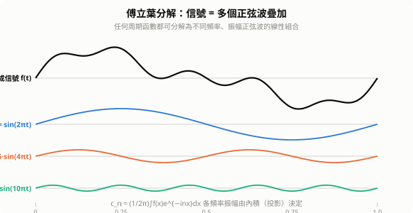
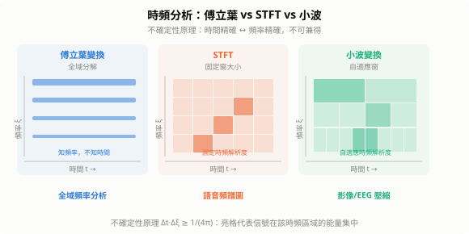
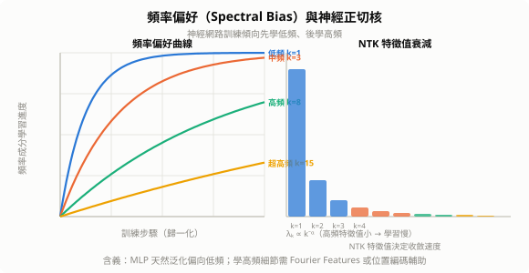

# 調和分析（Harmonic Analysis）

調和分析研究「如何把函數分解成基本振盪（諧波）的疊加，以及這種分解能揭示什麼」。傅立葉分析是其核心，但現代調和分析更延伸至小波、圖信號、球諧等領域，為語音、影像、GNN 與 Transformer 提供共同的數學語言。

## 1. 核心思想：分解與重建

任何信號 $f$ 可分解為基底函數 $\{\phi_i\}$ 的線性組合（投影）：

$$f = \sum_i \langle f, \phi_i \rangle \, \phi_i$$

選不同的基底，就得到不同的分析工具：

| 基底 | 工具 | 適合信號 |
|------|------|---------|
| 複指數 $e^{inx}$ | 傅立葉級數 | 周期信號 |
| 複指數 $e^{i\xi x}$ | 傅立葉變換 | 非周期連續信號 |
| 旋轉矩陣 $e^{-2\pi ikn/N}$ | DFT / FFT | 離散數位信號 |
| 小波 $\psi_{j,k}$ | 小波變換 | 局部不規則信號 |
| 球諧函數 $Y_l^m$ | 球諧分析 | 球面信號 |
| 圖拉普拉斯特徵向量 $u_i$ | 圖傅立葉 | 圖節點信號 |

---

## 2. 傅立葉分析

### 2.1 傅立葉級數（周期函數）

$f: [-\pi,\pi] \to \mathbb{R}$ 展開：

$$f(x) = \sum_{n=-\infty}^{\infty} c_n \, e^{inx}, \quad c_n = \frac{1}{2\pi}\int_{-\pi}^{\pi} f(x) \, e^{-inx} \, dx$$

$c_n$ 是 $f$ 在頻率 $n$ 的「投影量」，$|c_n|^2$ 是該頻率的功率。



### 2.2 傅立葉變換（非周期函數）

$$\hat{f}(\xi) = \int_{-\infty}^{\infty} f(x) \, e^{-2\pi i \xi x} \, dx, \quad f(x) = \int_{-\infty}^{\infty} \hat{f}(\xi) \, e^{2\pi i \xi x} \, d\xi$$

$\hat{f}(\xi)$ 是**頻域表示**：$|\hat{f}(\xi)|^2$ 是頻率 $\xi$ 的功率密度（功率譜）。

### 2.3 離散傅立葉變換（DFT）與 FFT

$N$ 個樣本的 DFT：

$$X_k = \sum_{n=0}^{N-1} x_n \, e^{-2\pi i kn/N}, \quad k=0,\ldots,N-1$$

**FFT（快速傅立葉變換）**：Cooley-Tukey 演算法利用 $W_N^{kn}$ 的對稱性，將 $O(N^2)$ 降至 $O(N \log N)$，是 20 世紀十大演算法之一。

```python
import numpy as np

x = np.array([1.0, 2.0, 1.0, -1.0, 1.5, 0.5, -0.5, 1.0])
X = np.fft.fft(x)        # FFT：O(N log N)
freqs = np.fft.fftfreq(len(x))
power = np.abs(X)**2      # 功率譜
x_rec = np.fft.ifft(X)   # 逆變換重建（應與 x 相同）
```

---

## 3. 核心定理

### 3.1 Parseval 定理（能量守恆）

$$\int_{-\infty}^{\infty} |f(x)|^2 \, dx = \int_{-\infty}^{\infty} |\hat{f}(\xi)|^2 \, d\xi$$

時域總能量 = 頻域總能量。傅立葉變換是 $L^2(\mathbb{R})$ 空間的**等距同構**（Hilbert 空間的酉算子）。

### 3.2 卷積定理

$$\widehat{f * g}(\xi) = \hat{f}(\xi) \cdot \hat{g}(\xi)$$

**時域卷積 = 頻域點乘**。CNN 的卷積操作在頻域只是逐元素相乘，這是 FFT 加速卷積（$O(N\log N)$）的理論基礎。

### 3.3 不確定性原理（Heisenberg）

$$\Delta x \cdot \Delta \xi \geq \frac{1}{4\pi}$$

信號在時域越集中（$\Delta x$ 小），頻域就越分散（$\Delta \xi$ 大）。**時間精確與頻率精確不能兼得**——這是所有時頻分析工具設計的根本限制。

### 3.4 Nyquist-Shannon 採樣定理

若信號最高頻率為 $f_{\max}$，採樣率需滿足：

$$f_s \geq 2 f_{\max} \quad \text{（Nyquist 頻率）}$$

違反此條件則發生**混疊（aliasing）**：高頻信號被誤判為低頻。影像縮放中的鋸齒感、音訊的失真均源於此。

---

## 4. 時頻分析

### 4.1 短時傅立葉變換（STFT）

傅立葉變換告訴「有哪些頻率」，但不告訴「何時出現」。STFT 加滑動窗函數 $w$：

$$\text{STFT}(t, \xi) = \int_{-\infty}^{\infty} f(\tau) \, w(\tau - t) \, e^{-2\pi i \xi \tau} \, d\tau$$

輸出是二維**頻譜圖**（spectrogram）$|\text{STFT}(t,\xi)|^2$，橫軸時間、縱軸頻率。

**缺點**：窗大小固定 → 時間解析度與頻率解析度的取捨固定（受不確定性原理約束）。

**Mel 頻譜**：對頻譜圖取 Mel 濾波器組（對數頻率刻度，模擬人耳感知），是 Whisper、Wav2Vec、AudioLM 等語音模型的標準輸入。

### 4.2 小波變換（Wavelet Transform）

小波解決 STFT「窗大小固定」的問題：**高頻用短窗（時間精確），低頻用長窗（頻率精確）**：

$$W_\psi f(a, b) = \frac{1}{\sqrt{|a|}} \int_{-\infty}^{\infty} f(t) \, \overline{\psi\!\left(\frac{t-b}{a}\right)} \, dt$$

- $a$：**尺度**（大 = 低頻，對應長窗）
- $b$：**平移**（時間位置）
- $\psi$：**母小波**（Morlet、Daubechies、Haar 等）

**多解析度分析（MRA）**：將信號分解為不同尺度的近似係數（低頻）與細節係數（高頻），遞迴分解形成樹狀結構。JPEG 2000、醫學 EEG/fMRI 分析廣泛使用；U-Net 的多尺度跳接結構有其影子。



---

## 5. 圖傅立葉變換與 GNN

普通傅立葉依賴「平移不變性」，對不規則圖結構不適用。**圖傅立葉變換**以圖拉普拉斯特徵向量為基底：

$$L = D - A \quad \text{（圖拉普拉斯矩陣）}, \quad L = U\Lambda U^\top \quad \text{（特徵分解）}$$

圖傅立葉變換與逆變換：

$$\hat{f} = U^\top f, \quad f = U\hat{f}$$

**圖卷積（頻域定義）**：

$$g *_G f = U \, \hat{g}(\Lambda) \, U^\top f$$

**ChebNet**：用 Chebyshev 多項式 $T_k(\tilde{L})$ 近似 $\hat{g}(\Lambda)$，避免完整特徵分解（$O(n^3) \to O(|\mathcal{E}|k)$）。**GCN** 是 $k=1$ 的特殊情形：

$$H^{(l+1)} = \sigma\!\left(\tilde{D}^{-1/2}\tilde{A}\tilde{D}^{-1/2} H^{(l)} W^{(l)}\right)$$

---

## 6. 球諧函數

球面 $S^2$ 上的調和分析基底：

$$Y_l^m(\theta,\phi) = \sqrt{\frac{(2l+1)(l-|m|)!}{4\pi(l+|m|)!}} \, P_l^{|m|}(\cos\theta) \, e^{im\phi}$$

$l$：**次數**（頻率），$m$：**階數**（方位）。球諧函數是拉普拉斯方程 $\nabla^2 f = 0$ 在球面上的特徵函數，應用於：
- 量子力學：原子軌道（$s, p, d, f$ 殼層對應 $l=0,1,2,3$）
- 3D 形狀分析與等變網路（SE(3)-Transformer）
- 全球大氣模型、球面 CNN

---

## 7. 調和分析與深度學習

### 7.1 頻率偏好（Spectral Bias / Frequency Principle）

神經網路訓練時傾向**先學低頻、後學高頻**（Rahaman et al., 2019）：

$$f_\theta(x) \approx \sum_{|\xi| \leq k_t} \hat{f}(\xi) \, e^{2\pi i \xi x} \quad \text{（訓練步驟 } t \text{ 時的頻率截斷近似）}$$

**含義**：
- 解釋深度網路的良好泛化性（高頻噪聲難以過擬合）
- 解釋 MLP 難以學習高頻細節（需要 Fourier Features 或位置編碼）
- 物理資訊神經網路（PINN）的收斂困難部分源於此



### 7.2 Fourier Features 與位置編碼

**Random Fourier Features**（Rahimi & Recht, 2007）：用 $\gamma(x) = [\cos(2\pi\omega_i^\top x), \sin(2\pi\omega_i^\top x)]_{i=1}^D$ 嵌入，讓 MLP 能學習高頻函數。

**Transformer 正弦位置編碼**：

$$PE_{pos,2i} = \sin\!\left(\frac{pos}{10000^{2i/d}}\right), \quad PE_{pos,2i+1} = \cos\!\left(\frac{pos}{10000^{2i/d}}\right)$$

不同維度對應不同頻率，使模型能以各尺度感知相對位置。**RoPE**（旋轉位置編碼）是其旋轉矩陣版本，已被 LLaMA、GPT-4 等採用。

### 7.3 影像壓縮（DCT / JPEG）

DCT（離散餘弦變換，傅立葉的實數版本）：

$$X_k = \sum_{n=0}^{N-1} x_n \cos\!\left(\frac{\pi k(2n+1)}{2N}\right)$$

JPEG 對每個 $8\times8$ 圖塊做 2D DCT，對低頻係數（人眼敏感）高精度保留，對高頻係數（人眼不敏感）量化截斷，實現有損壓縮。

### 7.4 注意力機制的頻率觀點

Multi-head attention 可理解為在不同頻率尺度上的軟查詢：每個注意力頭學習在不同「語義頻率」上聚合信息，高頻頭捕捉局部句法細節，低頻頭捕捉長程語義依賴。

---

## 8. 掛谷猜想：調和分析的核心難題

> **掛谷宗一（1917）**：在平面上把一根單位長度的針旋轉 360°，最小需要多少面積？

直覺答案是圓盤（面積 $\pi/4$），但 **Besicovitch（1928）** 震驚地證明：可以在**任意小面積**內完成！他構造的集合稱為 **Besicovitch 集**。

### 8.1 掛谷猜想

**定義**：$\mathbb{R}^n$ 中的**掛谷集（Kakeya set）**是一個包含每個方向上至少一條單位線段的集合。

**猜想**：$\mathbb{R}^n$ 中的掛谷集的 Hausdorff 維度 $= n$（體積可以為零，但維度必須最大）。

| 維度 | 狀態 |
|------|------|
| $\mathbb{R}^2$ | 已解決（維度確實為 2） |
| $\mathbb{R}^3$ | **Hong Wang & Zahl 2024 年解決！** |
| $\mathbb{R}^n$，$n \geq 4$ | 仍未解決 |

### 8.2 與調和分析的深層連結

表面是幾何問題，本質是「**傅立葉振盪能量如何在不同方向分布**」的問題：

**傅立葉限制猜想（Restriction Conjecture）**：$L^p$ 函數的傅立葉變換限制在球面上，是否有 $L^q$ 估計？

$$\left\|\hat{f}\big|_{S^{n-1}}\right\|_{L^q(S^{n-1})} \leq C \|f\|_{L^p(\mathbb{R}^n)}$$

**連結**：限制猜想蘊含掛谷猜想。分析傅立葉積分時，能量沿**細長管子**（tube）傳播，管子的方向分布正是掛谷集的幾何——若掛谷集可以很「細」（維度 $<n$），就意味著振盪積分可以病態集中，破壞諸多重要估計式。

**解耦定理（Decoupling Theorem，Bourgain & Demeter 2015）**：

$$\left\|\sum_\tau f_\tau\right\|_{L^p}^2 \lesssim_\varepsilon \delta^{-\varepsilon} \sum_\tau \|f_\tau\|_{L^p}^2$$

統一解決了掛谷型幾何、Vinogradov 均值定理（數論）與 Strichartz 估計（PDE），核心正是控制不同方向振盪函數的「干涉」。

### 8.3 Hong Wang 的 $\mathbb{R}^3$ 突破（2024）

Hong Wang（王虹，NYU Courant Institute）與 Joshua Zahl 以**多項式方法（Polynomial Method）**解決 $\mathbb{R}^3$ 的掛谷猜想：

用次數 $D$ 的多項式 $P(x,y,z)$ 把空間切割成 $O(D^3)$ 個區域，分析線段分布，透過精細組合幾何論證得到維度下界。**關鍵觀察**：若太多線段集中在某個低維代數超曲面上，就會產生矛盾——把幾何問題轉化為代數約束。

**跨學科連結**：

```
掛谷猜想（幾何）
     ↕ 傅立葉波集中性
限制猜想（調和分析）
     ↕ 振盪積分估計
Strichartz 估計（非線性 PDE）
     ↕ 解耦定理（Bourgain-Demeter）
Vinogradov 均值（數論）
```

---

## 9. 小結

| 概念 | 核心要點 |
|------|---------|
| 傅立葉變換 | 時域 ↔ 頻域；$\hat{f}(\xi)$ 量化頻率成分 |
| FFT | Cooley-Tukey 分治；$O(N^2) \to O(N\log N)$ |
| Parseval 定理 | 時頻能量守恆；傅立葉為 $L^2$ 酉算子 |
| 卷積定理 | 時域卷積 = 頻域點乘；CNN 的理論根基 |
| 不確定性原理 | $\Delta x \cdot \Delta\xi \geq 1/(4\pi)$；時頻不可兼得 |
| Nyquist 定理 | 採樣率需 $\geq 2f_{\max}$；違反則混疊 |
| STFT | 滑動窗傅立葉；固定時頻解析度 |
| 小波 | 多尺度分析；高頻短窗/低頻長窗 |
| 圖傅立葉 | 拉普拉斯特徵向量為基底；GCN 的頻域根基 |
| Spectral Bias | 網路先學低頻；解釋泛化性與收斂行為 |
| RoPE | 旋轉位置編碼；現代 LLM 的位置感知機制 |
