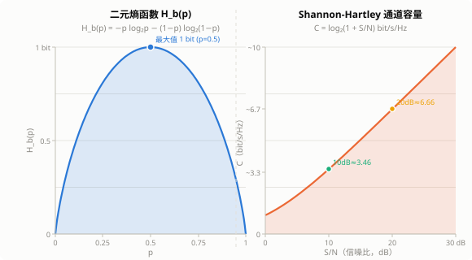
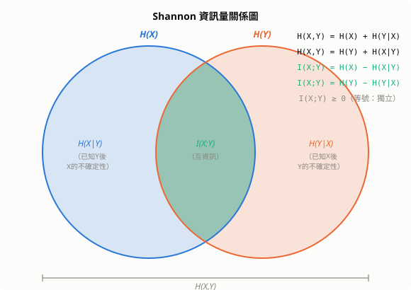

# 資訊論（Information Theory）

Shannon 資訊論由 Claude Shannon 於 1948 年在《通訊的數學理論》中提出，回答了一個根本問題：**資訊可以被量化嗎？如何以最高效率傳遞資訊？**

資訊論奠定了現代通訊（壓縮、加密、糾錯碼）與 AI（損失函數、特徵選擇、生成模型）的數學基礎。

## 1. 資訊量的定義

### 1.1 為什麼用對數

我們希望資訊量 $I(x)$ 滿足三個性質：

1. 越罕見的事件，發生時帶來越多資訊：$I$ 是 $p$ 的遞減函數
2. 必然事件不帶資訊：$p=1 \Rightarrow I=0$
3. 兩個獨立事件的總資訊量可加：$I(x,y) = I(x) + I(y)$

由第 3 點，若 $x, y$ 獨立，則 $p(x,y)=p(x)p(y)$，需要

$$
f(p(x)p(y)) = f(p(x)) + f(p(y))
$$

在連續性條件下，滿足此函數方程的唯一形式是對數，故定義**自資訊（Self-Information）**：

$$
I(x) = -\log_2 p(x) \quad \text{（單位：bit）}
$$

底數取 2 時單位為 bit；取 $e$ 時為 nat；取 10 時為 hart。

### 1.2 直覺例子

| 事件 | $p$ | $I$ |
|---|---|---|
| 丟硬幣正面 | $1/2$ | 1 bit |
| 擲骰子出6 | $1/6$ | 2.58 bits |
| 標準52張抽到黑桃A | $1/52$ | 5.70 bits |
| 明天太陽升起 | $\approx 1$ | $\approx 0$ bits |

## 2. Shannon 熵

**熵（Entropy）** 是自資訊的期望值，衡量整個分布的平均不確定性：

$$
H(X) = \mathbb{E}[I(X)] = -\sum_{x \in \mathcal{X}} p(x) \log_2 p(x)
$$

### 2.1 熵的基本性質

**非負性**：$H(X) \geq 0$，等號成立當且僅當某事件機率為 1。

**上界**：對有限字母表 $|\mathcal{X}|=n$，

$$
H(X) \leq \log_2 n
$$

等號成立當且僅當 $X$ 為均勻分布（最大不確定性）。

**二元熵函數**：當 $|\mathcal{X}|=2$，$p(X=1)=p$，

$$
H_b(p) = -p\log_2 p - (1-p)\log_2(1-p)
$$

在 $p=0.5$ 時達到最大值 1 bit。

*圖左：二元熵曲線——均勻分布（$p=0.5$）不確定性最大，確定事件（$p=0$ 或 $1$）熵為零。圖右：Shannon-Hartley 定理——通道容量隨 S/N 對數增長，10 dB ≈ 3.46 bit/s/Hz，20 dB ≈ 6.66 bit/s/Hz。*

### 2.2 連續隨機變數：微分熵

對連續分布，以積分取代求和，定義**微分熵（Differential Entropy）**：

$$
h(X) = -\int p(x)\log p(x)\,dx
$$

微分熵可以是負數（例如均勻分布在 $(0, 0.1)$ 上，$h = \log 0.1 < 0$），與離散熵的性質有所不同。**高斯分布在相同方差下微分熵最大**：

$$
h(\mathcal{N}(\mu,\sigma^2)) = \frac{1}{2}\log(2\pi e \sigma^2)
$$

## 3. 聯合熵與條件熵

### 3.1 聯合熵

兩個隨機變數 $(X, Y)$ 的不確定性：

$$
H(X,Y) = -\sum_{x,y} p(x,y)\log p(x,y)
$$

**次可加性**：$H(X,Y) \leq H(X) + H(Y)$，等號成立當且僅當 $X, Y$ 獨立。

### 3.2 條件熵

已知 $Y$ 後，$X$ 的剩餘不確定性：

$$
H(X|Y) = \sum_y p(y) H(X|Y=y) = -\sum_{x,y} p(x,y)\log p(x|y)
$$

**鏈式法則**：

$$
H(X,Y) = H(Y) + H(X|Y) = H(X) + H(Y|X)
$$

**單調性**：$H(X|Y) \leq H(X)$，知道 $Y$ 只會減少（或維持）對 $X$ 的不確定性，等號成立當且僅當 $X, Y$ 獨立。

**多變數鏈式法則**：

$$
H(X_1, X_2, \ldots, X_n) = \sum_{i=1}^n H(X_i \mid X_1, X_2, \ldots, X_{i-1})
$$

## 4. 互資訊

**互資訊（Mutual Information）** 衡量兩個變數之間共享的資訊量：

$$
I(X;Y) = H(X) - H(X|Y) = H(Y) - H(Y|X) = H(X) + H(Y) - H(X,Y)
$$

等價地，

$$
I(X;Y) = \sum_{x,y} p(x,y)\log\frac{p(x,y)}{p(x)p(y)}
$$

### 4.1 互資訊的性質

- **非負性**：$I(X;Y) \geq 0$，等號成立當且僅當 $X,Y$ 獨立
- **對稱性**：$I(X;Y) = I(Y;X)$
- **上界**：$I(X;Y) \leq \min(H(X), H(Y))$
- **與熵的關係**：$I(X;X) = H(X)$（一個變數與自身的互資訊等於它的熵）

*圖：Shannon 資訊量關係。左圓 = $H(X)$，右圓 = $H(Y)$，交集 = $I(X;Y)$，左差 = $H(X|Y)$，右差 = $H(Y|X)$，全集 = $H(X,Y)$。*

### 4.2 條件互資訊與資料處理不等式

**條件互資訊**：$I(X;Y|Z) = H(X|Z) - H(X|Y,Z)$

**資料處理不等式（Data Processing Inequality）**：若 $X \to Y \to Z$ 形成馬可夫鏈，則

$$
I(X;Z) \leq I(X;Y)
$$

任何對資料的處理只能減少（或維持）資訊量，不能增加。這說明特徵工程不可能無中生有地創造資訊。

## 5. KL 散度

**KL 散度（Kullback-Leibler Divergence）** 衡量分布 $P$ 相對於 $Q$ 的「額外驚訝度」：

$$
D_{\text{KL}}(P \| Q) = \sum_x p(x)\log\frac{p(x)}{q(x)}
$$

### 5.1 基本性質

**非負性（Gibbs 不等式）**：

$$
D_{\text{KL}}(P \| Q) \geq 0
$$

等號成立當且僅當 $P = Q$（幾乎處處）。

**非對稱性**：$D_{\text{KL}}(P\|Q) \neq D_{\text{KL}}(Q\|P)$，KL 散度不是距離。

**奇異性**：若存在 $x$ 使 $q(x)=0$ 但 $p(x)>0$，則 $D_{\text{KL}}(P\|Q) = +\infty$。

**與互資訊的關係**：

$$
I(X;Y) = D_{\text{KL}}(p(x,y) \| p(x)p(y))
$$

互資訊是聯合分布與乘積分布的 KL 散度——衡量 $X, Y$ 偏離獨立的程度。

### 5.2 前向與反向 KL

| | $D_{\text{KL}}(P\|Q)$（前向） | $D_{\text{KL}}(Q\|P)$（反向） |
|---|---|---|
| 優化角度 | 令 $Q$ 覆蓋 $P$ 的所有支撐 | 令 $Q$ 集中於 $P$ 的主要模式 |
| 傾向 | mean-seeking（均值尋找） | mode-seeking（眾數尋找） |
| 應用 | MLE、VAE 編碼器 | 知識蒸餾、EP 演算法 |

## 6. 交叉熵

**交叉熵（Cross-Entropy）** 是用 $Q$ 為 $P$ 編碼所需的平均 bit 數：

$$
H(P, Q) = -\sum_x p(x)\log q(x) = H(P) + D_{\text{KL}}(P\|Q)
$$

因此最小化交叉熵等價於最小化 KL 散度（$H(P)$ 為常數，與 $Q$ 無關）。

**在分類任務中**，真實標籤分布為 $P$（one-hot），模型預測為 $Q$（softmax 輸出）：

$$
\mathcal{L}_{\text{CE}} = -\sum_{c=1}^C y_c \log\hat{y}_c = -\log\hat{y}_{c^*}
$$

其中 $c^*$ 為正確類別。交叉熵損失直接衡量模型對真實分布的近似程度。

## 7. 資訊熵編碼：無損壓縮定理

### 7.1 Shannon 第一定理

**Shannon 無損壓縮定理**：對獨立同分布符號序列，最優無損壓縮的平均碼長 $L^*$ 滿足：

$$
H(X) \leq L^* < H(X) + 1 \quad \text{（bit/符號）}
$$

下界 $H(X)$ 不可突破；對長度 $n$ 的序列，每符號平均碼長趨近 $H(X)$（漸近最優性）。

**實際含義**：若一份中文文字的 unigram 熵為 9 bit/字，則理論上最多能壓縮到原大小的 $9/16 \approx 56\%$（假設原始以 16 bit Unicode 存儲），不可能更小。

### 7.2 Huffman 編碼

**Huffman 編碼**是達到 Shannon 下界的貪心演算法：

1. 以每個符號為葉節點，機率為權重
2. 每次合併兩個最小機率的節點為新節點
3. 重複直到只剩一個根節點
4. 左支編 0，右支編 1

平均碼長 $L_{\text{Huffman}}$ 滿足：$H(X) \leq L_{\text{Huffman}} < H(X) + 1$。

**算術編碼（Arithmetic Coding）** 能更接近 Shannon 下界，現代壓縮格式（JPEG 2000、HEVC、Zstandard）的熵編碼層均基於此。

## 8. 通道容量與 Shannon 第二定理

### 8.1 通道模型

**離散無記憶通道（DMC）** 由轉移矩陣 $p(y|x)$ 描述——給定輸入 $x$，輸出 $y$ 的條件分布。最典型的例子是**二元對稱通道（BSC）**：以機率 $\epsilon$ 翻轉 bit，以機率 $1-\epsilon$ 保持不變。

$$
C_{\text{BSC}} = 1 - H_b(\epsilon) \quad \text{（bit/次使用）}
$$

### 8.2 通道容量

通道的**容量（Capacity）** 是在所有輸入分布上最大化的互資訊：

$$
C = \max_{p(X)} I(X;Y)
$$

### 8.3 Shannon 通道編碼定理（第二定理）

**正向**：若傳輸速率 $R < C$，存在長碼使錯誤機率趨近於零。  
**逆定理**：若 $R > C$，任何編碼都無法使錯誤機率趨近於零。

$C$ 是可靠傳輸的**理論極限**，對所有物理通道普適成立。

**AWGN 通道（加性高斯白噪聲）** 的容量是 Shannon–Hartley 定理：

$$
C = B\log_2\!\left(1 + \frac{S}{N}\right) \quad \text{（bit/s）}
$$

其中 $B$ 為頻寬，$S/N$ 為信噪比。WiFi、LTE、5G 均以此公式衡量頻譜效率上限。

## 9. 在 AI 與機器學習中的應用

### 9.1 損失函數

| 任務 | 損失 | 資訊論解釋 |
|---|---|---|
| 二元分類 | Binary Cross-Entropy | $H(y, \hat{y})$，最小化對真實標籤的 KL 散度 |
| 多元分類 | Categorical Cross-Entropy | 同上，推廣至 $C$ 類 |
| 語言模型 | 負對數似然（NLL） | 等同於交叉熵；**困惑度** $= 2^H$ |
| VAE | ELBO = $\mathbb{E}[\log p(x|z)] - D_{\text{KL}}(q\|p)$ | 重建 + 後驗與先驗的 KL |

### 9.2 決策樹的資訊增益

ID3 / C4.5 在每個節點選擇最大化**資訊增益（Information Gain）** 的特徵：

$$
\text{IG}(D, A) = H(D) - H(D|A)
$$

等價於最大化分裂前後的互資訊 $I(A; Y)$。

### 9.3 語言模型的困惑度

語言模型以 $\hat{p}$ 近似真實語言分布 $p$。**困惑度（Perplexity）** 是交叉熵的指數化：

$$
\text{PPL} = 2^{H(p,\hat{p})} = 2^{-\frac{1}{N}\sum_{i=1}^N \log_2 \hat{p}(x_i)}
$$

困惑度可解釋為「模型在每一步需要在多少個等可能詞中選擇」。GPT-4 在 WikiText-103 上困惑度約 3–5，意味著每步僅需在 3–5 個候選中做選擇。

### 9.4 Information Bottleneck 假說

Tishby 等人（2017）提出深度學習的本質是 **Information Bottleneck（IB）**：中間層表示 $T$ 應當最大化對輸出 $Y$ 的資訊，同時壓縮輸入 $X$ 的資訊：

$$
\min_{p(T|X)} \quad -I(T;Y) + \beta \cdot I(T;X)
$$

$\beta$ 控制壓縮與保真的權衡（類似 VAE 的 $\beta$-VAE）。這個框架解釋了為何神經網路在訓練後期會「遺忘」輸入的細節。

### 9.5 表示學習中的互資訊最大化

**SimCLR、BYOL** 等對比學習方法可理解為最大化同一樣本不同增廣版本的互資訊：

$$
\max_\theta\; I(Z_1; Z_2)
$$

其中 $Z_1, Z_2$ 是同一圖像兩個增廣版本的嵌入。

## 10. 歷史發展進程

### 10.1 前夜（1920s–1940s）

**1924 — Nyquist**：推導有限頻寬通道的最大傳輸速率，「Nyquist 取樣定理」前身。

**1928 — Hartley**：定義資訊量 $H = n\log s$，第一次嘗試量化資訊，但未考慮機率分布。

**1948 — Shannon《通訊的數學理論》**：划時代之作，一篇論文同時建立：
- 熵的精確定義 $H = -\sum p\log p$
- 無損壓縮定理（Source Coding Theorem）
- 通道容量與通道編碼定理（Channel Coding Theorem）

Shannon 明確表示這套理論**不處理語義**，只處理統計結構——這條邊界後來被 AI 刻意跨越。

**1951 — Huffman 編碼**：Robert Huffman 在課程作業中提交，擊敗指導教授，成為第一個達到 Shannon 下界的實用壓縮算法。

### 10.2 擴張（1960s–1980s）

**1963 — Gallager**：提出 LDPC 碼（低密度奇偶校驗碼），理論上接近 Shannon 極限，但因計算量太大被擱置 35 年，1990 年代重新發現後成為 5G 標準。

**1968 — Kolmogorov 複雜度**：用「描述長度」重新定義複雜性——一個物件的 Kolmogorov 複雜度是描述它的**最短程式長度**，連結資訊論與可計算理論。

**1982 — Amari 資訊幾何**：用黎曼幾何重新詮釋資訊論，Fisher 資訊矩陣成為參數空間的度量張量，後來影響神經網路優化理論（Natural Gradient）。

### 10.3 與機器學習的融合（1990s–2010s）

**1991 — MDL 原則（Minimum Description Length）**：最好的模型 = 壓縮資料最短的模型，統一了奧卡姆剃刀與統計學習理論：

$$
\text{MDL} = L(\text{model}) + L(\text{data} \mid \text{model})
$$

**1997 — Turbo 碼、LDPC 復活**：首次在實際系統中逼近 Shannon 極限（相差 < 0.5 dB），掀起編碼理論革命。

**1999 — ICA**：Bell & Sejnowski 以互資訊最小化做盲源分離，直接連結統計獨立性與資訊論。

### 10.4 資訊論進入深度學習核心（2013–今）

**2013 — VAE（Variational Autoencoder）**：整個生成框架就是資訊論的變分不等式：

$$
\mathcal{L} = \underbrace{\mathbb{E}[\log p(x|z)]}_{\text{重建（交叉熵）}} - \underbrace{D_{\text{KL}}(q(z|x)\|p(z))}_{\text{後驗與先驗的 KL 散度}}
$$

**2017 — Information Bottleneck（IB）假說**（Tishby & Schwartz-Ziv）：用資訊論解釋深度學習訓練的兩個階段：

$$
\min_{p(T|X)} \quad -I(T;Y) + \beta \cdot I(T;X)
$$

先記憶（$I(T;X)$ 增加），後壓縮（$I(T;X)$ 減少，保留對 $Y$ 有用的部分）。

**2018 — CPC（Contrastive Predictive Coding）**：明確以互資訊為目標做自監督學習：最大化當前表示與未來觀測的 $I(X;Y)$。

**2019–2020 — SimCLR / MoCo**：對比學習框架以互資訊最大化為理論基礎；InfoNCE loss 是互資訊下界的直接優化：

$$
\mathcal{L}_{\text{InfoNCE}} = -\mathbb{E}\left[\log\frac{e^{f(x)^\top f(x^+)/\tau}}{\sum_{j} e^{f(x)^\top f(x_j)/\tau}}\right]
$$

**2020 — 規模律（Scaling Laws）**：Power law $L \propto N^{-\beta}$ 在資訊論視角下是壓縮尺度律——更大的模型以更短的「描述」逼近語言分布（Kolmogorov 視角）。

**2022 — 擴散模型的 ELBO**：DDPM 的損失函數等價於對 KL 散度梯度的**分數匹配（Score Matching）**——資訊論的另一種面貌。

### 10.5 對深度學習的四大影響

| 影響 | 具體體現 |
|---|---|
| **損失函數語言** | 交叉熵 = 最大化似然 = 最小化 KL 散度；所有分類/生成損失都是資訊論量 |
| **表示學習目標** | 互資訊最大化（CPC、SimCLR）成為自監督學習的統一框架 |
| **模型壓縮理論** | 知識蒸餾 = 最小化師生分布的 KL；剪枝 = MDL 原則 |
| **生成模型架構** | VAE（ELBO）、Flow（精確 log-likelihood）、DDPM（score matching）都源自貝氏推斷 + 資訊論 |

Shannon 的原意是解決工程問題（電報、電話）；七十年後，他的熵公式出現在每一個深度學習訓練循環的核心。這是數學歷史上最深遠的「意外應用」之一。

## 11. 小結

| 概念 | 公式 | 意義 |
|---|---|---|
| 自資訊 | $-\log p(x)$ | 單一事件帶來的資訊量 |
| 熵 | $H(X) = -\sum p\log p$ | 分布的平均不確定性 |
| 聯合熵 | $H(X,Y)$ | 兩變數的總不確定性 |
| 條件熵 | $H(X|Y)$ | 知道 Y 後 X 的剩餘不確定性 |
| 互資訊 | $I(X;Y) = H(X) - H(X|Y)$ | 兩變數共享的資訊量 |
| KL 散度 | $D_{\text{KL}}(P\|Q) \geq 0$ | P 相對於 Q 的「額外驚訝度」 |
| 交叉熵 | $H(P,Q) = H(P) + D_{\text{KL}}$ | 用 Q 為 P 編碼的平均碼長 |
| 無損壓縮定理 | $L^* \geq H(X)$ | 壓縮的理論下界 |
| 通道容量 | $C = \max_{p(X)} I(X;Y)$ | 可靠傳輸的速率上限 |

資訊論的核心洞見：**資訊是不確定性的消除，而不確定性本身可以被精確量化。** 從這個基礎出發，Shannon 建立了一個令人驚嘆的理論——它同時告訴我們壓縮的極限、通訊的極限，以及機器學習模型「理解」資料的極限。
