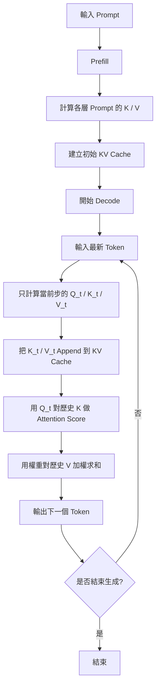

# AI 中的 KV Cache 與 Attention 影響

KV cache 是大型語言模型在推論階段常用的加速技巧，主要用在 autoregressive generation，也就是模型一次生成一個 token 的情境。它的核心想法很直接：對於已經處理過的 token，不要在每一步都重新計算它們的 `key` 和 `value`，而是把它們存起來，下一步直接重用。

在 Transformer 的 self-attention 中，每個 token 都會經過線性投影得到 `query`、`key`、`value`：

$$
Q = XW_Q,\quad K = XW_K,\quad V = XW_V
$$

注意力輸出為

$$
\text{Attention}(Q,K,V)=\text{softmax}\left(\frac{QK^\top}{\sqrt{d_k}}\right)V
$$

如果模型正在逐 token 生成，第 $t$ 步只新增一個 token。這時前面 $1 \sim t-1$ 的 token 其實沒有改變，因此它們的 $K$、$V$ 也不會改變。KV cache 就是把這些舊 token 的 $K$、$V$ 保存下來，讓第 $t$ 步只需要為最新 token 計算一次新的 $Q$、$K$、$V$，再把新的 $K$、$V$ 接到快取尾端。

## 1. 為什麼是快取 K 和 V，不是 Q

在第 `t` 步生成時，真正需要拿去和歷史資訊比對的是「當前 token 的 query」。因此：

- $Q_t$ 必須每一步重新計算，因為它對應的是最新 token
- $K_1, \dots, K_{t-1}$ 與 $V_1, \dots, V_{t-1}$ 已經固定，可以重用

也就是說，第 $t$ 步的 attention 可以寫成

$$
\text{Attention}(Q_t, [K_1,\dots,K_t], [V_1,\dots,V_t])
$$

其中 $[K_1,\dots,K_{t-1}]$ 和 $[V_1,\dots,V_{t-1}]$ 來自 cache，只有 $K_t$、$V_t$ 是本步新算出來的。

## 2. 沒有 KV Cache 時發生什麼事

假設目前已經生成到長度 `t`。如果沒有 KV cache，模型每次都要把整段 prefix 再跑一遍，重新得到：

- 前 `t` 個 token 的全部 `Q`
- 前 `t` 個 token 的全部 `K`
- 前 `t` 個 token 的全部 `V`
- 再重新計算整個 causal self-attention

這代表雖然你只多生成了一個 token，卻又重算了整段歷史。對 decoder-only LLM 來說，這會造成大量重複計算。

## 3. 使用 KV Cache 後的計算流程

以 decoder-only 模型為例，推論通常分成兩個階段。

### 3.1 Prefill

先把 prompt 一次送進模型，算出每一層所有 prompt token 的 `K`、`V`，並存入 cache。這一步計算量通常大，但可以高度平行化。

### 3.2 Decode

之後每生成一個新 token，只做下面幾件事：

1. 對最新 token 計算本步的 `Q_t`、`K_t`、`V_t`
2. 把 `K_t`、`V_t` append 到各層 cache
3. 用 `Q_t` 去和整個歷史 `K` 做相似度計算
4. 用 attention 權重對整個歷史 `V` 做加權求和

因此，cache 沒有消除「看歷史 token」這件事，而是消除了「重算歷史 token 的 K/V 投影」這件事。

### 3.3 Prefill / Decode 流程圖

這張圖對應的重點是：

- `Prefill` 階段先建立整段 prompt 的 KV cache
- `Decode` 階段每次只新增一個 token 的 `Q/K/V`
- attention 仍然會讀取歷史 `K/V`，但不再重算歷史 token 的投影

## 4. 對 Attention 計算量的影響

### 4.1 單步成本下降

沒有 KV cache 時，第 `t` 步通常等價於重新處理長度為 `t` 的整段序列。  
有 KV cache 時，第 `t` 步只需要：

- 為新 token 做一次投影
- 用一個 `Q_t` 對全部歷史 `K` 做點積
- 用注意力權重對全部歷史 `V` 加權

所以單步推論成本會明顯下降，尤其在序列越長時越明顯。

### 4.2 總成本仍然會隨序列長度增加

KV cache 並沒有讓 decode 變成常數時間。因為第 `t` 步仍然要對 `t` 個歷史位置做 attention score：

$$
Q_t K^\top
$$

所以生成長序列時，總 attention 成本仍然會隨輸出長度成長。  
更精確地說：

- 沒有 KV cache：會有大量 prefix 重算，成本非常高
- 有 KV cache：避免重算歷史 K/V，但每一步仍需掃過歷史位置

因此 KV cache 的本質是把「重複計算」拿掉，而不是把 causal attention 對歷史的依賴拿掉。

## 5. 對記憶體的影響

KV cache 用空間換時間。每一層都要保存每個已生成 token 的 `K` 與 `V`，所以序列越長、batch 越大、層數越多，快取越大。

粗略來看，cache 大小與下列因素成正比：

$$
\text{Memory} \propto B \times L \times T \times H_{kv} \times d_{head} \times 2
$$

其中：

- `B` 是 batch size
- `L` 是 Transformer layer 數
- `T` 是目前 cache 的 token 長度
- `H_{kv}` 是 KV head 數
- `d_{head}` 是每個 head 的維度
- `2` 代表同時存 `K` 和 `V`

這也是為什麼長 context 推論常常不是先被算力卡住，而是先被顯存卡住。

## 6. 對不同 Attention 形式的影響

### 6.1 Causal Self-Attention

KV cache 最直接服務的就是 decoder 裡的 causal self-attention。  
因為生成第 $t$ 個 token 時，只會依賴 $1 \sim t$ 的歷史內容，歷史 token 的 $K/V$ 可以安全重用。

### 6.2 Bidirectional Self-Attention

像 BERT 這類雙向 encoder 通常是一次看完整句子，不是逐 token 生成，因此通常不需要 KV cache。  
它們比較重視的是整句並行計算，而不是增量式 decode。

### 6.3 Cross-Attention

在 encoder-decoder 架構中，encoder 輸出對 decoder 來說也是可快取的。  
因為 source sequence 不變，所以 cross-attention 裡 encoder 端的 `K/V` 也可以先算好後重用。

## 7. 對模型設計的連動影響

### 7.1 MHA、MQA、GQA

傳統 multi-head attention（MHA）每個 attention head 都有自己的 `K/V`，快取成本最高。  
如果改成：

- MQA：多個 query head 共用一組 `K/V`
- GQA：多個 query head 分組共用 `K/V`

就能明顯降低 KV cache 的記憶體壓力。這是近年長 context LLM 很常見的設計選擇。

### 7.2 Sliding Window / Local Attention

如果模型只允許看最近一段視窗，而不是全部歷史，那 cache 也不必無限制成長。  
這種情況下通常只保留最近 `w` 個 token 的 `K/V`，把更舊的內容丟掉，藉此控制記憶體與延遲。

### 7.3 Paged Attention

當 cache 很大時，系統層面常用分頁式管理來減少記憶體碎片並提高批次調度效率。  
這不改變 attention 公式本身，但會大幅影響實際 serving 效率。

## 8. KV Cache 的限制與代價

KV cache 雖然很有效，但也有幾個明顯限制：

- 它主要適用於推論，不是訓練主流程
- 顯存消耗很大，長上下文尤其明顯
- batch 中不同樣本長度不一致時，cache 管理會更複雜
- beam search、speculative decoding、prefix sharing 等策略都需要更精細的 cache 複製或共享

另外，快取內容通常會受資料型別影響，例如 FP16、BF16、FP8 或量化 cache。  
精度越低，顯存越省，但可能帶來數值誤差或實作複雜度。

## 9. 一個常見誤解

常見說法是「KV cache 把 attention 複雜度從平方降成線性」，這句話只講對一半。

比較精確的說法應該是：

- 它避免了每一步對整段 prefix 的重算
- 它讓增量式 decode 的效率大幅提升
- 但單步仍然要對歷史 token 做 attention，因此歷史掃描並沒有消失

所以如果問題是「KV cache 能不能完全解決長序列 attention 太慢？」答案是不行；  
它能顯著改善，但不能消除 attention 對上下文長度的依賴。

## 10. 總結

KV cache 的核心就是：把歷史 token 的 `K/V` 存下來，下一步直接重用。  
它對 attention 的影響主要有三點：

1. 不再重算歷史 token 的 `K/V`
2. 讓 autoregressive decode 延遲大幅下降
3. 以更高的記憶體占用，換取更快的推論速度

因此在現代 LLM serving 中，KV cache 幾乎是 decoder 推論的標配。  
如果要再往前優化，接下來通常會碰到的就是兩個方向：

- 如何降低 KV cache 的記憶體成本
- 如何降低 attention 仍需掃描歷史序列的成本

前者對應到 MQA、GQA、量化 cache、paged attention；後者則會延伸到 local attention、chunked attention、state-space model 或其他長序列加速方法。

## 11. 更數學化的視角

如果把 decoder-only Transformer 看成在第 `t` 步預測下一個 token，則第 `t` 步輸入可寫成目前 prefix：

$$
x_{1:t} = (x_1, x_2, \dots, x_t)
$$

對某一層 self-attention 而言，投影後得到

$$
Q_{1:t} = X_{1:t}W_Q,\quad K_{1:t} = X_{1:t}W_K,\quad V_{1:t} = X_{1:t}W_V
$$

在 causal mask 下，第 `t` 個位置的輸出只依賴前 `t` 個位置：

$$
o_t = \text{softmax}\left(\frac{q_t K_{1:t}^\top}{\sqrt{d_k}} + M_t\right)V_{1:t}
$$

其中：

- `q_t` 是第 `t` 個 token 的 query
- `K_{1:t}` 是從第 `1` 到第 `t` 個 token 的所有 key
- `V_{1:t}` 是從第 `1` 到第 `t` 個 token 的所有 value
- `M_t` 是 causal mask，保證未來位置不可見

重點在於，對固定的 prefix 而言，`K_{1:t-1}` 和 `V_{1:t-1}` 在下一步不會改變。  
因此第 `t+1` 步只需新增：

$$
k_{t+1},\ v_{t+1}
$$

並把 cache 更新為

$$
K_{1:t+1} = [K_{1:t}; k_{t+1}],\quad V_{1:t+1} = [V_{1:t}; v_{t+1}]
$$

這件事之所以成立，是因為 autoregressive decoding 的條件分解：

$$
p(x_{1:T}) = \prod_{t=1}^{T} p(x_t \mid x_{1:t-1})
$$

每一步只新增一個 token，舊 token 的隱表示在「同一步的 forward pass 定義下」已經固定，所以對舊位置的 `K/V` 沒有必要重算。

從計算量角度看：

- 若每一步都重算整段 prefix，第 `t` 步要處理長度約為 `t` 的序列
- 若使用 KV cache，第 `t` 步只新算一個位置，但仍要對 `t` 個歷史 key 做匹配

因此在 decode 階段：

- 投影成本從「每步處理整段序列」降成「每步只處理一個 token」
- attention score 成本仍保留對歷史長度 `t` 的依賴

如果把每一步只看新增 token 的計算單獨抽出來，則單層單步的主要 attention 成本近似為：

$$
O(H \cdot t \cdot d_{head})
$$

其中 `H` 是 query head 數，`t` 是目前上下文長度。  
因此 KV cache 消掉的是重複投影與重複建構歷史 states 的成本，而不是歷史掃描本身。

## 12. 更偏系統實作的視角

在實際 serving 系統中，KV cache 不只是「存兩個 tensor」這麼簡單，而是整個推論延遲、顯存配置、batch 調度的核心。

### 12.1 Prefill 和 Decode 是兩種不同工作型態

實務上通常把請求切成：

- prefill：一次吃完整個 prompt，建立初始 KV cache
- decode：之後每步只生成一個 token，反覆讀寫 cache

這兩階段的硬體特性不同：

- prefill 比較像大矩陣計算，算力利用率高
- decode 比較像小批次、反覆訪問記憶體，常常更受 memory bandwidth 影響

所以很多推論系統會分別優化這兩段，而不是把它們當成同一種 workload。

### 12.2 Cache 佈局會直接影響吞吐量

每層 KV cache 通常需要考慮以下維度：

- batch
- sequence length
- kv head
- head dimension

不同框架會採用不同 layout，例如把 sequence 放在連續記憶體方向，或讓 head dimension 更利於向量化載入。  
這些選擇會影響：

- append 新 token 時是否便宜
- 讀取整段歷史 `K/V` 時是否連續
- 多請求混批時是否容易做 gather/scatter

因此同樣的理論模型，實作細節不同，延遲可能差很多。

### 12.3 長度不一的請求會讓管理變複雜

真實線上服務通常同時跑很多請求，而每個請求的：

- prompt 長度不同
- 已生成長度不同
- 結束時間不同

這代表 cache 不是一個整齊的矩形，而是持續增長、回收、重排的動態結構。  
如果直接用大塊連續記憶體保存，很容易遇到：

- 顯存碎片
- 閒置空洞
- 搬移成本高

這也是 paged attention 或 block-based KV 管理被提出的背景。

### 12.4 Beam Search 和 Prefix Sharing 需要複製或共享 Cache

如果同一個 prompt 分出多條 beam，最前面的 prefix 是共用的。  
這時系統常見兩種策略：

- 真的複製 cache，簡單但耗記憶體
- 共享 prefix cache，只複製分叉後的新部分，較省記憶體但管理更複雜

同理，很多多輪對話或同 prompt 多採樣場景，也會利用 prefix sharing 減少 prefill 重工。

### 12.5 量化 KV Cache 是常見工程手段

當 context 很長時，KV cache 往往比 model weights 更快成為瓶頸。  
因此常見做法包括：

- 用較低精度格式存 `K/V`
- 對 cache 做 per-head 或 per-block 量化
- 對不同層採取不同精度策略

好處是顯存占用下降，可支援更長 context 或更大 batch。  
代價則是：

- 需要額外反量化或特殊 kernel
- 可能讓注意力分數產生數值誤差
- 品質與速度未必同時最佳

### 12.6 最後的瓶頸常常不是算不動，而是搬不動

很多人直覺上會以為 LLM decode 的瓶頸主要是 FLOPs，但在長序列推論裡，實際常見的瓶頸是：

- 讀取大量歷史 `K/V`
- 在 GPU 記憶體中搬運 cache
- 為多請求動態排程 cache block

也就是說，KV cache 問題在系統層面常常更像「記憶體系統設計問題」，而不只是「attention 公式問題」。
