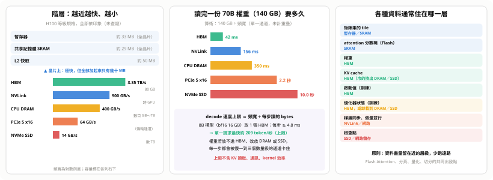
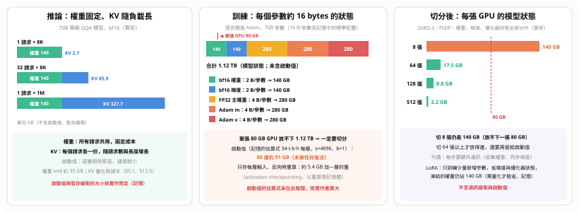
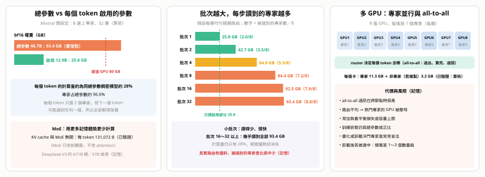
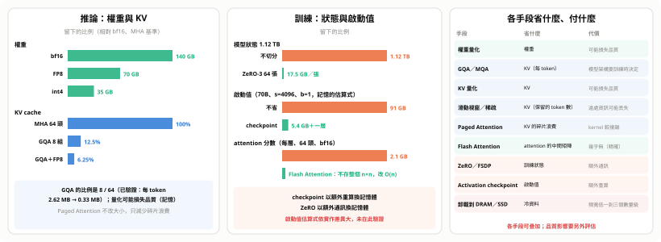

# LLM 的記憶體配置與使用

大型語言模型的瓶頸常常不是算力，而是記憶體：資料放在哪一層、放得下多少、搬得多快。這篇把 LLM 用到的各種記憶體整理成兩個角度：**放什麼**（權重、KV cache、啟動值、訓練狀態），以及**放在哪一層**（暫存器、SRAM、HBM、DRAM、SSD、網路）。

> 標示「（已驗證）」者，是我用程式實際算過的結果（算術與位元組加總，不是在真實 GPU 上量測）；「記憶」為依印象整理、未核對的說法。所有硬體規格（容量、頻寬）都屬於記憶，不同世代或廠牌的加速器會不同。

---

## 目錄

1. [超白話版](#0-超白話版)
2. [三個要分清楚的量：容量、頻寬、延遲](#1-三個要分清楚的量容量頻寬延遲)
3. [記憶體階層：越近越快、越小](#2-記憶體階層越近越快越小)
4. [推論時放什麼](#3-推論時放什麼)
5. [訓練時放什麼](#4-訓練時放什麼)
6. [切分：一張卡放不下時](#5-切分一張卡放不下時)
7. [各種資料住在哪一層](#6-各種資料住在哪一層)
8. [省記憶體的手段](#7-省記憶體的手段)
9. [規劃一張卡的預算](#8-規劃一張卡的預算)
10. [常見誤解](#9-常見誤解)
11. [總結與標註](#10-總結與標註)

---

## 0. 超白話版

- LLM 要記的東西有四類：**權重**（模型本體）、**KV cache**（對話的上下文）、**啟動值**（算到一半的中間結果）、**訓練狀態**（梯度與優化器的記帳）。
- 記憶體分很多層：晶片上的 SRAM 又快又小，HBM 是 GPU 的主記憶體，再往外是 CPU 的 DRAM、SSD、網路，越遠越大、越慢。
- 推論時，權重是固定成本，KV cache 隨請求數與上下文長度增長；每產生一個 token 都得把它們從 HBM 讀一遍，所以速度主要被 HBM 頻寬限制。
- 訓練時，每個參數要配約 16 bytes 的狀態，70B 模型就是 1.12 TB，單張卡放不下，必須切分。
- MoE 省計算、不省容量；批次大時 decode 也幾乎要讀全部專家（§5.1）。
- 幾乎所有省記憶體的技術（量化、GQA、分頁、Flash Attention、ZeRO、checkpointing）都在做同一件事：讓資料少放一點，或留在近的層級。

---

## 1. 三個要分清楚的量：容量、頻寬、延遲

| 量 | 問的問題 | 例子 |
|---|---|---|
| 容量 | 放得下嗎？ | 80 GB 的 HBM 放得下 140 GB 的權重嗎？（放不下） |
| 頻寬 | 每秒能搬多少？ | HBM 約 3.35 TB/s；讀 140 GB 權重至少要 42 ms |
| 延遲 | 要多久才開始收到第一筆？ | 影響小量隨機存取，如分頁後的 KV 指標查找 |

LLM 的 decode 階段每個 token 都要讀整份權重與 KV，是大量連續讀取，**頻寬**是主要限制。容量決定放不放得下，延遲通常在大批量讀取時不是主角。

一個常用的估算：

$$
t_{\mathrm{step}} \gtrsim \frac{B_{\mathrm{read}}}{\mathrm{BW}}
$$

其中 $B_{\mathrm{read}}$ 是這一步要讀的 bytes， $\mathrm{BW}$ 是記憶體頻寬。這是下限，沒有計入算力、通訊與 kernel 的實際效率（記憶：實際利用率通常低於峰值）。

---

## 2. 記憶體階層：越近越快、越小

以下以 NVIDIA H100 等級的 GPU 為例，數字全部是記憶，沒有核對：

| 層級 | 容量量級 | 頻寬量級 | 角色 |
|---|---|---|---|
| 暫存器 | 每個 SM 256 KB | 最快 | 單一執行緒正在算的值 |
| 共享記憶體／SRAM | 每個 SM 約 228 KB | 極快 | 分塊（tile）資料 |
| L2 快取 | 約 50 MB | 很快 | 熱資料的自動快取 |
| HBM | 80 GB | 約 3.35 TB/s | 權重、KV、啟動值 |
| NVLink | 跨 GPU | 約 900 GB/s | 張量並行的通訊 |
| CPU DRAM | 數百 GB 到數 TB | 約 400 GB/s | 換出的資料、卸載 |
| PCIe 5.0 x16 | 傳輸通道 | 約 64 GB/s | GPU 與 CPU 之間 |
| NVMe SSD | 數 TB | 約 14 GB/s | 檢查點、冷資料 |

H100 有 132 個 SM，若每個 SM 的暫存器 256 KB、共享記憶體 228 KB，全晶片約為 33 MB 與 29 MB（已驗證：算術；輸入規格為記憶）。**整個晶片上的快速記憶體加起來才幾十 MB**，連一層權重都放不下，所以大量資料一定在 HBM 與計算單元之間來回搬。

**讀完一份 70B bf16 權重（140 GB）要多久（已驗證：算術，頻寬為上表假設）**：

| 通道 | 時間 |
|---|---|
| HBM（單張） | 42 ms |
| NVLink | 156 ms |
| CPU DRAM | 0.35 秒 |
| PCIe | 2.2 秒 |
| NVMe SSD | 10 秒 |

從 HBM 換成 DRAM 就慢約 8 倍，換成 SSD 約慢 240 倍。這就是權重與 KV 必須常駐 HBM 的原因。

---

## 3. 推論時放什麼

假設 70B 等級的模型：80 層、隱藏維度 8192、64 個 query 頭、8 個 KV 頭（GQA）、每頭 128 維、前饋層維度 28672、詞彙 128,000（這是 Llama 70B 類模型的設定，依印象）。由這些數字算出的參數量約 70.5B（已驗證：算術）。

| 項目 | 大小 | 備註 |
|---|---|---|
| 權重（bf16） | 140 GB | 固定，所有請求共用 |
| 權重（FP8／int4） | 70 GB／35 GB | 精度降低，品質需另評估 |
| KV cache | 每 token 327,680 B（已驗證）；32 個請求 × 8,192 token 為 85.9 GB；1 個請求 × 100 萬 token 為 327.7 GB | 每個請求各一份 |
| 啟動值 | 小 | 逐層用完即丟（記憶） |
| 暫存緩衝、框架開銷 | 依實作 | 要預留一部分（記憶） |

每 token 的 KV 為 $2 \times 80 \times 8 \times 128 \times 2$ B（K 與 V 兩份、80 層、8 個 KV 頭、128 維、bf16 兩個 bytes），等於 327,680 B。若改成 64 個 KV 頭（MHA）則是 2,621,440 B，剛好 8 倍（已驗證）。細節見 `KV-Cache.md` §5.1。

**decode 速度的上限（已驗證：算術）**：每步至少要讀完整份權重。

| 情境 | 權重 | 每步最短時間 | 單一請求的 token/秒上限 |
|---|---|---|---|
| 8B 模型、bf16、放 1 張 HBM | 16 GB | 4.8 ms | 約 209 |
| 70B、bf16、分到 8 張（理想切分） | 140 GB | 5.2 ms | 約 191 |
| 70B、int4、分到 8 張（理想切分） | 35 GB | 1.3 ms | 約 766 |

這只是下限推算：沒有計入 KV 的讀取、通訊與 kernel 效率，實際一定更慢。但它說明了為什麼量化權重能直接加速 decode：少讀就快。

批次加大時，權重的讀取由所有請求共攤，KV 則是各請求各讀各的，所以長上下文、大批次時瓶頸逐漸從權重轉向 KV（`KV-Cache.md` §12.10）。

---

## 4. 訓練時放什麼

訓練比推論多了梯度與優化器狀態。以常見的混合精度 Adam 為例（這是我記得的標準配置）：

| 項目 | 每參數 bytes | 70B 的總量 |
|---|---|---|
| bf16 權重 | 2 | 140 GB |
| bf16 梯度 | 2 | 140 GB |
| FP32 主權重（master copy） | 4 | 280 GB |
| Adam 一階動量 $m$ | 4 | 280 GB |
| Adam 二階動量 $v$ | 4 | 280 GB |
| 合計 | 16 | 1.12 TB |

已驗證：各資料型態的位元組數加總為 16；並用小陣列確認 Adam 的兩個狀態恰為 FP32 權重大小的兩倍；70B 乘 16 B 為 1.12 TB。「這個配置是標準做法」本身屬記憶。

單張 80 GB 的 GPU 顯然放不下，所以訓練一定要切分（§5）。這個數字**還沒有計入啟動值**。

**啟動值**

反向傳播需要前向時的中間結果，所以訓練要存啟動值，大小與批次、序列長度、層數有關。我記得一個常被引用的每層估算式（16 位元、未做張量並行與 checkpointing）：

$$
A_{\mathrm{layer}} \approx 34\,s\,b\,h + 5\,a\,s^2\,b \quad (\mathrm{bytes})
$$

其中 $A_{\mathrm{layer}}$ 為每層啟動值、 $s$ 為序列長度、 $b$ 為批次、 $h$ 為隱藏維度、 $a$ 為頭數。這個式子是記憶，沒有在這裡驗證；它的細項依實作（是否使用 dropout、融合 kernel 等）而不同。

以 $s=4096$、 $b=1$、 $h=8192$、 $a=64$、80 層代入（已驗證：只驗證代入的算術，式子本身為記憶）：

| 情況 | 每層 | 80 層 |
|---|---|---|
| 第一項（線性項） | 1.14 GB | 91.3 GB |
| 第二項（attention 分數，可用 Flash Attention 免存） | 5.4 GB | 429 GB |
| 兩項都存 | 6.5 GB | 520.8 GB |

可見**不用 Flash Attention 時，attention 分數那一項會主導**。把 bf16 的完整分數矩陣直接算：64 頭、4096 × 4096，每層是 2.1 GB（已驗證：算術）。

**Activation checkpointing**：只存每層的輸入，反向時再重算層內的中間結果。每層輸入約 $2\,s\,b\,h$ bytes，80 層共約 5.4 GB，加上同時重算一層的量約 1.14 GB（已驗證：代入算術）。代價是多做一次前向計算，以重算換記憶體。

---

## 5. 切分：一張卡放不下時

**ZeRO-3／FSDP（記憶）**：把權重、梯度、優化器狀態都分片到所有資料並行的 GPU 上，用到時再收集。70B 模型 16 B/參數的狀態（已驗證：算術，不含啟動值與通訊緩衝）：

| GPU 數 | 每張 GPU 的模型狀態 |
|---|---|
| 8 | 140 GB（仍放不下一張 80 GB） |
| 64 | 17.5 GB |
| 128 | 8.75 GB |
| 512 | 2.19 GB |

可見切 8 張並不夠，要切到 64 張以上，還得再留空間給啟動值。代價是每一步要額外通訊（收集權重、同步梯度）。

**其他切法**（`KV-Cache.md` §12.9 有圖）：

| 切法 | 切什麼 | 主要用途 |
|---|---|---|
| 張量並行 | 每層內的矩陣 | 單層放不下、降低單步延遲；通訊頻繁，通常限於 NVLink 內（記憶） |
| 流水線並行 | 層 | 模型放不下；有 pipeline 空泡 |
| 序列並行（context parallel） | token | 超長上下文的 KV 與 attention 計算 |
| 資料並行 | 批次 | 放得下時提高吞吐 |
| 專家並行（MoE） | 不同的專家 | 專家總量放不下一張卡；要 all-to-all 通訊（記憶，§5.1） |

**LoRA 微調（記憶）**：只訓練少量新增參數，梯度與優化器狀態只針對這部分，省下大部分訓練狀態；但凍結的 bf16 權重仍占 140 GB，要再省需搭配量化（如 QLoRA）。

### 5.1 混合專家模型（MoE）與記憶體

MoE 把每層的前饋網路換成多個「專家」，加一個 router；每個 token 只選其中 $k$ 個專家來算。一句話：**MoE 省的是計算，不省記憶體容量；批次稍大時，連 decode 要讀的記憶體也接近「全部專家」。**

**為什麼不省容量（已驗證：算術）**

以 Mixtral 類的設定計算（依印象的設定：32 層、隱藏維度 4096、專家前饋維度 14336、8 個專家取 top-2、GQA 32 頭與 8 個 KV 頭、詞彙 32,000）：

| 項目 | 參數量 | bf16 權重 |
|---|---|---|
| 總參數（所有專家） | 46.7B | 93.4 GB |
| 每個 token 啟用的參數 | 12.9B | 25.8 GB |
| 專家占總參數的比例 | 96.6% | |

算出的 46.7B 與 12.9B 和我記得的 Mixtral 8x7B 一致，所以這組設定合理。

- 每個 token 的計算量與**啟用的參數**成正比：約 25.8 GFLOPs，是同總參數稠密模型（93.4 GFLOPs）的約 28%。
- 記憶體容量與**總參數**成正比：下一個 token 可能選到任何專家，所以全部都得常駐。
- KV cache 與 MoE 無關：MoE 只改前饋層，不改 attention。這組設定每 token 的 KV 為 131,072 B（已驗證：算術），所有 KV 的討論（`KV-Cache.md`）照舊適用。

我記得 DeepSeek-V3 約 671B 總參數、約 37B 啟用（記憶）：啟用比例約 5.5%，但 bf16 權重仍要約 1.34 TB，FP8 約 671 GB。

**decode：批次一大，幾乎讀到全部專家（已驗證：公式與模擬）**

decode 受 HBM 頻寬限制（§3）。批次為 1 時只需讀被選中的專家；但批次中不同 token 會選不同專家，一步內被碰到的專家越來越多。假設每層路由為均勻隨機（我設的簡化假設），一步內被碰到的專家數期望值為：

$$
E\left(1-\left(1-\frac{k}{E}\right)^{B}\right)
$$

其中 $E$ 為專家數、 $k$ 為每個 token 選的專家數、 $B$ 為批次大小。我另外用 2000 次隨機模擬核對，各批次下與公式的差異都小於 0.05 個專家。

| 批次 $B$ | 被碰到的專家（每層，8 選 2） | 每步讀的權重 | 相對只讀啟用部分 | 相對全部權重 |
|---|---|---|---|---|
| 1 | 2.0 | 25.8 GB | 1.00 倍 | 28% |
| 2 | 3.5 | 42.7 GB | 1.66 倍 | 46% |
| 4 | 5.5 | 64.9 GB | 2.52 倍 | 69% |
| 8 | 7.2 | 84.4 GB | 3.28 倍 | 90% |
| 16 | 7.9 | 92.5 GB | 3.59 倍 | 99% |
| 32 | 8.0 | 93.4 GB | 3.63 倍 | 100% |

- 小批次時，MoE 的 decode 讀得少、很快。
- 批次到 16 至 32 以上，每步幾乎要讀全部 93.4 GB，頻寬優勢消失；但每個 token 的計算量仍只有 28%。所以大批次下算力有餘裕，頻寬卻沒省到。
- 對大批次、高吞吐的服務，MoE 的優勢主要在計算，不在記憶體。
- 真實路由有偏斜，被碰到的專家會比表中少，程度依模型與資料而定（記憶）。

**專家並行與其他影響**

- **專家並行**：不同專家放在不同 GPU（記憶）。以 8 張卡為例，專家部分每張約 11.3 GB，非專家部分（若複製到每張卡）約 3.2 GB（已驗證：算術）。
- **通訊**：token 要被送到持有其專家的 GPU，算完再送回來（all-to-all），跨節點時尤其昂貴（記憶）。
- **負載不均**：路由不均時，熱門專家所在的 GPU 被壓垮，其他 GPU 閒著；實務上常加負載平衡的損失項或容量上限（記憶）。
- **訓練**：每個專家也要梯度與優化器狀態，訓練記憶體與總參數成正比，不是與啟用參數成正比（記憶）。
- **量化與卸載**：專家是權重的大宗，所以量化專家或把冷門專家卸載到 DRAM 或 SSD 是常見做法；但卸載後若被路由選中，就要付頻寬差一到三個數量級的代價（記憶）。

| 面向 | MoE 相對於同總參數的稠密模型 |
|---|---|
| 每 token 計算量 | 少很多（約 28%） |
| 權重容量 | 相同（所有專家都要放） |
| decode 讀取（小批次） | 少 |
| decode 讀取（大批次） | 接近相同 |
| KV cache | 無差別 |
| 多 GPU | 多了專家並行與 all-to-all 通訊 |
| 訓練狀態 | 與總參數成正比 |

未涵蓋：共享專家（部分設計中每個 token 都會用的專家）與細粒度專家的影響；各層路由是否獨立、不同層的專家是否相關；all-to-all 通訊的實際成本與負載平衡的效果。

---

## 6. 各種資料住在哪一層

| 資料 | 通常住在 | 為什麼 |
|---|---|---|
| 矩陣乘的 tile | 暫存器／共享記憶體 | 一個 kernel 內反覆使用 |
| attention 分數塊（Flash Attention） | SRAM | 不寫回 HBM（`KV-Cache.md` §15） |
| 權重 | HBM | 每步都要讀 |
| KV cache | HBM（冷的可換出到 DRAM 或 SSD） | 每步都讀，頻寬是瓶頸 |
| 啟動值（訓練） | HBM | 前向存、反向用 |
| 優化器狀態（訓練） | HBM，或卸載到 DRAM／SSD | 量大，只在更新時用（記憶） |
| 梯度同步、張量並行的通訊 | NVLink／網路 | 通訊，不是儲存 |
| 檢查點 | SSD／網路儲存 | 只偶爾寫出 |

原則只有一條：**資料盡量留在近的層級，少跑遠路**。Flash Attention、分頁、量化、切分都是這個原則的不同應用。

---

## 7. 省記憶體的手段

| 手段 | 作用對象 | 留下的比例（已驗證：算術） | 代價 |
|---|---|---|---|
| 權重量化 | 權重 | FP8 為 50%、int4 為 25% | 可能損失品質（記憶） |
| GQA／MQA | KV（每 token） | 8 個 KV 頭對 64 頭為 12.5% | 架構要在訓練時決定 |
| KV 量化 | KV | FP8 為 50%；與 GQA 疊加為 6.25% | 可能損失品質（記憶） |
| 滑動視窗／稀疏 | 保留的 token 數 | 依視窗大小 | 遠處資訊可能丟失 |
| Paged Attention | KV 的碎片浪費 | 不改大小，減少浪費 | kernel 較複雜 |
| Flash Attention | attention 的中間矩陣 | 不存 $n \times n$ 矩陣 | 幾乎無（精確） |
| ZeRO／FSDP | 訓練狀態 | 切 64 張為 1/64 | 額外通訊 |
| Activation checkpointing | 啟動值 | 約 5.9%（5.4 / 91.3，依上面的記憶式） | 額外重算 |
| 卸載到 DRAM／SSD | 冷資料 | 釋放 HBM | 頻寬低一到三個數量級 |

這些手段多半可以疊加，但品質影響要逐項另外評估。

---

## 8. 規劃一張卡的預算

推論的 KV 預算可以直接寫成：

$$
N_{\mathrm{req}} \approx \frac{M_{\mathrm{HBM}}\,(1-r) - W}{T \cdot k}
$$

其中 $N_{\mathrm{req}}$ 為可並行請求數、 $M_{\mathrm{HBM}}$ 為 HBM 總量、 $r$ 為預留比例、 $W$ 為權重大小、 $T$ 為每個請求的 token 數、 $k$ 為每 token 的 KV bytes。

以 8 張 80 GB（共 640 GB）、預留 10%、權重 140 GB、每 token 327,680 B 為例（已驗證：算術；預留比例是我隨意設定的假設）：

| 每請求 token 數 | 可並行請求數（理想） |
|---|---|
| 4,096 | 324 |
| 8,192 | 162 |
| 32,768 | 40 |
| 131,072 | 10 |

上下文拉長 32 倍，可並行請求就少約 32 倍。這就是長上下文服務昂貴的原因，也是 Paged Attention、前綴共享、KV 量化都有價值的原因（`KV-Cache.md` §5.1、§7.3、§12.7）。

這個式子是理想值：沒有計入碎片、啟動值、通訊緩衝與負載波動。

---

## 9. 常見誤解

| 說法 | 實際 |
|---|---|
| 「算力不夠才慢」 | decode 時常受 HBM 頻寬限制，不是算力（§3） |
| 「GPU 有 80 GB 就能跑 70B」 | bf16 權重 140 GB，放不下一張；需量化或切分 |
| 「訓練與推論吃的記憶體差不多」 | 訓練每參數約 16 B 的狀態，推論權重只要 2 B，差近一個數量級 |
| 「Flash Attention 能縮小 KV cache」 | 不能；它省的是 attention 的中間矩陣（`KV-Cache.md` §15.3） |
| 「批次加大就能一直省頻寬」 | 只攤薄權重的讀取；各請求的 KV 無法共攤 |
| 「放不進 HBM 就放 DRAM，只是慢一點」 | 慢一到三個數量級，且每步都付一次 |
| 「MoE 模型只用部分專家，所以記憶體也小」 | 所有專家都要常駐，省的是計算；批次大時 decode 的讀取也接近全部專家（§5.1） |

---

## 10. 總結與標註

- LLM 的記憶體可分權重、KV cache、啟動值、訓練狀態四類，各自的大小與增長方式不同。
- 記憶體階層越近越快越小；推論時每步都要從 HBM 讀權重與 KV，所以速度主要被頻寬限制。
- 訓練的模型狀態每參數約 16 B（70B 為 1.12 TB），必須切分；啟動值再另外加上。
- 省記憶體的手段都是讓資料變小，或讓資料留在近的層級；多半可疊加，但要評估品質與通訊的代價。

**本文的驗證範圍**

- **已驗證（算術與模擬）**：MoE 的總參數與啟用參數（Mixtral 類設定），以及均勻隨機路由下被碰到的專家數（公式與 2000 次模擬一致）；以 Llama 70B 類設定算出的參數量與每 token KV bytes；16 B/參數的加總與 1.12 TB；ZeRO 切分後各 GPU 的量；各通道讀 140 GB 的時間；decode 的頻寬上限；啟動值估算式的代入結果；可並行請求數。這些是位元組與頻寬的算術，不是在真實 GPU 上的實測。
- **記憶（未驗證）**：所有硬體規格（H100 的容量與頻寬）；混合精度 Adam 的 16 B/參數配置；每層啟動值的估算式；ZeRO、LoRA、QLoRA 的做法與細節；MoE 的路由偏斜、專家並行與 all-to-all 的實際成本、DeepSeek-V3 的參數規模；張量並行通常限於 NVLink 內；效率與利用率的說法。
- **未計入**：暫存緩衝、碎片、通訊與換入換出的重疊、kernel 的實際頻寬利用率、不同加速器（TPU 等）的差異。

**相關筆記**：`KV-Cache.md`（KV cache、Paged Attention、Flash Attention、HBM 的容量與頻寬、超長上下文）、`Backpropagation.md`（啟動值為何要存）、`Gradient-Descent.md`（優化器）。
