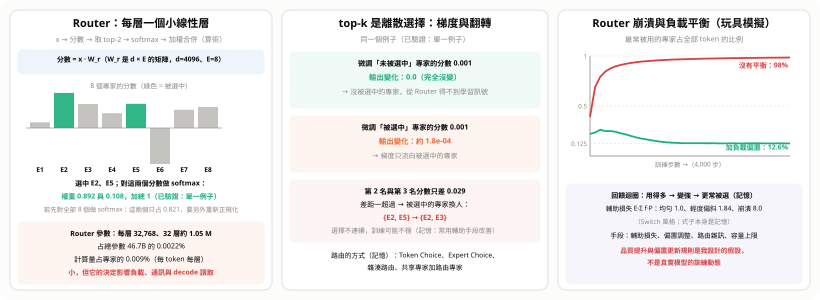
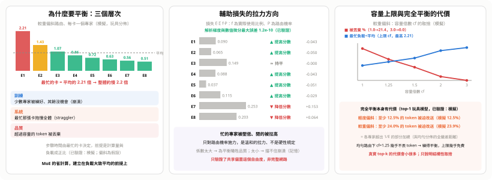
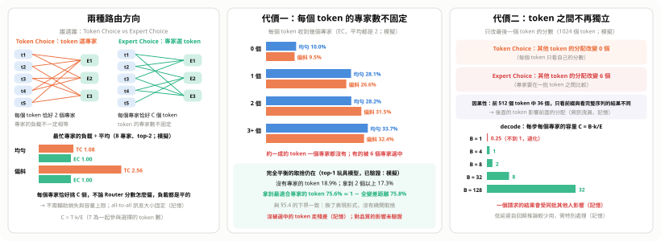

# LLM 的記憶體配置與使用

大型語言模型的瓶頸常常不是算力，而是記憶體：資料放在哪一層、放得下多少、搬得多快。這篇把 LLM 用到的各種記憶體整理成兩個角度：**放什麼**（權重、KV cache、啟動值、訓練狀態），以及**放在哪一層**（暫存器、SRAM、HBM、DRAM、SSD、網路）。

> 標示「（已驗證）」者，是我用程式實際算過的結果（算術與位元組加總，不是在真實 GPU 上量測）；「記憶」為依印象整理、未核對的說法。所有硬體規格（容量、頻寬）都屬於記憶，不同世代或廠牌的加速器會不同。

---

## 目錄

1. [超白話版](#0-超白話版)
2. [三個要分清楚的量：容量、頻寬、延遲](#1-三個要分清楚的量容量頻寬延遲)
3. [記憶體階層：越近越快、越小](#2-記憶體階層越近越快越小)
4. [推論時放什麼](#3-推論時放什麼)
5. [訓練時放什麼](#4-訓練時放什麼)
6. [切分：一張卡放不下時](#5-切分一張卡放不下時)
7. [各種資料住在哪一層](#6-各種資料住在哪一層)
8. [省記憶體的手段](#7-省記憶體的手段)
9. [規劃一張卡的預算](#8-規劃一張卡的預算)
10. [常見誤解](#9-常見誤解)
11. [總結與標註](#10-總結與標註)

---

## 0. 超白話版

- LLM 要記的東西有四類：**權重**（模型本體）、**KV cache**（對話的上下文）、**啟動值**（算到一半的中間結果）、**訓練狀態**（梯度與優化器的記帳）。
- 記憶體分很多層：晶片上的 SRAM 又快又小，HBM 是 GPU 的主記憶體，再往外是 CPU 的 DRAM、SSD、網路，越遠越大、越慢。
- 推論時，權重是固定成本，KV cache 隨請求數與上下文長度增長；每產生一個 token 都得把它們從 HBM 讀一遍，所以速度主要被 HBM 頻寬限制。
- 訓練時，每個參數要配約 16 bytes 的狀態，70B 模型就是 1.12 TB，單張卡放不下，必須切分。
- MoE 省計算、不省容量；批次大時 decode 也幾乎要讀全部專家（§5.1）；專家並行把專家分到多張卡，代價是 all-to-all 通訊與負載不均（§5.2）；Router 決定哪個 token 去哪個專家，體積很小但影響負載與通訊，要防止崩潰（§5.3）；負載平衡是 MoE 省計算的前提，要在訓練、系統與品質之間取捨（§5.4）；Expert Choice 把選擇方向倒過來換得完美平衡，代價是 token 的專家數不固定與 token 之間相依（§5.5）。
- 幾乎所有省記憶體的技術（量化、GQA、分頁、Flash Attention、ZeRO、checkpointing）都在做同一件事：讓資料少放一點，或留在近的層級。

---

## 1. 三個要分清楚的量：容量、頻寬、延遲

| 量 | 問的問題 | 例子 |
|---|---|---|
| 容量 | 放得下嗎？ | 80 GB 的 HBM 放得下 140 GB 的權重嗎？（放不下） |
| 頻寬 | 每秒能搬多少？ | HBM 約 3.35 TB/s；讀 140 GB 權重至少要 42 ms |
| 延遲 | 要多久才開始收到第一筆？ | 影響小量隨機存取，如分頁後的 KV 指標查找 |

LLM 的 decode 階段每個 token 都要讀整份權重與 KV，是大量連續讀取，**頻寬**是主要限制。容量決定放不放得下，延遲通常在大批量讀取時不是主角。

一個常用的估算：

$$
t_{\mathrm{step}} \gtrsim \frac{B_{\mathrm{read}}}{\mathrm{BW}}
$$

其中 $B_{\mathrm{read}}$ 是這一步要讀的 bytes， $\mathrm{BW}$ 是記憶體頻寬。這是下限，沒有計入算力、通訊與 kernel 的實際效率（記憶：實際利用率通常低於峰值）。

---

## 2. 記憶體階層：越近越快、越小

以下以 NVIDIA H100 等級的 GPU 為例，數字全部是記憶，沒有核對：

| 層級 | 容量量級 | 頻寬量級 | 角色 |
|---|---|---|---|
| 暫存器 | 每個 SM 256 KB | 最快 | 單一執行緒正在算的值 |
| 共享記憶體／SRAM | 每個 SM 約 228 KB | 極快 | 分塊（tile）資料 |
| L2 快取 | 約 50 MB | 很快 | 熱資料的自動快取 |
| HBM | 80 GB | 約 3.35 TB/s | 權重、KV、啟動值 |
| NVLink | 跨 GPU | 約 900 GB/s | 張量並行的通訊 |
| CPU DRAM | 數百 GB 到數 TB | 約 400 GB/s | 換出的資料、卸載 |
| PCIe 5.0 x16 | 傳輸通道 | 約 64 GB/s | GPU 與 CPU 之間 |
| NVMe SSD | 數 TB | 約 14 GB/s | 檢查點、冷資料 |

H100 有 132 個 SM，若每個 SM 的暫存器 256 KB、共享記憶體 228 KB，全晶片約為 33 MB 與 29 MB（已驗證：算術；輸入規格為記憶）。**整個晶片上的快速記憶體加起來才幾十 MB**，連一層權重都放不下，所以大量資料一定在 HBM 與計算單元之間來回搬。

**讀完一份 70B bf16 權重（140 GB）要多久（已驗證：算術，頻寬為上表假設）**：

| 通道 | 時間 |
|---|---|
| HBM（單張） | 42 ms |
| NVLink | 156 ms |
| CPU DRAM | 0.35 秒 |
| PCIe | 2.2 秒 |
| NVMe SSD | 10 秒 |

從 HBM 換成 DRAM 就慢約 8 倍，換成 SSD 約慢 240 倍。這就是權重與 KV 必須常駐 HBM 的原因。

---

## 3. 推論時放什麼

假設 70B 等級的模型：80 層、隱藏維度 8192、64 個 query 頭、8 個 KV 頭（GQA）、每頭 128 維、前饋層維度 28672、詞彙 128,000（這是 Llama 70B 類模型的設定，依印象）。由這些數字算出的參數量約 70.5B（已驗證：算術）。

| 項目 | 大小 | 備註 |
|---|---|---|
| 權重（bf16） | 140 GB | 固定，所有請求共用 |
| 權重（FP8／int4） | 70 GB／35 GB | 精度降低，品質需另評估 |
| KV cache | 每 token 327,680 B（已驗證）；32 個請求 × 8,192 token 為 85.9 GB；1 個請求 × 100 萬 token 為 327.7 GB | 每個請求各一份 |
| 啟動值 | 小 | 逐層用完即丟（記憶） |
| 暫存緩衝、框架開銷 | 依實作 | 要預留一部分（記憶） |

每 token 的 KV 為 $2 \times 80 \times 8 \times 128 \times 2$ B（K 與 V 兩份、80 層、8 個 KV 頭、128 維、bf16 兩個 bytes），等於 327,680 B。若改成 64 個 KV 頭（MHA）則是 2,621,440 B，剛好 8 倍（已驗證）。細節見 `KV-Cache.md` §5.1。

**decode 速度的上限（已驗證：算術）**：每步至少要讀完整份權重。

| 情境 | 權重 | 每步最短時間 | 單一請求的 token/秒上限 |
|---|---|---|---|
| 8B 模型、bf16、放 1 張 HBM | 16 GB | 4.8 ms | 約 209 |
| 70B、bf16、分到 8 張（理想切分） | 140 GB | 5.2 ms | 約 191 |
| 70B、int4、分到 8 張（理想切分） | 35 GB | 1.3 ms | 約 766 |

這只是下限推算：沒有計入 KV 的讀取、通訊與 kernel 效率，實際一定更慢。但它說明了為什麼量化權重能直接加速 decode：少讀就快。

批次加大時，權重的讀取由所有請求共攤，KV 則是各請求各讀各的，所以長上下文、大批次時瓶頸逐漸從權重轉向 KV（§3.1）。

### 3.1 HBM 的容量與頻寬：對 KV cache 的影響

HBM 是 GPU 的主記憶體，KV cache 住在這裡。它有兩個獨立的影響：**容量**決定放得下多少，**頻寬**決定 decode 多快。以下數字都是用假設的規格算出來的算術，不是實測。

**假設**：70B 等級 GQA 模型，bf16，每個 token 的 KV 為 327,680 B（`KV-Cache.md` §5.1）；8 張 GPU，每張 80 GB HBM、3.35 TB/s（規格依印象設定）；權重 140 GB。

**容量（算術已驗證）**

可用於 KV 的 HBM ＝ 640 GB − 140 GB（權重）＝ 500 GB（未計暫存緩衝與碎片）。

| 項目 | 結果 |
|---|---|
| 放得下的 token 總數（bf16） | 約 153 萬 |
| 換成 FP8 的 KV | 約 305 萬 |
| 每個請求 8,192 token | 約 186 個並行請求 |

容量是「並行請求數 × 平均上下文長度」的上限，批次上不去，吞吐也上不去。

**頻寬（算術已驗證）**

decode 每產生一個 token，要讀整份權重，再加上批次中每個請求的整份 KV。算術強度低，主要受 HBM 頻寬限制，不是受算力限制。

| 情境（請求數 × 每請求 token 數） | KV 大小 | 讀 KV 時間 | 相對權重 |
|---|---|---|---|
| 1 × 8,192 | 2.7 GB | 0.10 ms | 0.02 倍 |
| 32 × 8,192 | 85.9 GB | 3.2 ms | 0.61 倍 |
| 64 × 8,192 | 171.8 GB | 6.4 ms | 1.23 倍 |
| 32 × 32,768 | 343.6 GB | 12.8 ms | 2.45 倍 |
| 1 × 1,000,000 | 327.7 GB | 12.2 ms | 2.34 倍 |

讀一次權重約 5.2 ms（8 張卡頻寬合計）。批次內總 token 數超過約 43 萬時，讀 KV 的時間就超過讀權重。

加大批次能把權重的讀取成本攤薄，但攤不薄 KV 的讀取成本，因為每個請求各讀各的。所以長上下文服務傾向受 KV 頻寬限制。

| 手段 | 省容量 | 省頻寬 |
|---|---|---|
| GQA／MQA、KV 量化、滑動視窗 | 是 | 是 |
| Paged Attention（`KV-Cache.md` §7.3） | 是（減少碎片） | 否 |
| 前綴共享（`KV-Cache.md` §12.7） | 是 | 否（各請求仍各自讀完整 prefix，記憶） |
| Flash Attention（`KV-Cache.md` §15.3） | 否 | 主要省 prefill 的矩陣讀寫，對 decode 幫助小 |
| 多 GPU 切分（`KV-Cache.md` §12.9） | 是 | 是（總頻寬變大） |

**HBM 與 SRAM 不同**：HBM 容量大、較慢，KV cache 住在這裡；SRAM（晶片上快取，每個 SM 約數百 KB，記憶）極小但極快，Flash Attention 把分塊資料留在 SRAM 內。KV cache 放不進 SRAM，decode 每步都得從 HBM 讀它。

**沒有 HBM，百萬 token 真的很難嗎？**

放得下不難，跑得快很難。百萬 token 的 KV 為 327.7 GB（FP8 約 163.8 GB）。若每個 token 都要完整讀一遍：

| 儲存層級 | 假設頻寬 | 讀完整份 KV |
|---|---|---|
| 8 張 GPU 的 HBM（合計） | 26.8 TB/s | 12 ms |
| 1 張 GPU 的 HBM | 3.35 TB/s | 98 ms |
| CPU DRAM（DDR5） | 約 400 GB/s | 0.82 秒 |
| PCIe 5.0 x16 | 約 64 GB/s | 5.1 秒 |
| NVMe SSD | 約 14 GB/s | 23 秒 |

這些頻寬是依印象設的量級。離開 HBM 後，速度掉一到三個數量級：放 DRAM 約每 token 0.8 秒，放 SSD 約 23 秒。所以完整、精確的 attention 幾乎需要 KV 常駐高頻寬記憶體。

出路是**少讀**：

| 手段 | 想法 |
|---|---|
| 稀疏／檢索式 attention | 只讀最相關的 top-k 個 token |
| 滑動視窗加少數全域 token | 大部分層只看近處 |
| KV 量化 | 每個數用更少位元 |
| 前綴快取換出 | 冷的 prefix 放慢層級，用到再換回 |

以 top-k 為例：只讀 4,096 個 token 的 KV 共 1.34 GB，從 DRAM 讀約 3.4 ms，經 PCIe 約 21 ms，可以接受。代價是結果不再與完整 attention 精確相等，是近似，品質要另外驗證。

此外，百萬 token 的 prefill 是 $n^2$ 級的計算（`KV-Cache.md` §12.9），那是算力問題，換成非 HBM 的記憶體不能解決，只會更慢。

**標註**：

- **已驗證（算術）**：上述 GB、ms、token 數與倍率，都是依假設的規格計算。
- **記憶（未驗證）**：GPU 規格、SRAM 容量量級、各儲存層級的頻寬量級、哪些系統實際把 KV 換出到 DRAM 或 SSD、稀疏 attention 的品質損失。
- **未計入**：暫存緩衝、碎片、通訊開銷、換入換出的預取重疊、kernel 實際的頻寬利用率（通常低於峰值）。

---

## 4. 訓練時放什麼

訓練比推論多了梯度與優化器狀態。以常見的混合精度 Adam 為例（這是我記得的標準配置）：

| 項目 | 每參數 bytes | 70B 的總量 |
|---|---|---|
| bf16 權重 | 2 | 140 GB |
| bf16 梯度 | 2 | 140 GB |
| FP32 主權重（master copy） | 4 | 280 GB |
| Adam 一階動量 $m$ | 4 | 280 GB |
| Adam 二階動量 $v$ | 4 | 280 GB |
| 合計 | 16 | 1.12 TB |

已驗證：各資料型態的位元組數加總為 16；並用小陣列確認 Adam 的兩個狀態恰為 FP32 權重大小的兩倍；70B 乘 16 B 為 1.12 TB。「這個配置是標準做法」本身屬記憶。

單張 80 GB 的 GPU 顯然放不下，所以訓練一定要切分（§5）。這個數字**還沒有計入啟動值**。

**啟動值**

反向傳播需要前向時的中間結果，所以訓練要存啟動值，大小與批次、序列長度、層數有關。我記得一個常被引用的每層估算式（16 位元、未做張量並行與 checkpointing）：

$$
A_{\mathrm{layer}} \approx 34\,s\,b\,h + 5\,a\,s^2\,b \quad (\mathrm{bytes})
$$

其中 $A_{\mathrm{layer}}$ 為每層啟動值、 $s$ 為序列長度、 $b$ 為批次、 $h$ 為隱藏維度、 $a$ 為頭數。這個式子是記憶，沒有在這裡驗證；它的細項依實作（是否使用 dropout、融合 kernel 等）而不同。

以 $s=4096$、 $b=1$、 $h=8192$、 $a=64$、80 層代入（已驗證：只驗證代入的算術，式子本身為記憶）：

| 情況 | 每層 | 80 層 |
|---|---|---|
| 第一項（線性項） | 1.14 GB | 91.3 GB |
| 第二項（attention 分數，可用 Flash Attention 免存） | 5.4 GB | 429 GB |
| 兩項都存 | 6.5 GB | 520.8 GB |

可見**不用 Flash Attention 時，attention 分數那一項會主導**。把 bf16 的完整分數矩陣直接算：64 頭、4096 × 4096，每層是 2.1 GB（已驗證：算術）。

**Activation checkpointing**：只存每層的輸入，反向時再重算層內的中間結果。每層輸入約 $2\,s\,b\,h$ bytes，80 層共約 5.4 GB，加上同時重算一層的量約 1.14 GB（已驗證：代入算術）。代價是多做一次前向計算，以重算換記憶體。

---

## 5. 切分：一張卡放不下時

**ZeRO-3／FSDP（記憶）**：把權重、梯度、優化器狀態都分片到所有資料並行的 GPU 上，用到時再收集。70B 模型 16 B/參數的狀態（已驗證：算術，不含啟動值與通訊緩衝）：

| GPU 數 | 每張 GPU 的模型狀態 |
|---|---|
| 8 | 140 GB（仍放不下一張 80 GB） |
| 64 | 17.5 GB |
| 128 | 8.75 GB |
| 512 | 2.19 GB |

可見切 8 張並不夠，要切到 64 張以上，還得再留空間給啟動值。代價是每一步要額外通訊（收集權重、同步梯度）。

**其他切法**（`KV-Cache.md` §12.9 有圖）：

| 切法 | 切什麼 | 主要用途 |
|---|---|---|
| 張量並行 | 每層內的矩陣 | 單層放不下、降低單步延遲；通訊頻繁，通常限於 NVLink 內（記憶） |
| 流水線並行 | 層 | 模型放不下；有 pipeline 空泡 |
| 序列並行（context parallel） | token | 超長上下文的 KV 與 attention 計算 |
| 資料並行 | 批次 | 放得下時提高吞吐 |
| 專家並行（MoE） | 不同的專家 | 專家總量放不下一張卡；要 all-to-all 通訊（記憶，§5.1、§5.2） |

**LoRA 微調（記憶）**：只訓練少量新增參數，梯度與優化器狀態只針對這部分，省下大部分訓練狀態；但凍結的 bf16 權重仍占 140 GB，要再省需搭配量化（如 QLoRA）。

### 5.1 混合專家模型（MoE）與記憶體

MoE 把每層的前饋網路換成多個「專家」，加一個 router；每個 token 只選其中 $k$ 個專家來算。一句話：**MoE 省的是計算，不省記憶體容量；批次稍大時，連 decode 要讀的記憶體也接近「全部專家」。**

**為什麼不省容量（已驗證：算術）**

以 Mixtral 類的設定計算（依印象的設定：32 層、隱藏維度 4096、專家前饋維度 14336、8 個專家取 top-2、GQA 32 頭與 8 個 KV 頭、詞彙 32,000）：

| 項目 | 參數量 | bf16 權重 |
|---|---|---|
| 總參數（所有專家） | 46.7B | 93.4 GB |
| 每個 token 啟用的參數 | 12.9B | 25.8 GB |
| 專家占總參數的比例 | 96.6% | |

算出的 46.7B 與 12.9B 和我記得的 Mixtral 8x7B 一致，所以這組設定合理。

- 每個 token 的計算量與**啟用的參數**成正比：約 25.8 GFLOPs，是同總參數稠密模型（93.4 GFLOPs）的約 28%。
- 記憶體容量與**總參數**成正比：下一個 token 可能選到任何專家，所以全部都得常駐。
- KV cache 與 MoE 無關：MoE 只改前饋層，不改 attention。這組設定每 token 的 KV 為 131,072 B（已驗證：算術），所有 KV 的討論（`KV-Cache.md`）照舊適用。

我記得 DeepSeek-V3 約 671B 總參數、約 37B 啟用（記憶）：啟用比例約 5.5%，但 bf16 權重仍要約 1.34 TB，FP8 約 671 GB。

**decode：批次一大，幾乎讀到全部專家（已驗證：公式與模擬）**

decode 受 HBM 頻寬限制（§3）。批次為 1 時只需讀被選中的專家；但批次中不同 token 會選不同專家，一步內被碰到的專家越來越多。假設每層路由為均勻隨機（我設的簡化假設），一步內被碰到的專家數期望值為：

$$
E\left(1-\left(1-\frac{k}{E}\right)^{B}\right)
$$

其中 $E$ 為專家數、 $k$ 為每個 token 選的專家數、 $B$ 為批次大小。我另外用 2000 次隨機模擬核對，各批次下與公式的差異都小於 0.05 個專家。

| 批次 $B$ | 被碰到的專家（每層，8 選 2） | 每步讀的權重 | 相對只讀啟用部分 | 相對全部權重 |
|---|---|---|---|---|
| 1 | 2.0 | 25.8 GB | 1.00 倍 | 28% |
| 2 | 3.5 | 42.7 GB | 1.66 倍 | 46% |
| 4 | 5.5 | 64.9 GB | 2.52 倍 | 69% |
| 8 | 7.2 | 84.4 GB | 3.28 倍 | 90% |
| 16 | 7.9 | 92.5 GB | 3.59 倍 | 99% |
| 32 | 8.0 | 93.4 GB | 3.63 倍 | 100% |

- 小批次時，MoE 的 decode 讀得少、很快。
- 批次到 16 至 32 以上，每步幾乎要讀全部 93.4 GB，頻寬優勢消失；但每個 token 的計算量仍只有 28%。所以大批次下算力有餘裕，頻寬卻沒省到。
- 對大批次、高吞吐的服務，MoE 的優勢主要在計算，不在記憶體。
- 真實路由有偏斜，被碰到的專家會比表中少，程度依模型與資料而定（記憶）。

**專家並行與其他影響**

- **專家並行**：不同專家放在不同 GPU（記憶）。以 8 張卡為例，專家部分每張約 11.3 GB，非專家部分（若複製到每張卡）約 3.2 GB（已驗證：算術）。
- **通訊**：token 要被送到持有其專家的 GPU，算完再送回來（all-to-all），跨節點時尤其昂貴（記憶）。
- **負載不均**：路由不均時，熱門專家所在的 GPU 被壓垮，其他 GPU 閒著；實務上常加負載平衡的損失項或容量上限（記憶）。
- **訓練**：每個專家也要梯度與優化器狀態，訓練記憶體與總參數成正比，不是與啟用參數成正比（記憶）。
- **量化與卸載**：專家是權重的大宗，所以量化專家或把冷門專家卸載到 DRAM 或 SSD 是常見做法；但卸載後若被路由選中，就要付頻寬差一到三個數量級的代價（記憶）。

| 面向 | MoE 相對於同總參數的稠密模型 |
|---|---|
| 每 token 計算量 | 少很多（約 28%） |
| 權重容量 | 相同（所有專家都要放） |
| decode 讀取（小批次） | 少 |
| decode 讀取（大批次） | 接近相同 |
| KV cache | 無差別 |
| 多 GPU | 多了專家並行與 all-to-all 通訊 |
| 訓練狀態 | 與總參數成正比 |

未涵蓋：共享專家（部分設計中每個 token 都會用的專家）與細粒度專家的影響；各層路由是否獨立、不同層的專家是否相關；all-to-all 通訊的實際成本與負載平衡的效果。專家並行的細節見 §5.2。

### 5.2 MoE 與專家並行的關係

一句話：**MoE 是模型結構，專家並行（expert parallelism）是 MoE 在多張 GPU 上的放法與執行方式。** MoE 讓模型很大、每個 token 只算一小部分；專家並行負責把專家分給不同 GPU，並在計算時把 token 送到對的地方。

**為什麼需要專家並行（已驗證：算術）**

沿用 §5.1 的 Mixtral 類設定。所有專家都要常駐，單張卡放不下，而專家是最自然的切分單位。每個專家約 0.35 GB，全部專家 90.2 GB，非專家部分（attention、詞嵌入）3.2 GB，假設每張卡都複製一份：

| 專家並行度 EP | 每張 GPU 的權重 |
|---|---|
| 1（不切） | 93.4 GB |
| 2 | 48.3 GB |
| 4 | 25.8 GB |
| 8 | 14.5 GB |

專家並行度通常不超過專家數：8 個專家最多切 8 份；要再往上切，得把單一專家再拆開（記憶）。專家很多的模型才能開很大的專家並行；我記得 DeepSeek-V3 每層有 256 個路由專家（記憶）。

**執行方式：all-to-all（記憶：這是常見做法）**

每層做兩次通訊：

1. **dispatch**：router 為每個 token 選好 $k$ 個專家後，把 token 的隱藏向量送到持有那些專家的 GPU。
2. 各 GPU 用自己的專家算前饋。
3. **combine**：把結果送回 token 原本所在的 GPU，按 router 權重加總。

**通訊量（已驗證：算術）**：每個 token、每層，送出與收回共 $2 \cdot k \cdot d \cdot 2\,\mathrm{B} \cdot (N-1)/N$，其中 $N$ 為專家並行的 GPU 數， $(N-1)/N$ 是專家在別的 GPU 的機率（假設路由均勻）。 $d=4096$、 $k=2$ 時：

| EP（N 張 GPU） | 每 token 每層 | 每 token 全部 32 層 |
|---|---|---|
| 2 | 16,384 B | 0.52 MB |
| 4 | 24,576 B | 0.79 MB |
| 8 | 28,672 B | 0.92 MB |
| 16 | 30,720 B | 0.98 MB |

$N$ 增加時通訊量趨近上限（每 token 32 層約 1.05 MB），不會無限增長。但跨節點的頻寬比節點內低很多（記憶），所以專家並行通常盡量放在節點內，或靠通訊與計算重疊來隱藏。

**搬 token 還是搬權重（已驗證：算術）**：一個專家 352 MB，一個 token 來回 16,384 B。某個專家一步要處理約 21,500 個 token 以上時，搬權重才比搬 token 便宜。decode 時每步每個專家遠少於這個數，所以應該搬 token，這就是專家並行的道理：權重不動，token 去找專家。

**真正的難題：負載不均（已驗證：模擬；偏斜程度是假設）**

專家並行把每個專家綁在特定 GPU 上。路由不均勻時，熱門專家所在的 GPU 要處理更多 token，整體速度由最慢的那張卡（straggler）決定。我用模擬看了 8 個專家、每卡一個、top-2 的情況，偏斜程度是我設的玩具分佈，不是真實模型的路由：

| 路由分佈 | token 數／步 | 最忙 GPU 的負載 ÷ 平均 | 容量上限 1.25 倍時被丟棄的比例 |
|---|---|---|---|
| 均勻 | 64 | 1.34 | 1.4% |
| 均勻 | 1,024 | 1.08 | 0.0% |
| 均勻 | 8,192 | 1.03 | 0.0% |
| 輕度偏斜 | 1,024 | 1.49 | 5.1% |
| 較重偏斜 | 1,024 | 2.21 | 14.2% |
| 較重偏斜 | 8,192 | 2.20 | 14.2% |

- **均勻路由下，token 越多越平衡**（大數法則），所以小批次的 decode 反而容易不平衡。
- **只要路由有偏斜，增加 token 數也救不了**：最忙 GPU 的負載比例穩定在偏斜程度決定的水準，全體被最慢的那張卡拖慢。

常見對策（記憶）：

| 對策 | 想法 | 代價 |
|---|---|---|
| 訓練時加負載平衡損失 | 鼓勵 router 均勻使用專家 | 可能影響模型品質 |
| 容量上限（capacity factor） | 每個專家每步最多收固定數量的 token，超過的丟棄或改走殘差 | 被丟棄的 token 品質下降 |
| 冗餘專家（複製熱門專家） | 熱門專家在多張卡上各放一份 | 多佔記憶體 |
| 動態搬移專家 | 依實際負載重新安排專家的位置 | 搬移成本與系統複雜度 |

**與其他並行方式的搭配（記憶）**

| 部分 | 常見做法 |
|---|---|
| attention 與詞嵌入 | 資料並行（每張卡一份、各處理自己的 token）或張量並行 |
| 專家前饋 | 專家並行（可再配合張量並行切單一專家） |
| 層與層之間 | 可再用流水線並行 |

專家並行因此通常是混合並行方式的一部分；各模型的實際組合不同，我沒有逐一查證。

**與記憶體的關係**

- **容量**：專家並行把專家權重攤到多張卡，每張卡的權重變少，留出更多 HBM 給 KV cache。
- **頻寬**：decode 時每張卡只讀自己的專家，所有卡的 HBM 頻寬加總，對大批次有利。
- **KV cache**：與 MoE 無關，仍由 attention 決定；若 attention 用資料並行，每張卡各自維護自己請求的 KV。

| 面向 | MoE | 專家並行 |
|---|---|---|
| 是什麼 | 模型結構：多專家加 router | 部署方式：把專家分到多張 GPU |
| 解決什麼 | 用較多參數換品質、少計算 | 讓所有專家放得下、讓 decode 每卡讀得少 |
| 代價 | 容量大、路由不均 | all-to-all 通訊、負載不均造成 straggler |
| 關鍵指標 | 總參數與啟用參數 | 每卡權重、通訊量、最忙 GPU 的負載比 |

未涵蓋：通訊只算了資料量，沒算延遲、實際頻寬利用率與通訊和計算的重疊；多節點的專家並行、專家內部再切分、DeepSeek 一類的細緻設計（細粒度專家、共享專家、負載平衡策略）只憑印象提到；真實模型的路由偏斜程度沒有驗證。

### 5.3 MoE 與 Router 的關係

一句話：**Router 是 MoE 的決策層。** 專家負責算，Router 負責決定「這個 token 該給哪幾個專家算、各占多少權重」。MoE 的好壞、負載是否平衡、通訊量多大，大半取決於 Router。

**Router 做什麼**

沿用 §5.1 的 Mixtral 類設定（隱藏維度 $d=4096$、8 個專家、top-2）。Router 是每層一個小的線性層，把 token 的隱藏向量 $x$ 映射成每個專家的分數，再選出前 $k$ 名並算出權重：

- **選專家**：取分數最高的 $k$ 個（top-$k$）。
- **算權重**：只對被選中的分數做 softmax，使權重加總為 1（Mixtral 的做法，記憶）；也有先對全部專家做 softmax 再取 top-$k$ 的做法（記憶）。
- **輸出**：被選中專家的輸出，按這些權重加總。

用一個小例子驗證（已驗證：單一例子）：被選中的兩個專家權重為 0.892 與 0.108，加總 1.0；若先對全部 8 個專家做 softmax 再取 top-2，這兩個專家只占 0.821 的機率質量，需要另外重新正規化才會加總為 1。

**Router 很小，但很重要（已驗證：算術）**

| 項目 | 數量 |
|---|---|
| Router 參數（每層 $4096 \times 8$） | 32,768 |
| 32 層共 | 約 105 萬 |
| 占總參數 46.7B 的比例 | 約 0.0023% |
| Router 計算量（每 token 每層） | 約 65,536 FLOPs |
| 專家計算量（top-2，每 token 每層） | 約 7.05 億 FLOPs |
| Router 計算量占專家的比例 | 約 0.009% |

Router 幾乎不占記憶體也不占計算，重要性在於它的決定會影響後面所有事：

- 決定每個專家收到多少 token（負載平衡）。
- 決定 all-to-all 要把哪些 token 送到哪裡（§5.2 的通訊）。
- 決定 decode 一步內會碰到多少個專家（§5.1 的批次與被碰到的專家數）。

**Router 如何被訓練：離散選擇與梯度（已驗證：單一例子）**

top-$k$ 是離散的選擇，不可微，帶來兩個性質：

- **梯度只流向被選中的專家**：把一個未被選中專家的分數微調 0.001，輸出完全不變（差異 0.0）；把一個被選中專家的分數微調同樣大小，輸出變動約 $1.8 \times 10^{-4}$。所以沒被選中的專家，從 Router 得不到學習訊號。
- **選擇會突然翻轉**：這個例子中第 2 名與第 3 名的分數差只有 0.029，超過這個差距，被選中的專家就換人（{E2, E5} 變成 {E2, E3}）。所以 Router 的輸出對輸入有不連續的特性，訓練可能不穩（記憶：常用輔助手段改善，嚴重程度我沒有驗證）。

**最大的問題：Router 崩潰（rich-get-richer，記憶）**

Router 若沒有約束，容易形成惡性循環：某個專家被選得多，訓練得更好，Router 更偏好它，其他專家得不到訓練、永遠沒機會。

我用一個**玩具模擬**說明這個回饋迴圈。假設是我自己設計的：每個專家「被用一次品質就提升一點」，Router 偏好品質高的；平衡手段是依用量動態調整每個專家的偏置：

| 情況 | 最高那個專家的使用比例（4,000 步） |
|---|---|
| 沒有任何平衡機制 | 98% |
| 加負載偏置 | 12.6%（完全均勻為 12.5%） |

（已驗證：模擬。品質提升規則與偏置更新規則都是假設，不是真實訓練。）

常見的平衡手段（記憶）：

| 手段 | 想法 |
|---|---|
| 輔助負載平衡損失 | 在損失函數加一項，使專家使用比例與路由機率趨向均勻（Switch Transformer 風格） |
| 偏置調整（無輔助損失的平衡） | 動態調整每個專家的偏置，不影響主要損失（DeepSeek 一類的做法） |
| 路由雜訊 | 在分數加雜訊，增加探索 |
| 容量上限 | 每個專家每步最多收固定數量的 token，超過的丟棄或改走殘差（§5.2） |

輔助損失的標準形式我記得是 $E \cdot \sum_i f_i P_i$，其中 $f_i$ 為專家 $i$ 實際收到的 token 比例， $P_i$ 為 Router 給它的平均機率。我驗證了它在不同分佈下的值：均勻時為 1.0（最小）、輕度偏斜為 1.84、完全崩潰到單一專家時為 8.0（已驗證：算術；式子本身是記憶）。最小化它會把使用推向均勻。

**其他路由方式（記憶）**

| 方式 | 誰選誰 | 特點 |
|---|---|---|
| Token Choice（最常見） | 每個 token 選 top-$k$ 專家 | 簡單，但負載可能不均 |
| Expert Choice | 每個專家選自己要的 top-$C$ 個 token | 負載天然平衡；但每個 token 收到的專家數不固定，自回歸生成時的因果性要小心 |
| 固定或雜湊路由 | 依 token ID 或雜湊決定 | 不需訓練 Router、完全平衡；但無法依內容調整 |
| 共享專家加路由專家 | 有些專家每個 token 必用，其餘走 Router | 共享部分吸收通用知識，路由專家更專精 |

**Router 與記憶體、並行（記憶）**

- **預取困難**：每個 token 要選哪些專家取決於它當下的內容，而且每層各有各的 Router，很難提前知道下一層要用哪些專家，也就很難預先把冷門專家從 DRAM 搬到 HBM。
- **專家並行的通訊**：Router 的選擇決定 all-to-all 的目的地；Router 偏斜，熱門專家所在的 GPU 就被壓垮（§5.2 的模擬）。
- **品質與負載的取捨**：強制平衡可能降低專家的專業化程度；完全不平衡則浪費參數、拖慢系統。

| 面向 | 說明 |
|---|---|
| Router 是什麼 | 每層一個小線性層，加 top-$k$ 選擇與權重計算 |
| 大小 | 幾乎可忽略（約 0.0023% 參數、約 0.009% 計算量） |
| 影響 | 決定專家的負載、通訊目的地、decode 碰到的專家數 |
| 訓練難點 | top-$k$ 不可微、梯度只流向被選中的專家、選擇不連續 |
| 最大風險 | 崩潰（rich-get-richer），需要負載平衡手段 |

未涵蓋：崩潰的模擬是我設計的玩具回饋迴圈，不是真實模型的訓練動態；各種路由方式與各家模型的實際設計只憑印象；輔助損失的係數、z-loss、路由雜訊的細節沒有討論。

### 5.4 MoE 與 Load Balancing 的關係

一句話：**MoE 的省計算建立在「每個專家分到差不多多的 token」這個前提上，Load Balancing（負載平衡）就是讓這個前提成立的所有手段。** 平衡不夠，訓練會崩、系統會被最慢的 GPU 拖住；平衡過頭，又會逼 token 去不適合它的專家。

§5.2 與 §5.3 已經用模擬講過「不均有多糟」與「崩潰的回饋迴圈」；這一節整理背後的完整脈絡：為什麼要平衡、怎麼量、怎麼做，以及平衡的代價。

**為什麼要平衡：三個層次**

| 層次 | 不平衡的後果 | 對應的記憶體與系統面向 |
|---|---|---|
| 訓練 | 少數專家被訓練得很好、其他專家永遠沒機會（崩潰），等於浪費參數（記憶） | 容量白付：所有專家都得常駐 HBM，卻只有少數在用 |
| 系統（專家並行） | 熱門專家所在的 GPU 變 straggler，整體被最慢的卡決定 | §5.2：最忙 GPU 的負載 ÷ 平均 |
| 品質（容量上限） | 超過容量的 token 被丟棄或略過專家，品質下降 | 被丟棄的比例 |

第二點可以量化（已驗證：模擬，路由偏斜為我設的玩具分佈）：每卡一個專家、計算量與負載成正比時，步驟時間約由最忙的那張卡決定。較重偏斜的分佈下最忙 GPU 是平均的 2.21 倍，整體速度比完全平衡慢約 2.2 倍。

**怎麼量不平衡（記憶）**

| 指標 | 意思 |
|---|---|
| 最大負載 ÷ 平均負載 | 最忙的專家或 GPU 比平均多多少；直接對應 straggler |
| 專家使用比例的熵或變異係數 | 整體分佈偏離均勻的程度 |
| 被丟棄的 token 比例 | 容量上限下實際損失多少 |
| 輔助損失的值 | 訓練時的代理指標；均勻時最小 |

要分清楚專家層級與 GPU 層級：同一張卡上放多個專家時，單一專家偏熱不一定造成 GPU 偏熱。有些系統會限制每個 token 最多送到幾個裝置以控制通訊，細節我沒有查證。

**輔助損失如何起作用（已驗證：梯度方向）**

§5.3 提過輔助損失的形式 $E \cdot \sum_i f_i P_i$（記憶）。 $f_i$ 是專家 $i$ 實際收到的 token 比例（由 top-$k$ 計數得到，不可微，視為常數）， $P_i$ 是 Router 給它的平均機率（可微）。

我用一個有偏的隨機 Router（8 個專家、4096 個 token）檢查梯度：解析梯度與數值微分的最大誤差約 $1.2 \times 10^{-10}$，所以梯度推導正確。結果：

| 專家 | 實際使用比例 $f$ | 梯度下降時的效果 |
|---|---|---|
| E7（最忙） | 0.253 | 梯度為正，降低它的分數 |
| E8 | 0.203 | 梯度為正，降低 |
| E1、E2、E4、E5、E6（較閒） | 0.037 至 0.115 | 梯度為負，提高它們的分數 |
| E3 | 0.149 | 梯度約為 0，持平 |

（已驗證：單一模擬例子，只針對「專家分數的共享偏置」這個自由度，沒有驗證完整網路中的行為。）

所以最小化輔助損失，會把負載較高專家的分數壓低、負載較低專家的分數拉高，而且只對 Router 的機率施力，不直接改變主要損失，是一股溫和的拉力，不是硬性規定。

**這股拉力的代價（記憶）**：輔助損失的係數太大，Router 會為了平衡而犧牲對任務品質有利的選擇；太小，則擋不住崩潰。具體係數要調，我沒有查證。

**容量上限（capacity factor）：用丟棄換上限**

每個專家每步最多收 $cf \times$ 平均負載個 token，超過的丟棄或改走殘差（記憶）。我模擬了不同 $cf$ 的取捨（8 個專家、top-2、1024 個 token；已驗證：模擬，偏斜為玩具分佈）：

| $cf$ | 均勻路由：被丟棄 | 均勻路由：最忙負載÷平均 | 較重偏斜：被丟棄 | 較重偏斜：最忙負載÷平均 |
|---|---|---|---|---|
| 1.0 | 2.2% | 1.00 | 21.4% | 1.00 |
| 1.25 | 0.0% | 1.08 | 14.2% | 1.25 |
| 1.5 | 0.0% | 1.08 | 8.9% | 1.50 |
| 2.0 | 0.0% | 1.08 | 2.6% | 2.00 |
| 3.0 | 0.0% | 1.08 | 0.0% | 2.21 |

- 容量上限把最忙負載硬性限制在 $cf$ 倍，系統時間因此有上界。
- 代價是被丟棄的 token：路由越偏斜，要想有低延遲，就得丟越多。
- 均勻路由下 $cf=1.25$ 幾乎不丟，所以訓練時把路由練平衡，能讓容量上限幾乎免費。

**完全平衡本身有代價（已驗證：模擬）**

直覺：如果 token「最適合的專家」本來就分佈不均，強制完全平衡就一定會把一部分 token 送到不適合它的專家。

在最簡單的單選（top-1）玩具模型裡有一個下界：假設每個 token 有一個最適合的專家，分佈為 $p$，每個專家最多放 $1/E$ 的 token。被迫改送的比例，至少是各專家超出 $1/E$ 的部分加總，也就是 $p$ 與均勻分佈的全變差距離。

| 分佈 | 全變差距離（公式） | 模擬的被迫改送比例 | 不處理時最忙負載÷平均 |
|---|---|---|---|
| 輕度偏斜 | 12.5% | 12.55% | 1.50 |
| 較重偏斜 | 24.0% | 23.9% | 2.47 |

（模擬：200,000 個 token。）這只是單選的簡化模型；真實的 top-$k$、不同專家能力部分重疊，代價會小很多。它說明的是平衡與品質之間有結構性的取捨，不是預測真實模型損失多少品質。

**各種平衡手段整理（記憶）**

| 手段 | 作用階段 | 想法 | 代價 |
|---|---|---|---|
| 輔助損失 | 訓練 | 拉力使 $f$ 與 $P$ 趨向均勻（上面驗證了方向） | 干擾主要損失，需調係數 |
| 偏置調整（無輔助損失） | 訓練 | 依各專家近期負載動態調偏置，只影響選擇、不影響損失 | 需設計更新規則（§5.3 的玩具模擬可平衡到 12.6%） |
| 路由雜訊 | 訓練 | 加雜訊增加探索 | 不保證平衡 |
| 容量上限 | 訓練與推論 | 硬性上限 $cf$ | 丟棄 token |
| Expert Choice | 訓練與推論 | 專家選 token，負載天然平衡（§5.5） | 每個 token 收到的專家數不固定；自回歸因果性要小心 |
| 冗餘專家 | 推論 | 熱門專家多放幾份 | 多佔 HBM |
| 動態搬移專家 | 推論 | 依實際負載重排專家位置 | 搬移成本、系統複雜 |
| 路由時限制裝置數 | 訓練與推論 | 每個 token 最多去幾個裝置，限制通訊 | 縮小路由的選擇空間 |

**與記憶體的關係**

- **容量**：不平衡等於花了完整的 HBM 放所有專家，卻只有一部分在被用；平衡讓這筆容量成本物有所值。
- **頻寬**：decode 一步會碰到多少專家、讀多少 bytes（§5.1），也取決於路由是否集中；越集中，被碰到的專家越少、讀得越少，但 straggler 越嚴重。
- **冗餘專家**：熱門專家多放幾份，是直接拿 HBM 容量換負載平衡。

| 面向 | 說明 |
|---|---|
| 為什麼要平衡 | 避免訓練崩潰、避免 straggler、降低 token 被丟棄 |
| 怎麼量 | 最大÷平均負載、使用熵、丟棄比例 |
| 輔助損失 | 拉力方向已驗證：壓低忙的專家、拉高閒的專家 |
| 容量上限 | 以丟棄換取延遲上界，均勻時幾乎免費 |
| 平衡的代價 | 單選玩具模型中，完全平衡至少迫使一定比例的 token 離開最適合的專家 |

未涵蓋：所有模擬都用玩具偏斜分佈，不是真實模型的路由統計；輔助損失的梯度驗證只針對共享偏置這個自由度；全變差距離的下界只適用於單選；各系統的具體平衡策略（限制裝置數、冗餘專家的放置、動態搬移）只憑印象；平衡對最終模型品質的影響大小沒有實測。

### 5.5 MoE 與 Expert Choice 的關係

一句話：**Expert Choice（專家選擇）是 MoE 的一種路由方式，做法是把選擇的方向倒過來：不是「每個 token 選 $k$ 個專家」，而是「每個專家選自己要處理的前 $C$ 個 token」。** 它用這個反轉換到天然完美的負載平衡，付出的代價是每個 token 得到的專家數不固定，以及 token 之間的相依性。

**兩種路由的差別**

| | Token Choice（最常見） | Expert Choice |
|---|---|---|
| 誰選誰 | 每個 token 選 top-$k$ 專家 | 每個專家選 top-$C$ 個 token |
| 每個專家的負載 | 不固定，可能不均 | 固定為 $C$ |
| 每個 token 的專家數 | 固定為 $k$ | 不固定，可能是 0、1 或更多 |
| 容量 $C$ | 作為上限，超過的丟棄 | 由設計決定 $C = T \cdot k / E$（可再乘容量倍數，記憶） |

這裡 $T$ 是同一批次一起參與選擇的 token 數， $E$ 是專家數。我記得 Expert Choice 出自 Google 的研究（Zhou 等人，2022），沒有查證原文。

**優點：負載天然完美平衡（已驗證：模擬）**

用 8 個專家、top-2、1024 個 token 模擬，比較兩種路由（偏斜分佈是我設的玩具分佈）：

| 路由分佈 | Token Choice 最忙÷平均 | Expert Choice 每個專家的負載 | Expert Choice 最忙÷平均 |
|---|---|---|---|
| 均勻 | 1.08 | 每個都是 256 | 1.00 |
| 偏斜 | 2.56 | 每個都是 256 | 1.00 |

每個專家恰好挑 $C$ 個，所以不論 Router 分數怎麼偏，負載都是平的。這帶來幾個好處（記憶）：

- 不需要輔助損失（§5.4），也不需要容量上限。
- 每個專家的輸入大小固定，all-to-all 的訊息大小可預先決定，對需要靜態形狀的編譯器與硬體友善。
- 專家並行下沒有 straggler（§5.2）。

**代價一：每個 token 得到的專家數不固定（已驗證：模擬）**

Expert Choice 保證每個專家 $C$ 個 token，但沒有保證每個 token 被誰選中。同樣的模擬中，每個 token 收到的專家數：

| 路由分佈 | 平均 | 收到 0 個 | 1 個 | 2 個 | 3 個以上 | 最多 |
|---|---|---|---|---|---|---|
| 均勻 | 2.00 | 10.0% | 28.1% | 28.2% | 33.7% | 6 |
| 偏斜 | 2.00 | 9.5% | 26.6% | 31.5% | 32.4% | 6 |

- 平均仍是 $k=2$，但分佈很寬：約一成的 token 一個專家都沒有（只走殘差連線，記憶），也有 token 被六個專家同時選中。
- 沒被任何專家選中的 token，等於這一層的前饋層被略過。這是品質上的風險，要看那些 token 是否重要（我沒有驗證）。
- 這也可以看成優點：難的 token 可以拿到更多專家、簡單的拿較少，是一種自適應的計算量（記憶：原論文的賣點之一）。

**完全平衡的取捨依然存在（已驗證：模擬）**：用單選的玩具（每個 token 有一個最適合的專家，分佈偏斜，專家容量 $T/E$）驗證：

| 項目 | 結果 |
|---|---|
| 沒有任何專家的 token | 18.9% |
| 拿到 2 個以上專家的 token | 17.3% |
| 拿到自己最適合專家的 token | 75.6% |
| 全變差距離 | 24.2% |

拿到最適合專家的比例（75.6%）約等於 $1-$ 全變差距離（75.8%），與 §5.4 說的「完全平衡會迫使至少全變差距離比例的 token 離開最適合的專家」一致。Expert Choice 沒有繞開這個取捨，只是換了表現形式：不是被丟棄或送錯，而是變成「有的 token 沒專家、有的有多個」。

**代價二：token 之間不再獨立（已驗證：模擬）**

Token Choice 中，token $t$ 選哪些專家只看它自己的分數。Expert Choice 中，專家要在一批 token 之間比較分數，所以一個 token 的分配取決於同批次的其他 token。

用同一批 1024 個 token 驗證：只把**最後一個** token 的分數調高，Expert Choice 下有 6 個其他 token 的專家分配被擠掉而改變；Token Choice 下為 0 個。這帶來兩個問題（記憶）：

- **因果性（自回歸語言模型）**：訓練語言模型時，token $t$ 不應看到後面的 token。但 Expert Choice 若在整段序列上選 top-$C$，token $t$ 能否被某個專家選中就取決於後面 token 的分數，等於資訊洩漏。我驗證了這個現象：只用前 512 個 token 做選擇，與在完整 1024 個 token 中選擇，前 512 個 token 裡有 36 個的專家分配不同。所以用在自回歸生成要特別處理，例如只在不洩漏的範圍內選擇（細節我沒有查證）。
- **推論時的批次依賴**：decode 一步通常每個序列只有一個新 token，專家要在同一步不同序列的 token 之間選。每個專家的容量 $C = B \cdot k / E$（ $B$ 為批次）：

| 批次 $B$ | 每個專家的容量 $C$（8 個專家、top-2） |
|---|---|
| 1 | 0.25（不到 1，退化） |
| 4 | 1.00 |
| 8 | 2.00 |
| 32 | 8.00 |
| 128 | 32.00 |

（已驗證：算術。）批次小時 $C$ 小到不足 1，選擇機制失去意義；一個使用者的 token 會被其他使用者的 token 影響，同一個請求在不同批次組合下輸出可能不同，這與「一個請求的結果與其他人無關」的期望衝突（記憶）。這是 Expert Choice 較常用在訓練與非自回歸情境、較少見於低延遲對話推論的原因之一（記憶：我的理解，沒有查證各模型的實際選擇）。

**與記憶體、並行的關係**

| 面向 | Token Choice | Expert Choice |
|---|---|---|
| 專家並行的 straggler | 要靠輔助損失、容量上限、冗餘專家 | 天然沒有（每個專家負載固定） |
| all-to-all 訊息大小 | 隨負載變動 | 固定，可預先決定（記憶） |
| 容量 | 專家被偏用時，其餘專家的 HBM 白放 | 每個專家都被用滿 |
| decode 一步碰到的專家數 | 取決於路由集中程度（§5.1） | 批次夠大時，每個專家都有 token，幾乎碰到全部專家 |

最後一點是從頻寬角度看的代價：Expert Choice 讓每個專家都分到同樣多的 token，所以一步內幾乎每個專家都會被碰到，decode 讀的權重 bytes 趨近全部專家，不會像小批次的 Token Choice 那樣只讀一部分（§5.1 的批次與專家數的分析）。

| 面向 | 說明 |
|---|---|
| 是什麼 | 專家選 token，每個專家固定處理 $C$ 個 |
| 優點 | 負載天然完美平衡，不需輔助損失與容量上限；訊息大小固定 |
| 代價一 | 每個 token 的專家數不固定（約一成的 token 一個專家都沒有） |
| 代價二 | token 之間相依：因果性洩漏、批次依賴、小批次退化 |
| 完全平衡的取捨 | 仍然存在，變成「有的 token 沒專家、有的有多個」 |
| 適用情境（記憶） | 訓練與非自回歸情境較自然；低延遲的自回歸推論需特別處理 |

未涵蓋：所有模擬都是玩具設定（Router 分數為隨機常態加偏置），不是真實模型；沒有查證 Expert Choice 的原始論文細節（容量倍數、因果處理、實驗結果）；沒有驗證「沒被選中的 token 走殘差」對品質的影響；各模型是否採用 Expert Choice 只憑印象；也沒有討論與其他路由方式的混合（例如保證每個 token 至少一個專家的變體）。

---

## 6. 各種資料住在哪一層

| 資料 | 通常住在 | 為什麼 |
|---|---|---|
| 矩陣乘的 tile | 暫存器／共享記憶體 | 一個 kernel 內反覆使用 |
| attention 分數塊（Flash Attention） | SRAM | 不寫回 HBM（`KV-Cache.md` §15） |
| 權重 | HBM | 每步都要讀 |
| KV cache | HBM（冷的可換出到 DRAM 或 SSD） | 每步都讀，頻寬是瓶頸 |
| 啟動值（訓練） | HBM | 前向存、反向用 |
| 優化器狀態（訓練） | HBM，或卸載到 DRAM／SSD | 量大，只在更新時用（記憶） |
| 梯度同步、張量並行的通訊 | NVLink／網路 | 通訊，不是儲存 |
| 檢查點 | SSD／網路儲存 | 只偶爾寫出 |

原則只有一條：**資料盡量留在近的層級，少跑遠路**。Flash Attention、分頁、量化、切分都是這個原則的不同應用。

---

## 7. 省記憶體的手段

| 手段 | 作用對象 | 留下的比例（已驗證：算術） | 代價 |
|---|---|---|---|
| 權重量化 | 權重 | FP8 為 50%、int4 為 25% | 可能損失品質（記憶） |
| GQA／MQA | KV（每 token） | 8 個 KV 頭對 64 頭為 12.5% | 架構要在訓練時決定 |
| KV 量化 | KV | FP8 為 50%；與 GQA 疊加為 6.25% | 可能損失品質（記憶） |
| 滑動視窗／稀疏 | 保留的 token 數 | 依視窗大小 | 遠處資訊可能丟失 |
| Paged Attention | KV 的碎片浪費 | 不改大小，減少浪費 | kernel 較複雜 |
| Flash Attention | attention 的中間矩陣 | 不存 $n \times n$ 矩陣 | 幾乎無（精確） |
| ZeRO／FSDP | 訓練狀態 | 切 64 張為 1/64 | 額外通訊 |
| Activation checkpointing | 啟動值 | 約 5.9%（5.4 / 91.3，依上面的記憶式） | 額外重算 |
| 卸載到 DRAM／SSD | 冷資料 | 釋放 HBM | 頻寬低一到三個數量級 |

這些手段多半可以疊加，但品質影響要逐項另外評估。

---

## 8. 規劃一張卡的預算

推論的 KV 預算可以直接寫成：

$$
N_{\mathrm{req}} \approx \frac{M_{\mathrm{HBM}}\,(1-r) - W}{T \cdot k}
$$

其中 $N_{\mathrm{req}}$ 為可並行請求數、 $M_{\mathrm{HBM}}$ 為 HBM 總量、 $r$ 為預留比例、 $W$ 為權重大小、 $T$ 為每個請求的 token 數、 $k$ 為每 token 的 KV bytes。

以 8 張 80 GB（共 640 GB）、預留 10%、權重 140 GB、每 token 327,680 B 為例（已驗證：算術；預留比例是我隨意設定的假設）：

| 每請求 token 數 | 可並行請求數（理想） |
|---|---|
| 4,096 | 324 |
| 8,192 | 162 |
| 32,768 | 40 |
| 131,072 | 10 |

上下文拉長 32 倍，可並行請求就少約 32 倍。這就是長上下文服務昂貴的原因，也是 Paged Attention、前綴共享、KV 量化都有價值的原因（`KV-Cache.md` §5.1、§7.3、§12.7）。

這個式子是理想值：沒有計入碎片、啟動值、通訊緩衝與負載波動。

---

## 9. 常見誤解

| 說法 | 實際 |
|---|---|
| 「算力不夠才慢」 | decode 時常受 HBM 頻寬限制，不是算力（§3） |
| 「GPU 有 80 GB 就能跑 70B」 | bf16 權重 140 GB，放不下一張；需量化或切分 |
| 「訓練與推論吃的記憶體差不多」 | 訓練每參數約 16 B 的狀態，推論權重只要 2 B，差近一個數量級 |
| 「Flash Attention 能縮小 KV cache」 | 不能；它省的是 attention 的中間矩陣（`KV-Cache.md` §15.3） |
| 「批次加大就能一直省頻寬」 | 只攤薄權重的讀取；各請求的 KV 無法共攤 |
| 「放不進 HBM 就放 DRAM，只是慢一點」 | 慢一到三個數量級，且每步都付一次 |
| 「MoE 模型只用部分專家，所以記憶體也小」 | 所有專家都要常駐，省的是計算；批次大時 decode 的讀取也接近全部專家（§5.1） |

---

## 10. 總結與標註

- LLM 的記憶體可分權重、KV cache、啟動值、訓練狀態四類，各自的大小與增長方式不同。
- 記憶體階層越近越快越小；推論時每步都要從 HBM 讀權重與 KV，所以速度主要被頻寬限制。
- 訓練的模型狀態每參數約 16 B（70B 為 1.12 TB），必須切分；啟動值再另外加上。
- 省記憶體的手段都是讓資料變小，或讓資料留在近的層級；多半可疊加，但要評估品質與通訊的代價。

**本文的驗證範圍**

- **已驗證（算術與模擬）**：MoE 的總參數與啟用參數（Mixtral 類設定），以及均勻隨機路由下被碰到的專家數（公式與 2000 次模擬一致）；專家並行的每卡權重、all-to-all 通訊量、搬 token 與搬權重的分界，以及路由偏斜下的負載不均模擬（偏斜程度為假設）；Router 的權重計算、梯度只流向被選中專家、選擇翻轉的單一例子，以及 Router 參數與計算量的占比；Router 崩潰與偏置平衡的玩具模擬（規則為假設）；輔助損失的梯度方向、容量上限的取捨、完全平衡下界的模擬（偏斜為玩具分佈）；Expert Choice 的負載平衡、每個 token 的專家數分佈、因果性洩漏與批次依賴的模擬（玩具設定）；以 Llama 70B 類設定算出的參數量與每 token KV bytes；16 B/參數的加總與 1.12 TB；ZeRO 切分後各 GPU 的量；各通道讀 140 GB 的時間；decode 的頻寬上限；啟動值估算式的代入結果；可並行請求數。這些是位元組與頻寬的算術，不是在真實 GPU 上的實測。
- **記憶（未驗證）**：所有硬體規格（H100 的容量與頻寬）；混合精度 Adam 的 16 B/參數配置；每層啟動值的估算式；ZeRO、LoRA、QLoRA 的做法與細節；MoE 的真實路由偏斜、專家並行與 all-to-all 的實際成本、各模型的並行方式組合、DeepSeek-V3 的參數與專家數；各種路由方式（Expert Choice、雜湊路由、共享專家）、輔助損失的標準形式、Router 訓練不穩的嚴重程度；各系統具體的平衡策略與平衡對品質的實際影響；Expert Choice 的原始論文細節與各模型是否採用；張量並行通常限於 NVLink 內；效率與利用率的說法。
- **未計入**：暫存緩衝、碎片、通訊與換入換出的重疊、kernel 的實際頻寬利用率、不同加速器（TPU 等）的差異。

**相關筆記**：`KV-Cache.md`（KV cache、Paged Attention、Flash Attention、HBM 的容量與頻寬、超長上下文）、`Backpropagation.md`（啟動值為何要存）、`Gradient-Descent.md`（優化器）。
