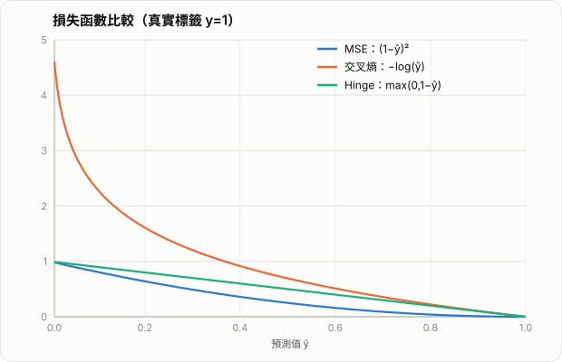

# AI 損失函數介紹

損失函數（Loss Function）是機器學習與深度學習訓練流程中的核心元件。模型在前向傳播時會輸出預測值，損失函數則負責衡量這個預測與真實標籤之間的差距。訓練的本質，就是透過最小化損失函數，調整參數使模型的行為逐步接近任務需求。

對進階學習者而言，損失函數不只是「算誤差的公式」，而是直接影響以下幾件事：

- 模型學到的統計假設
- 梯度的形狀與訓練穩定性
- 對離群值（outlier）的敏感度
- 分類機率的校準（calibration）
- 類別不平衡（class imbalance）下的學習效果
- 最終評估指標是否能被有效優化

因此，損失函數的選擇不是附屬細節，而是模型設計的一部分。

## 1. 損失函數、目標函數與經驗風險

設訓練資料為

$$
\{(x_i, y_i)\}_{i=1}^N
$$

模型參數為 $\theta$，模型輸出為 $\hat{y}_i = f_\theta(x_i)$。單筆樣本的損失可寫成：

$$
\ell(\hat{y}_i, y_i)
$$

整個資料集上的平均損失為：

$$
\mathcal{L}(\theta) = \frac{1}{N}\sum_{i=1}^{N}\ell(f_\theta(x_i), y_i)
$$

若再加入正則化項，例如 $L_2$ regularization，則常見的目標函數為：

$$
J(\theta) = \frac{1}{N}\sum_{i=1}^{N}\ell(f_\theta(x_i), y_i) + \lambda \Omega(\theta)
$$

其中：

- $\ell$ 是單筆樣本的損失函數
- $\mathcal{L}$ 是訓練集上的平均損失
- $\Omega(\theta)$ 是正則化項
- $J(\theta)$ 才是優化器真正最小化的目標函數

這裡的平均損失通常被視為經驗風險（empirical risk）。從統計學角度看，訓練其實是在用有限樣本近似真實資料分布下的期望風險。

## 2. 損失函數的兩個核心角色

### 2.1 衡量預測錯誤

最直觀的角色是比較 $\hat{y}$ 與 $y$ 的差距。例如回歸問題常看數值差距，分類問題則關心真實類別機率是否夠高。

### 2.2 提供可優化的梯度訊號

在深度學習中，更重要的是損失函數對模型參數的梯度：

$$
\nabla_\theta J(\theta)
$$

同樣都在衡量「錯」，不同損失函數產生的梯度可能差很多。這會直接影響：

- 收斂速度
- 是否容易梯度爆炸或過小
- 是否容易被少數極端樣本主導
- 對難樣本與易樣本的關注程度

因此，選 loss 不是只看定義是否合理，也要看它是否「好訓練」。



*圖：三種損失函數在真實標籤 $y=1$ 下隨預測值 $\hat{y}$ 的變化。交叉熵在 $\hat{y}\to 0$ 時懲罰最劇烈（對數趨向無限大），對低信心預測有強驅動力；MSE 則相對平滑；Hinge 在 $\hat{y}\ge 1$ 後損失直接歸零。*

## 3. 常見回歸損失函數

回歸任務的標籤通常是連續值，例如房價、溫度、流量、座標偏移量等。

### 3.1 Mean Squared Error, MSE

公式：

$$
\text{MSE} = \frac{1}{N}\sum_{i=1}^{N}(\hat{y}_i - y_i)^2
$$

特性：

- 對大誤差懲罰很重，因為誤差被平方
- 可微且梯度平滑，對梯度下降法友善
- 在高斯噪聲假設下，MSE 對應最大概似估計

梯度對單一預測值的形式為：

$$
\frac{\partial}{\partial \hat{y}_i}(\hat{y}_i-y_i)^2 = 2(\hat{y}_i-y_i)
$$

這表示誤差越大，梯度也越大。優點是模型能快速修正大錯誤；缺點是若資料含有離群值，少數樣本可能主導更新方向。

適用情境：

- 誤差分布近似高斯
- 希望大誤差被強力懲罰
- 任務對極端偏差很敏感

風險：

- 對 outlier 非常敏感
- 標籤尺度很大時，loss 與梯度也可能很大

### 3.2 Mean Absolute Error, MAE

公式：

$$
\text{MAE} = \frac{1}{N}\sum_{i=1}^{N}|\hat{y}_i - y_i|
$$

特性：

- 對離群值比 MSE 更穩健
- 對每個誤差的懲罰是線性的
- 對應拉普拉斯分布（Laplace）噪聲假設

優點：

- 不容易被極端樣本拖走
- 對異常值多的資料較穩定

缺點：

- 在誤差為 0 附近不可微，實作上通常使用次梯度（subgradient）
- 梯度大小近乎固定，誤差很大時也不會像 MSE 那樣給出更強修正力
- 最佳化通常比 MSE 更難

適用情境：

- 資料含有較多異常值
- 想降低少數極端樣本的影響

### 3.3 Huber Loss

Huber Loss 是 MSE 與 MAE 的折衷。公式如下：

$$
\ell_\delta(r)=
\begin{cases}
\frac{1}{2}r^2, & |r|\le\delta \\
\delta(|r|-\frac{1}{2}\delta), & |r|>\delta
\end{cases}
$$

其中 $r = \hat{y} - y$。

特性：

- 小誤差區域像 MSE，利於平滑收斂
- 大誤差區域像 MAE，降低 outlier 影響
- 實務上常比單純 MSE 更穩

適用情境：

- 回歸問題中同時存在一般樣本與少量異常值
- 需要兼顧穩定訓練與魯棒性

## 4. 常見分類損失函數

分類問題的核心不是「數值誤差差多少」，而是「真實類別的機率是否足夠高」。因此分類 loss 通常來自機率模型與最大概似估計。

### 4.1 Binary Cross Entropy, BCE

二元分類中，若真實標籤 $y \in \{0,1\}$，模型輸出正類機率 $p$，則 BCE 為：

$$
\text{BCE}(y,p) = -\big(y\log p + (1-y)\log(1-p)\big)
$$

特性：

- 當真實類別機率被模型預測得很低時，懲罰會很大
- 比平方誤差更適合機率輸出
- 來自 Bernoulli 分布下的負對數概似（negative log-likelihood）

如果模型輸出的是 logit $z$，常搭配 sigmoid：

$$
p = \sigma(z)=\frac{1}{1+e^{-z}}
$$

則 BCE 可視為對 sigmoid 後機率的對數懲罰。

### 4.2 BCEWithLogitsLoss 的重要性

實務上，很多框架提供像 PyTorch 的 `BCEWithLogitsLoss`。它不是「另一種 loss」，而是把：

- sigmoid
- binary cross entropy

整合成單一、數值更穩定的實作。

這樣做的原因是若先手動算 sigmoid，再做 log，當 logit 絕對值很大時容易有數值下溢或上溢問題。框架通常會用 log-sum-exp 技巧改寫公式，讓計算更穩定。

實務規則：

- 若用 `BCEWithLogitsLoss`，模型最後一層輸出應該是 logits，不要先做 sigmoid
- 若你已經手動做了 sigmoid，才應搭配普通 BCE

常見錯誤：

- `sigmoid` 後再餵 `BCEWithLogitsLoss`
- 這會等於重複做兩次 sigmoid，造成梯度與數值行為錯誤

### 4.3 Categorical Cross Entropy, CCE

多類別單標籤分類中，若共有 $C$ 類，模型輸出 logits 向量 $z$，經 softmax 後得到：

$$
p_i = \frac{e^{z_i}}{\sum_{j=1}^{C} e^{z_j}}
$$

真實標籤若使用 one-hot 向量 $y$，則交叉熵為：

$$
\text{CE}(y,p) = -\sum_{i=1}^{C} y_i \log p_i
$$

若 $y$ 為 one-hot，則只剩真實類別那一項：

$$
\text{CE}(y,p) = -\log p_{k}
$$

其中 $k$ 是正確類別索引。

特性：

- 只要模型把正確類別機率壓低，就會受到強烈懲罰
- 與 softmax 結合後，梯度形式漂亮且穩定
- 是多類分類的標準選擇

### 4.4 CrossEntropyLoss 與 softmax 的配對

像 PyTorch 的 `CrossEntropyLoss` 通常內部已經包含：

- `log_softmax`
- `negative log likelihood`

因此實務規則是：

- 若用 `CrossEntropyLoss`，最後一層輸出 logits，不要先做 softmax
- 若你先手動做 softmax，再丟入 `CrossEntropyLoss`，會讓數值穩定性變差，且梯度不如預期

原因主要有兩個：

- `CrossEntropyLoss` 預期輸入的是 logits，若你先做 softmax，相當於把機率化步驟重複做了一次
- `softmax` 後某些機率值可能非常接近 `0` 或 `1`，接著再做對數運算時更容易出現數值不穩

從工程角度看，這類錯誤最麻煩的地方在於它通常「能跑」，但 loss 曲線、梯度品質與收斂速度都會變差。

正確寫法通常是：

```python
logits = model(x)
loss = torch.nn.CrossEntropyLoss()(logits, target)
```

只有在推論或展示機率時，才另外做：

```python
probs = torch.softmax(logits, dim=1)
```

常見錯誤：

- 模型最後一層先 `softmax`
- 再餵 `CrossEntropyLoss`

這不是語法問題，而是訓練品質問題。

### 4.5 Multi-label Classification 與 BCE

多標籤分類（multi-label）與多類單選（multi-class）不同。

例如一張圖片可能同時有：

- 貓
- 沙發
- 人

這不是從多類中選一類，而是每個標籤都獨立判斷是否存在。此時正確作法通常是：

- 每個標籤輸出一個 logit
- 每個標籤各自做 sigmoid
- 使用 BCE 或 `BCEWithLogitsLoss`

這裡不應使用 softmax，因為 softmax 會強迫所有類別機率總和為 1，不符合多標籤任務的結構。

## 5. Focal Loss 與類別不平衡

在物件偵測、異常偵測、詐欺偵測等任務中，正負樣本可能極度不平衡。此時普通 BCE 或 CE 容易被大量「簡單負樣本」主導。

Focal Loss 的核心想法是降低容易樣本的權重，把學習焦點放到難樣本。二元形式常寫為：

$$
\text{FL}(p_t) = -\alpha (1-p_t)^\gamma \log(p_t)
$$

其中：

- $p_t$ 是對正確類別的預測機率
- $\alpha$ 控制類別權重
- $\gamma$ 控制對易樣本的抑制程度

性質：

- 當樣本很容易、$p_t$ 很高時，$(1-p_t)^\gamma$ 會讓 loss 變小
- 當樣本很難時，loss 保持較大

適用情境：

- 極端類別不平衡
- 負樣本遠多於正樣本
- 想提升少數難樣本的訓練比重

風險：

- 超參數 $\alpha,\gamma$ 需要調整
- 若資料本身不嚴重失衡，可能反而讓優化變慢

## 6. KL Divergence 與分布學習

KL Divergence 常用來衡量兩個分布之間的差異。若真實分布為 $P$，模型分布為 $Q$，則：

$$
D_{KL}(P\|Q)=\sum_i P(i)\log\frac{P(i)}{Q(i)}
$$

直覺上，它在回答的是：

- 如果真實世界遵循分布 $P$
- 但模型卻用分布 $Q$ 去描述
- 那麼模型多付出了多少資訊代價

因此，`KL Divergence` 不是單純比較兩個數值差距，而是在比較兩個分布的形狀是否一致。

在深度學習中，KL divergence 常出現在：

- 知識蒸餾（knowledge distillation）
- 變分自編碼器（VAE）
- 分布對齊與正則化
- label smoothing 的分析

需要注意：

- $D_{KL}(P\|Q)$ 與 $D_{KL}(Q\|P)$ 不對稱
- 它不是距離（distance），因為不滿足對稱性

### 6.1 一個二分類的數值例子

假設真實分布為：

$$
P = [0.9, 0.1]
$$

模型預測分布為：

$$
Q = [0.6, 0.4]
$$

則

$$
D_{KL}(P\|Q)
= 0.9\log\frac{0.9}{0.6} + 0.1\log\frac{0.1}{0.4}
$$

若使用自然對數，則近似為：

$$
D_{KL}(P\|Q) \approx 0.2263
$$

這表示模型分布 $Q$ 和真實分布 $P$ 仍有明顯差距。若模型改成預測：

$$
Q = [0.85, 0.15]
$$

那麼 KL divergence 會明顯變小，代表模型分布更接近真實分布。

也要注意：

$$
D_{KL}(P\|Q) \neq D_{KL}(Q\|P)
$$

所以 `KL Divergence` 是方向敏感的量，不能把它當成一般對稱距離來理解。

### 6.2 Cross Entropy 與 KL Divergence 的關係

交叉熵、熵與 KL divergence 之間有一個非常重要的關係：

$$
H(P,Q)=H(P)+D_{KL}(P\|Q)
$$

其中：

- $H(P,Q)$ 是模型分布 $Q$ 相對於真實分布 $P$ 的 cross entropy
- $H(P)$ 是真實分布自身的不確定性
- $D_{KL}(P\|Q)$ 是模型與真實分布的差距

對固定資料分布 $P$ 而言，$H(P)$ 是常數，所以最小化 cross entropy，本質上等價於最小化模型分布 $Q$ 與真實分布 $P$ 的 KL divergence。

這也是為什麼 cross entropy 在機率分類中具有堅實的統計解釋。

若真實標籤是 one-hot，例如：

$$
P = [1,0,0,\dots,0]
$$

則 $H(P)$ 會退化成常數，而 cross entropy 最後就等價於：

$$
-\log q_{\text{true class}}
$$

也就是說，分類任務中常見的 `CrossEntropyLoss`，本質上是在強迫模型把正確類別的機率拉高。

## 7. Label Smoothing

標準 one-hot 標籤會把正確類別機率設為 1，其餘設為 0。這會鼓勵模型變得非常自信，有時造成：

- 過度擬合
- 校準不佳
- 對錯標樣本過於敏感

Label smoothing 會把目標分布稍微攤平，例如：

- 正確類別不再是 1，而是 $1-\varepsilon$
- 其餘類別分到少量機率

其效果通常包括：

- 降低過度自信
- 改善泛化
- 讓輸出分布更平滑

但也有代價：

- 若任務需要非常尖銳的置信度，可能會壓低極限表現
- 在某些蒸餾或 calibration 任務中需額外評估是否合適

## 8. 不同任務該如何選損失函數

### 8.1 回歸

常見選擇：

- `MSE`：標準回歸、噪聲近似高斯、重視大誤差
- `MAE`：離群值多、想提升魯棒性
- `Huber Loss`：想在穩定與魯棒之間折衷

### 8.2 二元分類

常見選擇：

- `BCEWithLogitsLoss`

理由：

- 數值穩定
- 框架支援完整
- 直接輸入 logits，訓練流程簡潔

若類別嚴重不平衡，可考慮：

- class weight
- positive weight
- focal loss

### 8.3 多類單標籤分類

常見選擇：

- `CrossEntropyLoss`

理由：

- 直接處理 logits
- 內建 `log_softmax`
- 與 softmax 分類模型天然匹配

### 8.4 多標籤分類

常見選擇：

- `BCEWithLogitsLoss`

理由：

- 每個標籤是獨立 Bernoulli 預測
- 不應使用 softmax

### 8.5 分布匹配或生成模型

常見選擇：

- `KL Divergence`
- reconstruction loss + KL 項

這類任務的 loss 往往不是單一函數，而是多個項的加權組合。

## 9. 損失函數與 activation 的正確配對

這是實務中最常見的錯誤來源之一。

### 9.1 正確配對

二元分類：

- 模型輸出 logits
- loss 用 `BCEWithLogitsLoss`

多類單標籤分類：

- 模型輸出 logits 向量
- loss 用 `CrossEntropyLoss`

多標籤分類：

- 每個類別輸出一個 logit
- loss 用 `BCEWithLogitsLoss`

### 9.2 常見錯誤配對

錯誤一：

- 先 `sigmoid`
- 再 `BCEWithLogitsLoss`

錯誤二：

- 先 `softmax`
- 再 `CrossEntropyLoss`

錯誤三：

- 多標籤分類用 `softmax + cross entropy`

這些錯誤的本質不是函式名稱用錯，而是你把「機率化步驟」重複做了，或錯把任務結構理解成互斥類別。

## 10. 數值穩定性問題

深度學習實作中，loss 的數學形式常常不是直接照課本公式硬算，而是改寫成更穩定的版本。

### 10.1 為什麼會不穩定

若直接計算：

$$
\log(\sigma(z)), \qquad \log(\text{softmax}(z))
$$

當 $z$ 很大或很小時，可能出現：

- overflow
- underflow
- `log(0)`
- 梯度數值不穩

### 10.2 常見穩定技巧

- `log_softmax` 取代 `softmax` 再 `log`
- `BCEWithLogitsLoss` 取代 `sigmoid` 後手算 BCE
- log-sum-exp trick

因此，實務上應盡量使用框架提供的整合版 loss，而不是自己把 activation 與 log 拆開硬接。

## 11. 損失函數與評估指標不一定相同

這是一個常見但很重要的觀念。

模型訓練時優化的是 loss，但你真正關心的指標可能是：

- Accuracy
- F1-score
- AUC
- IoU
- BLEU
- ROUGE

這些指標常常：

- 不可微
- 不平滑
- 不適合直接拿來做梯度下降

因此實務上通常選擇一個可微且與目標指標高度相關的 surrogate loss。舉例：

- 分類任務常用 cross entropy 優化，即使最終看的是 accuracy 或 F1
- 偵測任務可能同時優化 classification loss 與 box regression loss

重點是：loss 是訓練時的優化代理，不一定等於最終商業指標。

## 12. 常見實務陷阱

### 12.1 只看 loss，不看任務指標

loss 降低不代表你在主要指標上一定進步。例如資料極度不平衡時，accuracy 看起來很高，但 recall 可能很差。

### 12.2 忽略標籤噪聲

cross entropy 對錯標資料可能相當敏感。當標註品質不佳時，可考慮：

- label smoothing
- robust loss
- data cleaning

### 12.3 把 outlier 問題交給 MSE

若資料中極端值很多，MSE 可能讓模型把大量能力花在追少數異常樣本上。這時應優先考慮 MAE 或 Huber。

### 12.4 忽略 loss 的縮放問題

不同 loss 的數值尺度可能完全不同。多任務學習中若同時使用多個 loss，必須考慮加權，否則某一項可能主導整體更新。

### 12.5 不了解 logits 與 probabilities 的差別

很多框架的 loss 輸入要的是 logits，不是機率。若混用，結果常常不是直接報錯，而是「能跑但訓練很差」。

## 13. 快速選型建議

如果只需要工程上的快速判斷，可以用下面這個簡化版本：

| 任務類型 | 常見選擇 | 備註 |
|---|---|---|
| 一般回歸 | `MSE` | 重視大誤差，假設較接近高斯噪聲 |
| 含離群值回歸 | `MAE` / `Huber` | `Huber` 通常是更穩健的折衷 |
| 二元分類 | `BCEWithLogitsLoss` | 不要先做 sigmoid |
| 多類單標籤分類 | `CrossEntropyLoss` | 不要先做 softmax |
| 多標籤分類 | `BCEWithLogitsLoss` | 每個標籤獨立 sigmoid |
| 類別極不平衡分類 | `Focal Loss` / weighted BCE | 視資料分布調整權重 |
| 分布對齊 / 蒸餾 | `KL Divergence` | 常搭配 soft target |

## 14. 總結

損失函數不是單純的誤差度量工具，而是模型訓練時最直接的學習訊號來源。它決定模型如何理解錯誤、如何分配梯度、如何面對離群值、如何處理類別不平衡，也決定了優化是否穩定。

從實務角度看，可以先記住幾條高頻原則：

- 回歸常從 `MSE`、`MAE`、`Huber Loss` 中選
- 二元分類優先考慮 `BCEWithLogitsLoss`
- 多類單標籤分類優先考慮 `CrossEntropyLoss`
- 多標籤分類通常不用 softmax，而用逐標籤 BCE
- 類別不平衡時，可考慮 weighted loss 或 `Focal Loss`
- 優先使用框架提供的整合版 loss，以避免數值穩定性問題

更進一步地說，選擇損失函數其實是在選擇一種學習偏好：你要模型更重視大錯誤，還是更重視整體穩健；你要更強的機率校準，還是更強的 hard example 聚焦；你要更貼近統計模型，還是更貼近最終商業指標。理解這些差異，才算真正掌握損失函數在 AI 訓練中的角色。
