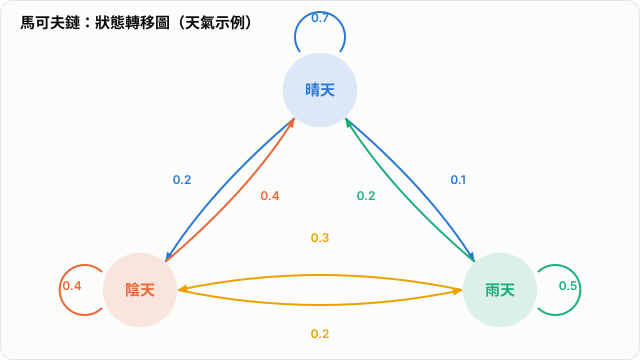

# 馬可夫鏈與隱馬可夫模型

馬可夫鏈（Markov Chain）是機率模型中的基本工具，用來描述一個系統如何隨時間在不同狀態之間轉移。它的核心假設是：**未來的狀態只依賴現在的狀態，而不依賴更早之前的歷史**。這種性質使馬可夫鏈成為分析隨機動態系統的重要基礎，也構成了隱馬可夫模型（Hidden Markov Model, HMM）、馬可夫決策過程（MDP）與部分機器學習方法的理論起點。

如果把馬可夫鏈視為「狀態如何變化」的模型，那麼 HMM 則可以視為「狀態不可直接觀察，但會生成可觀察訊號」的延伸。理解馬可夫鏈，有助於自然銜接到 HMM 的設計與應用。

## 1. 基本概念

馬可夫鏈描述一個離散時間隨機過程

$$
X_0, X_1, X_2, \dots
$$

其中每個 $X_t$ 都代表系統在時間 $t$ 所處的狀態。若此過程滿足

$$
P(X_{t+1}=j \mid X_t=i, X_{t-1}, \dots, X_0)
=
P(X_{t+1}=j \mid X_t=i)
$$

則稱其具有馬可夫性（Markov Property）。

這個條件表示：在知道目前狀態 $X_t=i$ 之後，過去的完整歷史不再提供額外資訊。直觀上，馬可夫鏈用「現在」濃縮了預測「下一步」所需的資訊。

### 常見元素

- `State`：系統可能處於的狀態。
- `Transition Probability`：從一個狀態轉移到另一個狀態的機率。
- `Step`：時間向前推進的一個離散單位。

## 2. 轉移機率與轉移矩陣

若狀態空間有限，馬可夫鏈可用轉移矩陣表示。假設系統有兩個狀態：

- `S`：晴天
- `R`：雨天

若其轉移規則如下：

- 今天是晴天，明天仍是晴天的機率為 `0.8`，變成雨天的機率為 `0.2`
- 今天是雨天，明天變成晴天的機率為 `0.4`，仍是雨天的機率為 `0.6`

則可寫成轉移矩陣

$$
P=
\begin{bmatrix}
0.8 & 0.2 \\
0.4 & 0.6
\end{bmatrix}
$$

矩陣中第 $i$ 列第 $j$ 行的值，表示從狀態 $i$ 轉移到狀態 $j$ 的機率。

## 3. 狀態分布的演化

若已知初始狀態分布

$$
\pi_0 = [1,\ 0]
$$

表示系統一開始 100% 位於晴天狀態，則一步之後的分布為

$$
\pi_1 = \pi_0 P
= [1,\ 0]
\begin{bmatrix}
0.8 & 0.2 \\
0.4 & 0.6
\end{bmatrix}
= [0.8,\ 0.2]
$$

這表示：

- 下一步為晴天的機率是 `0.8`
- 下一步為雨天的機率是 `0.2`

進一步可以得到

$$
\pi_2 = \pi_1 P, \qquad
\pi_3 = \pi_2 P
$$

因此馬可夫鏈不只描述單一步驟的變化，也描述整體狀態分布如何隨時間演進。

*圖：天氣的三狀態馬可夫鏈示例。每條有向箭頭上的數字為轉移機率，每個狀態的自環機率加上離開機率之和等於 1。*

## 4. 平穩分布

對某些馬可夫鏈而言，隨著時間推進，狀態分布會趨近某個固定分布 $\pi$，滿足

$$
\pi P = \pi
$$

這個 $\pi$ 稱為平穩分布（stationary distribution）。

平穩分布的重要性在於：

- 它描述了系統長期穩定下來後的行為。
- 在許多應用中，長期平均性質比短期狀態更有分析價值。

## 5. 馬可夫鏈的應用

馬可夫鏈常見於以下情境：

- 天氣變化建模
- 網頁排序，例如 PageRank
- 生物序列分析的基礎模型
- 金融市場中的狀態切換建模
- 排隊系統與可靠度分析

在這些問題中，重點往往不是單一事件，而是系統如何在多個狀態之間以機率方式持續變化。

## 6. 馬可夫鏈的限制

### 優點

- 結構清楚，容易以矩陣形式分析。
- 能有效描述具有狀態轉移特性的隨機系統。
- 是許多進階機率模型的理論基礎。

### 限制

- 馬可夫性假設可能過強，現實問題未必只依賴當前狀態。
- 若狀態定義不夠好，模型的預測能力會顯著下降。
- 只能直接描述「狀態轉移」，難以處理狀態不可見但有觀測資料的情況。

這最後一點正是 HMM 出現的原因。

## 7. 從馬可夫鏈到隱馬可夫模型

在一般馬可夫鏈中，系統狀態是可直接觀察的。例如「今天是晴天或雨天」本身就是狀態，也是我們能看到的資訊。

但在許多實際問題中，真正驅動系統的狀態無法直接觀察，只能看到由這些狀態產生的外部訊號。例如：

- 語音辨識中，真實發音狀態不可直接觀察，但可以觀察到聲學特徵
- 自然語言處理中，詞性或語法狀態可能是隱藏的，但可以觀察到詞彙序列
- 生物資訊中，基因功能狀態不可直接觀察，但可觀察到序列資料

這時就需要隱馬可夫模型。

## 8. 隱馬可夫模型的核心概念

隱馬可夫模型（Hidden Markov Model, HMM）可以理解為：

- 有一條看不見的隱藏狀態序列
- 這條隱藏狀態序列本身遵守馬可夫鏈
- 每個隱藏狀態會以某種機率產生一個可觀察輸出

因此，HMM 在結構上保留了馬可夫鏈的狀態轉移機制，但多加了一層「由隱藏狀態生成觀測值」的機制。

### 兩種變數

- `Hidden State`：真正描述系統內部狀況，但無法直接觀察
- `Observation`：實際能量測或看到的輸出訊號

HMM 的關鍵在於：觀測值不是直接按照前一步觀測值轉移，而是透過隱藏狀態間接生成。

## 9. HMM 的兩個基本假設

### 9.1 隱藏狀態滿足馬可夫性

若以 $q_t$ 表示時間 $t$ 的隱藏狀態，則有

$$
P(q_{t+1} \mid q_t, q_{t-1}, \dots, q_1)
=
P(q_{t+1} \mid q_t)
$$

也就是說，HMM 的內部狀態轉移仍然是一條馬可夫鏈。

### 9.2 觀測值只依賴當前隱藏狀態

若以 $o_t$ 表示時間 $t$ 的觀測值，則有

$$
P(o_t \mid q_t, q_{t-1}, \dots, o_{t-1}, \dots)
=
P(o_t \mid q_t)
$$

這表示在知道當前隱藏狀態後，過去的狀態與觀測值不再額外影響當前觀測值的分布。

## 10. HMM 的三個組成部分

一個標準 HMM 通常由三部分決定：

### 10.1 初始狀態機率

$$
\pi_i = P(q_1 = s_i)
$$

表示一開始位於狀態 $s_i$ 的機率。

### 10.2 狀態轉移機率

$$
a_{ij} = P(q_{t+1} = s_j \mid q_t = s_i)
$$

這一部分與馬可夫鏈的轉移矩陣完全對應。

### 10.3 發射機率

$$
b_j(o_t) = P(o_t \mid q_t = s_j)
$$

發射機率（emission probability）描述：若系統目前在隱藏狀態 $s_j$，那麼觀測到 $o_t$ 的機率是多少。

這一項是 HMM 相對於一般馬可夫鏈最關鍵的新增結構。

## 11. HMM 的直觀例子

假設某人每天的心情狀態不可直接觀察，可能是：

- `開心`
- `憂鬱`

但我們能觀察到他每天的外在行為，例如：

- `微笑`
- `沉默`

那麼：

- 隱藏狀態是 `開心 / 憂鬱`
- 觀測值是 `微笑 / 沉默`

模型假設是：

- 今天的心情會影響明天的心情
- 今天的心情也會影響今天表現出的行為

因此，我們觀察到的是

`微笑 -> 微笑 -> 沉默 -> 微笑`

但真正隱藏在背後的狀態可能是

`開心 -> 開心 -> 憂鬱 -> 開心`

HMM 的目的之一，就是根據外部觀測資料，推測最可能的隱藏狀態序列。

## 12. HMM 的三類基本問題

HMM 經典上處理三個基本問題。

### 12.1 Evaluation

給定模型參數與觀測序列，計算這串觀測資料出現的機率：

$$
P(o_1, o_2, \dots, o_T \mid \lambda)
$$

其中 $\lambda$ 表示整個 HMM 模型參數。

這個問題用來回答：某個模型對觀測資料的解釋能力有多高。

### 12.2 Decoding

給定模型與觀測序列，找出最可能的隱藏狀態序列。

這個問題對應到序列標註、語音辨識與生物序列分析中的路徑推斷。

### 12.3 Learning

當模型參數未知時，根據觀測資料估計最合適的初始機率、轉移機率與發射機率。

這是 HMM 的參數學習問題，也是模型真正能從資料中建立起來的關鍵。

## 13. HMM 的常見演算法

### Forward Algorithm

用來有效計算觀測序列的總機率，避免直接枚舉所有可能的隱藏狀態序列。

### Backward Algorithm

與 Forward Algorithm 對偶，從序列尾端往前計算機率，用於推導與訓練。

### Viterbi Algorithm

用來找出最可能的單一路徑，也就是最可能的隱藏狀態序列。

### Baum-Welch Algorithm

這是以 Expectation-Maximization（EM）為基礎的學習方法，用來在觀測資料已知但隱藏狀態未知時估計 HMM 參數。

## 14. HMM 在 AI 中的應用

HMM 在早期 AI 與統計學習中扮演過非常重要的角色，常見於：

- 語音辨識
- 自然語言處理
- 詞性標註
- 生物資訊，例如 DNA 與蛋白質序列分析
- 異常偵測與時間序列分析

即使深度學習後來在許多任務中取代了 HMM，HMM 仍然是理解序列建模與機率推理的重要基礎模型。

## 15. HMM 的優點與限制

### 優點

- 結構清楚，數學定義完整
- 能處理隱藏狀態與觀測值分離的序列問題
- 解釋性強，適合分析具有時序與狀態結構的資料

### 限制

- 隱藏狀態仍遵守一階馬可夫假設，可能過於簡化
- 發射分布的設計若不合適，模型效果會明顯受限
- 難以表示長距離依賴與高度複雜的非線性關係

這些限制也說明了為何後來的 RNN、LSTM 與 Transformer 會在更複雜的序列任務中逐漸成為主流。

## 16. 與其他模型的關係

從概念上可以這樣理解：

- `Markov Chain`：狀態可見，只建模狀態轉移
- `HMM`：狀態不可見，但由隱藏狀態生成觀測值
- `MDP`：在馬可夫鏈基礎上加入行動與回饋
- `Reinforcement Learning`：常以 MDP 為數學框架研究決策與學習

因此，馬可夫鏈不是孤立的單一模型，而是一整類序列與決策模型的共同基礎。

## 17. 小結

馬可夫鏈提供了一個簡潔但有力的框架，用來描述系統如何在狀態之間以機率方式轉移。其核心在於馬可夫性，也就是「未來只依賴現在」的假設。當狀態本身可觀察時，馬可夫鏈已能處理許多動態系統問題。

然而，當真實狀態不可直接觀察，只能透過外部訊號間接推測時，就需要 HMM。HMM 保留了馬可夫鏈的轉移結構，並加入了觀測生成機制，使其更適合語音、語言、生物資訊與各種序列資料分析任務。

可以把兩者的關係概括為一句話：

> 馬可夫鏈描述「狀態如何轉移」，隱馬可夫模型描述「看不見的狀態如何轉移，並如何生成我們看得見的訊號」。
