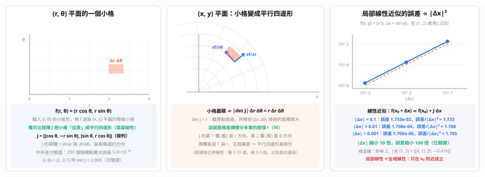
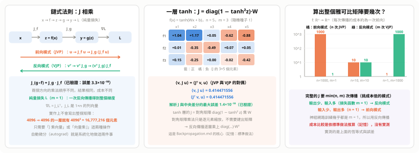
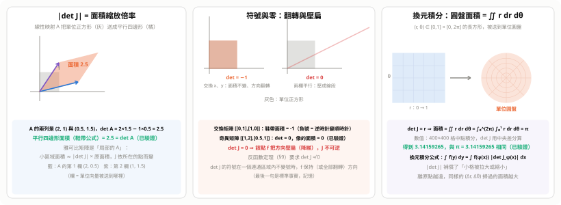
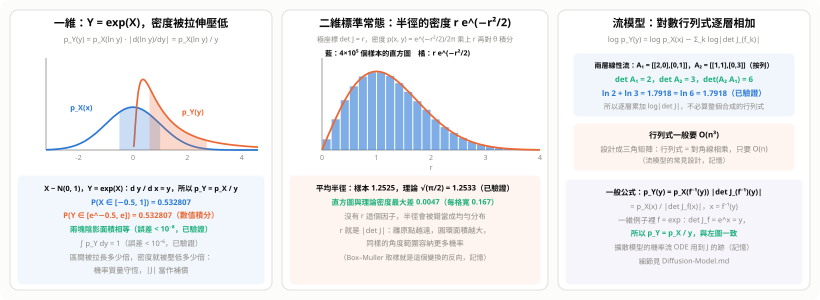
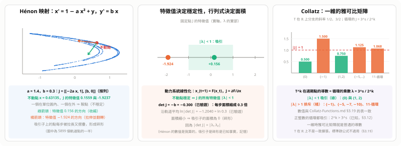

# 雅可比矩陣（Jacobian）：多變數函數的導數

雅可比矩陣是「輸入、輸出都是向量時的導數」。單變數函數的導數是一個數（斜率）；多變數函數在某一點附近的最佳線性近似，是一個矩陣，這個矩陣就是雅可比矩陣。

> 標示「（已驗證）」者，是我用程式實際算過的結果；「記憶」為依印象整理、未核對的說法。

---

## 目錄

1. [超白話版](#0-超白話版)
2. [定義](#1-定義)
3. [意義：局部線性近似](#2-意義局部線性近似)
4. [例子：極座標](#3-例子極座標)
5. [特例：梯度、一維、線性函數](#4-特例梯度一維線性函數)
6. [鏈式法則與反向傳播](#5-鏈式法則與反向傳播)
7. [行列式：體積縮放與換元積分](#6-行列式體積縮放與換元積分)
8. [機率：變數變換與流模型](#7-機率變數變換與流模型)
9. [動力系統：穩定性與線性化](#8-動力系統穩定性與線性化)
10. [反函數定理](#9-反函數定理)
11. [怎麼算](#10-怎麼算)
12. [常見誤解](#11-常見誤解)
13. [與本庫其他筆記的連結](#12-與本庫其他筆記的連結)
14. [小結](#13-小結)

---

## 0. 超白話版

- 單變數函數的導數告訴你：輸入動一點點，輸出動多少。
- 多變數函數有很多輸入、很多輸出，「動多少」要用一張表（矩陣）來回答：第 $j$ 個輸入動一點點，第 $i$ 個輸出動多少。這張表就是雅可比矩陣。
- 三個最常見的用途：
  1. **局部線性化**：在一個點附近，把複雜函數當成矩陣乘法。
  2. **鏈式法則**：複合函數的導數，是雅可比矩陣相乘；反向傳播就是這件事。
  3. **換元積分**：它的行列式是「局部的面積（體積）縮放倍率」。

---

## 1. 定義

設 $\mathbf{f}:\mathbb{R}^n\to\mathbb{R}^m$，輸入 $\mathbf{x}=(x_1,\dots,x_n)$，輸出 $\mathbf{y}=(f_1,\dots,f_m)$。雅可比矩陣 $J$ 是 $m\times n$ 的矩陣，第 $i$ 列第 $j$ 欄放「第 $i$ 個輸出對第 $j$ 個輸入的偏導數」：

$$
J=\frac{\partial\mathbf{f}}{\partial\mathbf{x}}=
\begin{pmatrix}
\frac{\partial f_1}{\partial x_1} & \cdots & \frac{\partial f_1}{\partial x_n}\\
\vdots & \ddots & \vdots\\
\frac{\partial f_m}{\partial x_1} & \cdots & \frac{\partial f_m}{\partial x_n}
\end{pmatrix}
$$

**輸出是列、輸入是欄。** 例： $f(x,y)=(x^2y,\ 5x+\sin y)$，則

$$
J=\begin{pmatrix}2xy & x^2\\ 5 & \cos y\end{pmatrix},\qquad
J(1,2)=\begin{pmatrix}4 & 1\\ 5 & -0.416\end{pmatrix}
$$

$J$ 依賴所在的點：不同的點，矩陣不同。

---

## 2. 意義：局部線性近似

在點 $\mathbf{x}_0$ 附近，

$$
\mathbf{f}(\mathbf{x}_0+\Delta\mathbf{x})\approx\mathbf{f}(\mathbf{x}_0)+J\,\Delta\mathbf{x}
$$

也就是說， $J$ 描述「輸入往各個方向微小移動時，輸出怎麼變」。幾何上， $J$ 的第 $j$ 欄是「把第 $j$ 個輸入軸方向的單位小段送到哪裡」；一個小方塊被送成一個小平行四邊形。

**誤差有多小（已驗證）**：用上面的例子，在 $(1,2)$ 處，沿固定方向取不同長度的 $\Delta\mathbf{x}$：

| $\lvert\Delta\mathbf{x}\rvert$ | 線性近似的誤差 | 誤差 $/\lvert\Delta\mathbf{x}\rvert^2$ |
|---|---|---|
| 0.1 | $1.733\times10^{-2}$ | 1.733 |
| 0.01 | $1.708\times10^{-4}$ | 1.708 |
| 0.001 | $1.705\times10^{-6}$ | 1.705 |

$\Delta\mathbf{x}$ 縮小 10 倍，誤差縮小 100 倍，誤差與 $\lvert\Delta\mathbf{x}\rvert^2$ 成正比（二階小量）。這就是「可微」的意思：線性部分之外的誤差比 $\lvert\Delta\mathbf{x}\rvert$ 更快趨於 0。

---

## 3. 例子：極座標

極座標轉直角座標： $x=r\cos\theta$， $y=r\sin\theta$。輸入 $(r,\theta)$，輸出 $(x,y)$：

$$
J=\begin{pmatrix}\cos\theta & -r\sin\theta\\ \sin\theta & r\cos\theta\end{pmatrix},\qquad \det J=r
$$

- 第 1 欄 $(\cos\theta,\sin\theta)$ 是「沿 $r$ 增加方向」的單位向量，長度 1。
- 第 2 欄 $(-r\sin\theta,\ r\cos\theta)$ 是「沿 $\theta$ 增加方向」，長度 $r$，與第 1 欄垂直。
- 兩條邊垂直，所以小格近似為矩形，面積是 $1\times r\times\Delta r\,\Delta\theta=r\,\Delta r\,\Delta\theta$。

**驗證（已驗證）**：我在 200 個隨機點 $(r,\theta)$ 比較解析的 $J$ 與中央差分（ $h=10^{-6}$），最大誤差是 $5.0\times10^{-10}$； $\det J=r$ 精確成立。

---

## 4. 特例：梯度、一維、線性函數

- **一維**： $n=m=1$ 時， $J$ 就是一般的導數 $f'(x)$。
- **純量函數**： $m=1$（輸出是一個數，如損失函數 $L$）， $J$ 是 $1\times n$ 的列向量，就是梯度的轉置： $J=(\nabla L)^\top$。
- **線性函數**： $\mathbf{f}(\mathbf{x})=A\mathbf{x}$ 的雅可比矩陣處處等於 $A$。所以矩陣可以看成「線性函數的導數」。
- **Hessian**：純量函數 $L$ 的 Hessian 矩陣，是它的梯度（一個向量函數）的雅可比矩陣： $H=J_{\nabla L}$。

---

## 5. 鏈式法則與反向傳播

若 $\mathbf{z}=\mathbf{f}(\mathbf{x})$， $\mathbf{y}=\mathbf{g}(\mathbf{z})$，則複合函數的雅可比矩陣是

$$
J_{g\circ f}(\mathbf{x})=J_g(\mathbf{z})\,J_f(\mathbf{x})
$$

**驗證（已驗證）**：取 $g(u,v)=(u+v,\ uv)$ 與上面的 $f$，在 $(1,2)$ 處， $J_gJ_f$ 與 $g\circ f$ 的中央差分雅可比矩陣最大差 $3.3\times10^{-10}$。

**兩個方向**：把鏈式法則的矩陣連乘，可以從右往左乘，也可以從左往右乘：

| 模式 | 做的事 | 每次得到 |
|---|---|---|
| 前向模式（JVP） | $u\mapsto Ju$，把一個輸入方向往前推 | $J$ 的一個線性組合欄（ $m$ 維向量） |
| 反向模式（VJP） | $v\mapsto v^\top J$，把一個輸出方向往回拉 | $J$ 的一個線性組合列（ $n$ 維向量） |

兩者互為轉置： $\langle v,Ju\rangle=\langle J^\top v,u\rangle$。我用一層 $\tanh$ 網路 $f(\mathbf{x})=\tanh(W\mathbf{x}+\mathbf{b})$（ $n=5$， $m=3$，隨機種子 1）驗證，兩邊都是 $0.414471556$（已驗證）。這一層的雅可比矩陣有簡單的形式 $J=\mathrm{diag}(1-\tanh^2 z)\,W$，與中央差分的最大誤差 $1.4\times10^{-10}$（已驗證）。

**為什麼訓練神經網路用反向傳播**：要得到整個 $J$，前向模式需要 $n$ 次 JVP，反向模式需要 $m$ 次 VJP；挑次數少的。損失函數是純量（ $m=1$），所以反向傳播一次就得到整個梯度。這是依標準做法推算（記憶），我沒有實測成本。

**實作上不會寫出整個矩陣**：一層 $4096\to4096$ 的 $J$ 就有 $4096^2=16{,}777{,}216$ 個元素。實際只做「 $J$ 乘向量」或「向量乘 $J$」，自動微分（autograd）就是系統化地做這兩件事。

---

## 6. 行列式：體積縮放與換元積分

當 $m=n$ 時， $J$ 是方陣，它的行列式 $\det J$ 有幾何意義：

- $\lvert\det J\rvert$ 是局部的**面積（體積）縮放倍率**。
- $\det J$ 的符號表示方向是否被翻轉（負號 = 翻轉）。
- $\det J=0$ 表示被壓扁（降維），該點是奇異點。

**換元積分**：若 $\mathbf{y}=\varphi(\mathbf{x})$ 是一對一的，

$$
\int f(\mathbf{y})\,d\mathbf{y}=\int f(\varphi(\mathbf{x}))\,\lvert\det J_\varphi(\mathbf{x})\rvert\,d\mathbf{x}
$$

**驗證（已驗證）**：

- 單位圓的面積。用極座標， $\iint r\,dr\,d\theta$；我用中央差分算 $\lvert\det J\rvert$，在 $400\times400$ 的格點上做中點積分，得到 $3.14159265$，與 $\pi$ 相同（到小數第 8 位）。
- 單位正方形在矩陣 $A$ 下的像（ $A$ 的兩列是 $(2,\ 1)$ 與 $(0.5,\ 1.5)$），是平行四邊形，面積 $2.5=\det A$。
- 符號與零：交換矩陣（兩列是 $(0,\ 1)$ 與 $(1,\ 0)$）的 $\det=-1$，鞋帶公式算出的有向面積也是 $-1$（方向被翻轉）；奇異矩陣（兩列是 $(1,\ 2)$ 與 $(0.5,\ 1)$）的 $\det=0$，單位正方形被壓成線段，面積 $0$。

---

## 7. 機率：變數變換與流模型

機率密度也要乘上雅可比行列式。若 $\mathbf{Y}=\mathbf{f}(\mathbf{X})$， $\mathbf{f}$ 可逆，則

$$
p_Y(\mathbf{y})=p_X\left(\mathbf{f}^{-1}(\mathbf{y})\right)\,\lvert\det J_{f^{-1}}(\mathbf{y})\rvert
$$

**例（已驗證）**：二維標準常態 $(X,Y)$ 改用極座標，因為 $\det J=r$，半徑的密度是 $r\,e^{-r^2/2}$，平均值是 $\sqrt{\pi/2}=1.2533$。我取 $4\times10^5$ 個樣本，平均半徑是 $1.2525$。

**一維例（已驗證）**： $X\sim N(0,1)$， $Y=e^X$， $dy/dx=y$，所以 $p_Y(y)=p_X(\ln y)/y$。區間 $X\in[-0.5,1]$ 的機率是 $0.532807$，對應區間 $Y\in[e^{-0.5},e]$ 用數值積分得 $0.532807$，兩者相差小於 $10^{-8}$； $\int p_Y\,dy=1$（誤差小於 $10^{-6}$）。二維例子的直方圖與理論密度的最大差是 $0.0047$（每格寬 $0.167$）。

**正規化流（normalizing flow）**（記憶）：用一連串可逆的變換把簡單的分布（如標準常態）變成複雜的分布，對數密度是

$$
\log p_Y(\mathbf{y})=\log p_X(\mathbf{x})-\log\lvert\det J_f(\mathbf{x})\rvert
$$

行列式的計算是 $O(n^3)$，所以流模型的設計重點，是讓 $J$ 是三角矩陣之類的形狀，使行列式只要把對角線相乘。兩層線性流的例子（已驗證）： $\det A_1=2$、 $\det A_2=3$、 $\det(A_2A_1)=6$， $\ln2+\ln3=\ln6$，所以逐層累加 $\log\lvert\det J\rvert$ 就好，不必算整個合成的行列式。擴散模型的機率流 ODE 用到的是雅可比矩陣的跡（瞬時的變數變換公式），細節見 `Diffusion-Model.md`（記憶）。

---

## 8. 動力系統：穩定性與線性化

映射 $\mathbf{x}_{t+1}=F(\mathbf{x}_t)$ 在不動點 $\mathbf{x}^*$ 附近，行為由 $J=\partial F/\partial\mathbf{x}$ 的特徵值決定：

- 所有特徵值 $\lvert\lambda\rvert<1$：不動點吸引（穩定）。
- 有任何特徵值 $\lvert\lambda\rvert>1$：不動點排斥（不穩定）。
- $\lvert\det J\rvert=\lvert\lambda_1\lambda_2\rvert$ 是每步的面積縮放倍率。

**例：Hénon 映射**（已驗證）： $x'=1-ax^2+y$， $y'=bx$，取 $a=1.4$， $b=0.3$，雅可比矩陣是

$$
J=\begin{pmatrix}-2ax&1\\b&0\end{pmatrix}
$$

結果：

| 量 | 值 |
|---|---|
| 不動點 $x$ | $0.63135$ |
| $J$ 的特徵值 | $0.1559$ 與 $-1.9237$ |
| $\det J$ | $-b=-0.300$ |
| 沿軌道平均 $\ln\lvert\det J\rvert$ | $-1.2040=\ln0.3$ |

一個特徵值在單位圓內、一個在外，所以不動點是鞍點，不穩定；每步面積縮成 $0.3$ 倍，所以吸引子的面積是 0，是碎形（已知事實，記憶）。

**一維的特例：Collatz**。Collatz 映射 $T$ 在實數軸上的導數就是 $1\times1$ 的雅可比矩陣：偶數分支的斜率是 $\frac12$，奇數分支是 $\frac32$。長度 $k$、含 $s$ 個奇數步的循環，其乘數 $\lambda=3^s/2^k$ 就是 $T^k$ 在週期點的導數。五個已知的整數循環是 $\frac12,\ \frac32,\ \frac34,\ \frac98,\ \frac{2187}{2048}$， $\lvert\lambda\rvert<1$ 的吸引，其餘排斥（已驗證，見 `Collatz-Functions.md` §3.19）。

---

## 9. 反函數定理

若 $\mathbf{f}:\mathbb{R}^n\to\mathbb{R}^n$ 在 $\mathbf{x}_0$ 處連續可微，且 $J(\mathbf{x}_0)$ 可逆（ $\det J\neq0$），則 $\mathbf{f}$ 在 $\mathbf{x}_0$ 附近有可微的反函數，且

$$
J_{f^{-1}}(\mathbf{f}(\mathbf{x}_0))=\left(J_f(\mathbf{x}_0)\right)^{-1}
$$

**驗證（已驗證）**：極座標的反函數是 $(x,y)\mapsto(\sqrt{x^2+y^2},\ \mathrm{atan2}(y,x))$。在 $(r,\theta)=(2,0.7)$，反函數的中央差分雅可比矩陣乘以原本的 $J$，得到單位矩陣；反函數的 $\det=0.5=1/r$。在原點 $r=0$， $\det J=0$，反函數不存在（所有 $\theta$ 都被送到原點）。

---

## 10. 怎麼算

| 方法 | 說明 |
|---|---|
| 手算偏導數 | 小例子最清楚 |
| 數值差分 | 中央差分 $\frac{f(x+h)-f(x-h)}{2h}$，上面用 $h=10^{-6}$ 得到約 $10^{-10}$ 的誤差；每個輸入要多算兩次 $f$ |
| 自動微分（autograd） | 前向或反向模式，精確到機器精度，成本是常數倍的一次前向（記憶） |
| 符號運算 | 得到解析式，但表達式可能膨脹 |

---

## 11. 常見誤解

1. **「雅可比矩陣」與「雅可比行列式」不同**：前者是 $m\times n$ 的矩陣，後者只有方陣才有，是它的行列式。有些書說「雅可比」時指行列式。
2. **排列的慣例**：本文用「輸出為列、輸入為欄」。有些書把梯度寫成欄向量，把 $J$ 轉置；看公式時要先確認慣例。
3. **$J$ 是某一點的**：它隨 $\mathbf{x}$ 變，沒有「這個函數的雅可比矩陣」這種說法，要指明在哪一點。
4. **局部線性不是全域線性**：誤差是二階小量，離 $\mathbf{x}_0$ 遠了就不準。

---

## 12. 與本庫其他筆記的連結

| 筆記 | 連結 |
|---|---|
| [反向傳播](Backpropagation.md) | 以鏈式法則沿計算圖回傳梯度，就是反向模式的 VJP |
| [鏈式法則](Chain-Rule.md) | 單變數鏈式法則是 $1\times1$ 的特例 |
| [矩陣、內積與外積](Matrix.md) | 線性函數的雅可比矩陣就是矩陣本身 |
| [梯度下降](Gradient-Descent.md) | 梯度是純量函數雅可比矩陣的轉置；Hessian 是梯度的雅可比矩陣 |
| [擴散模型](Diffusion-Model.md) | 機率流與變數變換用到雅可比行列式（記憶） |
| [奇異值分解](SVD.md) | $J$ 的奇異值是局部各個方向的伸縮倍率（記憶） |
| [黎曼幾何](Riemannian-Geometry.md) | 換座標時度量與體積元素的變換用到雅可比矩陣（記憶） |
| [冰雹猜想：函數、變換與算子](Collatz-Functions.md) | 循環的乘數是 $T^k$ 的一維雅可比矩陣（§3.19） |

---

## 13. 小結

- 雅可比矩陣 $J_{ij}=\partial f_i/\partial x_j$ 是多變數函數在一點的局部線性近似，誤差是二階小量。
- 鏈式法則： $J_{g\circ f}=J_gJ_f$；前向模式與反向模式只是乘法的順序不同，反向傳播（ $m=1$）一次得到整個梯度。
- $\lvert\det J\rvert$ 是局部體積縮放倍率，用在換元積分與機率密度的變數變換。
- 不動點的穩定性看 $J$ 的特徵值；一維時 $J$ 就是導數，Collatz 循環的乘數是例子。
- 本文的數值（極座標、線性近似誤差、鏈式法則、 $\tanh$ 層的對偶、單位圓面積、Hénon 映射、反函數定理）都用程式驗證過；標「記憶」的是依印象寫的標準結果。
