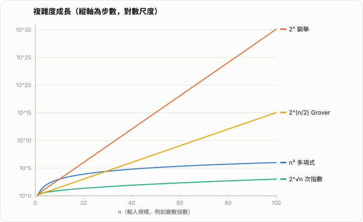

# AI 與 NP 問題

NP 問題是計算複雜度理論的核心議題，也是 AI 領域反覆遇到的瓶頸：訓練、規劃、推論、組合優化背後，常常藏著一個 NP-hard 問題。本文先釐清 P、NP、NP-complete 的定義，再說明 AI 在哪裡遇到它們、目前如何應對，以及最新的研究討論。

對進階學習者而言，重點不是「NP 很難所以放棄」，而是理解以下幾件事：

- 「難」指的是最壞情況（worst case）的漸近行為，不等於實務上都解不了
- 驗證與求解的不對稱，是 NP 的本質
- AI 的角色多半是提供好的啟發式，而不是證明最優
- 神經網路本身的計算能力有理論上限

## 1. 基本定義

### 1.1 問題與時間複雜度

計算複雜度以輸入長度 $n$ 為變數，衡量演算法所需的步數。若步數上界為 $n^k$（$k$ 為常數），稱為**多項式時間**；若為 $2^n$ 之類，稱為**指數時間**。

複雜度類別多以**決策問題**（答案為是 / 否）定義。優化問題可轉為決策版，例如 TSP 優化版是「找最短路徑」，決策版是「是否存在長度不超過 $K$ 的路徑」。

### 1.2 P 與 NP

$$
\mathrm{P} = \{\text{能在多項式時間內被決定性演算法解出的問題}\}
$$

$$
\mathrm{NP} = \{\text{給定答案（證書），能在多項式時間內驗證的問題}\}
$$

> NP 是 Nondeterministic Polynomial time 的縮寫，**不是**「Non-Polynomial」。

形式化地說，語言 $L \in \mathrm{NP}$ 若存在多項式時間驗證器 $V$ 與多項式 $p$，使得：

$$
x \in L \iff \exists w,\ |w| \le p(|x|),\ V(x, w) = 1
$$

其中 $w$ 稱為**證書**（certificate / witness）。

顯然 $\mathrm{P} \subseteq \mathrm{NP}$：能直接解，就能驗證。

### 1.3 NP-hard 與 NP-complete

若問題 $A$ 可以在多項式時間內歸約（reduce）到問題 $B$，記作 $A \le_p B$，直覺上表示 $B$ 至少和 $A$ 一樣難。

- **NP-hard**：所有 NP 問題都能歸約到它。它不一定在 NP 內。
- **NP-complete**：既在 NP 內，又是 NP-hard。

$$
\mathrm{NPC} = \mathrm{NP} \cap \mathrm{NP\text{-}hard}
$$

Cook–Levin 定理（1971）證明 SAT 是第一個 NP-complete 問題。之後 Karp（1972）列出 21 個 NP-complete 問題，其後有數千個問題被證明屬於此類。

### 1.4 P vs NP

$$
\mathrm{P} \overset{?}{=} \mathrm{NP}
$$

這是 Clay 數學研究所千禧年大獎難題之一。實務共識是 $\mathrm{P} \ne \mathrm{NP}$，但沒有證明。只要有人為任一 NP-complete 問題找到多項式時間演算法，就等於證明 $\mathrm{P} = \mathrm{NP}$。

```text
        ┌──────────────────────────────┐
        │ NP-hard                      │
        │   ┌────────────────────┐     │
        │   │ NP                 │     │
        │   │   ┌────────┐       │     │
        │   │   │   P    │       │     │
        │   │   └────────┘       │     │
        │   │        NP-complete │ ←── 交集
        │   └────────────────────┘     │
        └──────────────────────────────┘
        （假設 P ≠ NP 時的示意圖）
```

## 2. 經典 NP-complete 問題

| 問題 | 描述 |
|---|---|
| SAT / 3-SAT | 布林公式是否存在使其為真的賦值 |
| TSP（決策版） | 是否存在長度不超過 $K$ 的環遊路徑 |
| 圖著色 | 是否能用 $k$ 種顏色使相鄰節點異色（$k\ge 3$） |
| 子集和 / 背包 | 是否存在子集總和等於目標值 |
| 頂點覆蓋 | 是否存在大小不超過 $k$ 的頂點集合覆蓋所有邊 |
| 哈密頓路徑 | 是否存在經過每個節點恰好一次的路徑 |
| 整數規劃 | 整數變數的線性約束是否可行 |

### 2.1 以 SAT 看「驗證容易、求解困難」

3-SAT 公式例如：

$$
\varphi = (x_1 \lor \lnot x_2 \lor x_3) \land (\lnot x_1 \lor x_2 \lor x_4) \land \cdots
$$

- **驗證**：給定賦值，逐子句檢查，時間 $O(m)$。
- **求解**：暴力枚舉要試 $2^n$ 種賦值。

這個不對稱，就是 NP 的核心。

#### 逐步演練：驗證 vs 窮舉

取一個具體的小公式，$n=3$ 個變數、$m=3$ 個子句：

$$
\varphi = (x_1 \lor x_2 \lor \lnot x_3) \land (\lnot x_1 \lor x_2 \lor x_3) \land (x_1 \lor \lnot x_2 \lor x_3)
$$

**(A) 驗證一個「證書」**：有人聲稱 $(x_1, x_2, x_3) = (\text{T}, \text{T}, \text{F})$ 可滿足。逐子句檢查：

| 子句 | 代入 | 結果 |
|---|---|---|
| $x_1 \lor x_2 \lor \lnot x_3$ | $\text{T} \lor \text{T} \lor \text{T}$ | ✅ 真 |
| $\lnot x_1 \lor x_2 \lor x_3$ | $\text{F} \lor \text{T} \lor \text{F}$ | ✅ 真 |
| $x_1 \lor \lnot x_2 \lor x_3$ | $\text{T} \lor \text{F} \lor \text{F}$ | ✅ 真 |

三句全真，所以 $\varphi$ 為真。這只花了 $3$ 次子句檢查——**驗證很便宜**（$O(m)$）。

**(B) 從頭求解**：沒有證書時，最壞要掃完 $2^3 = 8$ 列真值表：

| # | $x_1$ | $x_2$ | $x_3$ | $\varphi$ |
|---|---|---|---|---|
| 0 | F | F | F | ✅（三句都靠某個文字為真） |
| 1 | F | F | T | ❌ 第 1 句 $\text{F}\lor\text{F}\lor\text{F}$ 為假 |
| 2 | F | T | F | ✅ |
| 3 | F | T | T | ✅ |
| 4 | T | F | F | ✅ |
| 5 | T | F | T | ✅ |
| 6 | T | T | F | ✅ |
| 7 | T | T | T | ✅ |

變數每多一個，表就長一倍。$n=100$ 時 $2^{100}\approx 10^{30}$ 列，窮舉就不可行了——**求解很貴**。

### 2.2 歸約的例子

歸約是證明某問題困難的標準工具。例如 3-SAT $\le_p$ 頂點覆蓋：

1. 對每個變數 $x_i$，建立兩個節點 $x_i$、$\lnot x_i$，並連邊。
2. 對每個子句，建立一個三角形，三個節點對應該子句的三個文字。
3. 把三角形節點連到圖中對應的文字節點。
4. 公式可滿足，當且僅當此圖存在大小為 $n + 2m$ 的頂點覆蓋。

#### 逐步演練：一個具體的歸約實例

取 $n=2$ 個變數、$m=1$ 個子句的迷你公式：

$$
\varphi = (x_1 \lor x_2 \lor \lnot x_2)
$$

**第 1 步：變數小工具（gadget）**。每個變數建一條邊連接它的兩個文字：

```text
x1 —— ¬x1        x2 —— ¬x2
```

**第 2 步：子句小工具**。子句有三個文字 $x_1, x_2, \lnot x_2$，建一個三角形：

```text
        (c:x1)
         /   \
   (c:x2)——(c:¬x2)
```

**第 3 步：連接邊**。把每個子句節點連到同名的變數文字節點：
$(c{:}x_1)\!-\!x_1$、$(c{:}x_2)\!-\!x_2$、$(c{:}\lnot x_2)\!-\!\lnot x_2$。

**第 4 步：目標大小** $k = n + 2m = 2 + 2 = 4$。

**對應關係**：取滿足賦值 $x_1=\text{T},\, x_2=\text{T}$。覆蓋這樣選：
- 每個變數邊選「為真的那個文字」：選 $x_1$、$x_2$（共 $n=2$ 個）。
- 每個三角形選「非見證文字的另外兩個」：子句被 $x_1$ 見證，故三角形選 $(c{:}x_2),(c{:}\lnot x_2)$（共 $2m=2$ 個）。

合計 $4$ 個節點，恰好覆蓋所有邊。於是「$\varphi$ 可滿足」對應「存在大小 $4$ 的頂點覆蓋」，反之亦然——這就是歸約如何**把一個問題的答案搬到另一個問題上**。

### 2.3 逐步演練：旅行推銷員（TSP）四城市

距離矩陣（對稱），城市 $A,B,C,D$：

| | A | B | C | D |
|---|---|---|---|---|
| **A** | 0 | 10 | 15 | 20 |
| **B** | 10 | 0 | 35 | 25 |
| **C** | 15 | 35 | 0 | 30 |
| **D** | 20 | 25 | 30 | 0 |

**求解（窮舉）**：固定起點 $A$，不同環遊路徑有 $(n-1)!/2 = 3!/2 = 3$ 條：

| 路徑 | 長度計算 | 總長 |
|---|---|---|
| $A\!\to\!B\!\to\!C\!\to\!D\!\to\!A$ | $10+35+30+20$ | $95$ |
| $A\!\to\!B\!\to\!D\!\to\!C\!\to\!A$ | $10+25+30+15$ | $80$ ✅ |
| $A\!\to\!C\!\to\!B\!\to\!D\!\to\!A$ | $15+35+25+20$ | $95$ |

最短為 $80$。四城市只有 $3$ 條，但 $n$ 城市有 $(n-1)!/2$ 條：$n=10$ 已超過 $18$ 萬條，$n=20$ 超過 $10^{16}$ 條。

**驗證**：決策版問「是否存在長度 $\le 85$ 的環遊？」。給定證書 $A\!\to\!B\!\to\!D\!\to\!C\!\to\!A$，只要把四段加起來得 $80 \le 85$——$O(n)$ 完成。又是「驗證便宜、求解貴」。

### 2.4 逐步演練：子集和（Subset Sum）

給定集合 $S = \{3, 34, 4, 12, 5, 2\}$，目標 $T = 9$。問：有沒有子集加起來等於 $9$？

**驗證**：有人給證書 $\{4, 5\}$。計算 $4+5=9$ ✅，一次加法就確認。

**求解（窮舉）**：最壞要檢查 $2^6 = 64$ 個子集。逐步縮小搜尋：

```text
目標 9，逐元素決定「取 / 不取」：
  取 3 → 還需 6 → 取 4 → 還需 2 → 取 2 → 還需 0 ✅  {3,4,2}
  不取 3 → 還需 9 → 取 4 → 還需 5 → 取 5 → 還需 0 ✅  {4,5}
  ...
```

存在解（$\{4,5\}$ 或 $\{3,4,2\}$）。注意：若把每個數字放大（例如都 $\times 10^9$），窮舉的「子集數」不變，但這也說明為何子集和是**弱 NP-complete**——存在對「數值大小」為多項式、對「位元長度」為指數的動態規劃 $O(nT)$ 演算法。

## 3. 相關的複雜度類別

| 類別 | 意義 | 例子 |
|---|---|---|
| coNP | 「否」的答案可高效驗證 | 公式是否為重言式 |
| #P | 計數解的個數 | 計算 SAT 的解個數 |
| PSPACE | 多項式空間可解 | 量化布林公式（QBF） |
| EXP | 指數時間可解 | 廣義西洋棋的勝負 |
| BPP | 機率多項式時間 | 隨機演算法 |
| BQP | 量子多項式時間 | Shor 演算法的因數分解 |

已知的包含關係：

$$
\mathrm{P} \subseteq \mathrm{NP} \subseteq \mathrm{PSPACE} \subseteq \mathrm{EXP}
$$

$\mathrm{P} \subsetneq \mathrm{EXP}$ 已被證明，但中間哪些包含是嚴格的，大多未知。

## 4. AI 為什麼會碰到 NP 問題

| AI 場景 | 對應的難題 |
|---|---|
| 訓練神經網路 | 一般損失曲面上找全局最小值是 NP-hard |
| 規劃與排程 | TSP、車輛路徑（VRP）、Job-shop scheduling |
| 邏輯推理與驗證 | SAT、SMT、約束滿足（CSP） |
| 機率推論 | 貝氏網路精確推論是 #P-hard |
| 特徵選擇 | 子集選擇是 NP-hard |
| 聚類 | k-means 在一般情況下是 NP-hard |
| 神經網路驗證 | ReLU 網路的性質驗證是 NP-complete |
| 架構搜尋、編譯器最佳化 | 離散組合空間 |

### 4.1 訓練神經網路

Blum 與 Rivest（1992）證明：即使只有三個節點的簡單網路，判斷「是否存在權重使其完全擬合訓練集」也是 NP-complete。

這並不表示深度學習不可行。原因在於：

- 理論結果針對**最壞情況**的資料與架構。
- 實務中使用**過參數化**網路，損失曲面的局部極小值通常品質相近。
- 目標是**泛化**，不是找到全局最小值。
- 梯度下降給的是近似解，而近似解往往已足夠。

### 4.2 神經網路驗證

對於 ReLU 網路，要驗證「輸入在某範圍內時，輸出是否滿足某性質」（例如對抗穩健性），本質上需要處理每個 ReLU 的兩種狀態：

$$
\mathrm{ReLU}(z) = \max(0, z)
$$

$k$ 個 ReLU 最多有 $2^k$ 種啟用模式，因此此問題是 NP-complete。實務上常用 MILP、SMT、分支定界（如 $\alpha,\beta$-CROWN）處理。

### 4.3 機率推論

貝氏網路中，計算邊際機率 $P(X \mid e)$ 的精確推論是 #P-hard，近似推論在一般情況下也是 NP-hard。這也是為什麼實務上改用 MCMC 與變分推論等近似方法。

## 5. 最壞情況不等於實際情況

NP-hard 描述的是**最壞**輸入。真實資料往往有結構，因此：

| 方法 | 做法 |
|---|---|
| 現代 SAT solver（CDCL） | 子句學習與啟發式分支，能處理數百萬變數的工業實例 |
| 近似演算法 | 可證明的近似比，例如 Christofides 對度量 TSP 達 1.5 倍 |
| 啟發式 / 元啟發式 | 模擬退火、遺傳演算法、局部搜尋（2-opt、LKH） |
| 參數化演算法 | 複雜度對特定參數 $k$ 為指數，對 $n$ 為多項式（FPT） |
| 鬆弛 | 線性規劃鬆弛後再取整 |
| 平滑分析 | 單純形法最壞指數、實際卻極快 |

近似比定義為：

$$
\rho = \max_{I} \frac{\mathrm{ALG}(I)}{\mathrm{OPT}(I)}
$$

某些問題連近似都很困難。依 PCP 定理，除非 $\mathrm{P}=\mathrm{NP}$，MAX-3SAT 無法被近似到優於 $7/8$ 的比例。

## 6. AI 用於組合優化

用機器學習輔助解 NP-hard 問題，稱為 **Neural Combinatorial Optimization**。

### 6.1 主要路線

1. **端到端求解**：直接輸出解。
   - Pointer Network（Vinyals et al., 2015）用序列到序列模型輸出 TSP 路徑。
   - Attention Model（Kool et al., 2019）用 Transformer 搭配強化學習解 TSP、VRP。
2. **學習啟發式**：讓模型決定傳統演算法中的決策。
   - Learning to Branch：學習分支定界中的變數選擇。
   - 學習 Large Neighborhood Search 的破壞與修復策略。
3. **GNN 輔助 solver**：將問題編碼為圖，預測節點或邊的機率。
   - NeuroSAT（Selsam et al., 2019）以 GNN 預測 SAT 的可滿足性。
4. **LLM 生成演算法**：讓 LLM 寫程式或啟發式，再用評估器篩選。
   - FunSearch、AlphaEvolve 在 cap set、組合構造等問題找到新的結果。

### 6.2 強化學習形式化

把構造解的過程當成馬可夫決策過程。以 TSP 為例：

- 狀態：已訪問節點與目前位置
- 動作：下一個要訪問的節點
- 獎勵：負的路徑總長

策略梯度（REINFORCE）目標：

$$
\nabla_\theta J(\theta) = \mathbb{E}_{\pi_\theta}\!\left[ \big(L(\pi) - b\big)\, \nabla_\theta \log \pi_\theta(\pi \mid s) \right]
$$

其中 $L(\pi)$ 為路徑長度，$b$ 為基線（baseline），用來降低方差。

### 6.3 限制

- 通常**沒有最優性保證**。
- 在訓練分佈外（規模、結構改變）時泛化較差。
- 在大規模實例上，常不如成熟的專用 solver（如 Concorde、LKH、Gurobi）。
- 好的做法多為混合：由 AI 給初始解或啟發，再由傳統方法保證品質。

## 7. LLM 與 NP 問題

### 7.1 直接求解

研究（如 NPHardEval 等基準）顯示：

- 小規模實例上，LLM 常能給出不錯的解。
- 規模與複雜度增加後，正確率明顯下降。
- 推理模型（長 Chain-of-Thought）有改善，但成本隨問題規模快速上升。

### 7.2 工具使用

更有效的做法是讓 LLM 把問題**翻譯**為形式化表示，交給 solver：

```text
自然語言 → LLM 形式化 → SAT / SMT / ILP / CP solver → 結果 → LLM 解釋
```

這結合了 LLM 的語意理解與 solver 的精確搜尋。

### 7.3 「驗證容易」與強化學習

NP 的核心性質（驗證便宜）正是 **RLVR**（Reinforcement Learning with Verifiable Rewards）的基礎：

- 答案可以自動、低成本地檢查（單元測試、數學答案、SAT 賦值）。
- 模型因此能透過大量試錯獲得可靠的獎勵訊號。

換言之，AI 的許多進展，建立在「很多任務屬於 NP 類」這個結構上。

## 8. Transformer 的計算能力上限

### 8.1 固定深度的限制

在常見假設下，固定深度、多項式大小的 Transformer 表達能力落在 $\mathrm{TC}^0$：

$$
\mathrm{AC}^0 \subsetneq \mathrm{TC}^0 \subseteq \mathrm{NC}^1 \subseteq \mathrm{L} \subseteq \mathrm{P}
$$

因為 $\mathrm{TC}^0 \subseteq \mathrm{P}$，且普遍相信 $\mathrm{TC}^0 \ne \mathrm{NP}$，所以**單次前向傳播**無法直接解 NP-complete 問題。

### 8.2 Chain-of-Thought 的作用

允許模型輸出中間 token，等於把「串列計算步數」加進來。理論結果（如 Merrill & Sabharwal、Feng et al.）顯示：

- 多項式長度的 CoT 可使 Transformer 表達能力提升到 $\mathrm{P}$。
- 要解 NP-hard 問題，仍需要隨規模快速增加的推理步數，或額外的搜尋機制。

所以「推理模型能否解 NP 問題」，本質上是在問：**測試時計算量**（token 數、搜尋、取樣）能否有效壓低搜尋成本。

### 8.3 搜尋與驗證結合

常見策略：

- Best-of-$N$ 取樣，搭配驗證器挑選。
- 樹搜尋（如 MCTS）搭配價值模型。
- 自我一致性（self-consistency）。

這些做法利用的正是 NP 的結構：**生成候選，再廉價驗證**。

## 9. 量子計算

- 一般認為 $\mathrm{NP} \not\subseteq \mathrm{BQP}$，即量子電腦大概**不能**在多項式時間內解 NP-complete 問題。
- Grover 搜尋對無結構搜尋有平方加速，$O(2^{n/2})$，仍是指數。
- Shor 演算法可分解整數，但整數分解並不是已知的 NP-complete 問題。
- 量子退火、QAOA 等用於組合優化，目前沒有確立的實用優勢。

## 10. AI 能證明 P ≠ NP 嗎？

目前沒有證據。原因包括：

1. **已知的證明障礙**：
   - Relativization（Baker–Gill–Solovay, 1975）
   - Natural proofs（Razborov–Rudich, 1994）
   - Algebrization（Aaronson–Wigderson, 2008）

   任何成功的證明都必須繞過這三者。
2. 這是**概念性**難題，不是計算量問題，無法靠窮舉解決。
3. AI 在數學上的成功（如 AlphaTensor 找更快的矩陣乘法、FunSearch 找組合構造、AlphaProof 解競賽題）屬於**搜尋與構造**，與證明複雜度下界性質不同。
4. 形式化驗證（如 Lean）可以讓 AI 生成的證明被機器檢查，這提供了可信度，但不保證 AI 能找到證明。

> 對於宣稱「AI 已證明 P=NP 或 P≠NP」的說法，應保持高度懷疑，並要求經過形式化驗證或同行審查。

## 11. ETH、SETH 與 P vs NP

P ≠ NP 只說「NP-complete 問題沒有多項式時間演算法」，沒有說**到底要多慢**。細粒度複雜度（fine-grained complexity）用更強的假設來回答這個問題。

### 11.1 定義

**指數時間假設（ETH, Impagliazzo–Paturi, 1999）**：3-SAT 沒有次指數時間演算法。

$$
\text{ETH}:\quad \exists\, \delta > 0,\ \text{3-SAT 無法在 } O(2^{\delta n}) \text{ 時間內求解}
$$

等價地說，3-SAT 不在 $2^{o(n)}$ 時間內可解。其中 $n$ 為變數個數。

**強指數時間假設（SETH）**：對任意 $\varepsilon > 0$，存在 $k$ 使得 $k$-SAT 無法在 $O((2-\varepsilon)^n)$ 時間內求解。換言之，窮舉搜尋 $2^n$ 在 SAT 上基本上無法大幅改進。

### 11.2 與 P vs NP 的關係

$$
\text{SETH} \Rightarrow \text{ETH} \Rightarrow \mathrm{P} \ne \mathrm{NP}
$$

- **ETH ⇒ P ≠ NP**：若 $\mathrm{P}=\mathrm{NP}$，3-SAT 有多項式時間演算法，必然也是 $2^{o(n)}$，與 ETH 矛盾。
- **反方向不成立**：$\mathrm{P}\ne\mathrm{NP}$ 只排除多項式時間，仍允許 $2^{\sqrt{n}}$ 這類**次指數但超多項式**的演算法，而 ETH 連這個也排除。

因此 ETH 是比 $\mathrm{P}\ne\mathrm{NP}$ **更強**的假設。

```text
SETH  ⟹  ETH  ⟹  P ≠ NP
 （最強）          （最弱）
```

### 11.3 推翻 ETH 代表什麼

若有人推翻 ETH，即找到 3-SAT 的 $2^{o(n)}$ 演算法：

| 問題 | 結論 |
|---|---|
| 是否證明 P = NP？ | **否**。$2^{\sqrt n}$ 仍是超多項式 |
| 是否推翻 P ≠ NP？ | **否**。P ≠ NP 仍可為真 |
| 對細粒度複雜度的影響 | **很大**。依賴 ETH 的下界全部失效 |

所以「推翻 ETH」是複雜度理論上的重大事件，但**不等於**解決 P vs NP。這也是新聞報導中最常被混淆的地方。

### 11.4 ETH 的用途：許多問題的緊下界

利用稀疏化引理（sparsification lemma）與保持規模的歸約，ETH 可推出許多問題的條件式下界：

| 問題 | ETH 下的結論 |
|---|---|
| 3-著色 | 無 $2^{o(n)}$ 演算法 |
| 哈密頓環 | 無 $2^{o(n)}$ 演算法 |
| 頂點覆蓋 | 無 $2^{o(k)}\cdot n^{O(1)}$ 演算法（$k$ 為覆蓋大小） |
| 團（Clique） | 無 $n^{o(k)}$ 演算法 |

SETH 則推出多項式時間問題的二次下界：

| 問題 | SETH 下的結論 |
|---|---|
| 正交向量（OV） | 無 $O(n^{2-\varepsilon})$ 演算法 |
| 編輯距離、最長公共子序列（LCS） | 無 $O(n^{2-\varepsilon})$ 演算法 |
| 圖直徑 | 難以在次二次時間內近似到 $3/2$ 以下 |

### 11.5 3SUM 是另一個獨立的假設

**3SUM 猜想**：給定 $n$ 個數，判斷是否有三個數之和為零，無法在 $O(n^{2-\varepsilon})$ 時間內解決。它與 ETH / SETH 是**不同的**假設，用於計算幾何與字串問題的下界。

因此，若新聞提到「次二次的 3SUM 演算法」，那推翻的是 3SUM 猜想，**不是** ETH，兩者不能混為一談。

### 11.6 與 AI 的關聯

- AI 能做的是**搜尋演算法與構造**，這類結果（找到更快的演算法）在方向上與 ETH 被推翻一致，因為它們屬於「提出新演算法」。
- 相反地，**證明**下界（例如證明 ETH 為真）屬於證明複雜度下界，這正是 P vs NP 的難點所在，目前沒有 AI 的進展。
- 2026 年有報導宣稱 AI 推翻 ETH，但據我查到的資料，**沒有可公開查證的證明**，且不同來源互相矛盾，應視為未驗證的宣稱，待演算法或形式化證明公開後再評估。

### 11.7 逐步演練：用數字感受「次指數但超多項式」

取變數數 $n = 100$，比較各種執行時間的量級（單位：步數）：

| 複雜度 | 代入 $n=100$ | 量級 | 類別 |
|---|---|---|---|
| $n^3$（多項式） | $100^3$ | $10^6$ | P |
| $n^{\log n}$（準多項式） | $100^{\log_2 100}\approx 100^{6.6}$ | $\sim10^{13}$ | 超多項式 |
| $2^{\sqrt{n}}$（次指數） | $2^{10}$ | $\sim10^{3}$ | 次指數、超多項式 |
| $2^{0.3 n}$（指數，小係數） | $2^{30}$ | $\sim10^{9}$ | 指數 |
| $2^{n/2}$（Grover 式） | $2^{50}$ | $\sim10^{15}$ | 指數 |
| $2^{n}$（窮舉） | $2^{100}$ | $\sim10^{30}$ | 指數 |

關鍵觀察，逐步推理：

1. $\mathrm{P}\ne\mathrm{NP}$ 只排除第一列（多項式），不排除 $2^{\sqrt{n}}$ 這種**次指數**。
2. ETH 更強：連 $2^{o(n)}$（含 $2^{\sqrt n}$）也排除，只留下「真指數」$2^{\delta n}$。
3. 所以**推翻 ETH**＝找到像 $2^{\sqrt n}$ 的 3-SAT 演算法。它比窮舉 $2^n$ 快得多（$10^3$ vs $10^{30}$），卻仍遠慢於多項式——因此**不代表** $\mathrm{P}=\mathrm{NP}$。

這張表把前面「推翻 ETH ≠ 證明 P=NP」那句話，變成可以用數字核對的具體差距。



*圖：複雜度成長（縱軸為步數，對數尺度）。在對數軸上，指數函數（$2^{n/2}$、$2^n$）是直線，多項式 $n^3$ 與次指數 $2^{\sqrt n}$ 則彎向平緩。注意 $n=100$ 時 $2^n$ 已達約 $10^{30}$，而 $n^3$ 僅 $10^6$——這道鴻溝就是 NP-hard 問題「窮舉不可行」的根源。*

## 12. 實務決策指南

遇到疑似 NP-hard 的問題時：

```text
問題規模小？
 ├─ 是 → 精確方法（ILP、SAT、CP、動態規劃）
 └─ 否 → 問題有特殊結構？
          ├─ 是 → 利用結構（樹寬、FPT、特殊子類）
          └─ 否 → 需要品質保證？
                   ├─ 是 → 近似演算法 / LP 鬆弛 / 分支定界
                   └─ 否 → 啟發式 / 元啟發式 / 學習式方法
```

| 需求 | 建議 |
|---|---|
| 需要證明最優 | 傳統 solver（Gurobi、OR-Tools、SAT solver） |
| 需要快速得到好解 | 局部搜尋、元啟發式、學習式啟發 |
| 同類問題重複大量求解 | 訓練神經網路學習該分佈上的啟發式 |
| 問題由自然語言描述 | LLM 形式化，再交給 solver |
| 需要可信度 | 解的驗證器必須獨立於產生器 |

## 13. 常見誤解

| 誤解 | 事實 |
|---|---|
| NP = Non-Polynomial | NP 是「非決定性多項式時間」 |
| NP-hard 問題無法解 | 只是最壞情況沒有已知的高效演算法，許多實例可解 |
| NP-hard 就是 NP-complete | NP-hard 不一定在 NP 內（如停機問題） |
| 神經網路能解 NP 問題，所以 P=NP | 神經網路給的是近似或啟發式解，不保證最優，也不保證多項式時間 |
| 量子電腦能高效解 NP-complete | 目前沒有證據，理論上也不被預期 |
| AI 越強，P vs NP 越可能被解決 | 此難題有證明障礙，目前 AI 沒有明顯的突破 |
| 推翻 ETH 就是 P = NP | 次指數但超多項式的演算法仍與 P ≠ NP 相容 |
| ETH 和 P ≠ NP 是同一件事 | ETH 是更強的假設，ETH 蘊含 P ≠ NP，反之不然 |

## 14. 小結

- **P**：高效可解；**NP**：高效可驗證；**NP-complete**：NP 中最難的一群。
- AI 的訓練、規劃、推論、驗證，都會遇到 NP-hard 問題，但**最壞情況不等於實務情況**。
- AI 目前最有效的角色，是提供**啟發式與搜尋引導**，並與傳統 solver 混合使用。
- Transformer 單次前向傳播的表達能力有限，推理能力來自**額外的計算步數與搜尋**。
- NP 的「驗證便宜」性質，是 RLVR 與 Best-of-$N$ 等方法能夠成功的結構基礎。
- ETH 比 P ≠ NP 更強（SETH ⇒ ETH ⇒ P ≠ NP）；推翻 ETH 不等於證明 P = NP。
- P vs NP 仍是開放問題，AI 並未提供證明。

## 參考資料

- Cook, S. (1971). The complexity of theorem-proving procedures.
- Karp, R. (1972). Reducibility among combinatorial problems.
- Blum, A. & Rivest, R. (1992). Training a 3-node neural network is NP-complete.
- Vinyals, O. et al. (2015). Pointer Networks.
- Kool, W. et al. (2019). Attention, Learn to Solve Routing Problems!
- Selsam, D. et al. (2019). Learning a SAT Solver from Single-Bit Supervision.
- Merrill, W. & Sabharwal, A. (2023). The Parallelism Tradeoff: Limitations of Log-Precision Transformers.
- Aaronson, S. (2017). P ≟ NP.
- Impagliazzo, R. & Paturi, R. (1999). The complexity of k-SAT.
- Impagliazzo, R., Paturi, R. & Zane, F. (2001). Which problems have strongly exponential complexity?
- Williams, V. V. (2018). On some fine-grained questions in algorithms and complexity.
