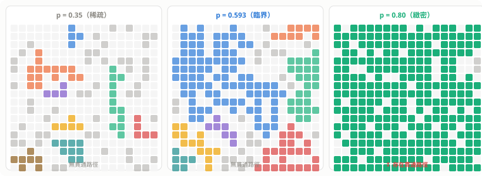
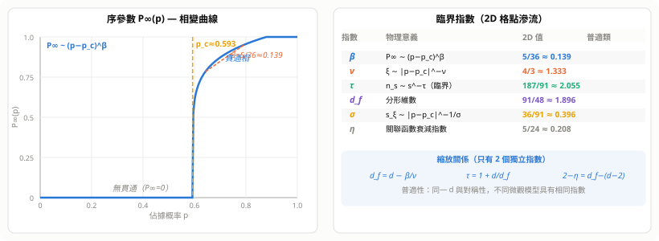
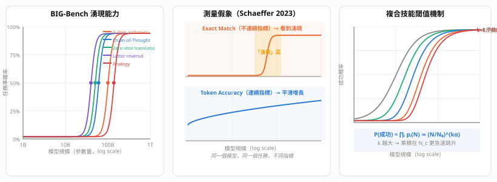
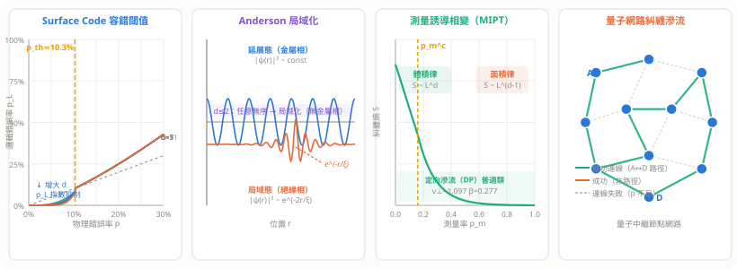

# 滲流理論與湧現（Percolation & Emergence）

> 當隨機性累積到臨界點，系統突然「貫通」——這一刻，整體獲得了任何部分都不曾擁有的性質。

---

## 1. 什麼是滲流（Percolation）

**滲流理論**研究：在隨機佔據的格點或網路上，連通性如何隨密度發生**相變**。

名稱來自物理意象：液體能否從岩石頂端滲透到底端（咖啡過濾、石油開採）？

### 1.1 兩種基本模型

**格點滲流（Site Percolation）**：每個格點以概率 $p$ 被佔據（黑色），相鄰的佔據格點形成連通分量。

**鍵滲流（Bond Percolation）**：每條邊以概率 $p$ 存在，研究節點間的連通性。

```
格點滲流示意（p=0.4 / p=0.593 / p=0.75）：

p=0.40  p=0.593（臨界）  p=0.75
■ □ □   ■ □ ■   ■ ■ □
□ □ ■   ■ ■ □   ■ ■ ■
■ □ □   □ ■ ■   □ ■ ■
（孤立）（剛好貫通）（密集）
```

### 1.2 核心問題

在二維正方格上（無限大極限）：

- $p < p_c$：只有有限大小的連通分量（孤島）
- $p = p_c$：剛好出現**跨越整個系統**的無限大連通分量
- $p > p_c$：一個巨大的連通分量包含 $O(N)$ 個格點

**二維正方格的臨界概率**：

$$p_c^{\text{site}} \approx 0.5927, \quad p_c^{\text{bond}} = \frac{1}{2}（精確解）$$

三角格：$p_c^{\text{site}} = \frac{1}{2}$（精確，對偶論證）。



---

## 2. 相變與序參數

### 2.1 滲流序參數

定義 $P_\infty(p)$ 為一個隨機選取的格點屬於**無限大連通分量**的概率：

$$P_\infty(p) = \begin{cases} 0 & p < p_c \\ (p - p_c)^\beta + O\!\left((p-p_c)^{2\beta}\right) & p \to p_c^+ \end{cases}$$

在二維中 $\beta = 5/36 \approx 0.139$，是一個非整數的**臨界指數**。

### 2.2 連通分量大小分布

在 $p < p_c$ 時，大小為 $s$ 的連通分量數目 $n_s$ 服從：

$$n_s \sim s^{-\tau} e^{-s/s_\xi}, \quad s_\xi \sim |p - p_c|^{-1/\sigma}$$

在 $p = p_c$（恰好臨界）時，指數截斷消失：

$$n_s \sim s^{-\tau}, \quad \tau = 187/91 \approx 2.055 \quad \text{（2D）}$$

**冪律分布 → 無特徵尺度 → 自相似（分形）**：臨界點的連通分量是分形，分形維數 $d_f = 91/48 \approx 1.896$。

### 2.3 相關長度

$\xi(p)$ 為連通分量的平均線尺寸（相關長度）：

$$\xi \sim |p - p_c|^{-\nu}, \quad \nu = 4/3 \quad \text{（2D）}$$

$p \to p_c$ 時 $\xi \to \infty$：在臨界點，系統在**所有尺度**都有結構（尺度無關性）。



---

## 3. 臨界指數與普適性

### 3.1 六個基本臨界指數

| 指數 | 定義 | 2D 值 | 3D 值 |
|------|------|-------|-------|
| $\beta$ | $P_\infty \sim (p-p_c)^\beta$ | $5/36$ | $0.418$ |
| $\nu$ | $\xi \sim \|p-p_c\|^{-\nu}$ | $4/3$ | $0.875$ |
| $\tau$ | $n_s \sim s^{-\tau}$（臨界） | $187/91$ | $2.189$ |
| $\sigma$ | $s_\xi \sim \|p-p_c\|^{-1/\sigma}$ | $36/91$ | $0.445$ |
| $d_f$ | 分形維數 | $91/48$ | $2.523$ |
| $\eta$ | 關聯函數指數 | $5/24$ | $-0.046$ |

這些指數之間由**縮放關係**（Scaling Relations）相互制約：

$$d_f = d - \beta/\nu, \quad \tau = 1 + d/d_f, \quad 2 - \eta = d_f - (d-2)$$

其中 $d$ 是空間維數。只有兩個指數是獨立的（二維中取 $\beta$ 和 $\nu$），其餘都可推導。

### 3.2 普適性（Universality）

**關鍵發現**：臨界指數**只依賴空間維數 $d$ 和對稱性，不依賴微觀細節**。

正方格的 $\beta = 5/36$，三角格也是 $\beta = 5/36$，蜂巢格也是——儘管它們的 $p_c$ 不同。

這叫做**普適性類（Universality Class）**，同一類中的所有模型在臨界點附近行為相同。

**為什麼普適？** 重整化群（RG）的解釋：
- 在臨界點，$\xi \to \infty$，系統的長波行為由固定點（Fixed Point）決定
- 固定點只依賴對稱性和維數，微觀細節是「無關算符」，在 RG 流下趨近於零

---

## 4. 重整化群（Renormalization Group）直觀

### 4.1 粗粒化（Coarse-graining）

把格點分成 $b \times b$ 的方塊，若方塊中至少一個格點被佔據，新的粗粒格點就「佔據」。這等於**換尺度**觀察同一個系統：

$$p' = R_b(p), \quad R_b(p) = 1 - (1-p^b)^b \quad \text{（近似）}$$

### 4.2 固定點與臨界點

$p_c$ 是 RG 變換的**不穩定固定點**：

$$p' = p_c \quad\text{當}\quad p = p_c$$

在 $p_c$ 附近線性化：$p' - p_c = b^{1/\nu} (p - p_c)$，給出 $\nu = \log b / \log(dR/dp|_{p_c})$。

**直觀**：臨界點的系統在粗粒化後「長得一樣」——自相似。偏離 $p_c$ 後，每次粗粒化都把系統推離臨界點，最終到達 $p=0$ 或 $p=1$ 的穩定固定點。

---

## 5. 湧現（Emergence）

### 5.1 定義

**湧現**：複雜系統整體展現出其個別組成元素**完全不具備**的性質或行為。

| 類型 | 說明 | 例子 |
|------|------|------|
| **弱湧現** | 原則上可從底層規則推導，但計算上不可預測 | 蟻群行為、交通堵塞、生命遊戲 |
| **強湧現** | 無法從底層規律推導，需要新層次的解釋 | 意識（爭議中）、生命本身 |

### 5.2 湧現即相變

許多湧現現象的本質是**相變**，可用滲流框架理解：

| 湧現現象 | 滲流類比 | 臨界參數 |
|---------|---------|---------|
| 森林火災傳播 | 鍵滲流 | 樹木密度 $p_c$ |
| 傳染病大流行 | 鍵滲流 | 傳播率 $R_0 = 1$ |
| 社交謠言擴散 | 格點滲流 | 連結密度 |
| 複合材料導電 | 格點滲流 | 導體體積分率 |
| LLM 推理能力 | 參數規模相變 | 模型大小閾值 |

### 5.3 湧現的共同機制

```
微觀：個體遵循簡單局部規則
           ↓ 大量個體互動
宏觀：整體出現新的集體性質
      ↙              ↘
  p < p_c            p > p_c
 （碎片化，無整體行為）  （連通，整體行為湧現）
```

---

## 6. SIR 傳染病模型——湧現的具體例子

### 6.1 模型定義

每個人在三個狀態間轉換：

$$S \xrightarrow{\beta I/N} I \xrightarrow{\gamma} R$$

- $S$（易感）、$I$（感染）、$R$（康復免疫）
- $\beta$：接觸傳播率，$\gamma$：康復率

### 6.2 基本再生數 $R_0$

$$R_0 = \frac{\beta}{\gamma}$$

**相變發生在 $R_0 = 1$**（對應滲流 $p_c$）：

- $R_0 < 1$：疫情自然熄滅（有限感染人數）
- $R_0 = 1$：臨界點，感染規模冪律分布
- $R_0 > 1$：疫情爆發，大量人口感染（湧現）

最終感染比例 $r_\infty$ 滿足超越方程：

$$r_\infty = 1 - e^{-R_0 r_\infty}$$

當 $R_0 > 1$ 時有非零解，對應滲流的 $P_\infty > 0$。

---

## 7. 網路滲流（Network Percolation）

### 7.1 隨機圖（Erdős–Rényi）

$N$ 個節點，每對之間以概率 $p$ 連邊。

**臨界點**：$p_c = 1/N$（平均度 $\langle k \rangle = 1$）。

當 $\langle k \rangle > 1$（$p > 1/N$），出現大小 $O(N)$ 的**巨大連通分量**（Giant Connected Component，GCC）——這是網路中「湧現」的典型例子。

### 7.2 無尺度網路（Scale-Free）

如果節點度分布服從冪律 $P(k) \sim k^{-\gamma}$（如 $\gamma < 3$），則：

$$p_c = \frac{\langle k \rangle}{\langle k^2 \rangle - \langle k \rangle} \to 0 \quad \text{當 } \langle k^2 \rangle \to \infty$$

**意義**：無尺度網路對隨機故障極為健壯（$p_c \to 0$ 意味著幾乎不會因隨機移除節點而崩潰），但對**定向攻擊**（移除高度節點）極脆弱。

**例子**：網際網路、社交網路、蛋白質交互網路。

### 7.3 滲流與脆弱性

| 網路類型 | $p_c$ | 健壯性 |
|---------|-------|--------|
| 隨機圖 ER | $1/\langle k \rangle$ | 中等 |
| 無尺度（$\gamma<3$） | $\approx 0$ | **超健壯（隨機）** |
| 格點（2D） | $0.593$ | 中等 |
| 樹狀結構 | $1/(\langle k \rangle - 1)$ | 低 |

---

## 8. 自組織臨界性（Self-Organized Criticality，SOC）

### 8.1 定義

Bak, Tang & Wiesenfeld（1987）：某些系統**自動演化到臨界態**，無需調節外部參數到 $p_c$。

**沙堆模型**：不斷往沙堆頂加沙，坡度超過閾值的格點就崩塌並把沙傳給鄰居。系統自動維持在臨界坡度，崩塌的規模服從冪律。

### 8.2 冪律是臨界的標誌

| 現象 | 冪律關係 | 指數 |
|------|---------|------|
| 地震規模（Gutenberg-Richter） | $N(M) \sim 10^{-bM}$ | $b \approx 1$ |
| 城市人口分布（Zipf） | $P_r \sim r^{-1}$ | 1 |
| 語言詞頻（Zipf） | $f_r \sim r^{-1}$ | 1 |
| 神經元突發放電 | 雪崩大小 $\sim s^{-3/2}$ | $3/2$ |
| 網路連結度 | $P(k) \sim k^{-\gamma}$ | $2 \sim 3$ |

**「凡冪律，皆臨界」**：這些系統都在自組織地接近某個臨界點。

---

## 9. 與深度學習「湧現能力」的聯繫

### 9.1 現象：BIG-Bench 的突然跳升

**Wei et al. 2022**（Google Brain）在 BIG-Bench 的 137 項任務中觀察到：

> 模型規模小時準確率接近隨機（≈ 0%）；越過某個臨界參數量後，準確率**突然**跳升至遠超隨機的水準。

代表性湧現能力：

| 能力 | 湧現規模 | 任務描述 |
|---|---|---|
| 算術（3 位數加法） | ~100B | 直接輸出計算結果 |
| Chain-of-Thought 推理 | ~60B | 「逐步思考」才有效果 |
| 多語言 zero-shot 翻譯 | ~50B | 未明確訓練的語言對 |
| 字母倒序排列 | ~40B | 操作字符串的精確位置 |
| 類比推理（SAT 類型） | ~137B | 關係類推 |

### 9.2 與滲流相變的正式對應

| 滲流 | LLM 湧現 |
|---|---|
| 佔據概率 $p$ | 模型參數量 $N$（log scale）|
| 臨界點 $p_c$ | 能力閾值 $N_c$（任務依賴）|
| 序參數 $P_\infty \sim (p-p_c)^\beta$ | 任務準確率 $A(N)$ |
| $p < p_c$：無貫通 | $N < N_c$：接近隨機 |
| $p > p_c$：巨分量湧現 | $N > N_c$：能力突然湧現 |
| 有限尺度效應（$\xi \sim L$） | 有限模型大小效應 |

### 9.3 湧現的可能機制

**機制 A：複合技能閾值**

許多任務需要**同時具備** $k$ 個子技能。假設每個子技能的掌握都是規模的平滑函數 $p_i(N)$，「全部具備」是邏輯 AND：

$$P(\text{成功}) \approx \prod_{i=1}^{k} p_i(N) \approx \left(\frac{N}{N_0}\right)^{k\alpha}$$

當 $k$ 大（複雜任務）時，乘積在某個 $N_c$ 急速上升 → **形如相變，實為多平滑函數之積**。

**機制 B：進位/精確匹配的組合爆炸**

以「3 位數加法」為例：每增加一位數，需要正確處理的進位組合數指數增長。模型規模不足時，任何一個環節出錯 → exact match = 0（全錯）。規模超閾值後，各環節同時達標 → 答案全對。

**機制 C：表示空間拓樸轉變（假說）**

Transformer 在某個深度/寬度之後，可能發生表示空間的「拓樸轉變」，使某類抽象關係突然可被線性探針提取。目前仍是未驗證的假說。

### 9.4 Schaeffer et al. 2023 的批評——測量假象

論文：*Are Emergent Abilities of Large Language Models a Mirage?*

**核心論點**：湧現是**評估指標非線性**造成的假象，不是真正的相變。

**關鍵實驗**：同一模型、同一任務，換不同評估指標：

```
Exact Match（全對才給 1 分）：
  準確率 │               ●●●●●
         │  ○○○○○○○○○○○
         └──────────────────── 規模
  → 看起來：突然湧現 ✓

Token-level Accuracy（每個 token 分別計分）：
  準確率 │        ●●●●●●●●●
         │  ●●●●
         └──────────────────── 規模
  → 看起來：平滑增長，無湧現 ✗
```

**比喻**：  
一個人「能否通過考試」（binary）看起來在某個準備時間突然跳升，但「理解程度」（0–100）一直平滑增長。考試的**通過門檻**不等於能力本身的**相變**。

**Schaeffer 的可複現結論**：

1. 選擇**不連續指標**（Exact Match、Pass@1）→ 看到「湧現」
2. 選擇**連續指標**（BLEU、token accuracy、語義相似度）→ 平滑曲線
3. 人為設定難度閾值的任務 → 自動「製造」湧現

**對應滲流的有限尺度縮放**：在有限系統（有限測量解析度）中，相變被「模糊化」。用粗粒化的測量工具，看到的是階梯函數而非平滑冪律。

### 9.5 當前學界立場

| 立場 | 論點 | 代表 |
|---|---|---|
| 湧現是真實相變 | 部分任務不可用連續指標替代 | Wei, Ganguli |
| 湧現是測量假象 | 所有「湧現」換指標後平滑 | Schaeffer, Stanford HAI |
| 兩者皆有 | 部分任務真相變，部分是閾值效應 | 多數中間立場 |

**真正重要的開放問題**：

1. Chain-of-Thought 是否只是 exact match 閾值效應？
2. 有沒有任何能力在某個規模**不連續**出現（與指標無關）？
3. Scaling Law 損失平滑下降，能力卻可能不平滑——兩者的關係是什麼？

**Scaling Law 的矛盾**：Chinchilla 損失是規模的**平滑冪律**：

$$L(N,D) = E + \frac{A}{N^{0.34}} + \frac{B}{D^{0.28}}$$

但「損失平滑下降」≠「所有能力平滑提升」。損失 → 任務準確率的映射本身可以是高度非線性的，這正是 Schaeffer 批評的核心：Scaling Law 是平滑的，「湧現」是任務評估方式**投影**出的假象。

### 9.6 分形與多尺度結構

臨界態的分形結構，在神經網路中也有對應：

| LLM 中的結構 | 對應的臨界現象 |
|---|---|
| 層奇異值的冪律分布 | 分形幾何 $d_f < d$ |
| Attention 的稀疏 Hub | 滲流的「脊椎（backbone）」 |
| 訓練資料 Zipf 分布 | 冪律叢集大小 $n_s \sim s^{-\tau}$ |
| 多尺度知識表示 | 重整化群的尺度不變性 |



---

## 10. 滲流的精確解（特殊情況）

### 10.1 一維格點

$p_c = 1$（需要所有格點都被佔據才能連通），且：

$$P_\infty = p^N \to 0 \quad \text{（有限長度）}$$

### 10.2 二維鍵滲流精確解

正方格的鍵滲流：$p_c = 1/2$（對偶論證：正方格的對偶格也是正方格，自對偶 $\Rightarrow p_c = 1/2$）。

### 10.3 Bethe 格（無限維極限）

在 Bethe 格（無環樹狀格，每個節點有 $z$ 個鄰居）上可精確求解：

$$p_c = \frac{1}{z-1}, \quad P_\infty = \frac{z-1}{z-2}\!\left(p - \frac{1}{z-1}\right) + O\!\left((p-p_c)^2\right)$$

此時 $\beta = 1$（mean-field 值）。**上臨界維數 $d_c = 6$**：$d \geq 6$ 時臨界指數退化為 mean-field 值。

---

## 11. 關鍵數學工具

### 11.1 生成函數方法

定義連通分量大小的生成函數：

$$G_0(x) = \sum_k P(k) x^k, \quad G_1(x) = \frac{G_0'(x)}{G_0'(1)}$$

巨大連通分量大小（網路滲流）：

$$S = 1 - G_0(u), \quad u = G_1(u)$$

其中 $u$ 是節點**不屬於**GCC 的概率，由自洽方程決定。

### 11.2 有限尺度縮放（Finite-Size Scaling）

在有限系統（大小 $L$）中，臨界點附近：

$$P_\infty(p, L) = L^{-\beta/\nu} \tilde{P}\!\left[(p-p_c) L^{1/\nu}\right]$$

$\tilde{P}$ 是普適縮放函數。**實驗/模擬方法**：畫 $P_\infty L^{\beta/\nu}$ vs $(p-p_c)L^{1/\nu}$，不同 $L$ 的曲線應塌縮到同一條——用於數值確定 $p_c$ 和臨界指數。


---

## 12. 量子計算中的滲流

### 12.1 量子滲流（Quantum Percolation）

**古典滲流**：粒子能否通過格點，純粹由連通性決定。

**量子滲流**：量子粒子以**波函數振幅**在稀疏格點上跳躍：

$$H = \sum_i \varepsilon_i |i\rangle\langle i| + \sum_{\langle i,j\rangle} t\, |i\rangle\langle j|$$

關鍵差異：量子干涉**破壞**部分路徑，即使 $p > p_c$（格點夠密），波函數仍可能局域化。因此：

$$p_q > p_c \quad \text{（量子滲流閾值嚴格高於古典）}$$

### 12.2 Anderson 局域化——量子版的「不貫通」

電子在無序格點中（$\varepsilon_i$ 隨機），競爭兩種行為：

| 無序程度 | 波函數行為 | 相 |
|---|---|---|
| 弱（$p \to 1$） | $\psi$ 延展全格 | **金屬相**（導電） |
| 強（$p$ 小） | $\psi \sim e^{-r/\xi}$ 指數衰減 | **絕緣相**（局域化） |
| 臨界 $p = p_c^{\text{quant}}$ | $\psi \sim r^{-(d-2+\eta)/2}$ | **金屬–絕緣體轉變（MIT）** |

**重要結論**（Abrahams 1979，「大四論文」）：

> 在 $d \leq 2$ 維，**任何**無序強度都會導致局域化——2D 量子系統沒有金屬相。

這比古典滲流更嚴格：古典 2D 有明確的 $p_c \approx 0.593$，量子版的 $p_c^{\text{quant}} \to 1$。

### 12.3 拓樸量子錯誤更正碼——最直接的應用

**Surface Code**（Kitaev 1997）的核心洞察：

> 量子比特排在 $L \times L$ 格點上，錯誤（bit-flip / phase-flip）以概率 $p$ 發生。  
> 若錯誤形成的「鏈」**貫通整個格點** → 邏輯錯誤無法糾正。  
> 若錯誤鏈不貫通（有限小簇） → decoder 可識別並修正。

**這正是滲流相變**：

| 滲流語言 | 量子糾錯語言 |
|---|---|
| $p < p_c$：誤差簇有限大小 | 可糾錯 → **容錯量子計算** |
| $p > p_c$：誤差鏈貫通格點 | 邏輯比特損毀 |
| $p = p_c$：臨界點 | **容錯閾值 $p_{\rm th}$** |

**Surface Code 容錯閾值**：

$$p_{\rm th} \approx 10.3\% \quad \text{（depolarizing noise，對應 2D 鍵滲流 } p_c = 0.5\text{）}$$

實際物理要求：硬體錯誤率需低於 $\sim 1\%$（考慮 decoder 開銷後的有效閾值）。

**為何是滲流？** Surface Code 的穩定子（stabilizer）結構形成一個格點，錯誤在上面「擴散」。解碼問題等價於求**最小重量完美匹配**（MWPM），而匹配存在解 ↔ 錯誤不貫通 ↔ $p < p_c$。

### 12.4 測量誘導相變（MIPT）

在含測量的**隨機量子電路**中（Google/IBM 2022–2023 實驗熱點）：

$$\text{么正閘}（\text{增加糾纏}） \quad \text{vs} \quad \text{測量}（\text{破壞糾纏}）$$

以測量率 $p_m$ 為控制參數，存在相變：

$$\text{糾纏熵} \; S \sim \begin{cases} L^d \quad &p_m < p_m^c \quad \text{（體積律，量子信息高度混合）} \\ L^{d-1} \quad &p_m > p_m^c \quad \text{（面積律，局域化）} \end{cases}$$

**與滲流的連結**：

在 Clifford 電路中，穩定子的傳播結構精確對應**定向滲流（Directed Percolation, DP）**，臨界指數與 DP 普適類一致：

$$\nu_\perp = 1.097,\; \nu_\parallel = 1.734,\; \beta = 0.277 \quad \text{（1+1D DP）}$$

### 12.5 量子網路中的糾纏滲流

**目標**：在量子中繼網路上建立長程 Bell 對。

每條連線成功概率 $p$（不完美糾纏），需要「轉換」（entanglement swapping）：

$$A \xrightarrow{p} B \xrightarrow{p} C \xrightarrow{p} D \quad \to \quad A \xleftrightarrow{?} D$$

**糾纏滲流理論**（Acín et al. 2007）：

- 存在臨界 $p_c$，**以上**可建立任意長程糾纏
- 六角格點比方格點有更低的 $p_c$（更容易建立量子網路骨幹）
- **最優策略**：先測量後判斷，讓糾纏沿「滲流脊椎（backbone）」傳遞
- 與古典滲流不同：單次糾纏轉換可讓兩條 $p < 1/\sqrt{2}$ 的線路合成一條 $p > p_c$ 的等效連線（量子增益）

### 12.6 四個應用的統一視角

| 應用 | 滲流類比 | 相變控制參數 | 物理量 |
|---|---|---|---|
| Anderson 局域化 | 量子滲流 | 無序強度 $W$ | 局域化長度 $\xi$ |
| Surface Code 容錯 | 2D 鍵滲流 | 錯誤率 $p$ | 邏輯錯誤率 $p_L$ |
| MIPT | 定向滲流（DP） | 測量率 $p_m$ | 糾纏熵 $S$ |
| 量子網路 | 格點滲流 | 連線成功率 $p$ | GCC 大小 $S$ |

共同的深層原因：**量子信息**（相干性、糾纏）的傳播受隨機障礙阻斷，臨界點決定了信息能否跨越宏觀距離——這與液體能否滲透岩石在數學上是**同一個問題**。



---

## 參考文獻

| 文獻 | 貢獻 |
|------|------|
| Broadbent & Hammersley 1957 | 創立滲流理論 |
| Stauffer & Aharony《Introduction to Percolation Theory》 | 標準教材 |
| Bak, Tang & Wiesenfeld 1987 | 自組織臨界性（沙堆模型） |
| Albert & Barabási 2002 | 網路滲流與無尺度網路 |
| Wei et al. 2022 | LLM 湧現能力 |
| Schaeffer et al. 2023 | 湧現的測量假象批評 |
| Anderson 1958 | 無序系統的量子局域化 |
| Kitaev 1997 | Toric Code 與拓樸量子糾錯 |
| Dennis et al. 2002 | Surface Code 容錯閾值 ↔ 滲流 |
| Acín et al. 2007 | 量子網路糾纏滲流 |
| Li et al. 2018 | 測量誘導糾纏相變（MIPT） |
