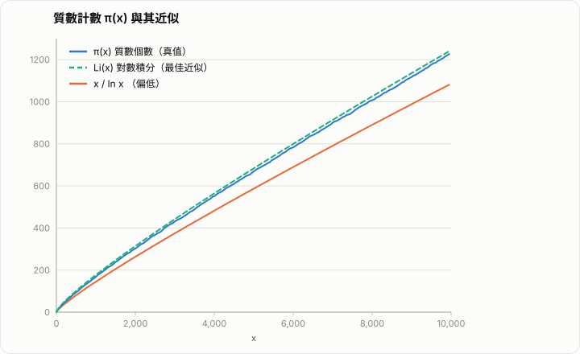
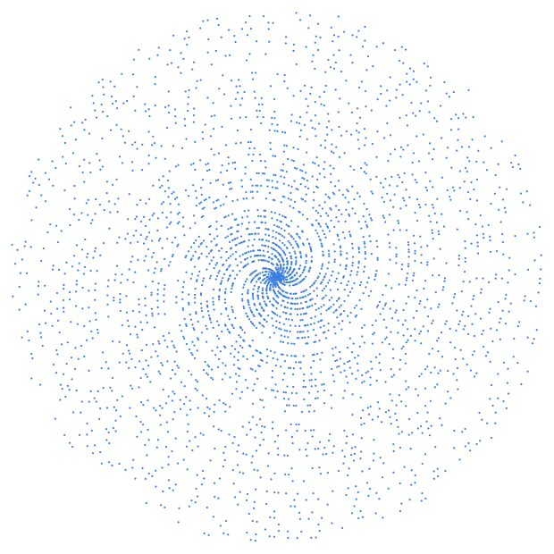
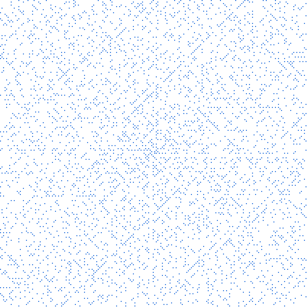

# 質數理論（Prime Number Theory）

質數是整數的「乘法原子」：每個大於 1 的整數都能唯一分解成質數的乘積。這個看似簡單的事實，衍生出數論最深的問題（黎曼猜想、孿生質數猜想），也支撐了現代密碼學（RSA、Diffie–Hellman）。本文從定義與基本定理出發，走到質數分布、判定與分解演算法，最後連結計算複雜度與 AI／密碼學應用。

與本庫其他筆記的關係：質數分布的核心——黎曼 ζ 函數與黎曼猜想——另見 `Riemann-Hypothesis.md`；判定與分解的「難易不對稱」與 `NP.md` 的驗證／求解主題相呼應。

對進階學習者而言，幾個貫穿全文的主線：

- **唯一分解**是一切的基礎，但它在一般代數結構中會失效。
- 質數「整體上」分布規律（質數定理），但「局部」充滿未解之謎（間隙、孿生）。
- **判定質數**很快（多項式時間），**分解質數**卻很慢——這道鴻溝正是公鑰密碼的根基。

---

## 目錄

1. [基本定義](#1-基本定義)
2. [算術基本定理](#2-算術基本定理)
3. [質數有無限多個](#3-質數有無限多個)
4. [質數的分布：質數定理](#4-質數的分布質數定理)
5. [質數計數、間隙與重要函數](#5-質數計數間隙與重要函數)
6. [黎曼 ζ 函數與黎曼猜想](#6-黎曼-ζ-函數與黎曼猜想)
7. [模算術：費馬小定理與歐拉定理](#7-模算術費馬小定理與歐拉定理)
8. [質數判定（Primality Testing）](#8-質數判定primality-testing)
9. [整數分解（Factorization）](#9-整數分解factorization)
10. [特殊質數](#10-特殊質數)
11. [著名猜想](#11-著名猜想)
12. [質數的視覺化：螺旋](#12-質數的視覺化螺旋)
13. [密碼學與計算複雜度](#13-密碼學與計算複雜度)
14. [AI 與質數](#14-ai-與質數)
15. [小結](#15-小結)

---

## 1. 基本定義

**質數（prime）**：大於 1 的整數 $p$，其正因數只有 $1$ 與 $p$ 本身。

**合數（composite）**：大於 1 且非質數的整數。

$1$ 既非質數也非合數——這是約定，但有深層理由：若把 $1$ 算成質數，算術基本定理的「唯一性」就會失效（$6 = 2\cdot 3 = 1\cdot 2\cdot 3 = \cdots$）。

前幾個質數：

$$
2, 3, 5, 7, 11, 13, 17, 19, 23, 29, 31, 37, \dots
$$

$2$ 是唯一的偶質數，因此有時被稱為「最奇特的質數」。

**整除記號**：$a \mid b$ 表示 $a$ 整除 $b$，即存在整數 $k$ 使 $b = ak$。

**歐幾里得引理（Euclid's lemma）**：若 $p$ 為質數且 $p \mid ab$，則 $p \mid a$ 或 $p \mid b$。這是唯一分解的關鍵。

---

## 2. 算術基本定理

**算術基本定理（Fundamental Theorem of Arithmetic）**：每個大於 1 的整數都能寫成質數的乘積，且在不計順序下**唯一**：

$$
n = p_1^{a_1} p_2^{a_2} \cdots p_k^{a_k}, \qquad p_1 < p_2 < \cdots < p_k,\ a_i \ge 1
$$

**例**：$360 = 2^3 \cdot 3^2 \cdot 5$。

### 2.1 證明概要

- **存在性**：對 $n$ 做強歸納。若 $n$ 是質數則已完成；否則 $n = ab$（$1 < a,b < n$），由歸納假設 $a,b$ 皆可分解，合起來即得。
- **唯一性**：靠歐幾里得引理。假設有兩種分解，逐一比對質因數，可證兩者相同。

### 2.2 為什麼「唯一」不是理所當然

在某些數系中唯一分解會失效。例如在 $\mathbb{Z}[\sqrt{-5}] = \{a + b\sqrt{-5}\}$ 中：

$$
6 = 2 \cdot 3 = (1 + \sqrt{-5})(1 - \sqrt{-5})
$$

兩種分解的因子都「不可再分」，卻互不相同。這個失效正是**理想（ideal）**與**代數數論**誕生的動機（見 `Group-Theory.md` 對環與理想的討論）。

### 2.3 推論

由質因數分解可直接得到：

- **最大公因數**：$\gcd$ 取各質數的最小次方。
- **最小公倍數**：$\operatorname{lcm}$ 取各質數的最大次方。
- **因數個數**：$d(n) = \prod_{i}(a_i + 1)$。
- **因數和**：$\sigma(n) = \prod_i \dfrac{p_i^{a_i+1}-1}{p_i - 1}$。

---

## 3. 質數有無限多個

### 3.1 歐幾里得的證明（反證法，約公元前 300 年）

假設質數只有有限多個 $p_1, \dots, p_n$。考慮

$$
N = p_1 p_2 \cdots p_n + 1
$$

$N$ 除以任一 $p_i$ 都餘 $1$，所以沒有任何已知質數整除 $N$。於是 $N$ 本身是質數，或有不在清單上的質因數——兩者都與「質數有限」矛盾。故質數有無限多個。$\blacksquare$

> 常見誤解：$N$ 不一定是質數。例如 $2\cdot3\cdot5\cdot7\cdot11\cdot13 + 1 = 30031 = 59 \times 509$。證明只需要「存在新的質因數」，不需要 $N$ 是質數。

### 3.2 歐拉的解析證明

歐拉證明質數倒數和發散：

$$
\sum_{p \text{ 質數}} \frac{1}{p} = \frac{1}{2} + \frac{1}{3} + \frac{1}{5} + \frac{1}{7} + \cdots = \infty
$$

這比「無限多」更強：它說明質數「不算太稀疏」（對比平方數倒數和 $\sum 1/n^2 = \pi^2/6$ 收斂）。關鍵是**歐拉乘積**：

$$
\sum_{n=1}^{\infty} \frac{1}{n^s} = \prod_{p} \frac{1}{1 - p^{-s}}
$$

在 $s \to 1^+$ 時左側（調和級數）發散，迫使右側的質數乘積也發散。這條恆等式把「質數」與「ζ 函數」連起來，是解析數論的起點。

---

## 4. 質數的分布：質數定理

定義**質數計數函數**

$$
\pi(x) = \#\{p \le x : p \text{ 為質數}\}
$$

**質數定理（Prime Number Theorem, PNT）**（Hadamard 與 de la Vallée Poussin，1896 年獨立證明）：

$$
\pi(x) \sim \frac{x}{\ln x}, \qquad \text{即} \quad \lim_{x \to \infty} \frac{\pi(x)}{x / \ln x} = 1
$$

直覺：在 $x$ 附近，一個整數是質數的「機率」約為 $1/\ln x$。

### 4.1 更好的近似：對數積分

$$
\operatorname{Li}(x) = \int_2^x \frac{dt}{\ln t}
$$

$\operatorname{Li}(x)$ 比 $x/\ln x$ 準得多。數值比較：

| $x$ | $\pi(x)$ | $x/\ln x$ | $\operatorname{Li}(x)$ |
|---|---|---|---|
| $10^3$ | $168$ | $145$ | $178$ |
| $10^6$ | $78498$ | $72382$ | $78628$ |
| $10^9$ | $50847534$ | $48254942$ | $50849235$ |



*圖：$\pi(x)$（真值）與兩種近似的對照（$x$ 至 $10^4$）。$\mathrm{Li}(x)$（虛線）幾乎與 $\pi(x)$ 重合，略高一點點；$x/\ln x$ 則明顯偏低。這直觀說明為何 $\mathrm{Li}(x)$ 是更好的近似。*

### 4.2 誤差項與黎曼猜想

PNT 說 $\pi(x) \approx \operatorname{Li}(x)$，但**誤差有多大**才是關鍵。黎曼猜想等價於以下誤差界（對任意 $\varepsilon>0$）：

$$
|\pi(x) - \operatorname{Li}(x)| = O\!\left(x^{1/2 + \varepsilon}\right)
$$

也就是說，黎曼猜想是「質數分布盡可能規律」的精確陳述。詳見第 6 節與 `Riemann-Hypothesis.md`。

### 4.3 等差數列中的質數

**狄利克雷定理（Dirichlet, 1837）**：若 $\gcd(a, d) = 1$，則等差數列 $a, a+d, a+2d, \dots$ 含有無限多個質數。例如 $4k+1$ 與 $4k+3$ 各有無限多個質數，且長期來看兩者數量相當。

---

## 5. 質數計數、間隙與重要函數

### 5.1 質數間隙

相鄰質數之差 $g_n = p_{n+1} - p_n$。

- **貝特朗假設（Bertrand's postulate）**：對任意 $n \ge 1$，區間 $(n, 2n)$ 內必有質數。故 $g_n < p_n$。
- **間隙可任意大**：$N! + 2, N!+3, \dots, N!+N$ 連續 $N-1$ 個都是合數。
- **平均間隙**：由 PNT，$p_n$ 附近的平均間隙約為 $\ln p_n$。

### 5.2 解析數論的核心函數

| 函數 | 定義 | 用途 |
|---|---|---|
| $\pi(x)$ | 質數個數 | 直接計數 |
| 馮·曼戈爾特 $\Lambda(n)$ | $\ln p$（若 $n=p^k$），否則 $0$ | 加權質數 |
| 第二切比雪夫 $\psi(x)$ | $\sum_{n \le x}\Lambda(n)$ | PNT 等價於 $\psi(x)\sim x$ |
| 黎曼 $\zeta(s)$ | $\sum n^{-s}$ | 連結質數與複分析 |

切比雪夫函數 $\psi(x)$ 之所以好用，是因為質數定理可等價改寫為簡潔的 $\psi(x) \sim x$，而 $\psi$ 又能透過**顯式公式**直接以 ζ 函數的零點表示。

### 5.3 篩法：找出質數

**埃拉托斯特尼篩法（Sieve of Eratosthenes）**：列出 $2$ 到 $n$，反覆劃掉已知質數的倍數，剩下的就是質數。時間 $O(n \log \log n)$，是列舉小質數最實用的方法。

```text
2  3  4  5  6  7  8  9 10 11 12 ...
留 2 → 劃 4,6,8,10,12,...
留 3 → 劃 9,15,21,...
留 5 → 劃 25,35,...
剩下:2 3 5 7 11 13 ...
```

---

## 6. 黎曼 ζ 函數與黎曼猜想

黎曼 ζ 函數先以級數定義（$\operatorname{Re}(s) > 1$），再**解析延拓**到整個複平面（除 $s=1$ 的單極點）：

$$
\zeta(s) = \sum_{n=1}^{\infty} \frac{1}{n^s} = \prod_{p} \frac{1}{1 - p^{-s}}
$$

### 6.1 零點

- **平凡零點**：$s = -2, -4, -6, \dots$。
- **非平凡零點**：全部落在**臨界帶** $0 < \operatorname{Re}(s) < 1$ 內。

**黎曼猜想（Riemann Hypothesis, 1859）**：所有非平凡零點的實部都等於 $\tfrac{1}{2}$，即落在**臨界線** $\operatorname{Re}(s) = \tfrac12$ 上。

### 6.2 為什麼與質數有關

黎曼的**顯式公式**把質數計數直接寫成 ζ 零點的和（概念形式）：

$$
\psi(x) = x - \sum_{\rho} \frac{x^{\rho}}{\rho} - \ln(2\pi) - \tfrac12\ln(1 - x^{-2})
$$

其中 $\rho$ 跑遍非平凡零點。每個零點貢獻一個振盪項 $x^{\rho}/\rho$，其大小由 $\operatorname{Re}(\rho)$ 控制。若所有 $\operatorname{Re}(\rho) = \tfrac12$，振盪被壓到 $O(x^{1/2}\ln x)$，質數分布就「盡可能規律」。這就是第 4.2 節誤差界的來源。完整討論見 `Riemann-Hypothesis.md`。

---

## 7. 模算術：費馬小定理與歐拉定理

模算術是質數判定與密碼學的語言。記 $a \equiv b \pmod{m}$ 表示 $m \mid (a - b)$。

### 7.1 費馬小定理

若 $p$ 為質數且 $p \nmid a$，則

$$
a^{p-1} \equiv 1 \pmod{p}
$$

等價形式：對所有整數 $a$，$a^p \equiv a \pmod p$。

**例**：$2^{6} = 64 \equiv 1 \pmod 7$（因 $64 = 9\times7 + 1$）。

### 7.2 歐拉定理

定義歐拉函數 $\varphi(n)$ 為不超過 $n$ 且與 $n$ 互質的整數個數。若 $\gcd(a, n) = 1$：

$$
a^{\varphi(n)} \equiv 1 \pmod{n}
$$

對質數 $\varphi(p) = p-1$，退化為費馬小定理。對兩質數乘積 $n = pq$：

$$
\varphi(pq) = (p-1)(q-1)
$$

這正是 RSA 的數學核心（第 12 節）。

### 7.3 威爾森定理

$p$ 為質數 $\iff (p-1)! \equiv -1 \pmod{p}$。它是「是否質數」的充要條件，但 $(p-1)!$ 太大，無法當實用判定法。

---

## 8. 質數判定（Primality Testing）

**問題**：給定 $n$，判斷它是不是質數（**不需要**找出因數）。

### 8.1 試除法

檢查 $2$ 到 $\sqrt{n}$ 是否有因數。正確但慢：對 $d$ 位數的 $n$ 要約 $\sqrt{n} = 10^{d/2}$ 次運算，是**指數時間**（以位元數計）。

### 8.2 費馬測試

由費馬小定理：若存在 $a$ 使 $a^{n-1} \not\equiv 1 \pmod n$，則 $n$ 必為合數。反之不保證質數——有**卡邁克爾數（Carmichael numbers）**（如 $561$）對所有互質底數都通過，卻是合數。

### 8.3 米勒–拉賓測試（Miller–Rabin）

目前最實用的機率型測試。寫 $n - 1 = 2^s d$（$d$ 奇），對隨機底數 $a$ 檢查

$$
a^d \equiv 1 \pmod n \quad\text{或}\quad a^{2^r d} \equiv -1 \pmod n\ (\exists\, 0 \le r < s)
$$

- 若不滿足，$n$ **必為**合數。
- 若滿足，$n$ 「可能」是質數。單次誤判機率 $\le 1/4$，做 $k$ 輪則 $\le 4^{-k}$。
- 速度：每輪一次模冪 $O(\log^2 n \cdot \log\log n)$，實務上極快。

### 8.4 AKS 測試

Agrawal–Kayal–Saxena（2002）給出第一個**確定性、多項式時間**的質數判定法，證明

$$
\text{PRIMES} \in \mathrm{P}
$$

這是計算複雜度的里程碑（終結了「質數判定是否在 P」的長期問題）。不過常數大，實務仍多用 Miller–Rabin 或 BPSW。

### 8.5 小結對照

| 方法 | 類型 | 複雜度 | 備註 |
|---|---|---|---|
| 試除 | 確定 | 指數（位元） | 僅適合小數 |
| 費馬 | 機率 | 多項式 | 卡邁克爾數會騙過 |
| Miller–Rabin | 機率 | 多項式 | 實務首選 |
| AKS | 確定 | 多項式 | 理論重要，常數大 |

---

## 9. 整數分解（Factorization）

**問題**：給定合數 $n$，找出它的質因數。這比「判定」**難得多**——沒有已知的多項式時間演算法。

| 演算法 | 大致複雜度 | 適用 |
|---|---|---|
| 試除 | $O(\sqrt{n})$ | 小因數 |
| Pollard $\rho$ | $O(n^{1/4})$ | 中等、含小因數 |
| Pollard $p-1$ | 視因數結構 | 特殊 $p-1$ 平滑 |
| 二次篩（QS） | $\exp\!\big(O(\sqrt{\ln n \ln\ln n})\big)$ | 至約 100 位 |
| 一般數域篩（GNFS） | $\exp\!\big(O((\ln n)^{1/3}(\ln\ln n)^{2/3})\big)$ | 目前最快，破 RSA 的工具 |

### 9.1 判定易、分解難

這道鴻溝是本篇最重要的觀念：

$$
\underbrace{\text{PRIMES} \in \mathrm{P}}_{\text{判定：快}} \qquad\text{vs.}\qquad \underbrace{\text{FACTORING：無已知多項式演算法}}_{\text{分解：慢}}
$$

有趣的是，FACTORING（判定版）同時落在 $\mathrm{NP} \cap \mathrm{coNP}$，因此一般**不被認為是 NP-complete**；它更可能是介於 P 與 NP-complete 之間的中間難度問題。與 `NP.md` 的「驗證容易、求解困難」主題一致：給定因數驗證只要一次乘法，找出因數卻極難。

### 9.2 量子的威脅

**秀爾演算法（Shor, 1994）**可在量子電腦上以**多項式時間**分解整數。這不代表 P=NP（FACTORING 不是 NP-complete），但足以摧毀 RSA——這正是**後量子密碼學（post-quantum cryptography）**興起的原因。

---

## 10. 特殊質數

| 名稱 | 形式／定義 | 備註 |
|---|---|---|
| 梅森質數（Mersenne） | $M_p = 2^p - 1$ 為質數 | 已知最大質數多為此類；用 Lucas–Lehmer 測試 |
| 費馬質數（Fermat） | $F_k = 2^{2^k} + 1$ | 只知 $k=0..4$ 為質數；與正多邊形尺規作圖相關 |
| 孿生質數 | $(p, p+2)$ 皆質數 | 如 $(11,13),(17,19)$ |
| 索菲·熱爾曼質數 | $p$ 與 $2p+1$ 皆質數 | 密碼學安全參數 |
| 回文／連接質數 | 位數對稱等 | 多為趣味性質 |

**梅森質數**特別重要：目前已知的最大質數幾乎都是梅森質數，由分散式計算專案 GIMPS 透過高效的 Lucas–Lehmer 測試找到。

---

## 11. 著名猜想

質數最迷人之處，在於極簡單的敘述卻可能極難證明。

- **孿生質數猜想**：存在無限多對相差 $2$ 的質數。張益唐（2013）證明「存在無限多對間隙小於某有限值」（最初 $7\times10^7$），經 Polymath 與 Maynard 改進到 $246$，但 $2$ 仍未達成。
- **哥德巴赫猜想（Goldbach）**：每個大於 2 的偶數都是兩個質數之和。已驗證到極大範圍，仍未證明。
- **勒讓德猜想（Legendre）**：每個 $n^2$ 與 $(n+1)^2$ 之間都有質數。
- **波利尼亞克猜想（Polignac）**：對每個偶數 $2k$，存在無限多對間隙為 $2k$ 的質數。
- **ABC 猜想**：關於 $a+b=c$ 與其根基（radical）的深刻不等式，牽動大量數論結果。

$$
\text{（孿生質數）} \quad \#\{p \le x : p, p+2 \text{ 皆質數}\} \sim 2C_2 \frac{x}{(\ln x)^2}
$$

其中 $C_2 \approx 0.6601$ 為孿生質數常數（哈代–李特爾伍德猜想的預測）。

### 11.1 深入：孿生質數

**定義**：相差 $2$ 的一對質數 $(p, p+2)$。前幾對：

$$
(3,5),\ (5,7),\ (11,13),\ (17,19),\ (29,31),\ (41,43),\ (59,61),\ (71,73),\dots
$$

$5$ 是唯一同時屬於兩對的質數（$(3,5)$ 與 $(5,7)$）。除 $(3,5)$ 外，每對孿生質數都形如 $(6k-1,\ 6k+1)$。

**相關家族**：

| 名稱 | 形式 | 例子 |
|---|---|---|
| 孿生質數（twin） | $(p, p+2)$ | $(11,13)$ |
| 表親質數（cousin） | $(p, p+4)$ | $(13,17)$ |
| 性感質數（sexy） | $(p, p+6)$ | $(23,29)$ |
| 孤立質數（isolated） | $p\pm2$ 皆非質數 | $23$ |

#### 布朗定理：孿生質數「很稀疏」

Brun（1919）證明**所有孿生質數的倒數和收斂**：

$$
B_2 = \left(\tfrac13+\tfrac15\right) + \left(\tfrac15+\tfrac17\right) + \left(\tfrac1{11}+\tfrac1{13}\right) + \cdots \approx 1.902
$$

$B_2$ 稱為**布朗常數**。對比第 3.2 節「全體質數倒數和發散」，這說明孿生質數比全體質數稀疏得多。

> 注意：收斂**不代表**孿生質數有限——即使有無限多對，稀疏到倒數和仍可收斂。所以布朗定理既沒證明也沒否證孿生質數猜想。

#### 2013 年張益唐的突破：有界間隙

孿生質數猜想要求間隙恰好為 $2$ 的質數對有無限多。張益唐（2013）首次證明了一個「有界」版本：

$$
\liminf_{n\to\infty} (p_{n+1} - p_n) < 7 \times 10^7
$$

也就是「存在某個 $\le 7\times10^7$ 的間隙，出現無限多次」。這是史上第一次把間隙壓到一個**有限常數**。隨後的改進：

| 里程碑 | 間隙上界 |
|---|---|
| 張益唐（2013） | $7\times 10^7$ |
| Polymath8（2013） | $4680$ |
| Maynard、Tao（2014，新方法） | $600 \to 246$ |
| 假設 Elliott–Halberstam 猜想 | $6$ |

目前無條件最佳為 **246**；即使假設更強的猜想，也只能降到 $6$，與目標 $2$ 仍有距離。**孿生質數猜想（間隙恰為 2）至今未解。**

#### 密度與最大已知孿生質數

哈代–李特爾伍德猜想預測孿生質數的密度（見上式）：孿生質數計數約為

$$
\pi_2(x) \sim 2C_2 \int_2^x \frac{dt}{(\ln t)^2}, \qquad C_2 \approx 0.6601
$$

數值上與實際計數吻合得很好。已知最大的孿生質數對（截至近年）形如

$$
2996863034895 \times 2^{1290000} \pm 1
$$

各約 $388{,}342$ 位數，由分散式計算專案找到。

---

## 12. 質數的視覺化：螺旋

常聽到「質數分布呈現螺旋狀」，其實是指兩種不同的**視覺化**現象。重點先講清楚：

> 螺旋並非質數本身藏著神祕規律，而是**特定畫法**凸顯出來的結構。真正的內容仍是老朋友——**模某數的餘數分布**與**二次多項式的質數密度**。換一種畫法，螺旋就消失了。

### 12.1 極座標螺旋

把每個質數 $p$ 畫在極座標 $(r, \theta) = (p,\ p\text{ 弧度})$。結果會出現明顯的**螺旋臂**，放大後又變成一條條**放射狀光線**。原因有三層。

**(1) $2\pi$ 的有理數逼近 → 產生臂與光線。** 角度以弧度計，而 $2\pi \approx 6.283$。每走約 $6$ 個整數，角度就幾乎繞一圈。而

$$
6,\quad \frac{44}{7} = 6.2857\ldots,\quad \frac{710}{113} = 6.28319\ldots
$$

正是 $2\pi$ 的**連分數漸近值**。以接近 $2\pi$ 的整數為週期時，同餘的點會排成一條線：

| 觀察尺度 | 近似週期 | 出現 |
|---|---|---|
| 小 | $6$ | 約 6 條螺旋臂 |
| 中 | $44$ | 約 44 條放射線 |
| 大 | $710$ | 約 710 條放射線 |

**(2) 整除性 → 某些臂是空的（這才和質數有關）。** 以 $6$ 為週期時，$6$ 條臂對應餘數 $0,1,2,3,4,5 \pmod 6$。但大於 $3$ 的質數只能是 $\equiv 1$ 或 $5 \pmod 6$（其餘會被 $2$ 或 $3$ 整除），所以 $6$ 條臂裡只剩 **2 條**有質數。$44$ 條線裡，只有與 $44$ 互質的餘數（共 $\varphi(44) = 20$ 個）會有質數，於是看到約 **20 條**光線。

**(3) 均勻 → 來自狄利克雷定理。** 在與模數互質的各餘數類裡，質數**均勻分布**（見第 4.3 節），所以留下的臂亮度相當，不偏向某幾條。

一句話：螺旋是「用弧度畫角度」碰上 $2\pi \approx 6, \tfrac{44}{7}, \tfrac{710}{113}$ 的巧合；缺口來自質數躲開「與模數有公因數」的餘數；均勻來自狄利克雷定理。



*圖：極座標質數螺旋。中央可見數條螺旋臂（$6$ 的尺度），外圍逐漸散為放射狀光線（$44$、$710$ 的尺度）。*

### 12.2 烏拉姆螺旋（Ulam spiral, 1963）

把整數 $1, 2, 3, \dots$ 以**方形螺旋**排在方格紙上，塗黑質數，會發現質數明顯沿一些**斜對角線**聚集。

```text
17 16 15 14 13
18  5  4  3 12
19  6  1  2 11
20  7  8  9 10
21 22 23 24 25 ...
```



*圖：烏拉姆螺旋。質數（藍點）明顯沿斜對角線聚集，每條對角線對應一個二次多項式。*

每條對角線對應一個**二次多項式**，形如 $4n^2 + bn + c$。某些二次式特別「盛產」質數，最有名的是歐拉的

$$
n^2 + n + 41
$$

它在 $n = 0, 1, \dots, 39$ 連續 $40$ 個值全是質數。這與二次剩餘、虛二次域的**類數（class number）**有關，背後是頗深的數論；「為何某些二次式這麼會出質數」至今沒有完整解釋。

### 12.3 對照

| 現象 | 畫法 | 「線」從哪來 | 和質數的關係 |
|---|---|---|---|
| 極座標螺旋 | $(p,\ p\text{ rad})$ | $2\pi$ 的有理逼近（$6, 44, 710$） | 缺口＝整除性；均勻＝狄利克雷定理 |
| 烏拉姆螺旋 | 方形螺旋格 | 對角線＝二次多項式 | 某些二次式特別多質數 |

兩者都不代表質數「本質上呈螺旋排列」——它們是特定視覺化凸顯出來的結構。

---

## 13. 密碼學與計算複雜度

質數理論最直接的應用是**公鑰密碼學**，其安全性建立在「判定易、分解難」。

### 12.1 RSA

1. 選兩個大質數 $p, q$（用 Miller–Rabin 快速產生），令 $n = pq$。
2. 計算 $\varphi(n) = (p-1)(q-1)$，選公鑰指數 $e$ 使 $\gcd(e, \varphi(n)) = 1$。
3. 私鑰 $d \equiv e^{-1} \pmod{\varphi(n)}$。
4. 加密 $c = m^e \bmod n$；解密 $m = c^d \bmod n$（由歐拉定理保證還原）。

**安全性**：公開 $n$，但要算出 $d$ 需要 $\varphi(n)$，而 $\varphi(n)$ 需要分解 $n = pq$。分解難 ⇒ RSA 安全。

### 12.2 Diffie–Hellman 與離散對數

建立在**離散對數問題**：已知 $g, g^x \bmod p$ 求 $x$ 很難。橢圓曲線密碼（ECC）用類似困難問題，金鑰更短。

### 12.3 與複雜度的連結

| 問題 | 難度定位 |
|---|---|
| PRIMES（判定質數） | $\in \mathrm{P}$（AKS） |
| FACTORING | $\in \mathrm{NP}\cap\mathrm{coNP}$，無已知多項式演算法，疑為中間難度 |
| 離散對數 | 類似，疑為中間難度 |

這些問題有趣在於：若 $\mathrm{P} = \mathrm{NP}$ 它們都會崩潰，但它們本身**大概不是 NP-complete**（見 `NP.md`）——這說明「難」也有層次。

---

## 14. AI 與質數

質數理論與 AI 的交集，目前集中在幾個方向：

### 13.1 AI 輔助數論研究

- **模式發現**：機器學習被用來在數論物件（如橢圓曲線、L-函數）中尋找規律。DeepMind 與數學家合作，用機器學習提出並驗證新猜想（如紐結理論、表示論），方法原則上也適用於質數相關統計。
- **猜想生成與反例搜尋**：如 `NP.md` 提到的 FunSearch／AlphaEvolve，用 LLM 生成候選構造再用驗證器篩選，適合這類「容易驗證、難以構造」的數論問題。

### 13.2 LLM 對質數的侷限

- LLM **不會**可靠地判斷大數是否為質數：它沒有內建算術引擎，容易「幻覺」出錯誤的因數分解或質數宣稱。
- 正確做法是讓 LLM **呼叫工具**（Miller–Rabin、SymPy、Pari/GP），而非直接「心算」——與 `NP.md` 第 7 節「LLM 形式化後交給 solver」相同。

### 13.3 質數與機器學習的理論連結

- **雜湊與特徵**：質數常用於雜湊函數、隨機投影的模數選擇，避免週期性碰撞。
- **可驗證獎勵（RLVR）**：質數判定與因數分解是「答案可廉價驗證」的典型任務，可作為訓練推理模型的可驗證獎勵來源。

> 務實結論：AI 目前是數論的**輔助工具**（找規律、生成候選、呼叫算術 solver），而非取代嚴謹證明。任何「AI 證明了黎曼猜想／哥德巴赫」的宣稱，都應要求形式化驗證（如 Lean）與同行審查。

---

## 15. 小結

- **質數是乘法的原子**：算術基本定理保證唯一分解，這是一切的基礎。
- **質數有無限多個**，且倒數和發散（歐拉），分布由**質數定理** $\pi(x)\sim x/\ln x$ 描述。
- **黎曼猜想**是「質數分布盡可能規律」的精確陳述，透過 ζ 零點的顯式公式連結質數（詳見 `Riemann-Hypothesis.md`）。
- **判定質數在 P**（AKS），**分解整數卻無已知多項式演算法**——這道鴻溝撐起了 RSA 等公鑰密碼。
- 量子的**秀爾演算法**威脅分解難度，催生後量子密碼。
- 許多最簡單的敘述（孿生質數、哥德巴赫）仍是**未解之謎**。
- **AI** 在質數研究中是輔助工具：找規律、生成候選、呼叫 solver，但不取代證明。

## 參考資料

- Euclid. *Elements*, Book IX（質數無限多）。
- Hardy, G. H. & Wright, E. M. *An Introduction to the Theory of Numbers*.
- Hadamard, J. / de la Vallée Poussin, C. (1896). 質數定理。
- Riemann, B. (1859). *Über die Anzahl der Primzahlen unter einer gegebenen Grösse*.
- Miller, G. (1976); Rabin, M. (1980). 質數判定測試。
- Agrawal, M., Kayal, N. & Saxena, N. (2004). PRIMES is in P.
- Shor, P. (1994). Polynomial-time algorithms for factorization on a quantum computer.
- Zhang, Y. (2014). Bounded gaps between primes.
