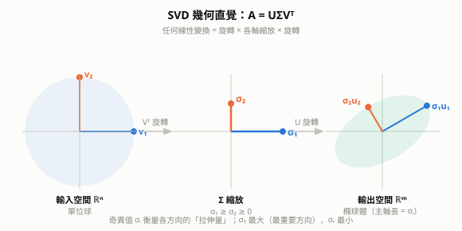
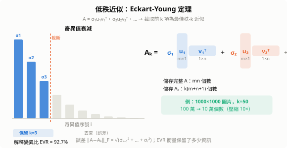
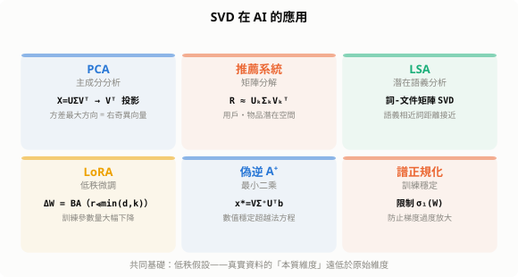

# 奇異值分解（Singular Value Decomposition, SVD）

奇異值分解是線性代數最核心的分解定理：**任何矩陣**（無論形狀、是否可逆）都能分解為三個幾何意義清晰的矩陣之積。PCA、推薦系統、LoRA 微調、最小二乘法……幾乎所有資料分析與 AI 方法的底層都能找到它的身影。

## 1. 定義

任何 $m \times n$ 實矩陣 $A$ 都可以分解為：

$$\boxed{A = U \Sigma V^\top}$$

| 矩陣 | 大小 | 性質 | 意義 |
|------|------|------|------|
| $U$ | $m \times m$ | 正交：$U^\top U = I$ | **左奇異向量**（輸出空間的旋轉） |
| $\Sigma$ | $m \times n$ | 對角，$\sigma_1 \geq \cdots \geq \sigma_r > 0$ | **奇異值**（各方向的縮放量） |
| $V$ | $n \times n$ | 正交：$V^\top V = I$ | **右奇異向量**（輸入空間的旋轉） |

其中 $r = \text{rank}(A)$，奇異值按降序排列：$\sigma_1 \geq \sigma_2 \geq \cdots \geq \sigma_r > 0$。

---

## 2. 幾何直覺

任何線性變換 $A: \mathbb{R}^n \to \mathbb{R}^m$ 由三個步驟組成：

$$x \xrightarrow{V^\top} \text{旋轉} \xrightarrow{\Sigma} \text{各軸縮放} \xrightarrow{U} \text{旋轉}$$

把 $\mathbb{R}^n$ 中的**單位球**經 $A$ 映射後，得到 $\mathbb{R}^m$ 中的**橢球體**，各主軸長度正好是奇異值 $\sigma_1 \geq \sigma_2 \geq \cdots$，方向正好是 $U$ 的列向量。



**關鍵洞見**：$V$ 的列向量 $v_i$ 是「輸入空間中被最大拉伸的方向」，$U$ 的列向量 $u_i$ 是「輸出空間中被拉伸到的方向」，拉伸倍率為 $\sigma_i$。

---

## 3. 與特徵分解的關係

奇異值是 $A^\top A$（或 $AA^\top$）特徵值的平方根：

$$A^\top A = V \Sigma^\top \Sigma V^\top \quad \Rightarrow \quad \sigma_i = \sqrt{\lambda_i(A^\top A)}$$

- $V$ 的列 = $A^\top A$ 的特徵向量（右奇異向量）
- $U$ 的列 = $AA^\top$ 的特徵向量（左奇異向量）

**為何 SVD 比特徵分解更通用？**

| | 特徵分解 $A = Q\Lambda Q^{-1}$ | SVD $A = U\Sigma V^\top$ |
|---|---|---|
| 適用矩陣 | 方形且可對角化 | **任意形狀** |
| 存在性 | 不保證 | **永遠存在** |
| 分解唯一性 | 否（特徵向量可縮放） | 奇異值唯一（向量方向可能不唯一） |

---

## 4. 低秩近似：Eckart-Young 定理

將 SVD 展開為秩-1 矩陣之和：

$$A = \sum_{i=1}^{r} \sigma_i \, u_i v_i^\top$$

截取前 $k$ 項，得到**最佳秩-$k$ 近似**：

$$A_k = \sum_{i=1}^{k} \sigma_i \, u_i v_i^\top = U_k \Sigma_k V_k^\top$$

**Eckart-Young 定理（1936）**：在所有秩不超過 $k$ 的矩陣中，$A_k$ 使 Frobenius 範數誤差最小：

$$A_k = \arg\min_{\text{rank}(B)\leq k} \|A - B\|_F, \quad \|A - A_k\|_F = \sqrt{\sigma_{k+1}^2 + \cdots + \sigma_r^2}$$



**壓縮比**：儲存完整 $A$ 需 $mn$ 個數，儲存 $A_k$ 只需 $k(m + n + 1)$ 個數。當 $k \ll \min(m,n)$ 時效果顯著。例：$1000 \times 1000$ 圖片取 $k=50$ → 壓縮 10 倍，視覺品質通常已足夠。

---

## 5. 重要指標

| 指標 | 公式 | 意義 |
|------|------|------|
| **秩** | $r = \#\{\sigma_i > 0\}$ | 線性獨立行數 |
| **Frobenius 範數** | $\|A\|_F = \sqrt{\sum_i \sigma_i^2}$ | 所有元素平方和的根 |
| **譜範數** | $\|A\|_2 = \sigma_1$ | 最大拉伸量 |
| **條件數** | $\kappa(A) = \sigma_1 / \sigma_r$ | 數值穩定性；越大越病態 |
| **偽逆** | $A^+ = V \Sigma^+ U^\top$ | 最小範數最小二乘解 |

**條件數的意義**：解線性系統 $Ax = b$ 時，輸入誤差放大倍率最大為 $\kappa(A)$；若 $\kappa \gg 1$，微小的 $b$ 誤差會造成 $x$ 劇烈變動。正規化（Regularization）本質上是給 $\sigma_i$ 加上下限，降低條件數。

---

## 6. 偽逆與最小二乘

求解超定系統 $Ax \approx b$（$m > n$，方程比未知數多）的最小二乘解：

$$x^* = A^+ b = V \Sigma^+ U^\top b, \quad \Sigma^+_{ii} = \begin{cases} 1/\sigma_i & \sigma_i > 0 \\ 0 & \text{otherwise} \end{cases}$$

這等價於 $\min_x \|Ax - b\|_2$，數值穩定性遠優於直接求法方程 $(A^\top A)x = A^\top b$（後者條件數為 $\kappa^2$）。

---

## 7. SVD 在 AI 的應用

### 7.1 PCA（主成分分析）

資料矩陣 $X \in \mathbb{R}^{n \times d}$（$n$ 筆樣本，$d$ 維特徵，已中心化），對 $X$ 做 SVD：

$$X = U \Sigma V^\top \quad \Rightarrow \quad \text{主成分方向} = V \text{ 的列}$$

前 $k$ 個主成分捕捉最大方差，$A_k$ 是在 $k$ 維子空間中對 $X$ 的最佳重建。

**變異數解釋比**（explained variance ratio）：

$$\text{EVR}_k = \frac{\sum_{i=1}^k \sigma_i^2}{\sum_{i=1}^r \sigma_i^2}$$

### 7.2 推薦系統（矩陣分解）

用戶-物品評分矩陣 $R \approx U_k \Sigma_k V_k^\top$：將用戶與物品同時嵌入 $k$ 維潛在語義空間，預測未評分項目。Netflix Prize 冠軍方法的核心即是此思想。

### 7.3 LSA（潛在語義分析）

詞-文件矩陣 $\xrightarrow{\text{SVD}}$ 語義空間：語義相近的詞在低維空間中距離接近，是 word2vec 之前 NLP 的基礎方法。

### 7.4 LoRA：語言模型的低秩微調

預訓練大模型的**權重更新量**可用低秩矩陣近似：

$$W = W_0 + \Delta W, \quad \Delta W = B A, \quad B \in \mathbb{R}^{d \times r},\; A \in \mathbb{R}^{r \times k},\; r \ll \min(d,k)$$

假設 $\Delta W$ 本質上是低秩的，只訓練 $A, B$ 兩個小矩陣，可凍結 $W_0$，訓練參數量從 $dk$ 降至 $r(d+k)$。GPT-4 等模型微調常用此方法。

### 7.5 注意力機制的穩定性

Transformer 的 $W_Q, W_K, W_V$ 的奇異值分布影響訓練穩定性。譜正規化（Spectral Normalization）直接對 $\sigma_1(W)$ 加限制，使每層不過度放大梯度。



---

## 8. 計算方式

實際計算不直接解 $A^\top A$ 的特徵值（數值精度差），而是用 **Golub-Kahan 二對角化** + QR 迭代，複雜度 $O(mn \cdot \min(m,n))$。

大型稀疏矩陣（如推薦系統）使用**截斷 SVD**（Randomized SVD）：

$$\text{只計算前 } k \text{ 個奇異值/向量，複雜度} O(mnk)$$

```python
import numpy as np

A = np.random.randn(1000, 500)
U, s, Vt = np.linalg.svd(A, full_matrices=False)  # 經濟型 SVD

# 低秩近似（取前 k=50 個）
k = 50
Ak = U[:, :k] @ np.diag(s[:k]) @ Vt[:k, :]

# 重建誤差
print(f"Frobenius error: {np.linalg.norm(A - Ak, 'fro'):.4f}")
print(f"Explained variance: {(s[:k]**2).sum() / (s**2).sum():.4f}")
```

---

## 9. 小結

| 概念 | 核心要點 |
|------|---------|
| $A = U\Sigma V^\top$ | 旋轉 × 縮放 × 旋轉；任意矩陣永遠存在 |
| 奇異值 $\sigma_i$ | $A^\top A$ 特徵值的平方根；資訊重要性排序 |
| Eckart-Young | 截斷 $k$ 項 = Frobenius 範數最佳低秩近似 |
| 條件數 $\kappa$ | $\sigma_1/\sigma_r$；衡量數值穩定性 |
| 偽逆 $A^+$ | 最小二乘的數值穩定解 |
| PCA | 資料矩陣 SVD 的右奇異向量 = 主成分方向 |
| LoRA | 低秩假設 $\Delta W = BA$；微調參數量大幅下降 |
