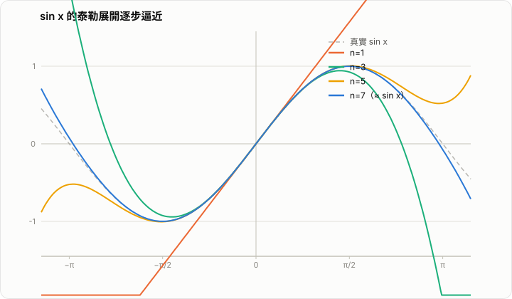

# 泰勒展開式的推導與證明

泰勒展開式的核心問題有兩個：

1. 為什麼近似函數的多項式係數會是那個形式？
2. 為什麼誤差項可以寫成特定的餘項公式？

本文先推導泰勒多項式，再證明拉格朗日餘項，最後補充自然常數函數與三角函數的展開推導。

## 1. 泰勒多項式的想法

設函數 `f(x)` 在 `x=a` 附近有足夠多階導數，我們希望用一個 `n` 次多項式來近似它：

$$
P_n(x)=c_0+c_1(x-a)+c_2(x-a)^2+\cdots+c_n(x-a)^n
$$

如果這個多項式要在 `x=a` 附近盡量像 `f(x)`，最自然的要求就是它在 `a` 點的前 `n` 階導數都和 `f(x)` 一樣：

$$
P_n(a)=f(a),\quad
P_n'(a)=f'(a),\quad
P_n''(a)=f''(a),\quad
\cdots,\quad
P_n^{(n)}(a)=f^{(n)}(a)
$$

## 2. 係數的推導

由多項式定義可得：

$$
P_n(a)=c_0
$$

因此

$$
c_0=f(a)
$$

對 `P_n(x)` 微分一次：

$$
P_n'(x)=c_1+2c_2(x-a)+3c_3(x-a)^2+\cdots+n c_n(x-a)^{n-1}
$$

代入 `x=a`：

$$
P_n'(a)=c_1
$$

所以

$$
c_1=f'(a)
$$

再微分一次：

$$
P_n''(a)=2!c_2
$$

因此

$$
c_2=\frac{f''(a)}{2!}
$$

同理可得一般情形：

$$
P_n^{(k)}(a)=k!c_k
$$

所以

$$
c_k=\frac{f^{(k)}(a)}{k!}
$$

於是得到泰勒多項式：

$$
P_n(x)=\sum_{k=0}^{n}\frac{f^{(k)}(a)}{k!}(x-a)^k
$$

這說明泰勒多項式不是憑空猜出來的，而是由「在 `a` 點函數值與各階導數都吻合」這個要求唯一決定的。

## 3. 泰勒定理

若 `f(x)` 在 `a` 與 `x` 之間具有 `n+1` 階導數，則

$$
f(x)=P_n(x)+R_n(x)
$$

其中 `R_n(x)` 稱為餘項。拉格朗日餘項的形式為

$$
R_n(x)=\frac{f^{(n+1)}(\xi)}{(n+1)!}(x-a)^{n+1}
$$

這裡的 $\xi$ 介於 $a$ 和 $x$ 之間。

## 4. 拉格朗日餘項的證明

先定義誤差函數：

$$
R_n(t)=f(t)-P_n(t)
$$

因為 `P_n(t)` 在 `t=a` 的前 `n` 階導數都和 `f(t)` 相同，所以：

$$
R_n(a)=R_n'(a)=R_n''(a)=\cdots=R_n^{(n)}(a)=0
$$

現在固定一個 `x`，構造輔助函數：

$$
\phi(t)=R_n(t)-R_n(x)\frac{(t-a)^{n+1}}{(x-a)^{n+1}}
$$

注意：

$$
\phi(a)=0,\quad \phi(x)=0
$$

而且因為 $R_n(a),R_n'(a),\ldots,R_n^{(n)}(a)$ 都等於 0，所以 $\phi(t)$ 在 $t=a$ 也有足夠多重的零點。

接著對 $\phi(t)$ 反覆使用 Rolle 定理，可知存在某個 $\xi$ 介於 $a$ 和 $x$ 之間，使得

$$
\phi^{(n+1)}(\xi)=0
$$

現在計算 $\phi^{(n+1)}(t)$：

$$
\phi^{(n+1)}(t)=R_n^{(n+1)}(t)-R_n(x)\frac{(n+1)!}{(x-a)^{n+1}}
$$

又因為

$$
R_n(t)=f(t)-P_n(t)
$$

而 `P_n(t)` 是 `n` 次多項式，所以它的 `n+1` 階導數為 0：

$$
P_n^{(n+1)}(t)=0
$$

因此

$$
R_n^{(n+1)}(t)=f^{(n+1)}(t)
$$

代回去，在 $t=\xi$ 時有

$$
0=\phi^{(n+1)}(\xi)
=f^{(n+1)}(\xi)-R_n(x)\frac{(n+1)!}{(x-a)^{n+1}}
$$

整理後得到

$$
R_n(x)=\frac{f^{(n+1)}(\xi)}{(n+1)!}(x-a)^{n+1}
$$

證畢。

## 5. 最終結論

因此，泰勒展開式可以寫成

$$
f(x)=f(a)+f'(a)(x-a)+\frac{f''(a)}{2!}(x-a)^2+\cdots+\frac{f^{(n)}(a)}{n!}(x-a)^n+R_n(x)
$$

其中

$$
R_n(x)=\frac{f^{(n+1)}(\xi)}{(n+1)!}(x-a)^{n+1}
$$

這就是泰勒定理的拉格朗日型餘項。

## 6. 補充說明

- 若 $a=0$，稱為麥克勞林展開。
- 若 $R_n(x) \to 0$ 當 $n \to \infty$，才可以把函數真正寫成無窮級數。
- 不是每個無限可微函數都一定等於自己的泰勒級數，這一點在高等微積分中很重要。

### 6.1 為什麼階數越高，通常會更接近函數

這裡要先澄清一個常見誤解：

- 變得更接近 `f(x)` 的，是更高階的 Taylor 多項式 `P_n(x)`。
- 不是說「越高階導數 `f^{(n)}(x)` 會越接近原函數 `f(x)`」。

一般函數的高階導數可能變大、震盪更劇烈，甚至和原函數長得完全不像。Taylor 定理比較的是

$$
f(x)\quad \text{和}\quad P_n(x)=\sum_{k=0}^{n}\frac{f^{(k)}(a)}{k!}(x-a)^k
$$

而不是 `f(x)` 和 `f^{(n)}(x)`。

直觀上，`P_0(x)` 只對準函數在 `a` 點的函數值；`P_1(x)` 再額外對準斜率；`P_2(x)` 再額外對準彎曲程度；更高階時，則連更細緻的局部變化都一起對準。因此在 `a` 附近，圖形會貼得越來越緊。

更正式地說，`n` 次 Taylor 多項式的誤差是

$$
R_n(x)=f(x)-P_n(x)
$$

而且前面已經證明

$$
R_n(x)=\frac{f^{(n+1)}(\xi)}{(n+1)!}(x-a)^{n+1}
$$

其中 $\xi$ 介於 $a$ 和 $x$ 之間。這個公式直接說明了兩件事。

第一，當 `x` 很接近 `a` 時，`|x-a|` 很小，所以

$$
|R_n(x)| \approx \text{某個係數} \cdot |x-a|^{n+1}
$$

會非常小。並且 `n` 每增加 1，誤差就多乘上一個 `|x-a|` 這個小因子。

第二，如果在 `a` 和 `x` 之間可以找到常數 `M`，使得

$$
|f^{(n+1)}(t)|\le M
$$

那麼就有估計

$$
|R_n(x)|\le \frac{M}{(n+1)!}|x-a|^{n+1}
$$

因此只要 `x` 在展開點附近，而且高階導數沒有失控，階數越高通常就代表誤差越小。

不過要注意，這個「更接近」通常是指：

- 在展開點 `a` 附近更接近。
- 在餘項 `R_n(x)` 確實趨近 0 的前提下更接近。

它不保證對所有函數、所有位置、所有階數都會機械式地單調變好。

### 6.2 用 $\sin x$ 看一個具體例子

以 $a=0$ 為例，$\sin x$ 的前幾個麥克勞林多項式是

$$
P_1(x)=x
$$

$$
P_3(x)=x-\frac{x^3}{3!}
$$

$$
P_5(x)=x-\frac{x^3}{3!}+\frac{x^5}{5!}
$$

它們的誤差階分別是

$$
R_1(x)=O(x^3),\quad R_3(x)=O(x^5),\quad R_5(x)=O(x^7)
$$

意思是：當 `x` 很小時，`x^5` 會比 `x^3` 小很多，`x^7` 又比 `x^5` 更小，因此 `P_5(x)` 在 `0` 附近通常會比 `P_3(x)` 更準，而 `P_3(x)` 又通常會比 `P_1(x)` 更準。

*圖：$\sin x$ 的麥克勞林展開（$a=0$）。階數越高，在更大的 $x$ 範圍內都能貼近真實曲線；但在展開中心遠處（$|x|$ 大時），低階多項式會明顯偏離。*

例如取 `x=0.1`：

$$
\sin(0.1)\approx 0.0998334166
$$

$$
P_1(0.1)=0.1
$$

$$
P_3(0.1)=0.1-\frac{0.1^3}{6}=0.0998333333
$$

$$
P_5(0.1)=0.1-\frac{0.1^3}{6}+\frac{0.1^5}{120}=0.0998334167
$$

可以看到，階數提高後，確實更接近 $\sin(0.1)$。原因不是高階導數本身變得像 $\sin x$，而是 Taylor 多項式把更多局部資訊編進去了，並讓餘項縮小得更快。

## 7. 常見函數的泰勒展開推導

下面補充三個最常見的例子：`e^x`、`sin x`、`cos x`。這些函數通常都是從麥克勞林展開開始推導，也就是在 `a=0` 的情況下：

$$
f(x)=f(0)+f'(0)x+\frac{f''(0)}{2!}x^2+\frac{f^{(3)}(0)}{3!}x^3+\cdots
$$

### 7.1 `e^x` 的展開

#### 直觀理解

`e^x` 最特別的地方是：無論微分幾次，結果都還是自己。這是 `e^x` 的特殊性，不能推廣成「一般函數的高階導數會越來越接近原函數」。

$$
\frac{d}{dx}e^x=e^x,\quad
\frac{d^2}{dx^2}e^x=e^x,\quad
\cdots
$$

因此在 `x=0` 時，每一階導數的值都一樣：

$$
e^0=1,\quad
\left(e^x\right)'_{x=0}=1,\quad
\left(e^x\right)''_{x=0}=1,\quad
\cdots
$$

也就是說，麥克勞林展開中的每個係數都會是 `1/n!`，所以它的展開式會特別整齊。

#### 正式推導

設

$$
f(x)=e^x
$$

則對任意正整數 `n`，都有

$$
f^{(n)}(x)=e^x
$$

代入 `x=0`：

$$
f^{(n)}(0)=e^0=1
$$

由麥克勞林公式

$$
f(x)=\sum_{n=0}^{\infty}\frac{f^{(n)}(0)}{n!}x^n
$$

得到

$$
e^x=\sum_{n=0}^{\infty}\frac{x^n}{n!}
=1+x+\frac{x^2}{2!}+\frac{x^3}{3!}+\cdots
$$

特別地，令 `x=1`，可得自然常數 `e` 的級數表示：

$$
e=e^1=1+1+\frac{1}{2!}+\frac{1}{3!}+\frac{1}{4!}+\cdots
$$

這也是自然常數的一個重要來源。

### 7.2 $\sin x$ 的展開

#### 直觀理解

`sin x` 的導數會週期性循環：

$$
\sin x \to \cos x \to -\sin x \to -\cos x \to \sin x
$$

所以只要知道它們在 `x=0` 的值，就能決定麥克勞林展開中的每一項。

由於

$$
\sin 0=0,\quad \cos 0=1
$$

因此 $\sin x$ 的偶數階導數在 $0$ 點都會變成 0，而奇數階導數則會在 $1$ 和 $-1$ 之間交替出現。這就是為什麼它只留下奇次項，而且正負號交錯。

#### 正式推導

設

$$
f(x)=\sin x
$$

則各階導數為

$$
f'(x)=\cos x
$$

$$
f''(x)=-\sin x
$$

$$
f^{(3)}(x)=-\cos x
$$

$$
f^{(4)}(x)=\sin x
$$

之後開始循環。代入 `x=0`：

$$
f(0)=\sin 0=0
$$

$$
f'(0)=\cos 0=1
$$

$$
f''(0)=-\sin 0=0
$$

$$
f^{(3)}(0)=-\cos 0=-1
$$

$$
f^{(4)}(0)=\sin 0=0
$$

因此麥克勞林展開為

$$
\sin x
=f(0)+f'(0)x+\frac{f''(0)}{2!}x^2+\frac{f^{(3)}(0)}{3!}x^3+\cdots
$$

代入各項係數：

$$
\sin x
=0+1\cdot x+0\cdot x^2-\frac{x^3}{3!}+0\cdot x^4+\frac{x^5}{5!}-\cdots
$$

整理得

$$
\sin x=x-\frac{x^3}{3!}+\frac{x^5}{5!}-\frac{x^7}{7!}+\cdots
$$

### 7.3 $\cos x$ 的展開

#### 直觀理解

`cos x` 和 `sin x` 的導數循環是同一組，只是起點不同：

$$
\cos x \to -\sin x \to -\cos x \to \sin x \to \cos x
$$

而

$$
\cos 0=1,\quad \sin 0=0
$$

因此 $\cos x$ 在 $x=0$ 的奇數階導數都為 0，偶數階導數則在 $1$ 和 $-1$ 間交替，所以最後只留下偶次項，而且正負號交錯。

#### 正式推導

設

$$
f(x)=\cos x
$$

則各階導數為

$$
f'(x)=-\sin x
$$

$$
f''(x)=-\cos x
$$

$$
f^{(3)}(x)=\sin x
$$

$$
f^{(4)}(x)=\cos x
$$

之後開始循環。代入 `x=0`：

$$
f(0)=\cos 0=1
$$

$$
f'(0)=-\sin 0=0
$$

$$
f''(0)=-\cos 0=-1
$$

$$
f^{(3)}(0)=\sin 0=0
$$

$$
f^{(4)}(0)=\cos 0=1
$$

因此麥克勞林展開為

$$
\cos x
=f(0)+f'(0)x+\frac{f''(0)}{2!}x^2+\frac{f^{(3)}(0)}{3!}x^3+\cdots
$$

代入各項係數：

$$
\cos x
=1+0\cdot x-\frac{x^2}{2!}+0\cdot x^3+\frac{x^4}{4!}-\cdots
$$

整理得

$$
\cos x=1-\frac{x^2}{2!}+\frac{x^4}{4!}-\frac{x^6}{6!}+\cdots
$$

## 8. 小結

從這三個例子可以看出，泰勒展開的關鍵在於：

- 先找出函數各階導數的規律。
- 再代入展開中心，通常是 `x=0`。
- 最後用麥克勞林公式把各階導數值轉成多項式係數。

其中：

- $e^x$ 的每階導數都相同，所以展開最整齊。
- $\sin x$ 只留下奇次項。
- $\cos x$ 只留下偶次項。

這些展開式在微積分、微分方程、物理近似和工程計算中都非常重要。

## 9. 如何利用泰勒展開推導 Euler 公式

Euler 公式是

$$
e^{ix}=\cos x+i\sin x
$$

這個公式可以直接由 $e^x$、$\sin x$、$\cos x$ 的麥克勞林展開推出。

### 9.1 基本想法

我們已經知道：

$$
e^x=1+x+\frac{x^2}{2!}+\frac{x^3}{3!}+\frac{x^4}{4!}+\cdots
$$

$$
\cos x=1-\frac{x^2}{2!}+\frac{x^4}{4!}-\frac{x^6}{6!}+\cdots
$$

$$
\sin x=x-\frac{x^3}{3!}+\frac{x^5}{5!}-\frac{x^7}{7!}+\cdots
$$

現在只要把 `e^x` 裡的 `x` 改成 `ix`，就能觀察它和三角函數展開式之間的關係。

### 9.2 正式推導

從 `e^x` 的麥克勞林展開開始：

$$
e^x=\sum_{n=0}^{\infty}\frac{x^n}{n!}
$$

把 `x` 換成 `ix`：

$$
e^{ix}=\sum_{n=0}^{\infty}\frac{(ix)^n}{n!}
$$

展開前幾項：

$$
e^{ix}=1+ix+\frac{(ix)^2}{2!}+\frac{(ix)^3}{3!}+\frac{(ix)^4}{4!}+\frac{(ix)^5}{5!}+\cdots
$$

利用虛數單位 `i` 的性質：

$$
i^2=-1,\quad i^3=-i,\quad i^4=1,\quad i^5=i,\quad \cdots
$$

因此可得

$$
e^{ix}
=1+ix-\frac{x^2}{2!}-i\frac{x^3}{3!}+\frac{x^4}{4!}+i\frac{x^5}{5!}-\frac{x^6}{6!}-i\frac{x^7}{7!}+\cdots
$$

把實部和虛部分開：

$$
e^{ix}
=\left(1-\frac{x^2}{2!}+\frac{x^4}{4!}-\frac{x^6}{6!}+\cdots\right)
+i\left(x-\frac{x^3}{3!}+\frac{x^5}{5!}-\frac{x^7}{7!}+\cdots\right)
$$

觀察括號中的兩個級數：

$$
1-\frac{x^2}{2!}+\frac{x^4}{4!}-\frac{x^6}{6!}+\cdots=\cos x
$$

$$
x-\frac{x^3}{3!}+\frac{x^5}{5!}-\frac{x^7}{7!}+\cdots=\sin x
$$

因此

$$
e^{ix}=\cos x+i\sin x
$$

這就是 Euler 公式。

### 9.3 幾何上的意義

這個公式說明了複數指數函數和三角函數其實是同一件事的兩種表現方式。

- $\cos x$ 表示複數的實部。
- $\sin x$ 表示複數的虛部。
- `e^{ix}` 表示複平面上單位圓上的點。

也就是說，當角度為 `x` 時，單位圓上的點可以寫成

$$
(\cos x,\sin x)
$$

而在複數形式中，這個點正好寫成

$$
\cos x+i\sin x=e^{ix}
$$

### 9.4 Euler 恆等式

若令 $x=\pi$，則由 Euler 公式可得

$$
e^{i\pi}=\cos \pi+i\sin \pi
$$

因為

$$
\cos \pi=-1,\quad \sin \pi=0
$$

所以

$$
e^{i\pi}=-1
$$

移項後得到最著名的 Euler 恆等式：

$$
e^{i\pi}+1=0
$$

這個公式把五個最重要的數學常數 $e$、$i$、$\pi$、$1$、$0$ 聯繫在一起，因此非常有名。

### 9.5 為什麼可以把 `x` 換成 `ix`

上面的推導有一個常見疑問：原本的泰勒展開不是對實數 `x` 寫的嗎？為什麼可以直接代入複數 `ix`？

關鍵原因有兩個。

第一，`e^x` 的展開式本質上是一個冪級數：

$$
e^x=\sum_{n=0}^{\infty}\frac{x^n}{n!}
$$

冪級數中的運算只有加法、乘法與除以整數階乘，而這些運算在複數系統中同樣都成立。因此把變數從實數 `x` 擴充成複數 `z` 並沒有代數上的問題，所以可以寫成

$$
e^z=\sum_{n=0}^{\infty}\frac{z^n}{n!},\quad z\in\mathbb{C}
$$

第二，這個級數對所有複數都收斂。因為階乘 `n!` 成長非常快，所以對任意複數 `z`，級數

$$
\sum_{n=0}^{\infty}\frac{z^n}{n!}
$$

都會收斂。也就是說，`e^z` 不只對實數有意義，對複數也有意義，而且是用同一個公式定義的。

因此令

$$
z=ix
$$

就自然得到

$$
e^{ix}=\sum_{n=0}^{\infty}\frac{(ix)^n}{n!}
$$

接下來再把偶次項與奇次項分開，就會得到

$$
e^{ix}=\cos x+i\sin x
$$

所以，嚴格地說，不是「勉強把實數公式套到複數上」，而是因為指數函數的冪級數本來就能在複數範圍內成立。

### 9.6 用微分方程再證明一次

除了用泰勒展開之外，Euler 公式也可以從微分方程的角度推出。這個方法的重點是：找一個函數，證明它和 `e^{ix}` 滿足同一個微分方程，並且有相同的初值，於是它們必須相等。

先定義

$$
g(x)=\cos x+i\sin x
$$

現在對 `g(x)` 微分：

$$
g'(x)=-\sin x+i\cos x
$$

把右邊整理一下：

$$
i g(x)=i(\cos x+i\sin x)=i\cos x-\sin x
$$

因此

$$
g'(x)=i g(x)
$$

再看初值：

$$
g(0)=\cos 0+i\sin 0=1+0=1
$$

另一方面，考慮函數

$$
f(x)=e^{ix}
$$

由鏈鎖律可得

$$
f'(x)=i e^{ix}=i f(x)
$$

而且

$$
f(0)=e^0=1
$$

所以 `f(x)` 與 `g(x)` 都滿足同一個初值問題：

$$
y'(x)=i y(x),\quad y(0)=1
$$

根據常微分方程解的唯一性，這個初值問題只有一個解，因此

$$
f(x)=g(x)
$$

也就是

$$
e^{ix}=\cos x+i\sin x
$$

這說明 Euler 公式不只可以由泰勒展開得到，也可以視為微分方程

$$
y'=iy
$$

的解在複數情形下的具體表現。

### 9.7 用矩陣與旋轉的觀點理解

還可以從線性代數與平面旋轉的角度來看 Euler 公式。這個觀點的重點是：複數乘上 $i$，在平面上對應到逆時針旋轉 $90^\circ$；而複數乘上 $e^{ix}$，則對應到旋轉角 $x$。

先看平面上的旋轉矩陣。若一個向量逆時針旋轉角度 `x`，它的矩陣為

$$
R(x)=
\begin{pmatrix}
\cos x & -\sin x \\
\sin x & \cos x
\end{pmatrix}
$$

另一方面，定義矩陣

$$
J=
\begin{pmatrix}
0 & -1 \\
1 & 0
\end{pmatrix}
$$

這個矩陣的作用就是把向量旋轉 $90^\circ$，而且它滿足

$$
J^2=
\begin{pmatrix}
0 & -1 \\
1 & 0
\end{pmatrix}^2
=
\begin{pmatrix}
-1 & 0 \\
0 & -1
\end{pmatrix}
=-I
$$

這個性質和複數單位 `i` 很像，因為

$$
i^2=-1
$$

現在考慮矩陣指數

$$
e^{xJ}=I+xJ+\frac{(xJ)^2}{2!}+\frac{(xJ)^3}{3!}+\cdots
$$

由於 `J^2=-I`，所以更高次方會循環：

$$
J^3=-J,\quad J^4=I,\quad J^5=J,\quad \cdots
$$

因此可以把偶次項和奇次項分開：

$$
e^{xJ}
=\left(I-\frac{x^2}{2!}I+\frac{x^4}{4!}I-\cdots\right)
+\left(xJ-\frac{x^3}{3!}J+\frac{x^5}{5!}J-\cdots\right)
$$

整理後得到

$$
e^{xJ}=(\cos x)I+(\sin x)J
$$

把 `I` 和 `J` 寫回矩陣形式：

$$
e^{xJ}
=
\cos x
\begin{pmatrix}
1 & 0 \\
0 & 1
\end{pmatrix}
+
\sin x
\begin{pmatrix}
0 & -1 \\
1 & 0
\end{pmatrix}
=
\begin{pmatrix}
\cos x & -\sin x \\
\sin x & \cos x
\end{pmatrix}
=R(x)
$$

這說明矩陣指數 `e^{xJ}` 就是平面上的旋轉矩陣。

而在複數平面中，一個複數 `z=a+bi` 可以對應到向量

$$
\begin{pmatrix}
a \\
b
\end{pmatrix}
$$

複數乘上 `i`，對應到

$$
\begin{pmatrix}
0 & -1 \\
1 & 0
\end{pmatrix}
\begin{pmatrix}
a \\
b
\end{pmatrix}
=
\begin{pmatrix}
-b \\
a
\end{pmatrix}
$$

這正是逆時針旋轉 $90^\circ$ 的效果。

因此，複數乘法中的 `i`，和矩陣中的 `J` 扮演的是同樣角色；同理，複數中的 `e^{ix}`，和矩陣中的 `e^{xJ}` 也扮演同樣角色。既然

$$
e^{xJ}=R(x)=
\begin{pmatrix}
\cos x & -\sin x \\
\sin x & \cos x
\end{pmatrix}
$$

那麼在複數形式下就對應為

$$
e^{ix}=\cos x+i\sin x
$$

所以 Euler 公式也可以理解成：「複數指數函數其實就是平面旋轉的代數表示」。
