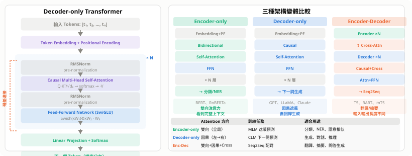
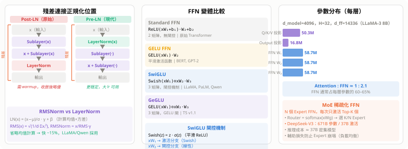
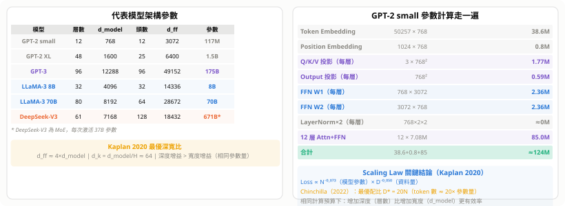

# Transformer 架構詳解

Transformer（Vaswani et al. 2017，*Attention Is All You Need*）是現代大型語言模型的基礎架構。
它完全放棄 RNN 的順序遞推，改以 **Attention** 在序列任意兩個位置之間直接建立依賴關係，
搭配殘差連接與層正規化，使得深層堆疊成為可能。

---

## 1. 全局結構

原始 Transformer 為 **Encoder-Decoder** 設計，現代 LLM 多採 **Decoder-only**：



| 架構 | Attention 方向 | 訓練任務 | 適合用途 |
|---|---|---|---|
| **Encoder-only** | 雙向（全局）| MLM 遮蔽預測 | 分類、NER、語意相似 |
| **Decoder-only** | 因果（左→右）| CLM 下一詞預測 | 生成、對話、推理 |
| **Encoder-Decoder** | 雙向+因果+Cross | Seq2Seq 配對 | 翻譯、摘要、問答生成 |

**Decoder-only 成為主流的原因**：
- 預訓練數據量遠大於任務標注數據，Causal LM 可用所有文本訓練
- Few-shot/Zero-shot 直接 prompt 即可
- 架構更簡單（無 Encoder + Cross-Attention）

---

## 2. 殘差連接與正規化

每個子層（Attention 或 FFN）都包裹在殘差連接中：

$$
\text{output} = x + \text{Sublayer}(\text{Norm}(x)) \quad \text{（Pre-LN，現代主流）}
$$

$$
\text{output} = \text{Norm}(x + \text{Sublayer}(x)) \quad \text{（Post-LN，原始）}
$$

**殘差連接的作用**：梯度可「跳過」子層直接流回，子層只需學「修正量」$\Delta x$，
而非從零映射 $x \to y$，大幅降低優化難度。

### 2.1 LayerNorm vs RMSNorm

**LayerNorm**：對一個 token 的全部 $d$ 個維度計算均值與方差並標準化：

$$
\text{LN}(x) = \frac{x - \mu}{\sigma + \varepsilon} \cdot \gamma + \beta, \quad \mu = \frac{1}{d}\sum x_i,\; \sigma^2 = \frac{1}{d}\sum (x_i - \mu)^2
$$

**RMSNorm**（LLaMA、Qwen 採用）：去掉均值計算，只除以均方根：

$$
\text{RMS}(x) = \sqrt{\frac{1}{d}\sum_{i=1}^d x_i^2}, \qquad \text{RMSNorm}(x) = \frac{x}{\text{RMS}(x)} \cdot \gamma
$$

省略均值計算，速度快約 15%，實驗效果相當。

| | Pre-LN | Post-LN |
|---|---|---|
| 訓練穩定性 | 更穩定，可用較大 lr | 需 warmup，早期不穩 |
| 最終性能 | 普遍採用 | 部分研究略優 |
| 代表模型 | LLaMA、GPT-3、Qwen | 原始 Transformer、BERT |

---

## 3. Feed-Forward Network（FFN）

每個 Attention 層後面都跟一個 FFN，負責**逐 token 的非線性變換**（Attention 負責跨 token 聚合）：

$$
\text{Standard FFN}(x) = \text{ReLU}(xW_1 + b_1)\,W_2 + b_2, \quad d_\text{ff} = 4 \times d_\text{model}
$$

**SwiGLU**（LLaMA、PaLM、Qwen，現代主流）：

$$
\text{SwiGLU}(x) = \big(\text{Swish}(xW_1) \odot xW_2\big)\,W_3
$$

$$
\text{Swish}(z) = z \cdot \sigma(z) \quad \text{（平滑版 ReLU，無死區）}
$$

閘控機制（$\odot$ 逐元素乘）讓模型動態選擇哪些維度通過，性能明顯優於 ReLU/GELU。



| FFN 變體 | 激活函數 | 閘控 | 代表模型 |
|---|---|---|---|
| Standard | ReLU | ✗ | 原始 Transformer |
| GELU FFN | GELU | ✗ | BERT、GPT-2 |
| **SwiGLU** | Swish + GLU | ✓ | LLaMA-3、PaLM、Qwen |
| GeGLU | GELU + GLU | ✓ | T5 v1.1 |

**參數比例**：FFN 通常占每層參數的 **60–65%**，Attention 占 35–40%（Attention : FFN ≈ 1 : 2）。

---

## 4. 完整參數量計算

以 GPT-2 small（$L=12$，$d=768$，$H=12$，$d_\text{ff}=3072$，$V=50257$）為例：

$$
\underbrace{V \times d}_{\text{Token Emb}} + \underbrace{n_\text{ctx} \times d}_{\text{Pos Emb}} + L \times \underbrace{\left(3d^2 + d^2 + 2d \cdot d_\text{ff}\right)}_{\text{每層 Attn+FFN}}
$$

$$
= 50257 \times 768 + 1024 \times 768 + 12 \times (3 \times 768^2 + 768^2 + 2 \times 768 \times 3072)
$$

$$
= 38.6\text{M} + 0.8\text{M} + 12 \times 7.08\text{M} \approx 124\text{M 參數}
$$



---

## 5. Scaling Law 與最優配置

Kaplan et al. 2020 的冪律：

$$
L(N, D) \propto \left(\frac{N_c}{N}\right)^{\alpha_N} + \left(\frac{D_c}{D}\right)^{\alpha_D}
$$

其中 $\alpha_N \approx 0.073$，$\alpha_D \approx 0.050$（OpenAI 原始估計）。

**Chinchilla（Hoffmann et al. 2022）**：最優訓練配比為

$$
D^* = 20N \quad \text{（token 數應為參數量的 20 倍）}
$$

LLaMA-3 8B 以 15 兆 tokens 訓練（大幅超出 Chinchilla 最優），
犧牲訓練效率換取推理時的高性能（over-training 策略）。

**深度 vs 寬度**：相同參數量下，增加層數（深度）通常比增加 $d_\text{model}$（寬度）更有效率，
這也是為什麼大模型傾向於深而窄（例如 GPT-3：96 層，$d=12288$）。

| 模型 | 層數 | d_model | 頭數 | d_ff | 參數 |
|---|---|---|---|---|---|
| GPT-2 small | 12 | 768 | 12 | 3072 | 117M |
| GPT-2 XL | 48 | 1600 | 25 | 6400 | 1.5B |
| GPT-3 | 96 | 12288 | 96 | 49152 | 175B |
| LLaMA-3 8B | 32 | 4096 | 32 | 14336 | 8B |
| LLaMA-3 70B | 80 | 8192 | 64 | 28672 | 70B |
| DeepSeek-V3 | 61 | 7168 | 128 | 18432 | 671B（MoE）|

---

## 6. MoE（Mixture of Experts）稀疏化

現代超大模型以 **稀疏 MoE** 取代標準 FFN，解耦參數量與計算量：

$$
\text{MoE}(x) = \sum_{i=1}^{K} g_i(x) \cdot \text{Expert}_i(x), \quad g_i(x) = \text{softmax}\!\left(\text{top-K}(xW_g)\right)_i
$$

每個 token 只激活 $K$ 個（通常 $K=2$ 或 $K=8$）Expert FFN，其餘 $N-K$ 個不計算。

**工程挑戰**：
- **Expert 崩塌**：所有 token 傾向選同幾個 Expert → 加入**負載均衡輔助損失**
- **通訊開銷**：分散式訓練時不同 Expert 在不同 GPU → all-to-all 通訊
- **推理記憶體**：所有 Expert 參數必須常駐 GPU，即便大多數不激活

**代表模型**：
- Mixtral 8×7B：8 個 Expert，每次激活 2 個；等效計算量約 12.9B 密集模型
- DeepSeek-V3：671B 總參數，37B 激活；訓練成本僅 2.78M H800 GPU 小時

---

## 7. 與 KV Cache 的關係

Transformer 的 Attention 形式決定 KV Cache 的使用方式：

- **Decoder-only（Causal）**：每次生成新 token 只需計算新 Q，
  歷史 K/V 已快取 → $O(nd)$ 而非 $O(n^2 d)$
- **MHA → GQA/MQA**：KV 頭數從 $H$ 減到 $G$（$G \ll H$），
  KV Cache 縮小 $H/G$ 倍（LLaMA-3 70B：64 Q 頭 / 8 KV 頭 → Cache 縮 8×）
- **Flash Attention**：Tiling + Online Softmax，
  訓練時 $O(n^2)$ HBM 讀寫降到 $O(n)$，速度快 2–4×

詳見 [KV Cache 與 Attention 機制](KV-Cache.md)。

---

## 8. BERT：雙向預訓練的 Encoder

> BERT（Devlin et al. 2018，Google）是 Transformer Encoder 的最重要應用，
> 開啟了「預訓練 → Fine-tune」的 NLP 新範式。

### 8.1 核心差異：單向 vs 雙向

```
GPT（Decoder-only）：「他把 _」只看左側 → 只能用前文
BERT（Encoder-only）：「他把 [MASK] 放進了背包」← 左右都看
```

雙向 Attention 讓每個 token 能同時利用完整上下文，
理解任務（分類、問答、NER）因此顯著受益；
但雙向模型**不能自回歸生成**——生成第 $t$ 個詞時不能看 $t+1$。

### 8.2 架構

純 Encoder Stack，無 Decoder，無 Causal Mask：

```
[CLS] token₁ token₂ … [SEP] （+ 句B tokens + [SEP]）
       ↓
Token Embedding
  + Segment Embedding（句 A → Eₐ，句 B → E_B）
  + Position Embedding（Learned，非 Sinusoidal）
       ↓
Bidirectional Self-Attention × L 層
       ↓
h_[CLS], h₁, h₂, …, hₙ
```

| | BERT-base | BERT-large |
|---|---|---|
| 層數 | 12 | 24 |
| d_model | 768 | 1024 |
| 頭數 | 12 | 16 |
| 參數量 | **110M** | **340M** |

### 8.3 預訓練任務

#### MLM（Masked Language Modeling）

隨機遮蔽 **15%** token，要求模型還原：

$$
\mathcal{L}_\text{MLM} = -\sum_{i \in \text{masked}} \log P(x_i \mid \tilde{x})
$$

遮蔽策略（15% 中）：
- **80%** → `[MASK]`
- **10%** → 隨機替換為其他詞
- **10%** → 保持原詞不變

加入後兩種是為了縮小預訓練（有 `[MASK]`）與 fine-tuning（無 `[MASK]`）的分佈差距。

#### NSP（Next Sentence Prediction）

給兩個句子，預測 B 是否是 A 的下一句（二元分類，從 `[CLS]` 隱狀態輸出）：

```
50% IsNext：  A = "天氣很好。"  B = "我決定去散步。"  → IsNext
50% NotNext： A = "天氣很好。"  B = "股市今日大漲。"  → NotNext
```

> **RoBERTa（2019）後來發現 NSP 效果存疑**：NotNext 範例來自不同段落，
> 模型可能只是學主題差異而非真正的句間邏輯，移除 NSP 後性能反而提升。

### 8.4 Fine-tuning 下游任務

預訓練後加一個小型分類頭，fine-tune 全部參數：

| 任務 | 輸入格式 | 分類頭 |
|---|---|---|
| 句子分類（情感、主題）| `[CLS] 句子 [SEP]` | `h_[CLS]` → Linear |
| 句對分類（NLI）| `[CLS] 句A [SEP] 句B [SEP]` | `h_[CLS]` → Linear |
| 問答（SQuAD）| `[CLS] 問題 [SEP] 段落 [SEP]` | 每個 token → 預測 start/end |
| NER | `[CLS] 句子 [SEP]` | 每個 token → 類別標籤 |

BERT 一次性在 11 個 NLP 任務刷新 SOTA，確立了「預訓練語言模型」的中心地位。

### 8.5 重要後繼模型

| 模型 | 核心改進 |
|---|---|
| **RoBERTa**（Meta 2019）| 去除 NSP、動態遮蔽、更大 batch（8K）、160GB 語料 |
| **ALBERT**（Google 2019）| 跨層參數共享 + Factorized Embedding → 大幅減少參數 |
| **DistilBERT**（HuggingFace 2019）| 知識蒸餾：60% 參數、40% 加速，保留 97% 性能 |
| **ELECTRA**（Google 2020）| 替換 token 偵測，全部 token 都算損失（比 MLM 效率高 4×）|
| **DeBERTa**（Microsoft 2020）| Disentangled Attention：內容向量與位置向量分開做 Attention |

**ELECTRA 的巧思**：

```
Generator（小 BERT）：MLM 還原遮蔽詞（可能還原為錯詞）
Discriminator（ELECTRA）：對每個 token 判斷「是原詞還是被替換」

損失覆蓋全部 token（而非只 15%）
→ 相同計算量下，有效學習訊號是 BERT 的 ~4× 以上
```

---

## 9. GPT 系列：Decoder-only 的規模化之路

> GPT（Radford et al. 2018，OpenAI）是 Transformer Decoder 的最重要應用，
> 從 117M 擴展到數兆參數，確立了「預訓練大型語言模型」的現代路線。

### 9.1 演進脈絡

```
GPT-1 (2018)  → GPT-2 (2019) → GPT-3 (2020) → InstructGPT (2022) → GPT-4 (2023)
 117M 參數       1.5B 參數      175B 參數       175B + RLHF          ~1.8T MoE（推測）
 有監督 fine-tune  zero-shot     few-shot ICL    指令跟隨              多模態
```

### 9.2 核心架構差異（vs BERT）

GPT 與 BERT 最大差異在 Attention 方向：

```
BERT（Encoder）：每個位置看完整序列（雙向）
GPT（Decoder） ：位置 t 只看 1…t（Causal Mask）
```

原因：自回歸生成的概率鏈式分解要求遮蔽未來：

$$
P(x_1, x_2, \ldots, x_T) = \prod_{t=1}^{T} P(x_t \mid x_1, \ldots, x_{t-1})
$$

Causal Mask：在 Attention score 矩陣的**上三角**填 $-\infty$，softmax 後歸零。

GPT 相比原始 Transformer 的改動：
- LayerNorm 移到每個子層**前**（Pre-LN），訓練更穩定
- 最後一層後加一個額外 LayerNorm
- 位置編碼：Learned PE（非 Sinusoidal）

**GPT-2 規格**：

| 版本 | 層數 | d_model | 頭數 | 參數 |
|---|---|---|---|---|
| Small | 12 | 768 | 12 | 117M |
| Medium | 24 | 1024 | 16 | 345M |
| Large | 36 | 1280 | 20 | 762M |
| XL | 48 | 1600 | 25 | 1.5B |

### 9.3 預訓練目標：Causal Language Modeling

$$
\mathcal{L}_\text{CLM} = -\sum_{t=1}^{T} \log P(x_t \mid x_1, \ldots, x_{t-1};\, \theta)
$$

每個位置都參與損失（不像 MLM 只算 15%），**資料效率更高**。

| 模型 | 訓練資料 | 規模 |
|---|---|---|
| GPT-1 | BooksCorpus（7000 本書）| ~5 GB |
| GPT-2 | WebText（Reddit 外鏈 + 高 karma 過濾）| 40 GB |
| GPT-3 | Common Crawl + Books + Wikipedia + WebText | 570 GB / ~300B tokens |

### 9.4 BPE 分詞（Byte Pair Encoding）

GPT 使用 BPE，GPT-2 改用 **Byte-level BPE**（詞彙表 50,257）：

```
演算法：
1. 初始詞彙表 = 所有 Unicode 字節（256 個）
2. 反覆合併出現頻率最高的 byte pair
3. 重複直到詞彙表達到目標大小

Byte-level 優勢：OOV 為零，任何 Unicode 文字都能表示
```

### 9.5 GPT-3 與 In-Context Learning

GPT-3（175B）最重要的貢獻是展示了 **In-Context Learning（ICL）**——
**不更新任何參數**，只靠 Prompt 中的範例讓模型執行新任務：

```
Zero-shot： "Translate English to French: cheese →"
One-shot：  "sea otter → loutre de mer\ncheese →"
Few-shot：  "sea otter → loutre de mer\npeppermint → menthe poivrée\ncheese →"
```

**為什麼有效**（主要假說）：
- **Meta-learning**：預訓練見過大量「格式 → 答案」結構，模型學會辨識並延續
- **隱式梯度下降**：Akyürek et al. 2022 證明 Transformer Forward Pass 能隱式實現梯度下降
- **模式匹配**：Razeghi et al. 2022 — ICL 更接近「從訓練資料中找匹配模式」

### 9.6 InstructGPT 與 RLHF

**問題**：GPT-3 預測「下一詞」，不是「幫助用戶」，常產生不安全、無用的輸出。

**InstructGPT（Ouyang et al. 2022）**用三階段 RLHF 對齊：

```
Stage 1：Supervised Fine-Tuning（SFT）
  人工示範高質量回答 → fine-tune GPT-3（~13,000 對）

Stage 2：Reward Model（RM）訓練
  人工排名同一 Prompt 的多個回答（A > B > C）
  Bradley-Terry 損失：ℒ = -E[log σ(r(x,yw) − r(x,yl))]

Stage 3：PPO 強化學習
  用 RM 分數為獎勵，PPO 優化語言模型策略
  加 KL 懲罰防止偏離 SFT 太遠：
  r_total = r_RM(x,y) − β · KL(π_RL ‖ π_SFT)
```

**關鍵結果**：1.3B InstructGPT 在人類偏好評估中**明顯優於 175B GPT-3**——
對齊的收益遠大於規模。

### 9.7 GPT-4

OpenAI 未公開架構，已知與推測：

**已確認**：
- 多模態輸入（圖片 + 文字）
- Context window：8K → 32K → 128K（GPT-4 Turbo）

**廣泛推測**：MoE 架構（8 Expert × ~220B，總參 ~1.8T，每次激活 ~220B）

**性能跳躍**：

| 測試 | GPT-3.5 | GPT-4 |
|---|---|---|
| MMLU | 70.0% | 86.4% |
| HumanEval | 48.1% | 67.0% |
| BAR Exam | ~10th %ile | ~90th %ile |

### 9.8 GPT 四個關鍵轉折

| 版本 | 轉折 | 意義 |
|---|---|---|
| GPT-1 | Transformer + 大量無標注文本 | 預訓練可遷移下游任務 |
| GPT-3 | 175B + ICL | 不 fine-tune，prompt 即可解任務；湧現能力初現 |
| InstructGPT | RLHF | 有能力 ≠ 有用；對齊才能落地 |
| GPT-4 | 多模態 + 超長 context | 從語言助手走向通用助手 |

---

## 10. Mamba：線性複雜度的 State Space Model

> Mamba（Gu & Dao 2023）以選擇性狀態空間模型取代 Attention，
> 將序列建模複雜度從 $O(n^2)$ 降至 $O(n)$，推理記憶體從 $O(n)$ 降至 $O(1)$。

### 10.1 動機：Transformer 的長序列瓶頸

Attention 計算量與序列長度成**平方**關係，序列翻倍計算量翻四倍。
長文件、長對話、長影片時代價極高。

### 10.2 連續時間狀態空間模型（SSM）

Mamba 源於控制理論的線性時不變系統：

$$
h'(t) = A\,h(t) + B\,x(t), \qquad y(t) = C\,h(t)
$$

- $x(t)$：輸入，$h(t)$：隱狀態（有限大小的「記憶」），$y(t)$：輸出
- $A, B, C$：學習到的矩陣

**離散化**（電腦處理序列必須）——以 Zero-Order Hold 引入時間步長 $\Delta$：

$$
\bar{A} = e^{\Delta A}, \quad \bar{B} = (\Delta A)^{-1}(e^{\Delta A}-I)\cdot\Delta B
$$

$$
h_t = \bar{A}\,h_{t-1} + \bar{B}\,x_t, \qquad y_t = C\,h_t
$$

### 10.3 Mamba 的核心創新：Selective SSM（S6）

前代 S4 的 $A,B,C$ 是**固定矩陣**，每個 token 被同等對待，無法選擇性記憶。

Mamba 讓 $B_t$、$C_t$、$\Delta_t$ **成為輸入的函數**：

$$
B_t = f_B(x_t), \quad C_t = f_C(x_t), \quad \Delta_t = \text{softplus}(W_\Delta x_t)
$$

**$\Delta_t$ 的作用**：
- $\Delta_t$ 小 → 離散化後 $\bar{A} \approx I$，隱狀態幾乎不更新（遺忘）
- $\Delta_t$ 大 → 隱狀態大幅更新（記憶此 token）

模型動態決定「這個 token 值得記多少」，實現選擇性記憶。

### 10.4 兩種計算模式

Mamba 同一組參數，訓練與推理用不同模式：

```
訓練（Parallel Scan）：
  關聯掃描算法（Parallel Prefix Scan）並行計算全序列
  複雜度 O(n)，支援 GPU 並行，不需 n×n Attention 矩陣

推理（Recurrent）：
  逐 token 遞推 h_t = Ā·h_{t-1} + B̄·x_t
  每步 O(1) 計算，隱狀態大小固定不增長
```

**複雜度對比**：

| | Transformer | Mamba |
|---|---|---|
| 訓練複雜度 | $O(n^2 d)$ | $O(n\,d)$ |
| 推理每步成本 | $O(n\,d)$（讀 KV Cache）| $O(d)$（固定隱狀態）|
| 推理記憶體 | $O(n)$（KV 隨長度增長）| $O(1)$（固定大小）|
| 長序列推理速度 | 線性下降 | 恆定 |
| 精確長程查詢 | ✓（Attention 直接存取）| △（壓縮後可能遺失）|

### 10.5 MambaBlock 結構

```
輸入 x
 ├─ Linear → Δ,B,C → Selective SSM ──┐
 │                                    ├── ⊙ → Linear → 輸出
 └─ Linear → SiLU ───────────────────┘
```

兩條分支逐元素相乘：SSM 分支做選擇性記憶，SiLU 分支做門控。
無 Attention，無顯式 Cross-token 操作。

### 10.6 效能數字（Gu & Dao 2023）

```
語言建模（Pile）：Mamba-3B ≈ Transformer++ 3B（perplexity 相近）
推理吞吐量（2K tokens）：Mamba 比 Transformer 快 5×
長序列（16K–1M tokens）：Transformer 記憶體爆炸，Mamba 線性擴展
```

### 10.7 Mamba 的根本限制

Transformer 是**隨機存取記憶體**（任意查詢歷史），
Mamba 是**有損壓縮記憶體**（細節可能遺失）：

```
Transformer：「第 1000 個 token 說了 X」→ Attention 直接取回
Mamba：       該 token 已壓縮進固定大小隱狀態，精確細節可能遺失
```

→ Needle-in-a-haystack 精確召回、In-context Learning 能力目前弱於 Transformer。

### 10.8 Mamba-2 與混合架構

**Mamba-2（Dao & Gu 2024）**：將 SSM 統一到「結構化矩陣乘法」框架（State Space Duality），
與 Attention 建立理論等價關係，更適合矩陣乘法硬體。

**混合架構**——Mamba 層負責長程壓縮記憶，Attention 層負責精確短程查詢：

| 模型 | 架構 | 特點 |
|---|---|---|
| **Jamba**（AI21 2024）| Mamba + Transformer 交替 | 商用 LLM，256K context |
| **Zamba**（Zyphr 2024）| 以 Mamba 為主穿插少量 Attention | 7B 開源 |
| **Hymba**（NVIDIA 2024）| Mamba + Attention 在同一層並行 | 1.5B，短/長程互補 |

**定位**：
```
Transformer  ：隨機存取記憶體（精確查詢，O(n) 空間）
Mamba        ：有損壓縮記憶體（O(1) 空間，但精確召回弱）
混合架構     ：兩種記憶模式並存，取各自優勢
```

---

## 11. Transformer、CNN、RNN 的關係

### 11.1 歷史脈絡

```
1980s–90s  CNN（影像）/ RNN（序列）
2014–17    Seq2Seq + Attention（RNN 的補丁）
2017       Transformer（Attention Is All You Need）
2020+      Vision Transformer（攻入 CNN 的影像領域）
```

Transformer 吸收了 CNN 和 RNN 各自的優點，同時解決了兩者的核心限制。

### 11.2 RNN 的優缺點

**設計**：用隱狀態 $h_t$ 傳遞歷史：

$$
h_t = f(W_h h_{t-1} + W_x x_t + b)
$$

**優點**：自然處理可變長序列，理論上可記住任意長歷史。

**致命缺陷**：
- **無法並行**：$h_t$ 依賴 $h_{t-1}$，訓練速度受限
- **梯度消失**：長序列時 $\partial L/\partial h_1 \approx \prod_i (\partial h_i/\partial h_{i-1})$ 指數衰減
- **資訊瓶頸**：所有歷史壓縮進固定大小 $h_t$，遠距依賴難以保持

LSTM 用遺忘/輸入/輸出三個門緩解梯度消失，但無法並行的本質不變。

### 11.3 CNN 在序列上的應用

1D 卷積：

$$
y_t = \sum_{k=0}^{K-1} w_k \cdot x_{t-k}
$$

**優點**：完全可並行、局部不變性（kernel 共享）。

**核心限制**：感受野 $=K \times$ 層數，覆蓋長程依賴需很深的網路。
WaveNet / TCN 用 Dilated Conv 把感受野指數擴大，但仍是固定結構。

### 11.4 Transformer 如何超越兩者

| 能力 | RNN | CNN | Transformer |
|---|---|---|---|
| 訓練並行 | ✗ | ✓ | ✓ |
| 任意長程依賴 | △（梯度消失）| △（需夠深）| ✓（直接 Attention）|
| **動態權重** | ✗（固定 W）| ✗（固定 kernel）| ✓（依輸入而定）|
| 位置感知 | ✓（天然有序）| △（局部）| 需額外 PE |
| 推理記憶體 | $O(1)$（只需 $h_t$）| $O(1)$ | $O(n)$（KV Cache）|

**關鍵突破**：Attention 權重由輸入內容動態決定，每次 Forward 都不同；
CNN 的 kernel 和 RNN 的 $W_h$ 是靜態的。

### 11.5 數學上的統一視角

**Attention 是廣義的 CNN**：

$$
\text{CNN：} \quad y_t = \sum_k \underbrace{w_k}_{\text{固定權重}} \cdot x_{t-k}
$$

$$
\text{Attention：} \quad y_t = \sum_j \underbrace{\alpha_{tj}}_{\text{動態 = } f(x_t, x_j)} \cdot v_j
$$

若強制 $\alpha_{tj}$ 只依賴相對位置 $(t-j)$ 而不依賴內容，Self-Attention 退化為 CNN。

**Attention 也能模擬 RNN**：RNN 用有限記憶體近似無限歷史；
Attention 直接使用完整歷史，能表示 RNN 能表示的一切（反之不然）。

### 11.6 Vision Transformer（ViT）衝擊 CNN

**ViT（Dosovitskiy 2020）**：把影像切成 $16 \times 16$ 的 patch 當 token：

$$
224 \times 224 \text{ 影像} \to 14 \times 14 = 196 \text{ 個 patch} \to \text{Transformer Encoder}
$$

| | CNN（ResNet）| ViT |
|---|---|---|
| 歸納偏置 | 局部性 + 平移不變 | 無（全靠資料學）|
| 小資料集 | 更好 | 更差 |
| 大資料集（JFT-300M）| 好 | 明顯更好 |
| 長程關係 | 需很深 | 直接 Attention |

### 11.7 三者融合的現代架構

**CNN 借鑑 Transformer**：
- **ConvNeXt**（2022）：把 ResNet 一步步改成「像 Transformer」（大 kernel 7×7、LayerNorm、GELU、倒置瓶頸）→ 追平 ViT

**Transformer 借鑑 CNN**：
- **Swin Transformer**：加入局部窗口 Attention，恢復平移不變性，$O(n^2) \to O(n)$

**現代定位**：
```
RNN（LSTM/GRU）：幾乎退出主流；Mamba（SSM）是 RNN 的現代復興
CNN             ：影像特徵提取 backbone；小資料 NLP；音訊生成
Transformer     ：NLP 完全主導；大型影像/多模態模型主導
```

**一句話**：RNN 解決「序列」但無法並行；CNN 解決「並行」但感受野有限；
Transformer 用動態 Attention 同時解決兩個問題，代價是 $O(n^2)$ 記憶體；
Mamba（SSM）試圖把這個代價也消除。

---

## 12. 一句話記憶

$$
\text{Transformer Block} = \underbrace{x + \text{Attn}(\text{Norm}(x))}_{\text{跨 token 聚合資訊}} + \underbrace{x + \text{FFN}(\text{Norm}(x))}_{\text{逐 token 非線性變換}}
$$

**深度**帶來表達能力，**寬度**帶來記憶容量，**MoE** 解耦兩者，
**Attention** 負責全局路由，**FFN** 負責局部精煉。

---

## 參考文獻

- Vaswani, A. et al. (2017). *Attention Is All You Need*. NeurIPS.
- Brown, T. et al. (2020). *Language Models are Few-Shot Learners*. NeurIPS. (GPT-3)
- Kaplan, J. et al. (2020). *Scaling Laws for Neural Language Models*. arXiv:2001.08361.
- Hoffmann, J. et al. (2022). *Training Compute-Optimal Large Language Models*. arXiv:2203.15556. (Chinchilla)
- Touvron, H. et al. (2023). *LLaMA: Open and Efficient Foundation Language Models*. arXiv:2302.13971.
- Shazeer, N. (2020). *GLU Variants Improve Transformer*. arXiv:2002.05202. (SwiGLU)
- Zhang, B. & Sennrich, R. (2019). *Root Mean Square Layer Normalization*. NeurIPS.
- Fedus, W. et al. (2022). *Switch Transformers: Scaling to Trillion Parameter Models*. JMLR. (MoE)
- DeepSeek-AI. (2024). *DeepSeek-V3 Technical Report*. arXiv:2412.19437.
